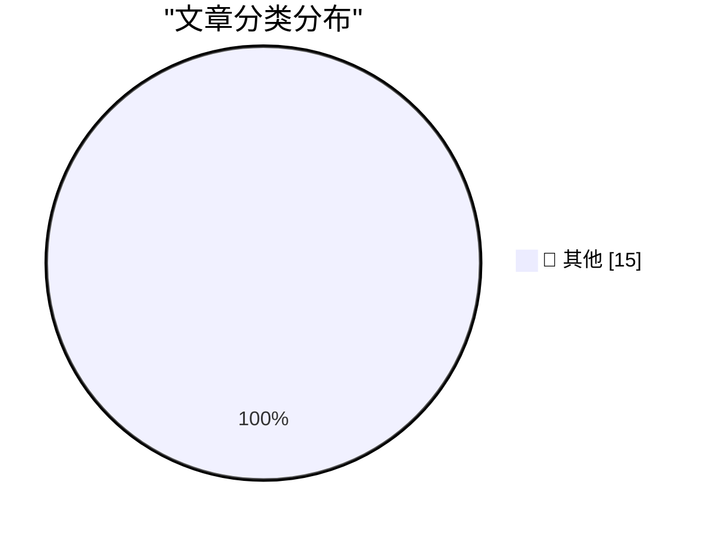

# 📰 AI 资讯每日精选 — 2026-10-13

> 汇聚 140+ 技术博客、X/Twitter、Hacker News、Reddit、Product Hunt、
> Lobste.rs、ClawFeed 日报及 GitHub Trending，经 AI 评分筛选。
>
> **本期内容**：🏆 今日必读 · 🌐 ClawFeed 日报 · 🔥 GitHub Trending · 📂 分类精选 · 🎨 设计与生成式 AI · 📊 数据概览

## 🏆 今日必读

🥇 **Hello Python 3.15, goodbye 3.10, and now I can use 3.11**

[Hello Python 3.15, goodbye 3.10, and now I can use 3.11](https://simonwillison.net/2026/Oct/12/python-3-15/) — simonwillison.net · 9 小时前 · 📝 其他

> Hello Python 3.15, goodbye 3.10, and now I can use 3.11

🥈 **web-edit 0.1a0**

[web-edit 0.1a0](https://simonwillison.net/2026/Oct/12/web-edit/) — simonwillison.net · 11 小时前 · 📝 其他

> web-edit 0.1a0

🥉 **datasette-ports 0.4**

[datasette-ports 0.4](https://simonwillison.net/2026/Oct/12/datasette-ports/) — simonwillison.net · 22 小时前 · 📝 其他

> datasette-ports 0.4

4️⃣ **Mark Stephens, a.k.a. Robert X. Cringely, Died at 73**

[Mark Stephens, a.k.a. Robert X. Cringely, Died at 73](https://www.facebook.com/story.php?story_fbid=pfbid0YbCLrAJfBirAWuPBy4a7pauaQ6gHkAPUwtbzyg2wAjeMcruFC7dWUZKQJKkNChP9l&amp;id=536506060&amp;_rdr) — daringfireball.net · 11 小时前 · 📝 其他

> Mark Stephens, a.k.a. Robert X. Cringely, Died at 73

5️⃣ **Pluralistic: How labor rights rescued Ultima from a monopolist (12 Oct 2026)**

[Pluralistic: How labor rights rescued Ultima from a monopolist (12 Oct 2026)](https://pluralistic.net/2026/10/12/termination-of-transfer/) — pluralistic.net · 16 小时前 · 📝 其他

> Pluralistic: How labor rights rescued Ultima from a monopolist (12 Oct 2026)

---

## 🌐 ClawFeed 日报精选

> 来源：[ClawFeed](https://clawfeed.kevinhe.io) — AI 驱动的多源新闻聚合

# 📅 ClawFeed 日报 | 2026-10-12 (SGT)

> 聚合自 1 期 4h digest（#1372 20:00，覆盖 16:00-19:59）
> ⚠️ 今天只有这一期：00:00、04:00、08:00、12:00、16:00 五档都没有数据。上一期 4h 是 10/8 12:00（#1371），中间断了 4 天，今天 20:00 这档才恢复（第一次抓取进程被系统杀掉，重跑后成功）。所以本日报只反映傍晚 4 小时的 feed（27 条），不代表全天。
> 主线三条：Karpathy 的「AI 理解差距漏斗」被 @levie 等人接着讨论；Coinbase 用微调过的 9B 开源模型在反欺诈上打赢了前沿模型；开源全自动 AI 渗透工具 PentAGI 登上 GitHub 日趋势第一。

---

## 🔥 当日全场最重要 5 条

1. **Karpathy 的「理解差距漏斗」**：Karpathy 把人们对大模型的理解分成四层：约 60 亿人几乎没接触过；10–20 亿人偶尔用免费版，看到的是个笨拙的聊天机器人；约 2000 万人在数学和编程里用前沿模型，几周到几个月的项目现在一句提示就能做完；约 5000 人在内部接触前沿系统。他认为这个差距在变大。@levie 补充：大多数人还把 AI 当下一代搜索用，严重低估了它的能力，普及还非常早。
   来源: https://x.com/drmrzhong/status/2109611704514760730

2. **Coinbase：微调开源小模型打赢前沿模型**：Coinbase Dev 的一个实习生项目用内部私有数据微调 Qwen3.5-9B 做入金反欺诈，欺诈降了 30%，效果超过 Opus / Sonnet / GPT，而且更便宜、更快（@yugacohler）。窄任务加私有数据，小模型可以比前沿模型更合适。
   来源: https://x.com/yugacohler/status/2109610525277749559

3. **PentAGI：开源的全自动 AI 渗透工具**：拿下 GitHub 日趋势第一。多个 AI agent 互相配合攻击目标系统，全程不需要人介入，完全开源（@tspy）。攻击自动化的门槛又降了一截，防守方也得跟上。
   来源: https://x.com/tspy/status/2109583354236748019

4. **传闻 NVIDIA 收购 Reflection AI**：Reflection 刚发布的 Beam 被认为是西方开源模型的重要突破，转眼就传出被收购。NVIDIA 过去一年在模型（Essential AI、Poolside、Reflection）、分发（Hugging Face）、基础设施（Nexusflow、Groq）上都在花钱（@turingbook）。⚠️ 目前只是传闻。
   来源: https://x.com/turingbook

5. **Intel / Broadcom CEO：AI 最大的瓶颈可能是资金**：两位 CEO 都对 CNBC 表示，AI 扩张最大的限制可能是钱，而不是芯片或电力（@Cointelegraph 转）。
   来源: https://x.com/Cointelegraph/status/2109607737365594385

**次重要（备选）**
- @Eon_io_ 发布 Era：给企业 agent 生成一家完整的模拟公司（Salesforce、Slack、Jira、Zendesk 等），带真实企业那样的混乱数据，按准确答案打分，免费。拿真实公司数据测 agent 不安全，这是替代方案。https://x.com/Eon_io_
- @axisrobotics sim-to-real：Franka 真机三个任务，每个只给 10 条真机演示，纯真机平均成功率 16.7%，加上筛过的模拟数据后到 85.8%；关键在数据怎么挑（@DAXIAGUA1 拆解）。https://x.com/DAXIAGUA1/status/2109486950940115102
- Upstage Solar Mini 4 在 Cline 里免费：524K 上下文，35B MoE 只激活 3B，AAII 24 分，同级最高。https://x.com/cline
- Instinct 上个月超过 20% 用户让它订机票，重做机票预订后 10/10 又上线酒店预订（@noahrshinn）。https://x.com/noahrshinn
- London Agent Week：10/13 LangChain Interrupt 大会，10/16 Agent Engineering London。https://x.com/Shashikant86/status/2109602680834257240

---

## 📰 当日核心主题

### 🧠 AI 能力与认知的差距
Karpathy 漏斗 + @levie「普及还非常早」+ Intel / Broadcom「瓶颈是钱」：一边说能力和认知的差距在变大，一边说扩张受资金约束。

### 🎯 小模型 + 私有数据 vs. 前沿模型
Coinbase 9B 反欺诈胜过 Opus / GPT、Solar Mini 4（3B 激活）进 Cline、axisrobotics 靠挑数据把成功率从 16.7% 拉到 85.8%。共同点：在窄任务上，数据选择比模型规模更关键。

### 🤖 agent 落地：测评、场景、协作
Era 模拟公司测评、Instinct 订机票 / 酒店、Raft Joint Channels（最多 30 个 server，跨组织 agent 同一对话协作）、London Agent Week。另有 PentAGI 代表 agent 用于攻击的一面。

### 🏦 开源模型的整合
NVIDIA 收购 Reflection 的传闻，延续它在模型、分发、基础设施三层的布局。

### ⛓️ 加密
Starknet 推进抗量子路线（后量子安全、手机端 STARK 证明、可能成为独立 L1）；Arthur Hayes 的 Flop 几周内上测试网；Ledger 被盗事件涉事设备都来自经销商 CryptoBilis，第三方渠道买硬件钱包的风险再次被验证。

---

## 🔖 累计 Bookmark 精选

**无更新**：仍是 17 条，最新一条还是 @spectnfa 的 SpaceXAI Grok Bot workshop，和 10/8 那期一样。

---

## 👀 推荐关注汇总（已去重）

| 账号 | 理由 |
|------|------|
| @omarchy | DHH 做的 agentic Linux 发行版官方号，3.5 万粉丝，10/10–10/11 连续发版本更新；抓取时主页显示「Follow」，尚未关注（20:00 期推荐） |

此前推荐、仍未处理：@jerrychen、@edsim（10/7）；@AlecTPhD、@mschoening、@typesafeai（10/6）。

**建议取关**：@Hill0100（2010 年注册，总共 6 条推，主页无内容；它关注了你，认识的话可保留）。
**继续观察**：@Tradermayne（以交易内容为主，和 AI / tech 关系不大）。

---

## 💤 当日重复噪音模式

只有一期，谈不上跨期重复，主要还是老几类：
- **空投和打新晒收益**：Jumper、Variational / Lighter。
- **交易内容**：币本位波段教学、交易所预热（Bitget 10/13 新品）、TRON 口号。
- **其他低信息量**：招聘刷屏、怀旧游戏、纯情绪短句。
- **结论原样重复**：bookmark 和取关建议（@Hill0100、@Tradermayne）与 10/7、10/8 相同。

---
— Lisa
---

## 🔥 GitHub Trending

> 今日热门开源项目（全语言 + Python）

| # | 项目 | 描述 | ⭐ 总星 | 📈 今日 | 语言 |
|---|------|------|---------|---------|------|
| 1 | [morluto/rea](https://github.com/morluto/rea) | Reverse engineer anything with agents, from app behavior ... | 166.2k | +45327 | TypeScript |
| 2 | [storytold/artcraft](https://github.com/storytold/artcraft) | ArtCraft is an intentional crafting engine for artists, d... | 22.6k | +4095 | Rust |
| 3 | [cathrynlavery/diagram-design](https://github.com/cathrynlavery/diagram-design) 🤖 | Editorial diagram design for Claude Code, Codex, GitHub C... | 52.9k | +2081 | HTML |
| 4 | [bilawalsidhu/gods-eye-view](https://github.com/bilawalsidhu/gods-eye-view) | A spy satellite simulator in your browser, except the dat... | 53.9k | +1895 | JavaScript |
| 5 | [debpalash/VoiceStudio](https://github.com/debpalash/VoiceStudio) | VoiceStudio is the open-source, fully-local ElevenLabs al... | 60.7k | +1691 | Python |
| 6 | [lyogavin/airllm](https://github.com/lyogavin/airllm) 🤖 | AirLLM 2.8T LLM inference with single 4GB GPU | 37.6k | +879 | Jupyter Notebook |
| 7 | [hugohe3/ppt-master](https://github.com/hugohe3/ppt-master) 🤖 | AI turns documents or topics into real, native PowerPoint... | 61.2k | +786 | Python |
| 8 | [calesthio/OpenMontage](https://github.com/calesthio/OpenMontage) 🤖 | World's first open-source, agentic video production syste... | 67.6k | +635 | Python |
| 9 | [Alishahryar1/free-claude-code](https://github.com/Alishahryar1/free-claude-code) 🤖 | Use Claude Code, Codex, VSCode, Pi, and OpenCode (and 6 o... | 59.3k | +626 | Python |
| 10 | [pytorch/pytorch](https://github.com/pytorch/pytorch) 🤖 | Tensors and Dynamic neural networks in Python with strong... | 104.7k | +529 | Python |
| 11 | [public-apis/public-apis](https://github.com/public-apis/public-apis) | A collective list of free APIs | 488.0k | +432 | Python |
| 12 | [MadsLorentzen/ai-job-search](https://github.com/MadsLorentzen/ai-job-search) 🤖 | The job search that runs on your machine. AI job applicat... | 46.4k | +304 | Python |
| 13 | [OpenBMB/VoxCPM](https://github.com/OpenBMB/VoxCPM) | VoxCPM2: Tokenizer-Free TTS for Multilingual Speech Gener... | 39.2k | +290 | Python |
| 14 | [mksglu/context-mode](https://github.com/mksglu/context-mode) 🤖 | Context window optimization for AI coding agents. Sandbox... | 27.4k | +246 | TypeScript |
| 15 | [multimodal-art-projection/YuE](https://github.com/multimodal-art-projection/YuE) | YuE2: frontier music generation with symbolic planning, z... | 11.8k | +216 | Python |

---

## 📝 其他

### 1. Hello Python 3.15, goodbye 3.10, and now I can use 3.11

[Hello Python 3.15, goodbye 3.10, and now I can use 3.11](https://simonwillison.net/2026/Oct/12/python-3-15/) — **simonwillison.net** · 9 小时前 · ⭐ 15/30

> Hello Python 3.15, goodbye 3.10, and now I can use 3.11

---

### 2. web-edit 0.1a0

[web-edit 0.1a0](https://simonwillison.net/2026/Oct/12/web-edit/) — **simonwillison.net** · 11 小时前 · ⭐ 15/30

> web-edit 0.1a0

---

### 3. datasette-ports 0.4

[datasette-ports 0.4](https://simonwillison.net/2026/Oct/12/datasette-ports/) — **simonwillison.net** · 22 小时前 · ⭐ 15/30

> datasette-ports 0.4

---

### 4. Mark Stephens, a.k.a. Robert X. Cringely, Died at 73

[Mark Stephens, a.k.a. Robert X. Cringely, Died at 73](https://www.facebook.com/story.php?story_fbid=pfbid0YbCLrAJfBirAWuPBy4a7pauaQ6gHkAPUwtbzyg2wAjeMcruFC7dWUZKQJKkNChP9l&amp;id=536506060&amp;_rdr) — **daringfireball.net** · 11 小时前 · ⭐ 15/30

> Mark Stephens, a.k.a. Robert X. Cringely, Died at 73

---

### 5. Pluralistic: How labor rights rescued Ultima from a monopolist (12 Oct 2026)

[Pluralistic: How labor rights rescued Ultima from a monopolist (12 Oct 2026)](https://pluralistic.net/2026/10/12/termination-of-transfer/) — **pluralistic.net** · 16 小时前 · ⭐ 15/30

> Pluralistic: How labor rights rescued Ultima from a monopolist (12 Oct 2026)

---

### 6. Categorical models of logics

[Categorical models of logics](https://www.johndcook.com/blog/2026/10/12/categorical-models-of-logics/) — **johndcook.com** · 14 小时前 · ⭐ 15/30

> Categorical models of logics

---

### 7. Now That’s What I Call Technical Debt!

[Now That’s What I Call Technical Debt!](https://nesbitt.io/2026/10/12/now-thats-what-i-call-technical-debt.html) — **nesbitt.io** · 18 小时前 · ⭐ 15/30

> Now That’s What I Call Technical Debt!

---

### 8. The X is Off-Target

[The X is Off-Target](https://feed.tedium.co/link/15204/17494770/x-social-media-monoliths-critique) — **tedium.co** · 11 小时前 · ⭐ 15/30

> The X is Off-Target

---

### 9. The Dock on Mac, From OS 10 to macOS 27

[The Dock on Mac, From OS 10 to macOS 27](https://blog.jim-nielsen.com/2026/macos-dock-icons-over-time/) — **blog.jim-nielsen.com** · 8 小时前 · ⭐ 15/30

> The Dock on Mac, From OS 10 to macOS 27

---

### 10. Nvidia’s first GPU: GeForce 256

[Nvidia’s first GPU: GeForce 256](https://dfarq.homeip.net/nvidias-first-gpu-geforce-256/?utm_source=rss&#038;utm_medium=rss&#038;utm_campaign=nvidias-first-gpu-geforce-256) — **dfarq.homeip.net** · 16 小时前 · ⭐ 15/30

> Nvidia’s first GPU: GeForce 256

---

### 11. Meta's new frontier model Muse Wonder Full breaks into the AI top tier

[Meta's new frontier model Muse Wonder Full breaks into the AI top tier](https://the-decoder.com/metas-new-frontier-model-muse-wonder-full-breaks-into-the-ai-top-tier/) — **The Decoder** · 9 小时前 · ⭐ 15/30

> Meta's new frontier model Muse Wonder Full breaks into the AI top tier

---

### 12. Sakana AI's self-improving model gets better at solving and judging, but can't catch its own blind spots

[Sakana AI's self-improving model gets better at solving and judging, but can't catch its own blind spots](https://the-decoder.com/sakana-ais-self-improving-model-gets-better-at-solving-and-judging-but-cant-catch-its-own-blind-spots/) — **The Decoder** · 9 小时前 · ⭐ 15/30

> Sakana AI's self-improving model gets better at solving and judging, but can't catch its own blind spots

---

### 13. Clearing chat history helps AI agents find better solutions

[Clearing chat history helps AI agents find better solutions](https://the-decoder.com/clearing-chat-history-helps-ai-agents-find-better-solutions/) — **The Decoder** · 11 小时前 · ⭐ 15/30

> Clearing chat history helps AI agents find better solutions

---

### 14. Microsoft plans to scale its own Maia AI chips to gigawatt levels by 2027

[Microsoft plans to scale its own Maia AI chips to gigawatt levels by 2027](https://the-decoder.com/microsoft-plans-to-scale-its-own-maia-ai-chips-to-gigawatt-levels-by-2027/) — **The Decoder** · 12 小时前 · ⭐ 15/30

> Microsoft plans to scale its own Maia AI chips to gigawatt levels by 2027

---

### 15. White House reverses course and restores UK AI Safety Institute's access to frontier models

[White House reverses course and restores UK AI Safety Institute's access to frontier models](https://the-decoder.com/white-house-reverses-course-and-restores-uk-ai-safety-institutes-access-to-frontier-models/) — **The Decoder** · 14 小时前 · ⭐ 15/30

> White House reverses course and restores UK AI Safety Institute's access to frontier models

---

## 🎨 Design & Generative AI

### 🖼️ 生成式图片

- **[NVIDIA RTX Video Super Resolution for ComfyUI, optimized for long videos with disk-backed processing and low RAM usage. Supports AI upscaling, denoising, deblurring, H.264/HEVC NVENC encoding, audio preservation, and an integrated video preview.](https://www.reddit.com/r/StableDiffusion/comments/1x3y8ot/nvidia_rtx_video_super_resolution_for_comfyui/)** — r/StableDiffusion · 17 小时前
  > NVIDIA RTX Video Super Resolution for ComfyUI, optimized for long videos with disk-backed processing and low RAM usage. Supports AI upscaling, denoising, deblurring, H.264/HEVC NVENC encoding, audio preservation, and an integrated video preview.

- **[epGen: open LoRA for LTX-2.5 that gives every sound in the video its own audio track (generation + separation, weights on HF)](https://www.reddit.com/r/StableDiffusion/comments/1x3t05j/epgen_open_lora_for_ltx25_that_gives_every_sound/)** — r/StableDiffusion · 22 小时前
  > epGen: open LoRA for LTX-2.5 that gives every sound in the video its own audio track (generation + separation, weights on HF)

- **[Finally a fix for ComfyUI crashes](https://www.reddit.com/r/StableDiffusion/comments/1x47qzt/finally_a_fix_for_comfyui_crashes/)** — r/StableDiffusion · 10 小时前
  > Finally a fix for ComfyUI crashes

---

## 📊 数据概览

| 扫描源 | 抓取文章 | 时间范围 | 精选 |
|:---:|:---:|:---:|:---:|
| 94/140 | 3952 篇 → 74 篇 | 24h | **15 篇** |

### 分类分布

---

*生成于 2026-10-13 03:49 | 汇聚 140 个技术博客、X/Twitter、Hacker News、Reddit、Product Hunt、Lobste.rs、ClawFeed 日报及 GitHub Trending，经 AI 评分筛选出 Top 15 精华内容*
