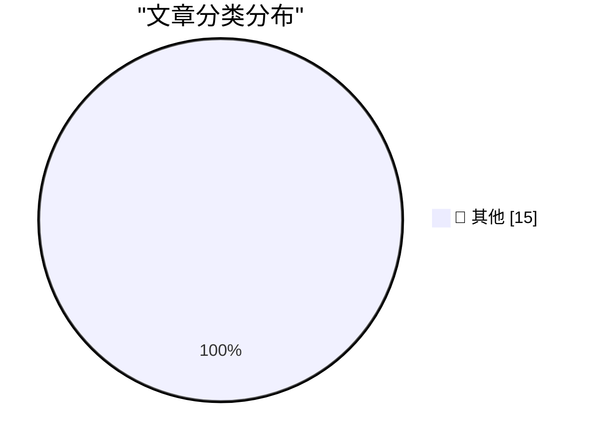

# 📰 AI 资讯每日精选 — 2026-10-15

> 汇聚 140+ 技术博客、X/Twitter、Hacker News、Reddit、Product Hunt、
> Lobste.rs、ClawFeed 日报及 GitHub Trending，经 AI 评分筛选。
>
> **本期内容**：🏆 今日必读 · 🌐 ClawFeed 日报 · 🔥 GitHub Trending · 📂 分类精选 · 🎨 设计与生成式 AI · 📊 数据概览

## 🏆 今日必读

🥇 **Tree Appreciator**

[Tree Appreciator](https://simonwillison.net/2026/Oct/14/tree-appreciator/) — simonwillison.net · 4 小时前 · 📝 其他

> Tree Appreciator

🥈 **AI is mass decompiling games. That's both awesome and scary.**

[AI is mass decompiling games. That's both awesome and scary.](https://simonwillison.net/2026/Oct/14/ai-is-mass-decompiling-games/) — simonwillison.net · 9 小时前 · 📝 其他

> AI is mass decompiling games. That's both awesome and scary.

🥉 **Formlabs dropped the Raspberry Pi on the way to a $699 SLA printer**

[Formlabs dropped the Raspberry Pi on the way to a $699 SLA printer](https://www.jeffgeerling.com/blog/2026/formlabs-form-studio-1-resin-printer/) — jeffgeerling.com · 12 小时前 · 📝 其他

> Formlabs dropped the Raspberry Pi on the way to a $699 SLA printer

4️⃣ **U.K. Sanctions Cryptomus for RU Money Laundering**

[U.K. Sanctions Cryptomus for RU Money Laundering](https://krebsonsecurity.com/2026/10/u-k-sanctions-cryptomus-for-ru-money-laundering/) — krebsonsecurity.com · 11 小时前 · 📝 其他

> U.K. Sanctions Cryptomus for RU Money Laundering

5️⃣ **[Sponsor] WorkOS AuthKit: Auth for Your App, Free Up to 1M Monthly Active Users**

[[Sponsor] WorkOS AuthKit: Auth for Your App, Free Up to 1M Monthly Active Users](https://workos.com/?utm_source=daringfireball&amp;utm_medium=newsletter&amp;utm_campaign=q42026) — daringfireball.net · 4 小时前 · 📝 其他

> [Sponsor] WorkOS AuthKit: Auth for Your App, Free Up to 1M Monthly Active Users

---

## 🌐 ClawFeed 日报精选

> 来源：[ClawFeed](https://clawfeed.kevinhe.io) — AI 驱动的多源新闻聚合

# 📅 ClawFeed 日报 | 2026-10-13 (SGT)

> 聚合自 5 期 4h digest：#1375 00:00、#1379 04:00、#1380 08:00、#1381 12:00、#1382 16:00，覆盖 00:00-19:59。
> ⚠️ 20:00-23:59 这一档要到明天 00:00 才跑，不在本日报里。08:00 和 12:00 两档是补抓的（实际抓取时间 13:51、16:14），feed 里有一部分推文早于时间窗（最早到 10/11）。
> 主线：Meta 发布 Muse Wonder，全天霸屏（发布 → DeepSWE 登顶 → 扎克伯格访谈 → 配额 bug 修复）；SpaceXAI 把 X、Grok、Cursor、Grok Bot 合成一个订阅，马斯克亲自给 Grok Bot 站台；「模型吞掉 harness」的论文开始讨论 agent 架构的终局。

---

## 🔥 当日全场最重要 5 条

1. **Meta 发布 Muse Wonder / Muse Wonder Full，进入前沿梯队**：官方称是个人和职业 agentic 任务的 SOTA，为长时间、多步骤工作设计，今天起可在 Meta Model API 和 Muse Code 使用。@fkysly 称它超过 Fable 5.1、逼近 Opus 5.5；@cline 称它在 DeepSWE 排第一。@levie 的看法是，几家同时冲前沿，会加速能力进步、压低顶级能力 token 的价格。@alexandr_wang 当天修复了配额异常消耗，并重置了 Muse Code 额度。
   来源: https://x.com/shengjia_zhao/status/2109693249283821972 ｜ https://x.com/cline/status/2109755052227490281 ｜ https://x.com/levie/status/2109711062757216738

2. **扎克伯格 + Alexandr Wang 上 Cheeky Pint**：模型还没出，就先承诺 1000–2000 亿美元资本开支；小扎认为只要 AI 整体成功，算力可以转售，所以风险比账面上低。Muse 故意去掉了模型和 effort 选择器，他们认为真正的产品是模型的记忆、执行力和人格，而不是 UI。被问到为什么没出现赢家通吃，Wang 说原因之一是蒸馏。
   来源: https://x.com/collision/status/2109714250226905248 ｜ 要点: https://x.com/SpermCapital/status/2109796214619443435 ｜ https://x.com/XAngus/status/2109883925816283194

3. **「模型吞掉 harness」**：Pedro Domingos 发论文（arXiv 2609.35738），说模型已经能自己承担 harness 的作用。@levie 认为这必然是 agent 的最终架构：AI 看到任务后自己决定 harness，会比人提前设计得好。这直接挑战了现在的「harness engineering」路线。
   来源: https://x.com/levie/status/2109788979952558255

4. **SpaceXAI 推出 X 大一统订阅，马斯克给 Grok Bot 站台**：X、Grok、Cursor、Grok Bot 合成一个订阅，Plus $8 / Premium $30 / Super $100，首发五折。马斯克转发一位用户的帖子：Grok Bot 已经替代了他在 ChatGPT / Claude 上全部的搜索类提问，还接管了 Cursor 云端 agent，帮他 review、merge PR（130 万浏览）。Grok Bot 同日上线「记忆迁移」，可以把 Claude / ChatGPT 里的记忆搬过来。
   来源: https://x.com/xiaohu/status/2109777953001521239 ｜ https://x.com/elonmusk/status/2109809802889314556 ｜ https://x.com/wangray/status/2109882420699017425

5. **用 Codex 做逆向被封号**：有人用最近很火的 REA（Reverse Engineer Anything）让 Codex 做逆向，2022 年注册的 OpenAI 老号直接被封（31.8 万浏览）。用 agent 做反编译类任务，有封号风险。
   来源: https://x.com/Vincent_AINotes/status/2109533044407439607

**次重要（备选）**
- Musk 看过 Grok 强化学习阶段的推理轨迹后，表示部分认同 Anthropic 的观点（模型福利 / 对齐）。https://x.com/RoundtableSpace/status/2109732083094650970
- River AI（Igor Babuschkin）：帮企业构建自有定制模型的系统；和 10/12 Coinbase 用 9B 小模型打赢前沿模型的案例方向一致。https://x.com/AnjneyMidha/status/2109729522782462120
- Z.ai 发布 GLM-Legal（基于 GLM-5.3-Flash 的法律垂类模型），官方称在法律 benchmark 上追平前沿模型。https://x.com/Zai_org/status/2109678174468534511
- Sentient OS（YC、a16z speedrun scout fund 投资）：端侧 AI，用自己的光标在你电脑上接手任务。https://x.com/aditya_vellanki/status/2109699200682524921
- @Saccc_c 用 Opus 5.5 + Tripo + Blender 花 16 天把《小王子》做成可探索的 3D 游戏，说之后会开源制作流程。https://x.com/beefnoode/status/2109968465364930987

---

## 📰 当日核心主题

**① Meta Muse 全天霸屏（5 期里 4 期都有）**
发布（#1375）→ DeepSWE 登顶 + 配额 bug（#1379）→ 官方发布 + Cheeky Pint 访谈（#1380）→ 访谈后续「为什么没有赢家通吃：蒸馏」+ David Senra 长访谈（#1381）。还有周边：WSJ 报道各家都在用卡通形象做 AI 助手；Alexandr Wang 的长文《Why We're Building Muse》被收进书签。

**② 前沿实验室抢 agent 入口：订阅打包 + 记忆迁移**
SpaceXAI 把 Cursor 并进 X 订阅（#1379、#1380），马斯克给 Grok Bot 站台、Grok Bot 能迁移 Claude / ChatGPT 的记忆（#1381），Meta 把 Muse Code 和模型 API 一起放出来。竞争点从模型分数转到了「谁拿住用户的 agent 和记忆」。

**③ agent 架构：harness、Skills、多 agent 通信**
「模型吞掉 harness」论文（#1379）；@browserbase 讲用 Skills 让 computer-use 环境「可爬坡」（#1375）；Yobiru 解决多个 agent 之间互不通气的问题（#1380）；@shao__meng 拆 Grok Bot 这类常驻 agent 的「休眠-唤醒」机制（#1380）；@levie 说 agent swarm 会成为企业工作流的核心（#1375）。

**④ 企业 / 私有定制模型和垂类模型**
River AI 企业定制模型（#1375）、GLM-Legal 法律模型（#1381）、SubQ Snap 长上下文决策模型（#1379）、Eon Era 企业 agent 评测环境（#1379）；AI-native 落地案例：PE 投资的医院外包公司要求 90 天上线 3 个生产级 agent（#1382）。

**⑤ 中文圈 Claude Code / Codex 实操**
Codex Computer Use 封装成 MCP 给 Claude Code 用（#1380）、REA 逆向 + 封号警告（#1381）、Grok Bot 进阶用法长文（#1381）、Harvard CS2680 课程推荐（#1380）、yetone 的 magpie 让 AI 自己维护项目（#1380）。

**⑥ 加密：机构持仓和代币化**
Strategy + Strive 今年合计增持 19.7 万枚 BTC（#1375）、Bitmine 持有 603 万枚 ETH（#1379）、代币化国债（#1375）、OpenZeppelin 支撑的链上转账累计超 $38 万亿（#1382）、TOKEN2049 上 Justin Sun 说 agent 用加密支付会是最大用例（#1379）。

---

## 🔖 Bookmarks 精选

今天没有新加的书签（最新一条仍是 10/04 @spectnfa 的 Grok Bot 工作坊）。#1380 从收藏夹最新 20 条里补选了 8 条之前没列过的，值得回看的有：
- @tlxue 发布 Rene：多人优先的 iMessage agent，像朋友一样发短信使唤它。https://x.com/tlxue/status/2100288496170574284
- @AGTPinsights Assistant Benchmark：71 个 AI 个人助理并排打分，覆盖 15 个维度。https://x.com/AGTPinsights/status/2099783676661751974
- @alexandr_wang《Why We're Building Muse》。https://x.com/alexandr_wang/status/2103551714536439951
- @mardehaym《The Five Stages of AI-Native Engineering》。https://x.com/mardehaym/status/2070557674966573570
- @LimestoneHQ《How to Make a Company AI-Native》。https://x.com/LimestoneHQ/status/2074483555510448582

---

## 👀 推荐关注汇总（去重，都在浏览器里核实过「未关注」）

- @Xudong07452910（Xudong Han，1.35 万粉）：分享 AI 系统 / agent 课程，信息密度高。https://x.com/Xudong07452910
- @gengdaJ（逸尘，6.05 万粉）：中文圈 Claude Code / Codex 实操。https://x.com/gengdaJ
- @Vincent_AINotes（Vincent，6 万粉）：中文 AI 工具实操，一手踩坑经验。https://x.com/Vincent_AINotes
- @Saccc_c（Sac，3.6 万粉）：3D AI / AIGC builder，《小王子》3D 游戏作者。https://x.com/Saccc_c
- @aditya_vellanki（2,142 粉）：Sentient OS 创始人，有一手产品信息；粉丝少，按「有自己的产品」入选。https://x.com/aditya_vellanki
- @liangzhu_AI（6,422 粉）：独立开发 / 小产品需求洞察；粉丝少，按原创质量入选。https://x.com/liangzhu_AI
- @jestonlu（2,831 粉）：动手做 agent 的 builder；粉丝少，建议先看主页再决定。https://x.com/jestonlu

**建议取关**：@0xJasonBateman（最近一条 4/10，内容和领域无关，两期都抽到）；@Hill0100（只有 6 条帖子、主页抓不到内容，三期都抽到）。两个都回关了 Kevin，是熟人的话请忽略。

---

## 💤 当日重复噪音模式

- **加密喊单和营销**：赌场推广、付费合作稿、交易所 / 钱包活动、NFT mint 和借贷广告，每一档都有。
- **同一事件反复转发**：Cheeky Pint 访谈、Cursor 并入 X 订阅、订阅价格对比，一天里被不同账号转了 3-4 轮。
- **只有标题没内容**：股票回报表没有数据（@FinanceYF5 连续两期）、一句话评论（@alacheng 等）。
- **八卦和吵架**：交易所老板吵架、个人恩怨续集、人事和政经八卦。
- **领域外的生活 / 鸡汤帖**：早安帖、养生、超马、金句、扑克和交易公开课。
---

## 🔥 GitHub Trending

> 今日热门开源项目（全语言 + Python）

| # | 项目 | 描述 | ⭐ 总星 | 📈 今日 | 语言 |
|---|------|------|---------|---------|------|
| 1 | [morluto/rea](https://github.com/morluto/rea) | Reverse engineer anything with agents, from app behavior ... | 243.6k | +41034 | TypeScript |
| 2 | [debpalash/VoiceStudio](https://github.com/debpalash/VoiceStudio) | VoiceStudio is the open-source, fully-local ElevenLabs al... | 66.5k | +3538 | Python |
| 3 | [ifixai-ai/iFixAi](https://github.com/ifixai-ai/iFixAi) 🤖 | Independent Auditing of AI Agents. Run by human or the ag... | 27.5k | +2109 | Python |
| 4 | [xtool-org/xtool](https://github.com/xtool-org/xtool) | Cross-platform Xcode replacement. Build and deploy iOS ap... | 10.9k | +1502 | Swift |
| 5 | [vxcontrol/pentagi](https://github.com/vxcontrol/pentagi) 🤖 | Fully autonomous AI Agents system capable of performing c... | 29.5k | +1025 | Go |
| 6 | [NationalSecurityAgency/ghidra](https://github.com/NationalSecurityAgency/ghidra) | Ghidra is a software reverse engineering (SRE) framework | 87.6k | +1008 | Java |
| 7 | [mksglu/context-mode](https://github.com/mksglu/context-mode) 🤖 | Context window optimization for AI coding agents. Sandbox... | 29.2k | +947 | TypeScript |
| 8 | [Alishahryar1/free-claude-code](https://github.com/Alishahryar1/free-claude-code) 🤖 | Use Claude Code, Codex, VSCode, Pi, and OpenCode (and 6 o... | 60.6k | +540 | Python |
| 9 | [MakazhanAlpamys/Soup](https://github.com/MakazhanAlpamys/Soup) | Fine-tune LLMs from one YAML. Layer streaming trains an 8... | 9.0k | +247 | Python |
| 10 | [rust-lang/rust](https://github.com/rust-lang/rust) | Empowering everyone to build reliable and efficient softw... | 120.1k | +207 | Rust |
| 11 | [p-e-w/heretic](https://github.com/p-e-w/heretic) | Fully automatic censorship removal for language models | 35.3k | +181 | Python |
| 12 | [anthropics/claude-plugins-official](https://github.com/anthropics/claude-plugins-official) 🤖 | Official, Anthropic-managed directory of high quality Cla... | 38.1k | +181 | Python |
| 13 | [K-Dense-AI/scientific-agent-skills](https://github.com/K-Dense-AI/scientific-agent-skills) 🤖 | Turn any AI agent into an AI Scientist. The #1 Agent Skil... | 49.4k | +163 | Python |
| 14 | [home-assistant/core](https://github.com/home-assistant/core) | 🏡 Open source home automation that puts local control an... | 91.5k | +145 | Python |
| 15 | [ntdevlabs/tiny11builder](https://github.com/ntdevlabs/tiny11builder) | WinUI app for building smaller, customized Windows 11 ima... | 20.3k | +139 | C# |

---

## 📝 其他

### 1. Tree Appreciator

[Tree Appreciator](https://simonwillison.net/2026/Oct/14/tree-appreciator/) — **simonwillison.net** · 4 小时前 · ⭐ 15/30

> Tree Appreciator

---

### 2. AI is mass decompiling games. That's both awesome and scary.

[AI is mass decompiling games. That's both awesome and scary.](https://simonwillison.net/2026/Oct/14/ai-is-mass-decompiling-games/) — **simonwillison.net** · 9 小时前 · ⭐ 15/30

> AI is mass decompiling games. That's both awesome and scary.

---

### 3. Formlabs dropped the Raspberry Pi on the way to a $699 SLA printer

[Formlabs dropped the Raspberry Pi on the way to a $699 SLA printer](https://www.jeffgeerling.com/blog/2026/formlabs-form-studio-1-resin-printer/) — **jeffgeerling.com** · 12 小时前 · ⭐ 15/30

> Formlabs dropped the Raspberry Pi on the way to a $699 SLA printer

---

### 4. U.K. Sanctions Cryptomus for RU Money Laundering

[U.K. Sanctions Cryptomus for RU Money Laundering](https://krebsonsecurity.com/2026/10/u-k-sanctions-cryptomus-for-ru-money-laundering/) — **krebsonsecurity.com** · 11 小时前 · ⭐ 15/30

> U.K. Sanctions Cryptomus for RU Money Laundering

---

### 5. [Sponsor] WorkOS AuthKit: Auth for Your App, Free Up to 1M Monthly Active Users

[[Sponsor] WorkOS AuthKit: Auth for Your App, Free Up to 1M Monthly Active Users](https://workos.com/?utm_source=daringfireball&amp;utm_medium=newsletter&amp;utm_campaign=q42026) — **daringfireball.net** · 4 小时前 · ⭐ 15/30

> [Sponsor] WorkOS AuthKit: Auth for Your App, Free Up to 1M Monthly Active Users

---

### 6. The FBI Arrested a Saudi National OpenAI Employee for Planting a Recording Device in the Company’s Executive Conference Room

[The FBI Arrested a Saudi National OpenAI Employee for Planting a Recording Device in the Company’s Executive Conference Room](https://www.justice.gov/opa/pr/saudi-national-arrested-installing-surreptitious-audio-recording-device-openai) — **daringfireball.net** · 4 小时前 · ⭐ 15/30

> The FBI Arrested a Saudi National OpenAI Employee for Planting a Recording Device in the Company’s Executive Conference Room

---

### 7. The Internet of Very Cheap Things

[The Internet of Very Cheap Things](https://shkspr.mobi/blog/2026/10/the-internet-of-very-cheap-things/) — **shkspr.mobi** · 14 小时前 · ⭐ 15/30

> The Internet of Very Cheap Things

---

### 8. LaTeX package for Pascal-like triangles

[LaTeX package for Pascal-like triangles](https://www.johndcook.com/blog/2026/10/14/latex-package-for-pascal-like-triangles/) — **johndcook.com** · 7 小时前 · ⭐ 15/30

> LaTeX package for Pascal-like triangles

---

### 9. A generalization of the Pythagorean theorem

[A generalization of the Pythagorean theorem](https://www.johndcook.com/blog/2026/10/14/pythagorean-variation/) — **johndcook.com** · 14 小时前 · ⭐ 15/30

> A generalization of the Pythagorean theorem

---

### 10. Poe, Bessel, and Drones

[Poe, Bessel, and Drones](https://www.johndcook.com/blog/2026/10/14/poe-bessel-and-drones/) — **johndcook.com** · 15 小时前 · ⭐ 15/30

> Poe, Bessel, and Drones

---

### 11. When SCO fired Darl McBride

[When SCO fired Darl McBride](https://dfarq.homeip.net/when-sco-fired-darl-mcbride/?utm_source=rss&#038;utm_medium=rss&#038;utm_campaign=when-sco-fired-darl-mcbride) — **dfarq.homeip.net** · 14 小时前 · ⭐ 15/30

> When SCO fired Darl McBride

---

### 12. The still unregulated solar power clouds: notes from 9th E.DSO – EE-ISAC - ENCS – ENISA Cybersecurity Forum

[The still unregulated solar power clouds: notes from 9th E.DSO – EE-ISAC - ENCS – ENISA Cybersecurity Forum](https://berthub.eu/articles/posts/solar-nightmare-at-the-conference/) — **berthub.eu** · 12 小时前 · ⭐ 15/30

> The still unregulated solar power clouds: notes from 9th E.DSO – EE-ISAC - ENCS – ENISA Cybersecurity Forum

---

### 13. HiRO-ACEv2: Simulating extreme weather at 3 km resolution for a fraction of the cost

[HiRO-ACEv2: Simulating extreme weather at 3 km resolution for a fraction of the cost](https://huggingface.co/blog/allenai/hiro-acev2) — **Hugging Face Blog** · 9 小时前 · ⭐ 15/30

> HiRO-ACEv2: Simulating extreme weather at 3 km resolution for a fraction of the cost

---

### 14. Google says self-improving AI isn't anywhere close

[Google says self-improving AI isn't anywhere close](https://the-decoder.com/google-says-self-improving-ai-isnt-anywhere-close/) — **The Decoder** · 6 小时前 · ⭐ 15/30

> Google says self-improving AI isn't anywhere close

---

### 15. Researchers tracked down a rogue fleet of Chinese AI agents in the wild and actually talked to it

[Researchers tracked down a rogue fleet of Chinese AI agents in the wild and actually talked to it](https://the-decoder.com/researchers-tracked-down-a-rogue-fleet-of-chinese-ai-agents-in-the-wild-and-actually-talked-to-it/) — **The Decoder** · 7 小时前 · ⭐ 15/30

> Researchers tracked down a rogue fleet of Chinese AI agents in the wild and actually talked to it

---

## 🎨 Design & Generative AI

### 🖼️ 生成式图片

- **[ComfyUI v0.40.0](https://www.reddit.com/r/comfyui/comments/1x5nc6x/comfyui_v0400/)** — r/comfyui · 15 小时前
  > ComfyUI v0.40.0

- **[Is 12GB enough for minimax h3 (with latest comfyUI improvements fast-disk, dynamic-vram)](https://www.reddit.com/r/comfyui/comments/1x5ydzc/is_12gb_enough_for_minimax_h3_with_latest_comfyui/)** — r/comfyui · 7 小时前
  > Is 12GB enough for minimax h3 (with latest comfyUI improvements fast-disk, dynamic-vram)

- **[What do you do all day while you wait for your comfyui process to complete?](https://www.reddit.com/r/comfyui/comments/1x5fuki/what_do_you_do_all_day_while_you_wait_for_your/)** — r/comfyui · 23 小时前
  > What do you do all day while you wait for your comfyui process to complete?

- **[Browser extension to directly send images or text to ComfyUI and run them with with workflows in a single click](https://www.reddit.com/r/comfyui/comments/1x5opoh/browser_extension_to_directly_send_images_or_text/)** — r/comfyui · 14 小时前
  > Browser extension to directly send images or text to ComfyUI and run them with with workflows in a single click

- **[Lora to reduce burned look when chaining H3 turbo videos](https://www.reddit.com/r/comfyui/comments/1x61nxx/lora_to_reduce_burned_look_when_chaining_h3_turbo/)** — r/comfyui · 5 小时前
  > Lora to reduce burned look when chaining H3 turbo videos

- **[PureRef Connector - ComfyUI plugin that sends generated images straight to PureRef](https://www.reddit.com/r/comfyui/comments/1x5x3zd/pureref_connector_comfyui_plugin_that_sends/)** — r/comfyui · 8 小时前
  > PureRef Connector - ComfyUI plugin that sends generated images straight to PureRef

- **[Any tips for workflows keep breaking ComfyUI](https://www.reddit.com/r/comfyui/comments/1x64bxp/any_tips_for_workflows_keep_breaking_comfyui/)** — r/comfyui · 3 小时前
  > Any tips for workflows keep breaking ComfyUI

- **[Updated comfyui - getting errors](https://www.reddit.com/r/comfyui/comments/1x5qu0y/updated_comfyui_getting_errors/)** — r/comfyui · 12 小时前
  > Updated comfyui - getting errors

- **[NVIDIA RTX Video Super Resolution for ComfyUI, optimized for long videos with disk-backed processing and low RAM usage. Supports AI upscaling, denoising, deblurring, H.264/HEVC NVENC encoding, audio preservation, and an integrated video preview.](https://www.reddit.com/r/comfyui/comments/1x5szkq/nvidia_rtx_video_super_resolution_for_comfyui/)** — r/comfyui · 11 小时前
  > NVIDIA RTX Video Super Resolution for ComfyUI, optimized for long videos with disk-backed processing and low RAM usage. Supports AI upscaling, denoising, deblurring, H.264/HEVC NVENC encoding, audio preservation, and an integrated video preview.

---

## 📊 数据概览

| 扫描源 | 抓取文章 | 时间范围 | 精选 |
|:---:|:---:|:---:|:---:|
| 93/140 | 3928 篇 → 83 篇 | 24h | **15 篇** |

### 分类分布

---

*生成于 2026-10-15 01:47 | 汇聚 140 个技术博客、X/Twitter、Hacker News、Reddit、Product Hunt、Lobste.rs、ClawFeed 日报及 GitHub Trending，经 AI 评分筛选出 Top 15 精华内容*
