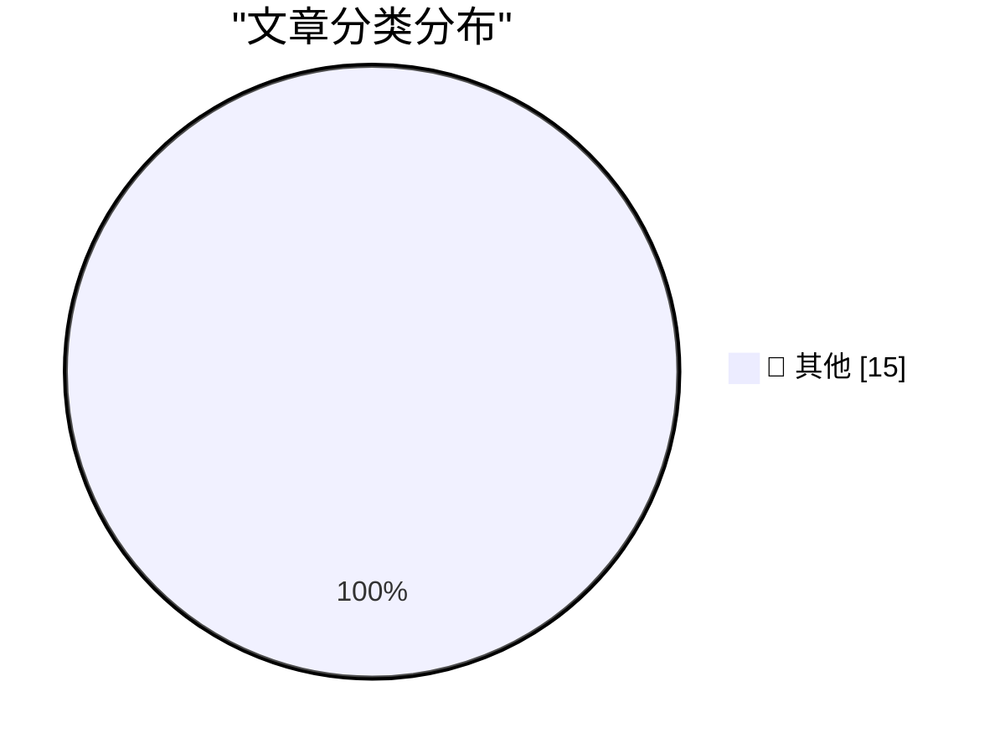

# 📰 AI 资讯每日精选 — 2026-10-16

> 汇聚 140+ 技术博客、X/Twitter、Hacker News、Reddit、Product Hunt、
> Lobste.rs、ClawFeed 日报及 GitHub Trending，经 AI 评分筛选。
>
> **本期内容**：🏆 今日必读 · 🌐 ClawFeed 日报 · 🔥 GitHub Trending · 📂 分类精选 · 🎨 设计与生成式 AI · 📊 数据概览

## 🏆 今日必读

🥇 **Chirp Pong**

[Chirp Pong](https://simonwillison.net/2026/Oct/15/chirp-pong/) — simonwillison.net · 5 小时前 · 📝 其他

> Chirp Pong

🥈 **Anthropic tells investors quarterly revenue up nearly 50% to $16.8bn ahead of IPO**

[Anthropic tells investors quarterly revenue up nearly 50% to $16.8bn ahead of IPO](https://simonwillison.net/2026/Oct/15/anthropic-tells-investors/) — simonwillison.net · 12 小时前 · 📝 其他

> Anthropic tells investors quarterly revenue up nearly 50% to $16.8bn ahead of IPO

🥉 **★ Initial Thoughts on This Week’s New Apple TV 4K (4th Generation) and HomePod Mini 2**

[★ Initial Thoughts on This Week’s New Apple TV 4K (4th Generation) and HomePod Mini 2](https://daringfireball.net/2026/10/thoughts_on_new_apple_tv_4k_and_homepod_mini_2) — daringfireball.net · 19 分钟前 · 📝 其他

> ★ Initial Thoughts on This Week’s New Apple TV 4K (4th Generation) and HomePod Mini 2

4️⃣ **Secret Documents Reveal Donors Behind $330 Million for Trump’s Ballroom — Apple and Nvidia Top the List at $25 Million Each**

[Secret Documents Reveal Donors Behind $330 Million for Trump’s Ballroom — Apple and Nvidia Top the List at $25 Million Each](https://www.washingtonpost.com/investigations/2026/10/15/secret-documents-reveal-donors-behind-330-million-trumps-ballroom/) — daringfireball.net · 9 小时前 · 📝 其他

> Secret Documents Reveal Donors Behind $330 Million for Trump’s Ballroom — Apple and Nvidia Top the List at $25 Million Each

5️⃣ **Pluralistic: Expedia amazoned hotel rooms (15 Oct 2026)**

[Pluralistic: Expedia amazoned hotel rooms (15 Oct 2026)](https://pluralistic.net/2026/10/15/enshittipedia/) — pluralistic.net · 14 小时前 · 📝 其他

> Pluralistic: Expedia amazoned hotel rooms (15 Oct 2026)

---

## 🌐 ClawFeed 日报精选

> 来源：[ClawFeed](https://clawfeed.kevinhe.io) — AI 驱动的多源新闻聚合

# 📅 ClawFeed 日报 | 2026-10-13 (SGT)

> 聚合自 5 期 4h digest：#1375 00:00、#1379 04:00、#1380 08:00、#1381 12:00、#1382 16:00，覆盖 00:00-19:59。
> ⚠️ 20:00-23:59 这一档要到明天 00:00 才跑，不在本日报里。08:00 和 12:00 两档是补抓的（实际抓取时间 13:51、16:14），feed 里有一部分推文早于时间窗（最早到 10/11）。
> 主线：Meta 发布 Muse Wonder，全天霸屏（发布 → DeepSWE 登顶 → 扎克伯格访谈 → 配额 bug 修复）；SpaceXAI 把 X、Grok、Cursor、Grok Bot 合成一个订阅，马斯克亲自给 Grok Bot 站台；「模型吞掉 harness」的论文开始讨论 agent 架构的终局。

---

## 🔥 当日全场最重要 5 条

1. **Meta 发布 Muse Wonder / Muse Wonder Full，进入前沿梯队**：官方称是个人和职业 agentic 任务的 SOTA，为长时间、多步骤工作设计，今天起可在 Meta Model API 和 Muse Code 使用。@fkysly 称它超过 Fable 5.1、逼近 Opus 5.5；@cline 称它在 DeepSWE 排第一。@levie 的看法是，几家同时冲前沿，会加速能力进步、压低顶级能力 token 的价格。@alexandr_wang 当天修复了配额异常消耗，并重置了 Muse Code 额度。
   来源: https://x.com/shengjia_zhao/status/2109693249283821972 ｜ https://x.com/cline/status/2109755052227490281 ｜ https://x.com/levie/status/2109711062757216738

2. **扎克伯格 + Alexandr Wang 上 Cheeky Pint**：模型还没出，就先承诺 1000–2000 亿美元资本开支；小扎认为只要 AI 整体成功，算力可以转售，所以风险比账面上低。Muse 故意去掉了模型和 effort 选择器，他们认为真正的产品是模型的记忆、执行力和人格，而不是 UI。被问到为什么没出现赢家通吃，Wang 说原因之一是蒸馏。
   来源: https://x.com/collision/status/2109714250226905248 ｜ 要点: https://x.com/SpermCapital/status/2109796214619443435 ｜ https://x.com/XAngus/status/2109883925816283194

3. **「模型吞掉 harness」**：Pedro Domingos 发论文（arXiv 2609.35738），说模型已经能自己承担 harness 的作用。@levie 认为这必然是 agent 的最终架构：AI 看到任务后自己决定 harness，会比人提前设计得好。这直接挑战了现在的「harness engineering」路线。
   来源: https://x.com/levie/status/2109788979952558255

4. **SpaceXAI 推出 X 大一统订阅，马斯克给 Grok Bot 站台**：X、Grok、Cursor、Grok Bot 合成一个订阅，Plus $8 / Premium $30 / Super $100，首发五折。马斯克转发一位用户的帖子：Grok Bot 已经替代了他在 ChatGPT / Claude 上全部的搜索类提问，还接管了 Cursor 云端 agent，帮他 review、merge PR（130 万浏览）。Grok Bot 同日上线「记忆迁移」，可以把 Claude / ChatGPT 里的记忆搬过来。
   来源: https://x.com/xiaohu/status/2109777953001521239 ｜ https://x.com/elonmusk/status/2109809802889314556 ｜ https://x.com/wangray/status/2109882420699017425

5. **用 Codex 做逆向被封号**：有人用最近很火的 REA（Reverse Engineer Anything）让 Codex 做逆向，2022 年注册的 OpenAI 老号直接被封（31.8 万浏览）。用 agent 做反编译类任务，有封号风险。
   来源: https://x.com/Vincent_AINotes/status/2109533044407439607

**次重要（备选）**
- Musk 看过 Grok 强化学习阶段的推理轨迹后，表示部分认同 Anthropic 的观点（模型福利 / 对齐）。https://x.com/RoundtableSpace/status/2109732083094650970
- River AI（Igor Babuschkin）：帮企业构建自有定制模型的系统；和 10/12 Coinbase 用 9B 小模型打赢前沿模型的案例方向一致。https://x.com/AnjneyMidha/status/2109729522782462120
- Z.ai 发布 GLM-Legal（基于 GLM-5.3-Flash 的法律垂类模型），官方称在法律 benchmark 上追平前沿模型。https://x.com/Zai_org/status/2109678174468534511
- Sentient OS（YC、a16z speedrun scout fund 投资）：端侧 AI，用自己的光标在你电脑上接手任务。https://x.com/aditya_vellanki/status/2109699200682524921
- @Saccc_c 用 Opus 5.5 + Tripo + Blender 花 16 天把《小王子》做成可探索的 3D 游戏，说之后会开源制作流程。https://x.com/beefnoode/status/2109968465364930987

---

## 📰 当日核心主题

**① Meta Muse 全天霸屏（5 期里 4 期都有）**
发布（#1375）→ DeepSWE 登顶 + 配额 bug（#1379）→ 官方发布 + Cheeky Pint 访谈（#1380）→ 访谈后续「为什么没有赢家通吃：蒸馏」+ David Senra 长访谈（#1381）。还有周边：WSJ 报道各家都在用卡通形象做 AI 助手；Alexandr Wang 的长文《Why We're Building Muse》被收进书签。

**② 前沿实验室抢 agent 入口：订阅打包 + 记忆迁移**
SpaceXAI 把 Cursor 并进 X 订阅（#1379、#1380），马斯克给 Grok Bot 站台、Grok Bot 能迁移 Claude / ChatGPT 的记忆（#1381），Meta 把 Muse Code 和模型 API 一起放出来。竞争点从模型分数转到了「谁拿住用户的 agent 和记忆」。

**③ agent 架构：harness、Skills、多 agent 通信**
「模型吞掉 harness」论文（#1379）；@browserbase 讲用 Skills 让 computer-use 环境「可爬坡」（#1375）；Yobiru 解决多个 agent 之间互不通气的问题（#1380）；@shao__meng 拆 Grok Bot 这类常驻 agent 的「休眠-唤醒」机制（#1380）；@levie 说 agent swarm 会成为企业工作流的核心（#1375）。

**④ 企业 / 私有定制模型和垂类模型**
River AI 企业定制模型（#1375）、GLM-Legal 法律模型（#1381）、SubQ Snap 长上下文决策模型（#1379）、Eon Era 企业 agent 评测环境（#1379）；AI-native 落地案例：PE 投资的医院外包公司要求 90 天上线 3 个生产级 agent（#1382）。

**⑤ 中文圈 Claude Code / Codex 实操**
Codex Computer Use 封装成 MCP 给 Claude Code 用（#1380）、REA 逆向 + 封号警告（#1381）、Grok Bot 进阶用法长文（#1381）、Harvard CS2680 课程推荐（#1380）、yetone 的 magpie 让 AI 自己维护项目（#1380）。

**⑥ 加密：机构持仓和代币化**
Strategy + Strive 今年合计增持 19.7 万枚 BTC（#1375）、Bitmine 持有 603 万枚 ETH（#1379）、代币化国债（#1375）、OpenZeppelin 支撑的链上转账累计超 $38 万亿（#1382）、TOKEN2049 上 Justin Sun 说 agent 用加密支付会是最大用例（#1379）。

---

## 🔖 Bookmarks 精选

今天没有新加的书签（最新一条仍是 10/04 @spectnfa 的 Grok Bot 工作坊）。#1380 从收藏夹最新 20 条里补选了 8 条之前没列过的，值得回看的有：
- @tlxue 发布 Rene：多人优先的 iMessage agent，像朋友一样发短信使唤它。https://x.com/tlxue/status/2100288496170574284
- @AGTPinsights Assistant Benchmark：71 个 AI 个人助理并排打分，覆盖 15 个维度。https://x.com/AGTPinsights/status/2099783676661751974
- @alexandr_wang《Why We're Building Muse》。https://x.com/alexandr_wang/status/2103551714536439951
- @mardehaym《The Five Stages of AI-Native Engineering》。https://x.com/mardehaym/status/2070557674966573570
- @LimestoneHQ《How to Make a Company AI-Native》。https://x.com/LimestoneHQ/status/2074483555510448582

---

## 👀 推荐关注汇总（去重，都在浏览器里核实过「未关注」）

- @Xudong07452910（Xudong Han，1.35 万粉）：分享 AI 系统 / agent 课程，信息密度高。https://x.com/Xudong07452910
- @gengdaJ（逸尘，6.05 万粉）：中文圈 Claude Code / Codex 实操。https://x.com/gengdaJ
- @Vincent_AINotes（Vincent，6 万粉）：中文 AI 工具实操，一手踩坑经验。https://x.com/Vincent_AINotes
- @Saccc_c（Sac，3.6 万粉）：3D AI / AIGC builder，《小王子》3D 游戏作者。https://x.com/Saccc_c
- @aditya_vellanki（2,142 粉）：Sentient OS 创始人，有一手产品信息；粉丝少，按「有自己的产品」入选。https://x.com/aditya_vellanki
- @liangzhu_AI（6,422 粉）：独立开发 / 小产品需求洞察；粉丝少，按原创质量入选。https://x.com/liangzhu_AI
- @jestonlu（2,831 粉）：动手做 agent 的 builder；粉丝少，建议先看主页再决定。https://x.com/jestonlu

**建议取关**：@0xJasonBateman（最近一条 4/10，内容和领域无关，两期都抽到）；@Hill0100（只有 6 条帖子、主页抓不到内容，三期都抽到）。两个都回关了 Kevin，是熟人的话请忽略。

---

## 💤 当日重复噪音模式

- **加密喊单和营销**：赌场推广、付费合作稿、交易所 / 钱包活动、NFT mint 和借贷广告，每一档都有。
- **同一事件反复转发**：Cheeky Pint 访谈、Cursor 并入 X 订阅、订阅价格对比，一天里被不同账号转了 3-4 轮。
- **只有标题没内容**：股票回报表没有数据（@FinanceYF5 连续两期）、一句话评论（@alacheng 等）。
- **八卦和吵架**：交易所老板吵架、个人恩怨续集、人事和政经八卦。
- **领域外的生活 / 鸡汤帖**：早安帖、养生、超马、金句、扑克和交易公开课。
---

## 🔥 GitHub Trending

> 今日热门开源项目（全语言 + Python）

| # | 项目 | 描述 | ⭐ 总星 | 📈 今日 | 语言 |
|---|------|------|---------|---------|------|
| 1 | [morluto/rea](https://github.com/morluto/rea) | Reverse engineer anything with agents, from app behavior ... | 271.2k | +32314 | TypeScript |
| 2 | [debpalash/VoiceStudio](https://github.com/debpalash/VoiceStudio) | VoiceStudio is the open-source, fully-local ElevenLabs al... | 69.2k | +3024 | Python |
| 3 | [ifixai-ai/iFixAi](https://github.com/ifixai-ai/iFixAi) 🤖 | Independent Auditing of AI Agents. Run by human or the ag... | 28.4k | +1587 | Python |
| 4 | [NationalSecurityAgency/ghidra](https://github.com/NationalSecurityAgency/ghidra) | Ghidra is a software reverse engineering (SRE) framework | 88.8k | +1369 | Java |
| 5 | [K-Dense-AI/scientific-agent-skills](https://github.com/K-Dense-AI/scientific-agent-skills) 🤖 | Turn any AI agent into an AI Scientist. The #1 Agent Skil... | 50.5k | +1091 | Python |
| 6 | [affaan-m/ECC](https://github.com/affaan-m/ECC) 🤖 | The agent harness performance optimization system. Skills... | 280.4k | +1013 | JavaScript |
| 7 | [mksglu/context-mode](https://github.com/mksglu/context-mode) 🤖 | Context window optimization for AI coding agents. Sandbox... | 29.8k | +904 | TypeScript |
| 8 | [HKUDS/CLI-Anything](https://github.com/HKUDS/CLI-Anything) 🤖 | "CLI-Anything: Making ALL Software Agent-Native" -- CLI-H... | 53.1k | +716 | Python |
| 9 | [xerj-org/xerj](https://github.com/xerj-org/xerj) 🤖 | XERJ is the new way for AI to search data. Its autoindex ... | 5.7k | +715 | Rust |
| 10 | [harry0703/MoneyPrinterTurbo](https://github.com/harry0703/MoneyPrinterTurbo) 🤖 | 利用 AI 大模型和自动化工作流，根据主题或关键词一键生成高清短视频。Generate HD short vide... | 131.7k | +604 | Python |
| 11 | [obra/superpowers](https://github.com/obra/superpowers) | An agentic skills framework & software development method... | 299.9k | +582 | Shell |
| 12 | [JuliusBrussee/caveman](https://github.com/JuliusBrussee/caveman) | 🪨 why use many token when few token do trick. Viral skil... | 112.6k | +433 | Go |
| 13 | [anthropics/claude-plugins-official](https://github.com/anthropics/claude-plugins-official) 🤖 | Official, Anthropic-managed directory of high quality Cla... | 39.1k | +307 | Python |
| 14 | [bojieli/ai-agent-book](https://github.com/bojieli/ai-agent-book) 🤖 | 《深入理解 AI Agent：设计原理与工程实践》（李博杰 著）开源主仓库：全书正文、编译版 PDF 与按章配套代码 | 54.4k | +204 | Python |
| 15 | [ShawnPana/phone-harness](https://github.com/ShawnPana/phone-harness) 🤖 | let your agent control your phone | 3.7k | +161 | Python |

---

## 📝 其他

### 1. Chirp Pong

[Chirp Pong](https://simonwillison.net/2026/Oct/15/chirp-pong/) — **simonwillison.net** · 5 小时前 · ⭐ 15/30

> Chirp Pong

---

### 2. Anthropic tells investors quarterly revenue up nearly 50% to $16.8bn ahead of IPO

[Anthropic tells investors quarterly revenue up nearly 50% to $16.8bn ahead of IPO](https://simonwillison.net/2026/Oct/15/anthropic-tells-investors/) — **simonwillison.net** · 12 小时前 · ⭐ 15/30

> Anthropic tells investors quarterly revenue up nearly 50% to $16.8bn ahead of IPO

---

### 3. ★ Initial Thoughts on This Week’s New Apple TV 4K (4th Generation) and HomePod Mini 2

[★ Initial Thoughts on This Week’s New Apple TV 4K (4th Generation) and HomePod Mini 2](https://daringfireball.net/2026/10/thoughts_on_new_apple_tv_4k_and_homepod_mini_2) — **daringfireball.net** · 19 分钟前 · ⭐ 15/30

> ★ Initial Thoughts on This Week’s New Apple TV 4K (4th Generation) and HomePod Mini 2

---

### 4. Secret Documents Reveal Donors Behind $330 Million for Trump’s Ballroom — Apple and Nvidia Top the List at $25 Million Each

[Secret Documents Reveal Donors Behind $330 Million for Trump’s Ballroom — Apple and Nvidia Top the List at $25 Million Each](https://www.washingtonpost.com/investigations/2026/10/15/secret-documents-reveal-donors-behind-330-million-trumps-ballroom/) — **daringfireball.net** · 9 小时前 · ⭐ 15/30

> Secret Documents Reveal Donors Behind $330 Million for Trump’s Ballroom — Apple and Nvidia Top the List at $25 Million Each

---

### 5. Pluralistic: Expedia amazoned hotel rooms (15 Oct 2026)

[Pluralistic: Expedia amazoned hotel rooms (15 Oct 2026)](https://pluralistic.net/2026/10/15/enshittipedia/) — **pluralistic.net** · 14 小时前 · ⭐ 15/30

> Pluralistic: Expedia amazoned hotel rooms (15 Oct 2026)

---

### 6. C++ futures part 4: What if I want an immediate on-thread std::async?

[C++ futures part 4: What if I want an immediate on-thread std::async?](https://devblogs.microsoft.com/oldnewthing/20261015-00/?p=112776/) — **devblogs.microsoft.com/oldnewthing** · 11 小时前 · ⭐ 15/30

> C++ futures part 4: What if I want an immediate on-thread std::async?

---

### 7. How to Train Your Robot

[How to Train Your Robot](https://www.construction-physics.com/p/how-to-train-your-robot) — **construction-physics.com** · 11 小时前 · ⭐ 15/30

> How to Train Your Robot

---

### 8. We Need All the Disciplines

[We Need All the Disciplines](https://blog.jim-nielsen.com/2026/we-need-all-disciplines/) — **blog.jim-nielsen.com** · 6 小时前 · ⭐ 15/30

> We Need All the Disciplines

---

### 9. What was a Token Ring network?

[What was a Token Ring network?](https://dfarq.homeip.net/what-was-a-token-ring-network/?utm_source=rss&#038;utm_medium=rss&#038;utm_campaign=what-was-a-token-ring-network) — **dfarq.homeip.net** · 14 小时前 · ⭐ 15/30

> What was a Token Ring network?

---

### 10. Granite Switch 4.1: Chat, Decisions, and Speech from One Endpoint

[Granite Switch 4.1: Chat, Decisions, and Speech from One Endpoint](https://huggingface.co/blog/ibm-granite/granite-switch-4-1) — **Hugging Face Blog** · 5 小时前 · ⭐ 15/30

> Granite Switch 4.1: Chat, Decisions, and Speech from One Endpoint

---

### 11. Muse Spark Open is Meta's answer to Qwen, GLM, and Kimi in the open-weight race

[Muse Spark Open is Meta's answer to Qwen, GLM, and Kimi in the open-weight race](https://the-decoder.com/muse-spark-open-is-metas-answer-to-qwen-glm-and-kimi-in-the-open-weight-race/) — **The Decoder** · 7 小时前 · ⭐ 15/30

> Muse Spark Open is Meta's answer to Qwen, GLM, and Kimi in the open-weight race

---

### 12. Black Forest Labs' open-weights image model FLUX 3 Image Klein runs on consumer GPUs with just 8 GB of VRAM

[Black Forest Labs' open-weights image model FLUX 3 Image Klein runs on consumer GPUs with just 8 GB of VRAM](https://the-decoder.com/black-forest-labs-open-weights-image-model-flux-3-image-klein-runs-on-consumer-gpus-with-just-8-gb-of-vram/) — **The Decoder** · 8 小时前 · ⭐ 15/30

> Black Forest Labs' open-weights image model FLUX 3 Image Klein runs on consumer GPUs with just 8 GB of VRAM

---

### 13. Google wants Gemini 4 Argon to be the only AI model robots need

[Google wants Gemini 4 Argon to be the only AI model robots need](https://the-decoder.com/google-wants-gemini-4-argon-to-be-the-only-ai-model-robots-need/) — **The Decoder** · 9 小时前 · ⭐ 15/30

> Google wants Gemini 4 Argon to be the only AI model robots need

---

### 14. Nvidia's Nemotron 3.5 Super VL is an open model built to run enterprise AI agents nonstop

[Nvidia's Nemotron 3.5 Super VL is an open model built to run enterprise AI agents nonstop](https://the-decoder.com/nvidias-nemotron-3-5-super-vl-is-an-open-model-built-to-run-enterprise-ai-agents-nonstop/) — **The Decoder** · 9 小时前 · ⭐ 15/30

> Nvidia's Nemotron 3.5 Super VL is an open model built to run enterprise AI agents nonstop

---

### 15. Bank of America puts 4,000 people on fixing vulnerabilities uncovered by Anthropic's Mythos and other AI models

[Bank of America puts 4,000 people on fixing vulnerabilities uncovered by Anthropic's Mythos and other AI models](https://the-decoder.com/bank-of-america-puts-4000-people-on-fixing-vulnerabilities-uncovered-by-anthropics-mythos-and-other-ai-models/) — **The Decoder** · 10 小时前 · ⭐ 15/30

> Bank of America puts 4,000 people on fixing vulnerabilities uncovered by Anthropic's Mythos and other AI models

---

## 📊 数据概览

| 扫描源 | 抓取文章 | 时间范围 | 精选 |
|:---:|:---:|:---:|:---:|
| 94/140 | 3943 篇 → 64 篇 | 24h | **15 篇** |

### 分类分布

---

*生成于 2026-10-16 01:37 | 汇聚 140 个技术博客、X/Twitter、Hacker News、Reddit、Product Hunt、Lobste.rs、ClawFeed 日报及 GitHub Trending，经 AI 评分筛选出 Top 15 精华内容*
