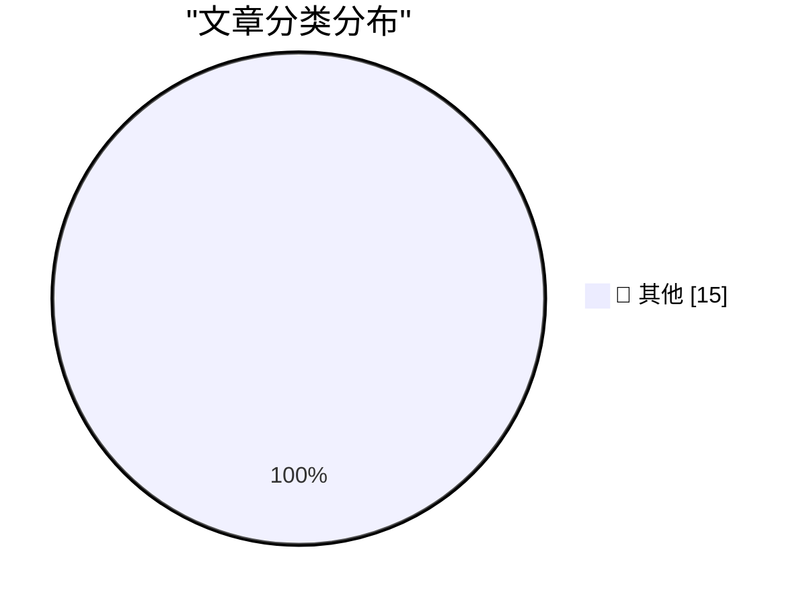

# 📰 AI 资讯每日精选 — 2026-10-21

> 汇聚 140+ 技术博客、X/Twitter、Hacker News、Reddit、Product Hunt、
> Lobste.rs、ClawFeed 日报及 GitHub Trending，经 AI 评分筛选。
>
> **本期内容**：🏆 今日必读 · 🌐 ClawFeed 日报 · 🔥 GitHub Trending · 📂 分类精选 · 🎨 设计与生成式 AI · 📊 数据概览

## 🏆 今日必读

🥇 **eMudhra Intermediate CA Compromise**

[eMudhra Intermediate CA Compromise](https://simonwillison.net/2026/Oct/20/emudhra-certificates/) — simonwillison.net · 2 小时前 · 📝 其他

> eMudhra Intermediate CA Compromise

🥈 **Battle Drones - a vibe coded RTS with audio-based multiplayer**

[Battle Drones - a vibe coded RTS with audio-based multiplayer](https://simonwillison.net/2026/Oct/20/battledrones/) — simonwillison.net · 6 小时前 · 📝 其他

> Battle Drones - a vibe coded RTS with audio-based multiplayer

🥉 **[Sponsor] Sunnny**

[[Sponsor] Sunnny](https://sunnny.com/) — daringfireball.net · 12 小时前 · 📝 其他

> [Sponsor] Sunnny

4️⃣ **Pluralistic: The death of history's most successful publisher (20 Oct 2026)**

[Pluralistic: The death of history's most successful publisher (20 Oct 2026)](https://pluralistic.net/2026/10/20/main-character-syndrome/) — pluralistic.net · 8 小时前 · 📝 其他

> Pluralistic: The death of history's most successful publisher (20 Oct 2026)

5️⃣ **Book Review: Quackery - A Brief History of the Worst Ways to Cure Everything by Lydia Kang ★★★⯪☆**

[Book Review: Quackery - A Brief History of the Worst Ways to Cure Everything by Lydia Kang ★★★⯪☆](https://shkspr.mobi/blog/2026/10/book-review-quackery-a-brief-history-of-the-worst-ways-to-cure-everything-by-lydia-kang/) — shkspr.mobi · 14 小时前 · 📝 其他

> Book Review: Quackery - A Brief History of the Worst Ways to Cure Everything by Lydia Kang ★★★⯪☆

---

## 🌐 ClawFeed 日报精选

> 来源：[ClawFeed](https://clawfeed.kevinhe.io) — AI 驱动的多源新闻聚合

# 📅 ClawFeed 日报 | 2026-10-20 (SGT)

> 聚合自 3 期已发布的 8 小时简报：#1400 00:00（00:00-07:59）、#1401 08:00（08:00-15:59）、#1402 16:00（16:00-23:59），首尾相接盖满全天。
> ⚠️ 三期素材都偏向各自窗口的最后一小时（#1401 约六成在 15 点档，#1402 一半多在 23 点档），#1400 素材最少（一共 66 条），凌晨、上午和傍晚可能漏事；全天没有新书签。
> 主线：推理成本继续往下压（DeepSeek 开源推理框架 DeepInfer、Mercury 3 低价上线）；OpenCode 被盗 Key 事件有了更完整的说法；「借钱买算力」的压力信号和怀疑声从下午吵到晚上；一晚上三笔 AI 公司融资；Musk 说 X 时间线推荐换了新模型。

---

## 🔥 当日最重要 5 条

1. **DeepSeek 开源推理框架 DeepInfer，同一天 Mercury 3 打低价**（#1402）：@ValeriShieh 引 @deepseek_ai 官方帖，DeepInfer 是 DeepSeek 自研的推理框架、现已完全开源，支撑 DeepSeek-V4.1-Flash 的大规模高吞吐、低延迟服务，目的是帮社区降低算力成本和能耗（官方原帖后半段被截断）；Valeri 认为这比再开源一个更强的模型更值得关注，推理进步可能让原本算不过账的 AI 生意第一次算得过账（他的观点）。@Daviswh 介绍 Inception 的扩散语言模型 Mercury 3：号称每秒 1068 个 token、质量追平 GPT-6 Luna 和 Claude Haiku 5.5、快 4-8 倍，上线期五折，每百万 token 输入 0.1 美元、输出 0.35 美元（性能是 Inception 自己的说法，没核对）。
   来源: https://x.com/ValeriShieh/status/2112539825639465090 ｜ https://x.com/Daviswh/status/2112563130685411558

2. **OpenCode 被盗 Key 事件有了更完整的说法**（#1400，延续 #1399 第 2 条，新数据点）：@Techub_News 速报，TechCrunch 和 The Hacker News 也报了。OpenCode 说 10 月 17 日夜里有人进了一个正在下线的旧系统，影响网页版 OpenCode Console 约 1.4% 的用户，存在 Console 里的 OpenAI、Anthropic 等密钥可能外泄；命令行和桌面版不受影响。已有用户被盗刷，Anthropic 和 Google 已封掉可能外泄的密钥，OpenAI 说会退款；收到 OpenCode 邮件的人要去各家后台吊销、换新密钥，光从 OpenCode 里删掉不够。晚上 @thdxr 说 opencode 2.0 已发布、团队在集中清 issue，帖子没提这件事（#1402）。⚠️ #1402 那期写的是「被黑的说法仍未见官方说明」，和 #1400 引 TechCrunch 的说法不一致，以 TechCrunch 原文为准。
   来源: https://x.com/Techub_News/status/2112307412644311257 ｜ https://techcrunch.com/2026/10/19/hackers-hit-ai-coding-tool-opencode-running-up-charges-on-users-ai-accounts/ ｜ https://x.com/thdxr/status/2112544276647231836

3. **「借钱买算力」的压力信号和怀疑声**（#1401 + #1402 合并，都是博主转述 / 观点，没有新的原始数据）：下午 @JaydenWei 说几项指标同时亮黄灯——Oracle CDS 冲到 315 个基点创新高、软银跌到六个月最低、CoreWeave 高开低走、韩国 neocloud Elice 上市首日跌三成，股东和债主押的是同一件事：借钱买算力这条路还走不走得通。晚上 @davidzmorris 引 @iamgingertrash 的说法：数据中心其实不会真建起来，27、28 年违约临近时会有成仓库的 Nvidia GPU 被甩卖；@michaelpwalrath（简介写 Yext CEO）写长文「What if Ben Horowitz is Wrong?」，回应「这次 GPU 稀缺、和 90 年代光纤泡沫不同」的说法（结论部分被截断）。另一边，@CoinMarketCap 转述大摩把亚马逊目标价从 335 调到 350 美元、称亚马逊正在部署约 200 万块 Nvidia GPU（二手转述，没附报告原文）。
   来源: https://x.com/JaydenWei/status/2112371315143516584 ｜ https://x.com/davidzmorris/status/2112562621631107413 ｜ https://x.com/michaelpwalrath/status/2112567583710847009 ｜ https://x.com/CoinMarketCap/status/2112567060714717262

4. **一晚三笔 AI 公司融资**（#1402，数字都是创始人自己发的，没看到第三方报道）：Daytona 完成 6,000 万美元 B 轮、估值 10 亿美元，FirstMark 领投，要做「Agent Cloud」（@ivanburazin）；Arda 公开亮相，A 轮 1.6 亿美元、估值 15 亿美元，做的是加速美国制造业，过去一年以 Anduril 为设计合作方（@bobmcgrewai，平台具体做什么被截断）；Beacon 拿了 550 万美元种子轮，做给编程 agent 用的开源、自我改进的记忆层（@jqdsouza，原帖被截断）。
   来源: https://x.com/ivanburazin/status/2112559682720055454 ｜ https://x.com/bobmcgrewai/status/2112558753770033342 ｜ https://x.com/jqdsouza/status/2112552451547001218

5. **X 时间线推荐换了排序和召回模型**（#1401）：@elonmusk 说时间线推荐有两项重要改动——新的 AI/SI 排序模型能更好地预测用户在一条帖子上停留多久，召回模型专门训练成优先推送用户会完整读完的帖子，并说用户活跃时长接近历史新高（原帖后半段被截断）；@lanhubiji 解读为对质量高一些的帖子有利。之后首页推荐流（也就是 ClawFeed 的主要素材来源）的构成可能会变——这是推断，当天素材里看不出变化。
   来源: https://x.com/elonmusk/status/2112373713937084809 ｜ https://x.com/lanhubiji/status/2112430751002300922

**⚠️ 未证实（素材里核实不了，只记录说法）**
- Altman 讲 AI 安全的「三种终局」：@sleepy0x13 转 @Hesamation，称据《The Information》，Altman 上周在内部介绍了三种方案（类似国际原子能机构的全球监管、几家大实验室合并、一家公司率先实现递归自我改进并「熔掉其他所有人的 GPU」）。二手转述，素材里没有《The Information》原文（#1401）。https://x.com/sleepy0x13/status/2112386573954424990
- 「OpenAI 对 Hugging Face 的网络攻击」：@ClementDelangue 说看了 Netflix Instadocs 关于这件事的纪录片、很失望，@kevinroose 引用并讽刺。素材里只有两人的帖子，没有攻击事件本身的报道或纪录片链接（#1402）。https://x.com/kevinroose/status/2112551229935288372
- Elorian 视觉推理模型 Glimpse 号称「Astra 级别」、成本低 17 倍：@FinanceYF5 转述，原帖被截断，没附 Elorian 原始公告（#1402）。https://x.com/FinanceYF5/status/2112468971576557605

**次重要（备选）**
- 以太坊 Glamsterdam 的 Hoodi 测试网激活时间定在 10 月 26 日 17:42:48 UTC，主网时间未定（@lanhubiji，没附以太坊官方公告，#1401）。https://x.com/lanhubiji/status/2112403126577959153
- Dream Labs 结束隐身、发布机器人基础模型 Dream-1，每小时 3 美元起，API 当天开放（能力描述是 Dream Labs 自己的说法；@sainingxie 转发，#1400）。https://x.com/sainingxie/status/2112239537271476251
- JPM Coin 上以太坊续：@CoinMarketCap 快讯称 JPMorgan 已在以太坊上为机构客户推出 JPM Coin 存款代币、范围从 Base 扩展出来（#1399 收的是「要把」，这里说「已推出」；帖子只有一句，没附原始公告，#1400）。https://x.com/CoinMarketCap/status/2112301024392237501
- 瑞士 FINMA 首次批准面向散户、直接投资比特币的 ETF（@wublockchain12，没附 FINMA 公告原文，#1402）。https://x.com/wublockchain12/status/2112491985063813347
- 慢雾：Qubic 钱包用 Math.random() 生成种子、私钥可能经网络观测被恢复（@wublockchain12 转述，原帖被截断，没有报告原文链接，#1402）。https://x.com/wublockchain12/status/2112483067835318543

---

## 📰 当日核心主题

**① 推理和模型价格往下走（三期都有）**
DeepInfer 开源、Mercury 3 低价（见上）；@cline 说 MiniMax M3.1 Flash 编程能和 Opus、GPT 正面较量、成本约低 25 倍，现在在 Cline 里免费用（Cline 的说法，M3.1 Flash 发布 #1399 已收，#1400，https://x.com/cline/status/2112220504258224605）；@agintender 引 @FundaAI：DeepSeek V4.1-Flash-1017 进了开源权重第一梯队、仍落后闭源头部（FundaAI 的评价，#1401，https://x.com/agintender/status/2112381197817163933）；@dingyi 转 Notion Agents 更新（Auto 模式「便宜 90%」、支持 BYOK），认为订阅越来越不值钱；@qoder_ai_ide 推出 Qoder Lite，每月 10 美元 1,000 积分（#1402，https://x.com/dingyi/status/2112539886159011965 ｜ https://x.com/qoder_ai_ide/status/2112535568794198260）；Exa 3.0 发布，称在它测过的所有基准上排第一（Exa 自己的说法，#1400，https://x.com/guruchahal/status/2112221854668919087）；@Google 演示 Gemini 4 Argon 在 Antigravity 里写出浏览器实时运行的 WebGL2 毛发引擎（官方宣传，#1402，https://x.com/Google/status/2112552114467602487）；「一半算力给短剧」补上出处：豆包公关负责人在微博说字节总算力里只有约 10% 用于视频生成模型（#1400，延续 #1399，https://x.com/turingbook/status/2112214637685215268）。

**② agent 工程：记忆、等待和花销（#1400、#1401、#1402）**
@jolestar 做 @holonrun 的体会：长程任务里充满等 CI、等 Review 的异步等待，单次对话模型没有「等待契约」，人反倒成了 AI 的「肉身调度器」（原帖被截断，https://x.com/jolestar/status/2112530649769005444）；@omarsar0 新文章讲要拥有自己的 agent 记忆，@EXM7777 每天收工让 Claude 复盘会话、提前写好 skill（#1402，https://x.com/omarsar0/status/2112574217443020881 ｜ https://x.com/EXM7777/status/2112544617707327774）；Beacon 记忆层融资（见上）；@mardehaym 算账：一个重构项目里 AI 花费约每名工程师每月 200 美元、每个合并 PR 约 10 美元（他自家公司 Limestone 的项目，原帖截断，#1400，https://x.com/mardehaym/status/2112317682011803993）；@shao__meng 推荐 MIT 研究生课「How to AI an AI」的 harness 演化两讲（#1401，https://x.com/shao__meng/status/2112361253905854685）；GitHub 项目 Impeccable 给编程 agent 一套设计语言、避免 AI 网站千篇一律（星数是帖子说的，没核对，#1401，https://x.com/RoundtableSpace/status/2112449992346517755）；@levie 问模型越强以后智能怎么最好地扩散进企业（原帖截断，#1401，https://x.com/levie/status/2112404676436222170）；Claude Code 写温度监控时查出 XMRig 挖矿程序（@gcsbtc 转述，没附原始出处，#1401；同类故事 #1399 已收，https://x.com/gcsbtc/status/2112443207665787384）。

**③ 算力资本开支：怀疑和乐观两边（#1401、#1402）**
「借钱买算力」压力信号和反方观点（见上）；@0xshunshun 认为叙事被放大来配合融资，高息贷款、资产出表、售后回租都是后果（原帖截断，https://x.com/0xshunshun/status/2112569314016702916）；@mardehaym 的文章引 Gartner 9 月预测今年全球 AI 支出 2.7 万亿美元、同比增 49.5%（他转述的，文章截断，#1402，https://x.com/mardehaym/status/2112556545699418346）；@0xlunasterling 转 @PhyrexNi：截至 10 月 14 日一周全球科技股基金净流出 47.5 亿美元（#1401，https://x.com/0xlunasterling/status/2112442797437370750）——⚠️ #1399 收过同一周的 Reuters 数字是 52.1 亿美元，两处口径或来源不同，以原始报道为准。

**④ 稳定币、支付和加密市场（三期都有）**
支付：@a16zcrypto 预告 @cdixon 对谈 Circle CEO，Allaire 认为美元上网的主要用户可能会是机器；@CoinbaseDev 在 Money20/20 讲 agentic payments，另宣布和 Thunes 合作做稳定币转账「最后一公里」（#1400、#1401，https://x.com/a16zcrypto/status/2112219494924132667 ｜ https://x.com/CoinbaseDev/status/2112444473439584535）；@meshpay 和 Visa 合作接入 1.75 亿商户网点、上线细节未出（#1401，https://x.com/itsbac0201/status/2112432860649189400）；Stripe 等发起的稳定币 OUSD 三周 8.25 亿美元，但前十个钱包约占八成（文章作者的链上数字，没核对，#1402，https://x.com/PANewsCN/status/2112517503826210860）。
链上产品：Coinbase 代币化股票在 Base 的 Aave 上抵押借 USDC，到 10-18 已存入 957 万美元（原文截断，#1400，https://x.com/davidtsocy/status/2112304104059879896）；Ducat 在比特币 L1 上做原生借贷、开始邀请制主网 Alpha（#1402，https://x.com/wublockchain12/status/2112493915701911779）；Starknet 一晚两个产品：自托管钱包 Bramble、Troves 私密收益（#1402，延续 #1399 的 Starknet 话题，https://x.com/Bramble_fi/status/2112559547370123549 ｜ https://x.com/0xKodawari/status/2112571630765613138）；TRON 按 TIP-899 引入两种后量子签名算法（正文截断，#1401，https://x.com/Blackpink_Ox66/status/2112441976096461296）；Pump 上线 PreStocks、新币可和未上市公司代币配对（据博主说，#1401，https://x.com/Memesdontlie/status/2112442945869951161）；papertrade 短期不开放 $PAPER 转账（#1401，https://x.com/dongdongRobin/status/2112334977102938186）；Bitget 计划收购泰国持牌交易所 GMO-Z.com Cryptonomics，没有金额和审批进度（#1402，https://x.com/Gummybear1771/status/2112561686016348489）；deBridge 累计交易量破 250 亿美元（#1401，https://x.com/krystal1/status/2112400073468629065）。
盘面和宏观（都是博主转述 / 快讯）：BTC 从 10-02 的 86,700 跌到 10-20 的 81,600 美元、市场结构信号降到 -0.32（Axel Adler Jr.，#1401，https://x.com/wublockchain12/status/2112442006966538541）；10/19 BTC 现货 ETF 净流入 5.27 亿美元、几乎全靠 IBIT，但 10-12 至 10-16 合计净流出约 2.29 亿（#1401，https://x.com/hongyi88/status/2112450208223179145 ｜ https://x.com/JinDianZiAI/status/2112438919631696207）；Glassnode 数据称永续主动净卖出和 ETF 周流出都在缩小（#1400，https://x.com/Meta8Mate/status/2112331730074173906）；美伊谈判「接近达成协议」的报道被知情人否认、股市先涨后落，油价反复测 100 关口（#1402，https://x.com/xingpt/status/2112565420377154001 ｜ https://x.com/TraderS18/status/2112566736440746376）；加拿大阿尔伯塔省公投否决独立（#1401，https://x.com/nytimes/status/2112419047010689316）。

---

## 🔖 Bookmarks 精选

今天没有新加的书签：三期抓到的书签里最新一条仍是 10-04 的推文，三期都跳过了这一区块，本日报也没有可补选的内容。

---

## 👀 推荐关注汇总（去重，共 5 个；各期发布时都在浏览器里核实过「未关注」，本日报没有重新核实）

**AI builder / 研究**
- @ivanburazin（Ivan Burazin，约 2.03 万粉）：Daytona 创始人，B 轮公告那条的作者，做 agent 基础设施；你关注的人里有 118 位也关注了他（#1402）。https://x.com/ivanburazin
- @ValeriShieh（Valeri，约 900 粉）：简介写北大 AI 创新学生中心负责人、微软 AI 工程师，DeepInfer 那条的作者，中文圈原创分析；粉丝少、发帖不多，但你关注的人里有 95 位也关注了他（#1402）。https://x.com/ValeriShieh

**AI 资本开支 / 金融**
- @davidzmorris（David Z. Morris，约 1.7 万粉）：前 CoinDesk / Fortune，「借钱买算力」那条的作者；观点很尖锐，适合当「AI 资本开支怀疑派」的声音看；你关注的人里有 127 位也关注了他（#1402）。https://x.com/davidzmorris
- @JinDianZiAI（金电子，约 8,500 粉）：关注 BTC 周期、AI、RWA 和资金流向，ETF 流出提醒那条的作者；数据多是转述、没附出处，建议当资金流线索看；你关注的人里有 46 位也关注了他（#1401）。https://x.com/JinDianZiAI

**加密**
- @KevinBoon_ML（Kevin Boon，约 1,900 粉）：Mysten Labs（Sui）CEO，上任后表态那条的作者，Sui 生态一手信息源；你关注的人里有 39 位也关注了他（#1400）。https://x.com/KevinBoon_ML

**建议取关**：三期都没有提出取关建议。

---

## 💤 当日重复噪音模式

三期合计过滤约 440 条，按类别（约数）：
- **无正文或一句话回复**：约 160 条，量最大，主要集中在 #1401 的 15 点档。
- **营销、推广和活动**：约 80 条（付费合作、交易所活动、抽奖、卖课荐书等），另有互关涨粉约 10 条、发射预告约 6 条。
- **生活和情绪帖**：约 70 条。
- **体育和娱乐**：约 40 条。
- **政治和社会新闻**：约 25 条。
- **喊单和个人交易**：约 25 条。
- **信息量少、只有标题或一句话**：约 20 条。
- **同一话题延续**：OpenCode 被盗 Key、JPM Coin 上以太坊、MiniMax M3.1 Flash、「短剧算力」出处、Claude 查出挖矿程序、科技基金流出、Starknet 都接着 #1399 的话题，上面已标为延续或新数据点；三期之间的 DeepSeek V4.1-Flash（#1401 → #1402）和「借钱买算力」（#1401 → #1402）已合并，没有重复收录的条目。---

## 🔥 GitHub Trending

> 今日热门开源项目（全语言 + Python）

| # | 项目 | 描述 | ⭐ 总星 | 📈 今日 | 语言 |
|---|------|------|---------|---------|------|
| 1 | [MadsLorentzen/ai-job-search](https://github.com/MadsLorentzen/ai-job-search) 🤖 | The job search that runs on your machine. AI job applicat... | 60.7k | +3861 | Python |
| 2 | [cloudflare/security-audit-skill](https://github.com/cloudflare/security-audit-skill) 🤖 | A coding-agent skill for multi-phase security audits with... | 34.3k | +1712 | JavaScript |
| 3 | [stablyai/orca](https://github.com/stablyai/orca) 🤖 | Orca is the place for working with a fleet of agents (e.g... | 99.8k | +1565 | TypeScript |
| 4 | [anomalyco/opencode](https://github.com/anomalyco/opencode) 🤖 | The open source coding agent. | 219.0k | +1240 | TypeScript |
| 5 | [DietrichGebert/ponytail](https://github.com/DietrichGebert/ponytail) 🤖 | Makes your AI agent think like the laziest senior dev in ... | 169.8k | +1208 | JavaScript |
| 6 | [Comfy-Org/ComfyUI](https://github.com/Comfy-Org/ComfyUI) 🤖 | The most powerful and modular diffusion model GUI, api an... | 140.8k | +1206 | Python |
| 7 | [Graphify-Labs/graphify](https://github.com/Graphify-Labs/graphify) 🤖 | Turn any codebase, with its docs, SQL schemas, configs, a... | 130.3k | +802 | Python |
| 8 | [shiyu-coder/Kronos](https://github.com/shiyu-coder/Kronos) | Kronos: A Foundation Model for the Language of Financial ... | 42.4k | +733 | Python |
| 9 | [ruvnet/ruflo](https://github.com/ruvnet/ruflo) 🤖 | 🌊 The original agent harness. Deploy intelligent multi-p... | 77.9k | +684 | TypeScript |
| 10 | [HKUDS/CLI-Anything](https://github.com/HKUDS/CLI-Anything) 🤖 | "CLI-Anything: Making ALL Software Agent-Native" -- CLI-H... | 55.7k | +566 | Python |
| 11 | [msitarzewski/agency-agents](https://github.com/msitarzewski/agency-agents) 🤖 | A complete AI agency at your fingertips - From frontend w... | 162.4k | +562 | Shell |
| 12 | [headroomlabs-ai/headroom](https://github.com/headroomlabs-ai/headroom) 🤖 | Compress tool outputs, logs, files, and RAG chunks before... | 76.8k | +549 | Python |
| 13 | [Kruk2/jasna](https://github.com/Kruk2/jasna) | Video restoration tool | 3.2k | +441 | Python |
| 14 | [google/artemis](https://github.com/google/artemis) 🤖 | ARTEMIS turns natural-language instructions into reliable... | 13.3k | +338 | Python |
| 15 | [anthropics/knowledge-work-plugins](https://github.com/anthropics/knowledge-work-plugins) 🤖 | Open source repository of plugins primarily intended for ... | 30.8k | +267 | Python |

---

## 📝 其他

### 1. eMudhra Intermediate CA Compromise

[eMudhra Intermediate CA Compromise](https://simonwillison.net/2026/Oct/20/emudhra-certificates/) — **simonwillison.net** · 2 小时前 · ⭐ 15/30

> eMudhra Intermediate CA Compromise

---

### 2. Battle Drones - a vibe coded RTS with audio-based multiplayer

[Battle Drones - a vibe coded RTS with audio-based multiplayer](https://simonwillison.net/2026/Oct/20/battledrones/) — **simonwillison.net** · 6 小时前 · ⭐ 15/30

> Battle Drones - a vibe coded RTS with audio-based multiplayer

---

### 3. [Sponsor] Sunnny

[[Sponsor] Sunnny](https://sunnny.com/) — **daringfireball.net** · 12 小时前 · ⭐ 15/30

> [Sponsor] Sunnny

---

### 4. Pluralistic: The death of history's most successful publisher (20 Oct 2026)

[Pluralistic: The death of history's most successful publisher (20 Oct 2026)](https://pluralistic.net/2026/10/20/main-character-syndrome/) — **pluralistic.net** · 8 小时前 · ⭐ 15/30

> Pluralistic: The death of history's most successful publisher (20 Oct 2026)

---

### 5. Book Review: Quackery - A Brief History of the Worst Ways to Cure Everything by Lydia Kang ★★★⯪☆

[Book Review: Quackery - A Brief History of the Worst Ways to Cure Everything by Lydia Kang ★★★⯪☆](https://shkspr.mobi/blog/2026/10/book-review-quackery-a-brief-history-of-the-worst-ways-to-cure-everything-by-lydia-kang/) — **shkspr.mobi** · 14 小时前 · ⭐ 15/30

> Book Review: Quackery - A Brief History of the Worst Ways to Cure Everything by Lydia Kang ★★★⯪☆

---

### 6. Death & Domains

[Death & Domains](https://feed.tedium.co/link/15204/17501584/death-domains-commentary) — **tedium.co** · 8 小时前 · ⭐ 15/30

> Death & Domains

---

### 7. AI Had Better Work Out

[AI Had Better Work Out](https://www.wheresyoured.at/ai-had-better-work-out/) — **wheresyoured.at** · 9 小时前 · ⭐ 15/30

> AI Had Better Work Out

---

### 8. What happened to Epyx

[What happened to Epyx](https://dfarq.homeip.net/what-happened-to-epyx/?utm_source=rss&#038;utm_medium=rss&#038;utm_campaign=what-happened-to-epyx) — **dfarq.homeip.net** · 14 小时前 · ⭐ 15/30

> What happened to Epyx

---

### 9. ClickHouse Will Let You Be Wrong at Scale

[ClickHouse Will Let You Be Wrong at Scale](https://matduggan.com/clickhouse-will-let-you-be-wrong-at-scale/) — **matduggan.com** · 11 小时前 · ⭐ 15/30

> ClickHouse Will Let You Be Wrong at Scale

---

### 10. How to install an app on your Commodore 64

[How to install an app on your Commodore 64](https://anildash.com/2026/10/08/install-an-app-commodore-64/) — **anildash.com** · 8 小时前 · ⭐ 15/30

> How to install an app on your Commodore 64

---

### 11. NVIDIA Cosmos3-H-Dreams: Bringing Clinical Surgery to Life Through Generative Simulation

[NVIDIA Cosmos3-H-Dreams: Bringing Clinical Surgery to Life Through Generative Simulation](https://huggingface.co/blog/nvidia/cosmos3-h-dreams) — **Hugging Face Blog** · 7 小时前 · ⭐ 15/30

> NVIDIA Cosmos3-H-Dreams: Bringing Clinical Surgery to Life Through Generative Simulation

---

### 12. FairStress: A deeper evaluation of fairness in LLM decision-making

[FairStress: A deeper evaluation of fairness in LLM decision-making](https://huggingface.co/blog/allenai/fairstress) — **Hugging Face Blog** · 9 小时前 · ⭐ 15/30

> FairStress: A deeper evaluation of fairness in LLM decision-making

---

### 13. ALTK-Evolve: How learned memory tops the τ²-bench leaderboard on customer service tasks without a frontier model

[ALTK-Evolve: How learned memory tops the τ²-bench leaderboard on customer service tasks without a frontier model](https://huggingface.co/blog/ibm-research/altk-evolve-bc) — **Hugging Face Blog** · 10 小时前 · ⭐ 15/30

> ALTK-Evolve: How learned memory tops the τ²-bench leaderboard on customer service tasks without a frontier model

---

### 14. Elevenlabs releases two new speech-to-speech models designed for real-time AI conversations

[Elevenlabs releases two new speech-to-speech models designed for real-time AI conversations](https://the-decoder.com/elevenlabs-releases-two-new-speech-to-speech-models-designed-for-real-time-ai-conversations/) — **The Decoder** · 6 小时前 · ⭐ 15/30

> Elevenlabs releases two new speech-to-speech models designed for real-time AI conversations

---

### 15. Deepseek open-sources the inference engine that powers its fastest and cheapest AI model

[Deepseek open-sources the inference engine that powers its fastest and cheapest AI model](https://the-decoder.com/deepseek-open-sources-the-inference-engine-that-powers-its-fastest-and-cheapest-ai-model/) — **The Decoder** · 7 小时前 · ⭐ 15/30

> Deepseek open-sources the inference engine that powers its fastest and cheapest AI model

---

## 📊 数据概览

| 扫描源 | 抓取文章 | 时间范围 | 精选 |
|:---:|:---:|:---:|:---:|
| 92/140 | 3885 篇 → 56 篇 | 24h | **15 篇** |

### 分类分布

---

*生成于 2026-10-21 01:58 | 汇聚 140 个技术博客、X/Twitter、Hacker News、Reddit、Product Hunt、Lobste.rs、ClawFeed 日报及 GitHub Trending，经 AI 评分筛选出 Top 15 精华内容*
