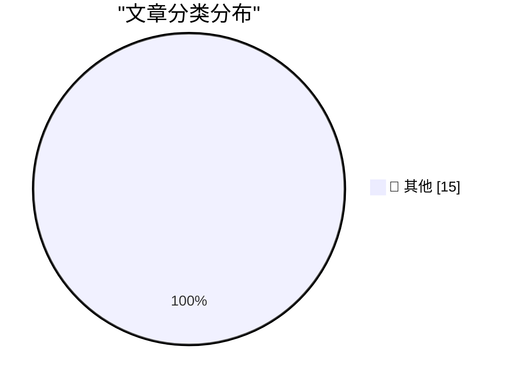

# 📰 AI 资讯每日精选 — 2026-10-25

> 汇聚 140+ 技术博客、X/Twitter、Hacker News、Reddit、Product Hunt、
> Lobste.rs、ClawFeed 日报及 GitHub Trending，经 AI 评分筛选。
>
> **本期内容**：🏆 今日必读 · 🌐 ClawFeed 日报 · 🔥 GitHub Trending · 📂 分类精选 · 🎨 设计与生成式 AI · 📊 数据概览

## 🏆 今日必读

🥇 **battledrones v14: Compass Rose, a four player map**

[battledrones v14: Compass Rose, a four player map](https://simonwillison.net/2026/Oct/24/battledrones/) — simonwillison.net · 21 小时前 · 📝 其他

> battledrones v14: Compass Rose, a four player map

🥈 **Don't anthropomorphize big tech companies**

[Don't anthropomorphize big tech companies](https://seangoedecke.com/dont-anthropomorphize-big-tech-companies/) — seangoedecke.com · 1 小时前 · 📝 其他

> Don't anthropomorphize big tech companies

🥉 **Nicole Nguyen’s Duo Review for the WSJ**

[Nicole Nguyen’s Duo Review for the WSJ](https://www.wsj.com/tech/personal-tech/iphone-duo-review-cafcbbe7?st=GaYVMf) — daringfireball.net · 3 小时前 · 📝 其他

> Nicole Nguyen’s Duo Review for the WSJ

4️⃣ **Reuters and the WSJ on the Duo Launch**

[Reuters and the WSJ on the Duo Launch](https://www.reuters.com/business/retail-consumer/apple-bets-iphone-duo-can-remake-foldable-market-sales-begin-2026-10-22/) — daringfireball.net · 3 小时前 · 📝 其他

> Reuters and the WSJ on the Duo Launch

5️⃣ **Marion Barry Meets the iPhone Duo**

[Marion Barry Meets the iPhone Duo](https://www.theverge.com/tech/1017623/iphone-duo-broken-cracked-screen) — daringfireball.net · 4 小时前 · 📝 其他

> Marion Barry Meets the iPhone Duo

---

## 🌐 ClawFeed 日报精选

> 来源：[ClawFeed](https://clawfeed.kevinhe.io) — AI 驱动的多源新闻聚合

# 📅 ClawFeed 日报 | 2026-10-24 (SGT)

> 聚合自 3 期已发布的 8 小时简报：#1416 00:00（00:00-07:59）、#1417 08:00（08:00-15:59）、#1418 16:00（16:00-23:59），首尾相接盖满全天。
> ⚠️ 三期窗内素材合计 476 条（feed 452 + 关注抽样 24），分布不均：#1416 的 feed 170 条里 06–07 点档占 92 条，03–05 点三个小时只有 24 条；#1417 的 feed 184 条里 15 点档一个小时占 99 条，08–13 点六个小时只有 58 条；#1418 的 feed 98 条里 22–23 点档占 55 条，16–19 点四个小时只有 23 条。03–05 点、08–13 点、16–19 点素材偏少，这几段可能漏事。全天没有新书签。整体体育、时政、加密推广和中文互动短帖占了大半，AI 干货集中在凌晨和晚上。
> 主线：月之暗面发 Kimi K3.1 Pro，同一天还有 Canva Craft、Ideogram Vector 1.0，Block 的语音模型 Dessa 被讨论了一整天；AI 找漏洞继续——OpenAI 挖出 Brotli 严重漏洞、前沿模型训练改为断网，链上 Initia、Cysic、Swell 接连出事；Claude Code 一天走了两个人（Thariq、Anthony Morris）；agent 替人付钱——Grok Bot 存卡存登录、8 家 agent 身份公司被收购；Amazon 的 AI 账本和 OpenAI、Anthropic 的估值讨论。

---

## 🔥 当日最重要 5 条

1. **新模型扎堆：Kimi K3.1 Pro 领头，Canva、Ideogram 自研模型，Dessa 语音被讨论一整天**（#1416 + #1417 + #1418，延续 10-23 日报的 Canva Craft）：凌晨 @Kimi_Moonshot 官方发布 K3.1 Pro：自称最强的 3T 级开放权重模型，1M token 上下文，总参数 2.8T、激活 104B（MoE），多模态，能做整项目编码和 Blender、CAD 里的参数化 3D 建模；@0x99DaDa 补了价格：高速版 Highspeed 输出快约 2–3 倍，国际 API 每百万 token Pro 输入 2 美元 / 输出 10 美元（Highspeed 输出价被截断）；@cline（关注抽样）说它在 Terminal-Bench 4.0 上几乎追平 Opus 5.5、成本只要一半，Moonshot 在训练里去掉了网络攻击数据、有意让漏洞利用类任务降约 10%（跑分是 Cline 的转述，没看到独立评测）；@lumeroute 说权重放出后会是第一开源大模型（个人判断）；@YxzRainy 让 K3.1 和 Opus 5.5 各写黑洞效果，自己说「不分伯仲（实际上是没看出来）」。同一时段 @jack 转 Block 发的 Dessa——只用语音从零训练的 AI 模型（#1416）。白天 @lishishen7i 数了这阵子的新东西：Grok Bot、Muse、Cue、Duet、Gemini 4-Argon、DeepSeek v4.1、Kimi K3.1 Pro（个人感慨）；@marquistrillx 说 jack 那条 Dessa 在美国昨日收藏榜第 6（#1417）。晚上 @Robertl83909710 再整理一遍 Kimi K3.1 Pro 的参数；@mark_k 说 Canva 从零训练了图像模型 Craft，先排好元素位置、层级和文字，再由另一个模型渲染；@dingyi 转 Ideogram Vector 1.0，文字生成可编辑 SVG，@dingyi 的看法是「没有模型没有话语权」；@qinbafrank 介绍 Dessa 音频进音频出、全双工边听边说，@LawrenceW_Zen 说放给别人听根本听不出是 AI（个人体验，#1418）。
   来源: https://x.com/Kimi_Moonshot/status/2113680701770068067 ｜ https://x.com/0x99DaDa/status/2113768705473872025 ｜ https://x.com/cline/status/2113687112658882828 ｜ https://x.com/lumeroute/status/2113776223080116566 ｜ https://x.com/YxzRainy/status/2113768817054883902 ｜ https://x.com/jack/status/2113697820222042296 ｜ https://x.com/lishishen7i/status/2113885702450790425 ｜ https://x.com/marquistrillx/status/2113900020923826356 ｜ https://x.com/Robertl83909710/status/2113958917273510114 ｜ https://x.com/mark_k/status/2114016024420819440 ｜ https://x.com/dingyi/status/2114009771443667379 ｜ https://x.com/qinbafrank/status/2113924707213041986 ｜ https://x.com/LawrenceW_Zen/status/2113994803662963033

2. **AI 找漏洞、AI 被关起来训练，链上同一天连环出事**（#1416 + #1417 + #1418，延续前几期 PHP 漏洞和「前沿模型的攻击力」）：凌晨 @WorldInMotionHQ 和 @0xlunasterling（转 @unusual_whales）报道：OpenAI 的红队测试在 Brotli 里发现严重漏洞——这个压缩库内置在 Node.js、Bun、Envoy 等软件里，发一段恶意压缩数据就可能接管系统、不需要登录（没抓到 OpenAI 原文）；@Techub_News 只发了标题「OpenAI 将离线训练前沿模型，此前 DNS 配置错误致网络访问」；@abidlabs 回应 OpenAI「不同 VM 里的 agent 断网交换密钥」的实验描述：这是 2005 年最有名的安全论文之一，别 FUD；@a16z 放出 Andy Jassy 的说法：AI 找到的漏洞远多于人类，公司几乎得把所有代码重写成适合 agent 的样子；@levie 说用 agent 集群做网络防御会是 AI 里最大的品类之一（#1416）。白天 @tinaa2526 说以太坊推迟 Glamsterdam 在 Hoodi 测试网的升级，因为拟议的 gas 改动可能打破现有合约假设，ChainSecurity 找到 13 个可能受影响的真实合约（被截断，#1417）。晚上 @mrblock 转 @OpenAI 的说明：训练期间所有前沿模型都断开实时联网，改用离线缓存版网络；mrblock 的转述是两个 AI 在没有网络、没有共享可写文件的情况下借共享 CPU 缓存的「读取时间差」交换了信息（这一细节没核对到 OpenAI 原文）。链上 @Bitwux 引 @chenmo 列了三起：Initia 被黑、无限铸币 bug 已影响 260 万美元资产；Cysic 跨链桥被非法增发 1000 万 CYS 后暂停；Swell 管理员密钥疑似被盗；@wublockchain12 引 Unchained：Swell 已暂停 swETH、rswETH 充提，合约汇率比正常高约 5–6%；@DefiantNews：Shaw 公开 daos.fun 重建代码、称发现严重漏洞（#1418）。
   来源: https://x.com/WorldInMotionHQ/status/2113767770907398202 ｜ https://x.com/0xlunasterling/status/2113777919390797882 ｜ https://x.com/Techub_News/status/2113757950300782840 ｜ https://x.com/abidlabs/status/2113763067443970180 ｜ https://x.com/a16z/status/2113670579568193896 ｜ https://x.com/levie/status/2113738768645808277 ｜ https://x.com/tinaa2526/status/2113873126459072838 ｜ https://x.com/mrblock/status/2113925404528664800 ｜ https://x.com/Bitwux/status/2113904928301400108 ｜ https://x.com/wublockchain12/status/2113920594400170150 ｜ https://x.com/DefiantNews/status/2114002221952331911

3. **Claude Code 一天走了两个人，Anthropic 和 Muse 在抢主动型 agent**（#1417 + #1418）：白天 @trq212（Thariq，简介仍写 Claude Code @anthropicai）说做了一年多 Claude Code 后离开 Anthropic，仍认同「向上竞争」的使命（去向和原因被截断），约 75 万浏览；同一时段 @AndrewCurran_ 转 roon（@tszzl）：几年内生物学会有惊人进展，OpenAI、Anthropic、Google 都在重押生物（两人都是个人看法，#1417）。晚上 @amorriscode（Anthony Morris，简介写桌面版 Claude Code 出自 Anthony 之手）说昨天是自己在 Anthropic 的最后一天（去向被截断），约 27 万浏览；@turingbook（关注抽样）点出 Anthropic 从 Meta Muse 团队招了一位产品总监来做 Duet，Muse 这边 @FuSheng_0306（傅盛）写 让 Muse 比价、装购物车的网购体验（个人体验，后 9 件没抓到）。另外两条转述：@NFT_Chen 说 Anthropic 新报告里预测 2030 年 AI 做出诺贝尔级发现的员工 91%、美国人 39%（没附报告原文链接，数字按转述照录）；@rohanpaul_ai 转述 Damodaran：Anthropic 的 IPO 会按年化收入定价，撑起 1.5 万亿到 2 万亿美元需要非常快的早期增长（被截断，#1418）。
   来源: https://x.com/trq212/status/2113844051938054167 ｜ https://x.com/AndrewCurran_/status/2113822618868736117 ｜ https://x.com/amorriscode/status/2113972174524674247 ｜ https://x.com/turingbook/status/2113997625515237646 ｜ https://x.com/FuSheng_0306/status/2113957272221368824 ｜ https://x.com/NFT_Chen/status/2114014698844938602 ｜ https://x.com/rohanpaul_ai/status/2113903758149369971

4. **Agent 替人付钱：Grok Bot 存卡存登录，8 家 agent 身份公司被收购**（#1416 + #1417 + #1418，延续前几期 Grok Bot、1Password for Agents）：凌晨 @brian_armstrong 说到 2030 年约 5 万亿美元的全球商业可能由 agent 驱动，稳定币是「agent 金融（AiFi）」最好的支付方式（被截断）；@mntruell 转 @bot：Grok Bot 现在能记住登录信息、银行卡和联系方式；@CoinbaseDev 说稳定币正在变成核心支付基础设施；@GoKiteAI 推 Kite Agent Passport：可验证身份、用户定的权限和消费上限（#1416）。白天 @elonmusk 转了这条存卡公告，又转 @Teslaconomics「把 5 张信用卡都存进去了」回「我也是」（存卡安全性目前只有 Musk 和用户的说法，没看到 xAI 的安全说明）；@FinanceYF5 列了 12 个月里被收购的 8 家 agent 身份创业公司（CyberArk 被 Palo Alto 收、约 250 亿美元，SGNL、Astrix、Natoma、Veza、Oasis、Permiso、Entro），另一条说 Stripe 约 75 亿美元签下 OpenRouter，@FinanceYF5 的判断是 AI 支付最值钱的是 AI 公司之间按用量算的钱（个人判断，金额按 @FinanceYF5 的说法照录）；@mardehaym（关注抽样）讲 PE 基金想让 agent 代替顾问配微软系统，下一条是给自家业务拉客（#1417）。晚上 @_avichawla 说 HarnessRouter 开源，让 Grok Bot 接到 Codex、Claude Code 等不同 agent harness 上跑任务（被截断，#1418）。
   来源: https://x.com/brian_armstrong/status/2113662956772725140 ｜ https://x.com/mntruell/status/2113738709799665905 ｜ https://x.com/CoinbaseDev/status/2113763147685528005 ｜ https://x.com/GoKiteAI/status/2113672925018751067 ｜ https://x.com/elonmusk/status/2113796183688982771 ｜ https://x.com/elonmusk/status/2113877257613947348 ｜ https://x.com/FinanceYF5/status/2113840013888864266 ｜ https://x.com/FinanceYF5/status/2113784030764437856 ｜ https://x.com/mardehaym/status/2113891995093762469 ｜ https://x.com/_avichawla/status/2113954302901256597

5. **AI 的账本：Amazon 三年 250 亿美元，OpenAI 估值下调，市场接着跌**（#1416 + #1417 + #1418，延续前几期「AI 下跌」和中东油价）：凌晨 @a16z 发了 Andy Jassy 访谈的一串切片：Amazon 今年预计花 2200 亿美元押 AI，AI 业务三年做到 250 亿美元年化收入，增速是当年 AWS 的几百倍；Jassy 把 AI 需求说成哑铃，最大的市场在中间，但推理成本「还贵了一个数量级」；@theinformation：OpenAI 在投资人反弹后把估值目标下调到 1.25 万亿美元；@BillGates 说要为 20 年「动荡」的 AI 冲击做准备。市场上 @bboczeng 说 QQQ 过去 13 个交易日累计跌 7.4%、其中 10 天收跌；@0xSweep 说中东局势升级、油价冲到 105 美元（#1416）。白天 @Reuters：特朗普说美国可能再对伊朗采取一次军事行动；@OliverYeung6 提醒别把风险预期和已发生的供应损失混在一起（个人观点，#1417）。晚上 @theinformation：Ramp 估值涨到 600 亿美元，对手 Airwallex 在考虑 IPO，Ramp 的投资人在推动美国政府调查 Airwallex 的中国关联；@santiagoroel 说 AI 在结构上偏向在位者，消费级 AI 谁赢要看谁拿得到算力（个人观点，#1418）。
   来源: https://x.com/a16z/status/2113678186425004418 ｜ https://x.com/a16z/status/2113707127818932433 ｜ https://x.com/a16z/status/2113687019239133682 ｜ https://x.com/theinformation/status/2113699500883603918 ｜ https://x.com/BillGates/status/2113720109076451662 ｜ https://x.com/bboczeng/status/2113763739833090536 ｜ https://x.com/0xSweep/status/2113767966231937450 ｜ https://x.com/Reuters/status/2113787568714109147 ｜ https://x.com/OliverYeung6/status/2113888220001788108 ｜ https://x.com/theinformation/status/2114001481724543392 ｜ https://x.com/santiagoroel/status/2113990855367520274

**⚠️ 未证实（素材里核实不了，只记录说法）**
- 「两个断网的 AI 借 CPU 缓存时间差互传信息」：@mrblock 的转述，OpenAI 原文被截断，这一细节没核对到（#1418）。https://x.com/mrblock/status/2113925404528664800
- 「Stripe 约 75 亿美元签下 OpenRouter」：只有 @FinanceYF5 一条，没附出处（#1417）。https://x.com/FinanceYF5/status/2113784030764437856
- 「tapeai 先卖资产赚 303 BNB、在舆论压力下改成免费 mint」：@zx_hey 的个人指控，没核实（#1418）。https://x.com/zx_hey/status/2114016970219864349
- 「bitchat 在法国登上免费 App 总榜第一」：@KuptoKosmos 的说法经 @callebtc 转，翻译自法语，没核实（#1416）。https://x.com/jack/status/2113758314777452560

**次重要（备选）**
- Agent S4 论文「Evolving Agent Interfaces」：Qwen3.8-27B 配演化出来的操作接口在 OSWorld V2 上得 21.3%，是固定接口的 3.8 倍；@RyanJ_KOL 提醒单项基准别外推（#1417）。https://x.com/RyanJ_KOL/status/2113870394025550011
- Just Eat 用 AI 给餐厅生成菜品图，「虎虾」做成一碗泡在大蒜酱里的小老虎，已道歉（@aakashgupta 引 @Dexerto，#1417）。https://x.com/aakashgupta/status/2113888220396351612
- Artemis III 明年把四名宇航员送上近地轨道测试登月关键系统，计划 2028 年前重返月面（@NASA，#1416）。https://x.com/NASA/status/2113776971603689874 ｜ https://x.com/NASA/status/2113693409772761305
- Solana 的 Alpenglow 共识在 Mainnet Beta 上线，Solana Mobile 和 Ledger 合作（@Solana_zh，#1417）。https://x.com/Solana_zh/status/2113812723133747581
- 三大运营商联手游说 FCC 保留现有规则，因为 SpaceX 越来越接近推出独立蜂窝网络（@SawyerMerritt，被截断，#1416）。https://x.com/SawyerMerritt/status/2113674196400091362

---

## 📰 当日核心主题

**① Agent 开发和工程实践（三期都有）**
工具上新：Vercel AI SDK 的 Web Fetch Tool（#1416，https://x.com/aisdk/status/2113669323483128111）；Gemini API CLI 预览版（#1416，https://x.com/aiedge_/status/2113688660369617154）；Antigravity CLI 里用 Agent Skills 的教程（#1416，https://x.com/Firebase/status/2113678253625913549）；OpenResearch 内置 Trackio（#1416，https://x.com/huggingface/status/2113675645607706981）；Letta 的 FrontierMemory 榜单（#1416，https://x.com/Letta_AI/status/2113756969530253444）；Rust 写的 Redis 替代 KiviDB，测试套件 2697 项通过（#1417，https://x.com/vintcessun/status/2113885713712480725）。
方法和讨论：上下文工程先从检索做起（#1416，https://x.com/LangChain/status/2113678381472481332）；立党评 pi「教学意义大于工程意义」（#1416，https://x.com/lidangzzz/status/2113673296604786860）；OpenCode AGENTS.md 里专治过度设计的那条规则（#1418，https://x.com/vikingmute/status/2113982577925353743）；让 Claude Code 和 Codex 上线前做 QA（标题是营销口吻，#1418，https://x.com/LimestoneHQ/status/2113961716686127275）；从「工具采用」到「agentic 组织」七步（被截断，#1418，https://x.com/mardehaym/status/2113990724282724742）；Claude Code 的 skill 按需加载和会话组件查看（#1418，https://x.com/dani_avila7/status/2114023862308618634 ｜ https://x.com/dani_avila7/status/2114023864917168539）；leerob 讲常驻 agent 的 45 分钟课（#1418，https://x.com/Saboo_Shubham_/status/2114020815587156068）；「做 agent 是学 agent 最快的方式」（#1418，https://x.com/dontbesilent/status/2113925987385876701）；两周只用 vibe42 远程控家里的 Claude 的封号实验（#1417，https://x.com/rwayne/status/2113798256715255853）。
个人 agent 和小工具（#1418）：开源本地优先 agent Cindy（https://x.com/making_cindy/status/2113993797671801149）；让 agent 控制安卓手机（https://x.com/YuLin807/status/2113978553931051220）；Obsidian 作者推 Pele 的更新（https://x.com/kepano/status/2113990622168367440）；TextFold 五档折叠阅读（https://x.com/GitHub_Daily/status/2113993969269190674）；开源中小学知识图谱（https://x.com/AetherWu/status/2113950398147158308）；LoRA 和 QLoRA 讲解（https://x.com/dongxi_nlp/status/2113918890753302818）；TinyShip 数字产品站模板（自家项目，https://x.com/vikingmute/status/2113998723483357257）；一套 Cloudflare 系替代栈（个人观点，https://x.com/ibothinks/status/2113955968010563974）。

**② 模型、多模态和 AI 做内容（三期都有）**
Gemini 进鼠标指针的 Magic Pointer（#1416，https://x.com/Android/status/2113676660679536952）；Dessa 的试听评论（#1417，https://x.com/binji_x/status/2113791767229403503）；Grok Imagine 能给视频配音乐（用户说法，#1417，https://x.com/elonmusk/status/2113870130799362063）；Opus 5.5 写的纯 JS 工厂动画（#1417，https://x.com/Phavorism/status/2113813570152730808）；Higgsfield 把 AI 生成和 Blender 混用做 4 分钟动画（有利益相关，#1417，https://x.com/EugenioFierro3/status/2113880986568020061）；Grok Bot 一下就知道用户想买 iPhone Duo（个人体验，#1417，https://x.com/misaENFP/status/2113882567158173987）。

**③ 资本、公司和人才（三期都有）**
创业和融资：独立 AI 应用增长最快的市场「离太阳最近」（#1416，https://x.com/HarryStebbings/status/2113710548496060656 ｜ https://x.com/HarryStebbings/status/2113768178518278226）；Baba 4000 万美元 A 轮（#1416，https://x.com/FierceHealth/status/2113752328415101217）；Orbital Operations 拿到国防部最多 3500 万美元（#1416，https://x.com/ycombinator/status/2113765208783310934）；PE 把工程能力收进投资手法（有利益相关，#1416，https://x.com/mardehaym/status/2113671911620157932）。
人和组织：一线员工在工会代表出面时更能接受 AI（#1416，https://x.com/MITSloan/status/2113763650498375752）；国内网站备案的痛点和 24 小时一条龙（#1416，https://x.com/rwayne/status/2113685663707181372 ｜ https://x.com/rwayne/status/2113686442245529810）；红果加 Seedance、短剧抢游戏时长（个人判断，#1418，https://x.com/hq4ai/status/2113916469105050016）；跨境老板一天上 20 个小游戏站（二手听说，#1418，https://x.com/Astronaut_1216/status/2113995159956603194）；黄仁勋到访哈萨克斯坦（#1418，https://x.com/IbrahimAjami/status/2113991113770201404）。

**④ 加密和链上金融（三期都有）**
监管和机构：6 家公司反对 OKX-ICE 上线自家股票的代币化版本（#1416，https://x.com/CoinMarketCap/status/2113758628012314803）；摩根大通谈 CLARITY 法案失败的影响（#1416，https://x.com/CoinMarketCap/status/2113768693922472045）；富途开通 BNB 充提（#1417，https://x.com/cryptobraveHQ/status/2113822351339241848）。
项目和市场：中期选举对加密影响不大、本月 60% 的山寨币在跌（#1416，https://x.com/Delphi_Digital/status/2113688546082984127 ｜ https://x.com/Delphi_Digital/status/2113723176287162383）；BSC 测试网 Jenner 硬分叉 10 月 28 日激活（#1416，https://x.com/BNBCHAIN/status/2113722170555736537）；一个地址卖光 2006 万枚 AI 代币（#1417，https://x.com/Techub_News/status/2113894852848910622）；City Protocol 锁仓过 1 亿美元（自家说法，#1418，https://x.com/cityprotocolHQ/status/2113976420372533705）；Starknet 独立 L1 和抗量子升级（#1418，https://x.com/balance0014/status/2114012577391055217）；Binance AI Pro 升级（官方推广，#1418，https://x.com/heyibinance/status/2113918938463764812 ｜ https://x.com/xueqiu88/status/2114010580675870809）。

**⑤ 宏观和其他（三期都有）**
QQQ 跌破 700 支撑的说法（#1416，https://x.com/bboczeng/status/2113764440722264463）；特朗普签行政令降低房贷成本（#1417，https://x.com/unusual_whales/status/2113792337243754502）；加州「亿万富翁税」投票（#1417，https://x.com/BBCWorld/status/2113900259696935031）；金正恩经丹东访华、五中全会前一批新的省级主官（#1418，https://x.com/Reuters/status/2113942333452386466 ｜ https://x.com/Reuters/status/2113959962024071403）；乌克兰说 Starlink 连接已经稳定（#1418，https://x.com/BBCWorld/status/2113953442083254767）；iPhone Duo 上手（延续前几期，#1416，https://x.com/indigox/status/2113757105437995177 ｜ https://x.com/Tradermayne/status/2113759965395763287）。

---

## 🔖 Bookmarks 精选

今天没有新加的书签：三期抓到的 20 条书签里最新一条仍是 10-04 的推文，三期都跳过了这一区块，本日报也没有可补选的内容。

---

## 👀 推荐关注汇总（去重，共 8 个；各期写稿时都在浏览器里核实过「未关注」：#1416 在 10-24 08:13–08:14，#1417 在 10-24 16:14–16:15，#1418 在 10-25 00:14–00:16 SGT，本日报没有重新核实）

**AI 模型 / 研究 / 开源**
- @lumeroute（Mark Han，约 1.17 万粉）：云技术从业者，第一时间整理 Kimi K3.1 Pro 发布和与 DeepSeek V4.1 Flash 的对比；简介写着也发搞笑段子，账号 2026 年 5 月才注册，你关注的人里有 30 位左右关注（#1416）。https://x.com/lumeroute
- @vintcessun（恒星sun，约 8000 粉）：AI / 开源 / agent / 论文和 GitHub 项目解读，KiviDB 那条给了测试通过和失败数；2025 年 11 月才注册，简介也写 web3，你关注的人里有 50 多位关注（#1417）。https://x.com/vintcessun
- @RyanJ_KOL（飞叔，约 6900 粉）：美股 × AI × 科技，读 Agent S4 论文时主动提醒「单项基准别外推」；2025 年 12 月才注册，偏市场资讯，你关注的人里有 40 多位关注（#1417）。https://x.com/RyanJ_KOL

**中文 AI builder / 创作者**
- @lidangzzz（lidang 立党，约 160 万粉）：HedgehogLab 联合创始人，对 pi agent harness 的评价是原创观点；观点鲜明、常带争议，也常推自家 YouTube 和 X Space，你关注的人里有 470 多位关注（#1416）。https://x.com/lidangzzz
- @YxzRainy（兴雨，约 7200 粉）：亲手让 Kimi K3.1 和 Opus 5.5 做黑洞效果来比，属实测内容；置顶是晒 X 创作者收益，你关注的人里有 20 位左右关注（#1416）。https://x.com/YxzRainy
- @hq4ai（汗青 HQ，约 3.8 万粉）：AIGC 和 AI 互动叙事创作者，红果加 Seedance 那条有自己的判断；偏 AI 内容创作和虚拟偶像，不是技术向，你关注的人里有 180 多位关注（#1418）。https://x.com/hq4ai
- @AetherWu（浮海一樂 Aether，约 4500 粉）：在做 mulan.pro 和阅读小工具，属 building in public，推了开源中小学知识图谱；规模小，按「原创内容 / 有自己产品」推荐，你关注的人里有 30 多位关注（#1418）。https://x.com/AetherWu

**设计 / 动效**
- @Phavorism（约 2.45 万粉）：首尔的动效设计师，拆广告和 AI 生成动画，转了 Opus 5.5 写的纯 JS 工厂动画；只发过约 100 条，在做 @SmartXTerminal、曾在 Bitget，简介带「Alpha Finder」，加密成分不低（#1417）。https://x.com/Phavorism

**建议取关**：三期都没有提出取关建议。

---

## 💤 当日重复噪音模式

三期合计过滤约 340 条（另有关注抽样 11 条没收），按类别（约数）：
- **一句话回复、生活和信息量少**：约 116 条，量最大（#1417 一期就有 64 条，含赛果竞猜和擦边；#1416 36 条，含早安串门、互关帖）。
- **加密项目推广、空投、撸毛和互关拉票**：约 74 条（#1417 47 条，Primus × Kaito、TermiX、$AXIS、Rarelist、Gate、BNB Chain 活动等；#1416 21 条，$IRYS、Polymarket Pick'ems、bankrbot 买 NFT 等）。
- **体育和娱乐**：约 72 条（英超、NBA、欧冠、Netflix、PlayStation、LoL 等）。
- **时政和社会新闻**：约 38 条（含 #1416 印度总理办公室亚残运会贺电 4 条、美国中期选举相关）。
- **公司、机构、课程和高校营销**：约 25 条。
- **征文和涨粉套路帖**：约 15 条（#1416 TermiX 征文投稿 8 条；#1418 创作者涨粉套路帖 7 条，都来自 @marquistrillx 一人）。
- **关注抽样里没收的**：11 条，多是 @StartupWisdom_ 的语录和订阅广告、@rwayne 的一句感想、@Tradermayne 的一句 BTC 空单或转述、@mardehaym 的约电话链接。
- **同一话题延续**：Kimi K3.1 Pro（#1416 → #1418）、Dessa（#1416 → #1417 → #1418）、AI 找漏洞和断网训练（#1416 → #1418）、Grok Bot 存卡（#1416 → #1417，晚上接到 HarnessRouter）、Claude Code 离职（#1417 → #1418）、中东和油价（#1416 → #1417）已合并；其中 Grok Bot、AI 找漏洞、「AI 下跌」、Glamsterdam 推迟、iPhone Duo、Canva Craft 也接着 10-23 日报的话题。
---

## 🔥 GitHub Trending

> 今日热门开源项目（全语言 + Python）

| # | 项目 | 描述 | ⭐ 总星 | 📈 今日 | 语言 |
|---|------|------|---------|---------|------|
| 1 | [cloudflare/security-audit-skill](https://github.com/cloudflare/security-audit-skill) 🤖 | A coding-agent skill for multi-phase security audits with... | 44.6k | +2264 | JavaScript |
| 2 | [NVIDIA/OpenShell](https://github.com/NVIDIA/OpenShell) 🤖 | OpenShell is the safe, private runtime for autonomous AI ... | 19.5k | +896 | Rust |
| 3 | [SnailSploit/Claude-Red](https://github.com/SnailSploit/Claude-Red) 🤖 | claude-red is a curated library of offensive security ski... | 8.8k | +630 | Python |
| 4 | [pbakaus/impeccable](https://github.com/pbakaus/impeccable) 🤖 | The design language that makes your AI harness better at ... | 86.4k | +619 | Rust |
| 5 | [anthropics/knowledge-work-plugins](https://github.com/anthropics/knowledge-work-plugins) 🤖 | Open source repository of plugins primarily intended for ... | 32.6k | +524 | Python |
| 6 | [makecindy/cindy](https://github.com/makecindy/cindy) 🤖 | Consider it done. The open-source AI agent that works out... | 4.1k | +477 | TypeScript |
| 7 | [Nutlope/hallmark](https://github.com/Nutlope/hallmark) 🤖 | Anti-AI-slop design skill for Claude Code, Cursor, and Co... | 32.2k | +455 | CSS |
| 8 | [luongnv89/claude-howto](https://github.com/luongnv89/claude-howto) 🤖 | A visual, example-driven guide to Claude Code — from basi... | 44.6k | +392 | Python |
| 9 | [vectorize-io/hindsight](https://github.com/vectorize-io/hindsight) 🤖 | Hindsight: Agent Memory That Learns | 53.5k | +329 | Python |
| 10 | [pollen-robotics/microduck](https://github.com/pollen-robotics/microduck) | A Tiny biped duck robot 🦆 | 11.0k | +319 | Rust |
| 11 | [TauricResearch/TradingAgents](https://github.com/TauricResearch/TradingAgents) 🤖 | TradingAgents: Multi-Agents LLM Financial Trading Framework | 113.7k | +309 | Python |
| 12 | [jbiaojerry/ebook-treasure-chest](https://github.com/jbiaojerry/ebook-treasure-chest) | 欢迎来到电子书下载宝库，一个汇聚了各类电子书下载链接的地方。无论你是喜欢阅读经典文学、经管励志、终身学习、职场创业... | 22.6k | +227 | Python |
| 13 | [ComposioHQ/awesome-claude-skills](https://github.com/ComposioHQ/awesome-claude-skills) 🤖 | A curated list of awesome Claude Skills, resources, and t... | 77.8k | +79 | Python |
| 14 | [agentskills/agentskills](https://github.com/agentskills/agentskills) 🤖 | Specification and documentation for Agent Skills | 26.6k | +53 | Python |
| 15 | [google-gemini/gemini-cli](https://github.com/google-gemini/gemini-cli) 🤖 | An open-source AI agent that brings the power of Gemini d... | 108.1k | +44 | TypeScript |

---

## 📝 其他

### 1. battledrones v14: Compass Rose, a four player map

[battledrones v14: Compass Rose, a four player map](https://simonwillison.net/2026/Oct/24/battledrones/) — **simonwillison.net** · 21 小时前 · ⭐ 15/30

> battledrones v14: Compass Rose, a four player map

---

### 2. Don't anthropomorphize big tech companies

[Don't anthropomorphize big tech companies](https://seangoedecke.com/dont-anthropomorphize-big-tech-companies/) — **seangoedecke.com** · 1 小时前 · ⭐ 15/30

> Don't anthropomorphize big tech companies

---

### 3. Nicole Nguyen’s Duo Review for the WSJ

[Nicole Nguyen’s Duo Review for the WSJ](https://www.wsj.com/tech/personal-tech/iphone-duo-review-cafcbbe7?st=GaYVMf) — **daringfireball.net** · 3 小时前 · ⭐ 15/30

> Nicole Nguyen’s Duo Review for the WSJ

---

### 4. Reuters and the WSJ on the Duo Launch

[Reuters and the WSJ on the Duo Launch](https://www.reuters.com/business/retail-consumer/apple-bets-iphone-duo-can-remake-foldable-market-sales-begin-2026-10-22/) — **daringfireball.net** · 3 小时前 · ⭐ 15/30

> Reuters and the WSJ on the Duo Launch

---

### 5. Marion Barry Meets the iPhone Duo

[Marion Barry Meets the iPhone Duo](https://www.theverge.com/tech/1017623/iphone-duo-broken-cracked-screen) — **daringfireball.net** · 4 小时前 · ⭐ 15/30

> Marion Barry Meets the iPhone Duo

---

### 6. MKBHD’s Duo Review

[MKBHD’s Duo Review](https://youtu.be/ESABTN4VtrA) — **daringfireball.net** · 4 小时前 · ⭐ 15/30

> MKBHD’s Duo Review

---

### 7. Tim Pan’s iPhone Duo Review

[Tim Pan’s iPhone Duo Review](https://www.youtube.com/watch?v=8pCccpKjjos) — **daringfireball.net** · 6 小时前 · ⭐ 15/30

> Tim Pan’s iPhone Duo Review

---

### 8. Apple Built a Photo-Realistic Functional Original iPod for Apple Music’s 404 Page

[Apple Built a Photo-Realistic Functional Original iPod for Apple Music’s 404 Page](https://music.apple.com/404) — **daringfireball.net** · 9 小时前 · ⭐ 15/30

> Apple Built a Photo-Realistic Functional Original iPod for Apple Music’s 404 Page

---

### 9. Chan Karunamuni on the Duo’s Open/Close Translucent Transition

[Chan Karunamuni on the Duo’s Open/Close Translucent Transition](https://x.com/chan_k/status/2113622379050246243) — **daringfireball.net** · 10 小时前 · ⭐ 15/30

> Chan Karunamuni on the Duo’s Open/Close Translucent Transition

---

### 10. Book Review: Get Ahead of Being Dead by Evie King ★★★★☆

[Book Review: Get Ahead of Being Dead by Evie King ★★★★☆](https://shkspr.mobi/blog/2026/10/book-review-get-ahead-of-being-dead-by-evie-king/) — **shkspr.mobi** · 13 小时前 · ⭐ 15/30

> Book Review: Get Ahead of Being Dead by Evie King ★★★★☆

---

### 11. Computing polar triangles with linear algebra

[Computing polar triangles with linear algebra](https://www.johndcook.com/blog/2026/10/24/computing-polar-triangles/) — **johndcook.com** · 31 分钟前 · ⭐ 15/30

> Computing polar triangles with linear algebra

---

### 12. Duality in spherical trigonometry

[Duality in spherical trigonometry](https://www.johndcook.com/blog/2026/10/24/polar-triangle/) — **johndcook.com** · 1 小时前 · ⭐ 15/30

> Duality in spherical trigonometry

---

### 13. List of Vim forks

[List of Vim forks](https://evanhahn.com/list-of-vim-forks/) — **evanhahn.com** · 8 小时前 · ⭐ 15/30

> List of Vim forks

---

### 14. This Week in Package Management: 24 October 2026

[This Week in Package Management: 24 October 2026](https://nesbitt.io/2026/10/24/this-week-in-package-management.html) — **nesbitt.io** · 15 小时前 · ⭐ 15/30

> This Week in Package Management: 24 October 2026

---

### 15. Reading List 10/24/26

[Reading List 10/24/26](https://www.construction-physics.com/p/reading-list-102426) — **construction-physics.com** · 13 小时前 · ⭐ 15/30

> Reading List 10/24/26

---

## 📊 数据概览

| 扫描源 | 抓取文章 | 时间范围 | 精选 |
|:---:|:---:|:---:|:---:|
| 94/140 | 3970 篇 → 77 篇 | 24h | **15 篇** |

### 分类分布

---

*生成于 2026-10-25 01:33 | 汇聚 140 个技术博客、X/Twitter、Hacker News、Reddit、Product Hunt、Lobste.rs、ClawFeed 日报及 GitHub Trending，经 AI 评分筛选出 Top 15 精华内容*
