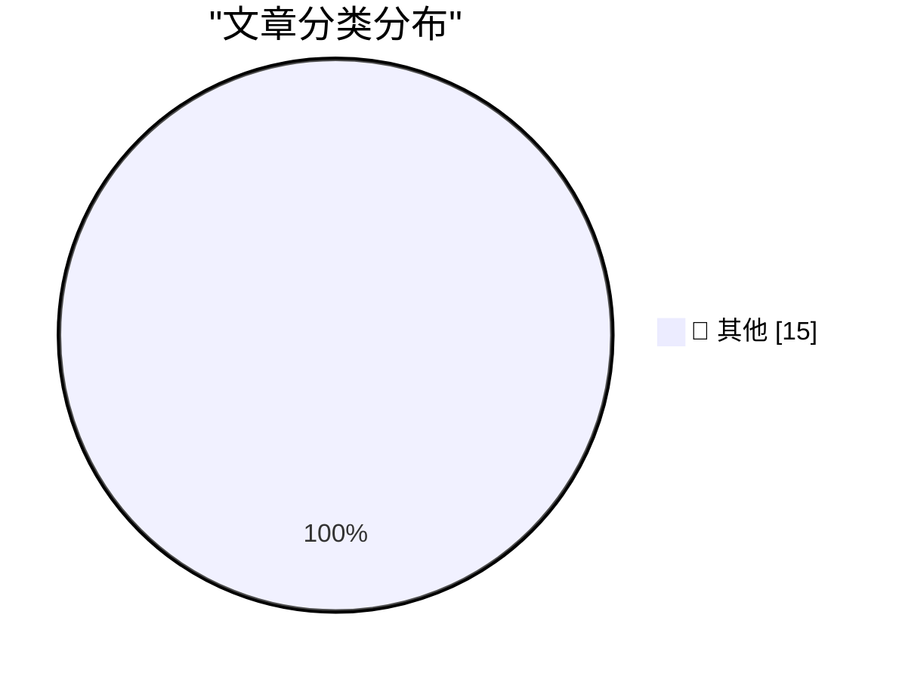

# 📰 AI 资讯每日精选 — 2026-10-26

> 汇聚 140+ 技术博客、X/Twitter、Hacker News、Reddit、Product Hunt、
> Lobste.rs、ClawFeed 日报及 GitHub Trending，经 AI 评分筛选。
>
> **本期内容**：🏆 今日必读 · 🌐 ClawFeed 日报 · 🔥 GitHub Trending · 📂 分类精选 · 🎨 设计与生成式 AI · 📊 数据概览

## 🏆 今日必读

🥇 **Sunnny**

[Sunnny](https://sunnny.com/) — daringfireball.net · 3 小时前 · 📝 其他

> Sunnny

🥈 **Duo Users Are Registering the Base of Their Index Finger as a Touch ID Coping Strategy**

[Duo Users Are Registering the Base of Their Index Finger as a Touch ID Coping Strategy](https://www.reddit.com/r/iPhoneDuo/comments/1xehtcj/best_fingerprint_method/) — daringfireball.net · 3 小时前 · 📝 其他

> Duo Users Are Registering the Base of Their Index Finger as a Touch ID Coping Strategy

🥉 **The Talk Show: ‘Lubricate the Inside of the Hinge’**

[The Talk Show: ‘Lubricate the Inside of the Hinge’](https://daringfireball.net/thetalkshow/2026/10/25/ep-456) — daringfireball.net · 6 小时前 · 📝 其他

> The Talk Show: ‘Lubricate the Inside of the Hinge’

4️⃣ **iPhone Portrait Mode, 10 Years In**

[iPhone Portrait Mode, 10 Years In](https://x.com/johnnie/status/2114007844605612167) — daringfireball.net · 7 小时前 · 📝 其他

> iPhone Portrait Mode, 10 Years In

5️⃣ **Gadget Review: LiberNovo Omni - the USB-C powered office chair ★★★★⯪**

[Gadget Review: LiberNovo Omni - the USB-C powered office chair ★★★★⯪](https://shkspr.mobi/blog/2026/10/gadget-review-libernovo-omni-chair/) — shkspr.mobi · 13 小时前 · 📝 其他

> Gadget Review: LiberNovo Omni - the USB-C powered office chair ★★★★⯪

---

## 🌐 ClawFeed 日报精选

> 来源：[ClawFeed](https://clawfeed.kevinhe.io) — AI 驱动的多源新闻聚合

# 📅 ClawFeed 日报 | 2026-10-25 (SGT)

> 聚合自 3 期已发布的 8 小时简报：#1420 00:00（00:00-07:59）、#1421 08:00（08:00-15:59）、#1422 16:00（16:00-23:59），首尾相接盖满全天。
> ⚠️ 三期正文开头写的窗内素材合计 399 条（feed 386 + 关注抽样 13：#1420 150 + 3、#1421 150 + 7、#1422 86 + 3），分布不均：#1420 的 feed 里 06–07 点档占 91 条，00–05 点六个小时只有 59 条；#1421 的 feed 里 15 点档一个小时占 70 条，08–13 点六个小时只有 57 条；#1422 的抓取比窗口结束晚了两个多小时，feed 只有 86 条，16–19 点四个小时只有 24 条。00–05 点、08–13 点、16–19 点素材偏少，这几段可能漏事。全天没有新书签。整体体育、时政、加密喊单和生活短帖占了大半。
> 主线：「先来找你」的 AI 助手成了一个品类，Grok Bot 一天里加了打电话的能力；算力的账一路往上算——GPU 租金高于折旧曲线、远期曲线转升水，Anthropic 想自研芯片把每 GW 成本压到三分之一，同时有公司因为便宜把写代码的模型从 Claude 换成 OpenAI；Kimi K3.1 Pro 从「跑分很强」走到「上第三方平台、口碑分化」；安全一整天没停：硬件钱包 Keystone 客户信息泄露、Electrum 严重漏洞、腾讯 CubeSandbox 被指可逃逸、以太坊取消 Hoodi 测试网的 Glamsterdam 升级；agent 按次付费（x402）有了第一批数字，加密资金在往交易、稳定币和代币化资产走。

---

## 🔥 当日最重要 5 条

1. **「先来找你」的 AI 助手成品类，Grok Bot 能替你打电话**（#1420 + #1421 + #1422，延续 10-24 日报的 Grok Bot 和主动型 agent）：凌晨 @BrianRoemmele 写用开源的 HarnessRouter 加 Grok Bot 做个人和企业客户的活，思路是留一个长期在线的协调者，而不是一个大 bot 或一堆互不相连的工具（后文被截断）；@IAmNickDodson 的回复里带出 @OpenBot_ 的简介：自称 Grok Bot 的免费开源替代品，本地运行（#1420）。白天 @yuaan1in 说 @NuphosAI 上了 sub-agent 后，用户开始把会话改名成「Release Engineer」「Incident Manager」，像在「雇人」；@turingou 发布 Yobiru Friends，让不同人的 personal agent 直接聊天、发文件、协商日程（自家产品，#1421）。晚上 @FinanceYF5 把 Meta Muse（9 月 8 日）、OpenAI Dots（9 月 29 日）、Anthropic Claude Duet（10 月 21 日）排成六周内的同一种产品，并提到 Expedia 宣布接入 Muse 的第二天股价收跌 7.7%；@elonmusk 引第三方的 Grok Bot 0.77 拆解说 Bot 现在能替你给个人或商家打电话、代你提要求、记下回复并发你摘要；@Chris_Defi 测评 Grok Bot 和 Muse，第 1 点是 Bot 能同时登录 Mac、Linux、iOS、Windows 并跨平台操作（后文被截断，#1422）。
   来源: https://x.com/BrianRoemmele/status/2114128789349490731 ｜ https://x.com/IAmNickDodson/status/2114111735502192808 ｜ https://x.com/yuaan1in/status/2114203907002175800 ｜ https://x.com/turingou/status/2114175110416675209 ｜ https://x.com/FinanceYF5/status/2114385794450460868 ｜ https://x.com/elonmusk/status/2114365361068138990 ｜ https://x.com/elonmusk/status/2114375896073216334 ｜ https://x.com/Chris_Defi/status/2114300755171745972

2. **算力的账：租金、远期价格、自研芯片和「换便宜模型」**（#1420 + #1421 + #1422）：凌晨 @bufcapy 转述 The Information：Rippling 工程师写代码用的模型，5 月 Claude 57%、OpenAI 16%，现在 OpenAI 52%、Claude 18%，CEO 给的理由是「OpenAI 便宜」（二手转述）；@woosuk_k 说 vLLM 在 DeepSeek-V4.1-Flash 上追平了 DeepSeek 自家推理引擎 DeepInfer（vLLM 自己的说法）；@ycombinator 的 Paper Club 说模型每花 1 个 FLOP 训练，每年大约要花 6 个 FLOP 用来服务（#1420）。白天 @elonmusk 列了超算建设的限制清单（电力、土地、许可、并网、变压器等），又引一张图：GPU 租金仍高于 6 年折旧曲线，H200 高 143%、B200 高 111%、H100 高 54%；@aakashgupta 引《卫报》说 Google 在芬兰没等环评就为 AI 数据中心砍了约 25 万棵树；@OliverYeung6 看 SK 海力士财报：HBM4 开始批量出货（#1421）。晚上 @firesidealpha 两段访谈剪辑：Dylan Patel 说 Anthropic 想用 OpenAI 一半的时间做出自研芯片，去掉芯片设计公司的利润后 1 GW 约 200 亿美元而不是 600 亿；Silicon Data CEO Carmen Li 说 GPU 远期曲线已转为升水，市场预期未来 36 个月算力价格继续涨（#1422）。
   来源: https://x.com/bufcapy/status/2114127944289263987 ｜ https://x.com/woosuk_k/status/2114120162668626132 ｜ https://x.com/ycombinator/status/2114031815916912736 ｜ https://x.com/elonmusk/status/2114167331056140414 ｜ https://x.com/elonmusk/status/2114205004340854795 ｜ https://x.com/aakashgupta/status/2114257654382203351 ｜ https://x.com/OliverYeung6/status/2114250609650225621 ｜ https://x.com/firesidealpha/status/2114329376628027755 ｜ https://x.com/firesidealpha/status/2114356939258003569

3. **Kimi K3.1 Pro 的一天：上平台、排名、口碑分化；Qwen 4 传闻**（#1420 + #1421 + #1422，延续 10-24 日报的 Kimi K3.1 Pro）：凌晨 @Super_Nius 一句话说 K3.1「远远超越 Opus 5.5」（没给测试）；@dongxi_nlp 说爆出 Kimi 公关问题的英推 KOL 是互粉凑数账号（个人判断，#1420）。白天 @justinsuntron 转 B.AI 公告：K3.1 Pro 和 Highspeed 上线 B.AI（自家平台）；@teortaxesTex 引 Vals：K3.1 是开放权重第 1、总榜第 8，并认为眼下 Vals 比 AA 更可信（个人判断，#1421）。晚上 @natolambert 的 Interconnects 播客讨论 K3.1 Pro 跑分这么好为什么反响两极、会不会被真正采用；@justinsuntron 又转 B.AI 国产模型 Token 周榜：DeepSeek 第一、小米 MiMo 只差 165.4 亿 Token；@RoundtableSpace 说多个 Qwen 4 版本疑似以「Kalmia」的名字在 Arena 匿名测试（传闻，#1422）。
   来源: https://x.com/Super_Nius/status/2114090456015683769 ｜ https://x.com/dongxi_nlp/status/2114042998019264982 ｜ https://x.com/justinsuntron/status/2114213534645272824 ｜ https://x.com/teortaxesTex/status/2114264863094784321 ｜ https://x.com/natolambert/status/2114337845548584983 ｜ https://x.com/justinsuntron/status/2114308386435248404 ｜ https://x.com/RoundtableSpace/status/2114382727478997100

4. **安全一整天：Keystone 泄露、Electrum 漏洞、CubeSandbox 逃逸、Glamsterdam 取消**（#1420 + #1421 + #1422，延续 10-24 日报的 Brotli 漏洞和 Glamsterdam 推迟）：凌晨 @wublockchain12 说硬件钱包 Keystone 公告：10 月 20 日发现官网遭未授权访问，第三方拿到客户姓名、联系方式、收货地址和订单详情，不涉及助记词和私钥；@134_Atlas 说以太坊开发者取消了原定 10 月 26 日在 Hoodi 测试网的 Glamsterdam 升级，@CoinWorldCap 说原因是拟议的 gas 计算改动可能影响现有合约（都被截断，#1420）。白天 @Bitwux 转 Electrum：4.8.3 修了一个能让钱包显示假交易的严重漏洞；@aeonframework 说扫描器发现腾讯 CubeSandbox 里的代码可以挂载宿主机任意目录、逃出容器（自家发现）；@levie 借 Brotli 漏洞 Node2Shell 说 agent 时代的安全风险会多到跟不上（#1421）。晚上 @punk2898 接着说 Keystone 泄露让大额硬件钱包用户有人身风险（个人观点）；@MaxForAI 说上海 GEEKCON 2026 因为现场破解无人机被人报警叫停（细节没抓到，#1422）。
   来源: https://x.com/wublockchain12/status/2114082879533904269 ｜ https://x.com/134_Atlas/status/2114113165781008684 ｜ https://x.com/CoinWorldCap/status/2114054520980267058 ｜ https://x.com/Bitwux/status/2114166536772669705 ｜ https://x.com/aeonframework/status/2114242213215690879 ｜ https://x.com/levie/status/2114187326406766604 ｜ https://x.com/punk2898/status/2114268391028781543 ｜ https://x.com/MaxForAI/status/2114295394331246833

5. **agent 按次付费有了数字，加密资金往交易和代币化资产走**（#1420 + #1421 + #1422，x402 延续 10-24 日报的 agent 支付）：凌晨 @DemeFi 引 BeInCrypto 的研究：Base 和 Solana 上 35 天 640 万笔 agent 支付只走了约 12 万美元，90.8% 单笔不到 1 美分（没附研究原文）；@AgentFiNews 转金融数据接口支持 x402，agent 用 USDC 按次付费查股价财报（自家公告，#1420）。白天 @t54ai 说 XRP Ledger 上 x402 agent 支付多到「机器人都现身了」（没给数字）；@CryptoCharming 讲币安在 BNB Chain 上的 Agent ID 限定发射模式，认为这种「AI 限定发射台」不会流行（个人观点，#1421）。晚上 @wublockchain12 转 IOSG：传统金融加速进入交易、托管、稳定币和代币化基础设施，原生资金流向 Perp DEX 和预测市场；@BNBCHAIN 说 Q3 在可追踪的代币化资产 DEX 交易量里份额从不到 1% 升到 50% 以上（自家说法，#1422）。
   来源: https://x.com/DemeFi/status/2114133618222362935 ｜ https://x.com/AgentFiNews/status/2114079904740602319 ｜ https://x.com/t54ai/status/2114265339110519088 ｜ https://x.com/CryptoCharming/status/2114251529264009669 ｜ https://x.com/wublockchain12/status/2114295557229580578 ｜ https://x.com/BNBCHAIN/status/2114326137488671155

**⚠️ 未证实（素材里核实不了，只记录说法）**
- 「Rippling 写代码的模型占比从 Claude 57% 变成 OpenAI 52%」：@bufcapy 转述 The Information，没附原文（#1420）。https://x.com/bufcapy/status/2114127944289263987
- 「多个 Qwen 4 版本以 Kalmia 之名在 Arena 匿名测试」：只有 @RoundtableSpace 一条，没有官方出处（#1422）。https://x.com/RoundtableSpace/status/2114382727478997100
- 「法国总理要求四家运营商准备切断 TikTok、Instagram、Snapchat 和 X」：@callebtc 的三手转述（#1420）。https://x.com/callebtc/status/2114110708963016846
- 「瑞典政府要切断公务人员电脑对 Claude 和 ChatGPT 的访问」：@WorldInMotionHQ 只有标题（#1421）。https://x.com/WorldInMotionHQ/status/2114235732667830587
- 「AI 会先攻破传统银行再轮到比特币」：@pete_rizzo_ 转述 CZ（#1421）。https://x.com/pete_rizzo_/status/2114255640097100051

**次重要（备选）**
- Instacart 据报和 DoorDash、Uber 讨论过出售自己（@TechCrunch，报道转述，#1420）。https://x.com/TechCrunch/status/2114032940015366394
- Block 说语音模型 Dessa 能在 MacBook M4 Max 上本地跑（@TechCrunch，延续 10-24 日报的 Dessa，#1420）。https://x.com/TechCrunch/status/2114025395125117359
- Apollo 首席经济学家报告：七巨头之外的 493 家标普公司大量投入 AI 后人均收入和利润率持平（@marquistrillx 二手转述，#1420）。https://x.com/marquistrillx/status/2114144335151464790
- ETH Zurich 教会 G1 机器人爬梯子等动作（@kimmonismus，#1422）。https://x.com/kimmonismus/status/2114338380376949167
- Google Quantum AI 在 Kaggle 办 70 万美元比赛，用 AI 压缩量子电路（@EntrepreneursAI，#1422）。https://x.com/EntrepreneursAI/status/2114386286173622416

---

## 📰 当日核心主题

**① Agent 工程、工具和实测（三期都有）**
工具和方法：Claude Managed Agents Cookbook，用 16 个 notebook 学 Managed Agents（#1420，https://x.com/dani_avila7/status/2114129576196726812）；KTransformers-FineTune 给 MoE 微调吞吐提升 2.5–21.2 倍（#1420，https://x.com/jiqizhixin/status/2114113202133074191）；GitHub 用自家 App「Evergreen」管外部协作者权限（#1420，https://x.com/github/status/2114037959649288534）；prime-rl 合并 score centering（#1421，https://x.com/samsja19/status/2114262782602592619）；Miles 101 和 vLLM 101 两份入门手册（自家网站，#1421，https://x.com/ghumare64/status/2114248945920770188）；94 个 Blender Skill（#1421，https://x.com/songsong/status/2114196156041564631）。
实测和体验：装到 512 个 skill 时 Claude Code 36 次开对 35 次、Codex 只开对 17 次（#1422，https://x.com/GoSailGlobal/status/2114347925182816488）；Hermes Agent 20 分钟出网站、一天 462 个 demo（#1421，https://x.com/BkashJosi/status/2114250135429685619）；Hermes 移动 App 预告（#1422，https://x.com/testingcatalog/status/2114326104416678367）；Ubuntu 通过 T3 Code 连 Mac mini 跑 iOS 模拟器（自家产品，#1422，https://x.com/theo/status/2114267380818100402）；Claude Code 云端环境要另扣 credits（#1421，https://x.com/DavidOndrej1/status/2114255881164779646）。
内容工具：CapCut 给 ChatGPT 出插件，一天里从「已上线桌面版」的教程到 CapCut 官方「即将推出」的预告都有（#1421，https://x.com/heyshrutimishra/status/2114253774441091451 ｜ #1422，https://x.com/laobaishare/status/2114286679376994651）；Kindle 刷机加 AI RSS、一句话发书（#1422，https://x.com/vista8/status/2114340452870836238）；免费开源的雅思背词网站（#1422，https://x.com/yangleiocx3/status/2114337645148979380）。

**② 学习资源和研究（#1421 + #1422）**
Sebastian Raschka 的推理模型视频系列上线、RSI 和持续学习的中文综述（#1422，https://x.com/alacheng/status/2114351659019329539 ｜ https://x.com/alacheng/status/2114327139181019309）；斯坦福 CS231N 全套免费（#1422，https://x.com/0x_meden/status/2114329458651893764）；机器人「部署公司」的说法（#1422，https://x.com/alacheng/status/2114303250233176309）；数学知识点依赖图谱和 Auto-Editor 两个开源项目（#1421，https://x.com/GitHub_Daily/status/2114205386605826522 ｜ https://x.com/GitHub_Daily/status/2114258176648626317）。

**③ 资本、公司和人才（三期都有）**
VC 和回报：七家巨型风投越来越像「VC 大盘指数」、市场集中度连创纪录（#1421，https://x.com/FinanceYF5/status/2114240464836792614 ｜ https://x.com/FinanceYF5/status/2114241618471756203）；Jordi Visser 认为加密回报潜力高于 AI 算力交易（个人观点，#1420，https://x.com/Cointelegraph/status/2114137644930138398）；PE 基金往被投公司派自己的 AI 工程师（#1422，https://x.com/mardehaym/status/2114336480793604328）。
创业和人：Lovable 到 1 亿美元 ARR 的分发路径，「AI 让做产品变便宜，没让分发变便宜」（#1422，https://x.com/guilleflorvs/status/2114342479856025714）；Parag Agrawal「不招异类就得不到异类」（#1422，https://x.com/MollySOShea/status/2114385496243581278）；Thariq 离开 Anthropic 的后续（延续 10-24 日报，无新信息，#1421，https://x.com/elioex0/status/2114241488582520953）；Flapping Airplanes 完成 A 轮（#1421，https://x.com/noahrshinn/status/2114179515211805149）；Revolut 想在 100 个国家做第一大银行（#1422，https://x.com/davidsenra/status/2114356314411348074）；Sundar Pichai 认为搜索会被并进 agent 层（只有标题，#1422，https://x.com/sejournal/status/2114341203135070396）；r/OpenSource 禁止一切用到 AI 的内容（#1421，https://x.com/dcbuilder/status/2114256467075473725）。

**④ 加密和链上金融（三期都有）**
产品和市场：@fomo 上线基于 Hyperliquid 的永续合约（#1420，https://x.com/DegenerateNews/status/2114124581808263563）；Toly 提议质押加权预言机（只有标题，#1420，https://x.com/Techub_News/status/2114122154195259564）；Solana 链上永续品类、Coinbase 上线价格预测市场（#1421，https://x.com/PhoenixTrade/status/2114157802574811160 ｜ https://x.com/coinbase/status/2114148184285143349）；Robinhood Chain 上 59% 的股票代币交易在盘后（只有标题，#1421，https://x.com/Techub_News/status/2114258701531885927）；Hyperliquid 调整测试网操作优先级（#1422，https://x.com/wublockchain12/status/2114291965772870065）。
资金动向：Worldcoin 关联地址 11 小时转入交易所 1050 万枚 WLD（#1421，https://x.com/wublockchain12/status/2114181972234993756）；Polygon 多签向质押合约转入 5292.8 万枚 POL（#1422，https://x.com/wublockchain12/status/2114320491821617187）；Cardone Capital 在下跌中买了 16 枚 BTC（#1420，https://x.com/BitcoinMagazine/status/2114129011752178077）；Sibos 上大银行对稳定币冷淡、对代币化存款感兴趣（#1421，https://x.com/robbieklages/status/2114251472044962214）。

**⑤ 宏观和其他（三期都有）**
伊朗：特朗普称正在考虑攻击伊朗、「可能明天就发生」（#1420，https://x.com/AJArabic/status/2114096309598822571）；伊朗军方称在阿巴斯港击落美国无人机、特朗普说要停止击杀伊朗领导人才能确定和谁谈判（#1421，https://x.com/Reuters/status/2114259428731977851 ｜ https://x.com/AJEnglish/status/2114259903389081954）；特朗普说油价上涨是暂时的（#1421，https://x.com/coinbureau/status/2114260926660485626）。
Starlink：玻利维亚把 4700 个天线发到全国学校（#1420，https://x.com/elonmusk/status/2114065201939034225）；马斯克回应「乌克兰星链被降速」（#1421，https://x.com/KKaWSB/status/2114252487452774658）；Aer Lingus 美国全部航线提供免费 Starlink Wi-Fi（#1422，https://x.com/elonmusk/status/2114370625582330326）。
其他：金正恩访华后回国（#1421，https://x.com/Reuters/status/2114185188712259844）；法国又一个周末大规模抗议、近 1000 人被拘（#1421，https://x.com/CNN/status/2114159901257654757）。

---

## 🔖 Bookmarks 精选

今天没有新加的书签：三期抓到的 20 条书签里最新一条仍是 10-04 的推文，三期都跳过了这一区块，本日报也没有可补选的内容。

---

## 👀 推荐关注汇总（去重，共 5 个；各期写稿时都在浏览器里核实过「未关注」：#1421 在 10-25 16:17–16:19，#1422 在 10-26 02:20–02:21 SGT，本日报没有重新核实；#1420 本期没有推荐）

**AI 资讯 / 产业**
- @firesidealpha（Fireside Alpha，约 3.56 万粉）：剪辑商业和科技人物访谈并配文字稿，本日两条是 Dylan Patel 谈 Anthropic 自研芯片成本、Silicon Data 谈 GPU 远期曲线；账号 2026 年 6 月才注册，以访谈剪辑为主、原创观点少，你关注的人里有 67 位关注（#1422）。https://x.com/firesidealpha
- @testingcatalog（AI News | TestingCatalog，约 8.16 万粉）：专追 AI 模型发布、agent 产品、泄露和测试版功能，本日是 Hermes 移动 App 预告（#1422）。https://x.com/testingcatalog

**创业 / 投资**
- @guilleflorvs（Guillermo Flor，约 1.24 万粉）：天使投资人，写 AI 创业公司的分发和 GTM 拆解，本日是 Lovable 到 1 亿美元 ARR 的分发路径，你关注的人里有 35 位关注（#1422）。https://x.com/guilleflorvs
- @yuaan1in（Yuanlin Lin，约 730 粉）：在做 nuphos.ai（团队用的 agent 工作区，代码开源），写了用户把 sub-agent 当成「雇人」的一手观察；粉丝少，按「多位已关注的人关注」（13 位）和 building in public 推荐（#1421）。https://x.com/yuaan1in

**中文 AI 教程**
- @songsong（宋宋，约 1.27 万粉）：简介写游戏开发工程师，分享 AI 知识和工具、写小白教程，本日推荐了 94 个 Blender Skill 的项目，你关注的人里有 31 位关注（#1421）。https://x.com/songsong

**建议取关**：三期都没有提出取关建议。

---

## 💤 当日重复噪音模式

三期合计过滤 263 条 feed（#1420 113、#1421 102、#1422 48），另有关注抽样 9 条没收；按类别（三期分类口径略有不同，按最接近的合并）：
- **一句话回复、生活和信息量少**：97 条，量最大（#1420 48、#1421 35、#1422 14）。
- **时政和社会新闻（印度、美国、欧洲）**：56 条（#1420 20、#1421 19、#1422 17；含印度总理和总理办公室的多条、美国中期选举相关）。
- **加密喊单、项目推广和交易所动态**：46 条（#1420 16、#1421 25、#1422 5）。
- **体育、娱乐、品牌和机构宣传**：56 条（#1420 体育 21；#1421 体育 14、品牌营销和 agent 排行榜 9；#1422 品牌、机构宣传、娱乐和体育合计 12）。
- **创作者涨粉套路帖**：8 条（#1420，都来自 @marquistrillx 一人）。
- **关注抽样里没收的**：9 条，多是 @StartupWisdom_ 的语录和订阅推广、@Tradermayne 的直播预告和交易闲聊、@mardehaym 的约会议链接、@noahrshinn 和 @rwayne 的闲聊。
- **同一话题延续**：Kimi K3.1 Pro（#1420 → #1421 → #1422）、Grok Bot 和主动型 agent（#1420 → #1422）、GPU 租金和算力成本（#1420 → #1421 → #1422）、Keystone 泄露（#1420 → #1422）、CapCut 插件（#1421 → #1422）、Starlink（三期都有）、伊朗（#1420 → #1421）已合并；其中 Kimi K3.1、Grok Bot、Dessa、Brotli 漏洞、Glamsterdam、Thariq 离职也接着 10-24 日报的话题。
---

## 🔥 GitHub Trending

> 今日热门开源项目（全语言 + Python）

| # | 项目 | 描述 | ⭐ 总星 | 📈 今日 | 语言 |
|---|------|------|---------|---------|------|
| 1 | [cloudflare/security-audit-skill](https://github.com/cloudflare/security-audit-skill) 🤖 | A coding-agent skill for multi-phase security audits with... | 47.0k | +2878 | JavaScript |
| 2 | [debpalash/VoiceStudio](https://github.com/debpalash/VoiceStudio) | VoiceStudio is the open-source, fully-local ElevenLabs al... | 86.9k | +1592 | Python |
| 3 | [Nutlope/hallmark](https://github.com/Nutlope/hallmark) 🤖 | Anti-AI-slop design skill for Claude Code, Cursor, and Co... | 33.9k | +1317 | CSS |
| 4 | [experientiallabs/experiential](https://github.com/experientiallabs/experiential) | Experiential is the open source, zero markup gateway for ... | 12.9k | +1117 | Python |
| 5 | [pbakaus/impeccable](https://github.com/pbakaus/impeccable) 🤖 | The design language that makes your AI harness better at ... | 87.7k | +1092 | Rust |
| 6 | [makecindy/cindy](https://github.com/makecindy/cindy) 🤖 | Consider it done. The open-source AI agent that works out... | 4.9k | +675 | TypeScript |
| 7 | [pollen-robotics/microduck](https://github.com/pollen-robotics/microduck) | A Tiny biped duck robot 🦆 | 11.7k | +647 | Rust |
| 8 | [TauricResearch/TradingAgents](https://github.com/TauricResearch/TradingAgents) 🤖 | TradingAgents: Multi-Agents LLM Financial Trading Framework | 114.7k | +381 | Python |
| 9 | [NanmiCoder/MediaCrawler](https://github.com/NanmiCoder/MediaCrawler) | 小红书笔记 | 评论爬虫、抖音视频 | 评论爬虫、快手视频 | 评论爬虫、B 站视频 ｜ 评论爬虫、微博帖子 ｜ ... | 68.6k | +350 | Python |
| 10 | [521xueweihan/HelloGitHub](https://github.com/521xueweihan/HelloGitHub) | 分享 GitHub 上有趣、入门级的开源项目。Share interesting, entry-level ope... | 184.5k | +276 | Python |
| 11 | [aws/agent-toolkit-for-aws](https://github.com/aws/agent-toolkit-for-aws) 🤖 | Official, AWS-supported MCP servers, skills, and plugins ... | 3.3k | +245 | Python |
| 12 | [AstrBotDevs/AstrBot](https://github.com/AstrBotDevs/AstrBot) 🤖 | AI Agent Assistant & development framework that integrate... | 43.5k | +208 | Python |
| 13 | [Renhuai123/ziwei-doushu](https://github.com/Renhuai123/ziwei-doushu) | 紫微斗数开源排盘引擎 — 基于倪海厦《天纪》体系，含完整排盘算法、四化系统、格局知识库、古籍原文数据 | 7.6k | +199 | TypeScript |
| 14 | [AgriciDaniel/claude-seo](https://github.com/AgriciDaniel/claude-seo) 🤖 | Universal SEO skill for Claude Code. 26 sub-skills + 19 s... | 20.9k | +197 | Python |
| 15 | [SnailSploit/Claude-Red](https://github.com/SnailSploit/Claude-Red) 🤖 | claude-red is a curated library of offensive security ski... | 9.1k | +186 | Python |

---

## 📝 其他

### 1. Sunnny

[Sunnny](https://sunnny.com/) — **daringfireball.net** · 3 小时前 · ⭐ 15/30

> Sunnny

---

### 2. Duo Users Are Registering the Base of Their Index Finger as a Touch ID Coping Strategy

[Duo Users Are Registering the Base of Their Index Finger as a Touch ID Coping Strategy](https://www.reddit.com/r/iPhoneDuo/comments/1xehtcj/best_fingerprint_method/) — **daringfireball.net** · 3 小时前 · ⭐ 15/30

> Duo Users Are Registering the Base of Their Index Finger as a Touch ID Coping Strategy

---

### 3. The Talk Show: ‘Lubricate the Inside of the Hinge’

[The Talk Show: ‘Lubricate the Inside of the Hinge’](https://daringfireball.net/thetalkshow/2026/10/25/ep-456) — **daringfireball.net** · 6 小时前 · ⭐ 15/30

> The Talk Show: ‘Lubricate the Inside of the Hinge’

---

### 4. iPhone Portrait Mode, 10 Years In

[iPhone Portrait Mode, 10 Years In](https://x.com/johnnie/status/2114007844605612167) — **daringfireball.net** · 7 小时前 · ⭐ 15/30

> iPhone Portrait Mode, 10 Years In

---

### 5. Gadget Review: LiberNovo Omni - the USB-C powered office chair ★★★★⯪

[Gadget Review: LiberNovo Omni - the USB-C powered office chair ★★★★⯪](https://shkspr.mobi/blog/2026/10/gadget-review-libernovo-omni-chair/) — **shkspr.mobi** · 13 小时前 · ⭐ 15/30

> Gadget Review: LiberNovo Omni - the USB-C powered office chair ★★★★⯪

---

### 6. Poles and polars

[Poles and polars](https://www.johndcook.com/blog/2026/10/25/poles-and-polars/) — **johndcook.com** · 5 小时前 · ⭐ 15/30

> Poles and polars

---

### 7. OpenAI and Anthropic cut their LLM prices by up to 80% within a few months. Why?

[OpenAI and Anthropic cut their LLM prices by up to 80% within a few months. Why?](https://minimaxir.com/2026/10/cheap-llms/) — **minimaxir.com** · 4 小时前 · ⭐ 15/30

> OpenAI and Anthropic cut their LLM prices by up to 80% within a few months. Why?

---

### 8. How much you can make in an entry level cyber security job

[How much you can make in an entry level cyber security job](https://dfarq.homeip.net/how-much-you-can-make-in-an-entry-level-cyber-security-job/?utm_source=rss&#038;utm_medium=rss&#038;utm_campaign=how-much-you-can-make-in-an-entry-level-cyber-security-job) — **dfarq.homeip.net** · 14 小时前 · ⭐ 15/30

> How much you can make in an entry level cyber security job

---

### 9. Nvidia open-sources Flora to make robot video labeling 125x cheaper than GPT-6 Astra

[Nvidia open-sources Flora to make robot video labeling 125x cheaper than GPT-6 Astra](https://the-decoder.com/nvidia-open-sources-flora-to-make-robot-video-labeling-125x-cheaper-than-gpt-6-astra/) — **The Decoder** · 15 小时前 · ⭐ 15/30

> Nvidia open-sources Flora to make robot video labeling 125x cheaper than GPT-6 Astra

---

### 10. Anthropic co-founder Jack Clark moves his prediction for self-improving AI forward to 2027

[Anthropic co-founder Jack Clark moves his prediction for self-improving AI forward to 2027](https://the-decoder.com/anthropic-co-founder-jack-clark-moves-his-prediction-for-self-improving-ai-forward-to-2027/) — **The Decoder** · 16 小时前 · ⭐ 15/30

> Anthropic co-founder Jack Clark moves his prediction for self-improving AI forward to 2027

---

### 11. Anthropic says one AI agent beats many subagents now that models can handle complexity alone

[Anthropic says one AI agent beats many subagents now that models can handle complexity alone](https://the-decoder.com/anthropic-says-one-ai-agent-beats-many-subagents-now-that-models-can-handle-complexity-alone/) — **The Decoder** · 16 小时前 · ⭐ 15/30

> Anthropic says one AI agent beats many subagents now that models can handle complexity alone

---

### 12. Ex-Google CEO Eric Schmidt calls OpenAI and Anthropic modern colonial trading companies

[Ex-Google CEO Eric Schmidt calls OpenAI and Anthropic modern colonial trading companies](https://the-decoder.com/ex-google-ceo-eric-schmidt-calls-openai-and-anthropic-modern-colonial-trading-companies/) — **The Decoder** · 17 小时前 · ⭐ 15/30

> Ex-Google CEO Eric Schmidt calls OpenAI and Anthropic modern colonial trading companies

---

### 13. OpenAI offers discounts up to 90 percent to poach Anthropic's biggest customers

[OpenAI offers discounts up to 90 percent to poach Anthropic's biggest customers](https://the-decoder.com/openai-offers-discounts-up-to-90-percent-to-poach-anthropics-biggest-customers/) — **The Decoder** · 18 小时前 · ⭐ 15/30

> OpenAI offers discounts up to 90 percent to poach Anthropic's biggest customers

---

### 14. OpenMobile-2 proves open-source smartphone agents can rival proprietary models

[OpenMobile-2 proves open-source smartphone agents can rival proprietary models](https://the-decoder.com/openmobile-2-proves-open-source-smartphone-agents-can-rival-proprietary-models/) — **The Decoder** · 18 小时前 · ⭐ 15/30

> OpenMobile-2 proves open-source smartphone agents can rival proprietary models

---

### 15. Serbia's Vucic concedes election defeat in historic win for student movement

[Serbia's Vucic concedes election defeat in historic win for student movement](https://www.reuters.com/world/europe/serbia-votes-students-seek-unseat-vucic-snap-election-2026-10-25/) — **Hacker News Best** · 4 小时前 · ⭐ 15/30

> Serbia's Vucic concedes election defeat in historic win for student movement

---

## 🎨 Design & Generative AI

### 🖼️ 生成式图片

- **[My first scene created with MiniMax H3 in ComfyUI, rendered on an NVIDIA RTX 3090 GPU.](https://www.reddit.com/r/comfyui/comments/1xf5r4l/my_first_scene_created_with_minimax_h3_in_comfyui/)** — r/comfyui · 9 小时前
  > My first scene created with MiniMax H3 in ComfyUI, rendered on an NVIDIA RTX 3090 GPU.

- **[Zipties in ComfyUI!](https://www.reddit.com/r/comfyui/comments/1xf9x6j/zipties_in_comfyui/)** — r/comfyui · 7 小时前
  > Zipties in ComfyUI!

- **[Sonnet 5.5 created a music video in ComfyUI - fully automated.](https://www.reddit.com/r/comfyui/comments/1xfh9a4/sonnet_55_created_a_music_video_in_comfyui_fully/)** — r/comfyui · 2 小时前
  > Sonnet 5.5 created a music video in ComfyUI - fully automated.

- **[ComfyUI-ZeroCopy-Continuity: Custom nodes to lock 20GB+ DiT models in VRAM (0.0s reload) & chain latents across cuts without VAE drift](https://www.reddit.com/r/comfyui/comments/1xf9yrs/comfyuizerocopycontinuity_custom_nodes_to_lock/)** — r/comfyui · 7 小时前
  > ComfyUI-ZeroCopy-Continuity: Custom nodes to lock 20GB+ DiT models in VRAM (0.0s reload) & chain latents across cuts without VAE drift

- **[ComfyUI gpu-unlock timings: BF16 vs INT8, with seconds saved (free comparison)](https://www.reddit.com/r/comfyui/comments/1xeprfe/comfyui_gpuunlock_timings_bf16_vs_int8_with/)** — r/comfyui · 23 小时前
  > ComfyUI gpu-unlock timings: BF16 vs INT8, with seconds saved (free comparison)

- **[I built two retro 7-segment timer nodes for ComfyUI to accurately track total batch workflow durations (no more infinite ticking ghosts).](https://www.reddit.com/r/comfyui/comments/1xf7ey2/i_built_two_retro_7segment_timer_nodes_for/)** — r/comfyui · 8 小时前
  > I built two retro 7-segment timer nodes for ComfyUI to accurately track total batch workflow durations (no more infinite ticking ghosts).

- **[Updated ComfyUI-HSWQ-Loader-and-Tools v3.6.7 - HSWQ Moss-Image Prompt Enhancer & Vision LLM Integration](https://www.reddit.com/r/comfyui/comments/1xfdl2o/updated_comfyuihswqloaderandtools_v367_hswq/)** — r/comfyui · 4 小时前
  > Updated ComfyUI-HSWQ-Loader-and-Tools v3.6.7 - HSWQ Moss-Image Prompt Enhancer & Vision LLM Integration

- **[Free Generative Fill for PhotoCraft on your own ComfyUI](https://www.reddit.com/r/comfyui/comments/1xfgdff/free_generative_fill_for_photocraft_on_your_own/)** — r/comfyui · 2 小时前
  > Free Generative Fill for PhotoCraft on your own ComfyUI

- **[Model Lora Merging Help](https://www.reddit.com/r/comfyui/comments/1xfh9ds/model_lora_merging_help/)** — r/comfyui · 2 小时前
  > Model Lora Merging Help

---

## 📊 数据概览

| 扫描源 | 抓取文章 | 时间范围 | 精选 |
|:---:|:---:|:---:|:---:|
| 93/140 | 3942 篇 → 62 篇 | 24h | **15 篇** |

### 分类分布

---

*生成于 2026-10-26 01:38 | 汇聚 140 个技术博客、X/Twitter、Hacker News、Reddit、Product Hunt、Lobste.rs、ClawFeed 日报及 GitHub Trending，经 AI 评分筛选出 Top 15 精华内容*
