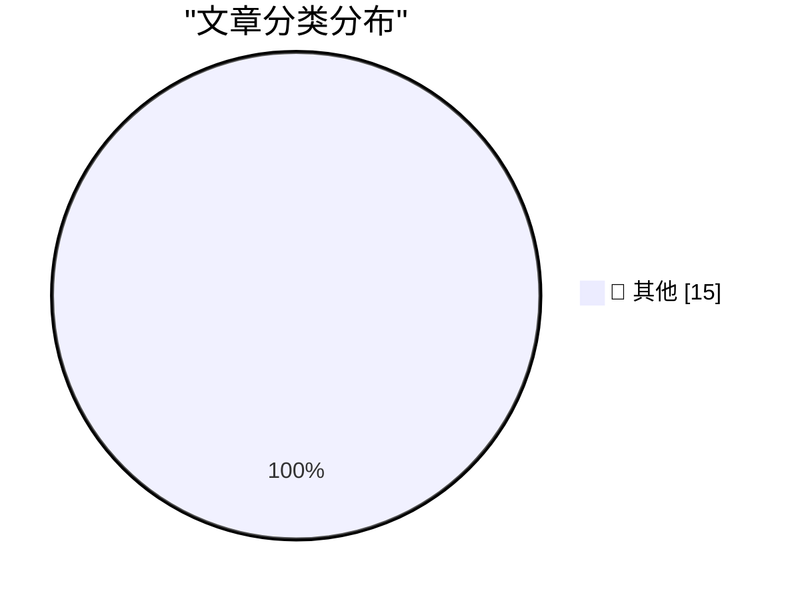

# 📰 AI 资讯每日精选 — 2026-10-29

> 汇聚 140+ 技术博客、X/Twitter、Hacker News、Reddit、Product Hunt、
> Lobste.rs、ClawFeed 日报及 GitHub Trending，经 AI 评分筛选。
>
> **本期内容**：🏆 今日必读 · 🌐 ClawFeed 日报 · 🔥 GitHub Trending · 📂 分类精选 · 🎨 设计与生成式 AI · 📊 数据概览

## 🏆 今日必读

🥇 **Quoting Ted Sanders**

[Quoting Ted Sanders](https://simonwillison.net/2026/Oct/28/ted-sanders/) — simonwillison.net · 3 小时前 · 📝 其他

> Quoting Ted Sanders

🥈 **GitHub Octoverse 2026**

[GitHub Octoverse 2026](https://simonwillison.net/2026/Oct/28/github-octoverse-2026/) — simonwillison.net · 10 小时前 · 📝 其他

> GitHub Octoverse 2026

🥉 **The October inflection point for vibe game development**

[The October inflection point for vibe game development](https://simonwillison.net/2026/Oct/28/vibe-game-development/) — simonwillison.net · 12 小时前 · 📝 其他

> The October inflection point for vibe game development

4️⃣ **Quoting Terk Terkowitz**

[Quoting Terk Terkowitz](https://simonwillison.net/2026/Oct/28/terk-terkowitz/) — simonwillison.net · 16 小时前 · 📝 其他

> Quoting Terk Terkowitz

5️⃣ **Guessing the Name: MacBook Studio?**

[Guessing the Name: MacBook Studio?](https://www.macrumors.com/2026/10/28/macbook-studio/) — daringfireball.net · 11 小时前 · 📝 其他

> Guessing the Name: MacBook Studio?

---

## 🌐 ClawFeed 日报精选

> 来源：[ClawFeed](https://clawfeed.kevinhe.io) — AI 驱动的多源新闻聚合

# 📅 ClawFeed 日报 | 2026-10-28 (SGT)

> 聚合自 3 期已发布的 8 小时简报：#1433 00:00（00:00-07:59）、#1434 08:00（08:00-15:59）、#1435 16:00（16:00-23:59），首尾相接盖满全天。
> ⚠️ 三期正文开头写的窗内素材合计 458 条（feed 425 + 关注抽样 33：#1433 172 + 13、#1434 92 + 9、#1435 161 + 11），三期的抓取都紧跟在窗口结束后，但首页推荐流越靠近窗口末尾越多：#1433 的 6–7 点档占 112 条，4–5 点档只有 7 条和 6 条；#1434 的 14–15 点档占 60 条，11–13 点档只有 3、2、5 条；#1435 的 22–23 点档占 100 条，16–18 点档只有 3、6、1 条。凌晨 4–5 点、中午 11–13 点和下午 16–18 点素材偏少，这几段可能漏事。全天没有新书签。整体体育、时政、品牌宣传、加密喊单和一句话帖占了大半，#1434、#1435 都说 AI 方面一手发布不多。
> 主线：Google DeepMind 发布世界模型 Genie 4；Anthropic 上市前又冒新料——S-1 显示账上现金 1124 亿美元、收购一家「一人」AI 制药公司、亚马逊持股的账面收益；传统金融往链上搬，DTCC 代币化服务上线、摩根大通存款代币上以太坊、Circle 的 Arc 链 USDC 过 10 亿；安全上 Coinbase 数据泄露的说法（官方未确认）、Bithumb 和万代南梦宫泄露，Datavault 储备困在交易所、wIRON 异常增发；「让 agent 自己付钱」又多几条路：Stripe 的企业间即时转账、Link 余额背后的技术、agent 用 x402 买域名。另有 Axiom 形式化的后续细节、用 AI 的价钱在变、比特币仍在 8 万附近。

---

## 🔥 当日最重要 5 条

1. **Google DeepMind 发布 Genie 4 世界模型：实时生成可交互场景，加了声音和角色对话**（#1433，#1434 只有转评）：@GoogleDeepMind 说 Genie 4 是他们目前最逼真、交互性最强的世界模型，可以实时探索动态环境，看场景怎么响应、发出什么声音、里面的人怎么动和说话；@GoogleAI：可以用自然语言实时改天气、移动镜头、加入新元素（后文被截断）；@demishassabis：把实时物理、推理和音频放到了一起。@RoundtableSpace：随着你移动逐帧生成 3D 世界，角色之间会对话、也会回应你；目前是研究预览，Google AI Ultra 用户「很快」能用。@op7418 的观感：画质和物理效果大幅提升，终于能在生成中途用提示词触发事件，但 Ultra 会员现在还用不上。目前只有官方发布和观感，没看到外部评测（#1433）。
   来源: https://x.com/GoogleDeepMind/status/2115114028338962672 ｜ https://x.com/GoogleAI/status/2115114625985368299 ｜ https://x.com/demishassabis/status/2115232001275924722 ｜ https://x.com/RoundtableSpace/status/2115228299295121671 ｜ https://x.com/op7418/status/2115128743408828720

2. **Anthropic 上市前的新料：现金 1124 亿美元、收购「一人」制药公司、亚马逊账面大赚**（#1434 + #1435，延续 10-27 日报的上市余波）：晚上 @CNBC：S-1 披露账上现金 1124 亿美元，另有 193 亿美元短期……（后文被截断），现金比几乎所有美国公司都多。@turingbook（关注抽样）转评 @Prof_Oak_：Anthropic 收购了一家 AI 制药「一人公司」，唯一的创始人 Cody Tranbarger（之前匿名的 Professor Oak）背景是运营、商务、创投，交易条款没看到。@XAngus：上市前 Dario 和 Daniela Amodei 与 Walter Isaacson 聊了 42 分钟（AI 会不会撒谎、会不会想「活下去」、为什么离开 OpenAI），他做了中字版（#1435）。上午 @TechCrunch：大额可转票据转换显示了亚马逊在 Anthropic 持股的真实规模，VC 会在 IPO 上赚几十亿，亚马逊赚得多得多（只有标题，#1434）。另有「Anthropic 面试不再考 LeetCode」的说法，见下方未证实。
   来源: https://x.com/CNBC/status/2115428325573148714 ｜ https://x.com/turingbook/status/2115367056459903266 ｜ https://x.com/XAngus/status/2115463774174073038 ｜ https://x.com/TechCrunch/status/2115251976493470025

3. **传统金融和美元往链上搬：DTCC 代币化服务上线，摩根大通存款代币上以太坊，Arc 上 USDC 过 10 亿**（#1434 + #1435，代币化股票和 RWA 延续 10-27 日报）：晚上 @DefiantNews 独家：美国最大的证券存管机构 DTCC 的代币化服务当天上线，首批 34 只证券、代币 1:1 有底层支持；美银、巴克莱、花旗、富达、摩根大通、摩根士丹利等 20 家 DTC 参与方已签约，DTCC 数字资产负责人 Nadine Chakar 说目标是放出约 30 万亿美元资产（后文被截断）。@karsenthil 转评 @nemild：YC 新一期加密 Request for Startups，想多投 AI 融资、稳定币、交易和 agent 方向（#1435）。上午 @wublockchain12：美国财长贝森特在 Ripple Swell 上说，美国在数字资产上的领导地位会成为巩固美元霸权的关键工具（正文后文被截断）；@wublockchain12 引 The Defiant 和 DefiLlama：Circle 的 Arc 链上线约 6 周 USDC 供应过 10 亿美元、一周涨 32%，但约 73% 在 4 个地址手里；@CoinDesk：摩根大通的存款代币在以太坊上，但只有自家客户能持有，@austincampbell 说它是给代币化股票交易付款用的、不是给 DeFi（#1434）。
   来源: https://x.com/DefiantNews/status/2115439119484465233 ｜ https://x.com/karsenthil/status/2115473465809797615 ｜ https://x.com/wublockchain12/status/2115244917735989538 ｜ https://x.com/wublockchain12/status/2115251956541444142 ｜ https://x.com/CoinDesk/status/2115242953597673570

4. **安全一上午：三起数据泄露，加上托管和跨链出事**（#1434）：@wublockchain12：慢雾首席信息安全官 23pds 说已确认 Coinbase 数据泄露属实，初步估计黑客拿到 7 万多名用户的联系信息，还没确认密码或资金是否被盗——这条没有 Coinbase 官方确认，也不清楚是不是 2025 年 5 月那起之外的新事件（后文被截断）；@Cryptic_Web3：韩国交易所 Bithumb 确认内部移动办公系统遭未授权访问、发生个人信息泄露，前面还有大信证券 38,490 条数据泄露；@nhk_news：万代南梦宫顾客邮箱等信息泄露超过 34.6 万条（只有标题）。托管和跨链：@wublockchain12 转述 Jameson Lopp：比特币财资公司 Datavault（DVLT）24 小时跌 49.55%，它的全部金库储备放在交易所 Biconomy，申请提币 4 个月后仍提不出（转述，后文被截断）；Iron Fish 在查 Base 上封装代币 wIRON 的异常发行，警告目前不能保证 1:1 足额支持，建议先别买、别用相关跨链桥。
   来源: https://x.com/wublockchain12/status/2115269233072558420 ｜ https://x.com/Cryptic_Web3/status/2115347831032827964 ｜ https://x.com/nhk_news/status/2115319412542804200 ｜ https://x.com/wublockchain12/status/2115238773630087293 ｜ https://x.com/wublockchain12/status/2115282822407786661

5. **让 agent 自己付钱又多几条路：Stripe 企业间即时转账、Link 余额的底层、agent 用 x402 买域名**（#1433 + #1434，Link 余额延续 10-27 日报）：凌晨 @jeff_weinstein 转 @stripe：推出「stripe pay」，企业之间用对方的 Stripe 主页 handle 找到公司、免费即时打款，Dashboard 和命令行都能用；@patrickc 只说了一句「A2A 支付会比 P2P 支付更重要」（A2A 指什么没解释）。@jeff_weinstein 另转 @StripeCrypto：给 AI agent 用的 Link 余额背后是 Tempo 上的稳定币和 Privy 的非托管钱包，首个接入方是 Instinct；@brian_armstrong 转 @CoinbaseBiz：agent 现在可以在域名市场 Atom 上用 Coinbase Business 买域名，x402 从数据和 API 请求扩到买域名；@noahrshinn（关注抽样）：Instinct 群聊对所有 iMessage 用户开放（自家产品，#1433）。上午 @GoKiteAI 的宣传片跟拍一次真实运行：agent 从自己的额度里付钱给 @apify 买 iPhone Duo 的用户评价数据（自家宣传、后文被截断，#1434）。
   来源: https://x.com/jeff_weinstein/status/2115161308681441747 ｜ https://x.com/patrickc/status/2115183046811156885 ｜ https://x.com/jeff_weinstein/status/2115161466253009070 ｜ https://x.com/brian_armstrong/status/2115224970188185624 ｜ https://x.com/noahrshinn/status/2115143830924341534 ｜ https://x.com/GoKiteAI/status/2115329598405923279

**⚠️ 未证实（素材里核实不了，只记录说法）**
- 「Coinbase 数据泄露、7 万多名用户联系信息外泄」：慢雾 CISO 的说法经 @wublockchain12 转述，Coinbase 尚未官方确认（#1434）。https://x.com/wublockchain12/status/2115269233072558420
- 「微软向 6 万名员工提供自愿离职方案」：@DeFi8362 的中文二手转述，没看到微软原文（#1434）。https://x.com/DeFi8362/status/2115343409527619961
- 「Anthropic 面试不再考 LeetCode 算法题」：@istdrc 的说法，没看到原始出处（#1435）。https://x.com/istdrc/status/2115422333649453118
- 「Google 在给银行做加密资产托管，Alphabet 自己的 ETH 和 SOL 已用它保管」：@KookCapitalLLC 一句话转述，没给出处（#1435）。https://x.com/KookCapitalLLC/status/2115467877923090551
- 「Discord 12 月中起让公开服务器消息可被搜索引擎搜到」：游戏资讯号 @Pirat_Nation 的转述，没看到 Discord 官方原文（#1433）。https://x.com/Pirat_Nation/status/2115146055310344363
- 「个人 AI 助理每用户每年 3000–7000 美元」「12 个平台交易者平均亏损率 88.5%」：@FinanceYF5、@WendySol_ 都没给数据出处（#1434）。https://x.com/FinanceYF5/status/2115289962577072512 ｜ https://x.com/WendySol_/status/2115307577412043073

**次重要（备选）**
- 有限单群分类形式化的后续细节：@dotey 转述 Axiom 用几十个 AI agent 花 24 天核对完，定理成立，但一篇论文的证法有漏洞、AI 换了证法补上（他的转述，后文被截断，延续 10-27 日报，#1433）。https://x.com/dotey/status/2115145479222665228
- 用 AI 的价钱在变：ChatGPT Pro 用量几天后减半，200 美元档从 Plus 的 20 倍降到 10 倍（@koltregaskes 转评，后文被截断）；GLM-5.3 在 Qoder 降一档思考省 40.5%、在 RunInfra 降价 51%（都是自家数字，#1435）。https://x.com/koltregaskes/status/2115466872502231212 ｜ https://x.com/qoder_ai_ide/status/2115418711716991029 ｜ https://x.com/runinfrai/status/2115356120877240657
- 分析师有 86% 的时候选了 agent 倾向的答案（@emollick 转评 @AlexTamkin 的研究，研究原文素材里没有，#1433）。https://x.com/emollick/status/2115209786157412397
- Google TPU 第一次跑在 Google 以外的云上，Oracle 从 2027 年起部署（@rohanpaul_ai，后文被截断，#1433）。https://x.com/rohanpaul_ai/status/2115228163408314757
- Pump.fun 上线由 Hyperliquid 驱动的永续合约，可用 USDC 交易加密、股票和大宗商品（@Cointelegraph，#1435）。https://x.com/Cointelegraph/status/2115473468418371612

---

## 📰 当日核心主题

**① Agent 怎么搭、怎么用（三期都有）**
做法：@mntruell 的销售运营团队「雇 Bot」——通话后更新 CRM、准备报价、审非标准条款（#1433，https://x.com/mntruell/status/2115163331569033368）；@dotey 认为多 agent 自己执行自己验证会成为趋势（#1433，https://x.com/dotey/status/2115162837844889943）；@trq212 说需要一种新的开源分发方式，让 agent 改自己的版本又能合并上游（#1433，https://x.com/trq212/status/2115188992861970693）。
工具：LangChain 开源设计 agent Content Studio 的 harness（#1433，https://x.com/wlzh/status/2115224100948017494）；LangSmith 统计 agent 缓存命中率（#1433，https://x.com/LangChain/status/2115156579498504576）；Cursor 设计模式加 Annotate（#1433，https://x.com/shaoruu/status/2115218832520630460）；Vercel 支持直接部署 Dockerfile（#1433，https://x.com/vercel_dev/status/2115210098222236058）；omux 并排跑多个 Claude Code 会话，额度表读钥匙串里的登录信息（#1433，https://x.com/RoundtableSpace/status/2115220750496084460）；Claude Code /usage 按 w 拆分 7 天用量（关注抽样，#1433，https://x.com/LimestoneHQ/status/2115146066379374788）；Salesforce 开源 Pronto 演示 Headless Toolkit（#1435，https://x.com/SalesforceDevs/status/2115448146855694427）；DeepLearning.AI 免费课 Loop Engineering（#1435，https://x.com/DeepLearningAI/status/2115466148330254459）；Firecrawl Directory 免费招聘数据（#1435，https://x.com/ericciarla/status/2115471385329832157）；Raft 可观测性 agent 和客户同频道修问题（自家宣传，关注抽样，#1435，https://x.com/raft_hq/status/2115472992759357793）；Mac 本地记忆 Onadit（#1435，https://x.com/clementrog/status/2115453906683646277）；@dhh：很多开发任务在 Linux 上快得多（#1435，https://x.com/dhh/status/2115441070662148356）。
落地程度：@levie 说整个经济里 agent 部署可能不到 1%（关注抽样，#1434，https://x.com/levie/status/2115305369799110905）；Opera 的 WebAI 让网站调用本地模型（早期预览，#1434，https://x.com/RoundtableSpace/status/2115243398601060639）；用 Muse 全自动做每日图书视频（个人实测，#1434，https://x.com/7998l201/status/2115351455792066848）。

**② 模型和价钱（#1433 + #1435）**
新模型：Liquid AI 发布 LFM3 六个模型（成绩只有自家说法，#1433，https://x.com/ivanfioravanti/status/2115221679681245431），已上 LM Studio、约 1GB 内存能跑（关注抽样，https://x.com/lmstudio/status/2115130736663507292）；@MatthewBerman 说 DeepSeek v4.1 Flash 1017 是眼下最好的开放权重模型（他的评价，没给测试，https://x.com/MatthewBerman/status/2115155714419425290）。
使用反馈（延续 10-27 日报的 GPT-6.1 Terra）：@The_Alex 说剪长视频额度省得多（https://x.com/The_Alex/status/2115226111877767233），@JakeBlockchain 说体验差、只是快（https://x.com/JakeBlockchain/status/2115227307015393552）；Claude Duet 在做远程控制和本地 Mac 访问（@rileybrown 转，https://x.com/rileybrown/status/2115217764700831949）。
价格：见上方次重要，ChatGPT Pro 用量减半、GLM-5.3 降档和降价（#1435）。

**③ AI 怎么改变判断和生意（三期都有）**
判断：分析师 86% 跟着 agent 走，@ajs6888 补充 agent 反对时 60% 改了答案、研究是刻意让 agent 偏向的（#1433，https://x.com/ajs6888/status/2115218075167658441）。
生意：@guruchahal 转评 @signulll「AI 正在把消费内容和注意力分开」（关注抽样，#1434，https://x.com/guruchahal/status/2115246612188696909）；黄仁勋说英伟达三分之一收入只是计算从 CPU 挪到 GPU（#1435，https://x.com/Delphi_Digital/status/2115427201025736892）；冷邮件回复率七年掉六成（转的是付费合作的产品发布，#1435，https://x.com/aakashgupta/status/2115466993143070817）；给小企业主配 AI「CFO」的会计所并购（关注抽样，#1435，https://x.com/mardehaym/status/2115426307064615180）；法律 AI Eve 帮客户追回 35 亿美元（关注抽样，#1435，https://x.com/guruchahal/status/2115466742550159500）；@robbiepetersen_ 的「Generative Networks」（#1435，https://x.com/a16zfrontier/status/2115439212522598667）；Jim Bianco：越发达的国家越怕 AI（#1435，https://x.com/laurashin/status/2115413083908874447）。

**④ 算力、资本和大公司（#1433 + #1434）**
Infisical 4000 万美元 B 轮、估值 6 亿，@eladgil 领投（https://x.com/eladgil/status/2115127305035227217 ｜ https://x.com/eladgil/status/2115133076808651116）；Luxor 融 1600 万美元，用挖矿电力做 AI 算力（https://x.com/RoundtableSpace/status/2115213200404963820）；Galaxy 数字资产收入降 71.6%、股价却涨约 10%，市场在给数据中心转型定价（https://x.com/blockspace/status/2115214170723439065）；SpaceX 想每年发射 1 万次（#1434，https://x.com/elonmusk/status/2115324467295756543）。

**⑤ 消费 AI、隐私和安全研究（三期都有）**
@ChatGPT 上线 iCloud 邮件和日历插件，@WesRoth 补充两项服务分别授权（#1433，https://x.com/WesRoth/status/2115224525793005943）；Gemini 里用 SynthID 检测 Google 自家 AI 的产物（#1433，https://x.com/GeminiApp/status/2115171788812669225）；亚马逊新一代 Echo 五款都跑 Alexa+（#1435，https://x.com/amazon/status/2115415017755496633）；Meta 的 AI 宠物应用 Waddle World（报道标题，#1435，https://x.com/TechCrunch/status/2115443239494828269）；Dalet Labs 700 万美元种子前轮（被转的帖标了付费合作，#1435，https://x.com/omarsar0/status/2115469422198464948）；Agility 拆了 Digit 5 的安全笼，但人形机器人 ISO 标准还是草案（#1435，https://x.com/bry1050/status/2115445527500513720）。
安全研究：CrowdStrike 研究员把护栏拒答当「漏洞信号」来找漏洞（GbVD，#1435，https://x.com/TalBeerySec/status/2115473301241790913）。

**⑥ 加密：交易产品、链和治理（三期都有）**
Phantom 要在美国推 Kalshi 支撑的预测市场（付费合作，#1435，https://x.com/cryptorover/status/2115470332329099362）；Polymarket 美国 App 上 5 分钟一期的涨跌预测（关注抽样，#1433，https://x.com/Tradermayne/status/2115229778974572556）；Strategy 股东批准「每日分红」修正案（#1435，https://x.com/saylor/status/2115451822915928244）；Ethena Pay 上线 Earn+（收益率是 @mdudas 说的，#1435，https://x.com/mdudas/status/2115419108833394999）；MegaETH 的 zkLogin 证明器约 0.13 秒（预览，#1435，https://x.com/megaeth/status/2115430738334302557）；Umia 将在 Robinhood Chain 上线（#1435，https://x.com/shawmakesmagic/status/2115446453787373753）；泰国最高法院裁定比特币是合法财产、Synthetix 和 Infinex 合并（只有标题，#1435，https://x.com/cchungccc/status/2115472431188197622）。
Starknet 社区 93.5% 支持研究转成抗量子 L1（#1434，https://x.com/godfathda/status/2115343380825682058），原生质押占流通量升到约 22.91%（https://x.com/akashneelesh/status/2115352465730334819）；Four.Meme 和 OpenFour 拿 50 万美元征集代币发行机制（#1434，https://x.com/Airdropxiaolin/status/2115350059969819104）；私掠者「以黑治黑」的讨论延续，白宫对朝鲜很谨慎（#1434，延续 10-27 日报，https://x.com/laurashin/status/2115274889561329818）。
观点：@Austin_Federa 说推动美元化的已是美元稳定币（#1433，https://x.com/Austin_Federa/status/2115215141306614141）；Bitwise 的 Matt Hougan 说比特币在数字价值储存最上面、Zcash 在后（#1433，https://x.com/andyyy/status/2115159412595732511）；@Tristan0x 在征集是否写 perp 交易所延迟优化指南（#1433，https://x.com/Tristan0x/status/2115113159078101005）。

**⑦ 行情：比特币仍卡在 8 万（#1433 + #1434，延续 10-27 日报）**
10/27 美股收盘股强币弱，BTC 钉在 8 万进入议息周（#1433，https://x.com/DrHashClub/status/2115217592650711371）；Glassnode：期货持仓涨到 375 亿美元，但多次冲 8.5 万、探 7.9 万都没成（#1434，https://x.com/Meta8Mate/status/2115343855671206150）；三个巨鲸向 Coinbase Prime 存入 6,168 枚 BTC（#1434，https://x.com/qianyueth/status/2115349598357143730）；@Tradermayne 的周线、月线看涨（个人看盘观点，关注抽样，#1434，https://x.com/Tradermayne/status/2115296386723766641）。

**⑧ 其他（#1435）**
英国预算：没有退出税、新设终身 1000 万英镑以内按 10% 征税的「创始人减免」（后文被截断，https://x.com/SebJohnsonUK/status/2115450417425297879）；Ginkgo 免费放出覆盖上万种药物分子的 DRUG-seq 数据集（https://x.com/jrkelly/status/2115472024663396405）。

---

## 🔖 Bookmarks 精选

今天没有新加的书签：三期抓到的 20 条书签里最新一条仍是 10-04 的推文，三期都跳过了这一区块，本日报也没有可补选的内容。

---

## 👀 推荐关注汇总（去重，共 9 个；各期写稿时都在浏览器里核实过「未关注」：#1433 在 10-28 08:21–08:23，#1434 在 10-28 16:15–16:17，#1435 在 10-29 00:14–00:16 SGT，本日报没有重新核实）

**AI 研究 / 产品**
- @liquidai（Liquid AI，约 4.21 万粉）：做高效通用模型的公司，本日发布 LFM3 系列，是一手发布，你关注的人里有 120 多位关注（#1433）。https://x.com/liquidai
- @mchiang0610（Michael，约 4100 粉）：Ollama 联合创始人，10-24 的帖子讲安全团队用开源模型做防御研究，你关注的人里有 20 多位关注（#1433）。https://x.com/mchiang0610
- @thsottiaux（Tibo，约 94.8 万粉）：在 OpenAI 做 Codex 和 ChatGPT，你关注的人里有 830 多位关注；#1413 推荐过，仍显示未关注（#1434）。https://x.com/thsottiaux
- @Muse（Muse，约 9.68 万粉）：个人 AI agent 产品官方号，#1413–#1426 多次出现，你关注的人里有 170 多位关注（#1434）。https://x.com/Muse

**投资 / 生意**
- @saranormous（Sarah Guo，约 16.5 万粉）：Conviction 创始人、No Priors 主持，本日 @levie 转评的「企业工作流自动化还在早期」是她发的，你关注的人里有 600 位左右关注；#1388、#1411 推荐过，仍显示未关注（#1434）。https://x.com/saranormous
- @robbiepetersen_（Robbie Petersen，约 6500 粉）：a16z 投资合伙人，写 agent 经济长文，本日「Generative Networks」是他写的，你关注的人里有 230 多位关注（#1435）。https://x.com/robbiepetersen_
- @Prof_Oak_（Professor Oak / Cody Tranbarger，约 3.18 万粉）：做 AI 加制药，「Anthropic 收购一人制药公司」是他本人公布的，你关注的人里有 78 位左右关注（#1435）。https://x.com/Prof_Oak_

**加密**
- @nemild（Nemil Dalal，约 1.1 万粉）：YC 访问合伙人、x402 大使，前 Coinbase 开发者平台和 USDC 负责人，本日 YC 加密创业方向是他发的，你关注的人里有 220 位左右关注（#1435）。https://x.com/nemild
- @Tristan0x（Tristan，约 2.07 万粉）：在做链上永续交易所 Bullet，写 Hyperliquid 交易者亏损的数据长文，你关注的人里有 270 多位关注（#1433）。https://x.com/Tristan0x

（各期还查到几个未关注但没推荐的：@infisical、@atomHQ 是公司官方号，@The_Alex 是视频剪辑，@Huxpro 本期只发了一句话（#1433）；@TechCrunch 是媒体号，@marissamayer 只是给自家产品带货，@imagine 是推广，@WendySol_ 以加密内容创作为主（#1434）；@yo_yo_yo_jbo 是 GbVD 文章作者但本期只有这一条，@DefiantNews 是媒体号，@nchakar 发帖少，@omerbartal 是付费合作帖（#1435）。）

**建议取关**：三期都没有提出取关建议。

---

## 💤 当日重复噪音模式

三期合计过滤 333 条 feed（#1433 133、#1434 70、#1435 130），另有关注抽样 21 条没收；按类别（三期分类口径略有不同，按最接近的合并）：
- **一句话、生活、只有标题或视频、信息量少、二手没出处、和前几期重复**：112 条（#1433 49、#1434 22、#1435 41；含 Genie 4 的其他转发和转评、马斯克「普通人只剩 3 年」的二手转述、「七个千禧年难题都有突破」、Mac Studio 发布日猜测，以及「Anthropic 测试分析师 86% 跟着 AI 倾向走」这类内容创作者转述）。
- **品牌、机构和活动宣传**：75 条（#1433 28、#1434 13、#1435 34；含 Anthropic S-1 阅读器、Trust Wallet 的 Anthropic 上市前合约、Muse 新加坡上线、Dazzle AI 带货、Ollama 云等）。
- **时政和社会新闻（美国中期选举、巴西博索纳罗赴美、西班牙列车事故、以色列选举、莫迪等）**：53 条（#1433 16、#1434 12、#1435 25）。
- **加密喊单、交易所活动、代币和项目推广、个人交易晒单**：51 条（#1433 27、#1434 10、#1435 14；含付费推广的账号商店、「日本学生用 Claude Code 写机器人赚 75 万美元」、「一个周末用 Claude 复刻 Hyperliquid」等）。
- **体育、娱乐和游戏**：42 条（#1433 13、#1434 13、#1435 16；NBA、NHL、MLB、英超、欧冠、金球奖投票等）。
- **关注抽样里没收的**：21 条（#1433 9、#1434 6、#1435 6），多是 @StartupWisdom_ 的名人语录、@rwayne 的一句话心情、@mardehaym 的约会议链接、@raft_hq 的一个词或小夸奖、@cline 的黑客松回顾和新网站、@Tradermayne 的玩笑、@turingbook 的 DeepMind 新人八卦。
- **同一话题延续**：Anthropic 上市（#1434 → #1435，接着 10-27 日报）、代币化和稳定币（#1434 → #1435）、agent 付钱（#1433 → #1434，接着 10-27 日报的 Link 余额）、比特币 8 万关口（#1433 → #1434，接着 10-27 日报）、Genie 4（#1433 → #1434 的转评）、ChatGPT iCloud 插件（#1433 → #1434 的玩笑）、Axiom 形式化和 GPT-6.1 Terra（接着 10-27 日报）已合并。
---

## 🔥 GitHub Trending

> 今日热门开源项目（全语言 + Python）

| # | 项目 | 描述 | ⭐ 总星 | 📈 今日 | 语言 |
|---|------|------|---------|---------|------|
| 1 | [HKUDS/DeepTutor](https://github.com/HKUDS/DeepTutor) | DeepTutor: Lifelong Personalized Tutoring. https://deeptu... | 48.2k | +2371 | Python |
| 2 | [elayadesign/ai-design-skills](https://github.com/elayadesign/ai-design-skills) 🤖 |  | 11.2k | +2139 | - |
| 3 | [Nutlope/hallmark](https://github.com/Nutlope/hallmark) 🤖 | Anti-AI-slop design skill for Claude Code, Cursor, and Co... | 40.8k | +2110 | CSS |
| 4 | [debpalash/VoiceStudio](https://github.com/debpalash/VoiceStudio) | VoiceStudio is the open-source, fully-local ElevenLabs al... | 93.1k | +1793 | Python |
| 5 | [hmjz100/LinkSwift](https://github.com/hmjz100/LinkSwift) | 一个基于 JavaScript 的网盘文件下载地址获取工具。基于【网盘直链下载助手】修改 ，支持 百度网盘 / 阿... | 35.0k | +1616 | JavaScript |
| 6 | [togg53192-cmd/jailbreaks](https://github.com/togg53192-cmd/jailbreaks) | LIST OF ALL MY JAILBREAKS | 7.3k | +1477 | - |
| 7 | [pbakaus/impeccable](https://github.com/pbakaus/impeccable) 🤖 | The design vocabulary for your coding agent. Steer with p... | 92.9k | +1472 | Rust |
| 8 | [obra/superpowers](https://github.com/obra/superpowers) | An agentic skills framework & software development method... | 307.5k | +1095 | Shell |
| 9 | [JetBrains/thinkrail](https://github.com/JetBrains/thinkrail) | Vibe code with pi in a lightweight, real IDE that customi... | 5.2k | +1068 | TypeScript |
| 10 | [nightly-labs/openbot](https://github.com/nightly-labs/openbot) 🤖 | A local-first desktop workspace for persistent AI teammat... | 3.3k | +1054 | TypeScript |
| 11 | [makecindy/cindy](https://github.com/makecindy/cindy) 🤖 | Consider it done. The open-source AI agent that works out... | 8.2k | +728 | TypeScript |
| 12 | [TauricResearch/TradingAgents](https://github.com/TauricResearch/TradingAgents) 🤖 | TradingAgents: Multi-Agents LLM Financial Trading Framework | 117.9k | +654 | Python |
| 13 | [AgriciDaniel/claude-seo](https://github.com/AgriciDaniel/claude-seo) 🤖 | Universal SEO skill for Claude Code. 26 sub-skills + 19 s... | 23.4k | +581 | Python |
| 14 | [ruvnet/RuView](https://github.com/ruvnet/RuView) | π RuView turns commodity WiFi signals into real-time spat... | 101.1k | +557 | Rust |
| 15 | [baidu/Unlimited-OCR](https://github.com/baidu/Unlimited-OCR) | Unlimited OCR Works: Welcome the Era of One-shot Long-hor... | 29.5k | +429 | Python |

---

## 📝 其他

### 1. Quoting Ted Sanders

[Quoting Ted Sanders](https://simonwillison.net/2026/Oct/28/ted-sanders/) — **simonwillison.net** · 3 小时前 · ⭐ 15/30

> Quoting Ted Sanders

---

### 2. GitHub Octoverse 2026

[GitHub Octoverse 2026](https://simonwillison.net/2026/Oct/28/github-octoverse-2026/) — **simonwillison.net** · 10 小时前 · ⭐ 15/30

> GitHub Octoverse 2026

---

### 3. The October inflection point for vibe game development

[The October inflection point for vibe game development](https://simonwillison.net/2026/Oct/28/vibe-game-development/) — **simonwillison.net** · 12 小时前 · ⭐ 15/30

> The October inflection point for vibe game development

---

### 4. Quoting Terk Terkowitz

[Quoting Terk Terkowitz](https://simonwillison.net/2026/Oct/28/terk-terkowitz/) — **simonwillison.net** · 16 小时前 · ⭐ 15/30

> Quoting Terk Terkowitz

---

### 5. Guessing the Name: MacBook Studio?

[Guessing the Name: MacBook Studio?](https://www.macrumors.com/2026/10/28/macbook-studio/) — **daringfireball.net** · 11 小时前 · ⭐ 15/30

> Guessing the Name: MacBook Studio?

---

### 6. Pluralistic: Agents vs ecommerce (28 Oct 2026)

[Pluralistic: Agents vs ecommerce (28 Oct 2026)](https://pluralistic.net/2026/10/28/principle-agent-problem/) — **pluralistic.net** · 15 小时前 · ⭐ 15/30

> Pluralistic: Agents vs ecommerce (28 Oct 2026)

---

### 7. Gadget Review: SoundPEATS CC3 Pro Bluetooth Headphones ★★★★⯪

[Gadget Review: SoundPEATS CC3 Pro Bluetooth Headphones ★★★★⯪](https://shkspr.mobi/blog/2026/10/gadget-review-soundpeats-cc3-pro-bluetooth-headphones/) — **shkspr.mobi** · 14 小时前 · ⭐ 15/30

> Gadget Review: SoundPEATS CC3 Pro Bluetooth Headphones ★★★★⯪

---

### 8. C++/WinRT overcorrection: Using make_self and immediately converting it to the projected interface

[C++/WinRT overcorrection: Using make_self and immediately converting it to the projected interface](https://devblogs.microsoft.com/oldnewthing/20261028-00/?p=112803/) — **devblogs.microsoft.com/oldnewthing** · 12 小时前 · ⭐ 15/30

> C++/WinRT overcorrection: Using make_self and immediately converting it to the projected interface

---

### 9. The Unbalanced Group Theorem

[The Unbalanced Group Theorem](https://www.johndcook.com/blog/2026/10/28/the-unbalanced-group-theorem/) — **johndcook.com** · 14 小时前 · ⭐ 15/30

> The Unbalanced Group Theorem

---

### 10. This Week in Source Control: 28 October 2026

[This Week in Source Control: 28 October 2026](https://nesbitt.io/2026/10/28/this-week-in-source-control.html) — **nesbitt.io** · 16 小时前 · ⭐ 15/30

> This Week in Source Control: 28 October 2026

---

### 11. Exit Liquidity

[Exit Liquidity](https://www.wheresyoured.at/exit-liquidity/) — **wheresyoured.at** · 8 小时前 · ⭐ 15/30

> Exit Liquidity

---

### 12. TI-99/4A discontinued October 28, 1983

[TI-99/4A discontinued October 28, 1983](https://dfarq.homeip.net/ti-99-4a-discontinued-october-28-1983/?utm_source=rss&#038;utm_medium=rss&#038;utm_campaign=ti-99-4a-discontinued-october-28-1983) — **dfarq.homeip.net** · 15 小时前 · ⭐ 15/30

> TI-99/4A discontinued October 28, 1983

---

### 13. Fake it ‘til you make it (and then keep faking it)

[Fake it ‘til you make it (and then keep faking it)](https://www.experimental-history.com/p/fake-it-til-you-make-it-and-then) — **experimental-history.com** · 11 小时前 · ⭐ 15/30

> Fake it ‘til you make it (and then keep faking it)

---

### 14. NVIDIA Nemotron 3.5 Transcribe and Granary v2: Intelligent Multilingual Transcription You Can Prompt and Adapt

[NVIDIA Nemotron 3.5 Transcribe and Granary v2: Intelligent Multilingual Transcription You Can Prompt and Adapt](https://huggingface.co/blog/nvidia/nemotron-transcribe-granary) — **Hugging Face Blog** · 11 小时前 · ⭐ 15/30

> NVIDIA Nemotron 3.5 Transcribe and Granary v2: Intelligent Multilingual Transcription You Can Prompt and Adapt

---

### 15. Google Deepmind releases Gemini 4 Carbon just two weeks after Argon with gains across the board

[Google Deepmind releases Gemini 4 Carbon just two weeks after Argon with gains across the board](https://the-decoder.com/google-deepmind-releases-gemini-4-carbon-just-two-weeks-after-argon-with-gains-across-the-board/) — **The Decoder** · 7 小时前 · ⭐ 15/30

> Google Deepmind releases Gemini 4 Carbon just two weeks after Argon with gains across the board

---

## 🎨 Design & Generative AI

### 🖼️ 生成式图片

- **[Introducing H3 Relay Hires node: 0.5 → 2 MP anime upscaler, ~4x faster than native, with a full 20-step pass 1 (no turbo LoRA needed for the take)](https://www.reddit.com/r/StableDiffusion/comments/1xhecjk/introducing_h3_relay_hires_node_05_2_mp_anime/)** — r/StableDiffusion · 22 小时前
  > Introducing H3 Relay Hires node: 0.5 → 2 MP anime upscaler, ~4x faster than native, with a full 20-step pass 1 (no turbo LoRA needed for the take)

- **[A free kernel module made my RTX 3090 generate images 55% faster with 40% less energy (ComfyUI, Z-Image Turbo, bit-identical outputs)](https://www.reddit.com/r/StableDiffusion/comments/1xi1pzo/a_free_kernel_module_made_my_rtx_3090_generate/)** — r/StableDiffusion · 4 小时前
  > A free kernel module made my RTX 3090 generate images 55% faster with 40% less energy (ComfyUI, Z-Image Turbo, bit-identical outputs)

- **[I made this toy-to-real Ferrari transition locally on an RTX 5070 Ti using ComfyUI](https://www.reddit.com/r/StableDiffusion/comments/1xi0rx1/i_made_this_toytoreal_ferrari_transition_locally/)** — r/StableDiffusion · 5 小时前
  > I made this toy-to-real Ferrari transition locally on an RTX 5070 Ti using ComfyUI

- **[I'm vibe coding an image + video + audio generation app with comfyui backend](https://www.reddit.com/r/StableDiffusion/comments/1xhr1ak/im_vibe_coding_an_image_video_audio_generation/)** — r/StableDiffusion · 11 小时前
  > I'm vibe coding an image + video + audio generation app with comfyui backend

- **[Retro Anime Style LoRA for MOSS](https://www.reddit.com/r/StableDiffusion/comments/1xhwplb/retro_anime_style_lora_for_moss/)** — r/StableDiffusion · 8 小时前
  > Retro Anime Style LoRA for MOSS

- **[MOSS-Image character LoRA trained successfully on RX 7900 XT 20GB / Windows (Fizgig)](https://www.reddit.com/r/StableDiffusion/comments/1xhn1ay/mossimage_character_lora_trained_successfully_on/)** — r/StableDiffusion · 14 小时前
  > MOSS-Image character LoRA trained successfully on RX 7900 XT 20GB / Windows (Fizgig)

- **[Update to the splat-repair-lora for qwen 2.1+ rebuilding of the old GaussianViewer node](https://www.reddit.com/r/StableDiffusion/comments/1xhl3mf/update_to_the_splatrepairlora_for_qwen_21/)** — r/StableDiffusion · 15 小时前
  > Update to the splat-repair-lora for qwen 2.1+ rebuilding of the old GaussianViewer node

---

## 📊 数据概览

| 扫描源 | 抓取文章 | 时间范围 | 精选 |
|:---:|:---:|:---:|:---:|
| 94/140 | 3969 篇 → 80 篇 | 24h | **15 篇** |

### 分类分布

---

*生成于 2026-10-29 02:47 | 汇聚 140 个技术博客、X/Twitter、Hacker News、Reddit、Product Hunt、Lobste.rs、ClawFeed 日报及 GitHub Trending，经 AI 评分筛选出 Top 15 精华内容*
