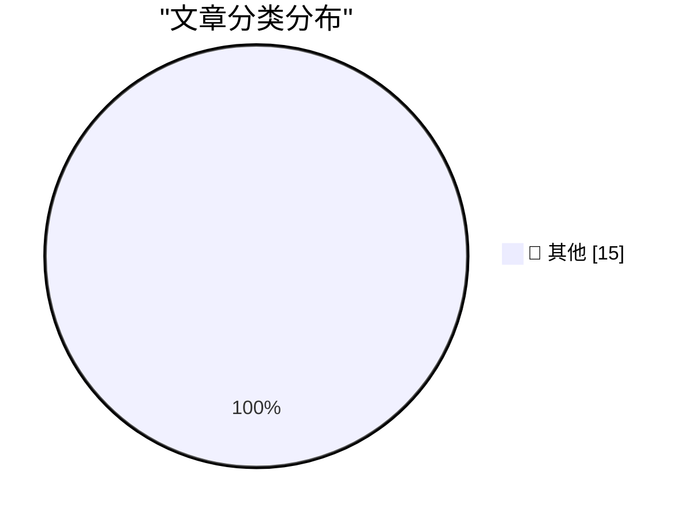

# 📰 AI 资讯每日精选 — 2026-10-30

> 汇聚 140+ 技术博客、X/Twitter、Hacker News、Reddit、Product Hunt、
> Lobste.rs、ClawFeed 日报及 GitHub Trending，经 AI 评分筛选。
>
> **本期内容**：🏆 今日必读 · 🌐 ClawFeed 日报 · 🔥 GitHub Trending · 📂 分类精选 · 🎨 设计与生成式 AI · 📊 数据概览

## 🏆 今日必读

🥇 **API credits benefit for eligible ChatGPT subscriptions**

[API credits benefit for eligible ChatGPT subscriptions](https://simonwillison.net/2026/Oct/29/api-credits/) — simonwillison.net · 4 小时前 · 📝 其他

> API credits benefit for eligible ChatGPT subscriptions

🥈 **Building a multiplayer game world with autonomous Fable-class models**

[Building a multiplayer game world with autonomous Fable-class models](https://simonwillison.net/2026/Oct/29/how-i-built-the-most-ai-pilled-company-in-the-world/) — simonwillison.net · 9 小时前 · 📝 其他

> Building a multiplayer game world with autonomous Fable-class models

🥉 **Quoting Ben Hylak**

[Quoting Ben Hylak](https://simonwillison.net/2026/Oct/29/ben-hylak/) — simonwillison.net · 12 小时前 · 📝 其他

> Quoting Ben Hylak

4️⃣ **Apple Drops App Store Commission by a Whopping 4 Percentage Points in Taiwan**

[Apple Drops App Store Commission by a Whopping 4 Percentage Points in Taiwan](https://developer.apple.com/news/?id=w9mxlhek) — daringfireball.net · 5 小时前 · 📝 其他

> Apple Drops App Store Commission by a Whopping 4 Percentage Points in Taiwan

5️⃣ **A Health Update From Craig Hockenberry**

[A Health Update From Craig Hockenberry](https://furbo.org/2026/10/28/a-health-update/) — daringfireball.net · 6 小时前 · 📝 其他

> A Health Update From Craig Hockenberry

---

## 🌐 ClawFeed 日报精选

> 来源：[ClawFeed](https://clawfeed.kevinhe.io) — AI 驱动的多源新闻聚合

# 📅 ClawFeed 日报 | 2026-10-29 (SGT)

> 聚合自 3 期已发布的 8 小时简报：#1438 00:00（00:00-07:59）、#1437 08:00（08:00-15:59）、#1439 16:00（16:00-23:59），时间窗 2026-10-29 00:00–23:59 SGT，首尾相接盖满全天。
> ⚠️ 三期正文开头写的窗内素材合计 556 条（feed 524 + 关注抽样 32：#1438 161 + 12、#1437 121 + 8、#1439 242 + 12），三期的抓取都紧跟在窗口结束后，但首页推荐流越靠近窗口末尾越多：#1438 的 7 点档占 50 条，2 点档和 3 点档只有 9 条和 7 条；#1437 的 15 点档占 43 条，13 点档和 14 点档只有 7 条和 4 条；#1439 的 23 点档一个小时占 132 条（不少是回复和一句话），16–18 点档只有 6、11、7 条。凌晨 2–3 点、下午 13–14 点和 16–18 点素材偏少，这几段可能漏事。全天没有新书签。整体体育、时政、品牌宣传、加密喊单和一句话帖占了大半，#1437 说 AI 和科技的干货比上一期少。
> 主线：Google 发 Gemini 4 Carbon，多方说它登顶榜单；纽交所母公司 ICE 联手 Trade[XYZ] 把基于 Hyperliquid 的永续合约搬进美国受监管市场，$HYPE 大涨；AI 购物 agent 被亚马逊挡在门外，马斯克喊「去 Shopify 买」，投资人说消费入口又要洗牌；财报和议息挤在一天——微软营收又创纪录、ServiceNow 大跌、美联储利率不动，盘后微软和 Alphabet 一涨一跌；开源模型有 Mistral 新版 Le Chonk 和 Meta 的 Muse Glimmer。另有 agent 进企业的权限和安全问题、苹果触屏 MacBook Pro 与 macOS 安全帖、Neuralink 语言恢复数据、DoorDash 170 亿美元收购 Instacart、Visa 稳定币结算等。

---

## 🔥 当日最重要 5 条（跨档去重）

1. **Google 发布 Gemini 4 Carbon：几方都说它登顶，跑分细节后来才出**（#1438 + #1437）：@demishassabis 说迭代飞快，Gemini 4 Carbon 在关键基准上 SOTA，前沿能力和深度安全研究结合在一起；@elonmusk 转评只说了一句「Impressive」，被转的帖（原作者在素材里没显示）说距 Argon 发布才两周，Carbon 在最近更新的 Artificial Analysis v5.0 榜上排第一；@cline（关注抽样）说它是第一个超过 Claude 和 GPT 的模型，几乎每个基准都赢 Opus 5.5、价格只有一半、比两周前的 Argon 提升 18%（Cline 自己的说法，没给测评明细）；@DavidOndrej1 一句话「Google is back」；@levelsio 说一直在低位加仓 $GOOGL，还提到他爸已经退订 ChatGPT（后文被截断，原因没看到）（#1438）。下午 @python_spaces 转 @itsafiz 列的数字：Artificial Analysis 智能指数第一（59 分），主打网络安全和长程任务，SEC-bench Pro 88.2%、ExploitGym 54.8%、CWE-bench 71.0%——是转述，没看到 Google 原文（#1437）。
   来源: https://x.com/demishassabis/status/2115489550256746502 ｜ https://x.com/elonmusk/status/2115503730368061688 ｜ https://x.com/cline/status/2115501578916601925 ｜ https://x.com/DavidOndrej1/status/2115583109823676570 ｜ https://x.com/levelsio/status/2115594451217187315 ｜ https://x.com/python_spaces/status/2115654746594062631

2. **ICE + Trade[XYZ]：基于 Hyperliquid 的永续合约进美国受监管市场，$HYPE 当天大涨**（#1439；#1437 有 HYPE 解质押的前情）：@star_okx（OKX 总裁）转 DegenerateNews：纽交所母公司 @ICE_Markets 说 @tradexyz 的永续合约也会通过它和 OKX 的合资公司卖给零售用户，ICE 是这个美国新市场的「独家运营方」，他认为三方合起来可能做出新一代 7×24 市场（后文被截断）；@standuquesne（德鲁肯米勒的家族办公室 Duquesne）说很高兴成为 trade(xyz) 的投资人，「作为市场参与者，期待用它改进自己的投资流程」；@Matt_Hougan（Bitwise CIO）：99.9% 的美国人根本不知道 $HYPE 存在，「我们才刚开始」。行情：@RoundtableSpace 说 Hyperliquid 消息后涨超 20%，@coinbureau 说马斯克在德鲁肯米勒那条下回了一句「Interesting」、$HYPE 一小时内又涨近 5%（都是转述，涨幅以各自发帖时为准）。白天的前情：@wublockchain12 引余烬监测，HyperLabs 关联地址申请赎回 179,706 枚 HYPE（约 1449 万美元），预计 11 月 4 日晚完成解质押（后文被截断）；@RaccoonHKG 因为估值清仓了 $HYPE，但仍认为 Hyperliquid 遥遥领先（#1437）。
   来源: https://x.com/star_okx/status/2115777773545664533 ｜ https://x.com/standuquesne/status/2115777839622689036 ｜ https://x.com/Matt_Hougan/status/2115812716602613871 ｜ https://x.com/RoundtableSpace/status/2115832279805079675 ｜ https://x.com/coinbureau/status/2115836010705871176 ｜ https://x.com/wublockchain12/status/2115603904507555944 ｜ https://x.com/RaccoonHKG/status/2115672054825709947

3. **AI 购物 agent 被亚马逊挡门外，「消费入口」又要洗牌；Shop Pay 成了 agent 的另一条路**（#1437 + #1438）：@elonmusk 转评 @jamesdouma：亚马逊封了他的 Grok Bot，Bot 就去别的网站用更低的价买了同样的东西，马斯克说「我也是这么干的」；随后又转评 Shopify 的 @tobi，只说「Buy from @Shopify!」，tobi 原话是「正好赶上 Shop Pay 支持……」（后文被截断）。@guruchahal（关注抽样）：亚马逊屏蔽了大多数第三方 AI 购物 agent，沃尔玛反而敞开门，给 agent 设消费额度、审批控制和专门的 agent 账户；他转的 @martin_casado（a16z）说消费层又一次「谁都能抢」，几十年才一次（#1437）。凌晨 @noahrshinn（关注抽样）：Instinct 和 Shopify 的合作扩大，现在能在任何网店用 Shop Pay 付款，沿用存好的卡和地址（自家产品，#1438）。
   来源: https://x.com/elonmusk/status/2115632219712811226 ｜ https://x.com/elonmusk/status/2115634265702678859 ｜ https://x.com/guruchahal/status/2115646340474818820 ｜ https://x.com/noahrshinn/status/2115521853775388931

4. **财报和议息挤在一天：微软创纪录、ServiceNow 跌近 20%、美联储不动，盘后 AI 交易分化**（#1438 + #1437）：@TechCrunch：微软季度营收 923 亿美元、同比增 19%，又一个纪录；@WorldInMotionHQ：ServiceNow（$NOW）三季度没达预期，股价跌近 20%；@Pence0629 写的是联邦基金利率目标区间维持 3.75%–4.00%，10 票赞成、2 票反对（反对的有 Lisa Cook，后文被截断），@WatcherGuru：美联储主席 Kevin Warsh 说「通胀太高」（#1438）。盘后 @BinanceResearch：$MSFT 和 $GOOGL 一个涨、一个大跌，两家都在 AI 上猛砸钱，区别在自由现金流——微软还有剩，Alphabet 已连续两个季度为负；它又转 Bloomberg：Marvell 正在深入谈判收购光器件公司 Lumentum，$LITE 永续合约消息后一小时内涨 14%、随后回吐大半；@Web3Eden01：高盛广义 AI 指数这几天涨 7.33%，剔掉几家 AI 大户后标普 500 其余股票反而跌 0.31%（他引的数字，没给原始出处）（#1437）。
   来源: https://x.com/TechCrunch/status/2115556487305048264 ｜ https://x.com/WorldInMotionHQ/status/2115586590537871758 ｜ https://x.com/Pence0629/status/2115585452191400366 ｜ https://x.com/WatcherGuru/status/2115513656222060775 ｜ https://x.com/BinanceResearch/status/2115656534638387447 ｜ https://x.com/BinanceResearch/status/2115691082650620164 ｜ https://x.com/Web3Eden01/status/2115714826131648931

5. **开源模型：Mistral 放出新版 Le Chonk（Mistral Large 4）权重，Meta 30B 的 Muse Glimmer 技术报告被拆读**（#1439）：@MistralAI：新版 Le Chonk 主打 agentic coding 和网络安全，在 @cognition 的 FrontierCode 上是开源模型第一，并号称在帕累托效率上创了新标杆（后文被截断）；@SergioPaniego（Hugging Face）：已上 Hub，TRL 首日支持后训练，SFT + LoRA 示例在单台 8×B300 上就能跑。@ChinmayKak 读 Muse Glimmer 技术报告（Meta 的 30B 开源权重模型，Apache 2.0，面向消费级硬件跑 agent 任务）：训练里 95% 是从 Muse Spark 做 top-k 蒸馏，5% 用交叉熵损失缓解截断偏差，投机解码用 DFlash，他觉得算法细节不多但值得读；@alexandr_wang 转 Simon Taylor 对 Meta @Muse 的观察：引用来源更多、字数和表格少得多、不追问，Wang 说「muse team is anti-slop-text」。
   来源: https://x.com/MistralAI/status/2115811242556137820 ｜ https://x.com/SergioPaniego/status/2115827752263721213 ｜ https://x.com/ChinmayKak/status/2115831813889491174 ｜ https://x.com/alexandr_wang/status/2115797301021327535

**⚠️ 未证实（素材里核实不了，只记录说法）**
- 「macOS 自带的 git、curl、python3 在苹果被告知 11 天后仍信任已被攻破的 eMudhra 证书，macOS 27.2 还抹掉了用户的手动修复」：@CupOJoseph 的帖没给原始研究链接（#1438）。https://x.com/CupOJoseph/status/2115581315986964584
- 「Gemini 4 Carbon 几乎每个基准都赢 Opus 5.5、价格一半」：Cline 自己的说法，没给测评明细；跑分数字是 @itsafiz 的转述，没看到 Google 原文（#1438、#1437）。https://x.com/cline/status/2115501578916601925 ｜ https://x.com/python_spaces/status/2115654746594062631
- 「高盛广义 AI 指数涨 7.33%、其余标普成分股跌 0.31%」：@Web3Eden01 没给原始出处（#1437）。https://x.com/Web3Eden01/status/2115714826131648931
- 「Anthropic 给 agent 做了十几样零件、只把沙箱外包」：@FinanceYF5 的归纳，帖里没给出处（#1437）。https://x.com/FinanceYF5/status/2115611124712542484
- 「全球雇主在收缩 AI 使用」：@unusual_whales 一句话转述《卫报》，没看到原文（#1439）。https://x.com/unusual_whales/status/2115779934136545373
- 「/claude-api build-eval 是 Anthropic 9 月 28 日公布的」：日期和说法是 @LimestoneHQ 写的，没看到 Anthropic 原文（关注抽样，#1439）。https://x.com/LimestoneHQ/status/2115829305712521329

**次重要（备选）**
- Agent 进企业的权限和安全（#1438 + #1439）：@a16z 的 CISO 调查里，已在生产使用员工生成式 AI 工具的占 92%、AI 编程助手或 agent 83%、MCP 或 agent 接应用 55%（自主 agent 那项被截断）；@JiquanNgiam 发布 @mintive，让每个 agent 像员工一样有自己的身份和权限，融资 1100 万美元、Cowboy VC 领投（后文被截断）；@Eon_io_（关注抽样）转 Ofir Ehrlich：19 个主流模型在模拟公司里跑 2304 次，40% 违反了安全或业务规则。另有 @TechCrunch：黑客拿到并公开 4 万多名美国国土安全部员工的个人身份信息（#1438）。https://x.com/a16z/status/2115537851601551491 ｜ https://x.com/JiquanNgiam/status/2115823843067691019 ｜ https://x.com/Eon_io_/status/2115812519184855217 ｜ https://x.com/TechCrunch/status/2115534840254640484
- 苹果新款 MacBook Pro 上了 PROLED XDR 触屏（@tim_cook），M5 Pro / M5 Max、续航最长 24 小时（@gregjoz）；同一天 @taresky 说一个 macOS 0day 3 年前就报给苹果、被确认后关了报告（后文被截断，#1438）。https://x.com/tim_cook/status/2115494289488953462 ｜ https://x.com/gregjoz/status/2115501308706975860 ｜ https://x.com/taresky/status/2115593428851687869
- @nytimes：DoorDash 同意以 170 亿美元收购 Instacart（#1439）。https://x.com/nytimes/status/2115773331886452820
- @neuralink 早期语言恢复数据：ALS 受试者第一周就做到每分钟 75 词、词错误率 5.8%、词表 12.5 万（#1438）。https://x.com/neuralink/status/2115534593147187397
- Visa 财报电话会：稳定币结算年化交易量超 250 亿美元、同比 10 倍（@ChainCatcher_，#1437）。https://x.com/ChainCatcher_/status/2115614166505730473

---

## 📰 当日核心主题

**① Agent 怎么搭、怎么评（三期都有）**
省 token 和上下文：@levie（关注抽样）说 agent 消耗的 token 会是现在的 1000 倍，他转的是 @Suhail 新公司 Particle 的 particle-1，少用约 45% 的 token（数字是自家的，#1438，https://x.com/levie/status/2115516370695987435）；@jiayq 手写用 agent 集群优化推理的分析（后文被截断，#1438，https://x.com/jiayq/status/2115490096049004765）；@dotey 建议 Claude Code 跑 `/autocompact 300k`（#1438，https://x.com/dotey/status/2115505947187585302）；@lydiahallie 说 dynamic workflows 只用 10 个左右 subagent 也值得（#1438，https://x.com/lydiahallie/status/2115533617984401464）；@Ronny_MiniMax《为什么长会话让 agent 变笨》：上下文窗口是工作台不是仓库（#1439，https://x.com/Ronny_MiniMax/status/2115806697474474420）。
评测：@ryzemew 说专家判断写成 rubric 就能反复用，下一步是可靠的 verifier（#1437，https://x.com/ryzemew/status/2115666351427908081）；@LimestoneHQ 推 Claude Code 自动建 eval 套件、每个用例跑 3 次（#1439，https://x.com/LimestoneHQ/status/2115829293611905295）；@LuozhuZhang 转：只把 ASR 的 batch size 从 128 改成 16，362 段里有 33 段转写变了（#1439，https://x.com/LuozhuZhang/status/2115825987552518390）；@mardehaym（关注抽样）不再让工程师在写好 spec 之前用 AI 开工（后文被截断，#1439，https://x.com/mardehaym/status/2115829197839233164）。
工具和接入：Google Connected Apps Platform 预览（#1438，https://x.com/Google/status/2115562774231155045）；Perplexity 语音模式能同时操作多个 Computer 会话（#1438，https://x.com/randomjohnnyh/status/2115548527426498775）；trigger.dev webhooks 用真实事件启动 agent（后文被截断，#1438，https://x.com/ProductHunt/status/2115561284951515275）；nomads.com 加了 MCP 和 API（#1438，https://x.com/levelsio/status/2115586985888825445）；GitHub Universe 2026 一批更新（帖里没展开，#1438，https://x.com/github/status/2115500308873052465）；PGX 给每个 agent 分临时数据库（关注抽样，后文被截断，#1437，https://x.com/vintcessun/status/2115712750123094458）；Unsloth 让本地模型控制浏览器（后文被截断，#1437，https://x.com/realfxw/status/2115663996799893619）；AgentWeb 不开浏览器直接调网站操作（付费合作，#1439，https://x.com/rohanpaul_ai/status/2115831812832510374）；Vercel Labs 多个 CLI 加了 mcp 子命令（#1439，https://x.com/ctatedev/status/2115835185816289372）；DBOS 每秒 100 万以上 workflow（#1439，https://x.com/qianl_cs/status/2115834291649491231）；LM Studio 用 oMLX 跑 MLX 模型（关注抽样，#1439，https://x.com/lmstudio/status/2115829031832830252），新款触屏 MacBook Pro 产品页上也有 LM Studio（#1438，https://x.com/lmstudio/status/2115495746858528951）。
个人用法：@brian_armstrong 和 @jessepollak 这周合计合了 44 个 PR（#1437，https://x.com/brian_armstrong/status/2115628817196650843）；@dharmesh 觉得晚上不让 agent 跑着就是浪费（#1437，https://x.com/dharmesh/status/2115632560554287462）；@willdepue 让 Codex 用高斯泼溅重建自己（#1437，https://x.com/willdepue/status/2115708400143315433）；@emilkowalski 的「交互实验室」（#1439，https://x.com/emilkowalski/status/2115789995860517254）。

**② 模型、研究和前沿（三期都有）**
模型：Gemini 4 Carbon、Le Chonk 和 Muse Glimmer 见上方 🔥；Articul8 发布多模态决策模型 Bivia（自家发布，#1438，https://x.com/ftcarpe/status/2115566490053464434）；OXR 1.3B 文档解析模型（付费合作，#1439，https://x.com/DataChaz/status/2115829185239568877）；@snaptrude Agent 做建筑设计到 LOD 400（#1439，https://x.com/altafganihar/status/2115808566439264349）。
研究和观点：@OfirPress 说千禧年难题是现在最好的 benchmark，@DimitrisPapail 反驳（后文被截断，#1439，https://x.com/OfirPress/status/2115812781408539074 ｜ https://x.com/DimitrisPapail/status/2115829713763479591）；「neural twins」只有一句话（#1439，https://x.com/Sauers_/status/2115726641410482580）；Odyssey-3 这类 world model（#1438，https://x.com/olivercameron/status/2115558683333755353）；AerialSim 训练控制无人机的视觉-语言 agent（#1438，https://x.com/nahidalam/status/2115476579560357953）；Sequoia、Citadel Securities 和 OpenAI 办扑克 bot 编程赛（后文被截断，#1437，https://x.com/FinanceYF5/status/2115638376057704917）。
生物医疗：Neuralink 见上方次重要；retatrutide 睡眠呼吸暂停——#1438 只有 Polymarket 一句话，#1437 @aakashgupta 补了数字：每小时 58 次降到 22 次（后文被截断，https://x.com/aakashgupta/status/2115708715873821130）；Meta 给 5 所大学 200 万美元做医疗 AI（#1439，https://x.com/ahsuzm/status/2115816159178105147）。

**③ AI 进企业：安全和落地（三期都有）**
安全：a16z CISO 调查、Mintive、Era 测评见上方次重要；@guruchahal 访谈 Cato Networks 的 Shlomo Kramer（访谈节目宣传，#1438，https://x.com/guruchahal/status/2115478403394707555）；@laurashin 节目里 @GiancarloMKTS 谈 AI 黑客（#1438，https://x.com/laurashin/status/2115516484097343752）。
落地：Broccoli A+B 轮共 5200 万美元，AI agent 给水管、暖通、电工公司接电话（后文被截断，#1438，https://x.com/ycombinator/status/2115550323607740769）；@mardehaym 不同意 PE 并购前必须先整理全部数据（关注抽样，后文被截断，#1438，https://x.com/mardehaym/status/2115559596953686156）；Grass 的基础设施跟不上 AI 需求（后文被截断，#1438，https://x.com/Delphi_Digital/status/2115581213674987723）；Delphi 新报告《AI 繁荣有个电力问题》（#1439，https://x.com/Delphi_Digital/status/2115805371961131305）；@avipat_ 说新冒出的数据供应商几乎都在撒谎（#1439，https://x.com/avipat_/status/2115811492213707255）。

**④ 公司和钱（三期都有）**
财报和议息见上方 🔥；DoorDash 收购 Instacart 见次重要；@ekuyda 完成 5500 万美元 A 轮、估值 12.5 亿美元，IVP 领投（帖子后半被截断，没看到公司名和产品，#1439，https://x.com/ekuyda/status/2115819179756671330）；@Lagarde 将于 2027 年 2 月 7 日卸任欧洲央行行长（#1439，https://x.com/Lagarde/status/2115746242491723810）；@austingriffith 评 Anthropic 把控制性股份分给七位创始人（#1438，https://x.com/laurashin/status/2115539683404923367）；SpaceX Ship 42 完成六发动机静态点火，马斯克说会是第一次塔臂接住飞船（#1437，https://x.com/elonmusk/status/2115634093949911506）。

**⑤ 加密：支付、监管和链上产品（三期都有）**
支付和稳定币：Visa 稳定币结算见次重要；Aptos Confidential Assets 金额加密（#1438，https://x.com/Aptos/status/2115474247992869261）；Base 联手 Morphllm，稳定币直接付 AI 推理费（#1438，https://x.com/Techub_News/status/2115579518362518000）。
监管和机构：Galaxy Digital 向 OCC 申请联邦章程设国家信托银行（#1439，https://x.com/wublockchain12/status/2115764265932210544）；巴西新规下伊塔乌银行赶在截止前交了通知（#1438，https://x.com/laurashin/status/2115559247459336427）；俄罗斯央行监管名录（#1439，https://x.com/wublockchain12/status/2115784814469197910）；Backpack 和 SK 证券让海外投资者交易韩股（#1439，https://x.com/wublockchain12/status/2115831422640640115）；冒充谷歌客服骗走 185 枚比特币的 20 岁加拿大人判 25 个月（后文被截断，#1437，https://x.com/ToplayerNo8/status/2115706377104506951）。
链上产品：Curve 生态 Yield Basis 推 propAMM 升级（后文被截断，#1437，https://x.com/wublockchain12/status/2115635037760893016）；Curve 上线 Stellar，第一次非 EVM 原生部署（#1439，https://x.com/wublockchain12/status/2115765213031272528）；@chilla_ct 拆 Ethena Earn+「最高 12%」，收益其实来自两个 Merkl 激励（延续 10-28 日报的 Earn+，#1439，https://x.com/chilla_ct/status/2115759945429766365）；以太坊 Glamsterdam 在 Hoodi 测试网推迟（#1439，https://x.com/iiam_Akshay/status/2115810825630056641）；Starknet 抗量子 Falcon-512 签名验证约 0.023 美元一笔（#1439，https://x.com/haroldbillioner/status/2115771378980798616）；SOLVENT 核验 Cashu mint 负债（#1439，https://x.com/callebtc/status/2115832465042682070）。

**⑥ 行情：比特币还在 8 万上下（#1437 + #1439，延续 10-28 日报）**
Strive 一周增持 6182 枚 BTC，Strategy 没买卖、回购 STRC，按 8 万美元算的优先股和股息负担对比（#1437，https://x.com/wublockchain12/status/2115605605297877324）；glassnode：比特币波动率回到 2023 年夏天的水平，24 小时清算超 3.65 亿美元（#1437，https://x.com/CoinGapeMedia/status/2115713988818510166 ｜ https://x.com/CoinGapeMedia/status/2115713500911739233）；@bitfinex：10 月 22 日长期持有者大量移动 BTC，放量突破 82,500 美元才能缓解担心（#1439，https://x.com/bitfinex/status/2115835136033919360）。

---

## 🔖 书签精选

今天没有新加的书签：三期抓到的 20 条书签里最新一条仍是 10-04 的推文，三期都跳过了这一区块，本日报也没有可补选的内容。

---

## 👀 推荐关注汇总（去重，共 9 个；各期写稿时都在浏览器里核实过「未关注」：#1438 在 10-29 08:2x，#1437 在 10-29 16:13–16:15，#1439 在 10-30 00:14–00:15 SGT，本日报没有重新核实）

**AI 研究 / 产品**
- @olivercameron（Oliver Cameron，约 5.24 万粉）：Odyssey CEO，做 world model，之前做自动驾驶、YC 校友，本日 Odyssey-3 那条是他发的，你关注的人里有约 91 位关注（#1438）。https://x.com/olivercameron
- @randomjohnnyh（Johnny Ho，约 23 万粉）：Perplexity 联合创始人、CSO，发帖少（共 164 条），本日 Perplexity 语音模式那条是他转评的，你关注的人里有约 79 位关注（#1438）。https://x.com/randomjohnnyh
- @nahidalam（Nahid Alam，约 1700 粉）：Prime Intellect 研究驻留，做开源多模态模型 Maya，本日 AerialSim 是她发布的，你关注的人里有 6 位关注，量小但一手（#1438）。https://x.com/nahidalam
- @OfirPress（约 2.05 万粉）：SWE-bench、ProgramBench 作者，普林斯顿博士后，本日「千禧年难题是最好的 benchmark」是他发的，你关注的人里有 180 多位关注（#1439）。https://x.com/OfirPress
- @emilkowalski（约 11.3 万粉）：之前在 Linear、Vercel，现在在 aiforui.dev 教 AI 做 UI，本日「交互实验室」是他发的，你关注的人里有 160 多位关注（#1439）。https://x.com/emilkowalski

**Agent / 开发**
- @ryzemew（ryze，约 4.84 万粉）：做 sonzai，之前是 Limit Break 游戏设计师、Delphi Digital 风险投资人，本日 rubric 和 verifier 那条是他写的，你关注的人里有约 292 位关注（#1437）。https://x.com/ryzemew
- @dharmesh（约 60 万粉）：HubSpot 联合创始人、CTO，写 simple.ai 简报、在做 YouSpot，本日「晚上不让 agent 跑着就是浪费」是他发的，你关注的人里有约 189 位关注（#1437）。https://x.com/dharmesh
- @JiquanNgiam（约 1600 粉）：在做 Mintive（给 agent 发身份和权限），之前在 Google Brain、Coursera、斯坦福 ML 组，本日 agent 权限那条是他的发布帖，你关注的人里有 15 位左右关注（#1439）。https://x.com/JiquanNgiam

**投资**
- @martin_casado（约 9.8 万粉）：简介写在 a16z，本日 @guruchahal 转的「消费层又一次谁都能抢」是他的判断，你关注的人里有约 475 位关注（#1437）。https://x.com/martin_casado

（#1439 还查到 @Ronny_MiniMax 显示未关注，但之前的简报已经推荐过，这次没有重复推荐。）

**建议取关**：三期都没有提出取关建议。

---

## 💤 当日重复噪音模式

三期合计过滤约 432 条 feed（#1438 约 130、#1437 约 98、#1439 约 204，均为各期写的大约条数），另有关注抽样 20 条没收；按类别（三期分类口径略有不同，按最接近的合并）：
- **一句话、生活、早安、信息量少和没出处的耸动帖**：约 142 条（#1438 50、#1437 24、#1439 68；含 #1439 23 点档大量「恭喜」「是的」式回复、「土壤细菌 100% 消灭小鼠肿瘤」这类没给论文的转述、律所 Weil Gotshal 将关门的突发标题、Anthropic 收购 Professor Oak 的重复帖等）。
- **品牌、机构和活动宣传**：约 90 条（#1438 22、#1437 20、#1439 48；PlayStation 三期都有，另有 Netflix、Fortnite、币安活动和「区块链 100 强」获奖感言、各种 DeFi 收益宣传、卖号广告等）。
- **加密喊单、段子和跟风评论**：约 61 条（#1438 12、#1437 15、#1439 34；含 HYPE 消息下的大量「历史性」式跟帖、「中国股市 AI 泡沫破裂蒸发 1.1 万亿」（没出处）、GM 帖、K 线喊单、「Ponytail Skill 少写 70% 代码」标题党等）。
- **时政和社会新闻**：约 56 条（#1438 21、#1437 22、#1439 13；奥巴马佐治亚助选在 #1438、#1437 都出现，另有西班牙高铁事故、阿拉斯加选举、朝鲜试射导弹、印度政务帖等）。
- **体育**：约 56 条（#1438 25、#1437 17、#1439 14；欧冠、英超、MLB 总决赛酿酒人首次夺冠、NBA、C 罗「史上最佳金球奖」等）。
- **互关涨粉和抽奖**：约 8 条（#1439）。
- **和已收内容重复或只是补充**：约 19 条（#1439：HYPE 跟帖、DataChaz 和 snaptrude 同题连发、Galaxy 的重复报道、ekuyda 融资转发等）。
- **关注抽样里没收的**：20 条（#1438 6、#1437 6、#1439 8），多是 @StartupWisdom_ 的名人语录（三期都有）、@rwayne 的一句话感叹（三期都有）、@mardehaym 的约会议链接（#1438、#1439）、@Tradermayne 的 Breakout 宣传（#1438、#1439）、@raft_hq 的产品小功能和 Builder Program、@guruchahal 访谈花絮、@vintcessun 的 Flatkey 推广转发。
- **同一话题延续**：Gemini 4 Carbon（#1438 → #1437 跑分细节）、Hyperliquid（#1437 解质押 → #1439 ICE 合作）、Shop Pay 和 agent 购物（#1438 → #1437）、财报（#1438 微软 → #1437 盘后分化）、retatrutide（#1438 一句话 → #1437 有数字）、Pump.fun 接 Hyperliquid 永续和 Anthropic 收购 Professor Oak（接着 10-28 日报，本日只在噪音里出现）、Ethena Earn+ 和比特币 8 万（接着 10-28 日报）已合并。
---

## 🔥 GitHub Trending

> 今日热门开源项目（全语言 + Python）

| # | 项目 | 描述 | ⭐ 总星 | 📈 今日 | 语言 |
|---|------|------|---------|---------|------|
| 1 | [pbakaus/impeccable](https://github.com/pbakaus/impeccable) 🤖 | The design vocabulary for your coding agent. Steer with p... | 95.6k | +2870 | Rust |
| 2 | [HKUDS/DeepTutor](https://github.com/HKUDS/DeepTutor) | DeepTutor: Lifelong Personalized Tutoring. https://deeptu... | 50.3k | +1930 | Python |
| 3 | [togg53192-cmd/jailbreaks](https://github.com/togg53192-cmd/jailbreaks) | LIST OF ALL MY JAILBREAKS | 9.2k | +1594 | - |
| 4 | [vectorize-io/hindsight](https://github.com/vectorize-io/hindsight) 🤖 | Hindsight: Agent Memory That Learns | 56.2k | +1454 | Python |
| 5 | [milind-soni/OpenMausBot](https://github.com/milind-soni/OpenMausBot) | Open-source Grok Bot alternative with a virtual machine t... | 7.6k | +1199 | TypeScript |
| 6 | [elayadesign/ai-design-skills](https://github.com/elayadesign/ai-design-skills) 🤖 |  | 12.3k | +1187 | - |
| 7 | [JetBrains/thinkrail](https://github.com/JetBrains/thinkrail) | Vibe code with pi in a lightweight, real IDE that customi... | 6.1k | +1117 | TypeScript |
| 8 | [obra/superpowers](https://github.com/obra/superpowers) | An agentic skills framework & software development method... | 308.7k | +1034 | Shell |
| 9 | [nightly-labs/openbot](https://github.com/nightly-labs/openbot) 🤖 | A local-first desktop workspace for persistent AI teammat... | 3.9k | +709 | TypeScript |
| 10 | [AgriciDaniel/claude-seo](https://github.com/AgriciDaniel/claude-seo) 🤖 | Universal SEO skill for Claude Code. 26 sub-skills + 19 s... | 24.0k | +682 | Python |
| 11 | [rohitg00/ai-engineering-from-scratch](https://github.com/rohitg00/ai-engineering-from-scratch) 🤖 | Learn AI Engineering! Learn it. Build it. Ship it for oth... | 75.6k | +443 | Python |
| 12 | [Donchitos/Claude-Code-Game-Studios](https://github.com/Donchitos/Claude-Code-Game-Studios) 🤖 | Turn Claude Code into a full game dev studio — 49 AI agen... | 29.3k | +353 | Shell |
| 13 | [thedotmack/claude-mem](https://github.com/thedotmack/claude-mem) 🤖 | Persistent Context Across Sessions for Every Agent – Capt... | 104.9k | +336 | TypeScript |
| 14 | [github/spec-kit](https://github.com/github/spec-kit) | 💫 Toolkit to help you get started with SDD or any other ... | 143.9k | +335 | Python |
| 15 | [beenuar/AiSOC](https://github.com/beenuar/AiSOC) 🤖 | Open-source AI Security Operations Center: alert fusion, ... | 5.2k | +320 | Python |

---

## 📝 其他

### 1. API credits benefit for eligible ChatGPT subscriptions

[API credits benefit for eligible ChatGPT subscriptions](https://simonwillison.net/2026/Oct/29/api-credits/) — **simonwillison.net** · 4 小时前 · ⭐ 15/30

> API credits benefit for eligible ChatGPT subscriptions

---

### 2. Building a multiplayer game world with autonomous Fable-class models

[Building a multiplayer game world with autonomous Fable-class models](https://simonwillison.net/2026/Oct/29/how-i-built-the-most-ai-pilled-company-in-the-world/) — **simonwillison.net** · 9 小时前 · ⭐ 15/30

> Building a multiplayer game world with autonomous Fable-class models

---

### 3. Quoting Ben Hylak

[Quoting Ben Hylak](https://simonwillison.net/2026/Oct/29/ben-hylak/) — **simonwillison.net** · 12 小时前 · ⭐ 15/30

> Quoting Ben Hylak

---

### 4. Apple Drops App Store Commission by a Whopping 4 Percentage Points in Taiwan

[Apple Drops App Store Commission by a Whopping 4 Percentage Points in Taiwan](https://developer.apple.com/news/?id=w9mxlhek) — **daringfireball.net** · 5 小时前 · ⭐ 15/30

> Apple Drops App Store Commission by a Whopping 4 Percentage Points in Taiwan

---

### 5. A Health Update From Craig Hockenberry

[A Health Update From Craig Hockenberry](https://furbo.org/2026/10/28/a-health-update/) — **daringfireball.net** · 6 小时前 · ⭐ 15/30

> A Health Update From Craig Hockenberry

---

### 6. Rolfe Winkler at The WSJ: ‘The Beleaguered Chip Sellers Getting Their Revenge on Apple’

[Rolfe Winkler at The WSJ: ‘The Beleaguered Chip Sellers Getting Their Revenge on Apple’](https://www.wsj.com/tech/apple-iphone-memory-chips-ai-c0084cc9?st=FNAyaT) — **daringfireball.net** · 7 小时前 · ⭐ 15/30

> Rolfe Winkler at The WSJ: ‘The Beleaguered Chip Sellers Getting Their Revenge on Apple’

---

### 7. The Space Shuttle Discovery’s Starboard Side ‘s’ Is Upside Down

[The Space Shuttle Discovery’s Starboard Side ‘s’ Is Upside Down](https://www.theautopian.com/a-typography-geek-pointed-out-something-about-the-space-shuttle-discovery-and-now-i-cant-unsee-it/) — **daringfireball.net** · 11 小时前 · ⭐ 15/30

> The Space Shuttle Discovery’s Starboard Side ‘s’ Is Upside Down

---

### 8. Steven Levy on the New MacBook Pro, With, Yes, a Touchscreen

[Steven Levy on the New MacBook Pro, With, Yes, a Touchscreen](https://www.wired.com/story/the-inside-story-of-why-apple-finally-brought-a-touch-display-to-the-mac/) — **daringfireball.net** · 22 小时前 · ⭐ 15/30

> Steven Levy on the New MacBook Pro, With, Yes, a Touchscreen

---

### 9. A New Kind of Chemistry

[A New Kind of Chemistry](https://www.construction-physics.com/p/a-new-kind-of-chemistry) — **construction-physics.com** · 11 小时前 · ⭐ 15/30

> A New Kind of Chemistry

---

### 10. What I learned about power from LBJ and Robert Moses

[What I learned about power from LBJ and Robert Moses](https://www.dwarkesh.com/p/lessons-in-power) — **dwarkesh.com** · 10 小时前 · ⭐ 15/30

> What I learned about power from LBJ and Robert Moses

---

### 11. Celebrating SIM Cards

[Celebrating SIM Cards](https://blog.jim-nielsen.com/2026/celebrating-sim-cards/) — **blog.jim-nielsen.com** · 7 小时前 · ⭐ 15/30

> Celebrating SIM Cards

---

### 12. IBM’s 2018 Red Hat acquisition

[IBM’s 2018 Red Hat acquisition](https://dfarq.homeip.net/ibms-2018-red-hat-acquisition/?utm_source=rss&#038;utm_medium=rss&#038;utm_campaign=ibms-2018-red-hat-acquisition) — **dfarq.homeip.net** · 15 小时前 · ⭐ 15/30

> IBM’s 2018 Red Hat acquisition

---

### 13. Granite Switch 4.1.1 — Update models like you update software

[Granite Switch 4.1.1 — Update models like you update software](https://huggingface.co/blog/ibm-granite/granite-switch-4-1-1) — **Hugging Face Blog** · 13 小时前 · ⭐ 15/30

> Granite Switch 4.1.1 — Update models like you update software

---

### 14. OpenAI doubles usage limits on Pro plans as competition with Anthropic heats up

[OpenAI doubles usage limits on Pro plans as competition with Anthropic heats up](https://the-decoder.com/openai-doubles-usage-limits-on-pro-plans-as-competition-with-anthropic-heats-up/) — **The Decoder** · 6 小时前 · ⭐ 15/30

> OpenAI doubles usage limits on Pro plans as competition with Anthropic heats up

---

### 15. Experts adopt AI agent's random opinions and think they're their own, Anthropic study finds

[Experts adopt AI agent's random opinions and think they're their own, Anthropic study finds](https://the-decoder.com/experts-adopt-ai-agents-random-opinions-and-think-theyre-their-own-anthropic-study-finds/) — **The Decoder** · 7 小时前 · ⭐ 15/30

> Experts adopt AI agent's random opinions and think they're their own, Anthropic study finds

---

## 🎨 Design & Generative AI

### 🖼️ 生成式图片

- **[Higgsfield is threatening to sue ComfyUI over Open Source Challenge](https://www.reddit.com/r/StableDiffusion/comments/1xixfwe/higgsfield_is_threatening_to_sue_comfyui_over/)** — r/StableDiffusion · 4 小时前
  > Higgsfield is threatening to sue ComfyUI over Open Source Challenge

- **[New MiniMax H3 Finetune by Pika Labs -](https://www.reddit.com/r/StableDiffusion/comments/1xiqifk/new_minimax_h3_finetune_by_pika_labs/)** — r/StableDiffusion · 9 小时前
  > New MiniMax H3 Finetune by Pika Labs -

- **[Speridlabs - idol: A single image to a 3D Gaussian splat](https://www.reddit.com/r/StableDiffusion/comments/1xixgdb/speridlabs_idol_a_single_image_to_a_3d_gaussian/)** — r/StableDiffusion · 4 小时前
  > Speridlabs - idol: A single image to a 3D Gaussian splat

- **[1500+ styles for Krea 2 in a Comfyui wildcards node](https://www.reddit.com/r/StableDiffusion/comments/1xit315/1500_styles_for_krea_2_in_a_comfyui_wildcards_node/)** — r/StableDiffusion · 7 小时前
  > 1500+ styles for Krea 2 in a Comfyui wildcards node

- **[Krea 2 Turbo Distill - 3 step LoRA](https://www.reddit.com/r/StableDiffusion/comments/1ximik9/krea_2_turbo_distill_3_step_lora/)** — r/StableDiffusion · 11 小时前
  > Krea 2 Turbo Distill - 3 step LoRA

- **[I made a free and opensource filmmaking app with easy character creation and a cinematic video studio using ComfyUI](https://www.reddit.com/r/StableDiffusion/comments/1xij723/i_made_a_free_and_opensource_filmmaking_app_with/)** — r/StableDiffusion · 13 小时前
  > I made a free and opensource filmmaking app with easy character creation and a cinematic video studio using ComfyUI

- **[Pika H3 Flex: official 6-step vs fused 4-step Turbo LoRA](https://www.reddit.com/r/StableDiffusion/comments/1xizf4l/pika_h3_flex_official_6step_vs_fused_4step_turbo/)** — r/StableDiffusion · 3 小时前
  > Pika H3 Flex: official 6-step vs fused 4-step Turbo LoRA

- **[Splat Edit Engine opensource toolkit for Extracting / Removing / Replacing elements in Gaussian Splat Scenes.](https://www.reddit.com/r/StableDiffusion/comments/1xidz0n/splat_edit_engine_opensource_toolkit_for/)** — r/StableDiffusion · 18 小时前
  > Splat Edit Engine opensource toolkit for Extracting / Removing / Replacing elements in Gaussian Splat Scenes.

- **[YuE2 Keygen Music LoRA](https://www.reddit.com/r/StableDiffusion/comments/1xiwk48/yue2_keygen_music_lora/)** — r/StableDiffusion · 5 小时前
  > YuE2 Keygen Music LoRA

- **[My entry to the Comfy Open Source Higgsfield challenge: HyperKut Studio, an open-source multi-shot AI video studio on ComfyUI](https://www.reddit.com/r/StableDiffusion/comments/1xipg4b/my_entry_to_the_comfy_open_source_higgsfield/)** — r/StableDiffusion · 10 小时前
  > My entry to the Comfy Open Source Higgsfield challenge: HyperKut Studio, an open-source multi-shot AI video studio on ComfyUI

- **[Aiming LTX-2.5 alpha-gen at one person: SAM3 + inpaint trick gives native 4K hair mattes in ComfyUI (open source)](https://www.reddit.com/r/StableDiffusion/comments/1xiaimv/aiming_ltx25_alphagen_at_one_person_sam3_inpaint/)** — r/StableDiffusion · 22 小时前
  > Aiming LTX-2.5 alpha-gen at one person: SAM3 + inpaint trick gives native 4K hair mattes in ComfyUI (open source)

---

## 📊 数据概览

| 扫描源 | 抓取文章 | 时间范围 | 精选 |
|:---:|:---:|:---:|:---:|
| 92/140 | 3918 篇 → 66 篇 | 24h | **15 篇** |

### 分类分布

---

*生成于 2026-10-30 02:54 | 汇聚 140 个技术博客、X/Twitter、Hacker News、Reddit、Product Hunt、Lobste.rs、ClawFeed 日报及 GitHub Trending，经 AI 评分筛选出 Top 15 精华内容*
