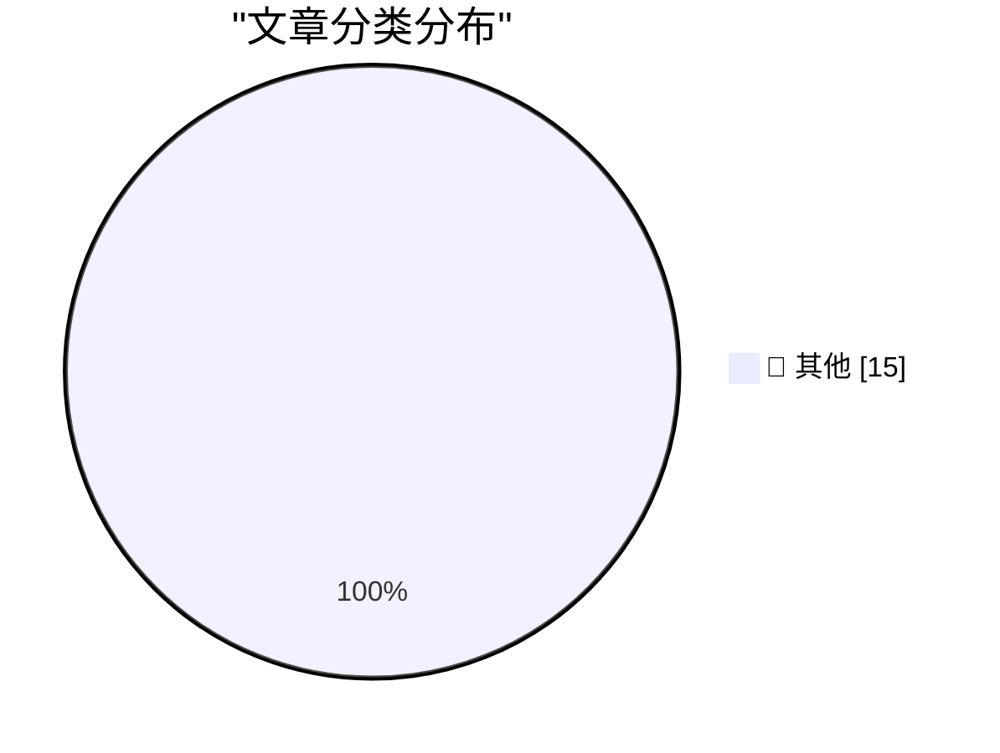

# 📰 AI 资讯每日精选 — 2026-11-07

> 汇聚 140+ 技术博客、X/Twitter、Hacker News、Reddit、Product Hunt、
> Lobste.rs、ClawFeed 日报及 GitHub Trending，经 AI 评分筛选。
>
> **本期内容**：🏆 今日必读 · 🌐 ClawFeed 日报 · 🔥 GitHub Trending · 📂 分类精选 · 🎨 设计与生成式 AI · 📊 数据概览

## 🏆 今日必读

🥇 **Quoting Nilay Patel**

[Quoting Nilay Patel](https://simonwillison.net/2026/Nov/6/nilay-patel/) — simonwillison.net · 9 小时前 · 📝 其他

> Quoting Nilay Patel

🥈 **Working with designers**

[Working with designers](https://seangoedecke.com/working-with-designers/) — seangoedecke.com · 3 小时前 · 📝 其他

> Working with designers

🥉 **★ Touch and Glow**

[★ Touch and Glow](https://daringfireball.net/2026/11/touch_and_glow) — daringfireball.net · 7 小时前 · 📝 其他

> ★ Touch and Glow

4️⃣ **Apple Support: ‘About the Illuminated Apple Logo on MacBook Pro With PROLED XDR Display’**

[Apple Support: ‘About the Illuminated Apple Logo on MacBook Pro With PROLED XDR Display’](https://support.apple.com/en-us/149248) — daringfireball.net · 12 小时前 · 📝 其他

> Apple Support: ‘About the Illuminated Apple Logo on MacBook Pro With PROLED XDR Display’

5️⃣ **The President is Coping Well**

[The President is Coping Well](https://www.wsj.com/politics/policy/trump-signs-proclamation-he-says-will-protect-oval-office-from-major-changes-93f3285b) — daringfireball.net · 12 小时前 · 📝 其他

> The President is Coping Well

---

## 🌐 ClawFeed 日报精选

> 来源：[ClawFeed](https://clawfeed.kevinhe.io) — AI 驱动的多源新闻聚合

# ☀️ ClawFeed | 2026-11-06 日报 SGT

> 聚合自 3 期已发布的 8 小时简报：#1469 00:00（00:00-07:59）、#1471 08:00（08:00-15:59）、#1472 16:00（16:00-23:59），时间窗 2026-11-06 00:00–23:59 SGT，三档齐全。
> 三期正文开头写的窗内素材合计 467 条（feed 434 + 关注抽样 33：#1469 180 + 16、#1471 121 + 9、#1472 133 + 8）；三期都没有新书签。时间上是纽约 11-05 周四 11:00 到 11-06 周五 10:59（东部标准时间），也就是选后第二个交易日的盘中到收盘、再到周五早上的非农数据和开盘。覆盖：#1471 翻满 80 屏仍有窗内的帖，写明覆盖不全；#1472 翻过了窗口开始、覆盖完整；首页都是推荐流样本，三期各时段都很不均，每期最后一个小时都占三成到一半（#1469 07 点档 60 条、#1471 14–15 点档 62 条、#1472 23 点档 66 条），其余时段（比如 #1469 02 点档 6 条、#1471 09 点档 6 条、#1472 16 和 19 点档各 5 条）素材很少，可能漏事。
> 主线：选后 AI 股大跌贯穿全天——凌晨纳指大跌、比特币跌破 7.6 万，市场担心民主党限制数据中心、暂停先进 AI；白天 WSJ 和路透报 Anthropic 的 IPO 估值和下周路演被投资人质疑；晚上美国 10 月非农新增 16.5 万、周五美股反弹。「AI 加速 AI」成了第二条线：METR 用 Anthropic 内部数据评估 AI 是否在加速 AI 研发，转述的结论是「研发速度翻倍、或已越过警戒线」，Jeff Dean 和 Demis Hassabis 各有说法。另有 OpenAI 发布 GPT-6 Cyber、Claude 上线个人理财、Base 上智能体支付变大、腾讯混元 Hy4 登上 APEX-Agents 开源第一和通义千问预热 Qwen 4、特斯拉明年停产 Cybertruck、Aave 收购 Avon、以太坊 Devcon 8 等。

---

## 🔥 当日最重要 5 条（跨档去重）

1. **选后 AI 股大跌 → Anthropic IPO 被质疑 → 非农好于预期、周五反弹**（三期都有）：@CoinDesk 00:32：民主党在中期选举获胜后 AI 股崩跌，纳指跌 3.9%，比特币一小时内从 8 万美元跌到 7.6 万以下，多头爆仓超过 3.7 亿美元，原因写的是「对数据中心限制的担心在上升」；05:14 收盘后又一条：美股收出自 2025 年 4 月以来最差的一天。@Meta8Mate 07:43 和 @NFT_Chen 06:48 把这和众议员 Ansari「第一天就要暂停先进 AI」、新当选参议员 El-Sayed 要禁止超级智能、几个地方选民投票否决数据中心连在一起（带立场的中文号转述）；@passluo 00:16 不同意，认为真正原因是 AI 应用远落后于模型（#1469）。白天 @Cointelegraph 09:30 援引 WSJ：Anthropic 的投资人怀疑公司还能不能拿到预期的 1.5 万亿美元 IPO 估值；@ReutersBiz 10:18（路透独家）：潜在 IPO 投资人怀疑 Anthropic 能不能按计划下周路演、赶上 11 月上市；@Gussie799 14:41 转 PANews 的传闻是估值可能从约 2 万亿降到 1 万亿（#1471）。晚上 @xiaohu 17:40 列的周四数字是纳指跌 5.5%、费城半导体指数跌 12.3%、英伟达一天蒸发近 4,500 亿美元，和凌晨 CoinDesk 的 3.9% 对不上（见下方「未证实」）；@nytimes 21:45（突发）：美国 10 月新增就业 16.5 万，失业率降到 4.1%；@marquistrillx 23:42：周五在反弹，标普涨约 1%、纳指接近 2%，「一天大跌不是崩盘」；@robustus 23:57：「AI 末日派和 ASI 狂热的旧金山圈好像都错了」（#1472）。
   来源: https://x.com/CoinDesk/status/2118380830686920927 ｜ https://x.com/CoinDesk/status/2118451994020938228 ｜ https://x.com/Meta8Mate/status/2118489487911293186 ｜ https://x.com/NFT_Chen/status/2118475491460210742 ｜ https://x.com/passluo/status/2118376897310757016 ｜ https://x.com/Cointelegraph/status/2118516393494659217 ｜ https://x.com/ReutersBiz/status/2118528455251755296 ｜ https://x.com/Gussie799/status/2118594588353159678 ｜ https://x.com/xiaohu/status/2118639603964150095 ｜ https://x.com/nytimes/status/2118701335117726162 ｜ https://x.com/marquistrillx/status/2118730715579973713 ｜ https://x.com/robustus/status/2118734586985267215

2. **「AI 加速 AI」：METR 用 Anthropic 内部数据做的评估、Jeff Dean 和 Hassabis 谈递归自我改进（RSI）**（#1471、#1472）：@sleepy0x13 15:10 转 METR：METR 一个团队从 8 月起用 Anthropic 内部信息（预训练、强化学习、未发布模型的测试成绩、算力投入等）评估「AI 是否已经在加速 AI 研发」，花了 11 周，现在发布了这份风险评估的总结报告，结论在素材里被截断；@sleepy0x13 10:26 转 Fireside Alpha：Jeff Dean 在和李飞飞的对谈里说 RSI 无限加速「不太可能」，因为改进基础模型要真实的训练；关注抽样里 @rwayne 15:16 转的说法是投资人拒得最多的就是围绕 RSI 的创业项目（#1471）。晚上 @Techub_News 23:45 速报：METR 称 Anthropic 研发速度翻倍，「或已越过警戒线」（只有一行转述）；@haider1 22:20 转述 Demis Hassabis：现在是 RSI 的早期，AI 让工程师效率提高 3–5 倍，但人还在回路里，下一阶段、也是最危险的是不经人审的「闭环 RSI」（#1472）。
   来源: https://x.com/sleepy0x13/status/2118601848311746616 ｜ https://x.com/sleepy0x13/status/2118530492199006280 ｜ https://x.com/rwayne/status/2118603442872898026 ｜ https://x.com/Techub_News/status/2118731478590800016 ｜ https://x.com/haider1/status/2118709991666586007

3. **用 AI 找漏洞的后续：OpenAI 发布 GPT-6 Cyber，攻防两头都在加速**（#1469、#1471）：@OpenAI 01:09：发布 GPT-6 Cyber，前一天公布的 Linux 内核漏洞研究就是它跑的；@WesRoth 07:16：先开放给部分 Daybreak Red 客户做授权安全测试，内核那次为 948 个本地提权漏洞写出了能用的利用代码、也出了补丁。@a16z 01:01 和 03:00：前沿模型能可靠完成的最长网络安全任务（按专家用时算）从 2024 年底 5.5 分钟到 2026 年 4 月 4.8 小时，每 4–5 个月翻一倍；公开漏洞数自 2017 年涨了 3 倍多，而确认在野利用的每年一直不到 900 个。@0xAA_Science 03:27 转述 OpenSSH 新漏洞：受影响的 Alpine Linux 服务器上输入任意 257–1024 个字符的密码就能绕过认证（原始公告不在素材里，#1469）。攻击面这边：@evilcos 11:29（余弦，慢雾）推荐 brucexu.eth 的复盘，亲历和币安同款的招聘攻击，最后发现自己中了木马；@xiaohangzhang7 14:43（Trust Wallet）提醒 Coruna 和 DarkSword 攻击的是 iOS 本身，点一个恶意链接就可能中招，要更新系统或开锁定模式（#1471）。
   来源: https://x.com/OpenAI/status/2118390190246879554 ｜ https://x.com/WesRoth/status/2118482531507134848 ｜ https://x.com/a16z/status/2118388149449871712 ｜ https://x.com/a16z/status/2118418125435904271 ｜ https://x.com/0xAA_Science/status/2118424937052651915 ｜ https://x.com/evilcos/status/2118546226782326848 ｜ https://x.com/xiaohangzhang7/status/2118595233659359520

4. **AI 碰钱：Claude 个人理财、Base 上的智能体支付、Link 接近 400 个智能体**（#1469、#1471）：@zachperret 03:05（Plaid CEO）：和 Anthropic 合作在 Claude 里上线个人理财，美国用户今天起可用，由 Plaid 接入账户；@levelsio 04:07 引用的官方说明：美国测试版，用你自己的余额和交易回答问题，只读，Claude 不能转、管或投资你的钱，levelsio 评「他们会一个行业一个行业吃掉」（#1469）。@brian_armstrong 11:21（Coinbase CEO）转 @fabdarice：Base 上的智能体支付（x402）交易量在往上走，单笔也更大，中位数 30 美元，Armstrong 只评了一句「Ok interesting」；@danhilltech 08:42（Stripe 旗下 Link）：Link 已和近 400 个智能体合作；关注抽样 @levie 08:19（Aaron Levie，Box）：企业里和数据、系统打交道的智能体会比今天的人多 100 倍，成败看能不能拿到关键上下文（#1471）。
   来源: https://x.com/zachperret/status/2118419507232518647 ｜ https://x.com/levelsio/status/2118435009354694853 ｜ https://x.com/brian_armstrong/status/2118544197087293559 ｜ https://x.com/danhilltech/status/2118504337089425417 ｜ https://x.com/levie/status/2118498574497665316

5. **中国模型上新：腾讯混元 Hy4 登上 APEX-Agents 开源第一，通义千问预热 Qwen 4**（#1472，另有 #1469 一条）：@ShunyuYao12 17:11（姚顺雨）：混元 Hy4 是 APEX-Agents 上新的开源第一，Pass@1 77.6%、平均分 85.1%（在 69 个模型里都排第 3），后面是 DeepSeek-V4.1-Flash-1017（69.8%）、Kimi K3.1 Pro（65.5%）；@latepostnews 21:41（晚点）写模型公司开始从人类的实际工作里收数据，文中说姚顺雨 2026 年初起直接管混元数据团队。@Alibaba_Qwen 20:00 只发了一句「The becoming begins.」，@QwenDevs 22:46 解释海报上的「北冥有鱼，其名为鲲」，鲲读音像 Qwen，「Qwhen? Qsoon!」；还没发布，素材里没有参数或成绩（#1472）。另外关注抽样里 @runinfrai 04:32 说 Kimi K3.1 Pro 高速版快要上，每秒 250 个 token（#1469）。
   来源: https://x.com/ShunyuYao12/status/2118632307859014021 ｜ https://x.com/latepostnews/status/2118700335753773480 ｜ https://x.com/Alibaba_Qwen/status/2118674834632978755 ｜ https://x.com/QwenDevs/status/2118716745372532865 ｜ https://x.com/runinfrai/status/2118441307198898327

**⚠️ 未证实（素材里核实不了，只记录说法）**
- 周四纳指跌幅：#1469 收的 @CoinDesk 00:32 是 3.9%，#1472 收的 @xiaohu 17:40 是 5.5%，素材原样如此，哪个对核不了。https://x.com/CoinDesk/status/2118380830686920927 ｜ https://x.com/xiaohu/status/2118639603964150095
- Anthropic IPO 估值：WSJ（经 @Cointelegraph）写的是预期 1.5 万亿美元，PANews 传闻（经 @Gussie799）写的是「从约 2 万亿降到 1 万亿」，两个数对不上，都是转述（#1471）。https://x.com/Gussie799/status/2118594588353159678
- 「METR 称 Anthropic 研发速度翻倍、或已越过警戒线」：一行速报，METR 报告原文素材里没有（#1472）。https://x.com/Techub_News/status/2118731478590800016
- 「GPT-6.2 Astra」：只有 @Yuchenj_UW 22:40 一句「Happy GPT-6.2 Astra and Qwen 4 Day」，素材里没有别的帖提到，是否已发布核不了（#1472）。https://x.com/Yuchenj_UW/status/2118715113591177371
- 巴拉圭数字银行 Ueno 出事、约 300 万人账户被冻结：@StaniKulechov 07:15 和 @sjdedic 15:20 都是转述，没有原始报道（#1469、#1471）。https://x.com/StaniKulechov/status/2118482261746045259 ｜ https://x.com/sjdedic/status/2118604393729737020
- 「马斯克说软银在燃气轮机订单上违约」：没点名供应商、没有合同细节，软银没公开确认（#1472）。https://x.com/0xlunasterling/status/2118731337184010702
- Solana 上海活动被临时叫停、现场有执法人员：单一来源，没有官方通报（#1472）。https://x.com/knowyourself518/status/2118697831943000549
- 「若 Anthropic 对 TeraWulf AI 数据中心的租约违约，谷歌可能入股」：CoinDesk 简报里只有一句，没说为什么会违约（#1469）。https://x.com/CoinDesk/status/2118432195282956600

**次重要（备选）**
- 「人只审 spec、不审代码」的前沿实验室开发流程：@GenAI_is_real 05:29 说是「听说」（#1469）；@istdrc 23:49（Raft 创始人）转述了同样的流程，说 Raft 也差不多（#1472）。https://x.com/GenAI_is_real/status/2118455615853154363 ｜ https://x.com/istdrc/status/2118732465103855657
- 特斯拉约明年年中逐步停掉德州超级工厂的 Cybertruck 生产，给 Cybercab 扩产腾地方（@elonmusk 14:30）；@Scobleizer 15:40 说对投资人合理（#1471）。https://x.com/elonmusk/status/2118591788701421573 ｜ https://x.com/Scobleizer/status/2118609569937342942
- Gemini Omni 1.2 Flash：视频生成和编辑上限加到 15 秒，便宜 30%（@GoogleAI 01:08，#1469）。https://x.com/GoogleAI/status/2118389961426874879
- Hugging Face《终极 MoE 大模型训练手册》：帖子说花了 80 万 GPU 小时自己跑实验（@alacheng 10:42，#1471）；@shao__meng 20:21 补了一句全文约 7 万词（#1472）。https://x.com/alacheng/status/2118534505657200929 ｜ https://x.com/shao__meng/status/2118680242797883876
- Aave Labs 收购做链上固定利率借贷的 Avon 的团队和技术，做 Aave V4 的链上信贷（@StaniKulechov 23:17，#1472）。https://x.com/StaniKulechov/status/2118724526754173048

---

## 📰 当日核心主题

**① AI 编程和智能体工具（三期都有）**
发布：@cognition 01:11：Devin Review 2.0，审 PR 最多便宜 5 倍、快 1.5 倍；@github 03:55：Copilot Fusion 自动在三种执行方式里挑模型；@vercel 06:05：Cursor 里做的应用一键部署、不用建账号；@rauchg 04:30：Vercel Schedules 公测，智能体可以自己排定时任务（#1469，https://x.com/cognition/status/2118390707228745948 ｜ https://x.com/github/status/2118431920295989588 ｜ https://x.com/vercel/status/2118464668444557411 ｜ https://x.com/rauchg/status/2118440831355068671）。@github 11:25：Copilot Verified Proficiency，按平时实际用法评估熟练度；@ZhihuFrontier 14:21 转：WebHarbor 开源，153 个真实网站的离线复刻、3,518 个任务，给网页智能体训练和评估（#1471，https://x.com/github/status/2118545162670383517 ｜ https://x.com/ZhihuFrontier/status/2118589507025121352）。@rabi_guha 22:58：OpenUI Dashboards，让产品里的智能体用你自己的组件直接给用户做看板；@peter_szilagyi 23:36 转 Claude Code 更新：后台子代理状态行改由 Haiku 5.5 写，每次省约 99%（11-05 日报已收过，#1472，https://x.com/rabi_guha/status/2118719621113262402 ｜ https://x.com/peter_szilagyi/status/2118729259611038138）。
用法和观点：@Yuchenj_UW 02:46：现在 Codex 比 Claude Code 强在 computer use（#1469，https://x.com/Yuchenj_UW/status/2118414764296790519）；@GoSailGlobal 15:46 让 8 个 AI 工具照自己的资料做个人主页，不装工具的 Claude Code 最快，装了工具的没有一个多做对一项、用量是不装时的 1.8–13.7 倍；@thdxr 15:21：「卖『软件工厂』的公司，自己产出的软件少得惊人」；@FinanceYF5 12:17 转 Jeff Ladish：「Fable 之前和之后差别巨大，我从有时候用 agent 变成每天都用」（#1471，https://x.com/GoSailGlobal/status/2118610966141452314 ｜ https://x.com/thdxr/status/2118604739428426223 ｜ https://x.com/FinanceYF5/status/2118558292360429977）；@dhh 22:31：唯一反复打的纠偏提示是「could this be simpler?」（#1472，https://x.com/dhh/status/2118712924218773709）。
额度和多智能体管理：@fankaishuoai 17:28：让 Grok Bot 改一个静态页，它自己拉起 Cursor Cloud Agent，一次用掉 200 万 token，套餐额度最近也腰斩；@yan5xu 23:01：Claude 账号又被封，把工作迁到只有 loop + MCP 的极简 runtime，「居然还行」；@WangBenson6541 17:42：开源 Agents Anywhere，一个工作台管所有设备上的 Claude Code、Codex 等智能体；@yanhua1010 16:33：部门用 Multica 统一管理智能体、接入飞书（#1472，https://x.com/fankaishuoai/status/2118636737375490407 ｜ https://x.com/yan5xu/status/2118720493478162561 ｜ https://x.com/WangBenson6541/status/2118640057963749873 ｜ https://x.com/yanhua1010/status/2118622897870934048）。
设备和沙箱：@ProductHunt 06:45：Glasshand 在机房托管真 iPhone 和 Mac 给智能体操作；@Replit 01:00：沙箱改成 microVM；@thdxr 00:26：OpenCode 的 iOS 应用几周了苹果还没批（#1469，https://x.com/ProductHunt/status/2118474799123194285 ｜ https://x.com/Replit/status/2118388063252676938 ｜ https://x.com/thdxr/status/2118379489562439683）。
收入（公司自己的数字）：@aspenjfm 03:23 转 E2B：10 月年化收入 1.2 亿美元；@scottastevenson 03:28 转 Replit 的收入增长图（#1469，https://x.com/aspenjfm/status/2118423906596098190 ｜ https://x.com/scottastevenson/status/2118425363688648814）。

**② 模型、研究和评测（三期都有）**
@DrJimFan 00:31：VFlash，给物理 AI 用的「系统一」视觉模型；@theworldlabs 03:25：Frameboy 用 Atlas 世界模型实时探索 3D 世界，最高 15 fps；@mustafasuleyman 00:32 转：Planet AI 可以对 10 年以上的卫星影像直接提问（#1469，https://x.com/DrJimFan/status/2118380813498892301 ｜ https://x.com/theworldlabs/status/2118424455873741028 ｜ https://x.com/mustafasuleyman/status/2118380863134282083）。Ripple-65B 后续：@DZhang50 06:53 转用户在 64GB Mac mini 上本地跑、每秒 7 个 token；@MichaelGannotti 06:10 的 Cold Iron 测试里它在 28 个模型中排最后（#1469，https://x.com/DZhang50/status/2118476872862531708 ｜ https://x.com/MichaelGannotti/status/2118466101025931682）。评测：@omarsar0 01:19 转 Science's Last Exam，给智能体九个学科的真实研究目标；@alth0u 07:27 转 DeepFinance 金融长任务测评；@dwarkesh_sp 05:06 花 2 万美元让模型对玩《血染钟楼》（#1469，https://x.com/omarsar0/status/2118392657651057140 ｜ https://x.com/alth0u/status/2118485270735822978 ｜ https://x.com/dwarkesh_sp/status/2118449808402681911），@polynoamial 09:24（Noam Brown）夸方法论并邀请 Dwarkesh 来 OpenAI 设计评测（#1471，https://x.com/polynoamial/status/2118514804189233568）。@ArtificialAnlys 07:22：FLUX 3 Image Klein 在文生图开放权重榜排第 2（#1469，https://x.com/ArtificialAnlys/status/2118484199552561609）；@huang_chao4969 13:09：9B 小模型能引导更大的 DeepSeek V4 写代码更好，项目 HKUDS/AgentPilot（#1471，https://x.com/huang_chao4969/status/2118571357323808779）。资助：@JeffDean 12:01 和 Laude Institute 等人一起资助开放科学「登月」项目；@sleepy0x13 15:10 转 Felicis 的首期 Emergent 名单，由创始人推荐 29 家早期公司（#1471，https://x.com/JeffDean/status/2118554350859813374 ｜ https://x.com/sleepy0x13/status/2118601965374771665）。

**③ AI 产业、公司和政策（三期都有）**
@amazon 04:44：Andy Jassy 说 AI 需求是哑铃型，最大市场在中间，推理成本还「贵了一个数量级」；@ivanhzhao 04:04：Notion Calendar iOS 从头重写；@Box 03:23：Box Architect 预览（#1469，https://x.com/amazon/status/2118444288199589889 ｜ https://x.com/ivanhzhao/status/2118434195336732770 ｜ https://x.com/Box/status/2118423944021823725）；@digitalocean 10:22 祝贺 Box 发布 Box Mount，把 Box 文件夹放进智能体沙箱（#1471，https://x.com/digitalocean/status/2118529490280456592）。融资和公司：关注抽样 @guruchahal 12:15 转：Zipline 以 215 亿美元估值融了 15 亿美元（#1471，https://x.com/guruchahal/status/2118557829661639049）；@ycombinator 23:20：Domu 的催收智能体每收回人工的 100 美元能收回 186 美元；@hamptonism 23:52 转：韩国鞋厂 Changshin 部署 Palantir（#1472，https://x.com/ycombinator/status/2118725310963462580 ｜ https://x.com/hamptonism/status/2118733216526020709）。马斯克的算力：@elonmusk 16:25 转 Terafab 芯片厂进展，17:34 转「2–3 年内太空会成为运行超级智能成本最低的地方」（#1472，https://x.com/elonmusk/status/2118620772268990966 ｜ https://x.com/elonmusk/status/2118638089677803638）。政策：@CoinMarketCap 18:24：美国司法部成立「超级智能特别工作组」；@Yuki27__ 22:54 转：民调显示投民主党的人不想要家旁边建 AI 数据中心，数据中心越难建、越多智能体得跑在本地（#1472，https://x.com/CoinMarketCap/status/2118650610580865244 ｜ https://x.com/Yuki27__/status/2118718703399481701）。AI 和工作：@RoundtableSpace 07:45 转 Dario Amodei「AI 能做入门级的法律、金融、咨询工作……也会消灭工作」，没写出处（#1469，https://x.com/RoundtableSpace/status/2118489789922185666）；@Kristian_cy 15:51 面试实习生时有人中途说「我问一下 AI 公式」（#1471，https://x.com/Kristian_cy/status/2118612221014192481）；@Barret_China 22:14：同事每天做得最多的事是把需求转给自己的 AI 排队处理（#1472，https://x.com/Barret_China/status/2118708627079069948）。

**④ 加密：稳定币、机构上链、监管和 Devcon（三期都有）**
稳定币和支付：@coinbase 01:00：USDC 进了三星钱包，美国 8,200 万台 Galaxy 设备可用，走 Solana；@base 04:02：Base Denim 主网上线，200 毫秒出块（#1469，https://x.com/coinbase/status/2118387973834387603 ｜ https://x.com/base/status/2118433679202791587）；@Celo 08:15：印尼盾稳定币 IDRX 上 Celo 不到两个月成交近 3,000 万美元（#1471，https://x.com/Celo/status/2118497346967499038）。机构：@CoinDesk 02:47：Kraken 母公司在二级市场买了 AAVE、两家在谈合作；@Techub_News 07:41：Core Scientific 年底前退出比特币挖矿（#1469，https://x.com/CoinDesk/status/2118414887739109774 ｜ https://x.com/Techub_News/status/2118488828788785296）；@CoinMarketCap 11:20：Hyperliquid Strategies 申请成为期货佣金商，@CoinDesk 20:21 补充三季度净利润 6.206 亿美元、主要是未实现的代币收益（#1471、#1472，https://x.com/CoinMarketCap/status/2118543909655584891 ｜ https://x.com/CoinDesk/status/2118680273449832908）；@Solana_zh 14:00：今年 Solana 上代币化美债从 5.64 亿涨到 21 亿美元（#1471，https://x.com/Solana_zh/status/2118584163863322684）；@andyyy 23:24 转述 DTCC 数字资产 CTO：银行「正在下水」，MEV 是代币化时最大的考虑之一；@Morpho 23:33：Coinbase App 里可以用代币化黄金借稳定币（#1472，https://x.com/andyyy/status/2118726251540271454 ｜ https://x.com/Morpho/status/2118728584592576677）。监管：@WatcherGuru 11:07：反加密的参议员 Warren 预计出任参议院银行委员会主席（#1471，https://x.com/WatcherGuru/status/2118540678733103324）；@oragnes 23:53：401(k) 开放加密投资的规则已提交白宫终审，预计 2027 年 1–2 月完成；@coinbureau 23:52：Lummis 说民主党对自己提出的 CLARITY 条款投了反对票（#1472，https://x.com/oragnes/status/2118733620143849499 ｜ https://x.com/coinbureau/status/2118733257659523170）。Devcon：@wublockchain12 17:00：Vitalik 在孟买 Devcon 8 说硬件钱包的芯片也要开源可验证；@EFDevcon 19:17：Devcon 9 定在里斯本，2027 年 10 月（#1472，https://x.com/wublockchain12/status/2118629479589556412 ｜ https://x.com/EFDevcon/status/2118664094819782946）。其他：@Cointelegraph 10:30：World Liberty Financial 推出新的 WLFI 回购；@coingecko 11:49：NEAR 跌出市值前 20（#1471，https://x.com/Cointelegraph/status/2118531494733902230 ｜ https://x.com/coingecko/status/2118551274245235138）；@BNBCHAIN 18:35：BSC-Reth 节点要尽快升级到 v0.1.4-hotfix（#1472，https://x.com/BNBCHAIN/status/2118653372941406493）。

**⑤ 其他时政和社会（三期都有）**
@WSJ 10:03（独家）：民主党想先废除特朗普对加拿大的关税；@Reuters 13:10：防长 Hegseth 发视频说要对抗国会弹劾（#1471，https://x.com/WSJ/status/2118524609506975944 ｜ https://x.com/Reuters/status/2118571578791465339）；@nytimes 00:47：LIV 高尔夫在花掉 50 亿美元后关停；03:40：加州州长纽森给全州 548 名死刑犯全部减刑（#1469，https://x.com/nytimes/status/2118384745440485522 ｜ https://x.com/nytimes/status/2118428321205666241）。

---

## 🔖 书签精选

今天没有新加的书签：#1469、#1471、#1472 窗内书签都是 0 条（书签页最新一条是 11-04 22:23），三期都跳过了这一区块，本日报也没有可补选的内容。

---

## 👀 推荐关注汇总（去重，共 14 个；各期写稿时都在浏览器里核实过「未关注」：#1469 在 11-06 08:27–08:28，#1471 在 11-06 16:12–16:15，#1472 在 11-07 00:14–00:15 SGT，本日报没有重新核实）

**AI 研究、模型和评测**
- @METR_Evals（METR，非营利评测机构，6.16 万关注者）：Anthropic 内部数据评估「AI 是否在加速 AI 研发」的一手来源（#1471）。https://x.com/METR_Evals
- @ShunyuYao12（姚顺雨，5.08 万关注者）：混元 Hy4 登上 APEX-Agents 开源第一的成绩是他发的（#1472）。https://x.com/ShunyuYao12
- @TencentHunyuan（腾讯混元官方，5.74 万关注者）：Hy4 的一手来源（#1472）。https://x.com/TencentHunyuan
- @QwenDevs（通义千问开发者官方号，2.58 万关注者）：解释了 Qwen 4 预热海报；你已关注主号 @Alibaba_Qwen，这个号可选（#1472）。https://x.com/QwenDevs
- @DZhang50（Dan Zhang，Ricursive 的 LLM 负责人，前 Google DeepMind Gemini，6,480 关注者）：Ripple-65B 的一手消息（#1469）。https://x.com/DZhang50
- @MichaelGannotti（Mike Gannotti，5.46 万关注者）：自己跑测评出数字，发帖量很大、可能偏高频（#1469）。https://x.com/MichaelGannotti
- @Nouamanetazi（Nouamane Tazi，Hugging Face，2,982 关注者）：《终极 MoE 训练手册》作者之一，关注者少、发帖也少（#1471）。https://x.com/Nouamanetazi

**中文 AI 圈**
- @GenAI_is_real（Guitar Cat，在 RadixArk 做 SGLang，1.66 万关注者）：一线做推理系统（#1469）。https://x.com/GenAI_is_real
- @passluo（Passluo AI，5.83 万关注者）：中文 AI 观点号，对选后 AI 股大跌给了不同解释（#1469）。https://x.com/passluo
- @ZhihuFrontier（知乎官方英文号，1.26 万关注者）：介绍中国 AI 和科技动态，机构号、偏转介（#1471）。https://x.com/ZhihuFrontier
- @latepostnews（晚点 LatePost 官方，1.51 万关注者）：模型公司数据生意的报道；媒体号，发帖不多（#1472）。https://x.com/latepostnews

**智能体支付和加密**
- @fabdarice（fabda.eth，Coinbase Developer Platform 做稳定币支付，1.75 万关注者）：Base 上智能体支付的一手数据（#1471）。https://x.com/fabdarice
- @danhilltech（Dan Hill，Stripe 旗下 Link 的消费者产品负责人，3,107 关注者）：Link 接近 400 个智能体的一手说明（#1471）。https://x.com/danhilltech
- @donnoh_eth（donnoh，ethbeat 研究负责人，8,416 关注者）：在 Devcon 讲 CROPS 指南（#1472）。https://x.com/donnoh_eth

（三期另有 12 个显示未关注但没推荐的账号：#1469 的 @zachperret、@aspenjfm、@MaiYangAI、@yankunzhao、@Redisinc；#1471 的 @LucyChenSpeaker、@Riri_unfiltered、@AsumaCodes、@zhaoywang_CS、@kxshor；#1472 的 @rabi_guha、@WangBenson6541，理由是内容不以 AI/科技为主、关注者太少、或以自家产品宣传为主。）

**建议取关**：三期都没有提出取关建议。

---

## 💤 当日重复噪音模式

三期过滤掉的 feed 合计 251 条（#1469 102、#1471 77、#1472 72），另有同一件事的重复 10 条（#1469）、关注抽样 23 条没收；按类别（三期分类口径基本一致，直接相加）：
- **空帖、一个词和回复别人的一句话**：67 条（#1469 35、#1471 16、#1472 16）。仍集中在每期最后一个小时，「congrats」「Banger」「What is love?」之类，还有只有图或视频的帖子。
- **科技和 AI 的宣传、课程、小生意和没有出处的猜测**：61 条（#1469 26、#1471 18、#1472 17；DeepLearning.AI 课程和大会广告、YC 公司介绍、AI 视频涨粉和代做、「十个 AI 创业方向」、GEO 资料、表情包赚打赏、各种大会预告，以及「Sonnet 5.5 Extra 其实是下一代 Claude」这类猜测）。
- **加密项目宣传、活动和喊单**：54 条（#1469 18、#1471 15、#1472 21；OKX 预测赛、闪赚和 Boost、FungoLabs（三期都有）、Primus 榜单、U 卡返现、币安学习营感想、抄底和一句话行情判断）。
- **名言、生活、体育和本地**：45 条（#1469 12、#1471 18、#1472 15；Naval、Paul Graham、张一鸣、马斯克语录，LoL、足球、NBA、马拉松、樟宜机场、GTA VI 截图等）。
- **时政和社会**：15 条（#1469 7、#1471 5、#1472 3；出口民调、印度政要、辱骂性的选后评论、Rockefeller IV 去世等）。
- **股票**：9 条（#1469 4、#1471 5；希尔顿上市三条、马斯克「股市像有人每天对你的房子喊价」三个号各发一遍、巴菲特「跌 50%」旧文重发）。
- **同一件事的重复**：#1469 10 条（Gemini Omni 1.2 Flash 另 3 个官方号、Cursor 一键部署 2 条转述、ChatGPT Images 2.6 两条等）；#1471 和上一期 0 重复；#1472 和 #1471 重叠的 MoE 手册、Hyperliquid Strategies 申请 FCM、Warren 三处只补了新信息。
- **关注抽样里没收的**：23 条（#1469 10、#1471 5、#1472 8），还是 @StartupWisdom_ 的语录（三期都有）、@Tradermayne 的行情直播和日常（三期都有）、@rwayne 的段子和感慨、@mardehaym 的自家服务广告。
- **同一话题延续**：选后 AI 股大跌（#1469）→ Anthropic IPO 被质疑（#1471）→ 非农和周五反弹（#1472）；METR 报告（#1471 结论截断）→ #1472 结论转述；Jason Calacanis「底部到了」（#1469 → #1471 补后半段）；巴拉圭 Ueno 银行（#1469 → #1471）；「人只审 spec」开发流程（#1469 → #1472）；Dwarkesh 测评（#1469 → #1471 Noam Brown 回应）已合并。
---

## 🔥 GitHub Trending

> 今日热门开源项目（全语言 + Python）

| # | 项目 | 描述 | ⭐ 总星 | 📈 今日 | 语言 |
|---|------|------|---------|---------|------|
| 1 | [cloudflare/security-audit-skill](https://github.com/cloudflare/security-audit-skill) 🤖 | A coding-agent skill for multi-phase security audits with... | 64.2k | +2548 | JavaScript |
| 2 | [mattpocock/skills](https://github.com/mattpocock/skills) | Skills for Real Engineers. Straight from my .agents direc... | 316.8k | +2070 | Shell |
| 3 | [NVIDIA/auto-ontology](https://github.com/NVIDIA/auto-ontology) 🤖 | Auto Ontology is a Python framework for building semantic... | 9.2k | +2015 | Python |
| 4 | [sherlock-project/sherlock](https://github.com/sherlock-project/sherlock) | Hunt down social media accounts by username across social... | 98.6k | +1761 | Python |
| 5 | [D4Vinci/Scrapling](https://github.com/D4Vinci/Scrapling) | 🕷️ The BEST Web Scraping framework that handles everythi... | 98.9k | +1324 | Python |
| 6 | [microsoft/VibeVoice](https://github.com/microsoft/VibeVoice) 🤖 | Open-Source Frontier Voice AI | 56.5k | +1004 | Python |
| 7 | [google/skills](https://github.com/google/skills) 🤖 | Agent Skills for Google products and technologies | 22.9k | +534 | Python |
| 8 | [zed-industries/zed](https://github.com/zed-industries/zed) | Code at the speed of thought – Zed is a high-performance,... | 93.7k | +306 | Rust |
| 9 | [microsoft/vscode](https://github.com/microsoft/vscode) | Visual Studio Code | 195.0k | +301 | TypeScript |
| 10 | [react/react](https://github.com/react/react) | The library for web and native user interfaces. | 252.3k | +248 | JavaScript |
| 11 | [pandas-dev/pandas](https://github.com/pandas-dev/pandas) | Flexible and powerful data analysis / manipulation librar... | 50.5k | +194 | Python |
| 12 | [rust-lang/rust](https://github.com/rust-lang/rust) | Empowering everyone to build reliable and efficient softw... | 121.5k | +192 | Rust |
| 13 | [astral-sh/ruff](https://github.com/astral-sh/ruff) | An extremely fast Python linter and code formatter, writt... | 50.7k | +169 | Rust |
| 14 | [django/django](https://github.com/django/django) | The Web framework for perfectionists with deadlines. | 91.7k | +169 | Python |
| 15 | [prometheus/prometheus](https://github.com/prometheus/prometheus) | The Prometheus monitoring system and time series database. | 67.2k | +148 | Go |

---

## 📝 其他

### 1. Quoting Nilay Patel

[Quoting Nilay Patel](https://simonwillison.net/2026/Nov/6/nilay-patel/) — **simonwillison.net** · 9 小时前 · ⭐ 15/30

> Quoting Nilay Patel

---

### 2. Working with designers

[Working with designers](https://seangoedecke.com/working-with-designers/) — **seangoedecke.com** · 3 小时前 · ⭐ 15/30

> Working with designers

---

### 3. ★ Touch and Glow

[★ Touch and Glow](https://daringfireball.net/2026/11/touch_and_glow) — **daringfireball.net** · 7 小时前 · ⭐ 15/30

> ★ Touch and Glow

---

### 4. Apple Support: ‘About the Illuminated Apple Logo on MacBook Pro With PROLED XDR Display’

[Apple Support: ‘About the Illuminated Apple Logo on MacBook Pro With PROLED XDR Display’](https://support.apple.com/en-us/149248) — **daringfireball.net** · 12 小时前 · ⭐ 15/30

> Apple Support: ‘About the Illuminated Apple Logo on MacBook Pro With PROLED XDR Display’

---

### 5. The President is Coping Well

[The President is Coping Well](https://www.wsj.com/politics/policy/trump-signs-proclamation-he-says-will-protect-oval-office-from-major-changes-93f3285b) — **daringfireball.net** · 12 小时前 · ⭐ 15/30

> The President is Coping Well

---

### 6. Writing English is Solved

[Writing English is Solved](https://idiallo.com/byte-size/english-is-solved) — **idiallo.com** · 19 小时前 · ⭐ 15/30

> Writing English is Solved

---

### 7. A video game which caused real world violence

[A video game which caused real world violence](https://shkspr.mobi/blog/2026/11/a-video-game-which-caused-real-world-violence/) — **shkspr.mobi** · 14 小时前 · ⭐ 15/30

> A video game which caused real world violence

---

### 8. Why are we all worked up about atomicity when applying hot-patches if we can just suspend all the threads?

[Why are we all worked up about atomicity when applying hot-patches if we can just suspend all the threads?](https://devblogs.microsoft.com/oldnewthing/20261106-00/?p=112838/) — **devblogs.microsoft.com/oldnewthing** · 12 小时前 · ⭐ 15/30

> Why are we all worked up about atomicity when applying hot-patches if we can just suspend all the threads?

---

### 9. Static site generators are weird

[Static site generators are weird](https://evanhahn.com/static-site-generators-are-weird/) — **evanhahn.com** · 10 小时前 · ⭐ 15/30

> Static site generators are weird

---

### 10. Weekend at Bernie’s II

[Weekend at Bernie’s II](https://nesbitt.io/2026/11/06/weekend-at-bernies-ii.html) — **nesbitt.io** · 17 小时前 · ⭐ 15/30

> Weekend at Bernie’s II

---

### 11. How Do Building Codes Affect the Price of Housing?

[How Do Building Codes Affect the Price of Housing?](https://www.construction-physics.com/p/how-do-building-codes-affect-the) — **construction-physics.com** · 14 小时前 · ⭐ 15/30

> How Do Building Codes Affect the Price of Housing?

---

### 12. Premium: Fault Lines

[Premium: Fault Lines](https://www.wheresyoured.at/premium-fault-lines/) — **wheresyoured.at** · 10 小时前 · ⭐ 15/30

> Premium: Fault Lines

---

### 13. Deus Ex

[Deus Ex](https://www.filfre.net/2026/11/deus-ex/) — **filfre.net** · 11 小时前 · ⭐ 15/30

> Deus Ex

---

### 14. What happened to Transmeta, the last big dotcom IPO

[What happened to Transmeta, the last big dotcom IPO](https://dfarq.homeip.net/what-happened-to-transmeta-the-last-big-dotcom-ipo/?utm_source=rss&#038;utm_medium=rss&#038;utm_campaign=what-happened-to-transmeta-the-last-big-dotcom-ipo) — **dfarq.homeip.net** · 15 小时前 · ⭐ 15/30

> What happened to Transmeta, the last big dotcom IPO

---

### 15. ToyBlocks: A controlled world for robot learning and evaluation

[ToyBlocks: A controlled world for robot learning and evaluation](https://huggingface.co/blog/allenai/toyblocks) — **Hugging Face Blog** · 13 小时前 · ⭐ 15/30

> ToyBlocks: A controlled world for robot learning and evaluation

---

## 📊 数据概览

| 扫描源 | 抓取文章 | 时间范围 | 精选 |
|:---:|:---:|:---:|:---:|
| 92/140 | 3950 篇 → 67 篇 | 24h | **15 篇** |

### 分类分布

---

*生成于 2026-11-07 03:10 | 汇聚 140 个技术博客、X/Twitter、Hacker News、Reddit、Product Hunt、Lobste.rs、ClawFeed 日报及 GitHub Trending，经 AI 评分筛选出 Top 15 精华内容*
