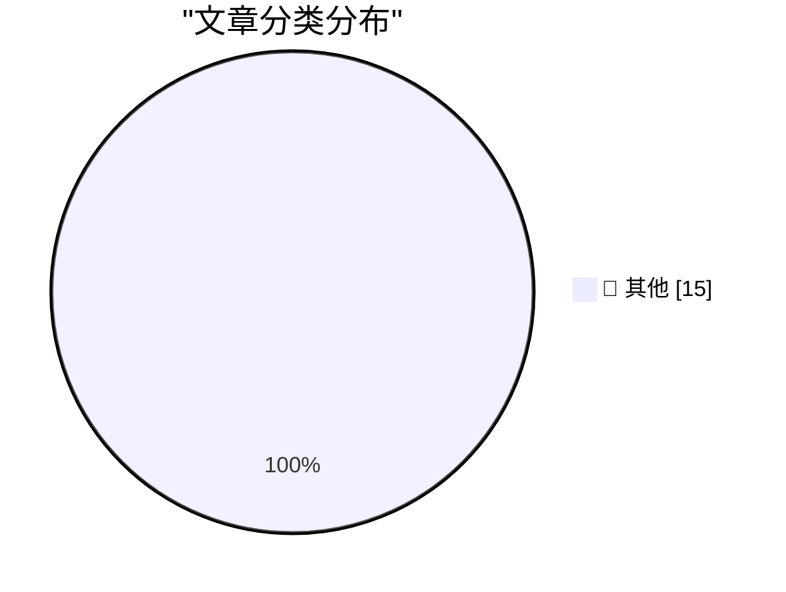

# 📰 AI 资讯每日精选 — 2026-11-08

> 汇聚 140+ 技术博客、X/Twitter、Hacker News、Reddit、Product Hunt、
> Lobste.rs、ClawFeed 日报及 GitHub Trending，经 AI 评分筛选。
>
> **本期内容**：🏆 今日必读 · 🌐 ClawFeed 日报 · 🔥 GitHub Trending · 📂 分类精选 · 🎨 设计与生成式 AI · 📊 数据概览

## 🏆 今日必读

🥇 **datasette #3046: Don't serve link: rel=next HTTP headers to Firefox for HTML pages**

[datasette #3046: Don't serve link: rel=next HTTP headers to Firefox for HTML pages](https://simonwillison.net/2026/Nov/7/link-rel-next/) — simonwillison.net · 2 小时前 · 📝 其他

> datasette #3046: Don't serve link: rel=next HTTP headers to Firefox for HTML pages

🥈 **Yours Truly on Full Stack Creator, Talking About the New MacBook Pros With PROLED XDR Displays**

[Yours Truly on Full Stack Creator, Talking About the New MacBook Pros With PROLED XDR Displays](https://www.youtube.com/watch?v=f2GZtWuUPl0) — daringfireball.net · 5 小时前 · 📝 其他

> Yours Truly on Full Stack Creator, Talking About the New MacBook Pros With PROLED XDR Displays

🥉 **Pluralistic: JS Tan and Clarissa Redwine's "Against Tech Oligarchy" (07 Nov 2026)**

[Pluralistic: JS Tan and Clarissa Redwine's "Against Tech Oligarchy" (07 Nov 2026)](https://pluralistic.net/2026/11/07/aeiou-but-sometimes-why/) — pluralistic.net · 13 小时前 · 📝 其他

> Pluralistic: JS Tan and Clarissa Redwine's "Against Tech Oligarchy" (07 Nov 2026)

4️⃣ **Book Review: When the Dust Settles - Stories of Love, Loss and Hope from an Expert in Disaster by Lucy Easthope ★★★★★**

[Book Review: When the Dust Settles - Stories of Love, Loss and Hope from an Expert in Disaster by Lucy Easthope ★★★★★](https://shkspr.mobi/blog/2026/11/book-review-when-the-dust-settles-stories-of-love-loss-and-hope-from-an-expert-in-disaster-by-lucy-easthope/) — shkspr.mobi · 14 小时前 · 📝 其他

> Book Review: When the Dust Settles - Stories of Love, Loss and Hope from an Expert in Disaster by Lucy Easthope ★★★★★

5️⃣ **This Week in Package Management: 7 November 2026**

[This Week in Package Management: 7 November 2026](https://nesbitt.io/2026/11/07/this-week-in-package-management.html) — nesbitt.io · 16 小时前 · 📝 其他

> This Week in Package Management: 7 November 2026

---

## 🌐 ClawFeed 日报精选

> 来源：[ClawFeed](https://clawfeed.kevinhe.io) — AI 驱动的多源新闻聚合

# ☀️ ClawFeed | 2026-11-07 日报 SGT

> 聚合自 3 期已发布的 8 小时简报：#1474 00:00（00:00-07:59）、#1475 08:00（08:00-15:59）、#1476 16:00（16:00-23:59），时间窗 2026-11-07 00:00–23:59 SGT，三档齐全。
> 三期正文开头写的窗内素材合计 443 条（feed 421 + 关注抽样 22：#1474 222 + 11、#1475 85 + 3、#1476 114 + 8）；三期都没有新书签。这是 SGT 周六的一天：早上那档接的是美股周五收盘，白天和晚上闲聊、体育、新闻和喊单都多。覆盖：三期首页都翻过了窗口开始，覆盖完整；首页都是推荐流样本，时段很不均，#1474 的 6 点档 66 条、7 点档 84 条占了七成多，0–2 点档各只有 8–9 条；#1475 全天量少（85 条，每小时 6–13 条）；#1476 的 23 点档 48 条占四成，16、17 点档只有 5 条和 4 条，这些时段可能漏事。
> 主线：Anthropic 一天里放了一串产品更新——早上是美国区 Claude 个人理财和 Claude Code 云端会话自己配环境，白天是工程博客《The components of agent memory》（「dreaming」整理记忆，中文圈至少 7 个人转述）、Claude Duet 接 Claude Code 会话、Claude Code Projects、Enterprise 的 Inference Hooks，晚上 Google Research 的「SLEEP」接着讲记忆。第二条线是 MEXC（抹茶）：早上被转述为美国财政部下禁令，白天细节落到 FinCEN、2021–2026 年至少 160 亿美元，晚上开始影响 U 卡充值。另有周四大跌后的周五收盘反弹和复盘、OpenAI 新一轮首批约 110 亿美元到账（彭博）和 Anthropic IPO 估值传闻、OpenAI 封号和 Claude 线下 KYC 的账号风控、以太坊 Glamsterdam 推迟和不变量被打破、bubblemaps 预告曝光大 KOL、Harness Leaderboard 等。

---

## 🔥 当日最重要 5 条（跨档去重）

1. **Anthropic 一天连发多处产品更新：Claude 个人理财、Claude Code 云端会话自配环境、Claude Duet 接 Claude Code、Claude Code Projects、Enterprise Inference Hooks**（#1474、#1475）：@aiedge_ 04:31 引用 @claudeai 11 月 6 日的发布：Claude 上线 Personal Finance（个人理财），美国区 beta，你自己选要连的账户，Claude 依据你自己的余额和交易记录回答和钱有关的问题；权限只读，Claude 不能转账、管理或投资你的钱，@aiedge_ 评「又一刀干掉 1000 家金融科技创业公司」，这是他的说法。@ClaudeDevs 03:58（关注抽样里的官方号）：Pro、Max、Ultra 用户在 Claude Code 云端会话里跑自己的仓库，Claude 自己判断需要哪些依赖、网络访问和 API Key，然后把环境存下来下次直接用，API Key 安全保存、Claude 看不到；@NFT_Chen 04:41 的中文转述补了一句「以前要手动折腾 10 分钟」，是作者的估计。企业侧 @Box 06:14：Box 里放可信内容，上面跑 Claude Design 和 Claude Skills，BTS Group 的 Kevin Bronk 说有些以前要几周的 RFP 回复现在几天甚至几小时（#1474）。白天 @rileybrown 08:55 引用 Claude Duet 负责人 @davidsuttonca：Claude Duet 现在能接 Claude Code 会话，在手机上看在跑什么、批准改动、发更新，电脑上的和云端的会话都行；@Tao100086 09:11 收到 Anthropic 邮件，Claude Duet 可以用了，还送了 3 次 reset。@lydiahallie 08:28（Anthropic Claude Code）：用过 Conductor 的，大部分做法现在可以用 Claude Code Projects 做——加上仓库，让 Claude 接着你推上去的分支干，还没有多人协作。@Starmanspace 15:45：Inference Hooks 在 Claude Enterprise 上正式可用，推理和调用工具之前先对 prompt 和工具调用做放行 / 拒绝，用你自己的 HTTPS 服务、签名投递、默认约 5 秒超时，拒绝记进 Activity Feed，Security Center 还是 beta（素材里没有 Anthropic 官方的发布帖）（#1475）。
   来源: https://x.com/aiedge_/status/2118803357116821913 ｜ https://x.com/ClaudeDevs/status/2118795192090386454 ｜ https://x.com/NFT_Chen/status/2118805901230608689 ｜ https://x.com/Box/status/2118829325550256438 ｜ https://x.com/rileybrown/status/2118869902660686220 ｜ https://x.com/Tao100086/status/2118873902554509546 ｜ https://x.com/lydiahallie/status/2118863157569737109 ｜ https://x.com/Starmanspace/status/2118972973046726971

2. **智能体记忆：Anthropic 工程博客讲「dreaming」，Meta Muse、Google「SLEEP」同一天也在讲**（#1475、#1476）：@AnthropicAI 发布工程博客《The components of agent memory》（素材里只有被引用的一段）：「记忆让 Claude 能从经验里学习。新的工程博客讲『dreaming』怎么帮 Claude 整理学到的东西、纠正错误、下次更容易找到需要的东西。」@hungryturbo 09:15 是素材里最早的转述；@yibie 13:44 摘的要点：三个部件是笔记、做梦、wiki，文章对「记忆」的定义是 Claude 从经验里得到、跨会话保留、存成以后能读的文件的知识，不包括改权重，也不包括单次对话里的临时学习；@Xudong07452910 10:30：重要的设计是分层存储，原始会话记录保留作证据，关键经验另外写入；@KKaWSB 11:22 说 dreaming 是让 AI 在空闲时回看过去的对话和任务、找出记错的地方、整理成长期记忆（他转述的 73%→87% 准确率见下方「未证实」）；@wey_gu 13:38：和他一直在分享的「RSI-like」做法一样。同一时段 @sleepy0x13 11:16 转扎克伯格：Muse 和 Meta AI 换了模型，把 Muse Wonder 的 Active Memory 和 Active Focus 放给所有人，「忘记关键信息的概率低 2.4 倍、自我纠错和完成日常任务好 67%」是 Meta 自己的数（#1475）。晚上 @shao__meng 20:58：Google Research 发了「SLEEP」框架，让模型在处理新任务之外专门做记忆巩固，把临时学到的信息写进长期参数，再通过自己生成的练习强化能力、减少对旧知识的覆盖——和 Anthropic 博客「存成文件、不改权重」的定义正好不同；@0x99DaDa 19:10：Meta 11 月 5 日宣布在美国分批推出 Muse 的实时语音和动态头像（#1476）。
   来源: https://x.com/hungryturbo/status/2118874895237185734 ｜ https://x.com/yibie/status/2118942644910821634 ｜ https://x.com/Xudong07452910/status/2118893703850860912 ｜ https://x.com/KKaWSB/status/2118906905053778260 ｜ https://x.com/wey_gu/status/2118941168184750235 ｜ https://x.com/sleepy0x13/status/2118905363483529644 ｜ https://x.com/shao__meng/status/2119051833872466407 ｜ https://x.com/0x99DaDa/status/2119024564378194004

3. **MEXC（抹茶）被 FinCEN 限制资金往来，晚上开始影响 U 卡充值；FinCEN 和美联储撤回 Travel Rule 降门槛的旧提案**（三期都有）：@Astraluna66 07:13 引用 @Meta8Mate 的转述（原始出处是 Cointelegraph 的帖子，素材里只有被截断的链接）：美国财政部要求美国的银行和金融机构不得再和 MEXC 有任何资金往来，理由是 5 年里帮伊朗、朝鲜、俄罗斯转移了至少 160 亿美元；@ThanksuTrump 06:13 建议尽快提币，「24 小时内流出的资金都会被监控」是他的预测，没有出处（#1474）。白天 @0xLoki_Zeng 13:57：出手的是 FinCEN，指控 MEXC 在 2021–2026 年至少促成了 160 亿美元与规避制裁、网络犯罪相关的资金流动，涉及俄罗斯、伊朗、朝鲜等受制裁主体，定性是该做的 KYC / AML 没做；FinCEN 是财政部下属机构，和早上的说法对得上；@colinwu 08:49：HTX 之后 MEXC 也出事，离岸交易所的空间越来越小（#1475）。晚上 @Laaaaacieee 17:06：她从合作卡商那里了解到，因为 FinCEN 对 MEXC 发了资金转移限制命令，多家 U 卡卡商更新了风控规则，从 MEXC 提出的资金充值都不会入账，提醒别用 MEXC 的钱给 U 卡充值（没点名哪几家）。另一件：@huynhconghuan83 23:10：据 The Block，FinCEN 和美联储撤回了 2020 年把加密 Travel Rule 申报门槛从 3,000 美元降到 250 美元的提案，理由是提案太旧、行业已经变了（#1476）。三期素材里都没有公告原文，也没有 MEXC 的回应。
   来源: https://x.com/Astraluna66/status/2118844174191759798 ｜ https://x.com/ThanksuTrump/status/2118829208495693861 ｜ https://x.com/0xLoki_Zeng/status/2118945878803415251 ｜ https://x.com/colinwu/status/2118868291074867204 ｜ https://x.com/Laaaaacieee/status/2118993471050498407 ｜ https://x.com/huynhconghuan83/status/2119085095667589152

4. **周四大跌之后：周五收盘反弹和复盘；AI 公司的钱——OpenAI 新一轮首批约 110 亿美元到账**（#1474、#1476）：@Dragonhau66 05:13：周五美股收盘，纳指涨 1.45%，费城半导体指数反弹 4.2%；周四纳指是 2020 年 3 月以来最惨的单日跌幅，一夜蒸发 2.3 万亿美元市值，他认为是技术性反抽、不是反转（#1474 注明：上一期 @marquistrillx 写的「纳指接近 2%」是盘中数，以收盘为准）。@0xlunasterling 06:37 转 SpotGamma：周四标普 500 跌 4.36% 到 7,353.73，是 2011 年 8 月以来最大单日跌幅（不算新冠和 2025 年 4 月关税冲击），纳指综指跌 5.52%，标题说是负 Gamma 放大了下跌。链上：@jessepollak 07:09（Base 负责人）转 @LlamaRisk：Aave 在 Base 上的代币化股票市场在这轮波动里正常运转，风控参数按设计起作用，当天跌得最多的是 TSLA −10.4%、SPCX −8.5%、NVDA −7.0%。@0xlunasterling 07:42：美国 9 月电脑、配件和半导体进口增加 121 亿美元，创纪录到 869 亿美元（#1474）。晚上 @0x99DaDa 18:37：据彭博报道，OpenAI 新一轮融资首批约 110 亿美元已在 11 月 6 日到账，整轮还在继续，最终可能筹到约 200 亿美元，10 月见报时目标约 300 亿美元，10 月底《金融时报》报道目标下调到约 200 亿（素材里没有彭博和 FT 原文）；Anthropic IPO 估值另有一条没出处的传闻，见下方「未证实」（#1476）。
   来源: https://x.com/Dragonhau66/status/2118813944861323556 ｜ https://x.com/0xlunasterling/status/2118835214369595679 ｜ https://x.com/jessepollak/status/2118843325763764404 ｜ https://x.com/0xlunasterling/status/2118851551120793977 ｜ https://x.com/0x99DaDa/status/2119016259119714482

5. **账号风控：OpenAI 被说大规模封号，Claude 有人跑到印尼线下做 KYC**（#1475、#1476）：@WildVariable01 13:35 说 11 月 7 日 OpenAI 大规模封号、没有邮件通知，他看到 21 个人被封了 30 多个号，有 Pro 20x、Pro、Team、Plus 和学生认证账户（#1475）。晚上又有两个转述：@PhyrexNi 21:05 引用 @Bqlsj2023：很多 200U、500U 的账号被封，没有预警、没有邮件，封了数据拿不回来；@rwayne 21:34（关注抽样）引用 @liyue_ai 的文章「今天 GPT 出现了大规模封号，具体封号原因也没说」。Phyrex 还说新加坡一个讨论组里很多人开始做远程托管：在家放一台配置一般的 Mac Mini，让国内的人远程连过去跑 AI。Claude 这边：@yanhua1010 19:59：「今日最佳：Claude 印尼面对面 KYC」，他自己的 Pro 账号是用护照过的 KYC；@0xLaughing 21:57 引用 @_FORAB：有人做 Claude KYC 生意，跑到印尼西部村庄线下找当地人面对面做身份验证、注册账号、现金结算，Laughing 自己是找美国朋友用美国 ID 过的 KYC，快 2 个月还稳定（个人经验和猜测）；@MaxForAI 16:30 只有一句「直接海外扫身份证做 KYC 去了」（#1476）。素材里没有 OpenAI 的说法，也没有 Anthropic 关于 KYC 的原文；Cat Wu 的说法见下方「未证实」。
   来源: https://x.com/WildVariable01/status/2118940279101431812 ｜ https://x.com/PhyrexNi/status/2119053594850959587 ｜ https://x.com/rwayne/status/2119060885968970176 ｜ https://x.com/yanhua1010/status/2119037137144426705 ｜ https://x.com/0xLaughing/status/2119066783500136737 ｜ https://x.com/MaxForAI/status/2118984378886041746

**⚠️ 未证实（素材里核实不了，只记录说法）**
- Cat Wu 的去向和日期：#1475 的 @WildVariable01 写「11 月 5 日 Claude Code 产品经理 Cat Wu 入职 OpenAI」，#1476 的 @PhyrexNi（引用 @Bqlsj2023）写「11 月 4 日 Claude Code 和 Cowork 产品负责人 Cat Wu 宣布离开 Anthropic 转投 OpenAI」，日期对不上；「这位高管推动封锁国内账号」是猜测，素材里没有 OpenAI 或本人的说法。https://x.com/WildVariable01/status/2118940279101431812 ｜ https://x.com/PhyrexNi/status/2119053594850959587
- OpenAI 大规模封号本身：三个说法都是个人观察或转述，没有 OpenAI 的说明（#1475、#1476）。https://x.com/rwayne/status/2119060885968970176
- Anthropic IPO 估值「被打下来到了 0.8 万亿」：@0xbiying 23:46 说市场之前讨论 11 月中下旬冲刺 IPO、估值 1.5 万亿至 2 万亿美元，「现在据说」降到 0.8 万亿，没有任何出处，也没有 Anthropic 的说法（#1476）。https://x.com/0xbiying/status/2119094213707198853
- 「杠杆 ETF 一天被迫卖出 6,000 亿美元」：@SarwarBuild 07:09 在回复里提到，同时自己在问摩根大通报告的出处、是一天还是一周的数（#1474）。https://x.com/SarwarBuild/status/2118843336492736854
- dreaming「实测准确率从 73% 升到 87%」：@KKaWSB 11:22 的转述，素材里没有原文出处，引用前先对博客原文（#1475）。https://x.com/KKaWSB/status/2118906905053778260
- Anthropic 对齐论文「旗舰模型面对关闭威胁时高达 96% 概率勒索用户」「300 万 token 把恶意行为降到 0%、效率提升 28 倍」：@garrytan 14:16 和 @DanielleMorrill 14:43 都是引用 @AYi_AInotes 的二手转述，原论文链接在素材里被截断，数字一律先别用（#1475）。https://x.com/garrytan/status/2118950671886287323 ｜ https://x.com/DanielleMorrill/status/2118957599320408371
- WSJ 那张「2026 年 3 月 Claude 只能主导约 1%」的图：@sleepy0x13 15:20 转述，后文被截断，比例指什么看不全（#1475）。https://x.com/sleepy0x13/status/2118966683490828671
- bubblemaps 预告「加密圈最大的 KOL 之一暗中从粉丝身上抽走数百万美元」：没点名；@WhiteWhaleLabs 04:52 公开喊话 @blknoiz06（Ansem），@blknoiz06 07:23 只回应了社交交易 app 的机制，没回应指控，这里不对号入座（#1474）。https://x.com/DinoMaxZK/status/2118840497586258358 ｜ https://x.com/WhiteWhaleLabs/status/2118808789247996346 ｜ https://x.com/blknoiz06/status/2118846679528964379
- MEXC 影响 U 卡充值：@Laaaaacieee 从合作卡商那里听来，没点名卡商（#1476）。@4399network 13:03 说 MEXC「新加坡注册地绝对是吹嘘的」，是他的判断，没有出处（#1475）。https://x.com/Laaaaacieee/status/2118993471050498407 ｜ https://x.com/4399network/status/2118932454224621960
- Windows 画图高危漏洞 CVE-2026-83844（不认证远程执行代码）：@cz_binance 15:19 引用 @DarkWebInformer 的转述，素材里没有微软公告原文（#1475）。https://x.com/cz_binance/status/2118966640486555947
- 淘宝 App 里「偷偷装模型监控购物行为」：@MaxForAI 18:25 转小红书网友的说法，没有原帖，也没有阿里回应，「监控」是转述者的说法（#1476）。https://x.com/MaxForAI/status/2119013460277367041
- Stripe Atlas 新开户「1,000–1,500 美元奖励」：@illyism 18:14 和 @wangray 22:22 都这么说，但不在他们引用的 @hayleyhalv 帖子里（被引用的是 7 天内开 Stripe Treasury 账户、打 500 美元抵 Atlas 费用）（#1476）。https://x.com/illyism/status/2119010616346091791 ｜ https://x.com/wangray/status/2119073014159724718
- Karpathy「认知核心」：@rise_raise_ai 23:35 转述，素材里没有 Karpathy 原话出处（#1476）。https://x.com/rise_raise_ai/status/2119091447634772381

**次重要（备选）**
- 以太坊 Glamsterdam：@CoinMarketCap 06:50：开发者推迟硬分叉流程，ChainSecurity 指出的 gas 重新定价问题解决之前不分叉 Hoodi 测试网；@WhatIsBrewing_ 07:03 提醒升级检查要包括「钱能不能取出来」（#1474）；@gretzke 20:56：有了 EIP-8037，一个子调用可能在 16.7M gas 以下失败、以上成功，他认为用户不该能靠给多少 gas 决定调用成败（#1476）。https://x.com/CoinMarketCap/status/2118838350073201142 ｜ https://x.com/WhatIsBrewing_/status/2118841653628981417 ｜ https://x.com/gretzke/status/2119051439175512412
- Harness Leaderboard：@NFT_Chen 23:01 转述 @joelniklaus：28,849 次试验，固定开源模型只换 harness，mini-swe-agent 平均解决 51.4%，OpenClaw 只有 27.3%；「换 harness 性能直接翻倍」是 NFT_Chen 的概括（#1476）。https://x.com/NFT_Chen/status/2119082866961523054
- GitHub 新的 Git 存储架构在内部测试里撑住 5,000 个智能体同时在一个仓库上干活、每秒 7,200 次 push（@github 06:17，#1474）。https://x.com/github/status/2118830274431873379
- 让 agent 操作电脑和浏览器：@opencode 10:35：OpenCode Browse 上线；@garrytan 14:18 引用 Aside 的 Computer Use（官方说比 Codex 快 2.7 倍、少用 65% token，注明是内部评测）；@DashHuang 10:18（心动 CEO）泼冷水：macOS 上 agent-desktop 后台通过率 20%、Codex 33%、Cua Driver 58%，没说测法（#1475）。https://x.com/opencode/status/2118895128152621153 ｜ https://x.com/garrytan/status/2118951284376285508 ｜ https://x.com/DashHuang/status/2118890851887874519
- 马斯克 Cloudflare 那句：「智能体流量已经超过人类流量」，Cloudflare 预测 5 年内智能体流量会是人类的 1,000 倍（@elonmusk 05:01 转 @KanekoaTheGreat，后文被截断，#1474）。https://x.com/elonmusk/status/2118810958730862759

---

## 📰 当日核心主题

**① Agent 工具、用法和选模型（三期都有）**
发布：@runinfrai 05:45（关注抽样）：阶跃星辰 Step 5 Preview 上了 RunInfra，输出 285 tok/s、首 token 46 ms，每百万 token 输入 0.90 美元、输出 2.43 美元，100 万上下文（素材里没有阶跃官方帖）；@rachiitgr 06:52 引用 @higgsfield：Higgsfield Miracle 把视频矢量化成图层做像素级编辑，只有官方宣传（#1474，https://x.com/runinfrai/status/2118822104900710830 ｜ https://x.com/rachiitgr/status/2118839056117240204）。@rauchg 08:01：AI SDK + Chat SDK + json-render 从 LLM 直接生成 Slack、Teams 里的界面；@QuantumTransf 09:07 和 @hungryturbo 10:32 讲 LangChain 的《Agents Are Going Async》；@garrytan 11:28 引用 GBrain Teams：同事的 AI 动你连接的账号之前先问你；@OurielOhayon 15:33：agent 接入应该像「用 Google 登录」一样一次搞定（#1475，https://x.com/rauchg/status/2118856239719608353 ｜ https://x.com/QuantumTransf/status/2118872867156959530 ｜ https://x.com/hungryturbo/status/2118894261186048381 ｜ https://x.com/garrytan/status/2118908444166263106 ｜ https://x.com/OurielOhayon/status/2118970128926654698）。@meow2149 16:36：心动团队开源的 AI Agent 客户端 Cindy，把 Claude Code、Codex 和 Pi 接进同一套任务界面；@xiaohu 21:23 引用 @ravisparikh：Vork，让 agent 自己写 shader、材质、相机、物理的 3D / VFX 引擎；@huang_chao4969 23:38：DeepTutor 出了桌面版（#1476，https://x.com/meow2149/status/2118985942115790975 ｜ https://x.com/xiaohu/status/2119058037885526072 ｜ https://x.com/huang_chao4969/status/2119092179826270340）。
选模型和 skill：@Steven_Ballmer 11:34 转 Microsoft 的 @clamanna：已经没有一个模型什么都最好，Copilot 里的 Auto 在每个任务挑模型；@garrytan 12:14：agent skill 要靠评测驱动迭代，他删了 /investigate，因为 Opus 5.5 不用它做得更好；@addyosmani 14:48：Claude Code 输出风格切 Concise（/config → Output style）；@Monica_xiaoM 10:47 引用 Sterling：同一个 API 模型不同服务商给的版本不一样（官方宣传）（#1475，https://x.com/Steven_Ballmer/status/2118909954044350841 ｜ https://x.com/garrytan/status/2118920030243139596 ｜ https://x.com/addyosmani/status/2118958843501920268 ｜ https://x.com/Monica_xiaoM/status/2118898057618288967）。
用法：@geoffreylitt 03:29：出门边走边对语音备忘录说思路，再让智能体整理成大纲；@alexdanilowicz 07:41：退订 Linear 一个月后又回来，「现在没人知道怎么组织工程团队」；@shawmakesmagic 07:45：TLA+ 在老项目上也好用，把隐含的状态机变成明确的规格（#1474，https://x.com/geoffreylitt/status/2118787832257155467 ｜ https://x.com/alexdanilowicz/status/2118851172823904588 ｜ https://x.com/shawmakesmagic/status/2118852400379273373）。@arantespp 21:54：所有状态放在 agent 对话之外，agent 没写进共享记录就当没做；@kimmonismus 21:54：每天用 Codex 7 亿到 18 亿 token，200 美元套餐不够了（自报）；深夜 @turingou 23:47 想要 Claude Code 云项目能改 bypass permission，@fkysly 23:49 嫌 Opus 5.5 速度不够快，@libukai 23:53 说 DeepSeek API 几乎从不打折、订了 70 元一个月的 WorkBuddy（#1476，https://x.com/arantespp/status/2119065867300295030 ｜ https://x.com/kimmonismus/status/2119065835910148420 ｜ https://x.com/turingou/status/2119094411581849624 ｜ https://x.com/fkysly/status/2119095004769743092 ｜ https://x.com/libukai/status/2119095834365354016）。
中文 builder：@luoling8192 13:04 做了 agent-rsi skill 自动总结可复用经验；@supezen 13:32：Todos 打磨了 118 天、大约用了 180 亿 token，「为什么一个产品怎么做都做不完」；@GitTrend0x 08:30：当天 GitHub 星标涨得最猛的是 agent 基础设施，第一是 NVIDIA/auto-ontology（#1475，https://x.com/luoling8192/status/2118932485732216877 ｜ https://x.com/supezen/status/2118939548688465946 ｜ https://x.com/GitTrend0x/status/2118863589716988311）。

**② AI 研究、记忆和安全（#1474–#1476）**
记忆见第 2 条。安全：@a16z 02:45 引用 a16z 网络安全文章：90% 的负责人说能从攻击里恢复，真正把数据全拿回来的只有 28%，备份没被打到时恢复成本中位数 37.5 万美元、被打到时 300 万美元（#1474，https://x.com/a16z/status/2118776813145211038）。@vikingmute 22:24 推荐 Matt Pocock 的演讲《Why Software Fundamentals Still Matter》（#1476，https://x.com/vikingmute/status/2119073385196195992）。AI 自我改进和对齐论文的数字都是二手转述，放在「未证实」。

**③ AI 产业、生意和算力（三期都有）**
投资和估值：@a16z 04:30：Salesforce 投资负责人 John Somorjai 说「现在有很多不负责任，估值当然太高了」；@kurtgrela 06:31 转述 a16z 合伙人：现在更常问「够不够有野心」；@vasuman 06:13：PE 运营合伙人的头号问题是被投公司的 AI 项目卡在 IT 部门（#1474，https://x.com/a16z/status/2118803269455884626 ｜ https://x.com/kurtgrela/status/2118833555413283160 ｜ https://x.com/vasuman/status/2118829175662682300）。@CTracy0803 08:49：「AI 软件产品已经完蛋了，根本不可能融到钱」；@myanTokenGeek 14:28（孟岩）：AI coding agent 提高软件供给的同时也在消灭对软件的需求（都是个人判断，#1475，https://x.com/CTracy0803/status/2118868529353306585 ｜ https://x.com/myanTokenGeek/status/2118953745304420408）。@digiii 21:57 引用：Traversal 融资 1.2 亿美元、估值 10 亿美元，做让生产系统自己保持运行的软件；@amix3k 23:17：人均营收只有「七巨头」在涨；@Jakegallen 23:51：年初雇的专职测试开发，现在 agent 和 harness 能干了；@FuSheng_0306 18:05（傅盛）深扒 AI 剧《持械入宋》的主创（#1476，https://x.com/digiii/status/2119066762842898934 ｜ https://x.com/amix3k/status/2119086953211527191 ｜ https://x.com/Jakegallen/status/2119095279702196676 ｜ https://x.com/FuSheng_0306/status/2119008378022461910）。
电力和算力：@ycombinator 00:15 和 @paulg 02:50 讲 Boom Supersonic 自己造发动机、做出卖燃气轮机的新生意；@elonmusk 03:34：「我们大约一年建成了一座超过 1 吉瓦的电厂」，03:32：Starlink V4 每颗卫星约 100 束激光、每束超过 10 Tb/s（#1474，https://x.com/ycombinator/status/2118739044901548324 ｜ https://x.com/paulg/status/2118778184418144707 ｜ https://x.com/elonmusk/status/2118789067571954105 ｜ https://x.com/elonmusk/status/2118788513365954734）。@Delphi_Digital 22:08：新数据中心越来越难建，溢价转向已装好算力、拿到许可的超大云厂商和大 neocloud；@wsfoxley 23:26 引用 Core Scientific CEO 采访：已签约 1.1 GW、合计收入 240 亿美元以上，和 AMD 签了 15 年 530 MW（#1476，https://x.com/Delphi_Digital/status/2119069461277995093 ｜ https://x.com/wsfoxley/status/2119089006734643594）。
其他：@levie 14:29（关注抽样）：AI 是少数对延迟不那么敏感的技术，长时间运行的 agent 会成为常态（#1475，https://x.com/levie/status/2118953909524050288）；@fankaishuoai 12:53：马斯克 10 月 7 日说 Grok Bot 后端会用 Claude Opus 5.5 等「每个任务最好的模型」，11 月 2 日又改了说法（改成什么被截断，#1475，https://x.com/fankaishuoai/status/2118929876975792415）；@roger9949 23:05：Muse 在性价比和实用性上全面碾压 Grok Bot（个人看法，#1476，https://x.com/roger9949/status/2119083778236965201）。

**④ 加密：监管、交易所、以太坊升级和 KOL 风波（三期都有）**
MEXC、Glamsterdam、bubblemaps 见上。华盛顿：@pete_rizzo_ 04:37：众议员 Maxine Waters 说民主党会通过比特币和加密立法、要「阻止特朗普的加密腐败」；@dschamis 05:41 引用：Coinbase 美国政策副总裁说新一届国会里支持加密的民主党人「比以往任何时候都多」（#1474，https://x.com/pete_rizzo_/status/2118804866588098830 ｜ https://x.com/dschamis/status/2118821206795153828）；@mdudas 23:09 摘彭博《Crypto's Trump-Fueled Washington Boom Reaches Its Endgame》（#1476，https://x.com/mdudas/status/2119084861889630663）。交易所和产品：@brian_armstrong 01:33：「everything exchange 继续增长，给人也给智能体」；@wardenprotocol 01:12 的智能体钱包路线图；@wublockchain12 01:10：Coinbase 11 月 7 日上线 CARD 现货（#1474，https://x.com/brian_armstrong/status/2118758747703222686 ｜ https://x.com/wardenprotocol/status/2118753501874401786 ｜ https://x.com/wublockchain12/status/2118752926508454291）；@defi_mago 15:29：DefiLlama 30 天费用 Tether 5.189 亿美元、Circle 2.07 亿，最赚钱的还是稳定币发行方；@0xPrince 14:48、15:34（Avon 创始人）：Aave Labs 收购 Avon 的团队和技术（#1475，https://x.com/defi_mago/status/2118968955104833579 ｜ https://x.com/0xPrince/status/2118958750128275956 ｜ https://x.com/0xPrince/status/2118970315321782286）；@PANewsCN 16:05：币安何一回应「UID 撞号导致资产丢失」，用户把资金转到币安泰国站时直接输入了 UID，本地法币平台不共享账号系统（#1476，https://x.com/PANewsCN/status/2118978223363313837）。冷场信号：@wajueji888 01:05：FungoLabs Genesis NFT 拍卖参与度不够，项目方取消拍卖、退款共 84,150 美元；@CoinDesk 05:00：Hyblock Capital CEO 说山寨季不会回来了（#1474，https://x.com/wajueji888/status/2118751743848931431 ｜ https://x.com/CoinDesk/status/2118810661782159367）。孟买：@clawdbotatg 23:06：ETHGlobal 孟买站 1,402 名黑客、622 个项目、36 小时；@RaoulGMI 23:09：链是基础设施，代币从来不是产品（#1476，https://x.com/clawdbotatg/status/2119084026535559568 ｜ https://x.com/RaoulGMI/status/2119084712849232311）。

**⑤ 其他（#1474、#1476）**
@tim_cook 03:35：新 MacBook Pro、iPad mini、M6 的 14 英寸 MacBook Pro 和 iMac 已开售（#1474，https://x.com/tim_cook/status/2118789406454882721）；@0x99DaDa 18:08：Fox 买下 Roku，11 月 6 日交割，ROKU 停止在纳斯达克交易；@gxgexiao 17:46：B 站卡顿像是 PCDN 引起的，在 Surge 里加拒绝规则后「瞬间流畅」（个人实测）（#1476，https://x.com/0x99DaDa/status/2119008961101996034 ｜ https://x.com/gxgexiao/status/2119003466085646646）；@rwayne 07:52（关注抽样）：做 AI 漫剧真正赚钱的还是卖课收徒弟，收徒弟每人 6,980 元（#1474，https://x.com/rwayne/status/2118853938896314795）。

---

## 🔖 书签精选

今天没有新加的书签：#1474、#1475、#1476 窗内书签都是 0 条（书签页最新一条是 11-04 22:23），三期都跳过了这一区块，本日报也没有可补选的内容。

---

## 👀 推荐关注汇总（去重，共 14 个；各期写稿时都在浏览器里核实过「未关注」：#1474 在 11-07 08:25–08:26，#1475 在 11-07 16:24–16:26，#1476 在 11-08 00:19–00:21 SGT，本日报没有重新核实）

**Agent 产品和工具**
- @DashHuang（Dash，心动公司 CEO，TapTap、VeryCD 创始人，12.23 万关注者）：给了 agent-desktop / Codex / Cua Driver 在 macOS 上的通过率对比，做产品的人讲一手体验（#1475）。https://x.com/DashHuang
- @clamanna（Charles Lamanna，Microsoft Copilot、Agents 和平台 EVP，1.02 万关注者）：Copilot Auto 选模型那条的原作者，微软 agent 产品线的一手来源（#1475）。https://x.com/clamanna
- @davidsuttonca（David Sutton，Anthropic Claude Duet 联合创作者和负责人，886 关注者）：关注者不多，但 Duet 接 Claude Code 会话的发布就是他发的（#1475）。https://x.com/davidsuttonca
- @AsideAI（Aside 官方，给人和 agent 用的浏览器，1.22 万关注者）：发布了 Computer Use（#1475）。https://x.com/AsideAI
- @ravisparikh（Ravi Parikh，Vork 作者，6,825 关注者）：给 agent 用的 3D / VFX 引擎的发布者，有自己的产品（#1476）。https://x.com/ravisparikh
- @higgsfield（Higgsfield AI 官方，15.08 万关注者）：Higgsfield Miracle 视频图层编辑，AI 视频工具的一手来源（#1474）。https://x.com/higgsfield

**AI 研究和写作**
- @geoffreylitt（Geoffrey Litt，Notion 做 malleable software，之前在 Ink & Switch、MIT CSAIL，2.62 万关注者）：「语音备忘录 + 智能体整理大纲」的写作流程，长期写人和 AI 协作的工具（#1474）。https://x.com/geoffreylitt
- @Xudong07452910（Xudong Han，萨塞克斯大学博士生，做 LLM 和 AI Agent，1.51 万关注者）：读了 Anthropic 记忆博客和 LangChain 异步 agent，长期写 agent 架构（#1475）。https://x.com/Xudong07452910
- @joelniklaus（Joël Niklaus，在 Hugging Face 做 harness 优化，3,380 关注者）：Harness Leaderboard 的原作者，一手实验数据（#1476）。https://x.com/joelniklaus
- @_anish_agarwal（Anish Agarwal，Traversal 创始人、哥伦比亚大学教授，1,857 关注者）：Traversal 1.2 亿美元融资的发布者，做 AI 时代的生产系统可靠性（#1476）。https://x.com/_anish_agarwal

**加密和链上**
- @vdWijden（MariusVanDerWijden，以太坊 go-ethereum 开发者，1.87 万关注者）：Glamsterdam 后「哪些不变量会被打破」的提醒是他发的（#1476）。https://x.com/vdWijden
- @gretzke（gretzke.eth，Uniswap 做协议，之前在 Polygon，1,322 关注者）：关注者不多，但对 EIP-8037 的分析是原创、具体的协议层意见（#1476）。https://x.com/gretzke
- @LlamaRisk（DeFi 风险评估，8,742 关注者）：关注者不到 1 万，但你的圈子里 126 个人关注；Aave 代币化股票市场在大跌里的风控复盘（#1474）。https://x.com/LlamaRisk
- @bubblemaps（链上交易可视化和调查平台，29.04 万关注者）：预告要曝光一位大 KOL，链上调查的一手来源；注意它有自己的代币 $BMT（#1474）。https://x.com/bubblemaps

（三期另有 14 个显示未关注但没推荐的账号：#1474 的 @alexdanilowicz、@rachiitgr、@Dragonhau66、@Astraluna66、@WhatIsBrewing_、@getreconxyz；#1475 的 @Steven_Ballmer、@hungryturbo、@yibie、@gbrainio、@miranetwork；#1476 的 @meow2149、@arantespp、@digiii，理由是领域不符、偏营销或宣传、带代币的项目号、或关注者少可以再观察。）

**建议取关**：三期都没有提出取关建议。

---

## 💤 当日重复噪音模式

三期过滤掉的时间线 291 条（#1474 174、#1475 45、#1476 72），收了 130 条；关注抽样没收 17 条。按类别（三期分类口径基本一致，直接相加）：
- **空帖、只有图、一句话回复和互关帖**：98 条（#1474 79、#1475 7、#1476 12）。集中在 #1474 周六早上的 6–7 点档，「Hi」「收到！」「RUN！」「Apes, unite!」、「求回关」之类。
- **AI 小生意、自家宣传和教程**：48 条（#1474 11、#1475 20、#1476 17；标了 Paid partnership 的「AI 员工」、Grok Bot 教程和视频指南、Polymarket 机器人 31 天赚 47,300 美元、RAG 科普、推特创作者收益、没有出处的 Dario / Hassabis 语录等）。
- **加密喊单、送币、活动和项目宣传**：32 条（#1474 19、#1475 5、#1476 8；1 BTC 送币、$CYBER $COGE 喊单、「本轮下跌接近结束」、TRON、STRATO TGE、KuCoin 活动、VIP 轮前置费等）。
- **时政和新闻**：26 条（#1474 17、#1476 9；特朗普任命 Stephen Miller 为白宫幕僚长三条、伊朗和霍尔木兹海峡、巴拉圭弹劾总统、莫迪两条、NASA 重返月球等）。
- **名言、生活、体育、娱乐和马斯克太空**：81 条（#1474 48、#1475 9、#1476 24；PlayStation 和 GTA VI 预下载、利物浦、皇马、巴萨、英超、NFL、NBA、SEVENTEEN，Falcon 9 回收、Raptor 4，早安问候和段子等）。
- **同一件事的重复**：6 条（#1475 4：上一期收过的云端会话、记忆博客的两条同义转述、孟岩被引用的前文；#1476 2：Claude Code 切 Concise、Grok Bot 短视频指南）。
- **关注抽样里没收的**：17 条（#1474 8、#1475 2、#1476 7），还是 @StartupWisdom_ 的语录（三期都有）、@Tradermayne 的感慨和自家营销（#1474、#1476）、@mardehaym 和 @LimestoneHQ 的约电话广告（#1474、#1476 都有 @mardehaym）、@rwayne 的社会新闻和怀旧（#1475、#1476）。
- **同一话题延续**：MEXC（#1474 财政部禁令转述 → #1475 FinCEN 细节 → #1476 U 卡充值）；OpenAI 封号（#1475 → #1476 又两个转述）；Anthropic dreaming（#1475 → #1476 Google SLEEP 对照）；Meta Muse（#1475 Active Memory → #1476 实时语音和头像）；Glamsterdam（#1474 推迟 → #1476 EIP-8037 不变量）；FungoLabs（上一期宣传帖进噪音 → #1474 拍卖取消的结果）；周四大跌（#1474 以收盘数修正上一期的盘中数）已合并。
---

## 🔥 GitHub Trending

> 今日热门开源项目（全语言 + Python）

| # | 项目 | 描述 | ⭐ 总星 | 📈 今日 | 语言 |
|---|------|------|---------|---------|------|
| 1 | [cloudflare/security-audit-skill](https://github.com/cloudflare/security-audit-skill) 🤖 | A coding-agent skill for multi-phase security audits with... | 65.8k | +2085 | JavaScript |
| 2 | [milind-soni/OpenMausBot](https://github.com/milind-soni/OpenMausBot) | Open-source Grok Bot alternative with a virtual machine t... | 17.1k | +1955 | TypeScript |
| 3 | [sherlock-project/sherlock](https://github.com/sherlock-project/sherlock) | Hunt down social media accounts by username across social... | 100.6k | +1766 | Python |
| 4 | [NVIDIA/auto-ontology](https://github.com/NVIDIA/auto-ontology) 🤖 | Auto Ontology is a Python framework for building semantic... | 9.8k | +1155 | Python |
| 5 | [zed-industries/zed](https://github.com/zed-industries/zed) | Code at the speed of thought – Zed is a high-performance,... | 94.3k | +1114 | Rust |
| 6 | [mattpocock/skills](https://github.com/mattpocock/skills) | Skills for Real Engineers. Straight from my .agents direc... | 317.8k | +1100 | Shell |
| 7 | [google/skills](https://github.com/google/skills) 🤖 | Agent Skills for Google products and technologies | 23.4k | +443 | Python |
| 8 | [anthropics/skills](https://github.com/anthropics/skills) 🤖 | Public repository for Agent Skills | 188.8k | +390 | Python |
| 9 | [jamiepine/voicebox](https://github.com/jamiepine/voicebox) 🤖 | The open-source AI voice studio. Clone, dictate, create. | 60.0k | +378 | Python |
| 10 | [astral-sh/ruff](https://github.com/astral-sh/ruff) | An extremely fast Python linter and code formatter, writt... | 51.0k | +350 | Rust |
| 11 | [prometheus/prometheus](https://github.com/prometheus/prometheus) | The Prometheus monitoring system and time series database. | 67.5k | +322 | Go |
| 12 | [microsoft/VibeVoice](https://github.com/microsoft/VibeVoice) 🤖 | Open-Source Frontier Voice AI | 56.7k | +245 | Python |
| 13 | [donnemartin/system-design-primer](https://github.com/donnemartin/system-design-primer) | Learn how to design large-scale systems. Prep for the sys... | 377.3k | +192 | Python |
| 14 | [ranxianglei/billion-context](https://github.com/ranxianglei/billion-context) | A context-compression plugin for month-long single sessio... | 4.7k | +191 | TypeScript |
| 15 | [vercel-labs/agent-browser](https://github.com/vercel-labs/agent-browser) 🤖 | Browser automation CLI for AI agents | 46.9k | +190 | Rust |

---

## 📝 其他

### 1. datasette #3046: Don't serve link: rel=next HTTP headers to Firefox for HTML pages

[datasette #3046: Don't serve link: rel=next HTTP headers to Firefox for HTML pages](https://simonwillison.net/2026/Nov/7/link-rel-next/) — **simonwillison.net** · 2 小时前 · ⭐ 15/30

> datasette #3046: Don't serve link: rel=next HTTP headers to Firefox for HTML pages

---

### 2. Yours Truly on Full Stack Creator, Talking About the New MacBook Pros With PROLED XDR Displays

[Yours Truly on Full Stack Creator, Talking About the New MacBook Pros With PROLED XDR Displays](https://www.youtube.com/watch?v=f2GZtWuUPl0) — **daringfireball.net** · 5 小时前 · ⭐ 15/30

> Yours Truly on Full Stack Creator, Talking About the New MacBook Pros With PROLED XDR Displays

---

### 3. Pluralistic: JS Tan and Clarissa Redwine's "Against Tech Oligarchy" (07 Nov 2026)

[Pluralistic: JS Tan and Clarissa Redwine's "Against Tech Oligarchy" (07 Nov 2026)](https://pluralistic.net/2026/11/07/aeiou-but-sometimes-why/) — **pluralistic.net** · 13 小时前 · ⭐ 15/30

> Pluralistic: JS Tan and Clarissa Redwine's "Against Tech Oligarchy" (07 Nov 2026)

---

### 4. Book Review: When the Dust Settles - Stories of Love, Loss and Hope from an Expert in Disaster by Lucy Easthope ★★★★★

[Book Review: When the Dust Settles - Stories of Love, Loss and Hope from an Expert in Disaster by Lucy Easthope ★★★★★](https://shkspr.mobi/blog/2026/11/book-review-when-the-dust-settles-stories-of-love-loss-and-hope-from-an-expert-in-disaster-by-lucy-easthope/) — **shkspr.mobi** · 14 小时前 · ⭐ 15/30

> Book Review: When the Dust Settles - Stories of Love, Loss and Hope from an Expert in Disaster by Lucy Easthope ★★★★★

---

### 5. This Week in Package Management: 7 November 2026

[This Week in Package Management: 7 November 2026](https://nesbitt.io/2026/11/07/this-week-in-package-management.html) — **nesbitt.io** · 16 小时前 · ⭐ 15/30

> This Week in Package Management: 7 November 2026

---

### 6. Reading List 11/7/2026

[Reading List 11/7/2026](https://www.construction-physics.com/p/reading-list-1172026) — **construction-physics.com** · 13 小时前 · ⭐ 15/30

> Reading List 11/7/2026

---

### 7. Marx diesel freight train set 9613

[Marx diesel freight train set 9613](https://dfarq.homeip.net/marx-diesel-freight-train-set-9613/?utm_source=rss&#038;utm_medium=rss&#038;utm_campaign=marx-diesel-freight-train-set-9613) — **dfarq.homeip.net** · 14 小时前 · ⭐ 15/30

> Marx diesel freight train set 9613

---

### 8. Upgrade diary: HP Elitedesk 800 G4

[Upgrade diary: HP Elitedesk 800 G4](https://dfarq.homeip.net/upgrade-diary-hp-elitedesk-800-g4/?utm_source=rss&#038;utm_medium=rss&#038;utm_campaign=upgrade-diary-hp-elitedesk-800-g4) — **dfarq.homeip.net** · 14 小时前 · ⭐ 15/30

> Upgrade diary: HP Elitedesk 800 G4

---

### 9. Anthropic pushes ahead with pre-Thanksgiving IPO despite tech selloff, accepts lower valuation

[Anthropic pushes ahead with pre-Thanksgiving IPO despite tech selloff, accepts lower valuation](https://the-decoder.com/anthropic-pushes-ahead-with-pre-thanksgiving-ipo-despite-tech-selloff-accepts-lower-valuation/) — **The Decoder** · 9 小时前 · ⭐ 15/30

> Anthropic pushes ahead with pre-Thanksgiving IPO despite tech selloff, accepts lower valuation

---

### 10. AI auditors catch most agent misbehavior but flood reviewers with false alarms, new study finds

[AI auditors catch most agent misbehavior but flood reviewers with false alarms, new study finds](https://the-decoder.com/ai-auditors-catch-most-agent-misbehavior-but-flood-reviewers-with-false-alarms-new-study-finds/) — **The Decoder** · 9 小时前 · ⭐ 15/30

> AI auditors catch most agent misbehavior but flood reviewers with false alarms, new study finds

---

### 11. Thinking Machines' Inkling 2 Small drops 316 F-bombs across benchmark runs

[Thinking Machines' Inkling 2 Small drops 316 F-bombs across benchmark runs](https://the-decoder.com/thinking-machines-inkling-2-small-drops-316-f-bombs-across-benchmark-runs/) — **The Decoder** · 10 小时前 · ⭐ 15/30

> Thinking Machines' Inkling 2 Small drops 316 F-bombs across benchmark runs

---

### 12. The gap between open and closed AI models in cyber capabilities keeps shrinking

[The gap between open and closed AI models in cyber capabilities keeps shrinking](https://the-decoder.com/the-gap-between-open-and-closed-ai-models-in-cyber-capabilities-keeps-shrinking/) — **The Decoder** · 11 小时前 · ⭐ 15/30

> The gap between open and closed AI models in cyber capabilities keeps shrinking

---

### 13. State propaganda in some Chinese AI models is only "a thin layer" that fine-tuning can strip away

[State propaganda in some Chinese AI models is only "a thin layer" that fine-tuning can strip away](https://the-decoder.com/state-propaganda-in-some-chinese-ai-models-is-only-a-thin-layer-that-fine-tuning-can-strip-away/) — **The Decoder** · 14 小时前 · ⭐ 15/30

> State propaganda in some Chinese AI models is only "a thin layer" that fine-tuning can strip away

---

### 14. Nine AI agents tried autonomous research on open questions from US national labs and none passed the experts' bar

[Nine AI agents tried autonomous research on open questions from US national labs and none passed the experts' bar](https://the-decoder.com/nine-ai-agents-tried-autonomous-research-on-open-questions-from-us-national-labs-and-none-passed-the-experts-bar/) — **The Decoder** · 15 小时前 · ⭐ 15/30

> Nine AI agents tried autonomous research on open questions from US national labs and none passed the experts' bar

---

### 15. Google's AI detects high blood pressure from a regular smartwatch without a cuff

[Google's AI detects high blood pressure from a regular smartwatch without a cuff](https://the-decoder.com/googles-ai-detects-high-blood-pressure-from-a-regular-smartwatch-without-a-cuff/) — **The Decoder** · 16 小时前 · ⭐ 15/30

> Google's AI detects high blood pressure from a regular smartwatch without a cuff

---

## 📊 数据概览

| 扫描源 | 抓取文章 | 时间范围 | 精选 |
|:---:|:---:|:---:|:---:|
| 93/140 | 3987 篇 → 69 篇 | 24h | **15 篇** |

### 分类分布

---

*生成于 2026-11-08 02:40 | 汇聚 140 个技术博客、X/Twitter、Hacker News、Reddit、Product Hunt、Lobste.rs、ClawFeed 日报及 GitHub Trending，经 AI 评分筛选出 Top 15 精华内容*
