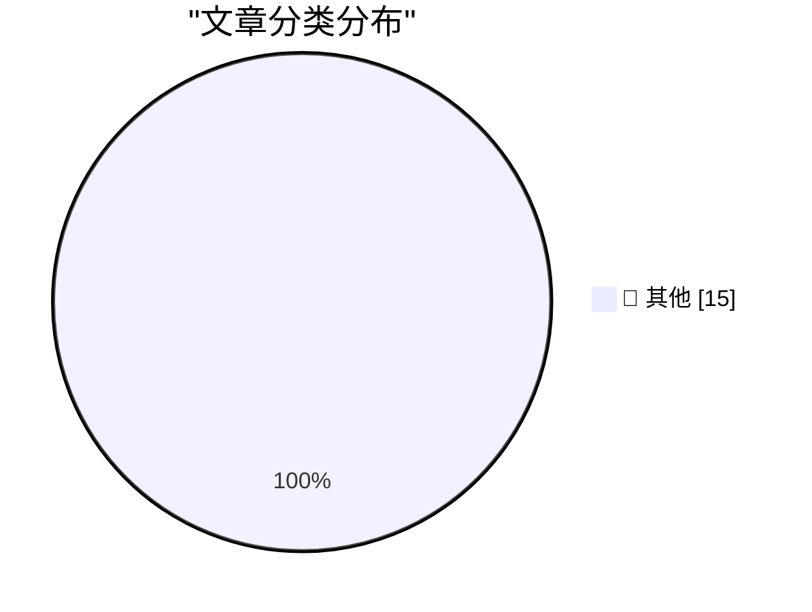

# 📰 AI 资讯每日精选 — 2026-11-09

> 汇聚 140+ 技术博客、X/Twitter、Hacker News、Reddit、Product Hunt、
> Lobste.rs、ClawFeed 日报及 GitHub Trending，经 AI 评分筛选。
>
> **本期内容**：🏆 今日必读 · 🌐 ClawFeed 日报 · 🔥 GitHub Trending · 📂 分类精选 · 🎨 设计与生成式 AI · 📊 数据概览

## 🏆 今日必读

🥇 **parse_number() as a SQLite extension: C vs Rust**

[parse_number() as a SQLite extension: C vs Rust](https://simonwillison.net/2026/Nov/8/sqlite-parse-number-c-vs-rust/) — simonwillison.net · 4 小时前 · 📝 其他

> parse_number() as a SQLite extension: C vs Rust

🥈 **Jensen Huang Betrayed Nvidia, Not Just His Family**

[Jensen Huang Betrayed Nvidia, Not Just His Family](https://www.nytimes.com/2026/11/06/us/politics/chinese-spy-agency-nvidia-jensen-huang.html?unlocked_article_code=1.O1E.DRyO.9mNcxhaxhtlI) — daringfireball.net · 3 小时前 · 📝 其他

> Jensen Huang Betrayed Nvidia, Not Just His Family

🥉 **Nvidia CEO Jensen Huang Was Banging a Chinese Spy, Who Was Feeding Information Back to Beijing**

[Nvidia CEO Jensen Huang Was Banging a Chinese Spy, Who Was Feeding Information Back to Beijing](https://www.nytimes.com/2026/11/08/technology/nvidia-investigation-jensen-huang-china.html?unlocked_article_code=1.O1E.Soow.6UjrM7Ch-C8L) — daringfireball.net · 5 小时前 · 📝 其他

> Nvidia CEO Jensen Huang Was Banging a Chinese Spy, Who Was Feeding Information Back to Beijing

4️⃣ **Some thoughts on restaurant menu QR codes**

[Some thoughts on restaurant menu QR codes](https://shkspr.mobi/blog/2026/11/some-thoughts-on-restaurant-menu-qr-codes/) — shkspr.mobi · 14 小时前 · 📝 其他

> Some thoughts on restaurant menu QR codes

5️⃣ **Reverse engineering a vintage diode-transistor logic chip**

[Reverse engineering a vintage diode-transistor logic chip](http://www.righto.com/feeds/7533579802505281921/comments/default) — righto.com · 10 小时前 · 📝 其他

> Reverse engineering a vintage diode-transistor logic chip

---

## 🌐 ClawFeed 日报精选

> 来源：[ClawFeed](https://clawfeed.kevinhe.io) — AI 驱动的多源新闻聚合

# ☀️ ClawFeed | 2026-11-08 日报 SGT

> 聚合自 3 期已发布的 8 小时简报：#1478 00:00（00:00-07:59）、#1479 08:00（08:00-15:59）、#1480 16:00（16:00-23:59），时间窗 2026-11-08 00:00–23:59 SGT，三档齐全。
> 三期正文开头写的窗内素材合计 465 条（feed 443 + 关注抽样 22：#1478 139 + 9、#1479 96 + 4、#1480 208 + 9）；三期都没有新书签。这是 SGT 周日的一天：凌晨那档美国是周六白天，体育、新闻和一句话帖多；白天中文圈发得多；晚上那档美国是周日早上。覆盖：三期首页都翻过了窗口开始，覆盖完整；时段很不均，#1478 的 6、7 点档 34 条和 33 条占近一半，3 点档只有 6 条；#1479 的 15 点档 37 条占近四成，9 点档 2 条、13 点档 3 条；#1480 的 23 点档 115 条占一半多，16–19 点档每小时只有 7–10 条，这些时段可能漏事。
> 主线：Anthropic 的钱从白天讲到晚上——白天是 IPO 估值「腰斩」的说法（没有出处）、FT 说它手握近 1,500 亿美元现金仍要再融 800–1,000 亿、The Information 说微软内部 Claude 支出砍了三分之一，晚上是 FT 报道它花 34 亿美元接下 1.7 GW 燃气发电机订单。第二条线是 DeepSeek Harness（DSH）插件生态：白天产品负责人说官方插件市场在路上，晚上官方发长文，有人转述日活 154 万，但三万多个插件仍没有市场入口。另有 GPT-6.2 Sol / Astra 灰测传闻和 DeepMind「接下来几周」的预告、让 agent 碰钱和手机时的护栏（Perplexity Teammates 盯盘、Instinct 预算、DIYgod 开源 Pinky）、Terafab「1 万亿美元」和反数据中心的声音、agent 护城河和套壳之争、Hermes 被弃和 Grok Bot 额度、Inkling 2 Small 连续三期、Ansem 的链上数据等。

---

## 🔥 当日最重要 5 条（跨档去重）

1. **Anthropic 的钱和电：估值「腰斩」说法、近 1,500 亿现金仍要再融 800–1,000 亿、微软内部 Claude 支出砍三分之一、34 亿美元接下 1.7 GW 燃气发电机**（#1479、#1480）：@AndrewCurran_ 09:00：Anthropic 的估值已经比一个月前金融圈谈论的 2 万亿美元高点大约腰斩，「如果你信它，现在大概半价就能上车」，IPO 的媒体宣传周一开始；腰斩是他的说法，素材里没有具体出处（前一天 #1476 那个更低的「0.8 万亿」传闻同样没有出处）。@linasbeliunas 14:00：据报道 Anthropic 手里有近 1,500 亿美元现金和流动投资，仍想再融 800–1,000 亿美元，原因是未来几年计划花 9,000 亿美元在算力和基础设施上（「据 FT……」后文被截断，素材里没有 FT 原文）。@Cointelegraph 11:00：据 The Information，Meta 和微软在减少员工对 Claude 的依赖，微软把内部 Claude 支出砍掉了三分之一（只有这一句）（#1479）。晚上 @coinbureau 23:09：据 FT，Anthropic 达成一笔 34 亿美元的交易，接下现有的 1.7 GW 燃气发电机订单给数据中心供电，绕开传统电力供应商（后文被截断）；@Techub_News 22:58 同一消息只有标题。@knowyourself518 22:18 转述 Chamath：SpaceX 和 Anthropic 的算力合同里有「双向 90 天随时解约」，微软、谷歌、Meta、亚马逊、SpaceX 是有地有电的「房东」，Anthropic、OpenAI 是「租客」（合同条款是 Chamath 的说法，素材里没有原文）。@turingbook 23:39（关注抽样）贴了 Ramp 企业支出数据里 Anthropic 和 OpenAI 的 10 月、9 月份额对比图，具体数字在图里看不到（#1480）。
   来源: https://x.com/AndrewCurran_/status/2119233522603020553 ｜ https://x.com/linasbeliunas/status/2119309169484247449 ｜ https://x.com/Cointelegraph/status/2119263833772396822 ｜ https://x.com/coinbureau/status/2119447171426926776 ｜ https://x.com/Techub_News/status/2119444486359073076 ｜ https://x.com/knowyourself518/status/2119434361887965476 ｜ https://x.com/turingbook/status/2119454888946246107

2. **DeepSeek Harness 插件生态：白天「官方插件市场在路上」，晚上官方发长文，转述日活 154 万，三万多个插件仍没有入口**（#1479、#1480）：@NFT_Chen 14:12：DSH 官方插件市场在路上，插件支持计划也会推出，接下来要提升插件 API 的稳定性和兼容性、完善插件安全机制；依据是 DSH 产品负责人 @tianyi 回 @dotey 的一句「等官方插件市场来了，一切都会好起来的」，回应的是前一天 #1476 有人说装几个插件就冲突、启动不了，没有时间表。@0xYusei 14:18：同一编程任务用 Kimi K3.1 pro 在两个 harness 上跑，DSH 不到 4 分钟、Kimi work 9 分钟，结果一样（他自己跑的一次对比）（#1479）。晚上 @DeepSeekHarness 22:07 发长文《Growing Together with Our Plugin Community》（素材里只有开头）；@sleepy0x13 22:24 解读为 DeepSeek 开始搭 agent「操作系统」的生态；@bozhou_ai 23:27 转述文中 DSH 日活已达 154 万，第一个推荐的是创作者工作台 dsh-media-desk；@NFT_Chen 22:28 说官方点名了 4 款社区插件。@xiax0603 22:37：社区插件已经三万多个，官方市场「还在画饼」；@hisevenih 23:07：三万插件堆着没入口，生态先卡在分发上。@Barret_China 21:50 推荐 Context 和 Agent-Team 两个插件看清 agent 执行全貌（#1480）。154 万这个数字只有 bozhou_ai 的转述。
   来源: https://x.com/NFT_Chen/status/2119312027923677485 ｜ https://x.com/0xYusei/status/2119313467412979899 ｜ https://x.com/DeepSeekHarness/status/2119431663642153128 ｜ https://x.com/sleepy0x13/status/2119435900811960477 ｜ https://x.com/bozhou_ai/status/2119451848675647706 ｜ https://x.com/NFT_Chen/status/2119436949002109200 ｜ https://x.com/xiax0603/status/2119439169613431177 ｜ https://x.com/hisevenih/status/2119446682266202329 ｜ https://x.com/Barret_China/status/2119427366892257490

3. **发布前信号：GPT-6.2 Sol / Astra 灰测传闻，DeepMind 预告「接下来几周」，Meta 的 Alexandr Wang 说「本周发布」**（#1479、#1480）：@alexandr_wang 11:00（Meta 首席 AI 官）：「本周发布之前，在训练大家的 muse 跳舞」，发布什么没说（#1479）。@kimmonismus 20:40：到处都有用户被路由到 GPT-6.2 Sol，他认为下周终于是发布周；他引用的 @TokenGremlin 说部分 ChatGPT 用户已经能用到 Sol。@NFT_Chen 23:04：GPT-6.2 Astra 灰测效果很强，他 11 月 5 日列的依据是前端选择器出现了「6.2 Astra」、后台预置了多条 gpt-6.2-astra 配额（当前全部 0%）。@CoooolXyh 22:01：今晚 Codex 开 fast mode 都很慢，猜这两天要发 6.2；@7777chu 23:47：这两天从 Opus 5.5 被切到了 GPT Sol；@libukai 23:42：Pro 500 现在唯一的用处是用 Magpie 把 Astra 反代到 DSH 里用。@choblin29 18:39 引用 DeepMind 的 @pushmeet：「我们正在见证科学发现速度的真正相变，接下来几周的发布里你会看到一点」（#1480）。这些都是用户观察和推测，都还没有官方发布；@AndrewCurran_「三大实验室都已实现自主研究」的说法见下方「未证实」。
   来源: https://x.com/alexandr_wang/status/2119263837845369286 ｜ https://x.com/kimmonismus/status/2119409780691284404 ｜ https://x.com/NFT_Chen/status/2119445997193773129 ｜ https://x.com/CoooolXyh/status/2119430000130855420 ｜ https://x.com/7777chu/status/2119456907878645942 ｜ https://x.com/libukai/status/2119455402509418888 ｜ https://x.com/choblin29/status/2119379244786589964

4. **让 agent 碰钱、碰手机：护栏成了一整天的话题，安全扫描查出无登录面板**（三期都有）：@AravSrinivas 00:19（Perplexity CEO）：Teammates 能帮你盯市场、管下单，他引用的 @jeffgrimes9 建了「Market Monitor」队友，接 Robinhood 插件、用一个 skill 写清风险承受度和投资目标，管着几十个交易触发条件；@noahrshinn 03:55（关注抽样，Instinct）：大多数设了 Link 余额的人之前没在 Instinct 买过东西，他认为「带护栏的预算」会是大多数人开始让 agent 替自己花钱的方式。安全：@aeonframework 00:05：他们的扫描器在 @mitsuhiko（Armin Ronacher）的 Absurd 仓库里发现 Habitat 面板没有登录、监听整个网络，同网络的机器或一个网页就能读取、重试任务（aeon 自己的扫描结果，素材里没有 Armin 的回应）（#1478）。白天 @DIYgod 11:19 开源 Pinky，让任何 agent 用你的 iPhone 和 Android，付款前停下来等你点头，发消息、删除也可设成先问，每一步有录屏；@brucexu_eth 11:41 准备下载试，还没人发实际反馈；@AravSrinivas 14:44 说 Teammates 自动化运行次数发布第二天涨了 3.7 倍（Perplexity 自己的数）（#1479）。晚上 @Starmanspace 23:49：DigitalOcean 的 Cuttlefish 在手机上批准或拒绝 agent 的完整命令，高风险要 Face ID；@TyronQuant 17:07：Cloudflare 11 月 4 日介绍了对个人 AI agent 访问网站的可见性和控制；@mardehaym 16:16（关注抽样）提醒，agent 四秒给出的「收入」取自计费系统，和财务按回款算的口径不一样（#1480）。
   来源: https://x.com/AravSrinivas/status/2119102346223591490 ｜ https://x.com/noahrshinn/status/2119156870963478929 ｜ https://x.com/aeonframework/status/2119098804817244554 ｜ https://x.com/DIYgod/status/2119268531678441646 ｜ https://x.com/brucexu_eth/status/2119274174522982629 ｜ https://x.com/AravSrinivas/status/2119320047403589761 ｜ https://x.com/Starmanspace/status/2119457408531771887 ｜ https://x.com/TyronQuant/status/2119356141281177721 ｜ https://x.com/mardehaym/status/2119343164112900126

5. **算力和数据中心：Terafab 可能花到 1 万亿美元、CoreWeave 写信得州，晚上反数据中心的声音变大，Vitalik 认为放慢未必是坏事**（#1478、#1480）：@huynhconghuan83 06:06 引用 24/7 Wall St.：马斯克说 Terafab 目标是每年生产约 1 太瓦的 AI 芯片，并同意 Ron Baron 的说法，项目最终可能花 1 万亿美元、分期投入；@Techub_News 06:53：CoreWeave 致信得州州长当选人寻求数据中心合作（只有标题）；@elonmusk 02:32 转 @cb_doge：Alphabet 三季度又增持 385 万股 SpaceX，截至 9 月 30 日持有 5.55 亿股、价值 837 亿美元，马斯克只回了「Interesting」（#1478）。晚上 @PANewsCN 19:05 转 Vitalik：他不认同这周对反数据中心运动的强烈情绪化反应，PANews 概括为「放缓算力超大规模扩张总体可能利大于弊」（英文原帖后文被截断）；@rwayne 22:25（关注抽样）：Meta 总裁 Powell McCormick 说在美国从零新建数据中心会越来越难，存量扩容和出海建厂在替代本土新建；@oran_ge 19:51：按部就班建就行，无须焦虑和炒作；@rohanpaul_ai 23:06 转 Alex Wissner-Gross「就算明天停建也挡不住」（他的观点）（#1480）。Anthropic 买燃气发电机见第 1 条。
   来源: https://x.com/huynhconghuan83/status/2119189739131789649 ｜ https://x.com/Techub_News/status/2119201702137967059 ｜ https://x.com/elonmusk/status/2119135865662300669 ｜ https://x.com/PANewsCN/status/2119385751439990875 ｜ https://x.com/rwayne/status/2119436025403424882 ｜ https://x.com/oran_ge/status/2119397408027365883 ｜ https://x.com/rohanpaul_ai/status/2119446570089537669

**⚠️ 未证实（素材里核实不了，只记录说法）**
- Anthropic 估值「大约腰斩」：@AndrewCurran_ 09:00 的说法，素材里没有具体出处；FT 关于 1,500 亿现金、9,000 亿算力计划的原文素材里也没有（#1479）。https://x.com/AndrewCurran_/status/2119233522603020553
- SpaceX 和 Anthropic 合同「双向 90 天随时解约」：@knowyourself518 转述 Chamath，素材里没有合同原文（#1480）。https://x.com/knowyourself518/status/2119434361887965476
- DSH 日活 154 万：只有 @bozhou_ai 23:27 的转述，没看到原文这一段（#1480）。https://x.com/bozhou_ai/status/2119451848675647706
- 「三大实验室都已实现自主研究，这个月就会看到成果」：@delfini_l 23:18 引用 @AndrewCurran_ 的推测（#1480）。https://x.com/delfini_l/status/2119449569045922068
- Grok Bot「基本不会路由到 Opus 5.5、额度至少砍了 50%–60%」：@dingyi 15:22 引用 @Gorden_Sun 的说法，没有官方说明（#1479）；晚上 @elonmusk 21:17 只说 Grok Bot 正在修复、改进 token 效率和行为，没说和额度有没有关系（#1480）。https://x.com/dingyi/status/2119329806261404078 ｜ https://x.com/elonmusk/status/2119419126045454531
- 路透社「不到 100 个汉字攻破 100 多家公司网站」：@bozhou_ai 01:23 转述，素材里没有路透社原文；同一条推荐的 magpie 怎么做到「借用闲置额度」后文被截断（#1478）。https://x.com/bozhou_ai/status/2119118464950653005
- Inkling 2 Small 在 FrontierBro 上 66%、进编程类开源模型前五：@aquilesfd 03:55 自己跑的评测，FrontierBro 推测是他自己的基准，没有 Thinking Machines 的官方数字（#1478）。https://x.com/aquilesfd/status/2119156922486333559
- AI 办公 agent 市场地图里 Claude Enterprise「估值 9,650 亿、收入 470 亿」、ChatGPT Enterprise「8,520 亿、500 亿」：@FinanceYF5 08:07 自己整理的数，没有出处（#1479）。https://x.com/FinanceYF5/status/2119220212742644099
- OpenAI 由 AI 生成的论文稿证明波动方程局部光滑性：@jiqizhixin 15:12 说是公开的研究主张、还在接受检验（#1479）。https://x.com/jiqizhixin/status/2119327057620398105
- Alpie 9B「向 Qwen3.5-9B 致敬」、权重基本逐位相同：@dongxi_nlp 22:57 自己的检查结论（#1480）。https://x.com/dongxi_nlp/status/2119444194661945710
- 「80% 以上的 meme 交易 KOL 都有割粉丝的小号」：@andyyy 23:08 的预测，没有给出证据（#1480）。https://x.com/andyyy/status/2119446968795861373

**次重要（备选）**
- Ansem 风波（接 11-07 日报 #1474 的 bubblemaps 预告）：@wublockchain12 08:04：链上分析人士 sahil 称 Ansem（@blknoiz06）疑似在多次名人 Meme 币发行前收到资金，其中 Iggy Azalea 发布 MOTHER 合约地址前不久有 129 SOL（当时约 2.2 万美元）转入疑似关联钱包；ZachXBT 说自己曾多次批评他的推广行为；素材里没有 Ansem 本人的回应（#1479）。https://x.com/wublockchain12/status/2119219505088139297
- OpenAI 11 月 4 日公告要收购做代码托管的 Pierre，完成后把 Code Storage 并进 Codex，开源项目继续开源（@meishengsimon 22:40，#1480）。https://x.com/meishengsimon/status/2119439807172497438
- OpenAI 澄清 Pro 套餐用量：所有 Pro 都没有 5 小时限制，Pro 100 / 200 / 500 分别是 Plus 的 10 / 20 / 50 倍，Pro 500 能用超快通道（@NFT_Chen 15:54 转 @thsottiaux，#1479）。https://x.com/NFT_Chen/status/2119337768560328998
- 机器人：@kul 02:51 投了 Theseus Robotics（YC F26），机器人夜里给超市补货、白天拣线上订单；@ruijie_zheng12 04:58 预告 @DrJimFan 11 月 9 日（周一）13:45 的 CoRL 主题演讲，内容没透露（#1478）。https://x.com/kul/status/2119140698306081066 ｜ https://x.com/ruijie_zheng12/status/2119172694033989870
- 英国国家网络安全中心的抗量子迁移时间表：2028 年前摸底和方案、2031 年高优先级系统完成、2035 年全部迁完（@balance0014 15:08，#1479）。https://x.com/balance0014/status/2119326257670209752

---

## 📰 当日核心主题

**① Agent 工具、平台新功能和用法（三期都有）**
工具和用法：@kloss_xyz 06:58：agent 大部分 token 花在读用不上的文件上，提示词开头是「打开任何文件之前，先列出这件事需要的确切文件……」（后文被截断）；@levie 00:54（关注抽样）：开始看到生产力比 AI 之前高一到两个数量级的例子，他引用的 @theo 说 AI 让普通和最好工程师的差距至少变成 100 倍（都是观感）（#1478，https://x.com/kloss_xyz/status/2119202949234897134 ｜ https://x.com/levie/status/2119111328099168409）。@addyosmani 15:32 长文《你的 coding agent 让你成了经理》；@jolestar 14:20：skill 不像插件，不用也占上下文，引用 @holonrun 讲 skill 隔离的四堵墙；@ctatedev 10:11：现在只跟一个 agent 说话（#1479，https://x.com/addyosmani/status/2119332146485891501 ｜ https://x.com/jolestar/status/2119314213160304801 ｜ https://x.com/ctatedev/status/2119251380150087685）。@dingyi 20:56：OpenCode 推出 Browse，agent 控制你真实的浏览器；@cramforce 23:32（Vercel）：把大活卸到 Vercel Sandbox，本地只跑 harness（#1480，https://x.com/dingyi/status/2119413629082865990 ｜ https://x.com/cramforce/status/2119452907246588125）。
平台新功能：@0x99DaDa 16:04：Claude Enterprise 11 月 6 日上线测试功能 Project Tags，按公司成本代码归集项目费用；@Starmanspace 23:45：微软 APM 是「agent 上下文的 npm」，可装进 Copilot、Claude Code、Cursor（#1480，https://x.com/0x99DaDa/status/2119340143652077601 ｜ https://x.com/Starmanspace/status/2119456285481689596）。
搭 agent 的经验：@xiaomanhedy 20:10：多 agent 像蚂蚁通过「环境」协作，而不是像人一样「开会」对齐；@snwiki238337 21:00：调用大模型之前先把能用代码、正则、状态机解决的逻辑写死，顶层路由只做意图分类（#1480，https://x.com/xiaomanhedy/status/2119402051570483265 ｜ https://x.com/snwiki238337/status/2119414637842305149）。

**② Agent 的护城河在哪、套壳会不会变薄（#1479、#1480）**
@dotey 11:02：张亚勤问姚顺雨用户黏性在哪，姚顺雨说护城河更多在产品层，一是别人没有的私有数据和上下文（第二点被截断）；@bozhou_ai 10:34 追问：上下文最终要经过基模 API，基模公司可以直接拿来训练；@jleechan2015 08:01 押「软件工厂」是下一个灭绝的套壳，模型越强、套壳越薄；@omooretweets 12:44（a16z）：苹果本可以做系统级个人 agent，app 优先的公司几乎没有 agent 流量，可能要靠 connectors（#1479，https://x.com/dotey/status/2119264167483850884 ｜ https://x.com/bozhou_ai/status/2119257252930760779 ｜ https://x.com/jleechan2015/status/2119218626293358612 ｜ https://x.com/omooretweets/status/2119289961296154783）。晚上 @buccocapital 23:07：模型越强，模型本身就越是产品，产品只需加够结构又别加太多；@lifesinger 19:18（玉伯）：谁组织「人加 agent 的作坊」之间的交易网络，谁就是下一个 App Store；@yifanxu_ephai 16:42：过去一个月 agent harness 的声音少了很多；@thorstenball 23:44：不再需要思考者，需要做事的人（#1480，https://x.com/buccocapital/status/2119446736632746391 ｜ https://x.com/lifesinger/status/2119389035693265319 ｜ https://x.com/yifanxu_ephai/status/2119349935296692647 ｜ https://x.com/thorstenball/status/2119456118204207151）。

**③ Hermes、Grok Bot 和用量（#1479、#1480）**
@ShiZheng24517 11:35：一个月用了 150 亿 token 的 Hermes，评价「注定昙花一现」，「越用越懂你」靠的就是 3 个 md 文件；@fankaishuoai 13:17 正相反：用 Hermes / Grok Bot 是养一支 AI 员工团队（#1479，https://x.com/ShiZheng24517/status/2119272504808407495 ｜ https://x.com/fankaishuoai/status/2119298332623622218）。晚上 @mydongo 22:55 准备正式弃用 Hermes；@lianyanshe 23:47 把 Hermes 和 OpenClaw 都卸了、任务全迁到 Grok Bot（#1480，https://x.com/mydongo/status/2119443632503853455 ｜ https://x.com/lianyanshe/status/2119456703343399188）。
用量：@PhyrexNi 16:47：Ultra 三天用了 55%，说 Claude 最不经用；@turingou 21:40：一天用掉一个 Claude Code 账户一周额度的 50%，90% 是全自动开发；@vista8 23:03：周末用完 3 张 Codex 重置卡、「阵亡」一个 Claude 账号，AI 新增 6.43 万行代码（#1480，https://x.com/PhyrexNi/status/2119351035462598915 ｜ https://x.com/turingou/status/2119424773650514214 ｜ https://x.com/vista8/status/2119445792247447946）。Pro 套餐澄清和 Grok Bot 额度见上。

**④ 模型、研究和开源（三期都有）**
Thinking Machines Inkling 2 Small 连续三期：#1478 @aquilesfd 的自测（见「未证实」）；#1479 @alacheng 10:44：它既给开源权重、又给后训练基础设施 API，引用的官方发布说 AA Intelligence Index 31 分、完整权重「计划很快」发布；#1480 @alacheng 22:01 推荐《RLVR on Inkling 2 Small: Beating GLM-5.3-Flash in 60 Steps for $22》（https://x.com/alacheng/status/2119259732297044056 ｜ https://x.com/alacheng/status/2119430067566862387）。
研究和模型：@dotey 12:18：Anthropic 11 月 4 日的报告统计约 20.7 万次科研相关 Claude 会话，科学家用得最多的是分析数据和写论文，最看重的提想法反而用得最少；@dingyi 12:32 引用 @NousResearch 发布 Arete-27B（在 Qwen3.8-27B 上后训练「强化西方价值观」），dingyi 评论很冲（#1479，https://x.com/dotey/status/2119283516143776186 ｜ https://x.com/dingyi/status/2119286841451180433）。@0x99DaDa 18:14：Meta 用 Muse Wonder 训练新版 Muse 和 Meta AI，练的是该用上旧信息时自己翻出来、卡住先换办法；@xiax0603 22:24：社区把 DeepSeek-V4-Pro Max 的推理蒸馏进 Qwen3.5-9B，8GB 显卡能跑（#1480，https://x.com/0x99DaDa/status/2119372858656784524 ｜ https://x.com/xiax0603/status/2119435954096353576）。
开源和作品：@wquguru 11:05：开源会议纪要和同传软件「知了 / Cicada」1.5.1 四个平台齐了；@wlzh 15:36：MAPLE 把 Gemma 4 26B-A4B 从 9.92GB 压到 4.75GB（砍专家后质量掉多少看不到）；@shao__meng 14:09：开源的 rea-video 让 agent 拆解复刻视频；@vikingmute 14:38：ai.engineer 收了大会讲座的视频、摘要和幻灯片（#1479，https://x.com/wquguru/status/2119264966125711494 ｜ https://x.com/wlzh/status/2119333103001080318 ｜ https://x.com/shao__meng/status/2119311344260583683 ｜ https://x.com/vikingmute/status/2119318698653782067）。@JustLikeBit 21:41：Auday 的 4 条宣传片全是 AI 做的；@GoSailGlobal 23:57：Opus 5.5 用 1,354 行代码画莫高窟（#1480，https://x.com/JustLikeBit/status/2119424955121123756 ｜ https://x.com/GoSailGlobal/status/2119459384778686713）。

**⑤ AI 产业和生意（三期都有）**
@saastr 06:01：「观点更多是给人看的，事实更多是给 agent 看的」；@anshnanda 06:59：10 倍好的产品配一般的分发几乎总能赢；@guruchahal 07:48（关注抽样，Lightspeed）：融 1 亿美元，估值从 15 亿抬到 16 亿，意向可能从 1.25 亿掉到 5,000 万（#1478，https://x.com/saastr/status/2119188508648587330 ｜ https://x.com/anshnanda/status/2119203110849479155 ｜ https://x.com/guruchahal/status/2119215400621850885 ｜ https://x.com/guruchahal/status/2119215402329031045）。@sleepy0x13 11:56：YC 公布 2026 年 1–10 月的 17 家新独角兽，最贵的是 AfterQuery（32 亿美元）；@jeff_weinstein 10:58：500 多人申请 Stripe agentic commerce 团队，建议附一张用 Stripe 的截图加 3–5 句批评；@HavenZhao 11:30：ERP、财务这类核心系统最重要的是确定和可审计，为「AI 化」动核心逻辑风险往往大于收益（#1479，https://x.com/sleepy0x13/status/2119277901099278781 ｜ https://x.com/jeff_weinstein/status/2119263160247206139 ｜ https://x.com/HavenZhao/status/2119271194256187770）。@jiucaitalk 23:45：agent 创业几乎都是名校博士和教授、ARR 普遍很低（#1480，https://x.com/jiucaitalk/status/2119456157756801313）。

**⑥ 加密（三期都有）**
@DefiantNews 00:15：STRK 四周跌 57%，同期 BTC 跌 8.8%、ETH 跌 10.9%；@BitcoinNews 00:31：据 Elliptic，币安被盗案黑客把 1.75 亿美元换成 2,300 枚 BTC（没写是哪一次被盗）；@CoinDesk 04:27：中期选举后 CLARITY 法案是否已死，@renato_mariotti 认为跛脚鸭会期还有机会（#1478，https://x.com/DefiantNews/status/2119101325166490085 ｜ https://x.com/BitcoinNews/status/2119105508166557743 ｜ https://x.com/CoinDesk/status/2119164789884604811）。Ansem 和英国抗量子时间表见上（#1479）。@neso 20:14 和 @oragnes 20:57 都引用 Vitalik 新帖：把「ETH 作为价值存储」当重点比「手续费燃烧代币」更合理；@huynhconghuan83 23:03 转 CoinDesk：芬兰 SunBit 用 30 台矿机给楼宇供暖，前提是 BTC 在 7 万美元以上（#1480，https://x.com/neso/status/2119403111966196193 ｜ https://x.com/oragnes/status/2119413946222546992 ｜ https://x.com/huynhconghuan83/status/2119445797997539343）。

**⑦ 其他（三期都有）**
@elonmusk 00:54 转 SpaceX：星舰第 15 次飞行最早 11 月 13 日（周五）发射、要尝试接住，待监管批准（#1478，https://x.com/elonmusk/status/2119111269718364631）。@coinbureau 15:11：据彭博，佐治亚州一个选区在存储卡上发现几百张没计入的选票、翻转了领先者（#1479，https://x.com/coinbureau/status/2119326915899380211）。@sleepy0x13 22:22：WIRED 记者顺着近 2,000 条错发的政治募款短信挖出一条数据经纪产业链（#1480，https://x.com/sleepy0x13/status/2119435381485834329）。

---

## 🔖 书签精选

今天没有新加的书签：#1478、#1479、#1480 窗内书签都是 0 条（书签页最新一条是 11-04 22:23），三期都跳过了这一区块，本日报也没有可补选的内容。

---

## 👀 推荐关注汇总（去重，共 15 个；各期写稿时都在浏览器里核实过「未关注」：#1478 在 11-08 08:23–08:25，#1479 在 11-08 16:19–16:20，#1480 在 11-09 00:14–00:18 SGT，本日报没有重新核实）

**Agent 产品和一手消息**
- @DeepSeekHarness（DeepSeek Harness 官方号，8.21 万关注者）：插件社区长文的发布方，DSH 的官方一手消息，之前几期都靠别人转述（#1480）。https://x.com/DeepSeekHarness
- @tianyi（Tianyi Cui，DeepSeek 产品部，做 DSH，5.76 万关注者）：「官方插件市场在路上」的说法来自他（#1479）。https://x.com/tianyi
- @thsottiaux（Tibo，OpenAI Codex 和 ChatGPT，99.3 万关注者）：Pro 套餐用量的澄清是他发的，Codex 额度和套餐变化多由他先说（#1479）。https://x.com/thsottiaux
- @AravSrinivas（Aravind Srinivas，Perplexity 联合创始人、CEO，110 万关注者）：Teammates 盯盘用法，Perplexity 产品更新多由他先发（#1478）。https://x.com/AravSrinivas
- @jeffgrimes9（Jeff Grimes，Perplexity 能力产品负责人，1.62 万关注者）：「Market Monitor」队友的原作者（#1478）。https://x.com/jeffgrimes9
- @DIYgod（DIŸgöd，RSSHub、Folo 的开源作者，3.33 万关注者）：Pinky 的作者，常发自己的开源项目（#1479）。https://x.com/DIYgod
- @mitsuhiko（Armin Ronacher，Flask 作者，10 万关注者）：Absurd 安全报告说的就是他的项目，长期写 agent 编程的一手经验（#1478）。https://x.com/mitsuhiko

**AI 研究、工程和行业**
- @pushmeet（Pushmeet Kohli，Google Cloud 首席科学家、DeepMind VP，3.25 万关注者）：「科学发现速度相变、接下来几周发布」的原话是他说的（#1480）。https://x.com/pushmeet
- @ruijie_zheng12（Ruijie Zheng，NVIDIA GEAR 实验室研究员，1,294 关注者）：关注者不多，但在 Jim Fan 的团队里，CoRL 演讲的东西会第一手发（#1478）。https://x.com/ruijie_zheng12
- @TokenGremlin（Token Gremlin，追踪发布前信号，1.8 万关注者）：GPT-6.2 Sol 灰测的原始帖来自他，要当传闻看（#1480）。https://x.com/TokenGremlin
- @snwiki238337（南晚 Nanwan，港大 PhD，做 agent 和 AI coding，1,376 关注者）：「先把确定性逻辑写死、路由只做分发」写得实在（#1480）。https://x.com/snwiki238337
- @ShiZheng24517（Todd Zheng，前 Googler、现 TikTok staff engineer，834 关注者）：一个月 150 亿 token 的 Hermes 重度用户给的一手评价（#1479）。https://x.com/ShiZheng24517
- @buccocapital（BuccoCapital Bloke，写科技和投资，19.14 万关注者）：「模型越强、模型本身就是产品」那条的作者（#1480）。https://x.com/buccocapital
- @linasbeliunas（Linas Beliūnas，金融科技和 AI newsletter，1.46 万关注者）：Anthropic 现金和 9,000 亿算力计划的转述者，常整理 AI 公司融资财务新闻（#1479）。https://x.com/linasbeliunas
- @kul（Kulveer，YC 访问合伙人，28.5 万关注者）：Theseus Robotics 的投资人，常发他投的 YC 项目（#1478）。https://x.com/kul

（三期另有 25 个显示未关注但没推荐的账号：#1478 的 @aeonframework、@theseuscom、@aquilesfd、@tornikegomareli、@saastr、@DefiantNews、@andreaslbigger；#1479 的 @HavenZhao、@0xYusei、@holonrun、@jleechan2015；#1480 的 @marclou、@RichardSSutton、@matthew_d_green、@andreasklinger、@jakevin、@AndyL5cc、@Kubai087、@xiaomanhedy、@JustLikeBit、@meishengsimon、@TyronQuant、@steinRWA、@169Pi_ai、@woniuniuniuCN，理由是简介挂自家代币或付费社群、本期只是被引用一句、评测是自己跑的先观察、领域偏、或关注者少。）

**建议取关**：三期都没有提出取关建议。

---

## 💤 当日重复噪音模式

三期过滤掉的时间线 310 条（#1478 115、#1479 59、#1480 136），收了 133 条（24、37、72）；关注抽样窗内 22 条，收了 7 条，没收 15 条。按类别（三期分类口径基本一致，直接相加）：
- **空帖、只有图、一句话回复**：89 条（#1478 22、#1479 13、#1480 54）。#1480 最多（只有图或视频的帖、猫进画廊三条、cryptodavidw 三条、yucheng 四条），#1478 是「Yes」「Yup」「Damn」「碉堡了」之类。
- **新闻、体育、娱乐和生活**：73 条（#1478 52：新闻和政治 16、体育和娱乐 18、生活和杂谈 18；#1479 7；#1480 14）。巴黎抗议、以色列组阁、特朗普提名 Dana White，Netflix、利物浦、皇马、NFL、F1，排灯节、Tim Hortons 点单等。
- **加密的宣传、喊单和感想**：58 条（#1478 21、#1479 14、#1480 23；Elysium 铸造和主网、BingX、孙宇晨、「比特币到 1,000 万美元」、Devcon 孟买感想、蓝 V 互关等）。
- **AI 宣传、教程、书单和八卦**：55 条（#1478 15、#1479 15、#1480 25；KirkDBorne 七条书单、Moon Dev 直播、GEO 大会、T3 Code 配置视频、Dario 病史八卦、Tripo 3D 推广三条、Kaze 浏览器内测等）。
- **同一件事的重复**：32 条（#1478 5、#1479 8、#1480 19；Claude 个人理财、Anthropic「做梦」记忆博客两条、Claude Duet、Glamsterdam 暂停（#1479、#1480 都有）、Addy Osmani 长文 4 条转评、rea-video、Arete-27B、Jim Fan 演讲倒计时、Pushmeet 原话的另一条转发等）。
- **旧闻和旧帖**：3 条（#1479 2：2025 年 8 月的朝鲜黑客求职渗透视频、10 月 19 日的赌博年龄采访；#1480 1：宝玉 2024 年 4 月的 Mac 外接 SSD 帖）。
- **关注抽样里没收的**：15 条（#1478 5、#1479 4、#1480 6），三期都是 @StartupWisdom_ 的语录、@Tradermayne 的交易感想和比赛、@rwayne 的杂谈；#1480 另有 @LimestoneHQ 两条提示词推广。
- **同一话题延续**：Anthropic 的钱（前一天 #1476「0.8 万亿」传闻 → #1479 估值腰斩、现金和融资、微软砍支出 → #1480 燃气发电机）；DSH 插件（#1476 插件冲突 → #1479 官方市场在路上 → #1480 官方长文）；Inkling 2 Small（#1478 自测 → #1479 开源加后训练 API → #1480 22 美元 RLVR）；Perplexity Teammates（#1478 盯盘 → #1479 运行次数 3.7 倍）；「带护栏」（#1478 Instinct 预算 → #1479 Pinky → #1480 Cuttlefish）；Grok Bot（#1479 额度砍了的说法 → #1480 马斯克说在修）；Ansem（#1474 bubblemaps 预告 → #1479 链上数据）；算力的钱（#1478 Terafab、CoreWeave → #1480 反数据中心和 Anthropic 燃气发电机）已合并。
---

## 🔥 GitHub Trending

> 今日热门开源项目（全语言 + Python）

| # | 项目 | 描述 | ⭐ 总星 | 📈 今日 | 语言 |
|---|------|------|---------|---------|------|
| 1 | [sherlock-project/sherlock](https://github.com/sherlock-project/sherlock) | Hunt down social media accounts by username across social... | 104.0k | +2373 | Python |
| 2 | [milind-soni/OpenMausBot](https://github.com/milind-soni/OpenMausBot) | Open-source Grok Bot alternative with a virtual machine t... | 18.4k | +1439 | TypeScript |
| 3 | [meta/astryx](https://github.com/meta/astryx) 🤖 | An open source design system that's fully customizable an... | 17.1k | +875 | TypeScript |
| 4 | [vercel-labs/agent-browser](https://github.com/vercel-labs/agent-browser) 🤖 | Browser automation CLI for AI agents | 47.7k | +815 | Rust |
| 5 | [anthropics/skills](https://github.com/anthropics/skills) 🤖 | Public repository for Agent Skills | 189.8k | +792 | Python |
| 6 | [ranxianglei/billion-context](https://github.com/ranxianglei/billion-context) | A context-compression plugin for month-long single sessio... | 5.2k | +460 | TypeScript |
| 7 | [rohitg00/ai-engineering-from-scratch](https://github.com/rohitg00/ai-engineering-from-scratch) 🤖 | Learn AI Engineering! Learn it. Build it. Ship it for oth... | 77.8k | +449 | Python |
| 8 | [dsx-ai-factory/nvke](https://github.com/dsx-ai-factory/nvke) 🤖 | NVIDIA Kubernetes Engine (NVKE). A management plane for G... | 888 | +345 | Go |
| 9 | [jamiepine/voicebox](https://github.com/jamiepine/voicebox) 🤖 | The open-source AI voice studio. Clone, dictate, create. | 60.2k | +208 | Python |
| 10 | [googlecolab/google-colab-cli](https://github.com/googlecolab/google-colab-cli) | A CLI for interacting with Google Colab runtimes | 2.1k | +104 | Python |
| 11 | [bradautomates/claude-video](https://github.com/bradautomates/claude-video) 🤖 | Give Claude the ability to watch any video. /watch downlo... | 20.3k | +92 | Python |
| 12 | [SWE-agent/mini-swe-agent](https://github.com/SWE-agent/mini-swe-agent) 🤖 | The 100 line AI agent that solves GitHub issues or helps ... | 9.4k | +86 | Python |
| 13 | [neuml/txtai](https://github.com/neuml/txtai) 🤖 | 💡 All-in-one AI framework for semantic search, LLM orche... | 13.2k | +56 | Python |
| 14 | [XiaoYouChR/Ghost-Downloader-3](https://github.com/XiaoYouChR/Ghost-Downloader-3) | The only downloader you need. 下载器的集大成者。 | 10.9k | +53 | Python |
| 15 | [google-deepmind/mujoco](https://github.com/google-deepmind/mujoco) | Multi-Joint dynamics with Contact. A general purpose phys... | 16.5k | +41 | C++ |

---

## 📝 其他

### 1. parse_number() as a SQLite extension: C vs Rust

[parse_number() as a SQLite extension: C vs Rust](https://simonwillison.net/2026/Nov/8/sqlite-parse-number-c-vs-rust/) — **simonwillison.net** · 4 小时前 · ⭐ 15/30

> parse_number() as a SQLite extension: C vs Rust

---

### 2. Jensen Huang Betrayed Nvidia, Not Just His Family

[Jensen Huang Betrayed Nvidia, Not Just His Family](https://www.nytimes.com/2026/11/06/us/politics/chinese-spy-agency-nvidia-jensen-huang.html?unlocked_article_code=1.O1E.DRyO.9mNcxhaxhtlI) — **daringfireball.net** · 3 小时前 · ⭐ 15/30

> Jensen Huang Betrayed Nvidia, Not Just His Family

---

### 3. Nvidia CEO Jensen Huang Was Banging a Chinese Spy, Who Was Feeding Information Back to Beijing

[Nvidia CEO Jensen Huang Was Banging a Chinese Spy, Who Was Feeding Information Back to Beijing](https://www.nytimes.com/2026/11/08/technology/nvidia-investigation-jensen-huang-china.html?unlocked_article_code=1.O1E.Soow.6UjrM7Ch-C8L) — **daringfireball.net** · 5 小时前 · ⭐ 15/30

> Nvidia CEO Jensen Huang Was Banging a Chinese Spy, Who Was Feeding Information Back to Beijing

---

### 4. Some thoughts on restaurant menu QR codes

[Some thoughts on restaurant menu QR codes](https://shkspr.mobi/blog/2026/11/some-thoughts-on-restaurant-menu-qr-codes/) — **shkspr.mobi** · 14 小时前 · ⭐ 15/30

> Some thoughts on restaurant menu QR codes

---

### 5. Reverse engineering a vintage diode-transistor logic chip

[Reverse engineering a vintage diode-transistor logic chip](http://www.righto.com/feeds/7533579802505281921/comments/default) — **righto.com** · 10 小时前 · ⭐ 15/30

> Reverse engineering a vintage diode-transistor logic chip

---

### 6. Finite Projective Planes

[Finite Projective Planes](https://www.johndcook.com/blog/2026/11/08/finite-geometries/) — **johndcook.com** · 3 小时前 · ⭐ 15/30

> Finite Projective Planes

---

### 7. The problem with Micron MT 4264 RAM

[The problem with Micron MT 4264 RAM](https://dfarq.homeip.net/the-problem-with-micron-mt-4264-ram/?utm_source=rss&#038;utm_medium=rss&#038;utm_campaign=the-problem-with-micron-mt-4264-ram) — **dfarq.homeip.net** · 14 小时前 · ⭐ 15/30

> The problem with Micron MT 4264 RAM

---

### 8. Is AI crashing?

[Is AI crashing?](https://dfarq.homeip.net/is-ai-crashing/?utm_source=rss&#038;utm_medium=rss&#038;utm_campaign=is-ai-crashing) — **dfarq.homeip.net** · 14 小时前 · ⭐ 15/30

> Is AI crashing?

---

### 9. Andrej Karpathy built a curated video platform in a weekend using Claude and 20 years of Hacker News

[Andrej Karpathy built a curated video platform in a weekend using Claude and 20 years of Hacker News](https://the-decoder.com/andrej-karpathy-built-a-curated-video-platform-in-a-weekend-using-claude-and-20-years-of-hacker-news/) — **The Decoder** · 12 小时前 · ⭐ 15/30

> Andrej Karpathy built a curated video platform in a weekend using Claude and 20 years of Hacker News

---

### 10. The brain-as-computer metaphor shaped modern AI but may be misleading the consciousness debate

[The brain-as-computer metaphor shaped modern AI but may be misleading the consciousness debate](https://the-decoder.com/the-brain-as-computer-metaphor-shaped-modern-ai-but-may-be-misleading-the-consciousness-debate/) — **The Decoder** · 13 小时前 · ⭐ 15/30

> The brain-as-computer metaphor shaped modern AI but may be misleading the consciousness debate

---

### 11. The inventor of the bitter lesson has a bitter lesson for LLM scaling enthusiasts

[The inventor of the bitter lesson has a bitter lesson for LLM scaling enthusiasts](https://the-decoder.com/the-inventor-of-the-bitter-lesson-has-a-bitter-lesson-for-llm-scaling-enthusiasts/) — **The Decoder** · 15 小时前 · ⭐ 15/30

> The inventor of the bitter lesson has a bitter lesson for LLM scaling enthusiasts

---

### 12. AI coding agents still need human cleanup on nearly three out of four tasks in a real-world test

[AI coding agents still need human cleanup on nearly three out of four tasks in a real-world test](https://the-decoder.com/ai-coding-agents-still-need-human-cleanup-on-nearly-three-out-of-four-tasks-in-a-real-world-test/) — **The Decoder** · 17 小时前 · ⭐ 15/30

> AI coding agents still need human cleanup on nearly three out of four tasks in a real-world test

---

### 13. KetchUp – Open-source SketchUp alternative built with Rust and WebGPU

[KetchUp – Open-source SketchUp alternative built with Rust and WebGPU](https://ketchup3d.github.io/app/) — **Hacker News Best** · 4 小时前 · ⭐ 15/30

> KetchUp – Open-source SketchUp alternative built with Rust and WebGPU

---

### 14. Nvidia CEO Jensen Huang's letter to staff about affair

[Nvidia CEO Jensen Huang's letter to staff about affair](https://www.axios.com/2026/11/08/nvidia-ceo-jensen-huang-affair-email-to-company) — **Hacker News Best** · 4 小时前 · ⭐ 15/30

> Nvidia CEO Jensen Huang's letter to staff about affair

---

### 15. Nvidia Board of Directors Is Investigating Jensen Huang

[Nvidia Board of Directors Is Investigating Jensen Huang](https://nvidianews.nvidia.com/news/statement-from-nvidia-board-of-directors) — **Hacker News Best** · 6 小时前 · ⭐ 15/30

> Nvidia Board of Directors Is Investigating Jensen Huang

---

## 🎨 Design & Generative AI

### 🖼️ 生成式图片

- **[ComfyUI Readable Node: an agent skill for turning messy workflows into readable ones](https://www.reddit.com/r/StableDiffusion/comments/1xqurqs/comfyui_readable_node_an_agent_skill_for_turning/)** — r/StableDiffusion · 17 小时前
  > ComfyUI Readable Node: an agent skill for turning messy workflows into readable ones

- **[Viggle Remake MCP now has a ComfyUI worker (int8 + offload). Raw results: what it nails and where it breaks](https://www.reddit.com/r/StableDiffusion/comments/1xqojjf/viggle_remake_mcp_now_has_a_comfyui_worker_int8/)** — r/StableDiffusion · 23 小时前
  > Viggle Remake MCP now has a ComfyUI worker (int8 + offload). Raw results: what it nails and where it breaks

- **[Follow-up to my LTX 2.5 music video — trying Pika H3 Flex for cleaner motion and singing lip-sync](https://www.reddit.com/r/StableDiffusion/comments/1xrcesv/followup_to_my_ltx_25_music_video_trying_pika_h3/)** — r/StableDiffusion · 3 小时前
  > Follow-up to my LTX 2.5 music video — trying Pika H3 Flex for cleaner motion and singing lip-sync

- **[We connected Nuke and After Effects to ComfyUI, and built a prompt/storyboard app that renders through it (open source)](https://www.reddit.com/r/StableDiffusion/comments/1xr7doc/we_connected_nuke_and_after_effects_to_comfyui/)** — r/StableDiffusion · 7 小时前
  > We connected Nuke and After Effects to ComfyUI, and built a prompt/storyboard app that renders through it (open source)

- **[i made an optimizer called ApexW to speed up PyTorch training on low-end GPUs Looking for feedback/benchmarks(got ~6.3% faster SD 1.5 LoRA training on a NVIDIA T4)](https://www.reddit.com/r/StableDiffusion/comments/1xqzr5z/i_made_an_optimizer_called_apexw_to_speed_up/)** — r/StableDiffusion · 12 小时前
  > i made an optimizer called ApexW to speed up PyTorch training on low-end GPUs Looking for feedback/benchmarks(got ~6.3% faster SD 1.5 LoRA training on a NVIDIA T4)

- **[Live-Action + Blender + Wan 2.2 Lora Hybrid Test](https://www.reddit.com/r/StableDiffusion/comments/1xrdsj8/liveaction_blender_wan_22_lora_hybrid_test/)** — r/StableDiffusion · 2 小时前
  > Live-Action + Blender + Wan 2.2 Lora Hybrid Test

---

## 📊 数据概览

| 扫描源 | 抓取文章 | 时间范围 | 精选 |
|:---:|:---:|:---:|:---:|
| 92/140 | 3963 篇 → 67 篇 | 24h | **15 篇** |

### 分类分布

---

*生成于 2026-11-09 02:57 | 汇聚 140 个技术博客、X/Twitter、Hacker News、Reddit、Product Hunt、Lobste.rs、ClawFeed 日报及 GitHub Trending，经 AI 评分筛选出 Top 15 精华内容*
