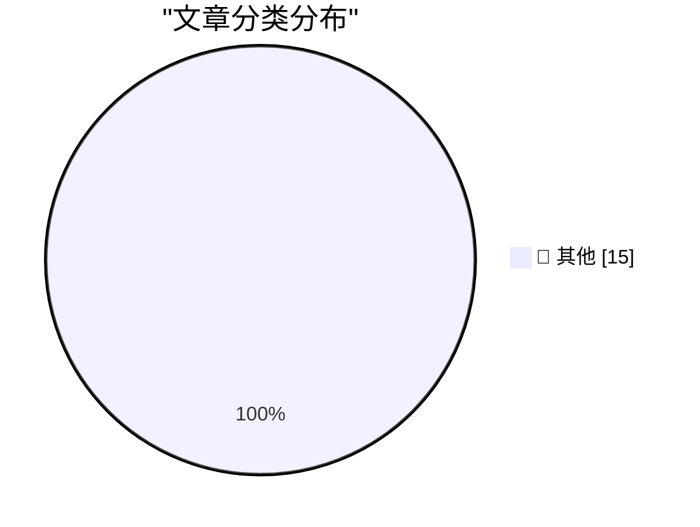

# 📰 AI 资讯每日精选 — 2026-11-11

> 汇聚 140+ 技术博客、X/Twitter、Hacker News、Reddit、Product Hunt、
> Lobste.rs、ClawFeed 日报及 GitHub Trending，经 AI 评分筛选。
>
> **本期内容**：🏆 今日必读 · 🌐 ClawFeed 日报 · 🔥 GitHub Trending · 📂 分类精选 · 🎨 设计与生成式 AI · 📊 数据概览

## 🏆 今日必读

🥇 **llm-gemini 0.36**

[llm-gemini 0.36](https://simonwillison.net/2026/Nov/10/llm-gemini/) — simonwillison.net · 6 小时前 · 📝 其他

> llm-gemini 0.36

🥈 **Introducing Our Smallest, Most Efficient Model: Muse Ember**

[Introducing Our Smallest, Most Efficient Model: Muse Ember](https://simonwillison.net/2026/Nov/10/muse-ember/) — simonwillison.net · 19 小时前 · 📝 其他

> Introducing Our Smallest, Most Efficient Model: Muse Ember

🥉 **Quoting Prompting Claude Fable 5.2**

[Quoting Prompting Claude Fable 5.2](https://simonwillison.net/2026/Nov/10/prompting-claude-fable-52/) — simonwillison.net · 21 小时前 · 📝 其他

> Quoting Prompting Claude Fable 5.2

4️⃣ **Yonkers Rises**

[Yonkers Rises](https://simonwillison.net/2026/Nov/10/yonkers-rises/) — simonwillison.net · 23 小时前 · 📝 其他

> Yonkers Rises

5️⃣ **Glue work is still harmful in the age of AI**

[Glue work is still harmful in the age of AI](https://seangoedecke.com/glue-work-is-still-harmful-in-the-age-of-ai/) — seangoedecke.com · 2 小时前 · 📝 其他

> Glue work is still harmful in the age of AI

---

## 🌐 ClawFeed 日报精选

> 来源：[ClawFeed](https://clawfeed.kevinhe.io) — AI 驱动的多源新闻聚合

# ☀️ ClawFeed | 2026-11-10 日报 SGT

> 聚合自 3 期已发布的 8 小时简报：#1487 00:00（00:00-07:59）、#1488 08:00（08:00-15:59）、#1489 16:00（16:00-23:59），时间窗 2026-11-10 00:00–23:59 SGT，三档齐全。
> 三期正文开头写的窗内素材合计 484 条（feed 444 + 关注抽样 40：#1487 169 + 16、#1488 125 + 9、#1489 150 + 15）；三期都没有新书签。这是 SGT 周二的一天：凌晨那档美国东部是周一上午到晚上，3 点前后 Anthropic 发了 Fable 5.2，之后一直是相关的帖子；白天那档美国是周一晚上到周二凌晨，美国那边新闻不多、体育占了一大半；晚上那档美国是周二凌晨到上午，体育、赫格塞斯弹劾等新闻和加密宣传多。覆盖：三期首页都翻满了 80 屏（最早分别翻到 11-08 23:19、11-09 06:47、11-09 09:19），但这次时间线是混排的，翻到后面的屏还夹着窗内的帖子，三期都说可能没收全（#1488、#1489 说的是窗口前半段）。时段也很不均：#1487 的 7 点档 53 条占三成，1 点档只有 9 条；#1488 的 15 点档 47 条占近四成，9–11 点档每小时只有 5–7 条；#1489 的 23 点档 64 条占四成多，16 点档只有 5 条。这些时段可能漏事。
> 主线：Anthropic 的 Claude Fable 5.2 / Mythos 5.2 从凌晨讲到深夜——凌晨是发布（API 降价两成、最多快 30%、送 Fable reset）、怎么选模型和 Anthropic 员工的实测，白天是 SemiAnalysis GDPx 排第一和「reset 只退 Fable 的用量」，晚上是「1,000 多个子 agent 八天写出能启动的操作系统」的转述和 ETH Evals 排第 3。同一天白天还有据路透 Anthropic IPO 最多想募 693 亿美元。第二条线是安全事故：推理服务商 Fireworks 被黑、npm 包 bee-js 被投毒、Initia 托管账户被盗约 61.5 万美元后暂停网络。另有 MEXC 被 FinCEN 下特别措施令的后续（据说币安拒收 MEXC 转来的资金）、Meta Muse Ember 和 MiniMax H3-Image 两个新模型、agent 工具和 MCP 的新功能、黄仁勋事件的市场后续（NVDA 跌超 4%、BTC 跌到 8 月以来最低）、国行 iPhone 强开 Apple Intelligence、MARA 转 AI 和一批加密的银行、监管和解锁消息等。

---

## 🔥 当日最重要 5 条（跨档去重）

1. **Claude Fable 5.2 / Mythos 5.2 发布：API 降价两成、最多快 30%、按订阅时长送 Fable reset；白天 GDPx 排第一、reset 只退 Fable 的用量，晚上「1,000 多个子 agent 写操作系统」**（三期都有）：@ClaudeDevs 03:04（关注抽样）：Fable 5.2 上线 Claude Platform 和 Claude Code，比 Fable 5.1 最多快 30%，价格从每百万 token $10/$50 降到 $8/$40（输入/输出）；@dotey 03:18 引用 @claudeai 的发布帖：Fable 5.2 和 Mythos 5.2 是 Anthropic 最高端的一档，官方说在测过的几乎所有能力上都比 Opus 5.5 强一档，提升在写代码、推理和视觉（后文被截断）；@edwinarbus 03:18 引用 @ClaudeDevs：Ultra 和 Team Premium 按订阅时长送 Fable reset（不满 6 个月 1 次、6–12 个月 2 次、超过 12 个月 3 次，3 月 8 日前用完），Pro 和 Team Standard 可以试用一周 Fable 5.2、最多用到每周额度的一半，另送一次 reset；@kalinowski007 03:14（关注抽样）引用 @claudeai：控制实体机器人的能力明显提升，在模拟双臂机器人的 RoboDojo 基准上超过其他模型和大多数专门控制机器人的系统（官方说法）（#1487）。白天 @dylan522p 10:16（SemiAnalysis）引用 @SemiAnalysis_：Fable 5.2 在 SemiAnalysis 自家的 GDPx 排行榜上排第一、16.4%，芯片设计、软件工程、生物和材料科学明显更强，金融、法律上没有更好；@bozhou_ai 14:16：送的是 Fable Reset，只退回 Fable 的用量——周额度用了 80%、其中 50% 是 Fable，重置后回到 30%，5 小时额度窗口则整个补满（#1488）。晚上 @AethirCloud 16:40 引用联合创始人 @MRRydon：一位 Anthropic 工程师给它一个空文件夹、让它写操作系统，它协调 1,000 多个子 agent 跑了八天，写出的系统能启动（算力公司的转述，后文被截断）；@austingriffith 23:57：Fable 5.2 在 ETH Evals 上排第 3（只有这一句）（#1489）。怎么用和实测见「核心主题 ①」。
   来源: https://x.com/ClaudeDevs/status/2119868698613956992 ｜ https://x.com/dotey/status/2119872207241543744 ｜ https://x.com/edwinarbus/status/2119872224681500674 ｜ https://x.com/kalinowski007/status/2119871286759616594 ｜ https://x.com/dylan522p/status/2119977464529289304 ｜ https://x.com/bozhou_ai/status/2120037830470844631 ｜ https://x.com/AethirCloud/status/2120074171958849687 ｜ https://x.com/austingriffith/status/2120184031551930542

2. **AI 基础设施和链上的安全事故：Fireworks 被黑、客户数据外泄，npm 包 bee-js 被投毒偷节点钱包密钥，Initia 托管账户被盗约 61.5 万美元后暂停网络**（#1487、#1488）：@steph_palazzolo 03:46（The Information 记者）：估值最高的推理服务商 Fireworks 通知包括 Harvey 在内的客户，说被黑了、客户数据外泄，有客户在考虑搬走，报道标题是「Fireworks 被黑威胁 10 亿美元的生意」（具体泄露了什么帖子里没写）；@wublockchain12 02:03：据 Socket，11 月 9 日攻击者用被盗的 GitHub 账号和 Ethersphere 的自动发布流程，发了带恶意代码的 @ethersphere/bee-js 13.3.0 和 Swarm Desktop 0.56.2，会偷 Swarm 节点的钱包密钥和密码，还装远程控制后门（后文被截断）（#1487）。@ChainCatcher_ 15:58：Initia L1 上存放多个 Rollup 跨链资产的托管账户出现未经授权的转账，约 61.5 万美元流出，团队和验证者协调后于北京时间 11 月 10 日 14:18 暂停网络，初步调查是攻击者用泄露的 Rollup 基础设施密钥伪造 IBC（后文被截断）；@ma1fan 14:06（ExVul）：他们的安全 AI agent 在 Aptos、NEAR、Sui 和 Anza 上发现了几个漏洞，细节之后公布（#1488）。
   来源: https://x.com/steph_palazzolo/status/2119879358575714545 ｜ https://x.com/wublockchain12/status/2119853289059782958 ｜ https://x.com/ChainCatcher_/status/2120063476848795816 ｜ https://x.com/ma1fan/status/2120035266442531013

3. **Anthropic 上市（接前几期）：据路透 IPO 最多想募 693 亿美元，上市前永续合约从递交申请以来跌了 28%**（#1488）：@Cointelegraph 09:45：据路透，Anthropic 的 IPO 最多想募集 693 亿美元，可能排进有记录以来最大的上市之列（只有这一句）；@BinanceResearch 11:09（周度宏观报告的摘要）：Anthropic 的上市前永续合约从递交申请以来跌了 28%；同一份报告说 2020 年以来纳斯达克跌得最狠的那些天，BTC 有 81% 跟着跌，支持加密的议员拿下了众议院、在参议院还差 10 票。
   来源: https://x.com/Cointelegraph/status/2119969714679992725 ｜ https://x.com/BinanceResearch/status/2119990923518255259

4. **MEXC 被美国财政部 FinCEN 下特别措施令的后续：据说币安已经停了和 MEXC 之间的资金往来**（#1489）：@Sea_Bitcoin 21:22：MEXC 原老板几年前把交易所卖给新老板 Tony，之后主做合约、很赚钱；按 Coinglass 的数据 MEXC 上的用户资产有 48.71 亿美元，比 HTX 和 KuCoin 都高；FinCEN 下令后头部交易所的反应是「币安今天发了公告」（后文被截断）。他引用的 11-07 那条说，制裁是因为 MEXC 的交易涉及伊朗、朝鲜和俄罗斯规避制裁，建议在 MEXC 有钱的人先提到自托管钱包过渡，别直接提到币安、OKX。@Tabgdoueth 16:50（关注抽样）：币安停了和 MEXC 之间的资金往来，转出直接拒、充值先扣留审查，账户可能受限（没有给出处，币安公告原文素材里看不到）。
   来源: https://x.com/Sea_Bitcoin/status/2120144968828465559 ｜ https://x.com/Tabgdoueth/status/2120076605066481968

5. **两个新模型：Meta 最小最省的 Muse Ember（1M 上下文，Cline 已接入），MiniMax 开放权重的 H3-Image（10 秒出 4K 图）**（#1487、#1489）：@AIatMeta 02:04：Meta 发布最小、最省的模型 Muse Ember，做复杂推理执行和日常 agent 活——跨应用跑流程、按顺序调工具、跑测试、精准修代码，1M token 上下文（后文被截断）；@cline 03:21（关注抽样）：Cline 已经接入，定位是给写代码、读文档这类 subagent 用的快速低价模型（#1487）。@MiniMax_AI 23:40：发布 MiniMax H3-Image，10 秒生成 4K 图（1,600 万像素），最多 16 张参考图，能按提示词编辑，开放权重，API、MiniMax Code 和海螺 AI 上已经能用（后文被截断，效果是官方说法）（#1489）。
   来源: https://x.com/AIatMeta/status/2119853591703998787 ｜ https://x.com/cline/status/2119873002338947109 ｜ https://x.com/MiniMax_AI/status/2120179737695826420

**⚠️ 未证实（素材里核实不了，只记录说法）**
- Anthropic IPO 最多募 693 亿美元：只有 @Cointelegraph 09:45「据路透」的一句，素材里没有路透原文（#1488）。https://x.com/Cointelegraph/status/2119969714679992725
- 「1,000 多个子 agent 跑八天写出能启动的操作系统」：@AethirCloud 16:40 引用 @MRRydon 的转述，素材里没有 Anthropic 的原文（#1489）。https://x.com/AethirCloud/status/2120074171958849687
- 币安拒收 MEXC 转来的资金、充值扣留审查：@Tabgdoueth 16:50 没给出处，@Sea_Bitcoin 只说「币安今天发了公告」、后文被截断（#1489）。https://x.com/Tabgdoueth/status/2120076605066481968
- Fable 5.2 GDPx 排第一（16.4%）：GDPx 是 SemiAnalysis 自己的评测，「题目由真正的专家出」是 @dylan522p 的说法（#1488）。https://x.com/dylan522p/status/2119977464529289304
- Fable 5.2 在 RoboDojo 上超过大多数专门控制机器人的系统：@claudeai 的官方说法（@kalinowski007 03:14 引用，#1487）。https://x.com/kalinowski007/status/2119871286759616594
- Perplexity 说 Fable 5.2 在 WANDR 上明显好过 Gemini Argon：@AravSrinivas 03:09，Perplexity 自己的说法（#1487）。https://x.com/AravSrinivas/status/2119870062408691902
- Grok 查航天零件异物准确率 99.9%、人工 94%：@elonmusk 11:04 转的 SpaceX 一方说法（#1488）。https://x.com/elonmusk/status/2119989523748905221
- Meta Astryx「13,000 多个应用撑出来」、当天涨 3,324 星：@XiaoxiVVa 14:05 自己说的数（#1488）。https://x.com/XiaoxiVVa/status/2120035204882379067
- ExVul 的安全 AI agent 在 Aptos、NEAR、Sui、Anza 上发现漏洞：@ma1fan 14:06 自己的说法，还没有技术细节（#1488）。https://x.com/ma1fan/status/2120035266442531013
- Gravity 的广告「不影响回答内容」：官方说法（@michael_chomsky 06:41 引用，#1487）。https://x.com/michael_chomsky/status/2119923241833889800
- Kinetiq 的 Elysium 给 Hyperliquid 应用 100 倍容量：@Delphi_Digital 23:00 报告的说法（#1489）。https://x.com/Delphi_Digital/status/2120169626235781167
- 「Claude 封号是大概率事件」和「早期注册的号都没被封」：@Stv_Lynn 13:36、@rwayne 15:41 的个人经历（#1488）。https://x.com/Stv_Lynn/status/2120027742720918010 ｜ https://x.com/rwayne/status/2120059216916554147

**次重要（备选）**
- 黄仁勋事件的市场后续（接 11-09 那几期）：@natbrunell 07:24：周一美股反弹，但 $NVDA 跌了 4% 多、$BTC 跌到 8 月以来最低；@haydenzadams 03:53（Uniswap 创始人）：Uniswap 上的代币化 $NVDA 周末就给出了准确价格，周一开盘时和美股只差 15 个基点；@BBCWorld 06:52：特朗普说黄仁勋告诉他自己不知道那位女士是中国间谍（只有标题）（#1487）。https://x.com/natbrunell/status/2119934149972652353 ｜ https://x.com/haydenzadams/status/2119881082363367654 ｜ https://x.com/BBCWorld/status/2119926158577795537
- 矿企转 AI：@Cointelegraph 07:20：MARA 三季度股东信说要扩大 AI 和能源基础设施，得州一个场地潜在电力最多 2 GW，子公司 Exaion 拿到 7,900 万美元的 GPU 租用合同；@mydongo 06:31：MARA 三季度账面赚 6.34 亿美元、主要靠 8.85 亿美元的币价浮盈，营收反降 35%，卖了 1.36 万枚 BTC 还了 7.5 亿美元贷款（#1487）。https://x.com/Cointelegraph/status/2119933228903530596 ｜ https://x.com/mydongo/status/2119920835679101262
- 代币化股票：@CoinDesk 17:25：Robinhood 确认不会阻止 OKXICE 交易它股票的代币化版本，和 Securitize、BitGo 一起，是最初提议的 62 家公司里仅有的三家公开支持的（#1489）。https://x.com/CoinDesk/status/2120085304254083316
- Magpie 背后的全自动开发流程：@xulijian1994 08:55：yetone 用 Claude Code + Opus 5.5 同时跑三个 /loop，一个盯 GitHub Issue、PR 和 Discord，自动处理需求、修 bug、审代码、合并、发版本，一个盯 X 上的产品反馈（第三个后文被截断）（#1488）。https://x.com/xulijian1994/status/2119956996279669088
- @Cointelegraph 03:10：PNC 银行试点让企业和机构客户通过 Coinbase 在以太坊上收 $USDC、自动换成美元入账（#1487）。https://x.com/Cointelegraph/status/2119870304595927378

---

## 📰 当日核心主题

**① Fable 5.2 怎么用、实测怎么样（三期都有）**
怎么选：@ClaudeDevs 05:03 发了指南，讲什么时候用 Fable 5.2、Opus 5.5、Sonnet 或 Haiku，什么时候调 effort 而不是换模型，怎么把 subagent 放到小模型上省钱；@ClaudeDevs 03:04（关注抽样）另一条：effort 在 Claude Platform 默认 high、在 Claude 应用里默认 medium，xhigh 留给最难、收益看得见的长任务，max 是摸上限用的、不建议日常用；@alexalbert__ 04:08（Anthropic）：每出一个新模型都对所有项目跑同一句提示「读完整个项目，找出所有坏掉的、不一致的、低效的或不再需要的东西。有把握的直接修，其余列出来给我看。」（#1487，https://x.com/ClaudeDevs/status/2119898687803621427 ｜ https://x.com/ClaudeDevs/status/2119868700522405933 ｜ https://x.com/alexalbert__/status/2119884951550386671）。
实测：@felixrieseberg 06:50 不给人工反馈、一句提示让它从零做了一个游戏，模型、音效、贴图都是它做的，跑了 8 小时，按 API 价约 550 美元（约 270 万输出、4.45 亿输入 token，大部分走缓存）；@_sholtodouglas 07:29 用它做了一个带传送门的竞技场 FPS，说是第一个过了他「好玩又好看」门槛的模型——这两位都是 Anthropic 的人；@claudeai 05:06：发布前测试里一段话的提示让它设计出三台能用的电子设备，包括一个家用语音助手中枢；@AravSrinivas 03:09：Perplexity 上线 Fable 5.2，可以在 Computer 里用或建 Teammates（#1487，https://x.com/felixrieseberg/status/2119925633564463609 ｜ https://x.com/_sholtodouglas/status/2119935331499925557 ｜ https://x.com/claudeai/status/2119899459761131615 ｜ https://x.com/AravSrinivas/status/2119870062408691902）。
之后两期收的是 GDPx、Fable Reset 规则、写操作系统和 ETH Evals（见「最重要」第 1 条）；三期另有 18 条一句话夸、吹捧和感想归在噪音（「用过最好的模型」「速度挺快就是不耐用」「Fable 5.2 是最好的图像生成模型」等）。

**② Agent 工具、平台和用 agent 做产品（#1487、#1488）**
工具和平台：@OpenAIDevs 04:01：同一个 dot 可以连多台本地电脑、按任务选用哪台，比如在专用机器上构建和测试、你在笔记本上继续写代码；@rauchg 04:33 引用 @vercel_dev：Vercel MCP 开始推送事件，agent 可以订阅 deployment.succeeded、deployment.error 之类的事件、触发时收到 webhook，不用轮询；@Tailscale 04:37：@bot 能连 tailnet 里的私有 MCP 服务器、不用暴露到公网，靠的是刚正式上线的 Tailscale OAuth apps；@gakonst 02:35（Paradigm 合伙人兼 CTO）：快要正式发布 Nanocode，做嵌入式 agent 的 harness 和 SDK，整个跑在 Cloudflare Durable Object / Vercel workflow 里、不用容器（#1487，https://x.com/OpenAIDevs/status/2119883176726409645 ｜ https://x.com/rauchg/status/2119891138450755670 ｜ https://x.com/Tailscale/status/2119892081581682974 ｜ https://x.com/gakonst/status/2119861377787695500）。
用 agent 做产品：@XiaoxiVVa 14:05：Meta 把内部用了八年的设计系统 Astryx 开源（GitHub meta/astryx，简介是「完全可定制、为 agent 准备好的开源设计系统」），150 多个组件；@raft_hq 14:48、14:50（关注抽样）：Raft 的 iOS 和 Android 应用上架，官方博客讲没有移动端工程师怎么做出手机 app——代码、发版和 bug 分诊都交给 agent，移动端团队只有 @bytemain_ 一个人；Magpie 的三个 /loop 见「次重要」（#1488，https://x.com/XiaoxiVVa/status/2120035204882379067 ｜ https://x.com/raft_hq/status/2120045880938238456 ｜ https://x.com/raft_hq/status/2120046340147401033）。

**③ 研究和推理成本（#1487）**
@rohanpaul_ai 07:43：苹果一篇新论文说，给 Claude Opus 5.5 这样的通用模型摄像头画面、让它直接控制机械臂，拿东西比用示范数据训练出来的机器人模型更稳（论文名素材里没有）；@dongxi_nlp 05:43 推荐 @FazlBarez 等人的综述「Understanding AI from the Inside: The State of Mechanistic Interpretability for AI Safety」，讨论「看懂模型怎么工作」是不是真能让它更安全；@michael_chomsky 06:41 引用 @trygravityai：Gravity 在 @inference_net 上推出带广告的大模型，Kimi K3.1 Pro、DeepSeek 4.1 Flash、GLM 5.3 每 token 最多便宜 25%，约 4.2% 的回答末尾附广告；@digitalocean 02:29 转 @DebarshiRaha 的长文：DigitalOcean 和 vLLM 怎么一起优化推理（精度选择、DeepSeek 注意力路径的算子融合、programmatic dependent launch、投机解码）（https://x.com/rohanpaul_ai/status/2119939013935255693 ｜ https://x.com/dongxi_nlp/status/2119908686386585990 ｜ https://x.com/michael_chomsky/status/2119923241833889800 ｜ https://x.com/digitalocean/status/2119859860896682290）。

**④ AI 的应用和使用（#1488、#1489）**
@elonmusk 11:04 转 @SawyerMerritt：SpaceX 发射副总裁 @TurkeyBeaver 说 Grok 现在帮他们查航天零件里的异物（FOD）；@ryan_kidd44 11:15：@NathanpmYoung 刚成立一个基金（epistemic.fund），资助社区笔记、AI 检测、预测市场这类「认知工具」；Claude 封号：@Stv_Lynn 13:36 说才意识到封号是大概率事件，他 23 年注册、一直走美区 App Store 续 Pro、多设备登录都没被封，@rwayne 15:41（关注抽样）引用说好几个早期注册的号也没被封（#1488，https://x.com/elonmusk/status/2119989523748905221 ｜ https://x.com/ryan_kidd44/status/2119992343504007512 ｜ https://x.com/Stv_Lynn/status/2120027742720918010 ｜ https://x.com/rwayne/status/2120059216916554147）。
国行 iPhone 强开 Apple Intelligence，白天和晚上各一条：@op7418 14:05 用一个项目给国行 iPhone Air 开了完整版，要点是 Apple 账号和 App Store 账号都得是美区、系统语言和 Siri 语言得是英语或支持的语言、开启后要下一个约 10GB 的……（后文被截断，项目名素材里没有）（#1488）；@wangray 22:51：强开 Siri AI（ChatGPT 模型）、iPhone Air/18 系列/Duo 解除海外 eSIM 添加限制的教程，附的是 GitHub 上 huamidev/GestaltX 的发布页，系统可更新到 iOS 27.2.1（具体步骤被截断；和 @op7418 说的是不是同一个项目素材里看不出来）（#1489）。https://x.com/op7418/status/2120035025655574865 ｜ https://x.com/wangray/status/2120167428231749845
让 AI 碰钱：@0xjimumu 21:25：用 bot 通过币安 Agentic Wallet 卖币出错，价值约 700U 的币只卖回了 0.00066 BNB，提醒用 grok bot 等 AI 操作的人把他给的一段提示词发给自己的 AI（提示词被截断，个人经历）；@elonmusk 18:34：Starlink 管理太空到地面海量数据传输的软件，原来也很适合训练超级智能（只有这一句）（#1489，https://x.com/0xjimumu/status/2120145833769538021 ｜ https://x.com/elonmusk/status/2120102767624880364）。

**⑤ 加密（三期都有）**
银行、监管和标准：PNC 和 Coinbase 的 USDC 试点（见「次重要」）；@Techub_News 07:18：CFTC 制裁 8 个替未注册的外国介绍经纪商拉客户的人（只有标题）；@buchmanster 07:40 引用 @cosmos：Cosmos 和 Interchain 把 IBC 捐给 LF Decentralized Trust，要做成数字账本互通的开放标准（#1487，https://x.com/Techub_News/status/2119932706616156505 ｜ https://x.com/buchmanster/status/2119938106329817292）。
链和数据：@Cointelegraph 03:20：据 Token Terminal，4 月 18 日 KelpDAO 被盗以来，以太坊上稳定币和代币化基金的市值从 2,067 亿美元跌到 1,683 亿美元、跌了 19%；@Optimism 01:00：Whitechain 从独立 L1 转成 OP Stack 上的以太坊 L2；@laurashin 06:50：Bitwise CIO Matt Hougan 说比特币的量子威胁主要是迁移风险、不是崩盘风险，难办的是 2015 年以前的币（后文被截断）（#1487，https://x.com/Cointelegraph/status/2119872652047470681 ｜ https://x.com/Optimism/status/2119837430652211406 ｜ https://x.com/laurashin/status/2119925600291049535）。@dapangdun 15:57 引用 @rgbstashlabs：RGBDEX 和 Stash Wallet 接入闪电网络社区的 LSPS1、LSPS2 规范（@BitlightLabs 的 RGB Lightning 实现），把流动性服务商做成能比价、能下单的市场（#1488，https://x.com/dapangdun/status/2120063324440469701）。@1inch 22:31：1inch 钱包上了代币化股票（自家宣传）；@CoinDesk 22:28：Ripple Prime 负责人、Hidden Road 创始人 Marc Asch 年底卸任，由 Noel Kimmel 接手；@Delphi_Digital 23:00：新报告「Kinetiq: Building the Hyperliquid Economy」（#1489，https://x.com/1inch/status/2120162547492126734 ｜ https://x.com/CoinDesk/status/2120161734249853153 ｜ https://x.com/Delphi_Digital/status/2120169626235781167）。
解锁、VC 和宏观：@CoinMarketCap 21:52：本周解锁 PIEVERSE 和 RAIN 领头，但大部分价值是线性释放——PIEVERSE 一次性 4,120 万美元、线性 1.39 亿美元（相当于流通量的 28.8%），RAIN 一次性 105 万美元、线性 1.112 亿美元；@Cryptic_Web3 23:40 列的本周解锁额：Pieverse 1.4013 亿、ADI Chain 5,611 万、Allora 2,490 万、Pump.fun 2,448 万、JANCTION 1,040 万、Aztec 894 万美元；@shanshan521 22:47 引用 @wublockchain12 的对话：水滴资本累计投了近 300 个项目，运营良好的不到三分之一，大量发币项目违约跑路、资金在转向 AI 和芯片；@MartyBent 23:51：10 月平均时薪涨 0.4%、物价也涨 0.4%，购买力没提高（#1489，https://x.com/CoinMarketCap/status/2120152509880615324 ｜ https://x.com/Cryptic_Web3/status/2120179719287001463 ｜ https://x.com/shanshan521/status/2120166546064478522 ｜ https://x.com/MartyBent/status/2120182490933379294）。@Gate_zh 08:00：本周美股日程——11 月 10 日美国 10 月 CPI、11 月 12 日 Cisco 和 Applied Materials 财报、11 月 13 日 10 月 PPI（#1488，https://x.com/Gate_zh/status/2119943118774530288）。

---

## 🔖 书签精选

今天没有新加的书签：#1487、#1488、#1489 窗内书签都是 0 条（三期都翻了 17 条，最新一条是 11-04 22:23），三期都跳过了这一区块，本日报也没有可补选的内容。

---

## 👀 推荐关注汇总（去重，共 9 个；各期写稿时都在浏览器里核实过「未关注」：#1487 在 11-10 08:12–08:16，#1488 在 11-10 16:13–16:14，#1489 在 11-11 00:30–00:32 SGT，本日报没有重新核实）

**AI 一手消息和研究**
- @AravSrinivas（Aravind Srinivas，Perplexity 联合创始人兼 CEO，110 万关注者）：Perplexity 上线 Fable 5.2、能在 Computer 和 Teammates 里用，Perplexity 产品的一手消息（#1487；11-08 日报也推荐过，当时仍显示未关注）。https://x.com/AravSrinivas
- @SemiAnalysis_（SemiAnalysis 官方账号，半导体和 AI 基础设施研究，18.37 万关注者）：GDPx 评测 Fable 5.2 排第一的出处，芯片和算力的一手分析（#1488）。https://x.com/SemiAnalysis_
- @FazlBarez（Fazl Barez，做可信 AI 和可解释性研究，3,191 关注者）：可解释性安全综述「Understanding AI from the Inside」的作者之一（#1487）。https://x.com/FazlBarez
- @MRRydon（Mark，Aethir 联合创始人，做 AI 用的全球 GPU 基础设施，33.56 万关注者）：「1,000 多个子 agent 写操作系统」那条的原作者，算力需求和推理成本方向（#1489）。https://x.com/MRRydon
- @NathanpmYoung（Nathan Young，Goodheart Labs，做 AI 写社区笔记，3.49 万关注者）：刚成立资助「认知工具」的基金，AI 和信息可信度方向的实践者（#1488）。https://x.com/NathanpmYoung
- @Khazix0918（数字生命卡兹克，AI 自媒体，做了 AI 热点站 AIHOT 并开源，10.94 万关注者）：中文 AI 资讯方向，本期是他招人的帖子（归在噪音）（#1489）。https://x.com/Khazix0918

**Agent 基础设施**
- @Tailscale（Tailscale 官方账号，基于 WireGuard 的组网工具，4.54 万关注者）：agent 连私有 MCP 服务器不用暴露公网、OAuth apps 正式上线（#1487）。https://x.com/Tailscale

**加密和链上数据**
- @BitlightLabs（Bitlight Labs，做 RGB 协议和闪电网络基础设施，4.86 万关注者）：RGBDEX 接入 LSPS1/LSPS2 用的是他们的 RGB Lightning 实现（#1488）。https://x.com/BitlightLabs
- @hagaetc（Dune 联合创始人兼 CEO，3.16 万关注者）：在 DAS 伦敦聊股票上链和代币化资产（时间线里 @Dune 的预告归在噪音），链上数据方向的一手视角（#1489）。https://x.com/hagaetc

（三期另有 17 个显示未关注但没推荐的账号：#1487 的 @archgen_、@trygravityai、@inference_net、@DebarshiRaha；#1488 的 @XiaoxiVVa、@xulijian1994、@ryan_kidd44、@rgbstashlabs、@SawyerMerritt、@TurkeyBeaver、@allen_coder、@bytemain_、@initia；#1489 的 @dhruvalgolakiya、@willcanny99、@dhruvbansal、@zehuac，理由是付费合作或自家产品宣传、本期只是转述或被引用、注册时间短、或帖子很少。#1489 另查了 @huamidev，X 上显示「账号不存在」，那是 GitHub 上的名字。）

**建议取关**：三期都没有提出取关建议。

---

## 💤 重复噪音模式

三期过滤掉的时间线 384 条（#1487 139、#1488 111、#1489 134），收了 60 条（30、14、16）；关注抽样窗内 40 条，收了 8 条，没收 32 条。按类别（三期分类口径基本一致，直接相加）：
- **新闻、体育和生活**：143 条（#1487 32、#1488 48、#1489 63；NBA、NFL、MLB、板球、欧冠和英超，曼联换帅传闻，美国防长赫格塞斯面临弹劾（#1487 三条、#1489 四条），伊朗协议和霍尔木兹海峡（#1489 是两艘油轮触雷起火），莫迪和印度总理办公室五条、教皇两条、Qantas 外包 850 个岗位、FDA 提示 GLP-1 眼病风险、GTA 6 上 Xbox 云游戏、K-pop，marquistrillx 用 @grok 问答刷互动（#1487–#1489 都有）等）。
- **空帖、只有图、一句话回复**：76 条（#1487 18、#1488 21、#1489 37；「adorable!!」「interesting」「hahahaha」「Gm」「好牛啊」「牛马更累了」「wow!」「Onchain wins」、越南语跟帖、晒 NFT 头像和 PEPE 仓位等）。
- **AI 宣传、教程和感想**：61 条（#1487 32、#1488 20、#1489 9；KirkDBorne 书单 6 条（#1488）、Skyfall「AI CEO」、Archgen 芯片设计工具两条（标了付费合作）、Grok Bot 重置周额度、Manus 取消前后端职位、X 上线视频剪辑、METR 任务时长七个月翻倍的转述、中转站 HiLinkup、蓝 V 互关检查插件、Instagram 对话生成 Stories 特效、Amazon Ring 室内无人机、Adobe Premiere 的 AI 更新等）。
- **加密的宣传、活动和感想**：56 条（#1487 25、#1488 11、#1489 20；Elysium 上线相关（#1487、#1488）、BNB Chain RWA 数据和曼谷活动、Pump.fun 战队赛三连帖、币安理财 USD1 加息、Gate 老板去红牛车队、Rarible 直播和 AMA（#1488、#1489）、DAS 伦敦活动（#1487、#1489）、primus_labs（#1488、#1489）、「最大牛市要来了」等）。
- **Fable 5.2 和 Claude 的吹捧、感想**：18 条（#1487 12、#1488 3、#1489 3；「用过最好的模型」、Blender 一次生成房间、和 GPT-6 Astra 对比、「别信跑分图」、「速度挺快就是不耐用」两条、Claude 防封号客户端 Cage 的广告、「Fable 5.2 是最好的图像生成模型」、「Claude cooked」等）。
- **同一件事的重复**：14 条（#1487 8、#1488 6；AndrewCurran 转 Fireworks 被黑、Injective ETF、Strategy 买 1,036 枚 BTC 等上一期收过的，X 的 Clipping 剪辑工具、转 RoboDojo 成绩、Emma 的三条等）。
- **黄仁勋事件的段子和传闻**：9 条（#1487 5、#1488 2、#1489 2；「Google Gemini 团队也在泄密」（没有出处）、「I am NOT a Chinese spy」晒照、扒 Alice Huang 的旧事、路透写她的背景、「中国没搞定黄仁勋就去找马斯克」的 AI 段子等）。
- **AI 视频人像 Emma（nuance_ai）的宣传**：7 条（#1487；几个号同口径说「像真人」「FaceTime agent 是下一个范式」，Scobleizer 三条回复是同一段采访视频；#1488 又有三条，算在重复里）。
- **关注抽样里没收的**：32 条（#1487 12、#1488 6、#1489 14），三期都有 @StartupWisdom_ 的语录、@Tradermayne 的感想和段子；@LimestoneHQ 推广四条（#1487、#1489）、@Eon_io_ 三条、@mardehaym 四条（#1487、#1489）、@rwayne 四条、@raft_hq 两条、@levie 转 Fable 5.2 测试例子、@noahrshinn 的祝贺、@turingbook「老黄只要不被 fire，公司问题不大」、@tangsanzangbtc 撸积分等。
- **同一话题延续**：Fable 5.2（#1487 发布、选模型和实测 → #1488 GDPx 和 Fable Reset 规则 → #1489 写操作系统和 ETH Evals）；Anthropic 上市（前几期 → #1488 据路透最多募 693 亿美元）；黄仁勋事件（11-09 那几期 → #1487 NVDA 跌超 4% 和特朗普转述 → #1488、#1489 只剩段子）；国行 iPhone 强开 Apple Intelligence（#1488 @op7418 → #1489 @wangray，是不是同一个项目看不出来）；MEXC（11-07 FinCEN 特别措施令 → #1489 币安拒收的说法）；Elysium（#1487、#1488 在噪音里 → #1489 Delphi 的 Kinetiq 报告）；AI 视频人像 Emma（#1487 → #1488 重复）。
---

## 🔥 GitHub Trending

> 今日热门开源项目（全语言 + Python）

| # | 项目 | 描述 | ⭐ 总星 | 📈 今日 | 语言 |
|---|------|------|---------|---------|------|
| 1 | [meta/astryx](https://github.com/meta/astryx) 🤖 | An open source design system that's fully customizable an... | 23.1k | +3108 | TypeScript |
| 2 | [sherlock-project/sherlock](https://github.com/sherlock-project/sherlock) | Hunt down social media accounts by username across social... | 109.1k | +2393 | Python |
| 3 | [anthropics/skills](https://github.com/anthropics/skills) 🤖 | Public repository for Agent Skills | 192.4k | +1679 | Python |
| 4 | [mattpocock/skills](https://github.com/mattpocock/skills) | Skills for Real Engineers. Straight from my .agents direc... | 321.0k | +1225 | Shell |
| 5 | [debpalash/VoiceStudio](https://github.com/debpalash/VoiceStudio) | VoiceStudio is the open-source, fully-local ElevenLabs al... | 107.4k | +1207 | Python |
| 6 | [ZhuLinsen/daily_stock_analysis](https://github.com/ZhuLinsen/daily_stock_analysis) 🤖 | LLM 驱动的多市场股票智能分析系统：多源行情、实时新闻、决策看板与自动推送，支持零成本定时运行。 LLM-pow... | 69.6k | +960 | Python |
| 7 | [homeassistant-ai/ha-mcp](https://github.com/homeassistant-ai/ha-mcp) 🤖 | Configure and automate Home Assistant with Claude, ChatGP... | 6.7k | +790 | Python |
| 8 | [vercel-labs/agent-browser](https://github.com/vercel-labs/agent-browser) 🤖 | Browser automation CLI for AI agents | 49.3k | +780 | Rust |
| 9 | [anthropics/claude-quickstarts](https://github.com/anthropics/claude-quickstarts) 🤖 | A collection of projects designed to help developers quic... | 20.5k | +531 | Python |
| 10 | [addyosmani/agent-skills](https://github.com/addyosmani/agent-skills) 🤖 | Production-grade engineering skills for AI coding agents. | 115.2k | +465 | JavaScript |
| 11 | [google-deepmind/mujoco](https://github.com/google-deepmind/mujoco) | Multi-Joint dynamics with Contact. A general purpose phys... | 17.4k | +456 | C++ |
| 12 | [ranxianglei/billion-context](https://github.com/ranxianglei/billion-context) | A context-compression plugin for month-long single sessio... | 6.4k | +375 | TypeScript |
| 13 | [opensandbox-group/OpenSandbox](https://github.com/opensandbox-group/OpenSandbox) 🤖 | Secure, Fast, and Extensible Sandbox runtime for AI agents. | 17.2k | +323 | Python |
| 14 | [Imbad0202/academic-research-skills](https://github.com/Imbad0202/academic-research-skills) 🤖 | Academic Research Skills for Claude Code: research → writ... | 56.4k | +225 | Python |
| 15 | [rohitg00/ai-engineering-from-scratch](https://github.com/rohitg00/ai-engineering-from-scratch) 🤖 | Learn AI Engineering! Learn it. Build it. Ship it for oth... | 78.3k | +207 | Python |

---

## 📝 其他

### 1. llm-gemini 0.36

[llm-gemini 0.36](https://simonwillison.net/2026/Nov/10/llm-gemini/) — **simonwillison.net** · 6 小时前 · ⭐ 15/30

> llm-gemini 0.36

---

### 2. Introducing Our Smallest, Most Efficient Model: Muse Ember

[Introducing Our Smallest, Most Efficient Model: Muse Ember](https://simonwillison.net/2026/Nov/10/muse-ember/) — **simonwillison.net** · 19 小时前 · ⭐ 15/30

> Introducing Our Smallest, Most Efficient Model: Muse Ember

---

### 3. Quoting Prompting Claude Fable 5.2

[Quoting Prompting Claude Fable 5.2](https://simonwillison.net/2026/Nov/10/prompting-claude-fable-52/) — **simonwillison.net** · 21 小时前 · ⭐ 15/30

> Quoting Prompting Claude Fable 5.2

---

### 4. Yonkers Rises

[Yonkers Rises](https://simonwillison.net/2026/Nov/10/yonkers-rises/) — **simonwillison.net** · 23 小时前 · ⭐ 15/30

> Yonkers Rises

---

### 5. Glue work is still harmful in the age of AI

[Glue work is still harmful in the age of AI](https://seangoedecke.com/glue-work-is-still-harmful-in-the-age-of-ai/) — **seangoedecke.com** · 2 小时前 · ⭐ 15/30

> Glue work is still harmful in the age of AI

---

### 6. Microsoft Fixes Nearly 1,100 Security Vulnerabilities

[Microsoft Fixes Nearly 1,100 Security Vulnerabilities](https://krebsonsecurity.com/2026/11/microsoft-fixes-nearly-1100-security-vulnerabilities/) — **krebsonsecurity.com** · 5 小时前 · ⭐ 15/30

> Microsoft Fixes Nearly 1,100 Security Vulnerabilities

---

### 7. Gary Marcus: ‘Just Say No to Anthropic’s IPO’

[Gary Marcus: ‘Just Say No to Anthropic’s IPO’](https://garymarcus.substack.com/p/just-say-no-to-anthropics-ipo?r=3k69a0) — **daringfireball.net** · 4 小时前 · ⭐ 15/30

> Gary Marcus: ‘Just Say No to Anthropic’s IPO’

---

### 8. Altar II Keyboard on Kickstarter

[Altar II Keyboard on Kickstarter](https://www.kickstarter.com/projects/electronicamaterials/altar-ii/) — **daringfireball.net** · 5 小时前 · ⭐ 15/30

> Altar II Keyboard on Kickstarter

---

### 9. Bloomberg: ‘Nvidia Intervened in U.S. Probe of Megaspeed Chip Smuggling’

[Bloomberg: ‘Nvidia Intervened in U.S. Probe of Megaspeed Chip Smuggling’](https://www.bloomberg.com/news/articles/2026-11-09/nvidia-intervened-in-us-probe-of-megaspeed-chip-smuggling) — **daringfireball.net** · 9 小时前 · ⭐ 15/30

> Bloomberg: ‘Nvidia Intervened in U.S. Probe of Megaspeed Chip Smuggling’

---

### 10. Regarding Graveyards and Indispensable Men

[Regarding Graveyards and Indispensable Men](https://www.youtube.com/watch?v=vydmUCGQnyI) — **daringfireball.net** · 9 小时前 · ⭐ 15/30

> Regarding Graveyards and Indispensable Men

---

### 11. Steven Levy on John Ternus

[Steven Levy on John Ternus](https://www.wired.com/story/i-spent-30-minutes-with-apples-ceo-now-i-know-why-john-ternus-got-the-job/) — **daringfireball.net** · 10 小时前 · ⭐ 15/30

> Steven Levy on John Ternus

---

### 12. OurCal

[OurCal](https://ourcal.com/?utm_source=daringfireball&amp;utm_medium=sponsorship&amp;utm_content=post-thankyou) — **daringfireball.net** · 11 小时前 · ⭐ 15/30

> OurCal

---

### 13. Safari 27.3 Adds Support for Global Privacy Control

[Safari 27.3 Adds Support for Global Privacy Control](https://pxlnv.com/linklog/safari-global-privacy-control/) — **daringfireball.net** · 12 小时前 · ⭐ 15/30

> Safari 27.3 Adds Support for Global Privacy Control

---

### 14. ‘A Scandal at the Center of the Economy’

[‘A Scandal at the Center of the Economy’](https://www.theatlantic.com/technology/2026/11/jensen-huang-chinese-spy/689357/?gift=aQyUJR7AIw1mJWdQ6Ed6yPI8n1FlV88MR9f9IZruvFA&amp;) — **daringfireball.net** · 12 小时前 · ⭐ 15/30

> ‘A Scandal at the Center of the Economy’

---

### 15. U.S. Commerce Dept. Inquiry Into Megaspeed Was Halted After Nvidia Name-Dropped Trump Appointee

[U.S. Commerce Dept. Inquiry Into Megaspeed Was Halted After Nvidia Name-Dropped Trump Appointee](https://www.nytimes.com/2026/11/09/business/economy/nvidia-megaspeed-investigation-huang.html?unlocked_article_code=1.PVE.GxBL.iBpBoc8Y4tnb) — **daringfireball.net** · 12 小时前 · ⭐ 15/30

> U.S. Commerce Dept. Inquiry Into Megaspeed Was Halted After Nvidia Name-Dropped Trump Appointee

---

## 🎨 Design & Generative AI

### 🖼️ 生成式图片

- **[Blender 5.3 released with Gaussian Splat support](https://www.blender.org/download/releases/5-3/)** — Hacker News Best · 10 小时前
  > Blender 5.3 released with Gaussian Splat support

- **[H3 Editor: a timeline video editor for MiniMax H3 inside ComfyUI. You write shots instead of wiring graphs (open source, GPL-3.0)](https://www.reddit.com/r/StableDiffusion/comments/1xsj747/h3_editor_a_timeline_video_editor_for_minimax_h3/)** — r/StableDiffusion · 16 小时前
  > H3 Editor: a timeline video editor for MiniMax H3 inside ComfyUI. You write shots instead of wiring graphs (open source, GPL-3.0)

- **[MiniMax H3 Image is natively supported in ComfyUI on day-0](https://www.reddit.com/r/StableDiffusion/comments/1xsrphc/minimax_h3_image_is_natively_supported_in_comfyui/)** — r/StableDiffusion · 10 小时前
  > MiniMax H3 Image is natively supported in ComfyUI on day-0

- **[ComfyUI Quant Benchmark: 10 GPUs, 15 models, and 467 runs comparing int8 ConvRot, nvfp4, w4a8, and fp8 against bf16. Real numbers on what fits, what drifts, and why turbo LoRAs break on quants.](https://www.reddit.com/r/StableDiffusion/comments/1xsgva6/comfyui_quant_benchmark_10_gpus_15_models_and_467/)** — r/StableDiffusion · 19 小时前
  > ComfyUI Quant Benchmark: 10 GPUs, 15 models, and 467 runs comparing int8 ConvRot, nvfp4, w4a8, and fp8 against bf16. Real numbers on what fits, what drifts, and why turbo LoRAs break on quants.

- **[MiniMax H3-Image 2 step lora](https://www.reddit.com/r/StableDiffusion/comments/1xst1bx/minimax_h3image_2_step_lora/)** — r/StableDiffusion · 9 小时前
  > MiniMax H3-Image 2 step lora

- **[Is ControlNet a thing of past now?](https://www.reddit.com/r/StableDiffusion/comments/1xsn793/is_controlnet_a_thing_of_past_now/)** — r/StableDiffusion · 13 小时前
  > Is ControlNet a thing of past now?

---

## 📊 数据概览

| 扫描源 | 抓取文章 | 时间范围 | 精选 |
|:---:|:---:|:---:|:---:|
| 92/140 | 3965 篇 → 98 篇 | 24h | **15 篇** |

### 分类分布

---

*生成于 2026-11-11 02:58 | 汇聚 140 个技术博客、X/Twitter、Hacker News、Reddit、Product Hunt、Lobste.rs、ClawFeed 日报及 GitHub Trending，经 AI 评分筛选出 Top 15 精华内容*
