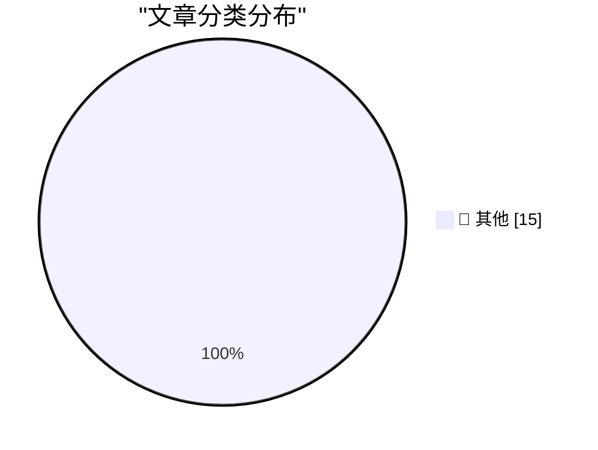

# 📰 AI 资讯每日精选 — 2026-11-12

> 汇聚 140+ 技术博客、X/Twitter、Hacker News、Reddit、Product Hunt、
> Lobste.rs、ClawFeed 日报及 GitHub Trending，经 AI 评分筛选。
>
> **本期内容**：🏆 今日必读 · 🌐 ClawFeed 日报 · 🔥 GitHub Trending · 📂 分类精选 · 🎨 设计与生成式 AI · 📊 数据概览

## 🏆 今日必读

🥇 **Gemini Decisions API**

[Gemini Decisions API](https://simonwillison.net/2026/Nov/11/gemini-decisions-api/) — simonwillison.net · 6 小时前 · 📝 其他

> Gemini Decisions API

🥈 **aws-emulator**

[aws-emulator](https://simonwillison.net/2026/Nov/11/aws-emulator/) — simonwillison.net · 6 小时前 · 📝 其他

> aws-emulator

🥉 **Browse tools.simonwillison.net by tag**

[Browse tools.simonwillison.net by tag](https://simonwillison.net/2026/Nov/11/tools-tags/) — simonwillison.net · 9 小时前 · 📝 其他

> Browse tools.simonwillison.net by tag

4️⃣ **llm 0.37.2**

[llm 0.37.2](https://simonwillison.net/2026/Nov/11/llm/) — simonwillison.net · 10 小时前 · 📝 其他

> llm 0.37.2

5️⃣ **Anthropic's IPO roadshow video**

[Anthropic's IPO roadshow video](https://simonwillison.net/2026/Nov/11/anthropic-ipo-roadshow/) — simonwillison.net · 12 小时前 · 📝 其他

> Anthropic's IPO roadshow video

---

## 🌐 ClawFeed 日报精选

> 来源：[ClawFeed](https://clawfeed.kevinhe.io) — AI 驱动的多源新闻聚合

# ☀️ ClawFeed | 2026-11-11 日报 SGT

> 聚合自 3 期已发布的 8 小时简报：#1491 00:00（00:00-07:59）、#1492 08:00（08:00-15:59）、#1493 16:00（16:00-23:59），时间窗 2026-11-11 00:00–23:59 SGT，三档齐全。
> 三期正文开头写的窗内素材合计 530 条（首页时间线 500 + 关注抽样 30：#1491 143 + 13、#1492 198 + 6、#1493 159 + 11）；三期都没有新书签。这是 SGT 周三的一天：凌晨那档美国东部是周二上午 11 点到晚上 7 点，1 点半前后 Anthropic、OpenAI 和 Google 先后发了新东西；白天那档美国是周二晚上 7 点到周三凌晨 3 点，主线是 Fable 5.2 实测、Anthropic 上市路演和 Claude 地区政策的中文圈讨论；晚上那档美国是周三凌晨 3 点到上午 11 点，正好是 11 月 11 日一战纪念日 / 美国退伍军人节，球队和政要的纪念帖很多。覆盖：三期首页都翻满了 80 屏（最早分别翻到 11-09 22:00、11-10 00:42、11-10 17:24），但时间线是混排的，翻到后面的屏还夹着窗内的帖子，三期都说可能没收全。时段也很不均：#1491 的 3 点档只有 5 条、5 点档 8 条；#1492 的 8 点档只有 3 条、15 点档 117 条占一大半（离抓取时刻近）；#1493 的 16、17 点档只有 9 条和 6 条、23 点档 66 条占四成。这些时段可能漏事。
> 主线：Anthropic 一整天——凌晨发了 Claude Whiteboards、Sheets、Data 和 Claude Meetings，Adobe、Atlassian、Box 能整个在 Claude 里打开，还给所有付费用户送一次全量额度重置；白天是上市路演（转述的招股书数字：已签算力和机房合同约 9000 亿美元），中文圈在讨论 Claude 地区政策收紧和封号；晚上是转述的上市时间表（11 月 18 日定价、19 日纳斯达克上市、代码 $ANT、发行价 70–78 美元、完全稀释估值最高约 1.4 万亿美元）。Fable 5.2 的实测（做游戏、做宣传片、Blender 整车模型）从白天讲到晚上。另有 OpenAI 的 ChatGPT 商家功能和 WSJ 报的三季度亏损、Google 用 Gemini 4 Carbon 给 Signal 协议做数学证明、百度 ERNIE 5.5 Flash Preview 等新模型、n8n 的 Nod 和 Chrome 的 modern-web-guidance、iOS 读文件漏洞，以及 CPI 偏热后 BTC 跌到 8 月以来最低、四家大银行合办稳定币等加密消息。

---

## 🔥 当日最重要 5 条（跨档去重）

1. **Anthropic 上市：白天路演、晚上转述的时间表——11 月 18 日定价、19 日纳斯达克上市，代码 $ANT，发行价 70–78 美元，完全稀释估值最高约 1.4 万亿美元**（#1492、#1493）：@kaelanyiu 13:39：Anthropic 这周开始上市路演，算上几家科技巨头的配售，预计能募到八百多亿美元；招股书显示已签的算力和机房合同未来要支付约 9000 亿美元，差不多是募资的十倍，其中很大一块要付给比特币矿场（转述，招股书原文素材里看不到）；@qinbafrank 09:40：路演 PPT 里那张「AI 能力扩展曲线」图，并说昨晚的抛售里半导体是重灾区，AI 不等于半导体（个人分析，后文被截断）；@zhzHNN 15:49 引用路演视频：今年 Anthropic 第一次开始用 AMD GPU，以前接一个新芯片平台要几十个工程师干几个月（后文被截断，这次用了多久素材里看不到）（#1492）。晚上 @hj667737550 20:57：据 CNBC，发行价 70–78 美元，完全稀释估值最高约 1.4 万亿美元，11 月 18 日定价、19 日上市（转述，这条主要是在算 Bitget 和 Gate「打新」的成本，后文被截断）；@NFT_Chen 23:34：Dario Amodei 本周五会直播为 IPO 造势、和摩根大通的 Jamie Dimon 对谈，称目标融资 900 亿美元、已大幅超额认购，并引用自己前一天的帖：每花 1 美元算力现在能收回 1.72 美元（峰值 2.08 倍），以前是 0.4 倍（转述，招股书原文素材里看不到；和白天「八百多亿美元」的说法对不上）；交易所那边 @xiejiayinBitget 23:50 说 Bitget 的 VIP 轮已经结束、认购 1.13 亿（素材里没写单位），@0xKevin00 16:04 说同样的盘前合约币安标价 1.7 万亿美元、Hyperliquid 只标 1.4 万亿（交易所侧的宣传和教程帖，只作参考）（#1493）。
   来源: https://x.com/kaelanyiu/status/2120390859221058003 ｜ https://x.com/qinbafrank/status/2120330754202943885 ｜ https://x.com/zhzHNN/status/2120423664760004759 ｜ https://x.com/hj667737550/status/2120501269127405851 ｜ https://x.com/NFT_Chen/status/2120540561497305093 ｜ https://x.com/xiejiayinBitget/status/2120544631121490116 ｜ https://x.com/0xKevin00/status/2120427527751786633

2. **Claude 做办公：Whiteboards、Sheets、Data 和 Claude Meetings，交互式连接器能在 Claude 里打开 Adobe、Atlassian、Box 的完整版；另给所有付费用户送一次全量额度重置**（#1491）：@claudeai 01:26：今天开始推出 Claude Whiteboards、Claude Sheets 和 Claude Data——在白板上把计划想清楚、在表格里做跟踪表、用数据讲故事；@mikeyk 04:37（Mike Krieger）引用的同一串帖里还有一条：有了交互式连接器，可以在 Claude 里打开工具的完整版本，先是 Adobe、Atlassian 和 Box，网页版和桌面版陆续上线；@TechCrunch 01:33：Anthropic 发布 Claude Meetings，开会时 Claude 能写下正在讨论的计划、在白板上排时间线（只有摘要，正文素材里看不到）；@ClaudeDevs 02:51、02:51（关注抽样）：Claude 支持了更多 MCP Apps 扩展的能力，比如 app tools 和内嵌网站；@levie 05:04（关注抽样，Box CEO）：让 Claude 对 Box 里的内容完全可读可写，说 agent 处理企业文件的量会是今天人工的 100 倍（合作方的说法，后文被截断）；@Jason 02:56 认为微软从「捆绑别人」变成了「被捆绑」（个人观点，后文被截断）。额度：@ClaudeDevs 05:59（关注抽样）：给所有 Pro、Max、Ultra 和 Team 用户送一次免费的全量重置，覆盖所有模型和额度，太平洋时间 12 月 10 日下午 2 点前随时用；原因是最近修了几个比预期多耗额度的小问题，而且之前的 Fable reset 对一部分用户没起多大作用（后文被截断，是哪部分用户素材里看不到）。白天 @haider1 15:15 拿这事批 OpenAI：「现在 Fable 5.2 出来了，我们只拿到额度重置」（个人观点，后文被截断，#1492）。
   来源: https://x.com/claudeai/status/2120206365759094857 ｜ https://x.com/mikeyk/status/2120254420105806188 ｜ https://x.com/TechCrunch/status/2120208134727754205 ｜ https://x.com/ClaudeDevs/status/2120227979041341943 ｜ https://x.com/ClaudeDevs/status/2120227980672901180 ｜ https://x.com/levie/status/2120261416733036905 ｜ https://x.com/Jason/status/2120229243590189500 ｜ https://x.com/ClaudeDevs/status/2120275296637321476 ｜ https://x.com/haider1/status/2120415023139029381

3. **Claude 地区政策收紧，中文圈讨论封号和「防封」方案**（#1492、#1493）：@liyue_ai 11:26：Anthropic 又更新了地区支持政策，这次连第三方云平台和授权经销商也要管；按转发人的翻译，人在不支持的地区（如中国大陆）打开 Claude 就会封号，哪怕是美国人，中国大陆企业派员工到美国、日本、英国当地用也会封号（转述和解读，政策原文素材里看不到，后文被截断）；@xx03199 13:46：自己的 Claude 被封了，说现在过 KYC 没法躲（个人遭遇）（#1492）。晚上 @realchendahuang 17:25：有人为了用 Claude 专门搞了一套专用环境方案，项目是 GitHub 上的 Lee-xeo/Claude-Cage（只给了项目名，具体做法素材里看不到）；@yanhua1010 22:19 也转了一个「把 Claude 关起来、彻底解决网络问题」的项目，并引用自己前一天的长文「史上最全 Claude 防封指南」，开头就说没有任何教程能保证不封号（#1493）。
   来源: https://x.com/liyue_ai/status/2120357527489855975 ｜ https://x.com/xx03199/status/2120392645340176599 ｜ https://x.com/realchendahuang/status/2120447854452027554 ｜ https://x.com/yanhua1010/status/2120521848610074996

4. **OpenAI：ChatGPT 商家功能开始 beta；据 WSJ 三季度营收 100 亿美元、经营亏损 109 亿美元**（#1491、#1492）：@OpenAI 02:06：Businesses in ChatGPT 开始 beta——商家可以认领、管理自己的信息，看用户怎么和它互动，符合条件的还能做一个 Business Agent 回答顾客问题、介绍商品；@gdb 02:30 转发、号召商家来认领；@WSJTech 07:03（WSJ 独家）：OpenAI 三季度营收增长 50% 到 100 亿美元，但经营亏损 109 亿美元，显示出追赶 Anthropic 的难度（只有标题和一句摘要，报道正文素材里看不到）（#1491）。白天 @aakashgupta 15:49：商家功能现在能告诉商家 ChatGPT 向顾客提了它多少次，说 OpenAI 一次走完了 Google 用 20 年教会小商家的套路（个人点评，后文被截断）（#1492）。
   来源: https://x.com/OpenAI/status/2120216592395174382 ｜ https://x.com/gdb/status/2120222471412666562 ｜ https://x.com/WSJTech/status/2120291276742410349 ｜ https://x.com/aakashgupta/status/2120423532853420520

5. **Google 用 Gemini 4 Carbon 和 AlphaProof Code 给 Signal 协议做数学证明，一直验证到编译后的设备代码；白天还有 Gemini 4 Carbon 的实测**（#1491、#1492）：@sundarpichai 01:28：团队让 Gemini 4 Carbon 去啃一个大的安全难题——用数学证明 Signal 协议底层的代码，Google DeepMind 的研究员用 AlphaProof Code 带着 agent，一直验证到编译后的设备代码（后文被截断；Google 一方的说法，论文和细节素材里看不到）；@Google 06:15：Gemini 4 Carbon 在 Antigravity 里给一篇针织物力学研究做了交互式 3D 可视化，跟踪 110 根纤维受力（#1491）。白天 @AI_Andrew 10:06 用它模拟一滴血（颜色、沉淀、红细胞比容），来回调了几轮；@JinjingLiang 11:06 用 Google Antigravity 新的 /swarm 功能让 builder 和 critic 两个子 agent 在 Blender 和 Three.js 之间循环、自己检查渲染结果，做出一个能玩的 3D 小游戏（后文被截断）（#1492）。
   来源: https://x.com/sundarpichai/status/2120207062655549933 ｜ https://x.com/Google/status/2120279087314837642 ｜ https://x.com/AI_Andrew/status/2120337224353063089 ｜ https://x.com/JinjingLiang/status/2120352428013068783

**⚠️ 未证实（素材里核实不了，只记录说法）**
- Anthropic 募资规模和时间表：@kaelanyiu 13:39 说「八百多亿美元」（#1492），@NFT_Chen 23:34 说「目标 900 亿美元、已大幅超额认购」（#1493），两边对不上；11 月 18 日定价、19 日上市、$ANT、70–78 美元都是转述（@hj667737550 20:57 说据 CNBC），招股书和 CNBC 原文素材里都看不到。https://x.com/kaelanyiu/status/2120390859221058003 ｜ https://x.com/NFT_Chen/status/2120540561497305093 ｜ https://x.com/hj667737550/status/2120501269127405851
- Claude 地区政策「人在中国大陆打开就封号、派员工到海外用也封」：@liyue_ai 11:26 按转发人翻译的解读，政策原文素材里看不到（#1492）。https://x.com/liyue_ai/status/2120357527489855975
- OpenAI 三季度营收 100 亿、经营亏损 109 亿美元：只有 @WSJTech 07:03 的标题和一句摘要（#1491）。https://x.com/WSJTech/status/2120291276742410349
- AI 2027 作者说「进展比报告快了五个月」：@MTSlive 01:01 没给出处，@marquistrillx 07:38 说依据是 METR 11 月 5 日的报告（内容号的转述，#1491）。https://x.com/MTSlive/status/2120200124454641923 ｜ https://x.com/marquistrillx/status/2120300117525971213
- ERNIE 5.5 Flash Preview 在 AutomationBench 上 61.9 分、超过 Claude Opus 5.5：@berryxia 15:36 的转述，榜单原图素材里看不到（#1492）。https://x.com/berryxia/status/2120420331244638392
- Muse Ember「比肩 Claude Haiku 5.5，碾压 GPT-6 Luna」：@heydengai 15:02 只有这一句，没给评测数据（#1492）。https://x.com/heydengai/status/2120411704274403446
- modern-web-guidance 让通过率从 56% 到 88%：@don_tech1 18:00 转述「谷歌官方」的说法，怎么测的素材里看不到（#1493）。https://x.com/don_tech1/status/2120456511575191890
- 币安被盗后的损失数字：@0xhile 15:26 说 63 亿美元，同一窗口另一条说 31 亿美元，对不上（#1492）。https://x.com/0xhile/status/2120417815110803912
- Fable 5.2 的作品：@mattshumer_ 08:10「才做了约 13 个小时」、@FinanceYF5 09:06 和 12:24 的宣传片和布加迪都是个人说法或转述，作品本身素材里看不到（#1492）。https://x.com/mattshumer_/status/2120308139153326225 ｜ https://x.com/FinanceYF5/status/2120322318170021946 ｜ https://x.com/FinanceYF5/status/2120372142147842296

**次重要（备选）**
- BTC 跌到 8 月以来最低、市场把 12 月加息看成定局（接 11-10 08:00 那期）：@coinbureau 06:35：BTC 今天最低到 72,677 美元，比 9 月 21 日的高点 87,374 美元跌了近 16%；@coinbureau 07:20：CPI 偏热，市场现在把 12 月加息看成定局；@0xlunasterling 07:50 转述 ZeroHedge 对高盛利率报告的摘要：高盛预计 11 月买短债、12 月加息（后文被截断）（#1491）；白天 @BTV_CN 15:41：之前说再也看不到 7 开头的比特币，结果又看到了（#1492）。https://x.com/coinbureau/status/2120284113500299340 ｜ https://x.com/coinbureau/status/2120295656397119492 ｜ https://x.com/0xlunasterling/status/2120303103115481493 ｜ https://x.com/BTV_CN/status/2120421612982051222
- n8n Labs 开源个人 agent Nod（研究预览版，Apache 2.0）：@taiyanghere 22:25：能在 Mac 和 Windows 上跑，跑腿任务在自己的虚拟机和浏览器里做，登录信息和卡片存在 Vault 里不交给模型（个人解读，后文被截断）；@maxwell_lenoir 22:41 引用 n8n 官方帖：可以帮你准备通话、收集发票、取消订阅，用你自己选的 AI 服务商（#1493）。https://x.com/taiyanghere/status/2120523421037826083 ｜ https://x.com/maxwell_lenoir/status/2120527306523365416
- Google Chrome 开源 modern-web-guidance：@don_tech1 18:00：一行 npx modern-web-guidance 装好，给 Claude Code、Codex、Copilot、Antigravity 喂 212 个现代 Web 特性（仓库是 GitHub 上的 GoogleChrome/modern-web-guidance）（#1493）。https://x.com/don_tech1/status/2120456511575191890
- iOS 读文件漏洞：@AAOnChain_Tg 00:49 引用 @binance 的帖：iOS 26.7.1、27.0.1、27.2 有一个漏洞（worse_query），恶意 app 能读别的 app 的本地文件，助记词、私钥和登录凭据都有风险，币安说不只影响币安（修复的系统版本素材里看不到；币安原帖不在本期窗口里）（#1491）。https://x.com/AAOnChain_Tg/status/2120197194049298881
- 稳定币和支付：@Cryptic_Web3 15:48：据 Bloomberg，高盛、花旗、桑坦德和德意志银行据报要投 2.7 亿美元合办一个美元稳定币项目；@0xAbhiP 15:56：Jack Dorsey 的 Square 给大约 400 万美国商户开通了比特币支付（只有这一句）（#1492）。https://x.com/Cryptic_Web3/status/2120423450808385662 ｜ https://x.com/0xAbhiP/status/2120425433909096794

---

## 📰 当日核心主题

**① Fable 5.2 实测：做游戏、做视频、做 3D（#1492、#1493）**
白天：@mattshumer_ 08:10：有人问是不是只是视频——不是，自己在 MacBook 上玩着，才做了大约 13 个小时，「Rockstar 做了 8 年，Fable 5.2 打算 7 天搞定」（个人的说法）；@FinanceYF5 09:06：有人只给一句话「做一支最能展示你当前能力的视频」，返回的成片质量很高（转述）；@FinanceYF5 12:24：Fable 5.2 在 Blender 里做出一辆布加迪 Tourbillon，外观到内饰每个部件都由它完成、最后渲染成短片，只用一条提示词和几张参考图，耗时 2.5 小时（转述）；@rwayne 15:26（关注抽样）：「Fable5.2 出来现在就是纯想象力时代了」，以前上百人按月开发的游戏 AI 一天就能搞定（个人感想）（#1492，https://x.com/mattshumer_/status/2120308139153326225 ｜ https://x.com/FinanceYF5/status/2120322318170021946 ｜ https://x.com/FinanceYF5/status/2120372142147842296 ｜ https://x.com/rwayne/status/2120417958380159340）。
晚上：@FinanceYF5 16:10 整理了 5 个开发者用 Fable 5.2 做游戏的 5 种路子（只写代码、接进引擎、重做旧游戏、全包），第一个是 Loktar 用它做动画、模型和特效，做出能在线玩的小队战斗游戏；@FinanceYF5 18:27：有人公开两段提示词，让 agent 跑通一门 3D 看房生意（都是转述，作品和提示词原文素材里看不到）（#1493，https://x.com/FinanceYF5/status/2120429041639678448 ｜ https://x.com/FinanceYF5/status/2120463542927405307）。额度重置的事见「最重要」第 2 条。

**② Agent 产品、开发工具和工程实践（三期都有）**
产品和工具：@dps 03:23（David Singleton）引用 @Muse：Muse 有了自己的邮箱，用户批准后能用自己的收件箱收发邮件，美国和加拿大的付费用户先用（产品方的说法）；@thdxr 04:09：团队里的 luke 在把 opencode 从 Electron 移到 rune 上，启动几乎是瞬间的（rune 是什么素材里没说）；@OpenAIDevs 04:52：Codex 和 ChatGPT 里的 Runway 插件，能看原型里角色怎么动、试预告片开场、把产品图做成视频广告（官方案例，后文被截断）（#1491，https://x.com/dps/status/2120235902266155168 ｜ https://x.com/thdxr/status/2120247436627071209 ｜ https://x.com/OpenAIDevs/status/2120258357533749755）。@turingou 12:34 引用：Grok Bot 可以加入 Tailscale 网络，安全地连私有 MCP 服务器、内部工具和应用；@nidhisinghattri 15:46：试了 Vercel 新出的电脑操作工具 agent-desktop，让 Claude Code 在后台用 Mac 上的 6 个日常应用，一次会话大约 2 美元（个人测评，后文被截断）；@hebi555 08:56：Mira 推出 Sterling——你付费的模型不一定是在回答你的那个，Sterling 测所有服务商、只路由到验证过的（产品方的说法）（#1492，https://x.com/turingou/status/2120374666795892741 ｜ https://x.com/nidhisinghattri/status/2120422840159658205 ｜ https://x.com/hebi555/status/2120319774865727982）。
观点：@levie 13:18：agent 集群（swarm）会让 AI 产出再上一个台阶，还提出「swarm riders」——能稳定指挥一大群 agent 干成事的人（个人观点，后文被截断）；@0xfishylosopher 13:29（USV）：agent 主要是界面上的创新，Muse、Instinct、Grok Bot 用的人多是因为界面方便、上手成本低、算力有补贴（个人观点）；@rauchg 10:06（Vercel CEO）：有了 agent 会冒出新语言、甚至专用语言，C、LLVM IR、汇编也会按需用（个人观点）（#1492，https://x.com/levie/status/2120385739342897469 ｜ https://x.com/0xfishylosopher/status/2120388347302486214 ｜ https://x.com/rauchg/status/2120337388178379178）。
工程实践：@ailiangzi 21:21 引用 @cxjwin 治理项目 harness 的问题：知识库写完没人维护、「AI 读得越认真，可能错得越离谱」，几百个 skill 到底有没有用（后文被截断）；@hosseeb 22:58（Haseeb Qureshi，VC）：创始人开始在融资材料里附一份写给 AI 读的 company.md，他认为是很正面的信号（个人观点，后文被截断）；@awais_khawar 23:00：LinkedIn 在用户理解 agent 上跑递归自我改进，agent 进步多快取决于评审（judge）有多可信，@open_is_free 23:16 回应：给 1 分的情况一致率只有 55%，「谁来评审评审」（两条都是转述，LinkedIn 原文素材里看不到）；@MurrLincoln 23:50 引用 Coinbase 官方帖：Coinbase for Agents 上线 agent 改不了的控制项——单笔上限、24 小时交易量上限、组合自动止损阈值等；@LimestoneHQ 16:12（关注抽样，公司号）：安全的迁移一直是拆成 7 个小 PR，现在 agent 整天写这种繁琐代码，借口没了（后文被截断）（#1493，https://x.com/ailiangzi/status/2120507103014220113 ｜ https://x.com/hosseeb/status/2120531493613400210 ｜ https://x.com/awais_khawar/status/2120532000331415647 ｜ https://x.com/open_is_free/status/2120536257889722702 ｜ https://x.com/MurrLincoln/status/2120544622778941930 ｜ https://x.com/LimestoneHQ/status/2120429322179932289）。Nod 和 modern-web-guidance 见「次重要」。

**③ 新模型和硬件（#1491、#1492、#1493）**
@berryxia 15:36：百度开源 ERNIE 5.5 Flash Preview，总参数 280B、每个 token 只激活 14B，上下文 1M，每秒 200 token 以上（转述加引用的官方帖，后文被截断）；@heydengai 15:02：Meta 发布新模型 Muse Ember（只有一句对比，没给评测数据）；@ivanfioravanti 15:37：MiniMax 的 33B 图像模型 MiniMax-H3-Image 两步出图，配了实时编辑的 LoRA 和 ComfyUI 检查点（Hugging Face 上的演示）（#1492，https://x.com/berryxia/status/2120420331244638392 ｜ https://x.com/heydengai/status/2120411704274403446 ｜ https://x.com/ivanfioravanti/status/2120420645708140901）。@UnslothAI 23:19：Qwen3.8-27B 的 Dynamic V3.1 GGUF 量化版，12GB 内存能跑，在做 Qwen4 的更好版本；语音输入硬件：@huang_song_ 23:06（Typeless 那边的人）宣布和 Anker 合作，把可穿戴麦克风 soundcore Work 接进 Typeless，@vista8 22:49：有人做了安克录音豆的第三方客户端（开源地址素材里看不到）（#1493，https://x.com/UnslothAI/status/2120536946774769860 ｜ https://x.com/huang_song_/status/2120533616518410259 ｜ https://x.com/vista8/status/2120529325560885364）。@Google 07:34：11 月 Pixel Drop，Pixel 10 上能用 Gemini Intelligence，另有 Pixel Tag 和自定义小组件（后文被截断）（#1491，https://x.com/Google/status/2120299157411790929）。

**④ AI 行业、钱和观点（三期都有）**
进展和招聘：AI 2027 那条（见「未证实」）；@lennysan 01:47：第五份科技招聘市场报告，AI 时代产品经理吃香、工程师需求停滞、设计岗位空缺创新低（第 4 条起被截断）（#1491，https://x.com/lennysan/status/2120211695453028770）。
钱往哪去：@deca_labs 01:03：DECA 共融资 1,200 万美元（Polychain、Pantera、Accel、daofive），做「agent 主导的软件商业化网络」（自家公告，后文被截断）；@TechCrunch 04:49：Sahir Raoof 的新基金 Proximal Ventures 募了 2,750 万美元，投 AI 药物研发；@MTSlive 04:52：据 Forbes，大麻价格跌到历史低位，电力、光纤、水和空调齐全的工业种植场在试着改成 AI 数据中心（#1491，https://x.com/deca_labs/status/2120200795522044396 ｜ https://x.com/TechCrunch/status/2120257458119623017 ｜ https://x.com/MTSlive/status/2120258343440949720）。@BinanceResearch 15:52：NeoCloud（CoreWeave、Nebius、IREN 这类）回来了，11 月 5 日的抛售是融资和审批的恐慌，需求一直在（后文被截断）（#1492，https://x.com/BinanceResearch/status/2120424287035089381）。
观点：@packyM 23:12（Packy McCormick）引 1998 年 Qwest CEO「带宽不会过剩」那句，配自己的周期论：神奇技术 → 快速收入 → 竞争 → 过剩 → 降价 → 洗牌 → 低成本者胜出；@7777chu 23:58 一句话：现在的 AI 故事和 90 年代光纤热高度相似；@mardehaym 23:15（关注抽样）：Jensen Huang 说年薪 50 万美元的工程师一年至少该烧 25 万美元的 AI token，Meta 员工在内部排行榜上一个月烧了 73.7 万亿 token（转述，后文被截断）；@lifesinger 19:20（玉伯）：在拥挤的车厢里看了一圈，用 personal agent 这类产品的零人（个人观察）（#1493，https://x.com/packyM/status/2120535171149746540 ｜ https://x.com/7777chu/status/2120546747298754877 ｜ https://x.com/mardehaym/status/2120535930956304816 ｜ https://x.com/lifesinger/status/2120476654598533251）。

**⑤ 安全（#1491、#1492、#1493）**
iOS 漏洞见「次重要」；@brian_armstrong 01:34：对付 AI 发起的网络攻击，办法是在防守上用更多 AI，引用的 Coinbase 首席安全官 @JLunglhofer 说 Coinbase 拿到了前沿模型的早期访问、让 agent 测自家代码（后文被截断）；@pete_rizzo_ 05:14：Ledger CEO 上电视说「每个人迟早都会被黑」「AI 在给攻击者加速」（后文被截断；是转述，节目原视频素材里看不到）（#1491，https://x.com/brian_armstrong/status/2120208539675492380 ｜ https://x.com/pete_rizzo_/status/2120263798921609544）。@wublockchain12 11:52：据韩联社，韩国金融安全院（FSI）的信息保护评估系统被黑，泄露约 300 条金融机构员工个人信息和约 350 条打码的联系方式（后文被截断）；@0xhile 15:26 引用 Ledger CEO 那句，说币安能赔付是因为有自有资金、应急基金和保险基金（个人点评，损失数字见「未证实」）（#1492，https://x.com/wublockchain12/status/2120364089566539968 ｜ https://x.com/0xhile/status/2120417815110803912）。@wublockchain12 18:44：苏格兰一名男子在狱中策划盗取最高 200 万英镑加密资产（让同伙逼受害者装 AnyDesk 再远程转币），被判 8 年（#1493，https://x.com/wublockchain12/status/2120467683099783400）。

**⑥ 加密和市场（三期都有）**
公司和机构：@CoinMarketCap 06:35：Trump Media 三季度净利润 4.097 亿美元，主要靠所持加密资产的非现金收益；@CoinDesk 02:00：Grayscale 现在 10 只加密 ETP 都支持实物换入；@CoinDesk 04:59：tZERO CEO 认为代币化五年内会进入主流，tZERO 打算通过 3.5 亿美元的 SPAC 上市（#1491，https://x.com/CoinMarketCap/status/2120284127102382128 ｜ https://x.com/CoinDesk/status/2120214918368464910 ｜ https://x.com/CoinDesk/status/2120260024328970525）。@BinanceResearch 18:45：机构调研，73% 打算今年加仓加密，80% 看重安全多于过往收益（报告摘要）；@CoinDesk 23:31：Pyth Network 接入纽交所实时行情；@laurashin 23:39：Robinhood 现在从事件合约赚的钱比加密还多，大部分增长来自体育，问各州能不能把预测市场关掉（线程前两条）（#1493，https://x.com/BinanceResearch/status/2120467823764078847 ｜ https://x.com/CoinDesk/status/2120539997858332852 ｜ https://x.com/laurashin/status/2120541901644587495 ｜ https://x.com/laurashin/status/2120541913476685890）。
DeFi、交易所和链上：@wublockchain12 08:16：据 The Defiant，Aave 的风险管理方 LlamaRisk 提案，从以太坊上的 Aave V3 Core 市场逐步清退约 13.3 亿美元抵押品，主要是 rsETH（6.618 亿美元）、osETH（2.794 亿美元）、LBTC 等（后文被截断）；@cryptorover 15:45：MEXC 收到 FinCEN 命令，限制部分美国金融转账，和 OFAC 制裁不同、不涉及冻结资产（后文被截断）（#1492，https://x.com/wublockchain12/status/2120309538591211585 ｜ https://x.com/cryptorover/status/2120422701223588307）。BTC 和 CPI、四家银行稳定币、Square 见「次重要」。

---

## 🔖 书签精选

今天没有新加的书签：#1491、#1492、#1493 窗内书签都是 0 条（三期都翻了 17 条，最新一条是 11-04 22:23），三期都跳过了这一区块、也没从旧书签里补，本日报没有可补选的内容。

---

## 👀 推荐关注汇总（去重，共 7 个；各期写稿时都在浏览器里核实过「未关注」：#1491 在 11-11 08:10–08:12，#1492 在 11-11 16:10–16:11，#1493 在 11-12 00:12–00:14 SGT，本日报没有重新核实）

**AI 产品和模型实测**
- @dps（David Singleton，简介写在 Meta Superintelligence Labs，之前是 Dreamer 的联合创始人兼 CEO、Stripe 的 CTO；2.75 万关注者）：发 Muse 能用自己的邮箱收发邮件，个人 agent 产品的一手进展（#1491）。https://x.com/dps
- @Google（Google 官方号；3,180 万关注者）：发了 Gemini 4 Carbon 在 Antigravity 里做 3D 可视化和 11 月 Pixel Drop，Gemini 产品的一手发布渠道，但消费产品宣传也多（#1491）。https://x.com/Google
- @mattshumer_（Matt Shumer，简介写投资了 Groq、Etched、OpenRouter 等，之前是 HyperWrite 的 CEO；40.35 万关注者）：发 Fable 5.2 做游戏的实测，AI 产品和模型实测的一手来源（#1492）。https://x.com/mattshumer_
- @JinjingLiang（Jinjing Liang，在做开源开发工具 Orca，之前在 Google、YC 校友；1.4 万关注者）：发 Gemini 4 Carbon 用 /swarm 跑 builder 和 critic 子 agent 做 3D 小游戏的测试，有自己的产品、分享实操（#1492）。https://x.com/JinjingLiang
- @huang_song_（Huang Song，简介是 Typeless 的创始人兼 CEO；7,138 关注者）：宣布 Typeless 和 Anker 合作做可穿戴麦克风，语音输入产品的一手信息（#1493）。https://x.com/huang_song_

**中文 AI 一线和科技商业分析**
- @ailiangzi（量子纠缠AI，简介「Building with AI」；2.09 万关注者，对方也关注了你）：在做 harness，转了一串关于知识库和 skill 到底有没有用的工程问题（#1493）。https://x.com/ailiangzi
- @packyM（Packy McCormick，Not Boring；23.2 万关注者）：拿 1998 年「带宽不会过剩」那句话配自己的技术周期论，原创的科技商业分析（#1493）。https://x.com/packyM

（三期另有 15 个显示未关注但没推荐的账号：#1491 的 @MTSlive、@TechCrunch、@Muse、@deca_labs、@JLunglhofer、@AAOnChain_Tg；#1492 的 @kaelanyiu、@heydengai、@AI_Andrew、@0xhile；#1493 的 @don_tech1、@taiyanghere、@realchendahuang、@maxwell_lenoir、@awais_khawar，理由是没给出处或只是转述、量大以转述为主、产品或项目官方号、注册时间短或发帖很少、关注者太少、营销号。）

**建议取关**：三期都没有提出取关建议。

---

## 💤 重复噪音模式

三期过滤掉的时间线 407 条（#1491 115、#1492 164、#1493 128），收了 93 条（28、34、31）；关注抽样窗内 30 条，收了 7 条（4、1、2），没收 23 条。按类别（三期分类口径不完全一样，下面是合并后的数）：
- **新闻、体育、娱乐和生活**：157 条（#1491 29、#1492 73、#1493 55；赫格塞斯弹劾的后续（众议院共和党把弹劾压了下去，#1491）、巴萨、切尔西、阿森纳、曼联、英超、欧冠、NFL、NBA、UFC、大学橄榄球，一战纪念日 / 退伍军人节的球队和政要纪念帖（#1493）、乌克兰、伊朗、美国选举、教皇、印度和土耳其政要（COP31）、marquistrillx 用 @grok 问答刷互动四条（#1491）等）。
- **加密项目宣传、活动和喊单**：125 条（#1491 30、#1492 64、#1493 31；Arch Prime 候补名单三条、Phantom 交易赛付费推广三条、预测市场（SIGHT、predict.fun、STRATO Odds、Polymarket 排名）、Vangrid 和 Atoma 的多条宣传、币安钱包 Agentic Wallet 专区、OKX 创意赛、GMGN 战队、BNB Bangkok 黑客松、LBank 冻结纠纷、一条没给出处的 NVDA「CEO 丑闻」快讯、Gate 和 MEXC VVIP 活动、Bitget 刷屏的「IPO IPO IPO」、「每个币都要涨 10 倍」、1 BTC 抽奖等）。
- **AI 宣传、杂谈和搞钱教程**：61 条（#1491 23、#1492 25、#1493 13；转述 Dario 说十年内疾病成为历史、LLM 写作腔清单、关于 Anthropic 创始人的传闻和吐槽、「碾压比肩先放放、评测呢」这类回复、国行 iPhone 绕限制的教程（#1492）、8.2k star 项目被下架、微信红包封面搞钱教程三条等）。
- **空帖、一句话和闲聊**：39 条（#1491 16、#1492 2、#1493 21；只有图或视频的帖、「Taps the sign」「Ouch」「still early」、「是的呢」「哈哈哈」「GOGOGO」、互怼和脏话等）。
- **科技公司、游戏和创投**：25 条（#1491 17、#1493 8；SpaceX 三条（Super Heavy V3 上发射台、太阳能电池供货合同、FCC 受理买 800MHz 频谱）、Discord 的 Rust 客户端、X 的 Clipping（前几期噪音里提过），腾讯裁员的传闻两条（脉脉上的说法，没有出处）等）。
- **关注抽样里没收的**：23 条（#1491 9、#1492 5、#1493 9），三期都有 @StartupWisdom_ 的语录（马斯克、Alexandr Wang、Phil Knight、Steve Jobs、Naval）、@Tradermayne 的直播预告和互怼、@rwayne 的闲聊；@LimestoneHQ 的广告（#1491、#1493）、@mardehaym 的约电话广告、@tangsanzangbtc 的 Nym VPN 推广等。
- **同一话题延续**：Anthropic 上市（前几期 → #1492 路演和招股书数字 → #1493 定价和时间表，募资额两种说法对不上）；Claude 额度（前几期的 Fable reset → #1491 全量重置 → #1492 @haider1 吐槽「只拿到额度重置」）；Fable 5.2（前几期发布 → #1492、#1493 实测，#1493 写的是「接上一期」）；Claude 地区政策（#1492 政策解读和封号 → #1493 防封方案）；ChatGPT 商家功能（#1491 发布 → #1492 点评）；Gemini 4 Carbon（#1491 Signal 证明和 3D 可视化 → #1492 实测）；BTC 跌到 8 月以来最低（11-10 08:00 那期 → #1491 72,677 美元和 CPI → #1492「又看到 7 开头」）；MEXC（#1492 @cryptorover：FinCEN 命令限制部分美国金融转账、不涉及冻结资产）。
---

## 🔥 GitHub Trending

> 今日热门开源项目（全语言 + Python）

| # | 项目 | 描述 | ⭐ 总星 | 📈 今日 | 语言 |
|---|------|------|---------|---------|------|
| 1 | [meta/astryx](https://github.com/meta/astryx) 🤖 | An open source design system that's fully customizable an... | 25.3k | +2776 | TypeScript |
| 2 | [sherlock-project/sherlock](https://github.com/sherlock-project/sherlock) | Hunt down social media accounts by username across social... | 110.2k | +1483 | Python |
| 3 | [we-promise/sure](https://github.com/we-promise/sure) | The personal finance app for everyone (by everyone) | 13.1k | +1078 | Ruby |
| 4 | [anthropics/skills](https://github.com/anthropics/skills) 🤖 | Public repository for Agent Skills | 193.2k | +1032 | Python |
| 5 | [addyosmani/agent-skills](https://github.com/addyosmani/agent-skills) 🤖 | Production-grade engineering skills for AI coding agents. | 116.1k | +787 | JavaScript |
| 6 | [vercel-labs/agent-browser](https://github.com/vercel-labs/agent-browser) 🤖 | Browser automation CLI for AI agents | 50.0k | +708 | Rust |
| 7 | [homeassistant-ai/ha-mcp](https://github.com/homeassistant-ai/ha-mcp) 🤖 | Configure and automate Home Assistant with Claude, ChatGP... | 7.5k | +645 | Python |
| 8 | [Alishahryar1/free-claude-code](https://github.com/Alishahryar1/free-claude-code) 🤖 | Use Claude Code, Codex, Antigravity, VSCode, Pi, and Open... | 68.7k | +636 | Python |
| 9 | [experientiallabs/experiential](https://github.com/experientiallabs/experiential) | Experiential is the open source, zero markup gateway for ... | 16.6k | +589 | Python |
| 10 | [anthropics/claude-quickstarts](https://github.com/anthropics/claude-quickstarts) 🤖 | A collection of projects designed to help developers quic... | 20.8k | +430 | Python |
| 11 | [shadcn/improve](https://github.com/shadcn/improve) | Use your most capable model to audit your codebase and wr... | 11.0k | +361 | - |
| 12 | [ZhuLinsen/daily_stock_analysis](https://github.com/ZhuLinsen/daily_stock_analysis) 🤖 | LLM 驱动的多市场股票智能分析系统：多源行情、实时新闻、决策看板与自动推送，支持零成本定时运行。 LLM-pow... | 70.5k | +278 | Python |
| 13 | [soxoj/maigret](https://github.com/soxoj/maigret) | 🕵️‍♂️ Collect a dossier on a person by username from 6K ... | 40.4k | +260 | Python |
| 14 | [browser-use/browser-use](https://github.com/browser-use/browser-use) 🤖 | Open-source Python library for AI browser agents, plus Br... | 120.8k | +172 | Python |
| 15 | [GoogleChrome/modern-web-guidance-src](https://github.com/GoogleChrome/modern-web-guidance-src) |  | 1.9k | +159 | TypeScript |

---

## 📝 其他

### 1. Gemini Decisions API

[Gemini Decisions API](https://simonwillison.net/2026/Nov/11/gemini-decisions-api/) — **simonwillison.net** · 6 小时前 · ⭐ 15/30

> Gemini Decisions API

---

### 2. aws-emulator

[aws-emulator](https://simonwillison.net/2026/Nov/11/aws-emulator/) — **simonwillison.net** · 6 小时前 · ⭐ 15/30

> aws-emulator

---

### 3. Browse tools.simonwillison.net by tag

[Browse tools.simonwillison.net by tag](https://simonwillison.net/2026/Nov/11/tools-tags/) — **simonwillison.net** · 9 小时前 · ⭐ 15/30

> Browse tools.simonwillison.net by tag

---

### 4. llm 0.37.2

[llm 0.37.2](https://simonwillison.net/2026/Nov/11/llm/) — **simonwillison.net** · 10 小时前 · ⭐ 15/30

> llm 0.37.2

---

### 5. Anthropic's IPO roadshow video

[Anthropic's IPO roadshow video](https://simonwillison.net/2026/Nov/11/anthropic-ipo-roadshow/) — **simonwillison.net** · 12 小时前 · ⭐ 15/30

> Anthropic's IPO roadshow video

---

### 6. Who Runs the Ransomware Group Qilin?

[Who Runs the Ransomware Group Qilin?](https://krebsonsecurity.com/2026/11/who-runs-the-ransomware-group-qilin/) — **krebsonsecurity.com** · 10 小时前 · ⭐ 15/30

> Who Runs the Ransomware Group Qilin?

---

### 7. Nvidia Working With Outside Firm to Identify CEO Candidates

[Nvidia Working With Outside Firm to Identify CEO Candidates](https://www.bloomberg.com/news/articles/2026-11-11/nvidia-working-with-outside-firm-to-identify-ceo-candidates) — **daringfireball.net** · 10 分钟前 · ⭐ 15/30

> Nvidia Working With Outside Firm to Identify CEO Candidates

---

### 8. WSJ: ‘Nvidia Is Preparing to Oust CEO Jensen Huang’

[WSJ: ‘Nvidia Is Preparing to Oust CEO Jensen Huang’](https://www.wsj.com/business/nvidia-is-preparing-to-oust-nvidia-ceo-jensen-huang-30f421ad?st=S84MQZ) — **daringfireball.net** · 26 分钟前 · ⭐ 15/30

> WSJ: ‘Nvidia Is Preparing to Oust CEO Jensen Huang’

---

### 9. Jensen Huang Was Banging an Nvidia Vice President Too

[Jensen Huang Was Banging an Nvidia Vice President Too](https://www.nytimes.com/2026/11/11/technology/jensen-huang-nvidia-affair.html?unlocked_article_code=1.P1E.pIe6.C65KRlbTa4MW) — **daringfireball.net** · 33 分钟前 · ⭐ 15/30

> Jensen Huang Was Banging an Nvidia Vice President Too

---

### 10. Apple Shutters Their Longstanding ‘Apple Support Community’

[Apple Shutters Their Longstanding ‘Apple Support Community’](https://sixcolors.com/link/2026/11/ding-dong-the-apple-support-community-is-dead/) — **daringfireball.net** · 8 小时前 · ⭐ 15/30

> Apple Shutters Their Longstanding ‘Apple Support Community’

---

### 11. Austin Mann’s iPhone Duo Review

[Austin Mann’s iPhone Duo Review](https://www.austinmann.com/trek/iphone-duo) — **daringfireball.net** · 9 小时前 · ⭐ 15/30

> Austin Mann’s iPhone Duo Review

---

### 12. Quinn Nelson: ‘The iPhone Duo Doesn’t Feel Like an iPhone’

[Quinn Nelson: ‘The iPhone Duo Doesn’t Feel Like an iPhone’](https://www.youtube.com/watch?v=cxjdVVVryC4) — **daringfireball.net** · 9 小时前 · ⭐ 15/30

> Quinn Nelson: ‘The iPhone Duo Doesn’t Feel Like an iPhone’

---

### 13. ‘Dangerous or Unusual’

[‘Dangerous or Unusual’](https://www.nytimes.com/interactive/2026/11/10/us/supreme-court-guns-misquote.html?unlocked_article_code=1.PlE.-Nhp.CaLpsgMqdWf3) — **daringfireball.net** · 9 小时前 · ⭐ 15/30

> ‘Dangerous or Unusual’

---

### 14. HowTo: Fix Eufy HomeBase 2 Storage Full Issues

[HowTo: Fix Eufy HomeBase 2 Storage Full Issues](https://shkspr.mobi/blog/2026/11/howto-fix-eufy-homebase-2-storage-full-issues/) — **shkspr.mobi** · 15 小时前 · ⭐ 15/30

> HowTo: Fix Eufy HomeBase 2 Storage Full Issues

---

### 15. Why Am I So Tired If AI Is Doing All the Work?

[Why Am I So Tired If AI Is Doing All the Work?](https://terriblesoftware.org/2026/11/11/why-am-i-so-tired-if-ai-is-doing-all-the-work/) — **terriblesoftware.org** · 9 小时前 · ⭐ 15/30

> Why Am I So Tired If AI Is Doing All the Work?

---

## 📊 数据概览

| 扫描源 | 抓取文章 | 时间范围 | 精选 |
|:---:|:---:|:---:|:---:|
| 92/140 | 3958 篇 → 87 篇 | 24h | **15 篇** |

### 分类分布

---

*生成于 2026-11-12 04:08 | 汇聚 140 个技术博客、X/Twitter、Hacker News、Reddit、Product Hunt、Lobste.rs、ClawFeed 日报及 GitHub Trending，经 AI 评分筛选出 Top 15 精华内容*
