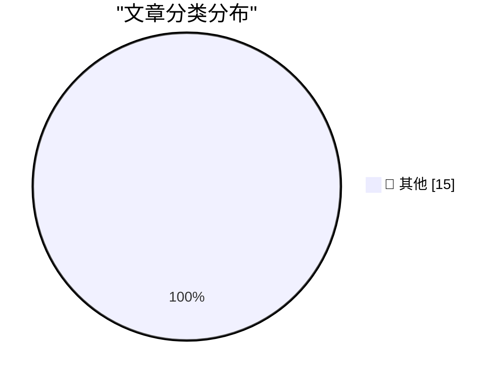

# 📰 AI 资讯每日精选 — 2026-11-15

> 汇聚 140+ 技术博客、X/Twitter、Hacker News、Reddit、Product Hunt、
> Lobste.rs、ClawFeed 日报及 GitHub Trending，经 AI 评分筛选。
>
> **本期内容**：🏆 今日必读 · 🌐 ClawFeed 日报 · 🔥 GitHub Trending · 📂 分类精选 · 🎨 设计与生成式 AI · 📊 数据概览

## 🏆 今日必读

🥇 **datasette-llm 0.1a11**

[datasette-llm 0.1a11](https://simonwillison.net/2026/Nov/14/datasette-llm/) — simonwillison.net · 3 小时前 · 📝 其他

> datasette-llm 0.1a11

🥈 **datasette-vega 0.7**

[datasette-vega 0.7](https://simonwillison.net/2026/Nov/14/datasette-vega/) — simonwillison.net · 9 小时前 · 📝 其他

> datasette-vega 0.7

🥉 **Ops needs friction**

[Ops needs friction](https://www.jeffgeerling.com/blog/2026/ops-needs-friction/) — jeffgeerling.com · 10 小时前 · 📝 其他

> Ops needs friction

4️⃣ **Joanna Stern Reviews the HomeView**

[Joanna Stern Reviews the HomeView](https://www.youtube.com/watch?v=yVTcVtLn2o4) — daringfireball.net · 9 小时前 · 📝 其他

> Joanna Stern Reviews the HomeView

5️⃣ **Jason Snell’s HomeView Review**

[Jason Snell’s HomeView Review](https://sixcolors.com/post/2026/11/homeview-review-a-late-arrival-with-promise-but-still-showing-some-seams/) — daringfireball.net · 9 小时前 · 📝 其他

> Jason Snell’s HomeView Review

---

## 🌐 ClawFeed 日报精选

> 来源：[ClawFeed](https://clawfeed.kevinhe.io) — AI 驱动的多源新闻聚合

# ☀️ ClawFeed | 2026-11-14 日报 SGT

> 聚合自 3 期已发布的 8 小时简报：#1503 00:00（00:00-07:59）、#1504 08:00（08:00-15:59）、#1505 16:00（16:00-23:59），时间窗 2026-11-14 00:00–23:59 SGT，三档齐全，但白天那档很薄。
> 素材数：三期 metadata 的 feed 分别是 177、69、188（合计 434，都是首页时间线窗内条数）；关注抽样另算，#1503 抽 35 个账号、窗内 11 条，#1504 抽 24 个、窗内 7 条，#1505 抽 35 个、窗内 10 条，合计 28 条。三期都没有新书签（bookmarks 0），errors 都是 0。
> **白天那档（08:00–15:59）偏薄**：#1504 只有 69 条，因为 16:00 派单时会话在升级、没接到，到 17:43 才抓，16:00 之后的帖子没算进来；虽然每个小时都有帖子，但每小时只有 3–13 条，比前后两档（177、188）少很多，这一段可能漏事。
> 这是 SGT 周六的一天：凌晨那档美国东部是周五（11-13）上午 11 点到晚上 7 点，跨过美股收盘；白天那档美国是周五晚上 7 点到周六凌晨 3 点，大多是夜里，中文帖占多数；晚上那档美国是周六凌晨 3 点到上午 11 点，周末早上大新闻少。覆盖：#1503 第 6 屏起出现整屏早于窗口开始，覆盖到了窗口开始，但 00–05 点每小时只有 9–18 条、06、07 两档（41、54 条）占一半多；#1504 第 10 屏起整屏早于窗口开始，覆盖到了窗口开始，但总量少（见上）；#1505 第 6 屏起整屏早于窗口开始，但 16–19 点每小时只有 3–11 条、23 点档 86 条占了快一半（多是一句话回复）。这些时段可能漏事。
> 主线：美国 FAA 全国停飞（官方说是通信故障，近 7,000 个航班延误或取消，白天恢复，晚上还在影响大学橄榄球赛程）；黄仁勋卸任后的「请回来」运动（Altimeter 和 Atreides 以股东身份联名致信董事会，马斯克、Garry Tan 签了 standwithjensen.com 公开信）；星舰第 15 次试飞一整天的进展（飞船进轨道、部署 26 颗星链 V3，助推器的结局说法不一）。AI 方面有 Anthropic 上市路演的转述、Anthropic 和 OpenAI 各发一篇讲常驻 agent 的文章、ChatGPT Wallet、LangChain 融资 3 亿美元、Sierra 的个人 agent 协议 Poppy 1.0，以及 Garry Tan 在 Claude Code 上比 Opus 5.5 和 Fable 5.2 的成本。加密方面比特币跌到 6.6 万附近、24 小时强平 9.127 亿美元。

---

## 🔥 当日最重要 5 条（跨档去重）

1. **美国 FAA 全国停飞：美东周五下午从芝加哥奥黑尔的「设备故障」开始，扩大到全国，近 7,000 个航班延误或取消，国土安全部长说目前没有理由怀疑是国家安全威胁；白天航班恢复，BBC 标题称是 9·11 以来最长的一次；晚上大学橄榄球赛程被打乱**（#1503、#1504、#1505）：凌晨 @stoolpresidente 05:23 引 CBS News 的突发：FAA「因特殊情况、出于安全原因」对全国机场下达停飞令（ground stop）；@BitGrateful 05:58 引别人的帖子：美东约下午 3:15 起，波士顿、纽约、芝加哥几个航路管制中心和纽约进近丢了大量通信频率，所有设施进入 ATC 警报（原帖作者的说法，官方说法素材里看不到，后文被截断）；@cnnbrk 06:31：国土安全部长 Markwayne Mullin 说，目前没有理由怀疑导致全美航班停飞的通信故障背后有国家安全威胁；@coinbureau 06:42：近 7,000 个航班延误或取消，是 2023 年以来第一次全国停飞，起点是芝加哥奥黑尔机场美东下午 3:10 因「设备故障」停飞，引 Axios 说是「直到另行通知」的罕见命令（汇总帖，后文被截断）（#1503）。白天 @BBCWorld 14:29 只有标题：全国停飞后航班恢复，旅客仍面临延误；@BBCWorld 11:14 只有标题：这是 9·11 以来时间最长的一次全国停飞（#1503 噪音里「自 911 以来首次」的说法没出处、和 Coin Bureau 的「2023 年以来首次」对不上，BBC 这里说的是「最长」不是「首次」）（#1504）。晚上 @espn 21:19、@SportsCenter 21:31：周五的停飞打乱了多支大学橄榄球队的行程，SEC 把俄克拉荷马对 19 号 Ole Miss 的主场比赛从周六改到周日，俄克拉荷马体育总监强烈反对（#1505）。素材里没有 FAA 对故障原因的正式说明。
   来源: https://x.com/stoolpresidente/status/2121353329498268018 ｜ https://x.com/BitGrateful/status/2121362033207661056 ｜ https://x.com/cnnbrk/status/2121370301661381080 ｜ https://x.com/coinbureau/status/2121373219131375807 ｜ https://x.com/BBCWorld/status/2121490661534822696 ｜ https://x.com/BBCWorld/status/2121441530435060191 ｜ https://x.com/espn/status/2121593793233269163 ｜ https://x.com/SportsCenter/status/2121596973534892509

2. **黄仁勋卸任之后：Altimeter 的 Brad Gerstner 先给英伟达董事会发信，后来和 Atreides 的 Gavin Baker 以股东身份联名，呼吁保留黄仁勋回归的选项；马斯克说在签复职请愿，Garry Tan 签了 standwithjensen.com 公开信；晚上有帖子说新加坡内政部否认对那名女商人做过间谍调查**（#1503、#1504、#1505，接 11-13 的辞职余波）：凌晨 @altcap 07:47：Brad Gerstner 本人说已经给英伟达董事会发了一封信，列出董事会处理这件事时至少应对股东做到的标准（信的内容在图里，素材里看不到）；@aleabitoreddit 05:07 引马斯克的回复：有人在发起请愿要让黄仁勋复职，马斯克说自己也会签，@aleabitoreddit 认为黄仁勋回来的可能性大增（个人看法）（#1503）。白天 @ChainCatcher_ 11:00：Gerstner 和 Atreides Management 的 Gavin Baker 以股东身份联名致信董事会，呼吁保留黄仁勋回归的选项（信的全文素材里看不到，后文被截断）；@garrytan 12:38：「黄仁勋应该得到正当程序，而不是现在这样」，自己签了 standwithjensen.com 的公开信（个人表态）；@EnHeng456 14:59 说签名榜上有马斯克、YC CEO、Epic Games CEO 等，约 6 万人签署（数字见「未证实」）（#1504）。晚上 @Moon1ightSt 17:46（接 11-13 的 Megaspeed 案）：说华尔街日报报道称新加坡在把一名与 Megaspeed 有关的女商人当间谍调查，新加坡内政部否认官员说过这些话、也否认对她做过任何间谍或情报调查，新加坡警方只确认 Megaspeed 公司的案子还在查（帖子转述，华尔街日报原文和内政部声明素材里看不到，后文被截断）（#1505）。
   来源: https://x.com/altcap/status/2121389561414623679 ｜ https://x.com/aleabitoreddit/status/2121349155457261991 ｜ https://x.com/ChainCatcher_/status/2121438121451765861 ｜ https://x.com/garrytan/status/2121462697787342932 ｜ https://x.com/EnHeng456/status/2121498114133799255 ｜ https://x.com/Moon1ightSt/status/2121540244524691880

3. **星舰第 15 次试飞：飞船进了轨道、隔热罩状态良好、部署 26 颗星链 V3 卫星，绕地 14 圈后离轨尝试回 Starbase 被接住；助推器的结局三种说法（凭画面判断触发终止系统 / SpaceX 官方写「着陆点火和溅落」/ ABC 说落海后爆炸）**（#1503、#1504、#1505）：凌晨 @WorldInMotionHQ 07:15：星舰进入轨道，准备第一次尝试在飞船返回时接住，引的早前帖说计划美东 17:45（新加坡 06:45）发射、起飞几分钟后接住助推器、22 小时后再接飞船（新闻号的说法）；@pronounced_kyle 07:08：看画面像是助推器悬停成功后触发了飞行终止系统（FTS），爆炸后火还烧了一阵（个人根据直播画面的判断）（#1503）。白天 @SpaceX 10:46、11:07：放出星舰在轨画面（经星链传回），另一条是「Super Heavy 22 号助推器着陆点火和溅落」的画面——官方写的是溅落，不是筷子接住；@elonmusk 14:23 引 SpaceX：飞船和隔热罩状态良好，发射后近 7 小时还在绕地飞行，计划发射后约 22.5 小时回发射场被接住；@elonmusk 15:11 引 SpaceX：飞船在部署 26 颗星链 V3 卫星，约 42 分钟，最多给星链增加 26 Tbps 容量，马斯克说以后每次会带 50 Tbps 以上（#1504）。晚上 @elonmusk 22:30 引 SpaceX「星舰在非洲上空」：飞船正在完成绕地 14 圈，之后离轨、尝试在 Starbase 降落（结果素材里还看不到）；@ABC 22:49：把整艘星舰收回发射台的尝试没成，助推器周五落进墨西哥湾后爆炸，但飞船进了轨道，是最大胆的一次试飞（ABC 正文素材里看不到）（#1505）。飞船最后有没有被接住，到 23:59 素材里还看不到。
   来源: https://x.com/WorldInMotionHQ/status/2121381542094311881 ｜ https://x.com/pronounced_kyle/status/2121379706335310306 ｜ https://x.com/SpaceX/status/2121434583178875245 ｜ https://x.com/SpaceX/status/2121439746740170859 ｜ https://x.com/elonmusk/status/2121489252072693925 ｜ https://x.com/elonmusk/status/2121501324663832873 ｜ https://x.com/elonmusk/status/2121611711278981147 ｜ https://x.com/ABC/status/2121616612776157192

4. **Anthropic 上市（接 11-12 的上市公告）：有文章说已经开始路演，计划发 8.25 亿股、每股 70–78 美元、代码 ANT、在纳斯达克上市；有人在 Bitget 的「IPO Prime」报名认购**（#1505）：@0xAstra 23:20 发长文「ANT IPO 在即，如何参加，值得参加吗？」，说 Anthropic 已启动路演，计划发行 8.25 亿股，预期发行价每股 70–78 美元，拟以 ANT 为代码在纳斯达克上市（#1505 按这个区间算募资约 578 亿–644 亿美元，是简报按帖子的数算的；文章是转述，招股文件原文素材里看不到，后文被截断）；@akari_defi 23:25（越南语，机器翻译）说已经在 Bitget 的「IPO Prime」上报名参加 Anthropic 的公开认购（交易所自家产品，具体买到的是什么素材里看不到；个人帖子，不是建议）。只在晚上那档出现，白天和凌晨两档没有相关新消息。
   来源: https://x.com/0xAstra/status/2121624436583616970 ｜ https://x.com/akari_defi/status/2121625658749288947

5. **常驻 agent 怎么搭、怎么管：Anthropic 发文「Building always-on agents」拆解收件箱、定时器、记忆、权限、发件箱；OpenAI 发文讲怎么给 OpenClaw 这类常驻 agent 做安全，说内部有 500 多个常驻 agent**（#1504、#1505）：白天 @dotey 08:56 转述 Anthropic 的新文章：一直在线的 AI 助理大部分时间在「睡觉」，不调用模型也不花钱，有事进收件箱才醒来跑一次，定时器让它没人叫也能主动（后文被截断）；@shao__meng 10:18 评论同一篇：五个部件单独看都不新，价值在把职责划清楚，「始终在线」是使用体验，不是让模型一直挂着烧 token（个人看法）；@Xudong07452910 08:45 转述 OpenAI 的文章「Securing persistent agents like OpenClaw at …」：OpenAI 内部有 500 多个常驻 agent、其中数百个基于 OpenClaw，在后台自动开 PR、跑数据实验，文章讲怎么保证安全（原文和具体做法素材里看不到，后文被截断）（#1504）。晚上 @HeLi8866 21:00 带出了 Anthropic 原文卡片「Building always-on agents」（claude.com），要点和白天一致：常驻 agent 大部分时间休眠，醒来跑一小轮、存好状态再睡，第一个模块是在 webhook 和 agent 之间加一张数据库表做事件收件箱（原文全文素材里看不到，后文被截断）（#1505）。
   来源: https://x.com/dotey/status/2121406975279792268 ｜ https://x.com/shao__meng/status/2121427594260398327 ｜ https://x.com/Xudong07452910/status/2121403992450478246 ｜ https://x.com/HeLi8866/status/2121588982781825302

**⚠️ 未证实（素材里核实不了，只记录说法）**
- Anthropic 上市「8.25 亿股、每股 70–78 美元、代码 ANT」：只有 @0xAstra 23:20 的转述长文，招股文件素材里看不到（#1505）。https://x.com/0xAstra/status/2121624436583616970
- standwithjensen.com「约 6 万人签署、现任员工 3,800、前员工 620、股民和投资人 3.3 万、路人 2 万」：@EnHeng456 14:59 个人帖子里的数，网站原始统计素材里看不到（#1504）。https://x.com/EnHeng456/status/2121498114133799255
- 星舰助推器「触发了飞行终止系统」：@pronounced_kyle 07:08 凭直播画面判断（#1503），SpaceX 官方写的是「着陆点火和溅落」（#1504），ABC 说落海后爆炸（#1505），三种说法素材里都没有进一步证实。https://x.com/pronounced_kyle/status/2121379706335310306 ｜ https://x.com/SpaceX/status/2121439746740170859 ｜ https://x.com/ABC/status/2121616612776157192
- 「OpenAI 解散独立机器人团队、改用 GPT-6 Astra 直接控制机器人」：@ShuaiCharles 15:12 没给出处（#1504）。https://x.com/ShuaiCharles/status/2121501593996857754
- 「一家消费级 agent 公司三个月做到 2,200 万美元年经常性收入」：@Raadmobrem 11:19 个人说法，没说是哪家（#1504）。https://x.com/Raadmobrem/status/2121442856586096703
- 「双十一大模型 Token 卖爆、李佳琦直播间低价卖 Token」：@kedaya 20:35 没给具体数字和出处（#1505）。https://x.com/kedaya/status/2121582670107074808
- 微软 365 故障「已经恢复、不是被黑、是服务器撑不住」：@Ethwanfeng 16:20 个人帖子的说法，微软正式说明素材里看不到（#1505）。https://x.com/Ethwanfeng/status/2121518644815610202
- 「KAVA 一小时跌 43% 是因为链上安全漏洞」：@Alligator199 20:36 个人帖子，项目方公告素材里看不到（#1505）；「美国 10 月 PPI 同比涨 6.5%」：@Bitwux 09:48 帖子的数，官方数据素材里看不到（#1504）。https://x.com/Alligator199/status/2121583009468133631 ｜ https://x.com/Bitwux/status/2121419850958700942

**次重要（备选）**
- ChatGPT Wallet：@gdb 01:32 引 ChatGPT 官方帖：和美国运通、万事达、Visa 合作，用户批准后「dot」可以代为下单，agent 付款时接触不到真实卡号，每笔都过安全验证，今天开始向 Pro 订阅用户的 dot 推出（dot 具体是什么素材里没说明，后文被截断，#1503）。https://x.com/gdb/status/2121295213025194172
- LangChain 融资 3 亿美元、估值 30 亿美元：@LangChain 02:00：把三年做 agent 框架的经验放进新的 LangSmith，覆盖 agent 开发的整个周期，引的 Harrison Chase 帖说 LangSmith 是不绑定框架的平台（后文被截断，#1503）。https://x.com/LangChain/status/2121302080954810691
- Sierra 发布 Personal Agent Protocol v1.0（Poppy）：@hungryturbo 17:13 引 Sierra：Meta 的 AI agent Muse 的所有用户都已能用，Shopify 每个商家都已启用，有 100 多家设计伙伴，转述里还列了 Stripe、Salesforce、Manus、Browserbase 等（协议怎么工作素材里看不到，后文被截断，#1505）。https://x.com/hungryturbo/status/2121531927987662888
- Garry Tan 的模型成本评测：@garrytan 12:45：在 Claude Code 2.1.322 上跑 52 个编程任务，Fable 5.2 解出 82.7%、Opus 5.5 解出 84.6%，但 Fable 5.2 每解一题的成本是 2.80 倍，建议 Claude Code 默认继续用 Opus 5.5，也说要分出高下得用更难的题（后文被截断，#1504）。https://x.com/garrytan/status/2121464508225053153
- 五大科技公司资本开支超过经营现金流：@BinanceResearch 19:30：亚马逊、谷歌、Meta、微软、甲骨文三季度资本开支合计 2,304 亿美元、是一年前的 2.2 倍，经营现金流只有 1,986 亿美元，资本开支占现金流 116%（一年前 63%），是 2023 年有数据以来第一次超过 100%（#1505）。https://x.com/BinanceResearch/status/2121566317173944537
- 加密下跌：@Tabgdoueth 13:45：比特币从 7 万跌到 6.6 万，最低 66,456 美元（#1504）；@MarsBit2022 16:00：比特币 24 小时强平 9.127 亿美元、95% 是多单、创 30 日新高，说主因是杠杆多头集中清算、不是现货抛压，ETF 连续六日净流出但在放缓（#1505）。https://x.com/Tabgdoueth/status/2121479672152350946 ｜ https://x.com/MarsBit2022/status/2121513464720138725
- 乌克兰：@BBCWorld 18:34、@CNN 22:30：泽连斯基说美国在最近的谈判里提出过让乌克兰把顿巴斯让给俄罗斯、换取加入北约的设想（只有标题和导语，乌方一方的说法，美方回应素材里看不到，#1505）。https://x.com/BBCWorld/status/2121552367749353910 ｜ https://x.com/CNN/status/2121611635026448762

---

## 📰 当日核心主题

**① Anthropic 和 Claude Code（三期都有）**
@ClaudeDevs 06:51、07:59：Claude Code 的 Projects 更新，负责协调多个并行线程的 coordinator 更主动，会在项目聊天里回答问题、汇报各线程进度；桌面版 Claude Code 可以用 mods 做自定义主题（改颜色、加动态背景），直接告诉 Claude 想要什么样，或者从 theme-examples 插件开始（关注抽样，#1503，https://x.com/ClaudeDevs/status/2121375309287301360 ｜ https://x.com/ClaudeDevs/status/2121392666244186327）。@ClaudeDevs 08:00 接着说：更新桌面版到最新就能用，目前只支持桌面版本地会话，云端会话「很快」支持，自己写可以看文档「Draw in the interface with a mod」；@turingou 15:09：已经把公司所有项目的主要开发迁到 Claude Code 的云端 Projects，云端环境用远程控制自动连自己的服务器、构建服务和个人电脑（个人经验）；@garrytan 12:40：开源 agent 外壳评测库 g-harness-evals，引的中文转述说同一个模型换不同外壳（harness）通过率差不多，但单次成本差 2.5 倍以上（转述，仓库原文素材里看不到）（#1504，https://x.com/ClaudeDevs/status/2121392667666125167 ｜ https://x.com/turingou/status/2121500754716524934 ｜ https://x.com/garrytan/status/2121463161069228382）。Opus 5.5 和 Fable 5.2 的成本对比见「次重要」，上市和常驻 agent 文章见前 5 条；#1505 只有 Claude Code Projects 协调员的附和，没收。

**② 模型和开发工具（三期都有）**
谷歌：@github 03:10：Gemini 4 Hydrogen 在 GitHub Copilot 里正式可用（Copilot app、CLI 和 VS Code），主打快速的 agent 编程、工具调用和多步流程，指令遵循比 Gemini 3.8 Flash 好；@github 05:55 回顾 10 月上线的 Copilot automations（分拣 issue）、跨多个仓库（或不带仓库）的 Projects、把请求路由到前沿模型的 Copilot Fusion；@chlovelyn 07:05 转述谷歌官方演示：纸上画界面、拍照给 Gemini、让 Canvas 写代码、直接预览运行（#1503，https://x.com/github/status/2121319695626518823 ｜ https://x.com/github/status/2121361459582025982 ｜ https://x.com/chlovelyn/status/2121378826949214260）。@Saboo_Shubham_ 15:00：Google Antigravity 加了编排模式，可以把 Gemini 4 Carbon 和 Hydrogen 搭配、在长时间 agent 任务里动态切换模型（接 11-13 的 Orchestrator）；@pdf_si 15:51：谷歌和 CopilotKit 发布 A2UI 1.0，一套声明式 UI 规范，让 agent 生成可交互界面而不是大段文字，号称最少两行代码接入（#1504，https://x.com/Saboo_Shubham_/status/2121498372586791036 ｜ https://x.com/pdf_si/status/2121511372551069721）。
开源和基础设施：@zhangwj3115 06:15：llama.cpp 11-14 发布 v1.0.0，第一个稳定版，意味着接口开始冻结（发布原文素材里看不到，#1503，https://x.com/zhangwj3115/status/2121366385716793797）；@bb833dong 13:30：AWS 开源 AWS Emulator，在本机模拟 AWS API、不需要账号，请求发到 127.0.0.1:9297，只用于构建和测试，3,900 多星、现在 v1.0.322；@evilcos 12:19 引 Cursor：Cursor 发了最近那次安全事件的进展和修复步骤（内容素材里看不到）（#1504，https://x.com/bb833dong/status/2121475715505799619 ｜ https://x.com/evilcos/status/2121457997360857389）；@ai_news_x 22:50：Runway 发布机器人控制模型 Praxis-1，权重和代码按 Apache 2.0 开放，把摄像头画面和文字指令变成机器人动作，目前还不能自己规划复杂动作序列（转述 THE DECODER，#1505，https://x.com/ai_news_x/status/2121616755143635326）。
个人和小团队的实操：@gimcall 00:41：做个微信小程序成本可以低到 30 元，代码让 WorkBuddy 写、MCP Token 交给它、测试也让 AI 跑，个人主体认证一年 30 元、企业 300 元，备案约 6 天（个人经验）；@nikpil06 01:34：发布给 forward deployed 团队用的 agent Nexus（自家产品）；@jack 02:12：说 Buzz 的插件是「魔法所在」（Buzz 是什么素材里没说明）（#1503，https://x.com/gimcall/status/2121282200767529091 ｜ https://x.com/nikpil06/status/2121295657239740737 ｜ https://x.com/jack/status/2121305121347023286）。@turingou 11:52：自己做的构建服务 HayaBuild 上线，开发 iOS 应用不再需要本地 Mac，代码推到 GitHub 后自动编译 TestFlight 包上传（自家产品）；@dabit3 15:48：云端跑 macOS 虚拟机、让 Devin 在上面干活，在手机上做和玩 Unity iPhone 游戏，说 2027 年是「agent 做游戏」的拐点（个人看法）（#1504，https://x.com/turingou/status/2121451065782796436 ｜ https://x.com/dabit3/status/2121510639135052081）。@vikingmute 19:54：试了给 agent 用的浏览器 ego lite，能一键导入 Chrome 状态，人和 agent 可以并行操作，目前好像只有 Mac 版（个人体验）；@tankxu 22:13：跑通「AI 自动做小红书小工具涨粉」：AI 自己选题、开发、在本地模拟器测试、自动提交审核（个人实践）；@wangray 17:28：OpenBean v0.5.0 新增「心力模式」，飞书录音豆整天戴着，放回充电盒后自动转写、分段、写出当天日记和待办（自家产品）（#1505，https://x.com/vikingmute/status/2121572506050162719 ｜ https://x.com/tankxu/status/2121607391183839306 ｜ https://x.com/wangray/status/2121535639187550677）。

**③ Agent 支付和 agent 生意（#1503、#1505）**
凌晨一档集中出现了几条「让 agent 自己付钱」的消息：ChatGPT Wallet（见「次重要」）之外，@brian_armstrong 02:19 引 Coinbase 11-11 的文章：Coinbase for Agents（agent 平台和 MCP，能让 agent 做研究和交易）推出新的控制项，让在金融账户里用 AI 更安全（具体控制项素材里看不到）；@base 02:22：Exa 让 AI agent 在 Base 上用 USDC 按次购买搜索，不需要账号和 API key；@blauyourmind 04:07 引 Circle：Circle Agent Marketplace 上有 trydrip、MrScraper、you.com 的搜索、抓取、出版内容和财经新闻工具，给 agent 一个 Circle 钱包就能用；@grinich 01:38：WorkOS 年经常性收入到 1 亿美元，现在做「人和 agent 一起工作」的基础设施（自家公告）（#1503，https://x.com/brian_armstrong/status/2121306986872795150 ｜ https://x.com/base/status/2121307703934898564 ｜ https://x.com/blauyourmind/status/2121334255758311886 ｜ https://x.com/grinich/status/2121296642276295119）。LangChain 融资和 Sierra 的 Poppy 协议见「次重要」（#1503、#1505）。

**④ 研究和观点（三期都有）**
@sainingxie 04:29 引 Ellis Brown 的论文帖：从头训了 200 多个模型拆解多模态模型怎么编码视觉输入（预训练编码器、无编码器、放在 LLM 之前），只有一个选择真正有影响（是哪一个素材里看不到），提醒别急着跟「无编码器」的风；@dwarkesh_sp 02:37：新文章，说「冲击数学的雪崩正在冲向 AI 研发」（正文素材里看不到）；@FinanceYF5 01:02：长文记 AIE CODE 2026 上 Diogo Almeida 的演讲：AI 95% 是爱因斯坦、5% 是憨豆先生，所以做了只判断、不生成的 Jev（转述长文，素材里只有开头）；@andrewdsouza 02:13：文章「Nobody Trusts Your Agent」：如果 2026 是 agent 之年，2027 会是「委托人」（principal）之年（素材里只有开头）（#1503，https://x.com/sainingxie/status/2121339807708193218 ｜ https://x.com/dwarkesh_sp/status/2121311524409225611 ｜ https://x.com/FinanceYF5/status/2121287722468008024 ｜ https://x.com/andrewdsouza/status/2121305381515456998）。@alacheng 15:27：Toloka 这类数据公司开始帮金融机构后训练自己的模型，引 Toloka：给银行客服训的 4B 模型测试对话解决率从 1% 到 93.8%，Gemini 3.8 只有 74%（自家数据）；@Techub_News 08:21 只有标题：美联储调查显示 AI 风险被认为是金融体系最大威胁（#1504，https://x.com/alacheng/status/2121505279338832092 ｜ https://x.com/Techub_News/status/2121398038295937290）。@willcb 22:56 调侃现在什么都叫「新算法」（分数居中、FP4 缩放技巧、地方税法的 RL 环境……）；@mardehaym 21:14（关注抽样）：「随手用 AI 重写软件、不再付供应商钱」对一些工具成立，但大多数取消 SaaS 自己 vibe code 的公司最后会为同一个软件付两次钱（作者自己做企业 AI 咨询）（#1505，https://x.com/willcb/status/2121618253781086414 ｜ https://x.com/mardehaym/status/2121592633558720892）。OpenAI 机器人团队、消费 agent 2,200 万美元、双十一 Token 见「未证实」。

**⑤ 加密和市场（三期都有）**
@toly 06:44 引 Bankless：Akash 开了一个单向通道，把 Cosmos 上的 AKT 锁住、在 Solana 上铸出等量，开放两年，到周五中午约 180 万 AKT（约占供应量 0.6%）转了过去；@kurtgrela 06:30：2020 年以来比特币涨 1,069%、黄金 174%、美股 162%，Bitwise 预计未来十年机构会把 1%–5% 的资产配到比特币（Bitwise 原文素材里看不到）；@0xlunasterling 06:40：芝加哥联储主席 Goolsbee 11-13 对 CNBC 说通胀没有在回到 2% 的路上，已扩散到服务业（后文被截断）（#1503，https://x.com/toly/status/2121373630399721901 ｜ https://x.com/kurtgrela/status/2121370020358013435 ｜ https://x.com/0xlunasterling/status/2121372721900597736）。@Bitwux 09:48：美国 10 月 PPI 环比涨 0.3%、低于预期，BTC、ETH、BNB 一起跌，ETF 仍明显净流出（同比数字见「未证实」）；@wublockchain12 08:09 引 Decrypt：众议院监督委员会 11-13 发布预测市场内幕交易调查备忘录，建议考虑限制联邦人员参与预测市场交易；@wublockchain12 08:17：Polkadot 社区基金会的新战略链上公投以 97% 支持通过，重心转向普通用户产品，以 dotStables 稳定币为核心、首款 dotUSD 锚定美元（#1504，https://x.com/Bitwux/status/2121419850958700942 ｜ https://x.com/wublockchain12/status/2121395051112915421 ｜ https://x.com/wublockchain12/status/2121397036692254948）。@binance 18:55（接 11-13 的币安被盗）：新的储备金证明的零知识证明已生成，用户可以自己验证资产至少 1:1；@Tradermayne 22:45（关注抽样）：原本相信四年周期、底部在 2026 年四季度到 2027 年初，7 月见底后的反弹打破了结构……（结论素材里看不到，个人看法，不是建议）；@solana 23:17：伦敦 Breakpoint 2026 又确认一批嘉宾，有伦敦副市长 Howard Dawber 以及 SoFi、MoonPay、FT 等的人；KAVA 暴跌见「未证实」（#1505，https://x.com/binance/status/2121557669618339988 ｜ https://x.com/Tradermayne/status/2121615520877212013 ｜ https://x.com/solana/status/2121623558598033879）。比特币跌到 6.6 万和强平见「次重要」。

**⑥ 其他新闻（三期都有）**
@BBCBreaking 04:36：新奥尔良一艘货轮撞上停靠的游轮，密西西比河上在救援，据报游轮上有 120 多人；@Reuters 06:30 只有标题：伊朗革命卫队说两艘油轮在霍尔木兹海峡触雷（#1503，https://x.com/BBCBreaking/status/2121341525678342451 ｜ https://x.com/Reuters/status/2121370149018046736）。@nytimes 08:45：新奥尔良市长说，倾覆的河船上近 200 人全部找到，没有危重伤员（#1504，https://x.com/nytimes/status/2121404021231477153）。@BBCWorld 18:45 只有标题：匈牙利当局在调查欧尔班时期一名部长时查出 2,000 万美元（#1505，https://x.com/BBCWorld/status/2121555221184651489）。乌克兰顿巴斯见「次重要」，微软故障的后续说法见「未证实」。

---

## 🔖 书签精选

今天没有新加的书签：#1503、#1504、#1505 窗内书签都是 0 条（三期分别翻到 17、17、13 条，最新一条都是 11-04，#1503 写明是 11-04 22:23），三期都跳过了这一区块、也没从旧书签里补，本日报没有可补选的内容。

---

## 👀 推荐关注汇总（去重，共 6 个；各期写稿时都在浏览器里核实过「未关注」：#1503 在 11-14 08:11–08:14，#1504 在 11-14 17:51–17:52，#1505 在 11-15 00:13–00:16 SGT，本日报没有重新核实）

**创业者和投资人的一手消息**
- @altcap（Brad Gerstner，简介是 Altimeter 创始人，也做 Invest America 和 BG2 播客；24.02 万关注者；你关注的人里有 320 个也关注了）：科技投资人，亲自给英伟达董事会发信的一手消息（#1503）。https://x.com/altcap
- @grinich（Michael Grinich，简介是 WorkOS 创始人；1.57 万关注者；你关注的人里有 106 个也关注了）：开发者基础设施公司创始人，WorkOS 年经常性收入到 1 亿美元、转向「人和 agent 一起工作」基础设施的一手公告（#1503）。https://x.com/grinich
- @andrewdsouza（Andrew D'Souza，简介是 Boardy AI 和 Clearco 创始人；2.17 万关注者；你关注的人里有 114 个也关注了）：AI 创业者，自己写的 agent 信任问题长文（#1503）。https://x.com/andrewdsouza
- @Raadmobrem（Raad，简介是 Intro 的 CEO，a16z 投资，上一家公司卖给了 Intuit，参与创建并带过 QuickBooks Online；6,419 关注者；你关注的人里有 21 个也关注了）：关注者不到 1 万，按「知名创始人」那条收；本期是自己做顾问的消费级 agent 公司三个月做到 2,200 万美元年收入的说法（数字没法核实，见「未证实」，#1504）。https://x.com/Raadmobrem

**AI agent 和加密的中文内容**
- @Xudong07452910（Xudong Han，简介是萨塞克斯大学在读博士，做 LLM 和 AI agent 产品；1.55 万关注者；你关注的人里有 61 个也关注了）：AI agent 方向的中文作者，置顶是自己团队的预测 agent 在 FutureX 榜单拿第 1 的一手内容；本期那条是转述 OpenAI 文章，只算加分不算主因（#1504）。https://x.com/Xudong07452910
- @MarsBit2022（火星财经，简介是 2018 年创办的中文区块链媒体官方号；1.49 万关注者；你关注的人里有 186 个也关注了）：加密中文快讯和数据解读，本期强平数据带了自己的归因；是媒体号、偏快讯，想在时间线里补加密市场数据的话再关注（#1505）。https://x.com/MarsBit2022

（三期另有 28 个显示未关注但没推荐的账号，去重后 27 个：#1503 的 @cnnbrk、@BBCBreaking、@Reuters、@stoolpresidente、@WorldInMotionHQ、@jack、@aleabitoreddit、@BitGrateful、@blauyourmind、@chlovelyn、@zhangwj3115、@nikpil06；#1504 的 @BBCWorld、@ShuaiCharles、@bb833dong、@pdf_si；#1505 的 @BBCWorld、@CNN、@ABC、@espn、@SportsCenter、@ai_news_x、@akari_defi、@hungryturbo、@HeLi8866、@kedaya、@Ethwanfeng、@Alligator199，理由是新闻或体育媒体、不是 AI 领域、新闻快讯或转述为主、本期只有一句话或转引看不出一手内容、自家产品或交易所推广、关注者不到 1 万、没有出处、偏交易喊单。@jack 和 @aleabitoreddit 关注者多，但本期内容看不出一手信息，#1503 写的是「先不推荐」；@blauyourmind 写的是「下期再看」。）

**建议取关**：三期都没有提出取关建议。

---

## 💤 重复噪音模式

三期过滤掉的时间线 351 条（#1503 147、#1504 40、#1505 164），收了 83 条（30、29、24）；关注抽样窗内 28 条，收了 6 条（2、2、2），没收 22 条。按类别（三期分类口径不完全一样，下面是合并后的数）：
- **新闻、体育、娱乐、生活和闲聊**：166 条（#1503 83、#1504 11、#1505 72 = 新闻体育 14 + 闲聊一句话 58；普京和乌克兰、俄罗斯空袭、Netflix 新剧、国家队和欧冠、香港短信反诈科普、周末问候、游戏播客、清华奖学金八卦、交友软件推广、印度 U19 亚洲杯夺冠、萨拉赫成为埃及历史最佳射手、NBA 和 NFL、方便面加什么、水果摆盘、「gmgm」之类一句话回复等）。
- **加密喊单、项目和交易所推广**：103 条（#1503 21、#1504 10、#1505 72；币安和 BNB Chain 活动、Bybit 网球赛赞助、Coinbase 送比特币的儿童书、TRON 和 Tether 的反犯罪工作组、USDD 增长、波音永续合约、OKX Ventures 投的 AI agent 项目、UMX 返佣、OKX 和 WEEX 活动、Debot 积分作废的吐槽、付费合作的空投和 NFT、「币圈已死」和周线六连阴的情绪帖、赌球和赌场推广）。
- **AI 和科技相关但没有信息量**：47 条（#1503 21、#1504 13、#1505 13；Grok 订阅吐槽、招聘和黑客松推广、ObsessionDB 和 Vork 的产品推广、Claude Code 主题和 Projects 协调员的附和（前几期已写）、Gemini 4 Hydrogen 的二手介绍、用 Fable 5.2 算黄仁勋八字、「央企为什么不做大模型」的段子、「agent 付款不需要加密货币」的观点、「Grok Bot 和 Claude 谁开会更好」的提问、「直播间卖 Token 是拿去写代码还是囤着」的一句话、「国内大模型快发力」的情绪帖）。
- **围绕 FAA 停飞、黄仁勋、星舰的重复标题、段子和情绪**：35 条（#1503 22、#1504 6、#1505 7；CNN、阿拉伯电视台、BBC 的重复标题，SpaceX 直播预告，「自 911 以来首次停飞」这种没出处的说法，Polymarket 停飞解除的盘口，「没有黄仁勋美国就不飞」「老黄遇上 HR」的梗图，standwithjensen 签名号召，让 Grok 猜「谁想搞掉黄仁勋」的阴谋论，代币化英伟达股票和「减仓英伟达」的推广，「Made on Earth by humans」）。
- **关注抽样里没收的**：22 条（#1503 9、#1504 5、#1505 8；咨询公司的 agent 观点和约会链接、创业语录号、对 ATC 频率故障的重复转引、「流量越大赚得越少」「卖课第一性原理」「爱抄作业」「GUI 还是命令行」之类的个人感悟、「13 号星期五」的闲聊、UMX 返佣推广、Limestone Digital 的营销帖、Mercor CEO 的语录剪辑、GTA 的玩笑、早安）。
- **同一话题延续**：黄仁勋（11-12 辞职 → 11-13 作证、特朗普、贝森特 → #1503 Gerstner 发信、马斯克签请愿 → #1504 Gerstner 和 Baker 联名、Garry Tan 签公开信 → #1505 新加坡内政部否认间谍调查）；FAA 停飞（#1503 停飞 → #1504 恢复、BBC「最长」 → #1505 橄榄球改期）；星舰第 15 次试飞（#1503 发射、助推器 → #1504 在轨、星链部署 → #1505 绕地 14 圈后离轨、ABC 说助推器落海爆炸）；常驻 agent（#1504 转述 → #1505 带出原文卡片）；Claude Code 主题和 Projects（#1503 发布 → #1504 补充 → #1505 附和）；新奥尔良货轮撞游轮（#1503 → #1504 全部找到）；Anthropic 上市（11-12 公告 → #1505 路演）；微软 365 故障（11-13 → #1505 恢复的说法）；币安被盗（11-13 → #1505 储备金零知识证明）；Antigravity Orchestrator（11-13 → #1504 编排模式）。
---

## 🔥 GitHub Trending

> 今日热门开源项目（全语言 + Python）

| # | 项目 | 描述 | ⭐ 总星 | 📈 今日 | 语言 |
|---|------|------|---------|---------|------|
| 1 | [GoogleChrome/modern-web-guidance-src](https://github.com/GoogleChrome/modern-web-guidance-src) 🤖 | Keep your coding agent up to date with the latest web bes... | 6.1k | +1231 | TypeScript |
| 2 | [alibaba/open-code-review](https://github.com/alibaba/open-code-review) 🤖 | Secure, fast, efficient, battle-tested at Alibaba's scale... | 51.5k | +893 | Go |
| 3 | [ChromeDevTools/chrome-devtools-mcp](https://github.com/ChromeDevTools/chrome-devtools-mcp) | Chrome DevTools for coding agents | 56.4k | +664 | TypeScript |
| 4 | [we-promise/sure](https://github.com/we-promise/sure) | The personal finance app for everyone (by everyone) | 15.4k | +659 | Ruby |
| 5 | [tradermonty/claude-trading-skills](https://github.com/tradermonty/claude-trading-skills) 🤖 | Claude Code skills for equity investors and traders — mar... | 4.9k | +553 | Python |
| 6 | [dream-num/univer](https://github.com/dream-num/univer) 🤖 | Build your own AI office with Univer Office SDK. Bring ed... | 24.6k | +495 | TypeScript |
| 7 | [louislam/uptime-kuma](https://github.com/louislam/uptime-kuma) | A fancy self-hosted monitoring tool | 94.3k | +430 | JavaScript |
| 8 | [Likely7/Veyra-NRVideo](https://github.com/Likely7/Veyra-NRVideo) 🤖 | Bring PS5 GTA6 to 120FPS with DLSS 5. An advanced Windows... | 2.3k | +420 | C++ |
| 9 | [backnotprop/plannotator](https://github.com/backnotprop/plannotator) | The workspace to stay in the loop and on top of agents - ... | 11.2k | +408 | TypeScript |
| 10 | [Alishahryar1/free-claude-code](https://github.com/Alishahryar1/free-claude-code) 🤖 | Use Claude Code, Codex, Antigravity, VSCode, Pi, and Open... | 70.3k | +366 | Python |
| 11 | [martin-olivier/airgorah](https://github.com/martin-olivier/airgorah) | A WiFi security auditing software | 5.9k | +270 | Rust |
| 12 | [JuliusBrussee/caveman](https://github.com/JuliusBrussee/caveman) | 🪨 why use many token when few token do trick. Viral skil... | 120.1k | +227 | Go |
| 13 | [anthropics/claude-plugins-official](https://github.com/anthropics/claude-plugins-official) 🤖 | Official, Anthropic-managed directory of high quality Cla... | 47.3k | +136 | Python |
| 14 | [NVIDIA/SkillEvaluator](https://github.com/NVIDIA/SkillEvaluator) 🤖 | Multi-tier framework for evaluating AI agent skills with ... | 1.3k | +133 | Python |
| 15 | [LibreTranslate/LibreTranslate](https://github.com/LibreTranslate/LibreTranslate) | Free and Open Source Machine Translation API. Self-hosted... | 17.7k | +130 | Python |

---

## 📝 其他

### 1. datasette-llm 0.1a11

[datasette-llm 0.1a11](https://simonwillison.net/2026/Nov/14/datasette-llm/) — **simonwillison.net** · 3 小时前 · ⭐ 15/30

> datasette-llm 0.1a11

---

### 2. datasette-vega 0.7

[datasette-vega 0.7](https://simonwillison.net/2026/Nov/14/datasette-vega/) — **simonwillison.net** · 9 小时前 · ⭐ 15/30

> datasette-vega 0.7

---

### 3. Ops needs friction

[Ops needs friction](https://www.jeffgeerling.com/blog/2026/ops-needs-friction/) — **jeffgeerling.com** · 10 小时前 · ⭐ 15/30

> Ops needs friction

---

### 4. Joanna Stern Reviews the HomeView

[Joanna Stern Reviews the HomeView](https://www.youtube.com/watch?v=yVTcVtLn2o4) — **daringfireball.net** · 9 小时前 · ⭐ 15/30

> Joanna Stern Reviews the HomeView

---

### 5. Jason Snell’s HomeView Review

[Jason Snell’s HomeView Review](https://sixcolors.com/post/2026/11/homeview-review-a-late-arrival-with-promise-but-still-showing-some-seams/) — **daringfireball.net** · 9 小时前 · ⭐ 15/30

> Jason Snell’s HomeView Review

---

### 6. Patrick McGee on Johny Srouji and Nvidia

[Patrick McGee on Johny Srouji and Nvidia](https://x.com/patrickmcgee_/status/2120799867140550999) — **daringfireball.net** · 9 小时前 · ⭐ 15/30

> Patrick McGee on Johny Srouji and Nvidia

---

### 7. Microsoft Says Cloud Outage Was ‘Not Related to Cyber or AI / Agents’

[Microsoft Says Cloud Outage Was ‘Not Related to Cyber or AI / Agents’](https://x.com/microsoft/status/2121282013600907325) — **daringfireball.net** · 11 小时前 · ⭐ 15/30

> Microsoft Says Cloud Outage Was ‘Not Related to Cyber or AI / Agents’

---

### 8. Theatre Review: FrankenTacit ★★☆☆☆

[Theatre Review: FrankenTacit ★★☆☆☆](https://shkspr.mobi/blog/2026/11/theatre-review-frankentacit/) — **shkspr.mobi** · 14 小时前 · ⭐ 15/30

> Theatre Review: FrankenTacit ★★☆☆☆

---

### 9. The longest polynomial level set

[The longest polynomial level set](https://www.johndcook.com/blog/2026/11/14/erdos-lemniscate/) — **johndcook.com** · 11 小时前 · ⭐ 15/30

> The longest polynomial level set

---

### 10. Peeking inside the bash rabbit hole

[Peeking inside the bash rabbit hole](https://www.johndcook.com/blog/2026/11/14/bash-rabbit-hole/) — **johndcook.com** · 13 小时前 · ⭐ 15/30

> Peeking inside the bash rabbit hole

---

### 11. This Week in Package Management: 14 November 2026

[This Week in Package Management: 14 November 2026](https://nesbitt.io/2026/11/14/this-week-in-package-management.html) — **nesbitt.io** · 17 小时前 · ⭐ 15/30

> This Week in Package Management: 14 November 2026

---

### 12. Reading List 11/14/2026

[Reading List 11/14/2026](https://www.construction-physics.com/p/reading-list-11142026) — **construction-physics.com** · 10 小时前 · ⭐ 15/30

> Reading List 11/14/2026

---

### 13. Vintage computer power centers

[Vintage computer power centers](https://dfarq.homeip.net/vintage-computer-power-centers/?utm_source=rss&#038;utm_medium=rss&#038;utm_campaign=vintage-computer-power-centers) — **dfarq.homeip.net** · 14 小时前 · ⭐ 15/30

> Vintage computer power centers

---

### 14. Anthropic CEO Amodei admits "there's a huge uncertainty in what's going to happen next year" days before a record IPO

[Anthropic CEO Amodei admits "there's a huge uncertainty in what's going to happen next year" days before a record IPO](https://the-decoder.com/anthropic-ceo-amodei-admits-theres-a-huge-uncertainty-in-whats-going-to-happen-next-year-days-before-a-record-ipo/) — **The Decoder** · 7 小时前 · ⭐ 15/30

> Anthropic CEO Amodei admits "there's a huge uncertainty in what's going to happen next year" days before a record IPO

---

### 15. Gemini 4 Carbon takes the MathArena crown but costs 15 times more than GPT-6.1 Sol

[Gemini 4 Carbon takes the MathArena crown but costs 15 times more than GPT-6.1 Sol](https://the-decoder.com/gemini-4-carbon-takes-the-matharena-crown-but-costs-15-times-more-than-gpt-6-1-sol/) — **The Decoder** · 10 小时前 · ⭐ 15/30

> Gemini 4 Carbon takes the MathArena crown but costs 15 times more than GPT-6.1 Sol

---

## 🎨 Design & Generative AI

### 🖼️ 生成式图片

- **[Runway's open-source Praxis-1 turns video AI into a robot controller](https://the-decoder.com/runways-open-source-praxis-1-turns-video-ai-into-a-robot-controller/)** — The Decoder · 17 小时前
  > Runway's open-source Praxis-1 turns video AI into a robot controller

- **[I’m building a paint app where ComfyUI workflows live as layers — pose a 3D doll, hit generate, and the character follows the pose](https://www.reddit.com/r/comfyui/comments/1xw0c55/im_building_a_paint_app_where_comfyui_workflows/)** — r/comfyui · 15 小时前
  > I’m building a paint app where ComfyUI workflows live as layers — pose a 3D doll, hit generate, and the character follows the pose

- **[MiniMax H3 I2V on a 5090: 0.8 MP x 20s OOM'd on cu128, 0.98 MP x 20s runs on cu130 (ComfyUI 0.45.0)](https://www.reddit.com/r/comfyui/comments/1xvwxyt/minimax_h3_i2v_on_a_5090_08_mp_x_20s_oomd_on/)** — r/comfyui · 18 小时前
  > MiniMax H3 I2V on a 5090: 0.8 MP x 20s OOM'd on cu128, 0.98 MP x 20s runs on cu130 (ComfyUI 0.45.0)

- **[Finally fully integrated: Plenio 2.0: type an idea, get a finished, mastered song - natively in ComfyUI (free, open source, local), and now with VST3 for your DAW!](https://www.reddit.com/r/comfyui/comments/1xw049w/finally_fully_integrated_plenio_20_type_an_idea/)** — r/comfyui · 15 小时前
  > Finally fully integrated: Plenio 2.0: type an idea, get a finished, mastered song - natively in ComfyUI (free, open source, local), and now with VST3 for your DAW!

- **[How to download Civitai Lora on Runpod?](https://www.reddit.com/r/comfyui/comments/1xwjte6/how_to_download_civitai_lora_on_runpod/)** — r/comfyui · 46 分钟前
  > How to download Civitai Lora on Runpod?

- **[I have tested and compared the small details fix of MiniMax H3 Image here it is. It really improves zoomed in tiny details significantly. ComfyUI with Kijai nodes](https://www.reddit.com/r/comfyui/comments/1xwhiuu/i_have_tested_and_compared_the_small_details_fix/)** — r/comfyui · 2 小时前
  > I have tested and compared the small details fix of MiniMax H3 Image here it is. It really improves zoomed in tiny details significantly. ComfyUI with Kijai nodes

- **[Character Consistency in ComfyUI – What Is the Best Workflow When Starting With ONE Reference Image?](https://www.reddit.com/r/comfyui/comments/1xw9itt/character_consistency_in_comfyui_what_is_the_best/)** — r/comfyui · 8 小时前
  > Character Consistency in ComfyUI – What Is the Best Workflow When Starting With ONE Reference Image?

- **[MiniMax H3 Image – My ComfyUI Workflow + Some Results](https://www.reddit.com/r/comfyui/comments/1xvwumb/minimax_h3_image_my_comfyui_workflow_some_results/)** — r/comfyui · 19 小时前
  > MiniMax H3 Image – My ComfyUI Workflow + Some Results

- **[I'm going into my comfort zone, less keyboard and mouse. comfyAF plugin for ComfyUI. https://github.com/GrandFounders/comfyAF](https://www.reddit.com/r/comfyui/comments/1xvsktr/im_going_into_my_comfort_zone_less_keyboard_and/)** — r/comfyui · 23 小时前
  > I'm going into my comfort zone, less keyboard and mouse. comfyAF plugin for ComfyUI. https://github.com/GrandFounders/comfyAF

---

## 📊 数据概览

| 扫描源 | 抓取文章 | 时间范围 | 精选 |
|:---:|:---:|:---:|:---:|
| 92/140 | 3967 篇 → 54 篇 | 24h | **15 篇** |

### 分类分布

---

*生成于 2026-11-15 03:01 | 汇聚 140 个技术博客、X/Twitter、Hacker News、Reddit、Product Hunt、Lobste.rs、ClawFeed 日报及 GitHub Trending，经 AI 评分筛选出 Top 15 精华内容*
