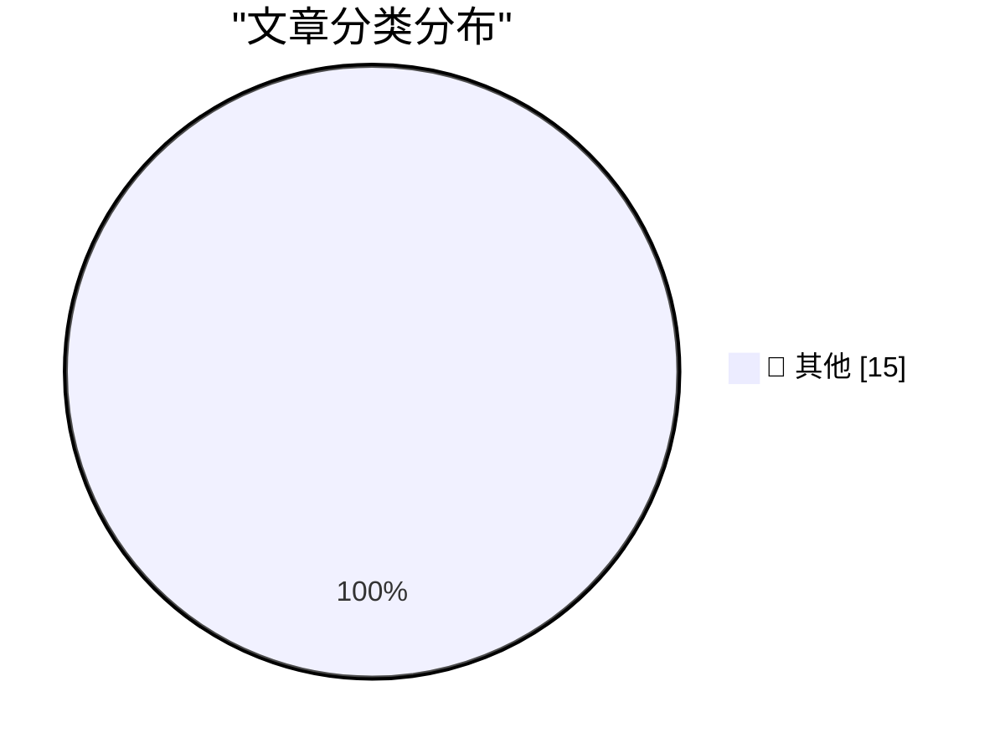

# 📰 AI 资讯每日精选 — 2026-11-16

> 汇聚 140+ 技术博客、X/Twitter、Hacker News、Reddit、Product Hunt、
> Lobste.rs、ClawFeed 日报及 GitHub Trending，经 AI 评分筛选。
>
> **本期内容**：🏆 今日必读 · 🌐 ClawFeed 日报 · 🔥 GitHub Trending · 📂 分类精选 · 🎨 设计与生成式 AI · 📊 数据概览

## 🏆 今日必读

🥇 **datasette-maplibre 0.1a0**

[datasette-maplibre 0.1a0](https://simonwillison.net/2026/Nov/15/datasette-maplibre/) — simonwillison.net · 3 小时前 · 📝 其他

> datasette-maplibre 0.1a0

🥈 **datasette 1.0a43**

[datasette 1.0a43](https://simonwillison.net/2026/Nov/15/datasette/) — simonwillison.net · 3 小时前 · 📝 其他

> datasette 1.0a43

🥉 **datasette 0.65.6**

[datasette 0.65.6](https://simonwillison.net/2026/Nov/15/datasette-2/) — simonwillison.net · 3 小时前 · 📝 其他

> datasette 0.65.6

4️⃣ **datasette-apps 0.4a0**

[datasette-apps 0.4a0](https://simonwillison.net/2026/Nov/15/datasette-apps/) — simonwillison.net · 22 小时前 · 📝 其他

> datasette-apps 0.4a0

5️⃣ **datasette-agent 0.6a0**

[datasette-agent 0.6a0](https://simonwillison.net/2026/Nov/15/datasette-agent/) — simonwillison.net · 23 小时前 · 📝 其他

> datasette-agent 0.6a0

---

## 🌐 ClawFeed 日报精选

> 来源：[ClawFeed](https://clawfeed.kevinhe.io) — AI 驱动的多源新闻聚合

# ☀️ ClawFeed | 2026-11-15 日报 SGT

> 聚合自 3 期已发布的 8 小时简报：#1507 08:00（00:00-07:59）、#1508 16:00（08:00-15:59）、#1509 00:00（16:00-23:59），时间窗 2026-11-15 00:00–23:59 SGT，三档齐全。
> 素材数：三期 metadata 的 feed 分别是 206、137、177（合计 520，都是首页时间线窗内条数）；关注抽样另算，#1507 抽 35 个账号、窗内 12 条，#1508 抽 35 个（打开 24 个主页）、窗内 7 条，#1509 抽 35 个（打开 24 个主页）、窗内 12 条，合计 31 条。三期都没有新书签（bookmarks 0），errors 都是 0。
> 这是 SGT 周日的一天：凌晨那档美国东部是周六（11-14）上午 11 点到晚上 7 点；白天那档美国是周六晚上 7 点到周日凌晨 3 点，大多是夜里；晚上那档美国是周日凌晨 3 点到上午 11 点，周日早上新闻少。覆盖：#1507 第 9 屏起出现整屏早于窗口开始，覆盖到了窗口开始，但 00–05 点每小时只有 9–19 条、06、07 两档（55、73 条）占六成多；#1508 第 7 屏起整屏早于窗口开始，覆盖到了窗口开始，但 09–10 点每小时只有 6–8 条、15 点档 52 条占近四成；#1509 第 3 屏起断续出现整屏早于窗口开始，覆盖到了窗口开始，但 16–19 点每小时只有 6–9 条、23 点档 67 条占近四成（多是一句话回复和体育、时政账号）。这些时段可能漏事。
> 主线：星舰第 15 次试飞的飞船被发射塔机械臂接住（SpaceX 写「Mechazilla 接住了星舰」，纽约时报、CNN 都说是历史性的一次）；黄仁勋卸任后的英伟达一整天都有后续（华尔街日报写东南亚数据中心和芯片走私、摩根大通的算力订单份额转述、AMD 5 天跑赢英伟达的快讯，晚上转向英国《金融时报》报的国会收紧 AI 芯片出口管制，Megaspeed 说涉事女商人早已离职）；加密市场继续跌（比特币一度到 6.3 万、6.2 万附近，Binance Research 说 11 天跌了 15.6%），有帖子提醒下周 17 日英伟达财报。AI 方面有 Anthropic 上市的转述（认购约 6 倍、公开轮下周二 16 点截止，都没有正式出处）、Claude for Manufacturing 插件和 Claude Code 的 Code Mode、GPT-6.2 什么时候发的互相矛盾的猜测、Cursor 安全事件的细节，以及 Goal Engineering、Lauren Tan 演讲、personal agent 要不要配虚拟机沙盒这些 agent 讨论。晚上还有 AWS 美东一区连接故障和伊朗无人机袭击美军在巴林的基地。

---

## 🔥 当日最重要 5 条（跨档去重）

1. **星舰第 15 次试飞：飞船绕地后离轨返回，被发射塔的机械臂接住，SpaceX 写「Mechazilla 接住了星舰」，纽约时报、CNN 都说是历史性的一次；马斯克说正在检查 42 号飞船，后来列出「三次接住助推器，一次接住飞船」**（#1507、#1508，接 11-14 的试飞进展）：凌晨 @elonmusk 04:26 引 SpaceX「Starship Flight 15」：离轨点火正常，53 分钟后着陆点火；@BBCWorld 05:13 直播标题「SpaceX 在星舰返回地球时第二次尝试接住它」，导语说接住用的是外号「筷子」的机械臂，第一次尝试接助推器在发射几分钟后就中止了（只有标题和导语）；@mdudas 05:28 引 SpaceX 原帖「Mechazilla 接住了星舰！祝贺整个 SpaceX 团队完成这项不可思议的成就」；@nytimes 05:37：SpaceX 用巨大的机械臂在空中接住了返回地球的飞船，是可复用火箭的一大步（只有标题和导语）；@CNN 05:43：星舰飞船从轨道安全、完整地回到了家（只有标题）；@Tradermayne 05:59（关注抽样）引 Watcher.Guru：SpaceX 第一次在发射塔上接住星舰火箭（「史上第一次」是快讯号的说法）；@elonmusk 06:36：「正在检查 42 号飞船」；反应有 @NASAAdmin 05:23（显示名是 NASA 局长 Jared Isaacman）「简直像魔法」、@sundarpichai 05:48 看直播「仍然像科幻」、@JayNagy 05:35 说自己整个成年生涯都在做那面隔热罩（个人帖子，后文被截断）（#1507）。白天 @elonmusk 08:15 引 @cb_doge 列的时间线：2024-10-13、2025-01-16、2025-03-06 三次接住助推器，2026-11-14 第一次接住星舰飞船；@elonmusk 08:36 回「Thanks」，引的是众议员 Ted Lieu 转 CBS 新闻：SpaceX 周六在南得州第一次在发射塔上接住并回收了星舰；@elonmusk 08:17 引 Walter Isaacson：说这件事对人类的意义比多数人想象的大（后文被截断）（#1508）。助推器的结局前一天有三种说法（凭画面判断触发终止系统 / SpaceX 官方写「着陆点火和溅落」/ ABC 说落海后爆炸），#1507 引的 BBC 说的是「中止」，素材里没有进一步说明；「星舰上带了一个 Optimus 机器人」见「未证实」。
   来源: https://x.com/elonmusk/status/2121701421183853007 ｜ https://x.com/BBCWorld/status/2121713135727915264 ｜ https://x.com/mdudas/status/2121716843282886967 ｜ https://x.com/nytimes/status/2121719086132429190 ｜ https://x.com/CNN/status/2121720637374820502 ｜ https://x.com/Tradermayne/status/2121724761180873105 ｜ https://x.com/elonmusk/status/2121733992726802703 ｜ https://x.com/NASAAdmin/status/2121715782350504106 ｜ https://x.com/sundarpichai/status/2121721987794174178 ｜ https://x.com/JayNagy/status/2121718709874053485 ｜ https://x.com/elonmusk/status/2121759042582589821 ｜ https://x.com/elonmusk/status/2121764319792677119 ｜ https://x.com/elonmusk/status/2121759522851115109

2. **黄仁勋卸任之后的英伟达：华尔街日报写东南亚数据中心给中国公司提供算力、也给涉嫌的芯片走私打了掩护；市场上有 AMD 5 天跑赢英伟达、摩根大通说英伟达在前沿实验室未来算力订单里只占 39% 的转述；晚上转向立法，有帖子转述英国《金融时报》说美国国会准备收紧 AI 芯片出口管制，Megaspeed 说涉事女商人 2025 年 8 月就已离职**（#1507、#1508、#1509，接 11-12 起的辞职风波）：凌晨 @WSJ 00:23：评论版发了 Peggy Noonan 的文章「黄仁勋是白宫的丑闻」（只有标题，是评论文章）；@WorldInMotionHQ 06:01：对冲基金把高盛统计的科技股多空比压到了历史最低（新闻号的说法，没给出处，后半句具体指什么不太清楚）；@Techub_News 07:27：AMD 股价 5 天跑赢英伟达 53.2 个百分点，是 1999 年以来最大差距（快讯标题；中文标题写「25 年来」、英文标题写「since 1999」，两种写法对不上）（#1507）。白天 @WSJ 10:03：文章标题「黄仁勋如何搭起让北京留在 AI 竞赛里的后门路线」，导语说东南亚的大型数据中心为中国公司提供了关键算力，也为涉嫌的芯片走私打了掩护（只有标题和导语）；@coinbureau 15:45 转述摩根大通：英伟达在前沿 AI 实验室未来的算力订单里只占 39%，2023–2025 年份额超过 80%，还说有一家前沿实验室表示把模型迁到 AMD 芯片现在只要 3 天、以前要 6–12 个月（摩根大通原报告、那家实验室是谁素材里看不到，后文被截断）；@ViewsOfChris 15:05 引马斯克：很多交易是和黄仁勋握手定下的、没有书面合同，黄仁勋走了至少有些关键交易会丢，还转述 Dylan Patel 说谷歌已经在求小供应商给产能（马斯克原帖不在窗内，这里是被引用）（#1508）。晚上 @KobeissiLetter 20:17 转述英国《金融时报》：美国国会在英伟达丑闻之后准备通过更严的 AI 芯片出口管制，几项法案要限制敏感芯片卖到美国以外，还会给国会审查……的权力（后文被截断，FT 原文素材里看不到）；@ai_news_x 21:09（接 11-14 的 Megaspeed 案）转述 CNBC：Megaspeed 说 Alice Huang 已于 2025 年 8 月 30 日正式离职、在公司没有任何职务，说媒体对其供应链的报道缺乏可核实的证据，已请外部律师做内部调查；@CNN 22:00：许多前员工和硅谷同行出来表态支持黄仁勋（只有标题和导语）；@Techub_News 18:30 转《华盛顿邮报》：黄仁勋曾批评对华鹰派是「耻辱标志」（只有标题）（#1509）。「数据中心类股票蒸发 4.2 万亿美元」「Rubio 是背后的关键推动者」见「未证实」。
   来源: https://x.com/WSJ/status/2121640065872900403 ｜ https://x.com/WorldInMotionHQ/status/2121725281723687365 ｜ https://x.com/Techub_News/status/2121746790122741939 ｜ https://x.com/WSJ/status/2121786014368661638 ｜ https://x.com/coinbureau/status/2121872077032390986 ｜ https://x.com/ViewsOfChris/status/2121862010648580260 ｜ https://x.com/KobeissiLetter/status/2121940650245398975 ｜ https://x.com/ai_news_x/status/2121953632862024126 ｜ https://x.com/CNN/status/2121966513208873208 ｜ https://x.com/Techub_News/status/2121913796935528642

3. **加密市场继续跌：比特币从 8.8 万一路跌到 6 万出头，Binance Research 说 11 天跌了 15.6%、是 6 月以来最猛的一段；有帖子把原因归到 12 月加息预期、AI 芯片股叙事崩、ETF 持续净流出、Anthropic 上市等，提醒下周 17 日英伟达发财报**（#1507、#1508、#1509）：凌晨 @zhuanfgghjnb 07:34：早上一睁眼比特币 6.3 万美元、以太坊 1,748 美元，UNI -16%、SUI -13%、ADA -13%、BNB 跌 8%（个人帖子，涨跌幅是多长时间的没写）；@xueqiu88 01:14 引 Fundstrat 的 Tom Lee：过去几周加密一直承受很大的抛压，基本面大体正面、价格没跟上，列的原因第一条是 AI、半导体和英伟达的抛售（其余原因被截断）；@mdudas 03:23 引 Theia Research 的文章「为什么加密让人这么难受」：行业今年有 266 亿美元现金流流入，而光以太坊和 Solana 自去年 10 月以来就抹掉了约 3,500 亿美元的行业财富（后文被截断）（#1507）。白天 @Techub_News 15:29：Deribit 大宗交易买入 200 张 BTC 看跌期权，行权价 6 万美元，名义价值约 1,296 万美元，11 月 16 日到期（#1508）。晚上 @tangsanzangbtc 18:40（关注抽样）：这轮比特币从 8.8 万跌回 6.2 万，81k 跌到 63k 那段基本没给多头脱身的机会，列的原因是 12 月加息预期、AI 芯片股叙事在崩、ETF 持续净流出、MSCI 剔除 DAT（数字资产储备公司）、Anthropic 上市，还说下周 17 日英伟达财报、19 日有一个「巨无霸 IPO」上线（没点名是哪家；附的行情卡片是比特币 64,718 美元、-1.52%）；@_RichardTeng 20:16 引 Binance Research：宏观收紧、对 AI 融资信心减弱的背景下，比特币跌了 15.6%，是 6 月以来最猛的 11 天下跌，Richard Teng（币安联席 CEO）说长期逻辑没变（交易所的一方说法）；@allen_su1024 23:23：承认之前对比特币的预测错得很大，说低估了英伟达事件和中期选举特朗普全面失势对加密流动性的虹吸，仍认为是牛市初期（个人看法）（#1509）。
   来源: https://x.com/zhuanfgghjnb/status/2121748551801991461 ｜ https://x.com/xueqiu88/status/2121652970714701929 ｜ https://x.com/mdudas/status/2121685493666422997 ｜ https://x.com/Techub_News/status/2121868185058066799 ｜ https://x.com/tangsanzangbtc/status/2121916148929515773 ｜ https://x.com/_RichardTeng/status/2121940459430039740 ｜ https://x.com/allen_su1024/status/2121987545131336042

4. **Anthropic：上市有「认购约 6 倍」「公开轮下周二 16 点截止」两条转述（都没有正式出处）；产品上有 11-12 发的 Claude for Manufacturing 插件（17 项技能），Claude Code 2.1.325 实验性加入 Code Mode**（#1507、#1508、#1509，上市接 11-14 晚上的路演转述）：凌晨 @kimmonismus 02:04 推测 GPT-6.2 为什么推迟时，提到的理由之一是「Anthropic 下周上市」（帖子里的说法）（#1507）。白天 @OliverYeung6 15:00：据报道 Anthropic 的 IPO 吸引了约 6 倍于可售股份的认购订单（「据报道」，没给出处）；@drmrzhong 15:09：Claude for Manufacturing 插件共 17 项技能，接通 Autodesk Fusion、Infor、Microsoft 365 和 Oracle NetSuite，可以按已有记录起草报价、质量报告、采购询价和生产汇报（卡片来自 claude.com）；@dani_avila7 10:15：Claude Code 2.1.325 实验性加入 Code Mode，Claude 不再一个一个调工具，而是写 JavaScript 在一步里执行多次工具调用（怎么开启的部分后文被截断）（#1508）。晚上 @xiejiayinBitget 20:34：「Anthropic IPO 公开轮下周二 16 点结束」，引的帖子是在 Bitget 上申购 Anthropic 的推广（交易所高管的帖子，带推广性质）（#1509）。招股文件素材里一直看不到。
   来源: https://x.com/kimmonismus/status/2121665631057777030 ｜ https://x.com/OliverYeung6/status/2121860754684903768 ｜ https://x.com/drmrzhong/status/2121863083668746389 ｜ https://x.com/dani_avila7/status/2121789088499933223 ｜ https://x.com/xiejiayinBitget/status/2121944811272056954

5. **AWS 美东一区（US-EAST-1）连接故障：20:59 SGT 发通告，正在调查多个服务的连接问题，IAM Identity Center 登录和新用户注册也受影响**（#1509）：@AWSSupport 20:59 服务更新原文如上；窗内素材里没有恢复的后续，状态以 AWS 健康面板为准。只在晚上那档出现。
   来源: https://x.com/AWSSupport/status/2121951163847180668

**⚠️ 未证实（素材里核实不了，只记录说法）**
- Anthropic 上市「认购约 6 倍于可售股份」：@OliverYeung6 15:00「据报道」，没给出处（#1508）；「19 日有一个巨无霸 IPO」：@tangsanzangbtc 18:40 没点名是哪家（#1509）。https://x.com/OliverYeung6/status/2121860754684903768 ｜ https://x.com/tangsanzangbtc/status/2121916148929515773
- 「星舰上有一个 Optimus 机器人，跟着升空、绕地、一起被塔架接住」：@xiaohu 10:31 没给出处，素材里没有 SpaceX 或特斯拉的原帖（#1508）。https://x.com/xiaohu/status/2121793182329663853
- 「AI 交易热潮转冷，数据中心建设类股票蒸发 4.2 万亿美元」：@WorldInMotionHQ 15:39 只有标题，没给出处和统计口径（#1508）；「对冲基金把高盛统计的科技股多空比压到历史最低」：同一新闻号 06:01，没给出处（#1507）。https://x.com/WorldInMotionHQ/status/2121870683101950238 ｜ https://x.com/WorldInMotionHQ/status/2121725281723687365
- 「摩根大通：英伟达只占前沿实验室未来算力订单的 39%、迁到 AMD 只要 3 天」：@coinbureau 15:45 转述，原报告和那家实验室是谁素材里看不到（#1508）。https://x.com/coinbureau/status/2121872077032390986
- 「《华盛顿邮报》爆料国务卿 Rubio 是黄仁勋事件背后的关键推动者」：@allen_su1024 13:20 二手转述，原文素材里看不到（#1508）。https://x.com/allen_su1024/status/2121835815877988540
- GPT-6.2 什么时候发：@kimmonismus 02:04 直觉是可能根本不会有 GPT-6.2、OpenAI 也许在做 GPT-6.5；@ohouhou717 06:58 说「这次是真的要来了」，依据只是 Andrew Ambrosino 回复 ChatGPT 的一句「new model」；@JamesDa55049936 07:03 提到的「GPT-6.2 Astra」原始出处素材里看不到。说法互相矛盾（#1507）。https://x.com/kimmonismus/status/2121665631057777030 ｜ https://x.com/ohouhou717/status/2121739452749918347 ｜ https://x.com/JamesDa55049936/status/2121740819342504418
- 「Fable 5.2 发布第二天，完整的 Claude Code 系统提示词被 Pliny 放上 GitHub，7,832 行、128 个工具、44 个技能」：@Tynric_carter 08:41 帖子的说法，文件内容素材里看不到（#1508）。https://x.com/Tynric_carter/status/2121765565018874099
- 「旧金山一家二十来人的公司 AI 账单比工资还高，把生产流量 100% 从 Claude 切到 DeepSeek」：@ekaknight 22:17 二手转述，原帖素材里看不到（#1509）。https://x.com/ekaknight/status/2121970876090310767
- Grok 4.8 开始向 Grok Bot 用户推送：@mark_k 15:18 自己说还没被独立证实（#1508）。https://x.com/mark_k/status/2121865403085259151

**次重要（备选）**
- Cursor 安全事件的细节（接 11-14 白天那档，那档只看到 Cursor 发了进展）：@towardssi 13:04 认为 Cursor 负 90% 的责任、Fireworks 负 10%，最大的问题是 Cursor 通过一个 S3 bucket 把未脱敏的凭证共享给了 Fireworks，这些凭证能访问内部工具、甚至能更新 Cursor 扩展市场的缓存（个人看法，引的是 Cursor 的事件说明，#1508）。https://x.com/towardssi/status/2121831683460624812
- 中东局势（接 11-14 凌晨那档的霍尔木兹油轮触雷）：@BBCWorld 21:45 只有标题：伊朗用无人机袭击美军在巴林的基地；@Reuters 16:40：也门政府军撤出曼德海峡附近地区，胡塞武装控制了那里；@Reuters 23:30 只有标题：霍尔木兹紧张局势和胡塞袭击让海湾股市下跌（#1509）。白天 @Reuters 11:10 只有标题：沙特领导的联军拦截了射向利雅得的导弹和东部省的无人机（#1508）。https://x.com/BBCWorld/status/2121962740554027476 ｜ https://x.com/Reuters/status/2121885934463406332 ｜ https://x.com/Reuters/status/2121989194289418396 ｜ https://x.com/Reuters/status/2121802893703458879
- Google Antigravity 推出 Dynamic Workflows（接 11-14 的编排模式）：@yan5xu 15:39 引 Antigravity：用 /run-workflow 让 agent 写一个 Python 脚本来编排并行和串行的子 agent，交接是结构化的、控制流是确定的，不靠提示词（#1508）。https://x.com/yan5xu/status/2121870704392184131
- TRL v1.18.0 里 AsyncGRPOTrainer 转为稳定版：@SergioPaniego 23:29：生成和训练在不同 GPU 上同时跑、不再轮流，配了一篇博客讲和同步 RL 的区别（#1509）。https://x.com/SergioPaniego/status/2121988846233506112
- 特斯拉开放 Cybercab「个人使用」预订：@TechCrunch 04:05：有地域限制，月费 299 美元，马斯克自己都说月费「太高」（只有标题和导语，#1507）。https://x.com/TechCrunch/status/2121695940310425747
- Gartner 预测：@Gartner_inc 08:08：到 2029 年，被 AI 替代的岗位里多达 30% 会被重新招回来，往往薪资更高（后文被截断，#1508）。https://x.com/Gartner_inc/status/2121757075000696841

---

## 📰 当日核心主题

**① Anthropic 和 Claude（三期都有）**
上市和 Manufacturing 插件、Code Mode 见前 5 条。@JamesDa55049936 07:03 说 Claude Fable 5.2 在 Epoch 的 SimpleQA Verified 测试里领先；@gabriel1 05:50 说 Opus 5.5 是便宜的模型，但在理解人这件事上感觉像大模型（个人感受）（#1507，https://x.com/JamesDa55049936/status/2121740819342504418 ｜ https://x.com/gabriel1/status/2121722423028445453）。@okapi_fukugyo 09:30（日文，X 自动翻译）介绍 Anthropic 官方做幻灯片的 skill「pptx」，说 GitHub 19.4 万星、约 25.5 万次安装（帖子的说法，没写数据出处）；Claude Code 系统提示词被放上 GitHub 的说法见「未证实」（#1508，https://x.com/okapi_fukugyo/status/2121777911409877374）。@ai_for_success 23:46 引自己的 11 月 9–13 日 AI 周报：赢下这周的前两项是 Google 的 Gemini 4 Carbon（API 首发价 2 美元和 10 美元）、Anthropic 的 Claude Fable 5.2 全面开放和有门槛的 Claude Mythos 5.2（个人整理，后文被截断）；@petergyang 23:15：新一期播客请到 Claude Design 的设计师 Nate Parrott，讲怎么设计 Claude 的新功能、做实时看板和动效 artifact，引了一句「Claude 不知道自己在设计上有哪些偏好」（后文被截断）；@rwayne 20:53 引的帖子说让 1 个 Claude Fable 5.2 带队、指挥 3 个 Opus 5.5 在 Blender 里从零做一把玻璃键盘，账单是跑了 7 小时 2 分钟、花 139.87 美元（作者晒的数）（#1509，https://x.com/ai_for_success/status/2121993155801387382 ｜ https://x.com/petergyang/status/2121985397551239366 ｜ https://x.com/rwayne/status/2121949754204856661）。

**② 其他模型和产品（三期都有）**
OpenAI：GPT-6.2 的几条猜测互相矛盾，见「未证实」（#1507）。xAI：@elonmusk 09:02「试试 Grok @Bot」，引的帖子说 Grok Bot 打电话替自己改签航班，但被引的帖子带了社区注释，说视频是摆拍的演示、航空公司 Bluepeak Air 是虚构的；Grok 4.8 推送传闻见「未证实」（#1508，https://x.com/elonmusk/status/2121770874885845044）。谷歌：@NFT_Chen 15:42：Gemini 4 Hydrogen 的免费 API 已开放，百万级上下文，在 AI Studio 建 API Key 就能用；同帖转述 Google Research 说 Argon + Carbon + Hydrogen 多代理系统做出了 Birkhoff 猜想等难题的首次机器可检查形式化（原文素材里看不到，后文被截断）（#1508，https://x.com/NFT_Chen/status/2121871539650048298）；Gemini 4 Carbon 的价格见 ①。DeepSeek：@huangyun_122 17:15：DeepSeek 放出开源库 deepseek-ai/chat-demo，不用写代码、不用买服务器（帖子标题党，「胜过 Anthropic 1000000 倍」是作者的夸张说法，后文被截断）；@ivanfioravanti 23:48 用提前拿到的一个 Flash 模型做 Blender 测试，跑了 3 小时 4 分钟、3,320 万 token，觉得 Flash 类模型需要更强的监督者（没说是哪家的模型）（#1509，https://x.com/huangyun_122/status/2121894829596815502 ｜ https://x.com/ivanfioravanti/status/2121993628205666684）。其他：@sleenyre 03:56 推 arXiv 论文「More Expressive Feedforward Layers: Part I. Token-Adaptive Mixing」，激活函数改成可学习的混合（只有标题和摘要开头）；@TechCrunch 01:33 整理「AI 墓地」清单，从苹果一再推迟的 Siri AI 到 OpenAI「混乱的超级应用发布」（只有导语）（#1507，https://x.com/sleenyre/status/2121693750108016758 ｜ https://x.com/TechCrunch/status/2121657686596956338）。

**③ Agent 和开发工具（三期都有）**
Goal Engineering：@hwchase17 00:05 和 Actively AI 合写「Goal Engineering：怎么设计目标」，说 agent 越来越多朝着目标工作，目标本身设计得对不对就变得重要（正文只有开头，#1507）；@guyingjie129 13:46 说不如叫 Goal-Driven Loop Engineering，真正干活的是循环而不是目标（后文被截断，#1508）（https://x.com/hwchase17/status/2121635683999883577 ｜ https://x.com/guyingjie129/status/2121842248937775216）。
Lauren Tan 在 AI Engineer Code Summit 的演讲：@ClorisSignal 04:43 转述核心观点：AI 写出低质量代码，问题往往不在模型、而在它工作的环境，把代码库约束和自动验证做扎实，就能提高产出又不降质量（#1507）；@N_Taisho 09:42（日文，X 自动翻译）说演讲讲的是用 AI agent 每月把 11,000 个 PR 合进生产、拒绝率只有 0.5%；@9hills 14:20 引 @dotey 整理的要点：每纠正 AI 一次，就把纠正写成 lint 这类自动检查规则，少往 agents.md 里加话，自己的做法是让 agent 先不写注释和单测、集成测试过了再补（#1508）（https://x.com/ClorisSignal/status/2121705509187358779 ｜ https://x.com/N_Taisho/status/2121780948580852036 ｜ https://x.com/9hills/status/2121850886498697698）。
工具和开源项目：@DataChaz 00:43：Garry Tan 的 GBrain（15.58 万页、2.46 万人、5,340 家公司、66 个定时任务）已开源，作为他的 AI agent 背后的记忆层；@kepano 02:27：Obsidian Skills 现在有 7 个 skill，教 agent 操作 Obsidian 的库和 wiki；@vercel_dev 06:53：fx v0.0.17，子 agent 和 Token Pass 成为一等功能，工具定义缩小 48.0%；@huang_chao4969 01:19：发布 AutoSwarm，让 Codex、Claude Code、Workbuddy、DeepSeek Harness 等 agent 共享上下文协作（自家项目）（#1507，https://x.com/DataChaz/status/2121645289484566640 ｜ https://x.com/kepano/status/2121671411119059034 ｜ https://x.com/vercel_dev/status/2121738219826131008 ｜ https://x.com/huang_chao4969/status/2121654255572660468）。@liangzhu_AI 15:21 引 Dan Kornas：Kanzo 是开源（AGPL-3.0）的本地看板加 MCP Server，人和 coding agent 用同一块看板；@GitHub_Daily 15:30：agentes.chat，开源、可自己部署的团队聊天工具，agent 和人在同一个频道里；@garrytan 08:53 引 Greg Isenberg「做最 AI 化的公司」的几步（markdown 文件夹做第二大脑、全天语音记录、做公司大脑），Garry Tan 说再配上 gbrain；@shao__meng 09:05：斯坦福 CS146S 请 Semgrep CEO 客座讲课，Mihail Eric 的概括是高调的漏洞利用和攻击会先变得更糟、然后才会好转（后文被截断）（#1508，https://x.com/liangzhu_AI/status/2121866036979053001 ｜ https://x.com/GitHub_Daily/status/2121868315849375919 ｜ https://x.com/garrytan/status/2121768476775989404 ｜ https://x.com/shao__meng/status/2121771537871344048）。Antigravity Dynamic Workflows、Cursor 安全事件见「次重要」。
Personal agent：@bojie_li 21:30 引王赞的长文「我看见的 Personal Agent」：不明白为什么各家 personal agent 都给每个用户配一个虚拟机沙盒，一个云端沙盒一个月几十美元成本（后文被截断）；@libukai 22:04：用 DS-Bot 这类 personal agent 做非编程工作，切入点是自动化任务；@shafu0x 20:19：最烦被要求去用别人家托管的 agent，「直接给我的 agent 开权限就行」；@Barret_China 20:51：研究 DeepSeek Harness 的插件，第一个是插件市场 dsh-market；@shao__meng 17:04：把「面向前端 / 产品 / UI 的 Top10 Agent Skills」更新到 2026.11 版；@cramforce 23:46（Malte Ubl）：agent 擅长 @uisdk，是因为 shadcn 和 shuding 看过模型权重、专门为模型设计了这个库（#1509，https://x.com/bojie_li/status/2121958983930163268 ｜ https://x.com/libukai/status/2121967585935937585 ｜ https://x.com/shafu0x/status/2121941096553238970 ｜ https://x.com/Barret_China/status/2121949262942720331 ｜ https://x.com/shao__meng/status/2121891982654206414 ｜ https://x.com/cramforce/status/2121993300135809385）。TRL 异步 RL 见「次重要」。

**④ 观点和行业（三期都有）**
@levie 03:27：AI 模型在编程、电脑操作、数学这类任务上会不可避免地越来越强，所以会用软件干活的 agent 进步速度会比其他所有……（后文被截断）；@anton_d_leicht 00:49 引 Dwarkesh Patel 的文章「冲击数学的雪崩正在冲向 AI 研发」（11-14 那期见过这篇）：认为这种速度的 RSI 快到没法温水煮青蛙、又慢到实验室来不及单方面接管，真发生的话美国政府会把它全部叫停（个人看法）；@mardehaym 00:26（关注抽样）：让团队用 AI 加快发布之前，先定好谁来检查 AI 发出去的东西（作者自己做外包和咨询）（#1507，https://x.com/levie/status/2121686564078297461 ｜ https://x.com/anton_d_leicht/status/2121646590846746726 ｜ https://x.com/mardehaym/status/2121640846483435724）。@SuJinyan6 11:46 文章「看起来没有壁垒的数据生意，为何如此繁荣？」：作者今年找 post-training 方向的工作，来联系的 startup 几乎全是做数据的；@bojie_li 14:50 引这篇：数据行业的本质是模型公司和数据提供方不方便直接交易，列了 5 种中间商（倒卖 token 的中转站和 GPU 卡、采集闭源模型 trace/CoT、倒卖用户数据、敏感行业数据）；@patrickc 09:04：斯密和孟德斯鸠认为市场让人变得更好，在人类劳动被 AI 取代的乐观愿景里，作者在想人会怎样……（后文被截断）；@0x99DaDa 08:31：美国在 AI 芯片上可能「两头堵」，卡得越死华为越有机会拿到大客户（只看到第 1 条）（#1508，https://x.com/SuJinyan6/status/2121812102709157921 ｜ https://x.com/bojie_li/status/2121858265684517016 ｜ https://x.com/patrickc/status/2121771165912064379 ｜ https://x.com/0x99DaDa/status/2121762857238790413）。Gartner 的预测见「次重要」，「AI 账单比工资高、切到 DeepSeek」见「未证实」。

**⑤ 加密其他（三期都有）**
以太坊该不该向应用「收税」：@laurashin 00:00 播客预告，问以太坊市值 2,400 亿美元、每月手续费只有 600 万美元，估值说得过去吗，嘉宾拿 Hyperliquid 举例（#1507）；@toly 23:25 回应同一期节目里 Arca CIO 的问题：问题不在收不收税而在需求，每秒 1 万笔、每笔 0.003 美元一年就是 10 亿美元（#1509）（https://x.com/laurashin/status/2121634267973161340 ｜ https://x.com/toly/status/2121988031578038782）。@CoinDesk 00:00：Policy Protocol 节目，Paradigm 的 Justin Slaughter 聊英伟达、出口管制和加密立法（节目预告）；@HHisnothing 03:32：Primus Labs 的 FHE 隐私技术 AutoHoG 用 8 张 RTX 5090，一笔 64 位隐私转账约 90 毫秒（转述项目方数据）；@ShieldedFlow 06:59：一个钱包把 50,000 枚 ZEC（约 4,193 万美元）转进 Ironwood 隐私池（#1507，https://x.com/CoinDesk/status/2121634271831994453 ｜ https://x.com/HHisnothing/status/2121687772226576601 ｜ https://x.com/ShieldedFlow/status/2121739867864355318）。@ZF_lab 13:56：OpenSea 又有 2 个团队成员离职，推测是对 TGE 没有信心（个人统计和推测）（#1508，https://x.com/ZF_lab/status/2121844744586432890）。@ChainCatcher_ 19:47 引链上分析师 Specter：「以太坊基金会在抛 ETH」的一些钱包归属标记证据不足；@0xAstra 21:40 引 Gate 华语：Gate 用户资产被印度警方司法冻结一案，Gate 说不会只凭单方面材料移交资产、目前没有资产被移交（Gate 的一方说法）；@thibauld 23:14 引 Fairmint：11 月 4 日 CNTN 的交易是第一笔在 SEC「创新豁免」下、由发行方发起的代币化美股交易（当事方的说法）；@Cointelegraph 23:30：韩国准备禁止向现役士兵发放高息贷款，这类贷款已涨到 1,700 万美元（#1509，https://x.com/ChainCatcher_/status/2121933020987109697 ｜ https://x.com/0xAstra/status/2121961538160660649 ｜ https://x.com/thibauld/status/2121985170215473269 ｜ https://x.com/Cointelegraph/status/2121989290183815510）。比特币下跌见前 5 条。

**⑥ 其他新闻（三期都有）**
@Reuters 07:20 只有标题：民主党想修改能源项目审批法案，内部出现分歧；@toly 06:58 引的帖子在力挺 BAAJA 法案，说过去十年美国只有两座核反应堆投运（转述 Greg Ip 的文章；和路透说的是不是同一个法案素材里看不出来）；@Reuters 03:40 只有标题：巴黎民族广场，防暴警察用催泪瓦斯驱散抗议者（游行是为什么素材里看不到）（#1507，https://x.com/Reuters/status/2121745004750164271 ｜ https://x.com/toly/status/2121739526536040636 ｜ https://x.com/Reuters/status/2121689624355516849）。@Techub_News 15:29 快讯标题：中国首部全 AI 生成电影上映三周，票房只有 180 万元（#1508，https://x.com/Techub_News/status/2121868170424115347）。中东局势、Cybercab 见「次重要」，AWS 故障见前 5 条。

---

## 🔖 书签精选

今天没有新加的书签：#1507、#1508、#1509 窗内书签都是 0 条（三期都抓到 16 条，#1508、#1509 都是翻了 5 屏，最新一条都是 11-14 17:13），三期都跳过了这一区块、也没从旧书签里补，本日报没有可补选的内容。

---

## 👀 推荐关注汇总（去重，共 6 个；各期写稿时都在浏览器里核实过「未关注」：#1507 在 11-15 08:12–08:14，#1508 在 11-15 16:10–16:13，#1509 在 11-16 00:15–00:17 SGT，本日报没有重新核实）

**AI 原创观点和一手经历**
- @bojie_li（Bojie Li，简介是独立研究员、做交互式 agent 系统；1.61 万关注者（#1509 时 1.62 万）；你关注的人里有 80 个也关注了）：两期都推荐了，#1508 是对 AI 数据生意的独立分析，#1509 是对 personal agent 给每个用户配云端虚拟机沙盒的成本质疑，都是自己的观点（#1508、#1509）。https://x.com/bojie_li
- @9hills（九原客，简介是「目前聚焦在大模型领域」；2.86 万关注者；你关注的人里有 115 个也关注了）：中文圈做大模型应用的工程师，本期是自己让 agent 写代码的做法，主页还写了完整的功能开发顺序和人负责检查哪几步，是实操经验（#1508）。https://x.com/9hills
- @SuJinyan6（Jinyan Su，简介是康奈尔 PhD，之前在微软、Meta AI、Adobe，方向是 post-training、数据、RSI；6,358 关注者，不到 1 万；你关注的人里有 43 个也关注了）：写一手经历的长文，按「原创一手内容」和「多个已关注的人也关注」两项推荐，发帖不多（736 条）（#1508）。https://x.com/SuJinyan6
- @anton_d_leicht（Anton Leicht，简介是 AI 和政治经济，卡内基基金会 fellow；6,796 关注者，不到 1 万；你关注的人里有 29 个也关注了）：写 AI 政策和政治经济的原创分析，本期是对 Dwarkesh 那篇 RSI 文章的独立判断；按「原创内容质量高」和「多个已关注的人也关注」两项推荐，偏政策、不是 builder（#1507）。https://x.com/anton_d_leicht

**创始人和科技媒体**
- @thibauld（简介是 Fairmint 联合创始人兼 CTO；8,224 关注者，不到 1 万；你关注的人里有 101 个也关注了）：本期是自家参与的第一笔 SEC「创新豁免」下的代币化美股交易，代币化证券这条线的一手信息；按「创始人」和「一手信息」两项推荐（#1509）。https://x.com/thibauld
- @TechCrunch（简介是关注创始人和创业团队的科技新闻和分析；1,100 万关注者；你关注的人里有 488 个也关注了）：科技媒体，本期两条（Cybercab 预订月费、「AI 墓地」清单）都是自家报道；是媒体号，发得多、多是标题加链接，想在时间线里补科技公司新闻的话再关注（#1507）。https://x.com/TechCrunch

（三期另有 28 个显示未关注但没推荐的账号，去重后 22 个：#1507 的 @BBCWorld、@CNN、@WSJ、@Reuters、@NASAAdmin、@WorldInMotionHQ、@JayNagy、@sleenyre、@ClorisSignal、@HHisnothing、@JamesDa55049936、@ShieldedFlow；#1508 的 @WSJ、@Reuters、@Gartner_inc、@WorldInMotionHQ、@liangzhu_AI、@guyingjie129、@Tynric_carter、@okapi_fukugyo、@N_Taisho；#1509 的 @CNN、@Reuters、@BBCWorld、@KobeissiLetter、@ai_news_x、@AWSSupport、@ekaknight，理由是综合新闻媒体、不是 AI / crypto / tech 领域（含 NASA 局长官方号和 SpaceX 工程师的个人感言）、快讯号没给出处、咨询公司官方号以推广为主、AWS 客服账号不是内容号、关注者不到 1 万且本期是转述或一句观点。@sleenyre、@liangzhu_AI、@guyingjie129 写的是「可以再观察」。）

**建议取关**：三期都没有提出取关建议。

---

## 💤 重复噪音模式

三期过滤掉的时间线 418 条（#1507 168、#1508 102、#1509 148），收了 102 条（38、35、29）；关注抽样窗内 31 条，收了 3 条（2、0、1），没收 28 条。按类别（三期分类口径不完全一样，下面是合并后的数）：
- **新闻、体育、娱乐、生活和闲聊**：222 条（#1507 100 = 体育娱乐新闻 22 + 闲聊一句话 78；#1508 48 = 15 + 33；#1509 74 = 46 + 28；皇马、英超、西甲、NFL、NBA、板球、UFC、Netflix、Marvel、MrBeast、伦敦吃什么、匹克球、温泉喝酒、土耳其和印度政要的行程、BBC 本地新闻、美国政治、ICE 拘留中心和「大学是左派工厂」这类政治立场强的帖子、FAA 停飞后骑士队要求改期、向 Grok 提问的冷知识、早安、生日、「GM」「Nice share」之类一句话回复）。
- **加密喊单、项目和交易所推广、行情情绪**：99 条（#1507 39、#1508 18、#1509 42；Stacks、币安和 BNB Chain 周边、HTX 和 Gate 邀请链接、Bybit 交易赛、Strive 说比特币到 1,100 万美元、BAYC 和 NFT、「币圈已死」的投降情绪、Zcash「牛市回来了」、在 Base 上发币、清算热力图、「做空 BTC」、Primus 隐私计算的一串互动帖、Solana Breakpoint 展位、Boris Johnson 说比特币是庞氏的旧帖新评、大量一句话互动）。
- **AI 和科技相关但没有信息量**：56 条（#1507 18、#1508 21、#1509 17；Claude Code 自定义主题和 Mods 的附和（前几期已写）、「Building always-on agents」的解读（11-14 起已写）、Goal Engineering 的中文转述、AutoSwarm 和 DeepSeek chat-demo 的重复转发、用 Fable 5.2 做 three.js 小城、服装店、作曲、水下世界的个人晒作品、亚马逊书单和教材推广、绕过 Claude 新政和 KYC 的网传办法、申请 Claude CVP 拿 Mythos 5.2、估值百亿美元 AI 公司清单（在图里）、「AI 时代文科生更容易被替代」、「模型账单比工资高」的重复转述、「make no mistakes」玩笑）。
- **课程、工具和引流推广**：23 条（#1508 10、#1509 13；网盘课程、闲鱼搬运、免费 VPS、SEO 案例、X 涨粉、PlayStation 黑五、termix 视频 agent、跨境电商独立站、Fable 投 Meta 广告的课程、Renoise 数字人教程、微软合作伙伴营销）。
- **围绕星舰、黄仁勋的重复、段子和传闻**：18 条（#1507 11 = 星舰 6 + 黄仁勋 5、#1508 5 = 3 + 2、#1509 2 = 黄仁勋 2；CNN Breaking 和 CNN 同一条标题、马斯克的「Thanks」、塔上拍的手机视频、「播放已过 900 万」、「iPhone Duo 是给黄仁勋做的」梗图、对 Gerstner 那封信的附和（前几期写过）、「黄仁勋与黄乐拥抱照片」的快讯标题和婚外情八卦（涉及个人私生活、没有出处）、「黄仁勋的桃色新闻可能是自己有意为之」的播客猜测、「川建国和东大有 Deal」的阴谋论）。
- **关注抽样里没收的**：28 条（#1507 10、#1508 7、#1509 11；UMX 返佣推广、Limestone Digital 的营销帖、咨询预约链接、Startup Wisdom 的马斯克和 Naval 语录、祝贺 SpaceX、@Tradermayne 的「6 万美元线」玩笑、交易课程和英伟达下任 CEO 盘口推广、Primus CEO 讲话的转述、乔布斯语录、加拿大移民局网站故障的玩笑、一句「Damn！」）。
- **同一话题延续**：星舰第 15 次试飞（11-14 发射、在轨、离轨 → #1507 飞船被接住 → #1508 马斯克列「三次接住助推器，一次接住飞船」、Optimus 的说法 → #1509 只剩助推器回收视频的转评）；黄仁勋（11-12 辞职 → 11-13 作证 → 11-14 Gerstner 和 Baker 联名、standwithjensen 公开信 → #1507 Noonan 评论、AMD 跑赢 → #1508 华尔街日报写东南亚后门、摩根大通份额转述、马斯克说握手交易会丢 → #1509 FT 报出口管制立法、Megaspeed 回应）；Megaspeed 案（11-13 → 11-14 新加坡内政部否认间谍调查 → #1509 公司说女商人早已离职）；Anthropic 上市（11-12 公告 → 11-14 路演转述 → #1508 认购约 6 倍 → #1509 公开轮下周二截止）；加密下跌（11-14 比特币 6.6 万、强平 9.127 亿美元 → #1507 6.3 万 → #1509 6.2 万、11 天跌 15.6%）；Lauren Tan 演讲（#1507 转述 → #1508 补 11,000 个 PR 和 lint 规则）；Goal Engineering（#1507 文章 → #1508 「Goal-Driven Loop Engineering」）；以太坊「收税」（#1507 Laura Shin 播客预告 → #1509 toly 回应）；Cursor 安全事件（11-14 发进展 → #1508 S3 凭证的细节）；Antigravity 编排（11-13 Orchestrator → 11-14 编排模式 → #1508 Dynamic Workflows）；中东（11-14 霍尔木兹油轮触雷 → #1508 利雅得拦截导弹 → #1509 伊朗无人机袭击巴林美军基地、胡塞控制曼德海峡附近）；Dwarkesh 的 RSI 文章（11-14 → #1507 Anton Leicht 的回应）。
---

## 🔥 GitHub Trending

> 今日热门开源项目（全语言 + Python）

| # | 项目 | 描述 | ⭐ 总星 | 📈 今日 | 语言 |
|---|------|------|---------|---------|------|
| 1 | [GoogleChrome/modern-web-guidance-src](https://github.com/GoogleChrome/modern-web-guidance-src) 🤖 | Keep your coding agent up to date with the latest web bes... | 7.3k | +1219 | TypeScript |
| 2 | [dream-num/univer](https://github.com/dream-num/univer) 🤖 | Build your own AI office with Univer Office SDK. Bring ed... | 26.3k | +988 | TypeScript |
| 3 | [backnotprop/plannotator](https://github.com/backnotprop/plannotator) | The workspace to stay in the loop and on top of agents - ... | 11.9k | +866 | TypeScript |
| 4 | [ChromeDevTools/chrome-devtools-mcp](https://github.com/ChromeDevTools/chrome-devtools-mcp) | Chrome DevTools for coding agents | 57.1k | +717 | TypeScript |
| 5 | [tradermonty/claude-trading-skills](https://github.com/tradermonty/claude-trading-skills) 🤖 | Claude Code skills for equity investors and traders — mar... | 5.6k | +706 | Python |
| 6 | [alibaba/open-code-review](https://github.com/alibaba/open-code-review) 🤖 | Secure, fast, efficient, battle-tested at Alibaba's scale... | 52.2k | +691 | Go |
| 7 | [Tencent/LoopForge](https://github.com/Tencent/LoopForge) 🤖 | Self-hosted workflows for coding-agent delivery. Orchestr... | 1.6k | +423 | Go |
| 8 | [ag-ui-protocol/ag-ui](https://github.com/ag-ui-protocol/ag-ui) 🤖 | AG-UI: the Agent-User Interaction Protocol. Bring Agents ... | 18.0k | +355 | TypeScript |
| 9 | [kajisho5/ffmpeg-skill](https://github.com/kajisho5/ffmpeg-skill) 🤖 | Local video editor for coding agents: 42 FFmpeg tools wit... | 6.0k | +331 | Python |
| 10 | [google-labs-code/stitch-skills](https://github.com/google-labs-code/stitch-skills) 🤖 | A library of Agent Skills designed to work with the Stitc... | 9.4k | +247 | TypeScript |
| 11 | [davila7/claude-code-templates](https://github.com/davila7/claude-code-templates) 🤖 | Open-source registry and CLI for Claude Code components: ... | 33.8k | +174 | Python |
| 12 | [andrewyng/openworker](https://github.com/andrewyng/openworker) |  | 19.3k | +139 | Python |
| 13 | [SnailSploit/Claude-Red](https://github.com/SnailSploit/Claude-Red) 🤖 | claude-red is a curated library of offensive security ski... | 11.0k | +131 | Python |
| 14 | [bojieli/ai-infra-book](https://github.com/bojieli/ai-infra-book) 🤖 | 《深入理解 AI Infra：量化分析与系统设计》（李博杰 著）开源书稿：从硬件约束和模型架构出发，量化推导 LL... | 7.8k | +127 | Python |
| 15 | [NVIDIA/SkillEvaluator](https://github.com/NVIDIA/SkillEvaluator) 🤖 | Multi-tier framework for evaluating AI agent skills with ... | 1.8k | +122 | Python |

---

## 📝 其他

### 1. datasette-maplibre 0.1a0

[datasette-maplibre 0.1a0](https://simonwillison.net/2026/Nov/15/datasette-maplibre/) — **simonwillison.net** · 3 小时前 · ⭐ 15/30

> datasette-maplibre 0.1a0

---

### 2. datasette 1.0a43

[datasette 1.0a43](https://simonwillison.net/2026/Nov/15/datasette/) — **simonwillison.net** · 3 小时前 · ⭐ 15/30

> datasette 1.0a43

---

### 3. datasette 0.65.6

[datasette 0.65.6](https://simonwillison.net/2026/Nov/15/datasette-2/) — **simonwillison.net** · 3 小时前 · ⭐ 15/30

> datasette 0.65.6

---

### 4. datasette-apps 0.4a0

[datasette-apps 0.4a0](https://simonwillison.net/2026/Nov/15/datasette-apps/) — **simonwillison.net** · 22 小时前 · ⭐ 15/30

> datasette-apps 0.4a0

---

### 5. datasette-agent 0.6a0

[datasette-agent 0.6a0](https://simonwillison.net/2026/Nov/15/datasette-agent/) — **simonwillison.net** · 23 小时前 · ⭐ 15/30

> datasette-agent 0.6a0

---

### 6. The Legion of PCAST

[The Legion of PCAST](https://www.whitehouse.gov/ostp/presidents-council-of-advisors-on-science-and-technology/) — **daringfireball.net** · 9 小时前 · ⭐ 15/30

> The Legion of PCAST

---

### 7. WorkOS: Let Agents Use Your Tools Without Giving Them Free Rein

[WorkOS: Let Agents Use Your Tools Without Giving Them Free Rein](https://www.workos.com/airlock?utm_source=daringfireball&amp;utm_medium=newsletter&amp;utm_campaign=q42026) — **daringfireball.net** · 11 小时前 · ⭐ 15/30

> WorkOS: Let Agents Use Your Tools Without Giving Them Free Rein

---

### 8. People will lose their jobs over GTA 6

[People will lose their jobs over GTA 6](https://idiallo.com/blog/losing-your-job-over-a-video-game) — **idiallo.com** · 2 小时前 · ⭐ 15/30

> People will lose their jobs over GTA 6

---

### 9. Variable Electricity Pricing - the Highs and the Lows

[Variable Electricity Pricing - the Highs and the Lows](https://shkspr.mobi/blog/2026/11/variable-electricity-pricing-the-highs-and-the-lows/) — **shkspr.mobi** · 14 小时前 · ⭐ 15/30

> Variable Electricity Pricing - the Highs and the Lows

---

### 10. Orbital footnote

[Orbital footnote](https://www.johndcook.com/blog/2026/11/15/orbital-footnote/) — **johndcook.com** · 42 分钟前 · ⭐ 15/30

> Orbital footnote

---

### 11. ASI as a Black Box

[ASI as a Black Box](https://borretti.me/article/asi-as-a-black-box) — **borretti.me** · 14 小时前 · ⭐ 15/30

> ASI as a Black Box

---

### 12. Date codes on cardboard boxes

[Date codes on cardboard boxes](https://dfarq.homeip.net/date-codes-on-cardboard-boxes/?utm_source=rss&#038;utm_medium=rss&#038;utm_campaign=date-codes-on-cardboard-boxes) — **dfarq.homeip.net** · 14 小时前 · ⭐ 15/30

> Date codes on cardboard boxes

---

### 13. What’s Next For Nvidia?

[What’s Next For Nvidia?](https://steveblank.com/2026/11/15/whats-next-for-nvidia/) — **steveblank.com** · 4 小时前 · ⭐ 15/30

> What’s Next For Nvidia?

---

### 14. Anthropic's Claude Fable 5.2 doesn't generate images, it paints them

[Anthropic's Claude Fable 5.2 doesn't generate images, it paints them](https://the-decoder.com/anthropics-claude-fable-5-2-doesnt-generate-images-it-paints-them/) — **The Decoder** · 11 小时前 · ⭐ 15/30

> Anthropic's Claude Fable 5.2 doesn't generate images, it paints them

---

### 15. Firm linked to Jensen Huang's ex-lover reportedly brokered nearly $12 billion in Nvidia chip orders for China

[Firm linked to Jensen Huang's ex-lover reportedly brokered nearly $12 billion in Nvidia chip orders for China](https://the-decoder.com/firm-linked-to-jensen-huangs-ex-lover-reportedly-brokered-nearly-12-billion-in-nvidia-chip-orders-for-china/) — **The Decoder** · 12 小时前 · ⭐ 15/30

> Firm linked to Jensen Huang's ex-lover reportedly brokered nearly $12 billion in Nvidia chip orders for China

---

## 🎨 Design & Generative AI

### 🖼️ 生成式图片

- **[We made a multiplayer game where each player's view is generated by a world model running on their GPU [P]](https://www.reddit.com/r/MachineLearning/comments/1xx4ta3/we_made_a_multiplayer_game_where_each_players/)** — r/MachineLearning · 7 小时前
  > We made a multiplayer game where each player's view is generated by a world model running on their GPU [P]

---

## 📊 数据概览

| 扫描源 | 抓取文章 | 时间范围 | 精选 |
|:---:|:---:|:---:|:---:|
| 92/140 | 3959 篇 → 58 篇 | 24h | **15 篇** |

### 分类分布

---

*生成于 2026-11-16 03:01 | 汇聚 140 个技术博客、X/Twitter、Hacker News、Reddit、Product Hunt、Lobste.rs、ClawFeed 日报及 GitHub Trending，经 AI 评分筛选出 Top 15 精华内容*
