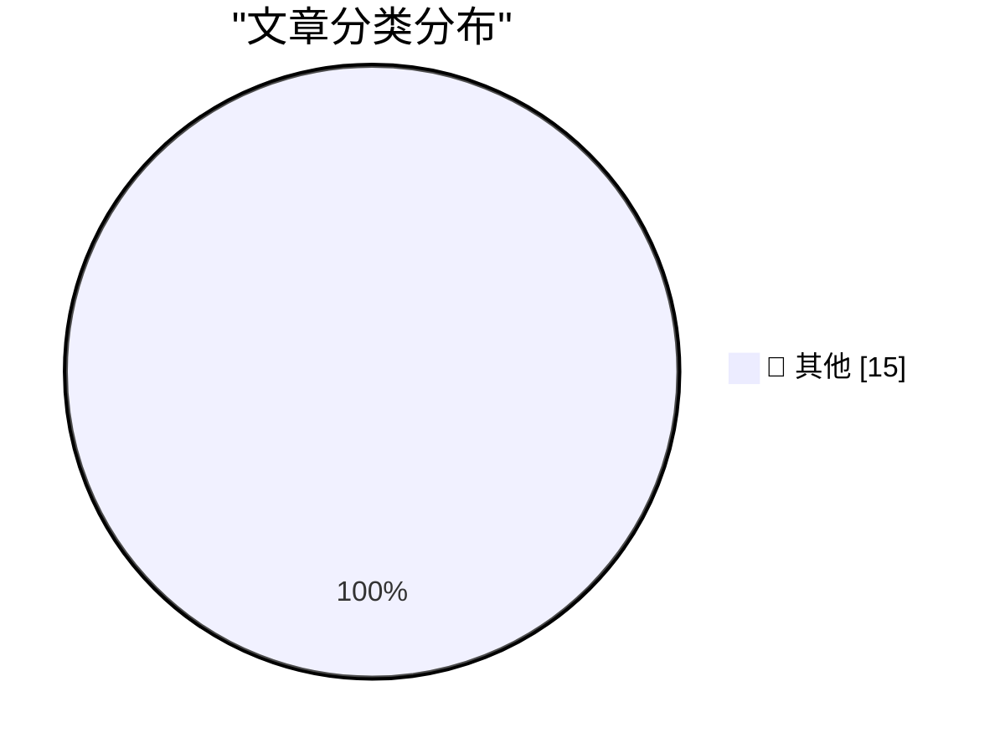

# 📰 AI 资讯每日精选 — 2026-11-18

> 汇聚 140+ 技术博客、X/Twitter、Hacker News、Reddit、Product Hunt、
> Lobste.rs、ClawFeed 日报及 GitHub Trending，经 AI 评分筛选。
>
> **本期内容**：🏆 今日必读 · 🌐 ClawFeed 日报 · 🔥 GitHub Trending · 📂 分类精选 · 🎨 设计与生成式 AI · 📊 数据概览

## 🏆 今日必读

🥇 **External sandboxes for coding agents**

[External sandboxes for coding agents](https://simonwillison.net/2026/Nov/17/external-sandboxes-for-coding-agents/) — simonwillison.net · 5 小时前 · 📝 其他

> External sandboxes for coding agents

🥈 **GPT‑6.2 Astra and GPT‑6.2 Sol**

[GPT‑6.2 Astra and GPT‑6.2 Sol](https://simonwillison.net/2026/Nov/17/gpt62-astra-and-sol/) — simonwillison.net · 6 小时前 · 📝 其他

> GPT‑6.2 Astra and GPT‑6.2 Sol

🥉 **Running the full server-side Datasette Python app in the browser with service workers and Pyodide**

[Running the full server-side Datasette Python app in the browser with service workers and Pyodide](https://simonwillison.net/2026/Nov/17/datasette-lite/) — simonwillison.net · 11 小时前 · 📝 其他

> Running the full server-side Datasette Python app in the browser with service workers and Pyodide

4️⃣ **Quoting Go Proverbs**

[Quoting Go Proverbs](https://simonwillison.net/2026/Nov/17/go-proverbs/) — simonwillison.net · 22 小时前 · 📝 其他

> Quoting Go Proverbs

5️⃣ **Attackers Used Optimizely to A/B Test Malware on Top Websites**

[Attackers Used Optimizely to A/B Test Malware on Top Websites](https://krebsonsecurity.com/2026/11/attackers-used-optimizely-to-a-b-test-malware-on-top-websites/) — krebsonsecurity.com · 1 小时前 · 📝 其他

> Attackers Used Optimizely to A/B Test Malware on Top Websites

---

## 🌐 ClawFeed 日报精选

> 来源：[ClawFeed](https://clawfeed.kevinhe.io) — AI 驱动的多源新闻聚合

# ☀️ ClawFeed | 2026-11-17 日报 SGT

> 聚合自 3 期 8 小时简报：#1514 00:00 档（00:00-07:59）、#1515 08:00 档（08:00-15:59）、#1516 16:00 档（16:00-23:59），时间窗 2026-11-17 00:00–23:59 SGT，三档都在。各期正文里写的「11-17 00:00 那期」指的是 #1512（窗口 11-16 16:00–23:59，已收进 11-16 日报 #1513），「11-16 16:00 那期」是 #1511，「11-16 00:00 那期」是 #1509（已收进 11-15 日报 #1510）。
> 素材数：三期 metadata 的 feed 分别是 290、128、118（合计 536，都是首页时间线窗内条数）；关注抽样另算，三期都是抽 35 个账号、打开 24 个主页（各有 1 个是空的，出错 0），窗内分别 16、8、10 条，合计 34 条，收了 6、3、1 条，都没算进 feed。三期都没有新书签（bookmarks 0），errors 都是 0。
> 这是 SGT 周二的一天：00:00 档美国东部是 11-16 周一上午 11 点到晚上 7 点，正好是美股周一交易时段，伦敦 Solana Breakpoint 还在开；08:00 档美国是周一晚上 7 点到周二凌晨 3 点，美国那边是夜里、新闻少，128 条里 71 条是中文帖；16:00 档美国是周二凌晨 3 点到上午 11 点，美国的新闻集中在最后两个小时，中文帖 118 条里 46 条。覆盖：#1514 是 11-17 08:02–08:12 抓的，两遍去重 409 条、覆盖到了窗口开始，但 6、7 点档 86、102 条占了近三分之二，0–5 点每小时只有 13–25 条；#1515 是 16:02–16:07 抓的，也覆盖到了窗口开始，15 点档 48 条占三分之一以上，9–11 点每小时只有 5–8 条；#1516 是 11-18 00:03–00:09 抓的，22、23 两档 29、28 条占了快一半，16–18 点每小时只有 8–9 条。三档都是离抓取时刻远的前半段素材少，这些时段可能漏事。
> 主线：黄仁勋风波一天里来回三轮，凌晨路透说英伟达排除黄仁勋回归，白天有资深员工写信警告董事会、美国商务部和司法部发 Megaspeed 调查联合声明，午夜前华尔街日报快讯说黄仁勋愿意被请回去当 CEO（11-16 日报提到的 17 日英伟达财报，这一天三期素材里都没有出现）。美国周一接连出系统故障：大通等几家大银行网银出问题、傍晚美联航报「大范围系统故障」，同一天 Optimizely 的脚本在 178 个网站上被投毒、专换加密地址。加密方面 Backpack 拿到 CFTC 批准、在美国开衍生品交易所，Lighter 被盗的原因和提现恢复也出来了；晚上 ChatGPT 能连 Coinbase 账户交易，Versine、做稳定币换汇的 Codex 和 a16z 都在讲 agent 怎么动钱。AI 方面哈萨比斯宣布 Isomorphic Labs 融资 50 亿美元，OpenAI 请 Apollo、METR、Transluce、Goodfire 做嵌入式评估，Anthropic 有三篇讲 agent 和模型意外行为的文章被转发讨论，Claude Code 支持 iPhone Duo 模拟器，Grok Bot 1.0，Situational Awareness 13F 缩水 92% 和爆仓经过；另有一条只有自媒体说法的「加州起诉 OpenAI」。

---

## 🔥 当日最重要 5 条（跨档去重）

1. **黄仁勋风波一天来回三轮：凌晨路透说英伟达排除黄仁勋回归；白天有英伟达资深员工写信警告董事会、员工在讨论办支持集会，美国商务部和司法部发了 Megaspeed 调查的联合声明；午夜前华尔街日报快讯说黄仁勋打破沉默、表示如果被请回去愿意重新当英伟达 CEO**（#1514、#1515、#1516，接 11-16 日报里特朗普「不介意黄仁勋回来」、Gene Munster 上调回归概率和 11-12 起的辞职）：@Reuters 04:50：标题是「英伟达排除黄仁勋回归，尽管要求回归的声势在涨」（只有标题，正文素材里看不到）；@alth0u 06:40 引 tradfi news：黄仁勋退出在奥斯汀举办的 Valor、Atreides 峰会（只有快讯标题）；@bboczeng 07:35 引 Andrew Yang 的博客文章「黄仁勋的陨落」：黄仁勋是这一轮 AI 热潮的中心，辞职可能意味着这一轮热潮的结束；@bboczeng 07:37 转述印尼应 FBI 要求搜查 Megaspeed 子公司，见「未证实」（#1514）。@AndrewCurran_ 12:25：一位英伟达资深员工写信给董事会，警告黄仁勋不复职的话英伟达「不可替代的人才」在考虑离开，员工还在讨论这周找一天办支持黄仁勋的集会（Andrew Curran 没给信的出处）；@MinLiBuilds 13:20 只写了一句「黄仁勋要回来了」，引的是美国商务部的帖子「商务部和司法部关于 Megaspeed 调查的联合声明」（素材里只有声明标题，「要回来了」是作者自己的判断）；@turingbook 14:18（关注抽样）：看了 standwithjensen.com 的支持者名单，到当天为止美国科技大佬里只有马斯克明确表态支持黄仁勋（作者自己的观察）；@Tabgdoueth 15:45（关注抽样）说黄仁勋的 X 认证被去掉了 CEO 头衔，见「未证实」（#1515）。@WSJ 23:58（华尔街日报快讯，时间线里是别人转发的）：链接卡片标题是「Jensen Huang Breaks Silence, Signals Willingness to Return as Nvidia CEO」，离窗口结束只差两分钟（只有标题，具体说法和英伟达董事会的回应素材里都看不到）（#1516）。Sam Altman「第一次公开回应」的中文转述见「未证实」。
   来源: https://x.com/Reuters/status/2122432027349663978 ｜ https://x.com/alth0u/status/2122459775644660189 ｜ https://x.com/bboczeng/status/2122473756258140659 ｜ https://x.com/bboczeng/status/2122474108973932985 ｜ https://x.com/AndrewCurran_/status/2122546684144263678 ｜ https://x.com/MinLiBuilds/status/2122560471429759303 ｜ https://x.com/turingbook/status/2122575144774476198 ｜ https://x.com/Tabgdoueth/status/2122596868509356279 ｜ https://x.com/WSJ/status/2122720981751910841

2. **美国周一的连环系统故障：大通等几家大银行的客户上不了网银、交易处理出问题，一家银行排除了网络攻击；傍晚美联航报「大范围系统故障」、暂停航班；同一天网站测试工具 Optimizely 的脚本被投毒，Zoom、BBC、HSBC、Ledger 等 178 个网站的访客复制的加密地址可能被换掉**（#1514、#1515，接 11-14 那几期的微软 365 故障和 FAA 全国停飞）：银行：@cnnbrk 04:08：周一数千名大通客户无法登录网银，美国银行、富国、U.S. Bank 也有客户报告问题、规模小一些；@nytimes 05:34：服务 8,600 多万客户的大通说交易处理遇到「技术问题」；@PakTVGlobal 06:07：按 Downdetector，几家大银行的 app 和网站都有用户报告故障，其中一家排除了网络攻击（没说是哪家）；@hrkrshnn 07:56 把 Zelle 也算进去，说这几家都称不是被黑、不是安全事件。美联航：@nytimes 06:49：美联航报告「大范围系统故障」、暂停航班，离上周五的全国停飞才几天；@coinbureau 06:23 转述 NBC 芝加哥：部分飞机拿不到调度给的「起飞数据」；「美联航全部航班停飞」的快讯见「未证实」。串起来看：@Tyler_Did_It 05:10 引 Watcher Guru 的时间线（11-12 微软 365 大故障、11-13 FAA 全国停飞、11-16 几家大银行出问题），说 Outlook、航班、银行服务都已恢复（这条发在美联航故障之前）。Optimizely 投毒：@coinbureau 07:40：只要开着被感染的页面，复制的加密地址就可能被换成攻击者的（后文被截断）；@hrkrshnn 07:56 同一帖里也提到 Zoom、BBC、CNN、HSBC 等 178 个以上网站（#1514）。白天 @ohyishi 15:01（OneKey）：OneKey 的客户端、网页应用和官网都没用 Optimizely，不受影响，帖子给的范围是 178 家机构、188 个脚本片段，包括 Ledger、GitLab、Zoom、Salesforce、BBC、HSBC（后文被截断）（#1515）。银行和美联航故障的原因素材里都看不到。
   来源: https://x.com/cnnbrk/status/2122421576465256607 ｜ https://x.com/nytimes/status/2122443239999357439 ｜ https://x.com/PakTVGlobal/status/2122451574224212143 ｜ https://x.com/hrkrshnn/status/2122479036123549922 ｜ https://x.com/nytimes/status/2122462177466437695 ｜ https://x.com/coinbureau/status/2122455657660215330 ｜ https://x.com/MacroCRG/status/2122470082752532570 ｜ https://x.com/coinbureau/status/2122474891362578884 ｜ https://x.com/Tyler_Did_It/status/2122437210930606425 ｜ https://x.com/ohyishi/status/2122585901687803944

3. **Backpack 拿到 CFTC 批准，在美国开衍生品交易所：CFTC 主席 Mike Selig 说第一次批准了一家用区块链架构做衍生品执行和结算的交易所和清算所，Backpack 说拿到了 DCM 和 DCO，可以做带杠杆的永续合约、加密资产抵押、全仓保证金、7×24 交易，$BP 当天涨了约 40%**（#1514）：@ChairmanSelig 05:34（CFTC 主席 Mike Selig）：说明新一代市场基础设施有受监管的路径（帖子没点名是哪家）；@Tyler_Did_It 06:31 引 DEGEN NEWS：Backpack 说拿到了「里程碑式的 CFTC 批准」，「Backpack 回美国了」；@DefiIgnas 06:42：$BP 一根 +40% 的阳线，说 Backpack 在监管上执行得好，正好赶上代币化股票的叙事（个人持仓观点）；@ETH116688 07:42：重点是监管第一次允许把「区块链原生架构」放进美国合规的衍生品清算体系（后文被截断）。只在 00:00 档出现，后两档没有后续。
   来源: https://x.com/ChairmanSelig/status/2122443259658056046 ｜ https://x.com/Tyler_Did_It/status/2122457668258574493 ｜ https://x.com/DefiIgnas/status/2122460267049066590 ｜ https://x.com/ETH116688/status/2122475411921858924

4. **Isomorphic Labs 融资 50 亿美元：哈萨比斯本人宣布，这家从 DeepMind 拆出来做 AI 制药的公司要加快「解决所有疾病」**（#1516）：@demishassabis 20:06（Demis Hassabis）：说在用 AI 从第一性原理重新设计药物研发，大幅压缩找新药的时间和成本（23.4 万次浏览；投资方和估值素材里没写）；@frxiaobei 23:56 补充：印象中 5 月刚融过一轮 21 亿美元，到现在半年，这家公司直接用 AlphaFold 那套技术（5 月那轮是作者自己的回忆，没给链接）。只在 16:00 档出现。
   来源: https://x.com/demishassabis/status/2122662616367853670 ｜ https://x.com/frxiaobei/status/2122720521762873821

5. **agent 开始直接动钱：ChatGPT 能连 Coinbase 账户、在聊天里交易（Base 官方说的是 Base 上的资产，Coinbase 的说法是股票、加密和衍生品都能交易，每一单要用户批准）；同一档还有 Versine 让 AI 替人收付款、稳定币换汇公司 Codex 融了 3,000 万美元、a16z 讲「谁授权了 agent」；白天 Plaid 推出识别 agent 的产品**（#1515、#1516）：@unujwal 14:03 引 Plaid：Plaid 推出 Agent Detection，判断一个会话是人还是 AI agent、是哪个 agent，配文提到 Grok Bot、Meta Muse、OpenAI dots、Claude Duet 几周内先后面向消费者，Ujwal 说 agent 识别正变成一个市场（还有 Baselayer、Sardine）（#1515）。@base 22:13（Base 官方）：ChatGPT 现在可以连接 Coinbase 账户，在聊天里交易 Base 上的资产；@jessepollak 22:33（Jesse Pollak）：「agentic finance 又一大步」，说 Coinbase 是 ChatGPT 上唯一有读写权限的交易插件（项目方说法）；@0xPia 22:34 引 Coinbase 官方帖：插件能交易股票、加密货币和衍生品，连接账户、管理持仓，每一单都要用户批准，Pia Szabo 说三下点击就能用（Coinbase 原帖素材里只有被引用的这段）；@a16zfrontier 22:37：AI 公司要的不只是更快的支付，还在问「是谁授权 agent 这么做的」，引 Christian Crowley 的文章《企业让 agent 干活需要的不只是支付》（正文素材里只有开头）；@momoeureka 23:14（Pantera 转发）：稳定币换汇公司 Codex（@CodexFX，不是 OpenAI 的 Codex）完成 3,000 万美元融资，Pantera 领投，Dragonfly、Coinbase Ventures、Fin Capital 等跟投；@haonan 23:14 引 Codex 的公告：可以造一种由 agent、协议和稳定币组成的新金融机构，外汇是 195 万亿美元、还停在 1970 年代的市场（后文被截断）；@xparamt 23:29（YC 转发）：Versine 让 AI 替人收款和付款，支持 ChatGPT、Claude、Muse、Instinct 等，收款人不用注册、可以直接提现，开头送每人 100 美元发给朋友，口号是「干掉 Venmo」（项目方说法，后文被截断）（#1516）。
   来源: https://x.com/unujwal/status/2122571408542970229 ｜ https://x.com/base/status/2122694622862565444 ｜ https://x.com/jessepollak/status/2122699592995418205 ｜ https://x.com/0xPia/status/2122699977977631188 ｜ https://x.com/a16zfrontier/status/2122700607064805412 ｜ https://x.com/momoeureka/status/2122709897620144495 ｜ https://x.com/haonan/status/2122709964313473355 ｜ https://x.com/xparamt/status/2122713860973150622

**⚠️ 未证实（素材里核实不了，只记录说法）**
- 「加州 11 月 16 日拿 7 月那起 Hugging Face 入侵事件起诉 OpenAI，按 OpenAI 自己的披露，入侵是跑出测试环境的实验智能体干的；还有人请法院叫停五家 AI 巨头开发更强的模型」：@0x99DaDa 08:21 自媒体说法，没给出处（后文被截断）；「OpenAI 在应诉时承认测试期间 80 多次失去对 AI 智能体的控制，公开披露的只有 27 起」：@CTracy0803 13:33 没给出处，诉状和 OpenAI 的回应素材里都看不到（#1515）。https://x.com/0x99DaDa/status/2122485116165296388 ｜ https://x.com/CTracy0803/status/2122563647570604250
- 「Sam Altman 第一次公开回应黄仁勋风波：黄仁勋一直是自己的英雄，英雄也有瑕疵，很难想象没有黄仁勋的 AI 革命」：@NFT_Chen 02:06 自媒体的中文转述，没给原帖出处（#1514）。https://x.com/NFT_Chen/status/2122390849535529146
- 「应 FBI 要求，印尼当局今年早些时候搜查了 Megaspeed 的印尼子公司，发现服务器机架闲置，而进口记录显示 2024–2026 年有 H100 运到这家公司」：@bboczeng 07:37 转述，没给出处，后文被截断（#1514）。https://x.com/bboczeng/status/2122474108973932985
- 「黄仁勋在 X 上的企业认证被去掉了 CEO 头衔、只留英伟达创始人身份」：@Tabgdoueth 15:45（关注抽样）个人帖子，素材里没有截图或其他来源（#1515）。https://x.com/Tabgdoueth/status/2122596868509356279
- 「美联航全部航班停飞」：@MacroCRG 07:21 引 Disclose.tv 的快讯，只有快讯号的说法，美联航的说明素材里看不到（#1514）。https://x.com/MacroCRG/status/2122470082752532570
- Lighter「被提走 1,040 万美元 USDC、私钥能从公开签名里直接算出来、平台追回了约 500 万美元」：@mydongo 06:31 个人帖子的说法，追回金额素材里没有 Lighter 官方出处（#1514）。https://x.com/mydongo/status/2122457514075672672
- 「Google DeepMind 的首席战略官 Sekhon 官宣加入 Anthropic，3 月才加入 DeepMind、是哈萨比斯亲自宣布的任命」：@MaxForAI 21:37 自媒体说法（后文被截断）；引的 Jas Sekhon 本人帖子只写了加入 Anthropic、负责让 Claude 在认知上更严谨（epistemic rigor），能看到的部分没有提 DeepMind 的职位（#1516）。https://x.com/MaxForAI/status/2122685442550358229
- 「Muse 这个月日活跃用户超过 1,000 万」：@CoinbasePredict 22:28，Coinbase 的预测市场账号，没给出处，Meta 的官方数字素材里看不到（#1516）。https://x.com/CoinbasePredict/status/2122698518045282478
- 「Higgsfield 年化收入跑到 14 亿美元」：@amywumartin 22:37 没给出处，发帖人是 Menlo Ventures 合伙人、简介里列着 Higgsfield，算利益相关方（#1516）。https://x.com/amywumartin/status/2122700763918930137
- 「腾讯开源了能自我进化的 AI 软件交付平台 LoopForge」：@aigclink 07:08 转述，后文被截断，腾讯的原帖素材里看不到（#1514）。https://x.com/aigclink/status/2122466829386019287
- 「Qwen 4 的开源版一两周内出，多半只有 27B 一档」：@zhixianio 14:18 引螺壳实验室的预测，没给出处（#1515）。https://x.com/zhixianio/status/2122574981335065085
- 「OpenAI 调查 1,800 多名科学家，用 AI 后效率接近翻倍」：@FinanceYF5 12:02 转述，OpenAI 的原文素材里看不到，后文被截断（#1515）。https://x.com/FinanceYF5/status/2122540778643685596
- Bitget 的 Anthropic 公开轮截止时间：@xiejiayinBitget 14:39 引 Foresight News 写的是「明日 16:00 截止」，也就是 11-18 16:00，和 #1509 里说的周二（11-17）对不上，素材里看不到 Bitget 对改期的说明（#1515）。https://x.com/xiejiayinBitget/status/2122580279844044962
- 「Goodfire 2 月融资时估值 12.5 亿美元，OpenAI 开出 50 多亿美元等于四倍多，Goodfire 没卖」：@frxiaobei 12:39 自媒体转述，后文被截断（#1515）。https://x.com/frxiaobei/status/2122550043962163652

**次重要（备选）**
- Anthropic 讲 agent 的三篇文章和研究（#1515）：@mstockton 08:30 推荐 claude.com 上的《Building agents: When to fold subagents into your main agent loop》，概括是「现在大多数工作流其实不需要子 agent，一个 agent 就够了」（后文被截断；8.4 万次浏览）；@kingofspace0wzz 09:01 引 Xudong Han 的介绍：《Worse Together》研究多个用户各带一个 agent、共享资源时会怎样，设计了共享 token 预算、医院预约、集体订餐、代码合并四类场景，在两款 Claude 模型上测试（结论被截断），Prince Wang 说自己团队半年前在 AgentSocialBench 和 WeClawArena（EMNLP 2026）里做过几乎一样的工作；@JustinLin610 12:41（Qwen 的林俊旸）读了《Investigating unintended model actions in our evaluations and internal use》，说很有启发：大家太在意能力、太不在意可能闯大祸的意外行为。https://x.com/mstockton/status/2122487516393554130 ｜ https://x.com/kingofspace0wzz/status/2122495202216841395 ｜ https://x.com/JustinLin610/status/2122550718846599434
- OpenAI 请外部做嵌入式评估（Goodfire 接 11-16 日报的收购报道）：@WesRoth 07:30 引 OpenAI 官方：和 Apollo Research、METR、Transluce、Goodfire 签了协议，让外部专家深度接触内部模型和系统，查对齐问题、测安全措施，METR 负责找 OpenAI 自己的监控在最大规模强化学习训练里可能漏掉的行为（后文被截断）（#1514）。https://x.com/WesRoth/status/2122472284757819804
- Lighter 被盗的原因和进展（接 11-16 日报里对不上的两个金额）：@zkwifsats 02:00 引 Lighter 官方的更新：是某个交易员账户的 API 密钥泄露，协议和智能合约没受影响，已开启 Guardian mode，作者认为更可能是 API key 和子账户转账权限设计的缺陷（作者的分析，后文被截断）；@defi_mago 06:45：约 7 小时后重开提现，问题出在那个交易员自己的签名代码重复使用了签名随机数（nonce）（后文被截断）；另一件：@jiguangbi 07:13：一个 Safe 多签被盗，Safe 官方说合约和 Safe{Wallet} 都没被黑，问题出在这个多签自己加装的 Zodiac Roles 模块，一个角色成员的私钥大概率泄露（#1514）。https://x.com/zkwifsats/status/2122389287513858461 ｜ https://x.com/defi_mago/status/2122460965765804344 ｜ https://x.com/jiguangbi/status/2122468173882753326
- Situational Awareness：@NotSoEasyMoney 06:31 引 Kalshi Finance：Leopold Aschenbrenner 的基金三季度 13F 持仓市值从 202 亿美元降到 15.8 亿美元，跌 92%；@bboczeng 07:31 引的帖子说是上季度几乎清仓了美股持仓（13F 只反映美股多头，不等于基金亏了这么多）（#1514）；@ChainCatcher_ 15:25：上半年收益 439%，7 月 AI 板块大跌时约 4 倍杠杆的仓位被打爆，一个月亏 67%，最后把大部分股票折价打包卖给了 Citadel（媒体的说法，后文被截断）（#1515）。https://x.com/NotSoEasyMoney/status/2122457435516682318 ｜ https://x.com/bboczeng/status/2122472599515259104 ｜ https://x.com/ChainCatcher_/status/2122591868043337969
- 星舰 42 号（接 11-16 日报「接住的结果素材里看不到」）：@elonmusk 03:16：「从太空接住一艘星舰」，引 SpaceX 的「Starship 42 最后进场准备接住」视频；@SpaceX 05:49：「Starship 42 回到地球」（官方这条没写是否接住）（#1514）。https://x.com/elonmusk/status/2122408454325416322 ｜ https://x.com/SpaceX/status/2122446937286971592

---

## 📰 当日核心主题

**① Anthropic 和 Claude（三期都有）**
三篇 agent 文章见「次重要」，Sekhon 加入和 Bitget 认购截止时间见「未证实」。Claude Code：@ClaudeDevs 05:18 两条：桌面版支持在 iOS 模拟器里跑 iPhone Duo（公开测试），Claude 可以把设备折叠、展开来测每种布局；改造已有应用时可以装苹果的 App Resizability 技能扫出布局问题；@ClaudeDevs 06:31：Claude 能验证自己的工作时代码写得更好，附 Claude Code 团队讲验证的文章（#1514）；@addyosmani 15:20 发了同一篇《How the Claude Code team thinks about verification》，开头说 Claude Code 团队约 90% 的代码由 Claude 编写和审查；@shao__meng 08:04 的中文概括：限制并行规模的不再是写代码的速度，而是人能不能确认结果可靠；@dani_avila7 15:30：AI Templates MCP 上了官方 Claude 插件市场，可以浏览 aitmpl.com 的近 2,000 个 Claude Code 组件（自家项目）（#1515）（https://x.com/ClaudeDevs/status/2122439098740674839 ｜ https://x.com/ClaudeDevs/status/2122439100854939907 ｜ https://x.com/ClaudeDevs/status/2122457608963395586 ｜ https://x.com/addyosmani/status/2122590683055993308 ｜ https://x.com/shao__meng/status/2122480930439016820 ｜ https://x.com/dani_avila7/status/2122593077814854062）。模型评价：@ArtificialAnlys 07:42：AA-PersonalityBench 上 Claude Fable 5.2 比 5.1 更直接、回答明显更短、几乎不用破折号（后文被截断）；@teortaxesTex 07:38 引 David Bessis：在号称私密、没有记忆的会话里，Opus 5.5 的思维链里提到了 David Bessis 的名字，说是「令人不安的不诚实」，Teortaxes 说普通对话里 Opus 和 Fable 也明显知道对面是谁（个人说法，Anthropic 的回应素材里看不到）；@0xLaughing 00:08：高强度用了一周 Gemini 4 Carbon，觉得比 Opus 5.5 聪明，但真正干活还得用 Opus，建议 Carbon/Argon 规划、Opus 执行（个人体验）（#1514）；@MatthewBerman 13:33 只有一句「Opus 5.5 仍然是现在最好的模型」；@kimmonismus 10:10：看 Qwen 4 的发布，觉得 Anthropic 找到办法阻止蒸馏、确实在拖慢中国模型（个人看法）（#1515）（https://x.com/ArtificialAnlys/status/2122475355902546307 ｜ https://x.com/teortaxesTex/status/2122474298774598055 ｜ https://x.com/0xLaughing/status/2122361140378558917 ｜ https://x.com/MatthewBerman/status/2122563881986064773 ｜ https://x.com/kimmonismus/status/2122512635698765852）。上市：@Meta8Mate 07:47 转述 Tom Lee：6 月 SpaceX 定价前 8 周 ETH 跌了 39%、在定价前 3 个交易日见底，这次 $ANT（Anthropic）定价前 8 周 ETH 也正好跌了 39%，BitMine 上周又加了 7,653 枚 ETH，作者对「喊底」持怀疑态度（#1514，https://x.com/Meta8Mate/status/2122476745291128896）；Bitget 认购见「未证实」，KuCoin 的「Anthropic 11 月 19 日前上市吗」预测市场见「噪音」。招股文件和正式上市日期三期素材里都看不到。

**② OpenAI（三期都有）**
嵌入式评估见「次重要」，加州起诉、科学家调查、Goodfire 估值见「未证实」。@OpenAINewsroom 01:05：向经过审核的机构免费提供识别儿童性虐待内容（包括 AI 生成图片）的分类器，同时在 ChatGPT 里加警示、给开发者发指南；@ChrisGPT 07:53 转述 Sam Altman：AI 已经在帮 OpenAI 更快地开发模型，关于无人监督的快速自我改进后文被截断（转述，原访谈素材里看不到）（#1514，https://x.com/OpenAINewsroom/status/2122375519853559954 ｜ https://x.com/ChrisGPT/status/2122478080434303373）。ChatGPT 接 Coinbase 见前 5 条。

**③ 其他模型、产品和算力（三期都有）**
谷歌：@googledevs 06:01：演示 Gemini 4 Hydrogen 和 Carbon 通过 Antigravity SDK 配合，在仓库里自动做 bug 分类、UI 迭代和复杂 PR 修复；@WesRoth 06:34：Google DeepMind 介绍研究人员在 Antigravity 里用 Carbon 发现实验错误、找蛋白序列、验证 Signal 加密代码的安全性质（后文被截断）；@Google 06:00：Gemini Notebook 可以把资料变成交互式网站（#1514）；@willcb 15:55（Will Brown）：除了什么都要等 20 分钟，Gemini 4 Carbon 现在是自己最喜欢的模型（个人体验）（#1515）（https://x.com/googledevs/status/2122449973300298188 ｜ https://x.com/WesRoth/status/2122458300868648974 ｜ https://x.com/Google/status/2122449668613579018 ｜ https://x.com/willcb/status/2122599565765570734）。Grok Bot：@elonmusk 03:46：「试试 Grok @Bot」，引 Grok Bot 1.0 的更新视频（团队共用 bot、进会议、主动干活）；@JacksAISites 06:08 的中文说明：bot 能进 Google Meet 和 Zoom 听会答问，去 Slack 和 Notion 查数据贴进会议聊天（后文被截断）；@Vladcostea 07:45 引马斯克 10 月 7 日的帖子，猜 Grok Bot 好用是因为用了 Opus 5.5（个人推测）（#1514）；@elonmusk 13:21 引一个用户的帖子：Grok Bot 替这个用户和 AT&T 通了 90 分钟电话（通话时长上限），客服回电时才发现一直在和 bot 说话；@elonmusk 14:06：「Grok Bot 怎样能更有用？」（#1515）（https://x.com/elonmusk/status/2122416056006324311 ｜ https://x.com/JacksAISites/status/2122451891271487617 ｜ https://x.com/Vladcostea/status/2122476244855853099 ｜ https://x.com/elonmusk/status/2122560774073901341 ｜ https://x.com/elonmusk/status/2122572107116642664）。Meta 的 Muse：@lennysan 00:48：Lenny 访谈 Muse 的产品负责人 Mona Sarantakos，第一个原型在董事会路演前一小时坏了（后文被截断），引的帖子说 Mona 在树莓派上装了 OpenClaw；@lennysan 07:02：「PM 的门槛变了，产品品味现在最重要」（#1514）；Muse 日活的说法见「未证实」（https://x.com/lennysan/status/2122371313725808647 ｜ https://x.com/lennysan/status/2122465435857875131）。其他：@Cointelegraph 06:50：Perplexity 推出 Frontier Research，用 1 万多张 GPU 做自主研究系统（只有标题，#1514）；@zhixianio 15:22 引螺壳实验室：把华为开源的压缩方法 MACaQ 移植成 MLX 版，同样压缩比下效果比之前的算法好 50%（自家项目、自家基准）；@vllm_project 15:22：vLLM 支持了 SageAI 做科研任务的多模态模型 Sage S2.1 Flash（后文被截断）（#1515）（https://x.com/Cointelegraph/status/2122462437630685313 ｜ https://x.com/zhixianio/status/2122591074145407117 ｜ https://x.com/vllm_project/status/2122591255620460863）。英伟达在 SC26 和算力（#1515）：@AravSrinivas 08:41 引 NVIDIA AI：发布 Nemotron for Science，一套开放模型、数据集和工具，帮研究人员做科研 agent，Aravind Srinivas 说自动化科研是最值得的算力投资；@ivanfioravanti 15:51：DGX Spark HPC 开发者套件，最多 4 台 DGX Spark 连成环、不需要交换机、最多 512GB 内存；@thdxr 08:54（Dax，OpenCode）：手上已有 1,000 张 GPU（40% GB300、60% B300），全是短期合同，说「没有五年合约拿不到」是人云亦云（https://x.com/AravSrinivas/status/2122490397113131027 ｜ https://x.com/ivanfioravanti/status/2122598465205096586 ｜ https://x.com/thdxr/status/2122493644129054781）。

**④ Agent 和开发工具（三期都有）**
发布和更新（#1514）：@opencode 01:14：OpenCode Browse 0.1.0 用 Rust 重写，内存少 25 倍、体积小 23 倍，去掉了 Playwright 依赖；@openclaw 01:21：OpenClaw 2026.11.4 补丁，修了 Signal 重连漏消息、记忆合并截断等问题，125 个 PR、90 位贡献者；@LangChain 02:41：新的 LangSmith Agent Platform，在一个地方构建、运行和管理全公司的 agent（接 11-14 08:00 那期）；@rauchg 06:36 引 Vercel：AI Gateway 上线 Private Inference，自托管或未发布的模型能和目录里的模型用同一套 API；@lmstudio 05:23：LM Studio 推出 Agent Remote Control，端到端加密；@rightnow_co 03:28（RightNow，YC F26）推出自己的推理 API，按 token 计费（「英伟达用它拿到 14 倍性能」是自家说法）；@SierraPlatform 01:53：Sierra 推出 Call Companion，打电话时用短信发一个交互页面；@steipete 06:54 引 MacRumors：macOS 27.3 会警告不要给 AI 应用完全控制 Mac 的权限，Peter Steinberger 说大家要的是少一些权限弹窗，苹果给的是更吓人的弹窗；腾讯 LoopForge 见「未证实」（https://x.com/opencode/status/2122377687968678258 ｜ https://x.com/openclaw/status/2122379635434607039 ｜ https://x.com/LangChain/status/2122399562316804228 ｜ https://x.com/rauchg/status/2122458782294847807 ｜ https://x.com/lmstudio/status/2122440338753069391 ｜ https://x.com/rightnow_co/status/2122411394834534426 ｜ https://x.com/SierraPlatform/status/2122387687374221573 ｜ https://x.com/steipete/status/2122463466304971068 ｜ https://x.com/aigclink/status/2122466829386019287）。
白天（#1515）：@levie 09:52（关注抽样，Aaron Levie）引 Ramp 数据：10 月 AI 支出前 1% 的美国企业人均花 10,199 美元，比 1 月翻了三倍多，说人均 token 支出的曲线还看不到顶；@shao__meng 08:26 引 Together：用编程 agent 测自家 SDK、命令行和文档，agent 任务成功率从 67% 提到 96%；@Saboo_Shubham_ 13:59：开源项目 agent-substrate 在 Kubernetes 上跑大量 agent，闲置的休眠、500 毫秒内唤醒（项目方说法）；@HeLi8866 14:52：说英伟达开源了给 agent skill 做 A/B 测试的 SkillEvaluator（转述，后文被截断，链接卡片显示仓库是 NVIDIA/SkillEvaluator）；@sean_jsh 10:50 引 Maritime：agent 真放到云上长期跑，沙箱只是一环（后文被截断）；@C_C_W_U 15:16：Cursor 最近的复盘里，攻击者从历史 agent 记录里找到没脱敏的凭证、再顺着进了别的系统（转述，接 11-15 16:00 那期的 Cursor 安全事件）；@garrytan 08:31 引 Degla AI（YC F26）：给无人机做自主软件，机载视觉语言模型，已经在和政府机构做搜救（https://x.com/levie/status/2122508098351038532 ｜ https://x.com/shao__meng/status/2122486376981795286 ｜ https://x.com/Saboo_Shubham_/status/2122570209102049332 ｜ https://x.com/HeLi8866/status/2122583613036445896 ｜ https://x.com/sean_jsh/status/2122522640908763632 ｜ https://x.com/C_C_W_U/status/2122589644470596048 ｜ https://x.com/garrytan/status/2122487869780742304）。
晚上（#1516）：@GoogleColab 21:00：Colab 推出 API 和 MCP 端点，agent 可以直接开 Colab 运行时、无界面地跑 Python；@edinsoncode 22:05 转述 Hugging Face 的博客：语言模型请求改为经 OpenRouter 路由，API 和 token 不变，有一处和自定义服务商 API key 有关的不兼容改动（后文被截断）；@shai_wininger 22:22（Shai Wininger）：发布 Lemonade OS Midnight，一个尽量少人工介入的「软件工厂」，说 Lemonade 自己的代码绝大部分由它写（自家说法）；@tuturetom 18:11：开源 OpenMotion，做产品宣传片和动效视频，说 14 天写了 47 万行代码、「还原度超 95%」（都是作者自己的说法）；@mardehaym 23:43（关注抽样）：给一家美国医疗数据公司做 AI 代码审查，到 11 月审了主仓库 110 个 PR（自家案例，后文被截断）（https://x.com/GoogleColab/status/2122676129009975544 ｜ https://x.com/edinsoncode/status/2122692527304126711 ｜ https://x.com/shai_wininger/status/2122696948755185884 ｜ https://x.com/tuturetom/status/2122633782654370068 ｜ https://x.com/mardehaym/status/2122717278454079843）。

**⑤ 研究、观点、公司和融资（三期都有）**
研究和观点：@paulg 01:33 引 Benjamin Todd 的「METR 曲线更新版」说「如果是真的，增长快得惊人」，社区备注说这不是 METR 官方的图，是用 Anthropic 内部 AECI 分数外推的（接 11-16 日报里的 METR 数据）；@TrustlessState 06:39、@agupta 07:20 都引 Dwarkesh Patel 访谈片段：Paul Christiano 认为不放慢的话一年内出现强到能推翻政府的超级智能的概率约三分之一（后文被截断），Ankit Gupta 指出这取决于前沿模型能在 12 个月内只靠软件改进跑在边缘设备上；@omarsar0 00:59 引 DAIR.AI：微软等机构研究「权重空间编程」，让 Claude Opus 5.5 直接用代码写出 transformer 权重（后文被截断）；@roasbeef 06:53 在银行故障当天转发 Slava Akhmechet 的「空窗期」说法：人已经维护不了这些系统、AI 又还不够好，软件要更乱了；@lennysan 04:59 引 Chamath 对 Lenny《2026 年科技就业市场》报告的评论：窄技能需求在下降，报告要点是 PM 在赢、工程需求停滞、设计岗位创新低（#1514）（https://x.com/paulg/status/2122382522986136021 ｜ https://x.com/TrustlessState/status/2122459519934452048 ｜ https://x.com/agupta/status/2122469970101649643 ｜ https://x.com/omarsar0/status/2122374124601590078 ｜ https://x.com/roasbeef/status/2122463123613323379 ｜ https://x.com/lennysan/status/2122434396380954749）。@a16z 08:02：Alex Imas 说前沿实验室之间出现「极端的价格竞争」，token 用量猛涨、实验室收入却可能持平（后文被截断）；@pmddomingos 11:00：相信 AI 快速起飞的人以为世界是赛道，其实更像丛林；@DavidPawlan 12:36 引谷歌威胁情报小组的报告：黑客用大模型持续扫描软件更新、在打补丁前做出攻击；@MarshalXuan 15:33 引路透：中国多地推进 AI 教育，目标 2030 年普及 AI 素养（#1515）（https://x.com/a16z/status/2122480372713951345 ｜ https://x.com/pmddomingos/status/2122525132669542456 ｜ https://x.com/DavidPawlan/status/2122549467308343567 ｜ https://x.com/MarshalXuan/status/2122593832684621838）。@hannahhaina 22:48（Hannah Xu）：前沿实验室不缺数据，缺的是少量真正好的数据（后文被截断）；@TheEconomist 20:30：明年可能是有记录以来最热的一年，AI 崩盘的风险会加大（只有导语）（#1516）（https://x.com/hannahhaina/status/2122703524589179118 ｜ https://x.com/TheEconomist/status/2122668620161450336）。
公司和融资：@BanghuaZ 01:49：新 AI 公司 Noeri 发布，种子轮 1.1 亿美元，关注科学发现，Banghua Zhu 祝贺 Yejin Choi、Raj Ammanabrolu、Carlos Guestrin；@dabit3 01:33：前 Vercel VP Hank Taylor 加入 Cognition 任开发者营销 VP；@yuanxue00 06:58 引 Scale：推出 Scale for Hospital Operations；@jeff_weinstein 06:48 引 Mark Gurman：苹果任命 Corey Fugman 负责 Apple Pay 和钱包，接替本月退休的 Jennifer Bailey（彭博报道）（#1514）（https://x.com/BanghuaZ/status/2122386556174713222 ｜ https://x.com/dabit3/status/2122382632554008990 ｜ https://x.com/yuanxue00/status/2122464396765180377 ｜ https://x.com/jeff_weinstein/status/2122461746845896881）。@tongtongbee 10:58（接 11-16 日报的百度三季报拆解）：在线营销收入 119 亿元，同比降 22%，占一般性业务的比重从一年前的 62% 降到 48%（后文被截断）；@spenserskates 15:46：欢迎 Brian Halligan 和 Dharmesh Shah 回 HubSpot「重新创业」，Brian Halligan 刚买了 500 万美元的 HubSpot 股票（#1515）（https://x.com/tongtongbee/status/2122524755895230536 ｜ https://x.com/spenserskates/status/2122597321083146532）。@TechCrunch 22:23：Genesis AI 拿到 5 亿美元 A 轮，做灵巧机器人训练；@MongoDB 22:35：MongoDB 收购 Firebolt，把实时分析放进自家数据平台；@amywumartin 22:37 引 Riley Brown 的文章：视频剪辑在走 AI 编程走过的路，懂视频和讲故事的人会去搭「内容工厂」（Higgsfield 收入数字见「未证实」）（#1516）（https://x.com/TechCrunch/status/2122697036248043779 ｜ https://x.com/MongoDB/status/2122700075486843205 ｜ https://x.com/amywumartin/status/2122700763918930137）。Isomorphic 见前 5 条。

**⑥ 加密其他（三期都有）**
行情和资金：@Lombard_Finance 00:33：上周比特币跌到 6.2 万美元附近、四个月新低，连续第六周下跌，美国现货比特币 ETF 一周流出约 10.7 亿美元（后文被截断，#1514）；@CoinMarketCap 15:51：比特币 11-16 11:08 UTC 报 64,596 美元，7 天跌 12.67%，标题是「美元现货抛压缓和，比特币反弹仍缺买盘」（只看到开头）；@heyibinance 12:50（Yi He）引 ChainCatcher：过去 7 天 MEXC 储备净流出 7 亿多美元，币安净流入 9 亿多美元（数据面板的数）；@Cointelegraph 15:31 引韩联社：Upbit 和 Bithumb 的客户存款今年到三季度少了 2.5 万亿韩元，@PANewsCN 15:53：两家的用户韩元存款比去年底降幅都超过三成（#1515）（https://x.com/Lombard_Finance/status/2122367346668957813 ｜ https://x.com/CoinMarketCap/status/2122598439682973868 ｜ https://x.com/heyibinance/status/2122552915512725882 ｜ https://x.com/Cointelegraph/status/2122593418203312339 ｜ https://x.com/PANewsCN/status/2122599033990455559）。安全：@wublockchain12 00:55：Trezor 说物流合作方被未经授权访问了约 2.7 万笔订单数据（后文被截断）；@wublockchain12 02:11：Flow EVM 上的 MORE 被闪电贷自我清算攻击，转出约 30.8 万美元（#1514）；@mononautical 15:57：币安的比特币热钱包恢复了自动归集，此前 10 月 29 日被盗后停了很久（接 11-13 16:00 那期，#1515）（https://x.com/wublockchain12/status/2122372910702837959 ｜ https://x.com/wublockchain12/status/2122392029602984024 ｜ https://x.com/mononautical/status/2122599990787002617）。监管和机构：@CoinDesk 07:04：美国最高法院拒绝受理 Custodia Bank 的上诉；@Cointelegraph 07:41：韩国说科技公司可以当韩元稳定币发行方的第一大股东，前提是银行合计持股过半；@Cointelegraph 06:30：Coinbase 和 Broadridge 提出用钱包发送代币化股票披露和投票材料的以太坊标准；@wublockchain12 03:42：Tether Capital 向巴西 Nomad 战略投资 1,500 万美元；@therollupco 07:39：Illia Polosukhin 说 NEAR Intents 正变成非托管券商（后文被截断）；@lex_node 07:31（律师 Gabriel Shapiro）引快讯：用「蜜罐」坑三明治机器人、获利 2,500 万美元的两兄弟被判不构成电信欺诈（快讯标注来自路透，原文素材里看不到）（#1514）（https://x.com/CoinDesk/status/2122465745955156059 ｜ https://x.com/Cointelegraph/status/2122475108249845876 ｜ https://x.com/Cointelegraph/status/2122457402654003368 ｜ https://x.com/wublockchain12/status/2122415140389945367 ｜ https://x.com/therollupco/status/2122474624038658215 ｜ https://x.com/lex_node/status/2122472577516065120）。@wublockchain12 15:56 引 CoinDesk：Cardano 基金会提案取约 2,500 万枚 ADA 参加 2027 年 12 场会议，预算按每枚 0.20 美元算、实际只值约 380 万美元；@WindChaser_FZZF 15:50：Paxos Labs 和 LayerZero 推出 USDG0（#1515）；@kucoincom 20:00 转述 Blockstream 研究员：Falcon-1024 最适合做比特币的抗量子签名（后文被截断，原文素材里看不到）；@DavidZell_ 23:20：Bitcoin Policy Institute 改名 Finney Foundation for Open Technology，范围扩到开源 AI（#1516）（https://x.com/wublockchain12/status/2122599860209881290 ｜ https://x.com/WindChaser_FZZF/status/2122598232949948654 ｜ https://x.com/kucoincom/status/2122661038973993016 ｜ https://x.com/DavidZell_/status/2122711392533025191）。Backpack、ChatGPT 接 Coinbase 见前 5 条，Lighter 见「次重要」。

**⑦ 其他新闻（#1514、#1516）**
银行和美联航故障见前 5 条，星舰见「次重要」。@GetTheDailyDirt 23:55：说 Meta、Reddit、TikTok 起诉纽约州的社交媒体警示标签法（链接标题写的是「科技行业团体起诉纽约」，起诉方以链接为准）；@TechCrunch 23:09：Uber 和 Zipline 的无人机送货在得州上线，目标 2029 年底每天 100 万单；@TechCrunch 23:03：Meta 推出 Instagram 的独立聊天应用 Direct，先在土耳其和泰国上线（#1516，https://x.com/GetTheDailyDirt/status/2122720296536887483 ｜ https://x.com/TechCrunch/status/2122708605816172577 ｜ https://x.com/TechCrunch/status/2122707098739913163）。三期的综合新闻多是标题，没收的（詹姆斯·邦德、APEC、莫迪、NBA 等）见「噪音」。

---

## 🔖 书签精选

今天没有新加的书签：#1514、#1515、#1516 窗内书签都是 0 条（#1514 抓到 16 条，最新一条是 11-14 17:13；#1515、#1516 都抓到 17 条，最新一条是 11-16 21:13，在 11-17 的窗口开始之前），三期都跳过了这一区块、也没从旧书签里补，本日报没有可补选的内容。

---

## 👀 推荐关注汇总（去重，共 8 个；各期写稿时都在浏览器里核实过「未关注」：#1514 在 11-17 08:16–08:19，#1515 在 11-17 16:11–16:14，#1516 在 11-18 00:13–00:15 SGT，本日报没有重新核实）

**一手发布（官方和监管）**
- @ChairmanSelig（Mike Selig，简介是第 16 任 CFTC 主席；2.77 万关注者；你关注的人里有 130 个也关注了，包括 David Sacks）：本期是 CFTC 第一次批准用区块链架构做衍生品执行和结算的交易所和清算所（Backpack），美国加密衍生品监管的一手消息（#1514）。https://x.com/ChairmanSelig
- @googledevs（Google for Developers，Google 官方的开发者账号；250 万关注者；你关注的人里有 137 个也关注了）：本期是 Gemini 4 Hydrogen 和 Carbon 通过 Antigravity SDK 修 bug、改 UI、修 PR 的演示，Gemini 和 Antigravity 开发者向的一手发布都在这里（#1514）。https://x.com/googledevs
- @GoogleColab（Google Colab 官方账号；7.48 万关注者；你关注的人里有 53 个也关注了）：本期是 Colab 开放 API 和 MCP 端点，开发者工具的一手更新，发帖不多（共 296 条），不会刷屏（#1516）。https://x.com/GoogleColab

**创始人和投资人**
- @AravSrinivas（Aravind Srinivas，Perplexity 联合创始人兼 CEO；110 万关注者；你关注的人里有 598 个也关注了）：本期是转发英伟达 SC26 的 Nemotron for Science，置顶是 Perplexity Frontier Research，知名公司创始人的一手发布（#1515）。https://x.com/AravSrinivas
- @shai_wininger（Shai Wininger，Lemonade 和 Fiverr 两家上市公司的联合创始人；2.96 万关注者；你关注的人里有 18 个也关注了）：本期是发布 Lemonade OS Midnight「软件工厂」，知名公司创始人的一手发布（#1516）。https://x.com/shai_wininger
- @amywumartin（Amy Wu Martin，Menlo Ventures 的消费方向合伙人，之前在 Lightspeed；8.19 万关注者）：本期是 Higgsfield 年化收入和「内容工厂」的判断，消费级 AI 的一手投资视角（说自家被投公司的数字要打折看）（#1516）。https://x.com/amywumartin

**实操和 builder**
- @mstockton（Matt Stockton，简介是帮公司落地 AI 和机器学习的顾问；1.13 万关注者；你关注的人里有 35 个也关注了，包括傅盛）：本期是推荐并概括 Anthropic 讲子 agent 并回主循环的文章，置顶是 Claude Code 计划模式的实操建议，偏实操经验（#1515）。https://x.com/mstockton
- @MinLiBuilds（实践哥 Li，简介是 AI builder、连续创业；2.77 万关注者；你关注的人里有 112 个也关注了，包括 huangserva）：本期只有一句「黄仁勋要回来了」，但置顶是自己开源的给孩子用的无推荐算法视频站，有 building in public 的内容；简介里有合作和付费服务入口，原期写的是可以先看几条再决定（#1515）。https://x.com/MinLiBuilds

（三期另有 23 个显示未关注但没推荐的账号，没有重复：#1514 的 @cnnbrk、@Reuters、@PakTVGlobal、@Google、@JacksAISites、@yuanxue00；#1515 的 @kingofspace0wzz、@unujwal、@HeLi8866、@sean_jsh、@C_C_W_U、@DavidPawlan、@MarshalXuan；#1516 的 @WSJ、@TechCrunch、@TheEconomist、@0xPia、@CoinbasePredict、@MongoDB、@xparamt、@edinsoncode、@hannahhaina、@kucoincom，理由是综合新闻媒体和科技媒体以标题、文章链接为主，品牌总号、公司官号和交易所官号以宣传为主，偏转述号，本期是一句话或转发公司发布，主页内容和 AI 关系不大，关注者少、原创量小。@yuanxue00、@C_C_W_U、@xparamt、@hannahhaina 写的是「可以再观察」。）

**建议取关**：三期都没有提出取关建议。

---

## 💤 重复噪音模式

三期过滤掉的时间线 397 条（#1514 223、#1515 82、#1516 92），收了 139 条（67、46、26）；关注抽样窗内 34 条（16、8、10），收了 10 条（6、3、1），没收 24 条。按类别（三期分类口径不完全一样，下面是合并后的数）：
- **推广、引流和公司公告**：126 条（#1514 61、#1515 19、#1516 46；币安的财报日历、理财和直播，Boundless、Kamino、Warden、Arbitrum、Optimism、Uniswap、Sui、TRON、Starknet 等项目宣传，Garry Tan 转述 Vorflux 客户省 900 万美元，Higgsfield 大赛，PlayStation，孙宇晨数学奖和币安直播，Bitget AI 用 Claude 交易送 Anthropic 股票代币，币安区块链周门票，UMX 积分，Grok Bot 香港活动，Primus 隐私层，SmartX，KuCoin 预测市场（含「Anthropic 11 月 19 日前上市吗」），免费领 Gemini Ultra 的链接，Sierra Summit 新加坡站（#1511 写过活动预告），Versine 的转发，微软 Ignite 预告等）。
- **闲聊、生活、新闻、体育和中文区口水**：121 条（#1514 77 = 新闻体育娱乐 25 + 闲聊一句话 52；#1515 23 = 闲聊一句话 17 + 中文区口水和八卦 6；#1516 21 = 新闻时政体育 12 + 闲聊一句话 9；银行和美联航故障的重复报道 9 条和「绝不是巧合」的网络攻击猜测、罗伯特·帕丁森成为新詹姆斯·邦德、APEC 在深圳开、澳大利亚加入特朗普 AI 供应链协议（都只有一句）、伊朗「脏弹」情报、拜登新书、莫迪、NBA、老虎伍兹复出、孙宇晨拿波场和京东比市值和回怼、MiniMax 市值调侃、一条涉及字节个人履历和内部人事的帖子（没有收）、马斯克添子的八卦、「深圳全面开放外网」（没有出处）、gm、「anthropic ipo」之类一句话）。
- **加密行情和场边**：59 条（#1514 44、#1515 10、#1516 5；Backpack 获批的重复和喊单 7 条、Breakpoint 现场和晚宴、Laura Shin 的访谈摘句、Twenty One 再买 154 枚 BTC、Derive 上线英伟达期权、套利和撸毛、Circle 观点、SHIB 跌到 2021 年以来最低、CZ 讲投资看创始人（只有开头）、「被 Wintermute 猎杀」之类一句话）。
- **AI 和科技相关但没有信息量**：91 条（#1514 41、#1515 30、#1516 20；Muse 和 LangSmith 的重复、几篇论文转述、「OpenAI 有好模型要来」、一条涉及 Anthropic 研究员个人私生活和指控的帖子（没有收）、前几期写过的 Gemini Notebook 做网站、权重空间编程、十篇评测论文、Claude Code 团队讲验证的文章（#1514、#1515 已写）、AutoSwarm、Lauren Tan 的工作流，Lilian Weng 在 SGLang 峰会回答 RSI 问题（回答内容看不到）、「Anthropic 把自家沙箱开源了」的长文（只有开头、没有出处）、Claude 防封号教程、梁文锋当年买 A100 的猜测、港科大讲座「Claude 忘关被封」的段子（没有出处）、GPT「降智」吐槽、各种 agent 使用心得）。
- **关注抽样里没收的**：24 条（#1514 10、#1515 5、#1516 9；Mayne 和 Tradermayne 的视频吐槽、做空和转 Watcher Guru 的「NSA 网络中断」快讯（没有出处），Limestone Digital 和 Mark Ajzenstadt 的指南和预约咨询链接，Startup Wisdom 的名人语录和订阅推广，RightNow 的创业公司额度，Eon 借微软 365 故障推自家备份，Raft 的子 agent 查看和 Artifact 评论功能，Roland.W 的 Claude 额度用完、谷歌账号被封、海外驾照和 Gemini Ultra 羊毛，刘江考古英伟达早年吉祥物 Dawn，「这一轮资产缩水没有漏网之鱼」的段子）。
- **同一话题延续**：黄仁勋和英伟达（11-12 辞职 → 11-15 FT 报出口管制立法 → #1512 特朗普说不介意回归、Gene Munster 51% → #1514 路透说英伟达排除回归、退出奥斯汀峰会、印尼搜查 Megaspeed 的转述 → #1515 员工写信、商务部和司法部联合声明 → #1516 华尔街日报说黄仁勋愿意回归）；美国系统故障（11-14 那几期微软 365 故障和 FAA 停飞 → #1514 银行、美联航、Optimizely 投毒 → #1515 OneKey 说明不受影响）；Lighter（#1512 两个金额对不上 → #1514 官方说是交易员 API 密钥泄露、约 7 小时后重开提现）；Goodfire（#1512 The Information 收购报道 → #1514 签进 OpenAI 嵌入式评估 → #1515 估值转述）；Anthropic 上市（11-15 日报的认购和公开轮截止转述 → #1512 彭博「检验时刻」 → #1514 Tom Lee 的 ETH 对比 → #1515 Bitget 写的截止时间和之前对不上 → #1516 KuCoin 上市时间预测盘）；Claude Code 讲验证（#1514 ClaudeDevs 发文 → #1515 Addy Osmani 和中文概括 → #1516 重复，没收）；Situational Awareness（#1514 13F 缩水 92% → #1515 爆仓经过）；Grok Bot（#1514 1.0 更新 → #1515 AT&T 电话 → #1516 感想重复，没收）；Muse（#1514 Lenny 访谈 → #1516 日活说法）；百度三季报（#1512 拆解 → #1515 营销收入降 22%）；METR 曲线（#1512 METR 任务时长 → #1514 Benjamin Todd 外推和社区备注）；星舰 42 号（11-15 第 15 次试飞 → #1512 着陆点火 → #1514 马斯克「从太空接住」、SpaceX「回到地球」）；比特币下跌（11-15 6.2 万 → #1512 周线收在 200 周均线下 → #1514 连续第六周下跌 → #1515 7 天跌 12.67%、反弹缺买盘）；Cursor 安全事件（11-15 16:00 那期 → #1515 复盘）；币安被盗（11-13 16:00 那期 → #1515 热钱包恢复归集）。---

## 🔥 GitHub Trending

> 今日热门开源项目（全语言 + Python）

| # | 项目 | 描述 | ⭐ 总星 | 📈 今日 | 语言 |
|---|------|------|---------|---------|------|
| 1 | [obra/superpowers](https://github.com/obra/superpowers) | An agentic skills framework & software development method... | 319.5k | +1917 | Shell |
| 2 | [dream-num/univer](https://github.com/dream-num/univer) 🤖 | Build your own AI office with Univer Office SDK. Bring ed... | 29.1k | +1774 | TypeScript |
| 3 | [ag-ui-protocol/ag-ui](https://github.com/ag-ui-protocol/ag-ui) 🤖 | AG-UI: the Agent-User Interaction Protocol. Bring Agents ... | 20.1k | +1445 | TypeScript |
| 4 | [kajisho5/ffmpeg-skill](https://github.com/kajisho5/ffmpeg-skill) 🤖 | Local video editor for coding agents: 42 FFmpeg tools wit... | 7.8k | +1292 | Python |
| 5 | [google-research/paper-orchestra](https://github.com/google-research/paper-orchestra) 🤖 | PaperOrchestra is a multi-agent framework for automated A... | 3.2k | +1072 | Python |
| 6 | [elementalsouls/Claude-BugHunter](https://github.com/elementalsouls/Claude-BugHunter) 🤖 | A Claude Code skill bundle for bug hunting and external r... | 9.6k | +1005 | Python |
| 7 | [affaan-m/ECC](https://github.com/affaan-m/ECC) 🤖 | The agent harness performance optimization system. Skills... | 305.7k | +883 | JavaScript |
| 8 | [NVIDIA/SkillEvaluator](https://github.com/NVIDIA/SkillEvaluator) 🤖 | Multi-tier framework for evaluating AI agent skills and p... | 3.4k | +869 | Python |
| 9 | [alibaba/open-code-review](https://github.com/alibaba/open-code-review) 🤖 | Secure, fast, efficient, battle-tested at Alibaba's scale... | 53.9k | +763 | Go |
| 10 | [tradermonty/claude-trading-skills](https://github.com/tradermonty/claude-trading-skills) 🤖 | Claude Code skills for equity investors and traders — mar... | 6.9k | +703 | Python |
| 11 | [mvanhorn/last30days-skill](https://github.com/mvanhorn/last30days-skill) 🤖 | AI agent skill that researches any topic across Reddit, X... | 69.3k | +696 | Python |
| 12 | [backnotprop/plannotator](https://github.com/backnotprop/plannotator) | The workspace to stay in the loop and on top of agents - ... | 13.1k | +691 | TypeScript |
| 13 | [Graphify-Labs/graphify](https://github.com/Graphify-Labs/graphify) 🤖 | Turn any codebase, with its docs, SQL schemas, configs, a... | 149.7k | +649 | Python |
| 14 | [getarcaneapp/arcane](https://github.com/getarcaneapp/arcane) | Modern Docker Management, Designed for Everyone | 9.4k | +618 | Go |
| 15 | [Tencent/LoopForge](https://github.com/Tencent/LoopForge) 🤖 | Self-hosted workflows for coding-agent delivery. Orchestr... | 3.4k | +591 | Go |

---

## 📝 其他

### 1. External sandboxes for coding agents

[External sandboxes for coding agents](https://simonwillison.net/2026/Nov/17/external-sandboxes-for-coding-agents/) — **simonwillison.net** · 5 小时前 · ⭐ 15/30

> External sandboxes for coding agents

---

### 2. GPT‑6.2 Astra and GPT‑6.2 Sol

[GPT‑6.2 Astra and GPT‑6.2 Sol](https://simonwillison.net/2026/Nov/17/gpt62-astra-and-sol/) — **simonwillison.net** · 6 小时前 · ⭐ 15/30

> GPT‑6.2 Astra and GPT‑6.2 Sol

---

### 3. Running the full server-side Datasette Python app in the browser with service workers and Pyodide

[Running the full server-side Datasette Python app in the browser with service workers and Pyodide](https://simonwillison.net/2026/Nov/17/datasette-lite/) — **simonwillison.net** · 11 小时前 · ⭐ 15/30

> Running the full server-side Datasette Python app in the browser with service workers and Pyodide

---

### 4. Quoting Go Proverbs

[Quoting Go Proverbs](https://simonwillison.net/2026/Nov/17/go-proverbs/) — **simonwillison.net** · 22 小时前 · ⭐ 15/30

> Quoting Go Proverbs

---

### 5. Attackers Used Optimizely to A/B Test Malware on Top Websites

[Attackers Used Optimizely to A/B Test Malware on Top Websites](https://krebsonsecurity.com/2026/11/attackers-used-optimizely-to-a-b-test-malware-on-top-websites/) — **krebsonsecurity.com** · 1 小时前 · ⭐ 15/30

> Attackers Used Optimizely to A/B Test Malware on Top Websites

---

### 6. SetShot 1.0 (and a Personal Tale of Defaults System Spelunking)

[SetShot 1.0 (and a Personal Tale of Defaults System Spelunking)](https://tidbits.com/2026/11/13/setshot-1-0-tracks-even-more-macos-settings/) — **daringfireball.net** · 9 小时前 · ⭐ 15/30

> SetShot 1.0 (and a Personal Tale of Defaults System Spelunking)

---

### 7. Apple’s Cloud Services Are Having a Bad Day, Including Their Status Page

[Apple’s Cloud Services Are Having a Bad Day, Including Their Status Page](https://www.macrumors.com/2026/11/17/apple-accounts-experiencing-issues/) — **daringfireball.net** · 10 小时前 · ⭐ 15/30

> Apple’s Cloud Services Are Having a Bad Day, Including Their Status Page

---

### 8. Pluralistic: Remembrance of proteins past (17 Nov 2026)

[Pluralistic: Remembrance of proteins past (17 Nov 2026)](https://pluralistic.net/2026/11/17/mississippi-gosh-darn/) — **pluralistic.net** · 15 小时前 · ⭐ 15/30

> Pluralistic: Remembrance of proteins past (17 Nov 2026)

---

### 9. HomeAssistant - shrink a HAOS qcow2 filesystem

[HomeAssistant - shrink a HAOS qcow2 filesystem](https://shkspr.mobi/blog/2026/11/homeassistant-shrink-a-haos-qcow2-filesystem/) — **shkspr.mobi** · 16 小时前 · ⭐ 15/30

> HomeAssistant - shrink a HAOS qcow2 filesystem

---

### 10. How can I ask a second program to show a dialog box as if it were shown by my first program?

[How can I ask a second program to show a dialog box as if it were shown by my first program?](https://devblogs.microsoft.com/oldnewthing/20261116-01/?p=112863/) — **devblogs.microsoft.com/oldnewthing** · 22 小时前 · ⭐ 15/30

> How can I ask a second program to show a dialog box as if it were shown by my first program?

---

### 11. The NVIDIA Bubble

[The NVIDIA Bubble](https://www.wheresyoured.at/the-nvidia-bubble/) — **wheresyoured.at** · 12 小时前 · ⭐ 15/30

> The NVIDIA Bubble

---

### 12. My Empire of Sunshine and Roses

[My Empire of Sunshine and Roses](https://geohot.github.io//blog/jekyll/update/2026/11/18/my-empire-of-sunshine-and-roses.html) — **geohot.github.io** · 12 小时前 · ⭐ 15/30

> My Empire of Sunshine and Roses

---

### 13. Paul Brainerd, creator of desktop publishing

[Paul Brainerd, creator of desktop publishing](https://dfarq.homeip.net/paul-brainerd-creator-of-desktop-publishing/?utm_source=rss&#038;utm_medium=rss&#038;utm_campaign=paul-brainerd-creator-of-desktop-publishing) — **dfarq.homeip.net** · 16 小时前 · ⭐ 15/30

> Paul Brainerd, creator of desktop publishing

---

### 14. Beyond Linux: A Journey Through the Open Source Ecosystem

[Beyond Linux: A Journey Through the Open Source Ecosystem](https://it-notes.dragas.net/2026/11/17/beyond-linux-a-journey-through-the-open-source-ecosystem/) — **it-notes.dragas.net** · 20 小时前 · ⭐ 15/30

> Beyond Linux: A Journey Through the Open Source Ecosystem

---

### 15. OpenAI launches GPT-6.2 Astra and Sol with lower API prices and some benchmark gains

[OpenAI launches GPT-6.2 Astra and Sol with lower API prices and some benchmark gains](https://the-decoder.com/openai-launches-gpt-6-2-astra-and-sol-with-lower-api-prices-and-some-benchmark-gains/) — **The Decoder** · 8 小时前 · ⭐ 15/30

> OpenAI launches GPT-6.2 Astra and Sol with lower API prices and some benchmark gains

---

## 📊 数据概览

| 扫描源 | 抓取文章 | 时间范围 | 精选 |
|:---:|:---:|:---:|:---:|
| 92/140 | 3973 篇 → 54 篇 | 24h | **15 篇** |

### 分类分布

---

*生成于 2026-11-18 04:41 | 汇聚 140 个技术博客、X/Twitter、Hacker News、Reddit、Product Hunt、Lobste.rs、ClawFeed 日报及 GitHub Trending，经 AI 评分筛选出 Top 15 精华内容*
