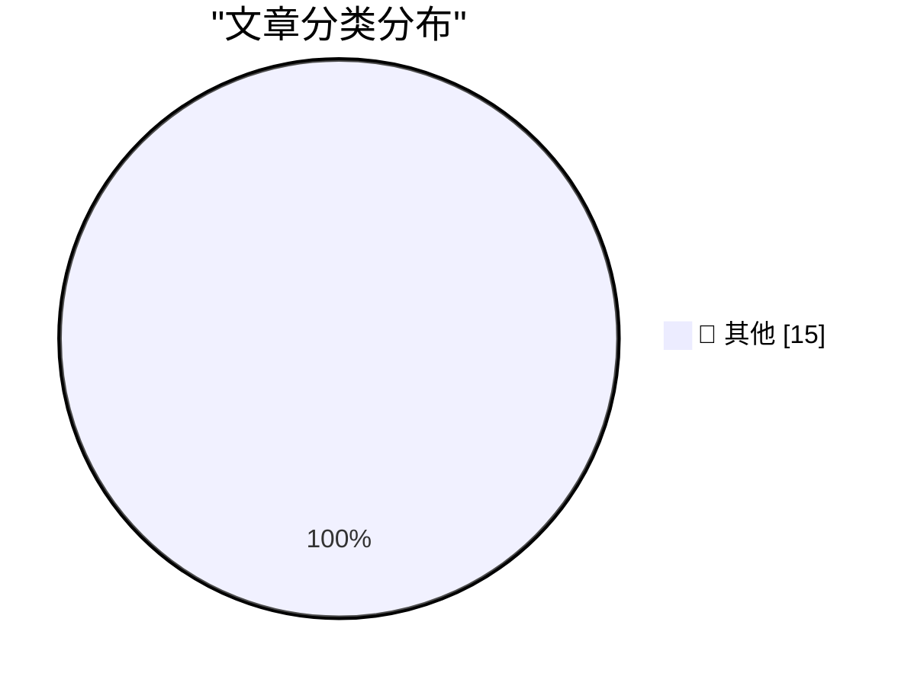

# 📰 AI 资讯每日精选 — 2026-11-19

> 汇聚 140+ 技术博客、X/Twitter、Hacker News、Reddit、Product Hunt、
> Lobste.rs、ClawFeed 日报及 GitHub Trending，经 AI 评分筛选。
>
> **本期内容**：🏆 今日必读 · 🌐 ClawFeed 日报 · 🔥 GitHub Trending · 📂 分类精选 · 🎨 设计与生成式 AI · 📊 数据概览

## 🏆 今日必读

🥇 **datasette-arrows 0.1a0**

[datasette-arrows 0.1a0](https://simonwillison.net/2026/Nov/18/datasette-arrows/) — simonwillison.net · 11 小时前 · 📝 其他

> datasette-arrows 0.1a0

🥈 **Quoting Daniel Stenberg**

[Quoting Daniel Stenberg](https://simonwillison.net/2026/Nov/18/daniel-stenberg/) — simonwillison.net · 12 小时前 · 📝 其他

> Quoting Daniel Stenberg

🥉 **The PSF end-of-year fundraiser**

[The PSF end-of-year fundraiser](https://simonwillison.net/2026/Nov/18/psf-end-of-year-fundraiser/) — simonwillison.net · 13 小时前 · 📝 其他

> The PSF end-of-year fundraiser

4️⃣ **★ The 50-Yard Line**

[★ The 50-Yard Line](https://daringfireball.net/2026/11/the_50-yard_line) — daringfireball.net · 7 小时前 · 📝 其他

> ★ The 50-Yard Line

5️⃣ **Jensen Huang Tweets**

[Jensen Huang Tweets](https://x.com/JensenHuang/status/2122726005219737649) — daringfireball.net · 12 小时前 · 📝 其他

> Jensen Huang Tweets

---

## 🌐 ClawFeed 日报精选

> 来源：[ClawFeed](https://clawfeed.kevinhe.io) — AI 驱动的多源新闻聚合

# ☀️ ClawFeed | 2026-11-18 日报 SGT

> 聚合自 3 期 8 小时简报：#1518 00:00 档（00:00-07:59）、#1519 08:00 档（08:00-15:59）、#1520 16:00 档（16:00-23:59），时间窗 2026-11-18 00:00–23:59 SGT，三档都在。各期正文里写的「11-18 00:00 那期」指的是 #1516（窗口 11-17 16:00–23:59，已收进 11-17 日报 #1517），「11-17 16:00 那期」是 #1515，「11-17 08:00 那期」是 #1514，「11-17 00:00 那期」是 #1512（已收进 11-16 日报 #1513），「11-16 16:00 那期」是 #1511。
> 素材数：三期 metadata 的 feed 分别是 146、121、123（合计 390，都是首页时间线窗内条数）；关注抽样另算，三期都是抽 35 个账号、打开 24 个主页（出错 0；#1518 有 23 个有内容，#1519、#1520 各有 1 个是空的），窗内分别 15、3、13 条，合计 31 条，收了 4、0、3 条，都没算进 feed。书签只有 #1518 窗内有 2 条（bookmarks 2，都讲 Devin Bots，都收了），#1519、#1520 都是 0；errors 都是 0。
> 这是 SGT 周三的一天：00:00 档美国东部是 11-17 周二上午 11 点到晚上 7 点，正好是美股交易时段和英伟达盘后财报，146 条里中文帖只有 15 条；08:00 档美国是周二晚上 7 点到周三凌晨 3 点，美国那边是夜里，121 条里 90 条是中文帖；16:00 档美国是周三凌晨 3 点到上午 11 点，时间线里大半是英文的新闻、体育和品牌号，中文帖 123 条里 15 条，AI 内容比前几期少。覆盖：#1518 是 11-18 08:01–08:08 抓的，两遍去重 260 条、覆盖到了窗口开始，每小时 12–24 条，分布比较匀；#1519 是 16:01–16:07 抓的，也覆盖到了窗口开始，但 15 点档 37 条占了三成，8–10 点每小时只有 5–7 条，前段可能漏事；#1520 是 11-19 00:01–00:07 抓的，22、23 两档 26、23 条占了四成，20 点档只有 6 条。
> 主线：黄仁勋风波到了一个节点，黄仁勋卸任后第一次发帖，BBC 说其表示董事会请就愿意回来，几个小时后英伟达董事会主席在财报电话会开头说董事会一致接受辞职、不打算让其复职（11-17 日报说「17 日财报三期素材里都没有出现」，这次在 00:00 档出现了，但数字只有自媒体整理的），晚上路透又说英伟达停止向中国发运美国批准的 AI 芯片（只有标题）。Anthropic 上市前最后一天：TechCrunch 说亚马逊、谷歌合计持股近三成，自媒体说当晚定价、区间 70–78 美元，币安钱包开代币化证券申购，华尔街日报说七位联合创始人身家都会过百亿美元，素材里没有定价结果。OpenAI 发布 GPT-6.2 Astra 和 Sol，上线第一天的跑分和负面实测都是转述；Cognition 推出 Devin Bots；习近平在深圳亲自迎接特朗普、周四还要和普京会谈。另有微软 Ignite 的 MAI Code 2 和 Agent 365（转述）、Gemini 4 Hydrogen 进 Google 搜索、Claude Platform 关联计费、SGLang 1.0 和九家公司的联盟，以及 Coinbase Ventures、Stripe、星展和 Circle 几家围着「agent 花钱」的动作。

---

## 🔥 当日最重要 5 条（跨档去重）

1. **英伟达一天里从「黄仁勋愿意回来」到「董事会不打算让其复职」：黄仁勋卸任后第一次发帖感谢支持，BBC 说其表示董事会请就愿意回来；几小时后董事会主席在财报电话会一开头说董事会一致接受辞职；临时 CEO 重申开源 AI 战略和收购 Hugging Face 的计划；晚上路透说英伟达停止向中国发运经美国批准的 AI 芯片（只有标题）**（#1518、#1520，接 11-17 日报里华尔街日报午夜前「愿意回去当 CEO」的快讯和路透「英伟达排除黄仁勋回归」）：@JensenHuang 00:18（黄仁勋本人，时间线里是别人转发的）：说过去一周被朋友、同行和素不相识的人的关心打动，感谢大家对自己和家人的善意，「53 年前来到美国」，后文被截断（3,200 万次浏览、85.4 万赞；能看到的部分没有提回不回英伟达）；@BBCBreaking 00:39：BBC 说这是黄仁勋辞职后第一次表态，如果董事会请，愿意回来当英伟达 CEO（BBC 的概括，原话素材里看不到）；@cnnbrk 06:44、@CNN 06:58：英伟达董事会排除黄仁勋回归，CNN 写的是董事会主席在财报电话会一开头说，董事会一致接受了前 CEO 黄仁勋的辞职，不打算让其重新担任 CEO；@TechCrunch 07:09（Hugging Face 的 clem 转发）：临时 CEO 重申开源 AI 战略不变，也还是计划收购 Hugging Face（TechCrunch 的标题，收购条款素材里看不到）；@indigox 07:38 整理的财报数字（营收 1,158 亿美元、同比翻倍）是自媒体整理的，见「未证实」（#1518）。晚上：@TechCrunch 21:03：英伟达说清楚了什么时候会为 neocloud 的融资兜底，为数据中心贷款提供担保时，只有在 neocloud 有独立融资、把设施建好并装上英伟达设备之后才会担责，TechCrunch 写的是临时 CEO Colette Kress 的解释（#1518 素材里 Kress 还是 CFO 的身份，谈 Neocloud 的那段被截断）；@Reuters 21:35：路透独家，英伟达停止向中国发运经美国批准的 AI 芯片（只有标题，停运原因和涉及哪些型号素材里看不到；接 #1512 纽约时报的对华芯片新规则）；@weadvertizers 19:28 说韩国 Kospi 借英伟达财报反弹，见「未证实」（#1520）。08:00 档只有两条没有新信息的评论（解读声明里的一句话、认为回归可能性很小），进了噪音。
   来源: https://x.com/JensenHuang/status/2122726005219737649 ｜ https://x.com/BBCBreaking/status/2122731322821009898 ｜ https://x.com/cnnbrk/status/2122823141080654270 ｜ https://x.com/CNN/status/2122826771884056592 ｜ https://x.com/TechCrunch/status/2122829401821675653 ｜ https://x.com/indigox/status/2122836757851111473 ｜ https://x.com/TechCrunch/status/2123039290112262413 ｜ https://x.com/Reuters/status/2123047355112903099 ｜ https://x.com/weadvertizers/status/2123015385620607339

2. **Anthropic 上市前最后一天：TechCrunch 说上市后亚马逊、谷歌合计持股近三成；自媒体说当晚定价、发行价区间 70–78 美元；币安钱包开 Anthropic 代币化证券申购；华尔街日报说七位联合创始人上市后身家都将超过 100 亿美元；三期素材里都没有定价结果**（#1518、#1519、#1520，接 11-17 日报的 Bitget 公开轮截止和 KuCoin「11 月 19 日前上市吗」的预测盘）：@TechCrunch 06:35：上市后亚马逊持有 Anthropic 不到 15%，还有大幅增持的选择权，谷歌接近 14%，两家合计近 30%（#1518）。@LJL06019 14:30 的发行价、募资额、估值和「认购 7 倍」，以及 @ViewsOfChris 15:34 转述的招股书修订文件（两家合计 28.4%、都没有投票权，七位联合创始人合持一股 F 类股、固定拿 50.1% 投票权）都没有原文出处，见「未证实」；ViewsOfChris 拿这个对比黄仁勋在英伟达手里没有这样的控制权（个人观点）；@EvaCmore 13:28、@KuiGas 15:14：币安钱包 11-18 14:00–22:00（新加坡时间）开 Anthropic 代币化证券（xStocks）申购，用 USDC、100 USDC 起，参考价 70–78 USDC 加 5% 服务费约 73.5–81.9（两条都带推广性质，申购到的是代币化证券；Hyperliquid 盘前价的说法见「未证实」）（#1519）。@WSJ 17:25（Hugging Face 的 clem 转发）：华尔街日报说上市后七位联合创始人身家都将超过 100 亿美元，文章逐个介绍这七个人（只有标题和导语，具体数字素材里看不到）；@CoinMarketCap 17:40：转述 Arthur Hayes 在 New Era Finance 播客里说 Anthropic 上市是「整个故事的风向标」，要是涨了，「游戏重新开始，全面做多，风险偏好回来」，「比特币也会涨」（#1520）。Dario Amodei 警告开源风险的转述见「未证实」。
   来源: https://x.com/TechCrunch/status/2122820852928401648 ｜ https://x.com/LJL06019/status/2122940454748692533 ｜ https://x.com/ViewsOfChris/status/2122956579498770535 ｜ https://x.com/EvaCmore/status/2122924762259398906 ｜ https://x.com/KuiGas/status/2122951528336281831 ｜ https://x.com/WSJ/status/2122984585617154293 ｜ https://x.com/CoinMarketCap/status/2122988191795876289

3. **OpenAI 发布 GPT-6.2 Astra 和 Sol：Codex 和 API 里都能用，Sol 的 ultrafast 扩到 Pro 200 套餐，Sam Altman 强调「很省 token」；上线第一天的跑分、降价和负面实测陆续出来，但都是转述，不是 OpenAI 原文**（#1518、#1519）：@OpenAIDevs 02:02：GPT-6.2 Astra 和 GPT-6.2 Sol 现在可以在 Codex 和 API 里用；@thsottiaux 02:09（Tibo）引 OpenAI 官方帖（「很高效，为真实世界的任务做的」）：Pro 200 套餐也能用 GPT-6.2 Sol 的 ultrafast 了，Sol 是自己日常大多数事情的首选；@sama 05:04：Sol 和 Astra 能做很厉害的事，而且很省 token，特别推 Sol ultrafast；@AravSrinivas 04:32：Perplexity 上也能用了（#1518，这一档素材里没有基准分数和价格，发布文章正文看不到）。白天：@RookieRicardoR 15:59 引一条整理帖：Astra 缓存读降价 60%、Sol 维持原价；最高思考档下 Sol 在 Artificial Analysis 指数拿 57 分、和 GPT-6 Astra 同分，跑这套题的单题成本约为旧 Astra 的 15%，新 Astra 62 分、比上代高 5 分（后文被截断；作者还遇到同一个账号两台电脑、一台的 Codex 里有 Sol 6.2 另一台没有）；@WorldClawAI 15:55（路由服务的上线推广）同样说 Sol 在 Artificial Analysis 智能指数上追平 GPT-6 Astra，Astra 的定位是科学、3D 和最后一轮代码评审；「Astra 在 ARC-AGI-3 上拿到 100%」、一位开发者发布当天的负面实测、OpenAI 针对「不说人话、容易卡住」的提示词指南，都是没有出处的转述，见「未证实」（#1519）。
   来源: https://x.com/OpenAIDevs/status/2122752256923873753 ｜ https://x.com/thsottiaux/status/2122753991000133943 ｜ https://x.com/sama/status/2122798039899263456 ｜ https://x.com/AravSrinivas/status/2122790013230632998 ｜ https://x.com/RookieRicardoR/status/2122962770274717759 ｜ https://x.com/WorldClawAI/status/2122961895015813631

4. **Cognition 推出 Devin Bots：常驻的「工程队友」，一个 Bot 带一队 Devin 负责一个目标到底，Bot 之间会协作，人在 Slack、短信、电话里跟进；当天两条书签都是它，白天在旧金山办了无人机表演**（#1518、#1519、#1520）：@cognition 01:03（书签）：Cognition 官方发布，从写固件到每周合并几千个 PR，一个 Devin Bot 带一队 agent 把活干完（附 1 分 33 秒视频，53.3 万次浏览）；@devindevelopers 01:57：之前几周有 1,000 多名内测用户，Devin Bot 负责一个目标从头到尾，带一队 Devin 去写、测、维护（后文被截断）；@walden_yan 01:17（Walden）：Cognition 内部用 Devin Bots 走到了「极度自动化」，Bot 造 Bot（个人用例被截断）；@swyx 01:39：「多 agent 团队的正确做法」：一直在线、主动干活（但按投入产出调过）、对结果负责而不是对任务负责、管理子 agent 并自查、电话短信 Slack 哪里都能找到、汇报格式一致；@dabit3 02:14（Nader Dabit，Cognition 的人）：过去几周把自己的工作 100% 迁到了 Devin Bots 上（公司员工的说法）；@SlackHQ 02:53 引 Cognition：比如 QA Bot 发现 bug 交给开发 Bot 修，Slack 说 Slack 线程是保留人工监督的最好地方；@dingyi 01:19（书签）：「Devin 家的 Bot 设计做得太牛逼了」（个人反应，没说好在哪）（#1518）。@devindevelopers 10:24：在旧金山 Embarcadero Plaza 办无人机表演庆祝上线；@alexkaplan0 12:56 只有一句「Devin Bots 占领了旧金山」（#1519）。@kinopee_ai 21:37（日语帖）：把 Muse 也拉进了 Bots 的群，Devin Bots、Grok Bot 和 Muse 组成一个「议会」（个人玩法）（#1520）。
   来源: https://x.com/cognition/status/2122737511684587551 ｜ https://x.com/devindevelopers/status/2122750919024759027 ｜ https://x.com/walden_yan/status/2122740852091216274 ｜ https://x.com/swyx/status/2122746401482592549 ｜ https://x.com/dabit3/status/2122755275182469515 ｜ https://x.com/SlackHQ/status/2122764988234563792 ｜ https://x.com/dingyi/status/2122741432050151552 ｜ https://x.com/devindevelopers/status/2122878649162739796 ｜ https://x.com/alexkaplan0/status/2122916921825964517 ｜ https://x.com/kinopee_ai/status/2123047845205061770

5. **习近平打破惯例，在深圳亲自迎接抵达的特朗普，周四（11-19）还有和普京的会谈；BBC 的俄罗斯编辑说这场会谈对普京是一次胜利**（#1520，接 #1512 的访华行程、#1511 的三方会晤；APEC 这几天在深圳开）：@BBCBreaking 17:26：习近平在深圳迎接特朗普，周四还有和普京的历史性会谈（BBC 快讯标题）；@cnnbrk 17:50、@CNN 17:51：习近平打破惯例，在特朗普抵达深圳时亲自迎接（两个号发的同一句）；@BBCWorld 18:54：Steve Rosenberg 说和习近平、特朗普的历史性会谈对普京是一次胜利（只有标题，评论正文素材里看不到）。会谈议题素材里都看不到；APEC 的其他帖子多是标题党，进了噪音。
   来源: https://x.com/BBCBreaking/status/2122984821404348530 ｜ https://x.com/cnnbrk/status/2122990796513165540 ｜ https://x.com/CNN/status/2122990978856300873 ｜ https://x.com/BBCWorld/status/2123006909485563988

**⚠️ 未证实（素材里核实不了，只记录说法）**
- 「Anthropic 今晚定价、明天上市，发行价区间 70–78 美元、8.25 亿股，公开募资最高 644 亿美元，加 260 亿美元私募配售共 904 亿美元，完全稀释估值 1.4 万亿美元，认购已到 7 倍，银行家在讨论定在区间上方」：@LJL06019 14:30 自媒体整理，没给出处，后面说 Anthropic 账本「有个大窟窿」被截断，招股书原文素材里看不到（#1519）。https://x.com/LJL06019/status/2122940454748692533
- 「招股书修订文件显示上市后亚马逊持股 14.7%、谷歌 13.7%，都是无投票权股票；七位联合创始人合持唯一一股 F 类股、固定拿 50.1% 投票权，独立信托持 T 类股、能选能罢免过半数董事」：@ViewsOfChris 15:34 转述，招股书原文素材里看不到（和 TechCrunch「不到 15%、接近 14%」的口径大致对得上，但投票权安排只有这一个来源）（#1519）。https://x.com/ViewsOfChris/status/2122956579498770535
- 「Hyperliquid 上 ANT 盘前合约价已到 96.85 美元」：@EvaCmore 13:28 带推广性质的帖子，没给截图或出处（#1519）。https://x.com/EvaCmore/status/2122924762259398906
- 「Dario Amodei 再次警告开源模型的风险：闭源能监控使用、封禁用户、调安全限制，开放权重之后这些手段很难起作用」：@FinanceYF5 15:53 转述，原话的场合和出处素材里看不到，后文被截断（#1519）。https://x.com/FinanceYF5/status/2122961322589495504
- 英伟达财报「营收 1,158 亿美元、同比 +103%、比指引上限高 56 亿，数据中心 1,076 亿，非 GAAP 毛利率 74.9%，每股收益 2.68 美元（预期 2.48），下季度指引 1,300 亿」：@indigox 07:38 自媒体整理，英伟达原始公告素材里没有（#1518）。https://x.com/indigox/status/2122836757851111473
- 「Kospi 反弹 1.99% 收在 5,067.44，开盘借英伟达财报高开 2.62%，韩国机构买回 5,118 亿韩元」：@weadvertizers 19:28，发帖的是一个广告社区频道，没给出处，后文被截断（#1520）。https://x.com/weadvertizers/status/2123015385620607339
- 「GPT-6.2 Astra 是第一个在 ARC-AGI-3 上拿到 100% 的模型，价格比上一版低 20%」：@automatotech 15:37 法语帖，没给出处，ARC 方面的数字素材里看不到，降价口径也和「缓存读降价 60%、Sol 维持原价」的整理帖不一样（#1519）。https://x.com/automatotech/status/2122957391079551099
- 「一位开发者发布当天实测 GPT-6.2：长任务里去问用户答不上来的内部细节，两小时后把自己卡住；输出深到读不懂，得切回 Opus 5.5 要总结；ts-rust 项目跑了 7 天 0 改进、编译器还慢了 56%，但做 reviewer 很强」：@Summer_ikiki 09:11 转述，原测试是谁素材里看不到（#1519）。https://x.com/Summer_ikiki/status/2122860330997121419
- 「OpenAI 针对『不说人话、容易卡住偷懒』出了优化指南，让模型面向用户重写、不把工作简写和缩写带出来」：@leo114119 12:20 转述，指南原文素材里看不到，「自我阻塞」那条被截断（#1519）。https://x.com/leo114119/status/2122907743447289885
- 「微软 11 月 17 日一次推出 6 款自研模型，编程模型 MAI Code 2 有 GPT-6.1 Sol 98% 的性能、40% 的价格」：@yueke 14:32 引的中文帖，另外 5 款是什么、微软原文素材里都看不到；「Satya Nadella 把 Agent 365 Business Analytics 叫作『AI 的 ERP』」：@gmgnjordan 15:08 的转述，Satya 的原帖素材里只有一句开场介绍（#1519）。https://x.com/yueke/status/2122940952390312271 ｜ https://x.com/gmgnjordan/status/2122950170270634131
- 「FBI 达拉斯发了 FLASH 警报，网络犯罪分子和有国家背景的黑客在用渗透测试框架 ARTEX 自动化攻击全球企业」：@marquistrillx 15:40 转引，FBI 原文素材里看不到，后文被截断（#1519）。https://x.com/marquistrillx/status/2122958199137427730
- 「哈佛研究者发现用上编程 agent 后代码多了约 30%、完成的工作没明显增加，过评审的时间长了 49%」：@erikdesmedt 23:54 引 complexdiscovery 的文章，研究原文素材里看不到（#1520）。https://x.com/erikdesmedt/status/2123082474830147644
- 「迪拜买的一台 Ledger 查出硬件植入，在设置时截取屏幕上的助记词、通过蜂窝网络发出去，还能通过 Ledger 的正品检测」：@JesuslVivas 17:02 引 BeInCrypto 的转述，Ledger 的说明素材里看不到，后文被截断（#1520）。https://x.com/JesuslVivas/status/2122978645379534986
- 「Sage S2.1 Flash 是上海 AI Lab 的书生模型，3,210 亿参数 MoE，MLE-bench Lite 90.3 排第一」：@Curingieul 14:26，90.3 是模型卡自测、还没人复现；11-17 日报里 vLLM 的帖子写的出品方是 SageAI，和这里不一致，素材里没法核对（#1519）。https://x.com/Curingieul/status/2122939480541917552
- 「OpenAI 和 Anthropic 都公告说自家股票数十亿美元的二级交易违规、作废」：@lukasgruber__ 02:59（Street 创始人）发布自家产品时的说法，两家的公告素材里看不到，后文被截断（#1518）。https://x.com/lukasgruber__/status/2122766711120171200
- 「AgentaOS 一个人加一队 AI 替全球小老板收款开票、处理税务，上线 2 个月月入 9,500 美元」：@aimusheng 15:36 转述，收入数字没有出处（#1519）。https://x.com/aimusheng/status/2122956975457628459
- Fable 5.2 的提示词迁移：@LimestoneHQ 01:19 和 @LimestoneHQ 16:17（关注抽样，各两条）转述 Anthropic 的迁移指南（旧提示词在 Fable 5.2 上可能更费钱，建议换掉「continue」「never delete files」「answer directly without deliberating」，思考按输出计费、每百万 token 40 美元），Anthropic 原文素材里看不到（#1518、#1520）。https://x.com/LimestoneHQ/status/2122741305260576966 ｜ https://x.com/LimestoneHQ/status/2122741317264621744 ｜ https://x.com/LimestoneHQ/status/2122967294301351948 ｜ https://x.com/LimestoneHQ/status/2122967306133467617

**次重要（备选）**
- 微软 Ignite（#1518、#1519）：@github 03:08：Ignite 上宣布 GitHub Copilot 应用接入 Azure DevOps，克隆 Azure DevOps 仓库、在应用里跟进 PR 到合并，评审意见上点 Fix 就让 agent 去改（后文被截断）；@satyanadella 05:14 引扎克伯格：Meta 的 Muse Wonder、Muse Spark 1.3 和 Muse Ember 即将上 Azure 的 Foundry（#1518）；MAI Code 2 和「AI 的 ERP」见「未证实」，@gmgnjordan 15:08 自己的看法是企业要像管云支出一样管 agent、按单位工作算成本，难的是中途每次工具调用、取数和 SaaS 操作（#1519）。https://x.com/github/status/2122768911749796156 ｜ https://x.com/satyanadella/status/2122800683867082960 ｜ https://x.com/gmgnjordan/status/2122950170270634131 ｜ https://x.com/yueke/status/2122940952390312271
- Google：@Google 06:35：Gemini 4 Hydrogen 在全球的 Google 搜索上线，Google 称是搜索最大的一次模型升级（更懂意图、回答更可视化、多语言更强）；@OfficialLoganK 06:25：AI Studio 支持自定义域名（能在里面直接买），能做 Android 应用并通过 Google Play 下到手机（暂时只限美国）；@TechCrunch 02:49：Gemini 的聊天记录即使关了历史也会保留两个月（以前是 72 小时）（#1518）；@akokoi1 09:13 引 Google：Antigravity 一周年，所有模型的额度给所有人重置一次；@bowenandwinter 14:18：领免费 Google AI Ultra 的活动把自己花钱买的 Ultra 覆盖掉了（个人遭遇；同窗口另有 4 条 Ultra 优惠链接进了噪音）（#1519）。https://x.com/Google/status/2122820914777845813 ｜ https://x.com/OfficialLoganK/status/2122818500763009273 ｜ https://x.com/TechCrunch/status/2122763976354279846 ｜ https://x.com/akokoi1/status/2122860618151776260 ｜ https://x.com/bowenandwinter/status/2122937499488317801
- Claude 平台（#1518）：@ClaudeDevs 02:00：Claude Platform 推出关联计费（beta），Factory、Linear、Ramp 等工具的用户可以用自己的 Claude Platform 组织付 API 费用、不用交出 API key；@linear 03:13：Linear 叫它 BYOB（自带账单），管理员批准关联、可设花费上限、随时解除；@ClaudeDevs 05:18（关注抽样）：Claude Code 的 Code Mode 正式介绍，Claude 写脚本把多个工具串起来调用，长命令还在跑时也能回答（用环境变量 CLAUDE_CODE_EXPERIMENTAL_CODE_MODE=1 开启，仍是实验功能；接 11-15 16:00 那期「2.1.325 实验性加入」）；@ClaudeDevs 06:35（关注抽样）：Claude 桌面版可以在设置里切到 Latest 发布通道，更新更快但不如 Stable 稳。https://x.com/ClaudeDevs/status/2122751844455956760 ｜ https://x.com/linear/status/2122770219097817092 ｜ https://x.com/ClaudeDevs/status/2122801681939234950 ｜ https://x.com/ClaudeDevs/status/2122821051910684824
- agent 和钱（接 11-17 日报的 ChatGPT 接 Coinbase、Versine 和 Codex 融资）：@jonathankingvc 01:23（Coinbase Ventures 投资经理）：Coinbase Ventures 的 agent 交易版图，AI agent 正从「谈论市场」走向「在市场里交易」（自家被投公司标了星号，算利益相关方，后文被截断），@brian_armstrong 02:04 转发、请做 agent 金融的人去找 Coinbase Ventures；@brian_armstrong 05:38：要让 AI 去中心化，需要一个让 agent 通过价格沟通和合作的市场经济，一队专门的开源模型能胜过前沿模型（观点，后文被截断）；@shafu0x 05:23：Circle 的 Agentic Commerce 团队在招人（agent 钱包、纳米支付、x402/mpp、身份和信誉）；@jeff_weinstein 07:38（Stripe）：新版 stripe.press 给 agent 留了入口（llms.txt、/.well-known/ucp、带价格和库存的 catalog.json、用 WebMCP 加购物车并开始结账）（#1518）；@0xcg2100 13:16：星展银行和 Circle 11 月 18 日宣布合作，符合条件的机构客户可以通过星展直接铸造和赎回 USDC，全天候近乎即时结算（转述，两家公告原文素材里看不到）（#1519）。https://x.com/jonathankingvc/status/2122742468042985565 ｜ https://x.com/brian_armstrong/status/2122752734113759413 ｜ https://x.com/brian_armstrong/status/2122806649450852377 ｜ https://x.com/shafu0x/status/2122802791643230400 ｜ https://x.com/jeff_weinstein/status/2122836852327763998 ｜ https://x.com/0xcg2100/status/2122921800938017071
- SGLang 1.0 和联盟：@larsholst_ 07:09、@DataChaz 07:38 引 SGLang：第一届 SGLang 峰会两天来了 2,000 多人，发布 SGLang v1.0、Miles v0.2，成立 SGLang 联盟，九个创始成员是英伟达、AMD、英特尔、Google、Meta、Thinking Machines、Cloudflare、Modal 和 RadixArk；lars 的评论是推理效率是 AI 最不起眼但最重要的部分之一（#1518）。https://x.com/larsholst_/status/2122829561222021450 ｜ https://x.com/DataChaz/status/2122836889849806895

---

## 📰 当日核心主题

**① Anthropic 和 Claude（三期都有）**
上市见前 5 条，Claude 平台见「次重要」，Dario 的开源警告和 Fable 5.2 提示词迁移见「未证实」。用法：@rileybrown 15:31：Claude 的 artifact 能编辑之后好用到不用再开 Google Doc，希望分享和权限再做好一点（个人体验）；@yibie 13:22：花了一上午整理并完整翻译了 Claude 团队「最佳实践」系列 173 篇（放在哪里素材里看不到）；@Vale_Eon 14:31：Claude-BugHunter，把 681 份 HackerOne 公开报告提炼成 58 个 hunt-* skill，覆盖 24 类漏洞，还附 2024–2026 年企业身份相关 CVE 的攻击矩阵（「GitHub 趋势榜第一」是作者的说法，后文被截断）（#1519）（https://x.com/rileybrown/status/2122955795314909529 ｜ https://x.com/yibie/status/2122923411798372690 ｜ https://x.com/Vale_Eon/status/2122940792335470756）。Claude Code 团队讲验证的文章三期都有重复转发，进了噪音。

**② OpenAI（#1518、#1519、#1520）**
GPT-6.2 见前 5 条。@aakashsabharwal 06:38、@gdb 06:53（Greg Brockman）引 ChatGPT 官方：推出 ChatGPT for Sales，新的 Sales 插件加 30 多个新增或增强的合作方插件，在 ChatGPT 里做路演材料、找线索、跟踪交易、出报价（#1518）；@HubSpot 23:00：HubSpot 的 CRM 进了 ChatGPT 的侧边栏，可以看谁在等回复、审草稿、批准更新（自家发布，#1520）（https://x.com/aakashsabharwal/status/2122821786278719876 ｜ https://x.com/gdb/status/2122825442021572838 ｜ https://x.com/HubSpot/status/2123068870747386061）。

**③ 其他模型、产品和研究（三期都有）**
Meta 的 Muse（接 11-17 日报里「日活过千万」的未证实说法，这次没有新的数字）：@Muse 02:15：Muse 在澳大利亚上线；@alexandr_wang 04:53：Muse 的语音对话上了 Apple Watch 和 Wear OS 手表；上 Foundry 见「次重要」（#1518）（https://x.com/Muse/status/2122755564866502661 ｜ https://x.com/alexandr_wang/status/2122795379263750477）。模型和路由（#1518）：@AravSrinivas 05:05 引 Perplexity 的 Denis Yarats：推出 Orchestrator API，一个接口用 45 个以上模型、自动切换服务商、统一计费，理由是通用模型路由会打破 KV 缓存（后文被截断）；@ClementDelangue 04:09：发布 Qwen3.8-27B-pi-adapted，用强化学习和 LoRA 给 pi 编程 agent 调的 Qwen 模型，SWE-bench Pro（Hard 51）pass@1 从 29.4% 到 62.7%、Terminal-Bench 2.1 从 39.5% 到 55.8%（发布方自己的数字）；@omarsar0 06:19 引 Meta 的 Jason Weston：「自我改进的记忆」，让模型从自己的运行里摸索出记忆技能再训练进权重（细节素材里看不到）（https://x.com/AravSrinivas/status/2122798425842536740 ｜ https://x.com/ClementDelangue/status/2122784279604383914 ｜ https://x.com/omarsar0/status/2122817030277509231）。白天（#1519）：@gauri__gupta 13:28：Epoch AI 审查了一批常用基准，连前沿模型刷得最多的那些也有缺陷（具体问题被截断）；@ivanfioravanti 15:51 引 Video Rebirth：MiniMax-H3 蒸馏到 137 亿参数，4–8 步出视频加同步立体声，Q4_K_M 的 GGUF 9.1GB、24GB 显卡能跑（发布方说法，作者在问有没有人测过）；@zhixianio 15:57 引一条对比帖：iPhone 18 Pro 的 A20 Pro 神经引擎实测是 M5 的两倍多，认为手机本地 AI 最值得探索的方向之一是 ANE（社区实测数字）；Sage S2.1 Flash 见「未证实」（https://x.com/gauri__gupta/status/2122924836750303497 ｜ https://x.com/ivanfioravanti/status/2122960750171869215 ｜ https://x.com/zhixianio/status/2122962400286851095 ｜ https://x.com/Curingieul/status/2122939480541917552）。Grok Bot 和个人 agent：@bot 03:18（Grok Bot 官方）：五个 Bot 在自家会计团队有了全职岗位，负责从开客户账户到收款的「订单到收款」流程（x.ai 上的文章正文素材里看不到，#1518）；@turingou 17:07（郭宇）：用 Grok bot 和 Muse 把个人生活、企业管理和项目开发串在一起，相信通用个人助理和垂直 agent 是接下来几年 AI 应用的主线，11-23 在东京银座有一场中文分享会；@savvy_luvvvv 17:44 引 Iron Giant 的文章：Grok bot 最被低估的配置是 1 个路由器加 4 个专职 agent、不轮询，每 5 分钟跑一次的例行任务成本是每小时一次的 12 倍（作者的估算）（#1520）（https://x.com/bot/status/2122771386456551516 ｜ https://x.com/turingou/status/2122980037536432623 ｜ https://x.com/savvy_luvvvv/status/2122989423180578911）。

**④ Agent 和开发工具（三期都有）**
发布（#1518）：@vercel 02:25：eve 1.0 正式可用，在自己的 harness 上搭 agent、做多租户多人协作的 agent、用 Agent Runs 管理会话；@rauchg 03:19：eve 每周下载 240 万次，142 天做到了 Next.js 5 年才做到的事（自家说法）；@ivanburazin 00:01：Daytona 上线 macOS 沙箱，有 M4、M4 Pro 和 M5 Pro；@trycua 01:22：Cua 发布给 agent 用的 macOS 虚拟机 Hoy，说比苹果的 Virtualization 框架启动快 20%（自家说法，后文被截断）；@ellazhang516 01:07 引 Desmond Lim：Workstream 是给小时工团队做的 AI 原生运营平台，AI agent 在给 3.5 万多家门店跑运营（发帖人说自己是 Desmond Lim 的妻子，算利益相关方）（https://x.com/vercel/status/2122758127968027108 ｜ https://x.com/rauchg/status/2122771609261879478 ｜ https://x.com/ivanburazin/status/2122721729512628713 ｜ https://x.com/trycua/status/2122742292330987802 ｜ https://x.com/ellazhang516/status/2122738333902348547）。
白天（#1519）：@verysmallwoods 08:17：Mario Zechner 几场访谈的总结，Pi SDK 把 coding agent 的会话、工具和扩展嵌进自己的应用，Pi Durable 给长期运行的 agent 提供检查点、崩溃恢复和调度（后文被截断）；@iamcheyan 14:07 引项目作者：开源 Appine，在 Android 上不用 root、不用 PRoot 地跑 Linux 环境，能跑 Codex CLI、Node.js、Docker（后文被截断）；@shao__meng 15:38 引 Airbnb 工程博客：训练模型前用 Presidio 给消息、评价和客服对话去标识，换成尽量逼真的模拟数据（后文被截断）（https://x.com/verysmallwoods/status/2122846566255861938 ｜ https://x.com/iamcheyan/status/2122934781440847898 ｜ https://x.com/shao__meng/status/2122957621263302910）。
晚上（#1520）：@omarsar0 22:09 引自己的文章「Auto-Approving PRs for Coding Agents」：往「软件工厂」走时审批成了下一个瓶颈（文章被截断）；哈佛研究的转述见「未证实」；@MongoDB 23:05：开源 strands-mongodb，让 Strands agent 把会话和长期记忆存进 MongoDB（自家发布）；@wietsevenema 22:38：Cloud Run 从源码部署加 --no-build 可以跳过 Cloud Build，7 秒部署完；@miltonheyan 22:48：CoreSpeed Tie 让 agent 用你自己已经登录的 Chrome，每个 agent 一个标签组，密码和 cookie 留在本机（自家产品）；@webstandards_ru 19:00（俄语帖）：Chrome 158 加了 <install> 元素和 navigator.install()、:playing 和 :paused 伪类；@appwrite 20:45：Appwrite CLI 加了交互式终端界面（自家发布）；@ManusAI 16:17：Manus 成了开源游戏引擎 Godot 基金会的白金赞助商（https://x.com/omarsar0/status/2123056013582713318 ｜ https://x.com/erikdesmedt/status/2123082474830147644 ｜ https://x.com/MongoDB/status/2123069971206983703 ｜ https://x.com/wietsevenema/status/2123063220646653972 ｜ https://x.com/miltonheyan/status/2123065780367700357 ｜ https://x.com/webstandards_ru/status/2123008558157402112 ｜ https://x.com/appwrite/status/2123034855391006937 ｜ https://x.com/ManusAI/status/2122967543191335231）。

**⑤ 公司、融资和观点（三期都有）**
@lukasgruber__ 02:59：Street 结束隐身，说已有 2 亿多美元的意向，口号是「永远干掉 SPV」（创始人的说法，二级交易作废的说法见「未证实」）；@kleinerperkins 01:17：Voyage Labs 结束隐身、融了 1,200 万美元，第一个产品 Atlas 是规划旅行的个人 AI agent，创始人 Manik Gupta 主导过 Google 地图重建（投资方的介绍）；@bradflora 01:13 引 Arjun Chaliha：Marble 完成 550 万美元种子轮，Contrary 领投（Marble 做什么素材里没写）（#1518）（https://x.com/lukasgruber__/status/2122766711120171200 ｜ https://x.com/kleinerperkins/status/2122740945984897399 ｜ https://x.com/bradflora/status/2122739793616626126）。@samuel_ys92 08:23 引 Jason Wei 本人：在 Meta TBD Lab 一年后加入 Mercor 任首席科学家，说数据会塑造下一个前沿；@yuk6ra 14:26 引 Hadrian：1866 年起铸造的 Kutztown Foundry 成了 Hadrian 第 6 号工厂，投 3 亿美元扩建、补美国海军和弹药供应链的铸造产能（#1519）（https://x.com/samuel_ys92/status/2122848077136724036 ｜ https://x.com/yuk6ra/status/2122939398551679453）。@TechCrunch 20:03、@aman_unsiloed 22:35：Unsiloed AI 拿到 Felicis 领投的 750 万美元种子轮，七个人的团队做 AI 文档处理，CEO 说以后 agent 读写的文档会比人多（后文被截断）；@alpackaP 22:51 引 Variational：完成 1.1 亿美元 B 轮、估值 15 亿美元，Bain Capital Crypto 领投，作者说 10 年前差点去这两位创始人的加密对冲基金（作者和投资方有渊源）；@Evie_Build2026 23:49：一家上百人的 AI 公司团队一半资深、一半实习生，作者觉得只能做执行的全职初级员工反而贵（二手听闻加个人看法）（#1520）（https://x.com/TechCrunch/status/2123024190357815529 ｜ https://x.com/aman_unsiloed/status/2123062651098140715 ｜ https://x.com/alpackaP/status/2123066519026307465 ｜ https://x.com/Evie_Build2026/status/2123081239116878105）。

**⑥ 钱包、支付和加密（三期都有）**
agent 和钱见「次重要」。@crowdfundinside 06:30：韩国 Toss 本周推出非托管钱包，App 里支持 ETH、USDT 和 USDC（#1518）；@juokaz 15:28：只有一句「SeatGeek 每天有 10–20 笔购买来自 agent」（没说怎么统计的）；AgentaOS 的收入说法见「未证实」（#1519）；@instinct 22:13：Instinct 可以通过 Plaid 接你的账户，提示看着不对的扣费、不漏掉该退的款；@noahrshinn 22:06（关注抽样，简介写的是 Instinct）：在 Instinct 上买过东西的人平均每月花 700 多美元（自家数据，后文被截断）（#1520）（https://x.com/crowdfundinside/status/2122819622055399517 ｜ https://x.com/juokaz/status/2122954992722104510 ｜ https://x.com/aimusheng/status/2122956975457628459 ｜ https://x.com/instinct/status/2123056959670903022 ｜ https://x.com/noahrshinn/status/2123055121584312484）。安全：@tongtongbee 11:48（PANews 联合创始人）：PANews 网站连续三天被攻击，攻击者疑似用了 AI 手段、不断切换页面和 API，Cloudflare 挡住了大部分（PANews 自己的说法，#1519）；@coinspect 23:40 引 BitFinding：跨链桥在存款最终确认前就放款，以太坊重组时存款所在的块成了孤块，演示了怎样借孤块从 Across、Relay 和 LI.FI 的中继者那里拿走资金（研究方的演示）；Ledger 植入的转述见「未证实」；@PancakeFi 21:00：PancakeSwap 改名 Pancake，口号是「不只是一个 Swap」（新业务素材里没写）（#1520）（https://x.com/tongtongbee/status/2122899806972735554 ｜ https://x.com/coinspect/status/2123078927065415702 ｜ https://x.com/JesuslVivas/status/2122978645379534986 ｜ https://x.com/PancakeFi/status/2123038517026750884）。

**⑦ 其他新闻和安全（#1518、#1519、#1520）**
@nytimes 05:50：一家网络安全创业公司用 AI 帮忙找到了 Java 的一个严重漏洞（公司名和漏洞细节素材里看不到）；@nytimes 06:28：加州上周禁止 Waymo 的无人车上高速后，Waymo 暂时把全美高速上的无人车都撤了（Waymo 的说法）；@elonmusk 00:46 引 Tesla Megapack：特斯拉推出 Powercore，固态中压变压器、逆变器和断路器一体，2027 年投运（#1518）（https://x.com/nytimes/status/2122809656884056171 ｜ https://x.com/nytimes/status/2122819131397312885 ｜ https://x.com/elonmusk/status/2122733232894468308）。美国情报网络（接 11-17 日报噪音里没出处的「NSA 网络中断」快讯）：@BBCWorld 06:02：BBC 说据报道 NSA 的机密内部网络下线了（只有标题，#1518）；@cnnbrk 23:10：美国情报和国土安全部门负责人在全球威胁听证会上作证，链接卡片标题是「NSA 网络修补比预期慢」（只有标题，#1520）（https://x.com/BBCWorld/status/2122812672240505235 ｜ https://x.com/cnnbrk/status/2123071284204441615）。FBI 的 ARTEX 警报见「未证实」（https://x.com/marquistrillx/status/2122958199137427730）。习近平迎接特朗普见前 5 条。

---

## 🔖 书签精选

当日只有 #1518 窗内有书签，2 条都是 Devin Bots（已写进前 5 条第 4 条）：@cognition 01:03 是 Cognition 的发布原帖（附 1 分 33 秒视频，53.3 万次浏览），@dingyi 01:19 是一条中文反应「Devin 家的 Bot 设计做得太牛逼了」，附了 devin.ai/bots 的链接（https://x.com/cognition/status/2122737511684587551 ｜ https://x.com/dingyi/status/2122741432050151552）。#1519 抓到 17 条、#1520 抓到 18 条，窗内都是 0 条（最新一条就是 11-18 01:19 这条，#1518 已经收过），两期都跳过了这一区块、也没从旧书签里补。

---

## 👀 推荐关注汇总（去重，共 7 个；各期写稿时都在浏览器里核实过「未关注」：#1518 在 11-18 08:12–08:15，#1519 在 11-18 16:10–16:12，#1520 在 11-19 00:11–00:13 SGT，本日报没有重新核实）

**一手发布（公司和产品）**
- @satyanadella（Satya Nadella，微软董事长兼 CEO；950 万关注者；你关注的人里有 645 个也关注了）：本期是 Meta 的 Muse 模型上微软 Foundry，置顶是 Ignite 的发布，微软 AI 布局的一手表态，发帖不多（共 2,439 条）（#1518）。https://x.com/satyanadella
- @thsottiaux（Tibo，简介是 OpenAI 的 Codex 和 ChatGPT；100 万关注者；你关注的人里有 868 个也关注了）：本期是 GPT-6.2 Sol 和 Astra 发布、Sol ultrafast 扩到 Pro 200 套餐，Codex 的产品更新多是在这里先发（#1518）。https://x.com/thsottiaux

**创始人和投资人**
- @AravSrinivas（Aravind Srinivas，Perplexity 联合创始人兼 CEO；110 万关注者；你关注的人里有 599 个也关注了）：本期是 Perplexity 接入 GPT-6.2 和推出 Orchestrator API；11-17 日报（#1515）也推荐过，#1518 核对时仍显示未关注（#1518）。https://x.com/AravSrinivas
- @alpackaP（Alexander Pack，Hack VC 联合创始人，之前联合创办 Dragonfly；1.64 万关注者；你关注的人里有 343 个也关注了）：本期是引 Variational 1.1 亿美元 B 轮，知名加密基金创始人的一手投资视角（#1520）。https://x.com/alpackaP
- @gauri__gupta（Gauri Gupta，neosigma 联合创始人兼 CEO、Parallel 早期成员；6,518 关注者；你关注的人里有 31 个也关注了）：本期是转 Epoch AI 对常用基准缺陷的审查，做 agent 评测和企业落地的创始人（#1519）。https://x.com/gauri__gupta

**实操和 builder**
- @ivanburazin（Ivan Burazin，在做 Daytona 的 agent 沙箱；2.34 万关注者；你关注的人里有 126 个也关注了）：本期是 Daytona 上线 macOS 沙箱，置顶说年化收入一年里从 100 万做到 1 亿美元（自家说法），agent 基础设施的 building in public（#1518）。https://x.com/ivanburazin
- @yibie（yibie；6,092 关注者；你关注的人里有 29 个也关注了）：本期是整理并翻译 Claude 团队「最佳实践」系列 173 篇，置顶是自己写的 strata-mlx（让 125B 的 MoE 模型在 Mac 上跑的非官方 MLX 引擎），中文 AI 圈有自己项目的 builder（#1519）。https://x.com/yibie

（三期另有 49 个显示未关注但没推荐的账号（去重后；@devindevelopers 在 #1518、#1519 都出现，@BBCBreaking、@BBCWorld、@CNN、@cnnbrk、@TechCrunch 在 #1518、#1520 都出现）：#1518 的 @JensenHuang、@BBCBreaking、@BBCWorld、@CNN、@cnnbrk、@TechCrunch、@Google、@SlackHQ、@Muse、@devindevelopers、@bot、@trycua、@larsholst_、@aakashsabharwal、@crowdfundinside、@lukasgruber__、@kleinerperkins、@bradflora；#1519 的 @alexkaplan0、@akokoi1、@iamcheyan、@leo114119、@gmgnjordan、@juokaz、@yuk6ra、@verysmallwoods、@LJL06019、@Summer_ikiki、@Curingieul、@Vale_Eon、@aimusheng、@yueke、@automatotech、@bowenandwinter；#1520 的 @WSJ、@Reuters、@MongoDB、@HubSpot、@appwrite、@PancakeFi、@instinct、@weadvertizers、@JesuslVivas、@kinopee_ai、@webstandards_ru、@aman_unsiloed、@miltonheyan、@wietsevenema、@savvy_luvvvv。理由是综合新闻和科技媒体以标题、文章链接为主，公司、产品和项目官号以宣传为主，黄仁勋本人帖子极少且已不在英伟达任职，偏转述号，本期只有一句话或转发，数字没给出处，关注者少、发帖量过大或内容面杂。@trycua、@lukasgruber__、@bradflora、@akokoi1、@gmgnjordan、@juokaz、@verysmallwoods、@kinopee_ai、@aman_unsiloed、@wietsevenema 写的是「可以再观察」。）

**建议取关**：三期都没有提出取关建议。

---

## 💤 重复噪音模式

三期过滤掉的时间线 276 条（#1518 95、#1519 88、#1520 93），收了 114 条（51、33、30）；关注抽样窗内 31 条（15、3、13），收了 7 条（4、0、3），没收 24 条。按类别（三期分类口径不完全一样，下面是合并后的数）：
- **推广、引流和公司公告**：93 条（#1518 30、#1519 27、#1520 36；Superform、Jev 的 jobs-api、Ava Studio、Hermes Agent 插件、PlayStation（两期都有）、Lenny 的 Product Pass、LiveKit 借 Sierra 的 Call Companion 推自家、LangChain 和 LangSmith 重发、币安理财、招聘、视频大赛和区块链周、Sensei 付费合作、PostHog 的 MCP 活动；Google AI Ultra 优惠链接 4 条、Minara 上线 GPT-6.2、YouMind 和 DGrid 上线 GPT-6.2、WeClaw、Devin 入门视频、深圳 AI 营销活动和硬件驻场、惠州旅居网站、玄学 skill 合集；KTX、厦门航空、Rarible、OKX 钱包、Bybit 的 Anthropic 上市直播、Bitget 理财、BNB Chain 黑客松、Brevis 的 Arca、HPE、Roborock 和 PlayStation 黑五、广交会、Techstars、1inch、Kaito Pulse 等）。
- **新闻、时政、体育、娱乐和闲聊**：95 条（#1518 33 = 新闻体育 15 + 闲聊一句话 18；#1519 14 = 新闻时政 3 + 个人履历和八卦 3 + 闲聊 8；#1520 48 = 马斯克 5 + 新闻时政 17 + 体育 12 + 娱乐生活 11 + 闲聊 3；美国失去麻疹消除状态、驻英美军士兵涉俄间谍案、萨那空袭、以色列议会、利物浦和英超、NBA；深圳 APEC 的标题党帖和李彦宏、雷军谈 AI 落地；英国 10 月通胀 3.6%、埃尔多安、Rahul Gandhi、曾毓群、Hakeem Jeffries、莫迪见威尔士亲王夫妇；欧冠、NFL 模拟选秀；Netflix、GTA VI 影评；马斯克的 Boring Company 掘进机命名、修昔底德陷阱；罗福莉的履历和外貌评论涉及个人，没收）。
- **AI 和科技相关但没有信息量**：72 条（#1518 25、#1519 40、#1520 7；前几期写过的重复：Claude Code 团队讲验证的文章三期都有，Lauren Tan 的经历和 Lightcone 访谈（11-15 16:00 那期起写过），Meta 的自我改进记忆，eve 和 stripe.press 的常见用例，MCP 别只给一个 ask_agent 工具，Typeless Ultra 的吐槽；GPT-6.2 的中文快讯、试玩和 Astra 生成的视频，「新模型发布前旧模型会变笨」；Grok Bot 会计团队的转发、GrokBot 省额度、让 @bot 读 x.ai 新闻；103 个 AI 用例清单、Anthropic 面试题（没有出处）、Claude 付款弹 KYC 的排查（偏引流）、「用 Claude Code 做微信小游戏日入 5 万」、A 轮门槛数据（没有出处）、Proton Lumo、Zoom Slides、各种 agent 使用心得）。
- **黄仁勋相关但没有新信息**：5 条（#1518 3：田渊栋转引声明、「Pls come back」、黄仁勋访谈合集网站；#1519 2：解读声明里的一句话、认为回归可能性很小的评论）。
- **加密场边**：11 条（#1518 4、#1519 5、#1520 2；Paolo Ardoino 谈 RGB、一篇 BFT 共识论文、ZEC 迁到 Ironwood、MARA 卖出比特币、Breakpoint 感想和「Solana Breakpoint 结束」、阿拉伯语的仓位日记）。
- **关注抽样里没收的**：24 条（#1518 11、#1519 3、#1520 10；Eon 的狗、微软 365 备份推广和 Ignite 超跑，Sierra 在 HLTH 的展位，Startup Wisdom 的扎克伯格、黄仁勋、Naval、Emilie Choi 语录，Mark Ajzenstadt 的被截断观察和预约咨询广告（两期都有），RightNow 决策模型 v3 和上线腾讯 Hy4 flash（「3 小时前发布」和 11-16 16:00 那期写过的对不上），Tradermayne 直播「Anthropic 上市是不是 AI 泡沫的顶」，比特唐三藏的返佣链接，Daytona 巴黎 Demo Night 预告，刘江说英伟达吉祥物 Dawn 还有个孪生姐妹，Raft 的一句话，找《麦穗与羊》原视频）。
- **同一话题延续**：黄仁勋和英伟达（11-12 辞职 → #1514 路透说英伟达排除回归 → #1515 员工写信、Megaspeed 联合声明 → #1516 华尔街日报说愿意回归 → #1518 黄仁勋发帖、BBC「董事会请就回来」、董事会主席说不打算让其复职、财报 → #1520 停止对华发运、Kress 讲 neocloud 担保，https://x.com/JensenHuang/status/2122726005219737649 ｜ https://x.com/Reuters/status/2123047355112903099）；Anthropic 上市（11-15 日报的认购 → #1515 公开轮认购和 Bitget 写的截止时间 → #1516 KuCoin 预测盘 → #1518 TechCrunch 持股 → #1519 区间和 F 类股转述、币安钱包申购 → #1520 华尔街日报身家、Arthur Hayes，https://x.com/TechCrunch/status/2122820852928401648 ｜ https://x.com/WSJ/status/2122984585617154293）；GPT-6.2（#1518 发布 → #1519 跑分和实测转述 → #1520「旧模型变笨」吐槽，没收）；Devin Bots（#1518 发布和书签 → #1519 无人机表演 → #1520 Bots「议会」）；Muse（#1514 Lenny 访谈 → #1516 日活说法 → #1518 上 Foundry、澳大利亚、手表）；Fable 5.2 提示词（#1518 迁移指南转述 → #1520 三种说法和替代句）；Claude Code 的 Code Mode（11-15 16:00 那期实验性加入 → #1518 官方介绍）；NSA 内网（#1516 噪音里没出处的快讯 → #1518 BBC「据报道下线」 → #1520「修补比预期慢」）；Sage S2.1 Flash（#1515 vLLM 支持 → #1519 挂上 Hugging Face，出品方说法不一致）；Grok Bot（#1514 1.0 → #1518 会计团队 → #1520 路由配置和省钱，https://x.com/bot/status/2122771386456551516 ｜ https://x.com/savvy_luvvvv/status/2122989423180578911）；微软 Ignite（11-17 日报噪音里的预告 → #1518 Copilot 接 Azure DevOps、Muse 上 Foundry → #1519 MAI Code 2 和 Agent 365 转述）；agent 动钱（#1516 ChatGPT 接 Coinbase、Versine、Codex → #1518 Coinbase Ventures 版图、Stripe、Circle 招人 → #1519 星展和 Circle → #1520 Instinct 接 Plaid）。---

## 🔥 GitHub Trending

> 今日热门开源项目（全语言 + Python）

| # | 项目 | 描述 | ⭐ 总星 | 📈 今日 | 语言 |
|---|------|------|---------|---------|------|
| 1 | [google-research/paper-orchestra](https://github.com/google-research/paper-orchestra) 🤖 | PaperOrchestra is a multi-agent framework for automated A... | 4.4k | +1524 | Python |
| 2 | [affaan-m/ECC](https://github.com/affaan-m/ECC) 🤖 | The agent harness performance optimization system. Skills... | 306.7k | +1108 | JavaScript |
| 3 | [mvanhorn/last30days-skill](https://github.com/mvanhorn/last30days-skill) 🤖 | AI agent skill that researches any topic across Reddit, X... | 70.2k | +1059 | Python |
| 4 | [obra/superpowers](https://github.com/obra/superpowers) | An agentic skills framework & software development method... | 321.4k | +822 | Shell |
| 5 | [sveltejs/svelte](https://github.com/sveltejs/svelte) | web development for the rest of us | 89.7k | +692 | JavaScript |
| 6 | [jingyaogong/minimind](https://github.com/jingyaogong/minimind) 🤖 | 🧠 两小时从 0 训出你的 64M 大模型。Train your own 64M LLM from scratc... | 66.5k | +687 | Python |
| 7 | [getarcaneapp/arcane](https://github.com/getarcaneapp/arcane) | Modern Docker Management, Designed for Everyone | 9.9k | +547 | Go |
| 8 | [p-e-w/heretic](https://github.com/p-e-w/heretic) | Training-free language model modification: Remove censors... | 42.0k | +515 | Python |
| 9 | [XiaoYouChR/Ghost-Downloader-3](https://github.com/XiaoYouChR/Ghost-Downloader-3) | The only downloader you need. 下载器的集大成者。 | 12.2k | +432 | Python |
| 10 | [HKUDS/CLI-Anything](https://github.com/HKUDS/CLI-Anything) 🤖 | "CLI-Anything: Making ALL Software Agent-Native" -- CLI-H... | 59.9k | +389 | Python |
| 11 | [google-labs-code/stitch-skills](https://github.com/google-labs-code/stitch-skills) 🤖 | A library of Agent Skills designed to work with the Stitc... | 10.5k | +365 | TypeScript |
| 12 | [kajisho5/ffmpeg-skill](https://github.com/kajisho5/ffmpeg-skill) 🤖 | Local video editor for coding agents: 42 FFmpeg tools wit... | 8.1k | +338 | Python |
| 13 | [n8n-io/n8n](https://github.com/n8n-io/n8n) 🤖 | Fair-code workflow automation platform with native AI cap... | 211.2k | +325 | TypeScript |
| 14 | [cursor/plugins](https://github.com/cursor/plugins) | Cursor plugin specification and official plugins | 17.3k | +314 | TypeScript |
| 15 | [NVIDIA/SkillEvaluator](https://github.com/NVIDIA/SkillEvaluator) 🤖 | Multi-tier framework for evaluating AI agent skills and p... | 3.8k | +312 | Python |

---

## 📝 其他

### 1. datasette-arrows 0.1a0

[datasette-arrows 0.1a0](https://simonwillison.net/2026/Nov/18/datasette-arrows/) — **simonwillison.net** · 11 小时前 · ⭐ 15/30

> datasette-arrows 0.1a0

---

### 2. Quoting Daniel Stenberg

[Quoting Daniel Stenberg](https://simonwillison.net/2026/Nov/18/daniel-stenberg/) — **simonwillison.net** · 12 小时前 · ⭐ 15/30

> Quoting Daniel Stenberg

---

### 3. The PSF end-of-year fundraiser

[The PSF end-of-year fundraiser](https://simonwillison.net/2026/Nov/18/psf-end-of-year-fundraiser/) — **simonwillison.net** · 13 小时前 · ⭐ 15/30

> The PSF end-of-year fundraiser

---

### 4. ★ The 50-Yard Line

[★ The 50-Yard Line](https://daringfireball.net/2026/11/the_50-yard_line) — **daringfireball.net** · 7 小时前 · ⭐ 15/30

> ★ The 50-Yard Line

---

### 5. Jensen Huang Tweets

[Jensen Huang Tweets](https://x.com/JensenHuang/status/2122726005219737649) — **daringfireball.net** · 12 小时前 · ⭐ 15/30

> Jensen Huang Tweets

---

### 6. Pluralistic: Enshittifiers groom us for scammers (18 Nov 2026)

[Pluralistic: Enshittifiers groom us for scammers (18 Nov 2026)](https://pluralistic.net/2026/11/18/malice-v-incompetence/) — **pluralistic.net** · 19 小时前 · ⭐ 15/30

> Pluralistic: Enshittifiers groom us for scammers (18 Nov 2026)

---

### 7. Once More Unto The Breach - Another Year In Review

[Once More Unto The Breach - Another Year In Review](https://shkspr.mobi/blog/2026/11/once-more-unto-the-breach-another-year-in-review/) — **shkspr.mobi** · 15 小时前 · ⭐ 15/30

> Once More Unto The Breach - Another Year In Review

---

### 8. Is Anthropic’s IPO a bad bet, both for investors and society?

[Is Anthropic’s IPO a bad bet, both for investors and society?](https://garymarcus.substack.com/p/is-anthropics-ipo-a-bad-bet-both) — **garymarcus.substack.com** · 6 小时前 · ⭐ 15/30

> Is Anthropic’s IPO a bad bet, both for investors and society?

---

### 9. Supersequences and Superpermutations

[Supersequences and Superpermutations](https://www.johndcook.com/blog/2026/11/18/supersequences/) — **johndcook.com** · 4 小时前 · ⭐ 15/30

> Supersequences and Superpermutations

---

### 10. This Week in Source Control: 18 November 2026

[This Week in Source Control: 18 November 2026](https://nesbitt.io/2026/11/18/this-week-in-source-control.html) — **nesbitt.io** · 18 小时前 · ⭐ 15/30

> This Week in Source Control: 18 November 2026

---

### 11. Push button telephones introduced November 18, 1963

[Push button telephones introduced November 18, 1963](https://dfarq.homeip.net/push-button-telephones-introduced-november-18-1963/?utm_source=rss&#038;utm_medium=rss&#038;utm_campaign=push-button-telephones-introduced-november-18-1963) — **dfarq.homeip.net** · 16 小时前 · ⭐ 15/30

> Push button telephones introduced November 18, 1963

---

### 12. How to install an app on your Commodore 64

[How to install an app on your Commodore 64](https://anildash.com/2026/10/08/install-an-app-commodore-64/) — **anildash.com** · 36 分钟前 · ⭐ 15/30

> How to install an app on your Commodore 64

---

### 13. NYC’s venture capitalists need to love themselves

[NYC’s venture capitalists need to love themselves](https://anildash.com/2026/11/03/nyc-venture-capitalists-love-themselves/) — **anildash.com** · 36 分钟前 · ⭐ 15/30

> NYC’s venture capitalists need to love themselves

---

### 14. DaisyRose-27B: Pushing the Frontier of Post-Training Efficiency

[DaisyRose-27B: Pushing the Frontier of Post-Training Efficiency](https://huggingface.co/blog/RadixArk/daisyrose-27b-pushing-the-frontier-of-post-trainin) — **Hugging Face Blog** · 8 小时前 · ⭐ 15/30

> DaisyRose-27B: Pushing the Frontier of Post-Training Efficiency

---

### 15. Why your fine-tuning job takes longer than the FLOPs say

[Why your fine-tuning job takes longer than the FLOPs say](https://huggingface.co/blog/Dharma-AI/predicting-fine-tuning-time) — **Hugging Face Blog** · 9 小时前 · ⭐ 15/30

> Why your fine-tuning job takes longer than the FLOPs say

---

## 📊 数据概览

| 扫描源 | 抓取文章 | 时间范围 | 精选 |
|:---:|:---:|:---:|:---:|
| 92/140 | 3954 篇 → 63 篇 | 24h | **15 篇** |

### 分类分布

---

*生成于 2026-11-19 04:28 | 汇聚 140 个技术博客、X/Twitter、Hacker News、Reddit、Product Hunt、Lobste.rs、ClawFeed 日报及 GitHub Trending，经 AI 评分筛选出 Top 15 精华内容*
