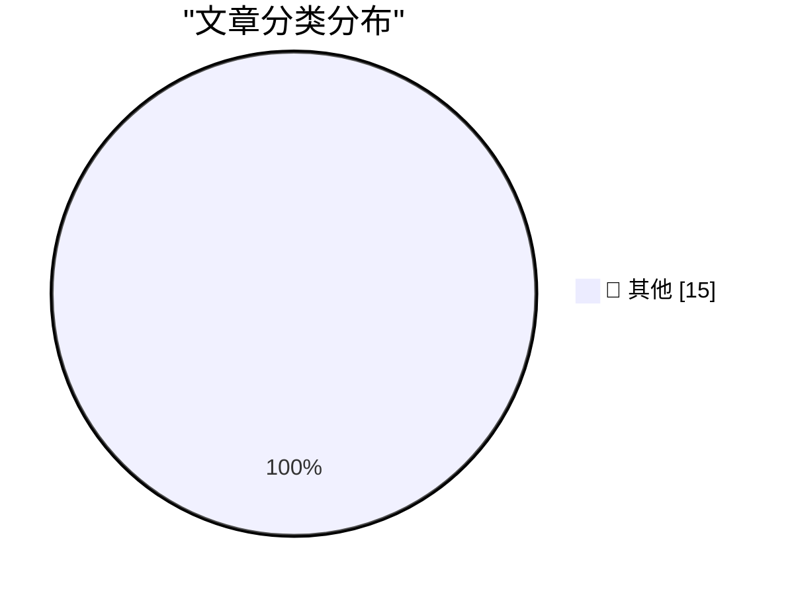

# 📰 AI 资讯每日精选 — 2026-11-21

> 汇聚 140+ 技术博客、X/Twitter、Hacker News、Reddit、Product Hunt、
> Lobste.rs、ClawFeed 日报及 GitHub Trending，经 AI 评分筛选。
>
> **本期内容**：🏆 今日必读 · 🌐 ClawFeed 日报 · 🔥 GitHub Trending · 📂 分类精选 · 🎨 设计与生成式 AI · 📊 数据概览

## 🏆 今日必读

🥇 **Quoting Ravi Vakil**

[Quoting Ravi Vakil](https://simonwillison.net/2026/Nov/20/ravi-vakil/) — simonwillison.net · 8 小时前 · 📝 其他

> Quoting Ravi Vakil

🥈 **Quoting Levent Alpöge**

[Quoting Levent Alpöge](https://simonwillison.net/2026/Nov/20/levent-alpoge/) — simonwillison.net · 11 小时前 · 📝 其他

> Quoting Levent Alpöge

🥉 **Why output caching doesn't work**

[Why output caching doesn't work](https://seangoedecke.com/why-output-caching-doesnt-work/) — seangoedecke.com · 4 小时前 · 📝 其他

> Why output caching doesn't work

4️⃣ **CTO of ‘RansomwareHelp’ Indicted for Wire Fraud**

[CTO of ‘RansomwareHelp’ Indicted for Wire Fraud](https://krebsonsecurity.com/2026/11/cto-of-ransomwarehelp-indicted-for-wire-fraud/) — krebsonsecurity.com · 3 小时前 · 📝 其他

> CTO of ‘RansomwareHelp’ Indicted for Wire Fraud

5️⃣ **The Talk Show: ‘A Whoopsie Treason’**

[The Talk Show: ‘A Whoopsie Treason’](https://daringfireball.net/thetalkshow/2026/11/20/ep-457) — daringfireball.net · 4 小时前 · 📝 其他

> The Talk Show: ‘A Whoopsie Treason’

---

## 🌐 ClawFeed 日报精选

> 来源：[ClawFeed](https://clawfeed.kevinhe.io) — AI 驱动的多源新闻聚合

# ☀️ ClawFeed | 2026-11-20 日报 SGT

> 聚合自 3 期 8 小时简报：#1526 00:00 档（00:00-07:59）、#1527 08:00 档（08:00-15:59）、#1528 16:00 档（16:00-23:59），时间窗 2026-11-20 00:00–23:59 SGT（周五），三档都在。各期按发布时刻称呼前几期：「11-20 08:00 那期」就是本日的 #1526，「11-20 16:00 那期」就是 #1527；「11-20 00:00 那期」指的是 #1524（窗口 11-19 16:00–23:59，已收进 11-19 日报），「11-19 16:00 那期」是 #1523，「11-19 08:00 那期」是 #1522，「11-19 00:00 那期」是 #1520；更早的「11-18 16:00 那期」是 #1519，「11-18 08:00 那期」是 #1518，「11-18 00:00 那期」是 #1516，「11-17 08:00 那期」是 #1514（按 11-19 日报的对照）。
> 素材数（都按各期自己写的数）：首页时间线窗内分别 140、124、117 条（合计 381），收了 33、33、43 条（合计 109）；关注抽样另算，三期都是抽 35 个账号、打开 24 个主页（23 个有内容、1 个是空的，出错 0），窗内分别 10、7、13 条，合计 30 条，收了 3、3、3 条，都不在首页时间线里。书签三期分别抓到 18、17、17 条，窗内都是 0 条，都跳过、没从旧书签里补。有一处对不上：#1527、#1528 写的最新一条书签时间是 11-20 07:43，落在本日 00:00 档的窗口里，但 #1526 在 08:01–08:07 抓取时看到的最新一条还是 11-19 13:39，所以三期都没收它（可能是 #1526 抓完之后才加进书签的，这是推测；那条书签的内容三期素材里都看不到）。
> 这是 SGT 周五的一天：00:00 档美国东部是 11-19 周四上午 11 点到晚上 7 点，美股收盘（SGT 05:00）在中间，140 条里中文帖只有 13 条；08:00 档美国是周四晚上 7 点到周五凌晨 3 点，美股已收盘，124 条里 58 条是中文帖；16:00 档美国是周五凌晨 3 点到上午 11 点，美股 22:30 SGT 开盘，23 点档的帖子集中在开盘前后（这一期没写中文帖数）。覆盖：#1526 是 11-20 08:01–08:07 抓的，两遍去重 241 条、覆盖到了窗口开始，但 7 点档 46 条占了三分之一，0–3 点每小时只有 9–11 条，那一段很薄、可能漏事；#1527 是 16:01–16:07 抓的，去重 234 条，15 点档 56 条占了近一半，8 点档只有 3 条、11 点档只有 5 条，前面几个小时可能漏事；#1528 是 11-21 00:01–00:07 抓的，去重 258 条，23 点档 50 条，17、18 点档各只有 7 条，那一段很薄、可能漏事。
> 主线：Anthropic（ANT）上市后的头两天。00:00 档是第一天的实际成交：开盘 111.50 美元、最高 115 美元、收盘 96.30 美元；08:00 档是成交复盘：头 12 小时正股成交 888 亿美元、代币化 ANT 只占 0.17%、币安占 Anthropic 永续合约成交的 47%，但收盘价出现了 97.17 美元的另一种说法；16:00 档是第二天：自媒体说承销商已全额行使「绿鞋」、Dario Amodei 上市时卖了约 338 万股，行情卡片显示 ANT 跌到 86.09 美元。晚上的大事是黎曼猜想：Anthropic 的数学家 Levent Alpöge 称和 Claude 一起证明了黎曼猜想，22:45 以后刷屏，素材里没有人核实。其次是比特币从四个月低点一路跌破 6 万美元、加密 ETF 一天流出 7.64 亿美元；腾讯放出旗舰模型 Hy4 的开放权重（7,700 亿总参数）；还有一串安全事件：美国国家网络总监辞职、美国农业部被报遭入侵、乐天证券测试环境被入侵、Ledger 被篡改的设备出现在德国。另有彭博报道的苹果自研电脑操作 agent、GPT-6.2 Astra 在 Blueprint-Bench 2 排第 1、Meta Muse 的法律基准和邮箱功能、Vercel Board 的后续、HD Moore 埋的 200 万个金丝雀、Cursor 可能逐步停用中国模型的报道。

---

## 🔥 当日最重要 5 条（跨档去重）

1. **Anthropic（ANT）上市的头两天：第一天开盘 111.50 美元、盘中最高约 115 美元，收盘有 96.30 和 97.17 美元两种说法；头 12 小时正股成交 888 亿美元，代币化 ANT 只占约 0.17%；第二天行情卡片显示跌到 86.09 美元（跌 11.40%），仍高于 83 美元发行价；纳斯达克和 Anthropic 的官方成交数据三期素材里都看不到**（#1526、#1527、#1528，接 11-19 日报的定价 83 美元、敲钟和开盘指示价 105 美元）：凌晨：@Moexba 01:24：卖了 9.8 亿股 A 类股、募资 813.4 亿美元，订单约为可售股数的 6 倍，开盘 111.50 美元后回落到 101 美元左右（自媒体整理，没给出处；11-18 16:00 那期自媒体说的是认购 7 倍）；@AethirCloud 01:06：同样写开盘 111.50 美元、募资 813 亿美元，称是有记录以来最大的 IPO（GPU 云项目发帖，后文被截断）；@Gemini 05:02（加密交易所 Gemini 的官号）：开盘 111.50、最高 115、收盘 96.30 美元（没给出处；按这些数，收盘比发行价高约 16%、比开盘价低约 14%）；美股以外：@coinbase 01:37：Coinbase 在美国和英国上线 ANT 交易；@haydenzadams 03:30：Uniswap 上代币化 ANT 几小时成交超过 1,000 万美元（自家数据）；@bfresh 07:50 引 Robinhood CEO：Robinhood Chain 上的 Anthropic 股票代币和上市同时开放（自家发布）（#1526）。白天：@gigiz_eth 11:40：收盘 97.17 美元、涨 17.1%，盘中最高 115.1 美元，市值约 1.3 万亿美元，连私募在内募资超过 1,070 亿美元（自媒体整理，没给出处）；@tangsanzangbtc 15:31（关注抽样）：最高 114.99 美元，几分钟后跌穿 95.05 美元，半天成交 536.74 亿美元，「创始人和打新机构集体出货」是发帖人的判断，见「未证实」；@FourPillarsFP 15:05：头 12 小时正股成交 888 亿美元，主要 CEX 和 DEX 上的代币化 ANT 合计 1.492 亿美元、约 0.17%，DEX 成交是 CEX 的 4.2 倍（研究机构整理）；@BinanceResearch 14:44：上市时 Anthropic 永续合约全市场成交 66 亿美元，币安占 47%，ANTUSDT 和纳斯达克第一笔成交相差不到 0.3%（自家数据）；@ChainCatcher_ 15:04：上市前 45 天各平台 Anthropic 合约累计成交约 95 亿美元，开盘前 Hyperliquid 合约价和实际开盘价相差不到 1%（#1527）。晚上：@crypto_pumpman 23:44：「刚刚 ANT 破发了」，承销商已全额行使「绿鞋」、相当于增发 1.47 亿股、多融约 122 亿美元，Dario Amodei 上市时卖了约 338 万股（自媒体整理，没给出处，见「未证实」）；但帖子附的行情卡片显示 86.09 美元、跌 11.40%，仍高于 83 美元，素材里看不到跌破发行价的成交；#1528 按这个跌幅倒推前一天收盘约 97.17 美元，和 #1527 的说法对得上（推算）（#1528）。**三期说法不一致的地方**：收盘价 96.30（#1526 的 Gemini 帖）和 97.17（#1527 的 gigiz_eth 帖、#1528 的倒推）对不上；最高价有 115、115.1、114.99 三种写法；募资 813.4 亿美元（#1526）和「连私募在内超过 1,070 亿」（#1527）口径不同；市值「约 1.3 万亿美元」（#1527 gigiz_eth）和 PANews 标题里的「1.5 万亿美元」（#1527，按 83 美元发行价算）不是同一个价位；「破发」（#1528 发帖人）和卡片上的 86.09 美元互相矛盾。这些都来自交易所、研究机构和自媒体，不是纳斯达克的官方数据。
   来源: https://x.com/Moexba/status/2123467388477960234 ｜ https://x.com/AethirCloud/status/2123462984064487674 ｜ https://x.com/Gemini/status/2123522388394676412 ｜ https://x.com/coinbase/status/2123470810870382779 ｜ https://x.com/haydenzadams/status/2123499065795027216 ｜ https://x.com/bfresh/status/2123564727691268102 ｜ https://x.com/gigiz_eth/status/2123622591114199234 ｜ https://x.com/tangsanzangbtc/status/2123680644505190828 ｜ https://x.com/FourPillarsFP/status/2123674026203615462 ｜ https://x.com/BinanceResearch/status/2123668798972784713 ｜ https://x.com/ChainCatcher_/status/2123673848688320545 ｜ https://x.com/crypto_pumpman/status/2123804779663220989

2. **黎曼猜想：Anthropic 的数学家 Levent Alpöge 在个人网站发声明，称和 Claude 一起找到了黎曼猜想的证明；Scientific American 的报道标题写的是「声称证明」；素材里只有转述和反应，证明本身没有人核实，也有人质疑上市第二天发布的时机**（#1528）：@MaxForAI 22:45 引 Scott Armstrong：声明发在 Alpöge 的个人网站上（转述）；@maharshii 23:27 引 Yifan Zhang「JUST IN」的帖子，附 alpo.ge 上的 remark.pdf；@thorstenball 23:43 引了一句「Claude flew, and danced, and sparkled near that finish line」（应出自那份声明，原文素材里看不到）；@MatthewBerman 23:45 引 Jeremy Berman 贴的 Scientific American 报道，从链接看标题是「Anthropic 数学家声称证明了黎曼猜想」（正文素材里看不到）。反应：@DeryaTR_ 23:48：如果成立，会是今年最大的 AI 新闻、第二个被 AI 解决的千禧年大奖难题（「第一个来自 OpenAI」没给出处）；@levie 22:55（关注抽样，Aaron Levie）：「数学界要过一个大日子了」；@jm_alexia 23:51：上市第二天冒出来，25 万页的证明人工核实要几周到几个月，但这个说法已足够把 ANT 拉起来（个人看法）。声明、「25 万页」和「第一个来自 OpenAI」见「未证实」；4 条一句话跟帖进了噪音。
   来源: https://x.com/MaxForAI/status/2123789800805429617 ｜ https://x.com/maharshii/status/2123800325891276954 ｜ https://x.com/thorstenball/status/2123804439379132769 ｜ https://x.com/MatthewBerman/status/2123804812064215216 ｜ https://x.com/DeryaTR_/status/2123805792147267815 ｜ https://x.com/levie/status/2123792233535332448 ｜ https://x.com/jm_alexia/status/2123806446236381418

3. **加密和美股一起跌：比特币白天到四个月低点，晚上跌破 6 万美元，ETH、XRP、SOL 同时跌破整数关口；11-19 加密 ETF 净流出 7.64 亿美元，贝莱德 IBIT 出现上市以来最大单日流出；两个账号写的「几月以来」和爆仓金额对不上**（#1527、#1528）：@KongBTC 15:11：比特币跌到四个月低点，认为是科技股被一场 AI IPO「传染」了，想和美股脱钩，结果「住进了同一间病房」（个人观点）（#1527）。@coinbureau 23:57：比特币 7 月以来第一次跌破 6 万美元，ETH 跌破 1,700、XRP 跌破 0.95、SOL 跌破 70 美元，所引的前一条说 24 小时全市场爆仓超过 11.5 亿美元；@RoundtableSpace 23:59 写的是「6 月以来第一次」、爆仓超过 13 亿美元；@CoinMarketCap 23:30：11-19 加密 ETF 净流出 7.643 亿美元（比特币基金 6.32 亿、以太坊基金 1.29 亿），IBIT 已连续三天流出；@alvin_kan 23:28 引 The Kobeissi Letter《45 天蒸发 6 万亿美元》：美股连续 31 个交易日平均每天蒸发 2,250 亿美元（转述，摘的那段归因出处没写明，见「未证实」）（#1528）。
   来源: https://x.com/KongBTC/status/2123675657825583491 ｜ https://x.com/coinbureau/status/2123807887743139973 ｜ https://x.com/RoundtableSpace/status/2123808380837892228 ｜ https://x.com/CoinMarketCap/status/2123801078604968340 ｜ https://x.com/alvin_kan/status/2123800663134216617

4. **腾讯放出旗舰模型 Hy4 的开放权重：原生多模态的 MoE，总参数 7,700 亿、激活 490 亿、100 万上下文，同时发布 System Card 和完整的安全评测报告；同一时段有转述说 DeepSeek V5 全部用华为昇腾 950 训练（没给出处）**（#1527，前几期写过的是 Hy4 flash，这次是旗舰的权重）：@ivanfioravanti 15:26 引腾讯混元：Hy4 开放权重，周五太平洋时间早上 8–10 点有 AMA（自家发布；Ivan Fioravanti 的评论是「跑起来不容易」）；@teortaxesTex 15:56 引鹿川「DeepSeek V5 完全采用华为昇腾 950 训练」（引文没给出处，见「未证实」）：Teortaxes 读了 DeepSeek 的招聘启事，认为对方预计让大规模集群稳定跑起来会非常艰难，拿到硬件只是第一步（个人解读）。
   来源: https://x.com/ivanfioravanti/status/2123679234354790836 ｜ https://x.com/teortaxesTex/status/2123686944072712264

5. **一天里的几起安全事件：美国国家网络总监 Sean Cairncross 辞职，同时美国农业部被报遭网络入侵（#1526）；乐天证券把没打码的真实客户数据拷进测试环境后被入侵，按整理的披露最多 1,125 万个账户的登录 ID 可能受影响（#1527）；Ledger 确认德国柏林出现被实体篡改的硬件钱包（#1528）**（接 11-20 00:00 那期大通确认第三方网络攻击、11-19 00:00 那期迪拜买到的被植入 Ledger）：@FoxNews 07:24：Cairncross 辞职，正赶上微软 Outlook、美联航、几家大银行和 NSA 等一波大面积技术故障（后文被截断）；@Tradermayne 06:48（关注抽样）转的 Disclose.tv 快讯注明来源 Axios；辞职和故障是否相关，素材里看不到官方说法；@coinbureau 07:46 引 Nextgov/FCW：美国农业部一封内部邮件要求重置所有数据库密码，故障让农民补贴支付系统下线（媒体转述，后文被截断）（#1526）。@liaoblove520 15:58 引 GCSA：乐天证券 11-17 披露测试环境遭未授权访问，最多 1,125 万个账户的登录 ID 可能受影响、其中最多 447 万个还涉及联系方式、银行账户和资产（转述，乐天原始公告素材里看不到）；@zhntosn1873 11:30：把生产数据拷进测试环境在不少公司很常见，「正式批准」不代表安全跟上了（个人观点）（#1527）。@wublockchain12 18:07：Ledger 更新调查，确认柏林出现被实体篡改的设备，迪拜另有两台疑似设备在查，东南亚发现一台受影响的 Ledger Nano Gen 5，已确认的设备都被植入了窃取助记词的硬件（媒体转述，后文被截断）；@Wangduanniao 20:09 推荐 GCSA《九起网络安全事件》报告，含 Reental RNT Lend 被抽走 95 万稳定币和 Ledger 植入芯片（转述）（#1528）。#1527 噪音里有一条纽约时报报白宫网络安全主管辞职，和 #1526 是同一件事。
   来源: https://x.com/FoxNews/status/2123557963688247795 ｜ https://x.com/Tradermayne/status/2123548958127440217 ｜ https://x.com/coinbureau/status/2123563701869679005 ｜ https://x.com/liaoblove520/status/2123687463520702705 ｜ https://x.com/zhntosn1873/status/2123619951722598831 ｜ https://x.com/wublockchain12/status/2123719947637719534 ｜ https://x.com/Wangduanniao/status/2123750628002586797

**⚠️ 未证实（素材里核实不了，只记录说法）**
- 「Anthropic 卖了 9.8 亿股 A 类股、募资 813.4 亿美元，订单约为可售股数的 6 倍」：@Moexba 01:24 自媒体整理、没给出处，@AethirCloud 01:06 也写 813 亿美元、「有记录以来最大的 IPO」；11-18 16:00 那期自媒体说的是认购 7 倍，两种倍数对不上（#1526）。https://x.com/Moexba/status/2123467388477960234 ｜ https://x.com/AethirCloud/status/2123462984064487674
- 「ANT 第一天收盘 96.30 美元」（@Gemini 05:02，只有数字，#1526）和「收盘 97.17 美元、市值约 1.3 万亿美元，连私募在内募资超过 1,070 亿美元、打破 SpaceX 的纪录」（@gigiz_eth 11:40 自媒体整理，#1527）：两个收盘价对不上，素材里没有纳斯达克的官方收盘数据。https://x.com/Gemini/status/2123522388394676412 ｜ https://x.com/gigiz_eth/status/2123622591114199234
- 「开盘后创始人和打新机构集体出货」：@tangsanzangbtc 15:31（关注抽样）个人判断，没给依据（#1527）。https://x.com/tangsanzangbtc/status/2123680644505190828
- 「承销商已全额行使绿鞋、增发 1.47 亿股；Dario Amodei 上市时卖了约 338 万股、套现约 2.8 亿美元；7 位联合创始人合计套现约 20 亿美元；员工合计可卖 3.15 亿股」：@crypto_pumpman 23:44 自媒体整理，没给出处，招股书原文素材里看不到；同一帖说「破发」，但附图是 86.09 美元、高于发行价（#1528）。https://x.com/crypto_pumpman/status/2123804779663220989
- 「按发行价约 600 名 Anthropic 员工身价过亿」：@PANewsCN 12:51 自家交互长文的说法，后文被截断（#1527）。https://x.com/PANewsCN/status/2123640227503714470
- 「Levent Alpöge 和 Claude 一起证明了黎曼猜想」：@MaxForAI 22:45 转述、@maharshii 23:27 附 remark.pdf，证明没有人核实；「证明有 25 万页」只有 @jm_alexia 23:51 一个来源；「第一个被 AI 解决的千禧年难题来自 OpenAI」是 @DeryaTR_ 23:48 的说法，没给出处（#1528）。https://x.com/MaxForAI/status/2123789800805429617 ｜ https://x.com/maharshii/status/2123800325891276954 ｜ https://x.com/jm_alexia/status/2123806446236381418 ｜ https://x.com/DeryaTR_/status/2123805792147267815
- 「比特币是 7 月以来（@coinbureau 23:57，爆仓 11.5 亿美元）还是 6 月以来（@RoundtableSpace 23:59，爆仓 13 亿美元）第一次跌破 6 万美元」：两家说法对不上（#1528）。https://x.com/coinbureau/status/2123807887743139973 ｜ https://x.com/RoundtableSpace/status/2123808380837892228
- 「现在的价位反映了利率维持高位、激进的 AI 监管、AI 基础设施回报不及预期和几家关键科技公司的不确定性」：@alvin_kan 23:28 摘的一段，出处没写明，后文被截断（#1528）。https://x.com/alvin_kan/status/2123800663134216617
- 「DeepSeek V5 完全采用华为昇腾 950 训练」：@teortaxesTex 15:56 引的鹿川帖子，没给出处（#1527）。https://x.com/teortaxesTex/status/2123686944072712264
- 「前 DeepSeek V1 作者张博创业做开源个人 agent Linger」：@Jackywine 10:01 引自媒体的转述，后文被截断（#1527）。https://x.com/Jackywine/status/2123597581326360740
- 「乐天证券最多 1,125 万个账户的登录 ID 可能受影响，其中最多 447 万个涉及银行账户和资产」：@liaoblove520 15:58 按 GCSA 整理的转述，乐天原始公告素材里看不到（#1527）。https://x.com/liaoblove520/status/2123687463520702705
- 「Cairncross 辞职和 Outlook、美联航、银行、NSA 等一波故障有关」：@FoxNews 07:24 只是把两件事放在一起写，后文被截断，辞职原因素材里看不到官方说法（#1526）。https://x.com/FoxNews/status/2123557963688247795
- 「美国农业部遭网络入侵、要求重置所有数据库密码」：@coinbureau 07:46 引 Nextgov/FCW 的转述，后文被截断（#1526）。https://x.com/coinbureau/status/2123563701869679005
- 「苹果在做自己的电脑操作 agent，macOS 27.3 给 ChatGPT 开电脑操作要 14 步、原来 4 步」：@omooretweets 07:04 引彭博 Mark Gurman 的报道，Gurman 原帖被截断；苹果给的理由是安全（#1526）。https://x.com/omooretweets/status/2123553025092706691
- 「据报道黄仁勋在考虑创办新的半导体公司，第一天就能融到数百亿美元」：@liyue_ai 15:56 没给出处，原始报道素材里看不到（#1527）。https://x.com/liyue_ai/status/2123686899533611450
- 「黄仁勋的管理风格据报道建立在恐惧之上」：@TechCrunch 21:29 只有链接标题和一句导语（#1528）。https://x.com/TechCrunch/status/2123770607150006615
- 「SpaceX 旗下的 Cursor 正考虑逐步停用中国的 AI 模型」：@cb_doge 22:10 转述 CNBC，SpaceX 和马斯克都没有正式确认，「SpaceX 旗下」是帖子的写法（#1528）。https://x.com/cb_doge/status/2123781117249798614
- 「特朗普说自己和习近平都想要温和的 AI 规则」：@Reuters 15:35 只有标题（#1527）。https://x.com/Reuters/status/2123681532153929894
- 「中投准备再投美国私募，但希望制裁时能把钱拿回来」：@coinbureau 14:26 引 FT，后文被截断（#1527）。https://x.com/coinbureau/status/2123664299042492904
- 「AWS Marketplace 推出能自主采购软件和服务的 AI agent」：@Techub_News 07:13 只有标题（#1526）。https://x.com/Techub_News/status/2123555300464640232
- 「Nous Research 和微软合作，把 Hermes agent 带给所有企业用户」：@Shaughnessy119 04:03 只附了公告标题，合作细节素材里看不到（#1526）。https://x.com/Shaughnessy119/status/2123507580068848099
- 「GPT-6.2 Astra 就是在 OpenAI 内部拿下那些数学突破的模型」：@mark_k 15:48 根据 Noam Brown 一句回复的个人解读（#1527）。https://x.com/mark_k/status/2123684874833772796
- 「Anthropic 说 Fable 5.2 默认 high 档已拿到大部分收益，xhigh 在编程评测上只略有提升」：@LimestoneHQ 18:47（关注抽样）转述，Anthropic 原文素材里看不到，后文被截断（#1528）。https://x.com/LimestoneHQ/status/2123729935928082735 ｜ https://x.com/LimestoneHQ/status/2123729923907162131

**次重要（备选）**
- 苹果和电脑操作 agent（#1526 列为当期三件事之一）：Gurman 的报道见「未证实」；@coinbureau 06:27 补充苹果的招聘启事：要做的 agent 能「像一个能干的人那样用电脑」，会浏览网页、跨应用干活（媒体转述，后文被截断）。https://x.com/omooretweets/status/2123553025092706691 ｜ https://x.com/coinbureau/status/2123543805517578359
- Anthropic 上市谁赚得多（#1527）：@TechFlowPost 12:41：按 83 美元，2021 年 Jaan Tallinn 领投的 A 轮账面约为本金的 323 倍；@turingbook 14:55（关注抽样，刘江）：SBF 在 B 轮按 40 亿美元估值领投 5 亿美元，2024 年破产清算时以 13 亿多美元卖掉（个人估算）；@Svwang1 10:05（硅谷王川）引 Paul Bonnet：投资人总投入约 1,420 亿美元、分到约 8,600 亿美元，综合约 6 倍，5 月入股的风投平均成本约 59 美元（个人估算）；@PANewsCN 12:51：交互长文《Anthropic 上市，1.5 万亿美元分给了谁》。https://x.com/TechFlowPost/status/2123637870531645585 ｜ https://x.com/turingbook/status/2123671624268624375 ｜ https://x.com/Svwang1/status/2123598673028452371 ｜ https://x.com/PANewsCN/status/2123640227503714470
- GPT-6.2 Astra（接 11-18 08:00 那期的发布）：@gdb 18:05（Greg Brockman）引 Andon Labs：Astra 在 Blueprint-Bench 2（看公寓照片画平面图）排第 1、Sol 排第 3，Brockman 说超过了人类基线；@FinanceYF5 16:29：Astra 和 Sol 在 3D 场景、游戏、网站等任务上的对比，Astra 胜在细节和精度、Sol 胜在动效和设计（转述，具体结果素材里看不到）（#1528）；@mark_k 15:48 的「Astra 就是数学突破那个模型」见「未证实」（#1527）。https://x.com/gdb/status/2123719297096990726 ｜ https://x.com/FinanceYF5/status/2123695099070791982
- AI 推理的供应链安全（接 11-19 16:00 那期 OpenCode 当天 44% 的 token 跑在自家 GPU 上）：@thdxr 22:15（Dax）引 HD Moore：在热门 AI 服务里埋了 200 万个金丝雀令牌，查出 3 家被入侵的服务商、借内置日志偷提示词的转售商、不理会零数据保留和隐私标记的服务商（Dragos 博客）；Dax 说这是把推理 100% 搬到自家 GPU 的又一个理由（个人观点）（#1528）。https://x.com/thdxr/status/2123782259916349514
- Cursor 和中国模型、Gensler 谈 AI 泡沫：Cursor 那条见「未证实」（#1528）；@wublockchain12 12:00：前 SEC 主席 Gary Gensler 11-16 接受 CNN 采访说 AI 泡沫可能在 2028 年美国大选前破裂，程度可能接近 2001 年、不太会像 2008 年（媒体转述，后文被截断）（#1527）。https://x.com/cb_doge/status/2123781117249798614 ｜ https://x.com/wublockchain12/status/2123627393206358461

---

## 📰 当日核心主题

**① Anthropic 和 Claude（三期都有）**
上市见前 5 条，黎曼猜想见前 5 条第 2 条，投资回报的算账见「次重要」。Claude 的用法：@dotey 07:14（宝玉）介绍 Claude 官方博客《Solving code review at Anthropic》：半年多前 Anthropic 内部是「你给我的 PR 盖章，我就给你的盖章」，Claude 写代码越来越快、等人审的改动排长队（后文被截断，具体做法素材里看不到）（#1526）（https://x.com/dotey/status/2123555597387813050）。@LimestoneHQ 18:47（关注抽样，两条）：一条转述 Anthropic 对 Fable 5.2 effort 档的说法（见「未证实」），另一条标着「BREAKING」，实际是让 Claude Code 在 Fable 5.2 各档和最新 Opus 上跑评测、找最便宜设置的提示词，不是新功能（#1528）（https://x.com/LimestoneHQ/status/2123729935928082735 ｜ https://x.com/LimestoneHQ/status/2123729923907162131）。@lifesinger 16:00、19:32（玉伯）：之前那篇《Dario 自述：我为什么讨厌中国》（文首注明是「小说化第一人称重构，请勿当作事实引用」）是用豆包一句话写的，看到这篇文章的话，它不是 Dario 本人的话（#1528）（https://x.com/lifesinger/status/2123687948659159163 ｜ https://x.com/lifesinger/status/2123741339796004971）。「华人工程师没有人出席敲钟」等场边帖子进了噪音。

**② OpenAI、Google、Meta 和其他模型（三期都有）**
OpenAI（#1526）：@OpenAIDevs 07:56：Responses API 里用 GPT-6.2 的 agent 能接着之前的推理做下去，token 更少、缓存命中更多，推理项绑定在之前的对话历史上（后文被截断）；@OpenAIDevs 04:00：GPT-Live-1.1 进了 API，多语言口音更自然，新增待机选项降低空闲成本（自家发布）（https://x.com/OpenAIDevs/status/2123566018866151579 ｜ https://x.com/OpenAIDevs/status/2123506733524136446）。Astra 见「次重要」。
Google（#1526、#1528，接 11-19 两期 Gemini 4 Neon 的发布和进 Antigravity）：@Cointelegraph 06:50：Polymarket 上「Google 2026 年底拥有最强 AI 模型」的概率 83%，Anthropic 15%、OpenAI 4%（预测市场的盘口，不是评测结果）；@oran_ge 06:56 引 Gemini RL 扩展团队的 Arthur Douillard：团队把一篇批评 DeepMind 的 SemiAnalysis 文章贴在桌上，提醒自己「当时是真的」，但「时代在变」；@udiWertheimer 06:55：每月 100 美元的 Gemini Ultra 能分给全家、还送 YouTube Premium，认为没理由再为 ChatGPT 付费（个人观点）（https://x.com/Cointelegraph/status/2123549521007300987 ｜ https://x.com/oran_ge/status/2123550893224480929 ｜ https://x.com/udiWertheimer/status/2123550761460346974）；@_philschmid 23:50、23:52：Gemini API 上线 Dynamic Tool Retrieval 预览版，agent 可以挂几百个工具、只看简短名字，函数和远程 MCP 服务器延迟加载（自家发布）（https://x.com/_philschmid/status/2123806307442401577 ｜ https://x.com/_philschmid/status/2123806623114440911）。
Meta 的 Muse（接 11-20 00:00 那期的隐私泄露报道）：@AIatMeta 02:30：Muse Wonder 在 Legora 11 月的法律基准 BAR 上总体质量分第一（自家发布）；@amasad 05:55（Replit CEO）：用 Replit Missions 3 天复刻出开源的 amuse，卖点是记忆和登录信息不放在别人的服务器上（自家产品）（#1526）；@alexandr_wang 09:58：Muse 的邮箱功能向支持地区的所有用户推送，可以选 muse.ai 邮箱名（自家发布）（#1527）（https://x.com/AIatMeta/status/2123484005089558692 ｜ https://x.com/amasad/status/2123535544718418191 ｜ https://x.com/alexandr_wang/status/2123596935231856931）。
中国模型（#1527）：Hy4 和 DeepSeek V5 见前 5 条；@Gorden_Sun 09:40：豆包工作模式里选 DeepSeek V4.1 Flash，做一份 PPT 跑了 25 分钟、消耗积分 0（个人实测）；张博创业见「未证实」（https://x.com/Gorden_Sun/status/2123592266262642753 ｜ https://x.com/Jackywine/status/2123597581326360740）。
研究和小模型：@NERDDISCO 04:13：开源 750 万参数的文字转语音模型 kale-tts-1-nano，14.8 MB，普通 CPU 上 90 毫秒开口，权重、训练脚本、数据集全公开（作者自己发布）（#1526）；@liu8in 03:28（Bin Liu）引 contra 的 Frontier Design Benchmark，预告要出测 agent 剪视频和做动态图形的基准（还没发布）（#1526）；@alacheng 19:52 引 Zhen Zhang：字节的 CSPD 把每个 RL 专家蒸馏成独立软提示，256 个 token（约 0.01% 参数）就能追平全参数 RL，软提示可以直接叠加（研究方说法）；@a1zhang 21:42：论文《Language Model Harnesses Can Be Compositional Generalizers》，模型变强后 harness 成了组合能力、泛化到训练环境之外的机制；@lateinteraction 23:28（Omar Khattab）补充 RLM 这类可组合 harness 在 RL 算力上回报更高（作者方说法）；@pratikg 23:25：苹果开放 Depth Pro 2 权重，在 M5 Pro Mac mini 上比 Core ML、PyTorch、MLX，苹果模型用苹果框架跑最快（个人实测，数字被截断）（#1528）（https://x.com/NERDDISCO/status/2123510099826090269 ｜ https://x.com/liu8in/status/2123498561522606536 ｜ https://x.com/alacheng/status/2123746209584316659 ｜ https://x.com/a1zhang/status/2123774098241147225 ｜ https://x.com/lateinteraction/status/2123800735653503457 ｜ https://x.com/pratikg/status/2123799906271821824）。

**③ Agent 和开发工具（三期都有）**
凌晨（#1526）：@LangChain 03:30：LangSmith Tool Gateway，托管的工具层，替 agent 的每次工具调用处理凭证、身份和权限；@LangChain 04:00：LangSmith 的 AI 搜索能用大白话查 trace（都是自家发布）；@hwchase17 03:00（Harrison Chase）引 Hex 的 Izzy Miller「知识工厂」，说 Hex 是自己知道的最好的 agent 公司之一（个人观点）；@CoinbaseDev 04:37：给 agent 用的数据市场上线，100 多家数据商，按次付费、不用注册（自家和合作方发布）；@pk_iv 04:04（Paul Klein）访谈 Mintlify 的 Han Wang，称每月 1 亿多次文档浏览里 agent 已占 65% 的流量（访谈里的说法）；AWS Marketplace 和 Nous 加微软两条见「未证实」（https://x.com/LangChain/status/2123499111856894028 ｜ https://x.com/LangChain/status/2123506798875263302 ｜ https://x.com/hwchase17/status/2123491665092784224 ｜ https://x.com/CoinbaseDev/status/2123515909180661830 ｜ https://x.com/pk_iv/status/2123507784134381848 ｜ https://x.com/Techub_News/status/2123555300464640232 ｜ https://x.com/Shaughnessy119/status/2123507580068848099）。
白天（#1527）：Vercel Board 的后续（接 11-19 16:00 那期）：@ctatedev 09:12：Board 是「无头」的，界面可以自己做（BYOUI）或让 agent 搭；@build_on_bob 15:57：BOB 开源了基于 Vercel 的共享板 bob-collective/board（自家发布）；@luosky0314 08:59：长文《多 Agent 协同的“缺失拼图”》（只看到开头）（https://x.com/ctatedev/status/2123585277536944319 ｜ https://x.com/build_on_bob/status/2123687215301599370 ｜ https://x.com/luosky0314/status/2123581866901110922）。@dingyi 13:01：Chrome 联合 Firefox、Edge 出的 skill「Modern Web Guidance」（11-13 发布，这里是转推荐）；@ctatedev 10:36 引 Lahfir：emulate 加了本地的 OpenAI 和 Anthropic API，换 baseURL 就能接真 SDK，能模拟流式、工具调用和 429 错误（项目方发布）；@Jackywine 09:22：Grok Bot 官方支持连接 Obsidian 库（转述官方更新）；@jarredsumner 15:26：Bun v1.5 和 Bun AoT 只差博客和一两个 PR（预告）；@AIsaOneHQ 11:24：AIsa 作为商户参加 Antom 和 Mastercard 的 Agent Pay 试点，agent 在花费上限内按次付费（参与方说法）；@jiayuan_jy 11:23：蚂蚁内部的 AntMultica 用户已经破万（发帖人的说法）；@CryptoOracle666 15:05：开源 AutoClip 把长视频切成各平台画幅的短片（后文被截断）；@gimcall 15:30：用 WorkBuddy 写微信小程序、备案约 6 天（个人实操）；@levie 15:54（关注抽样）引 Kevin Simback：与其精确告诉 agent 怎么做，不如拿它解决自己都说不清的问题（个人观点）（https://x.com/dingyi/status/2123642745420169556 ｜ https://x.com/ctatedev/status/2123606302198771818 ｜ https://x.com/Jackywine/status/2123587835173142683 ｜ https://x.com/jarredsumner/status/2123679427628548257 ｜ https://x.com/AIsaOneHQ/status/2123618412920512654 ｜ https://x.com/jiayuan_jy/status/2123618228907933698 ｜ https://x.com/CryptoOracle666/status/2123673998416622004 ｜ https://x.com/gimcall/status/2123680241591660779 ｜ https://x.com/levie/status/2123686350410912145）。
晚上（#1528）：@cosmtrek 17:15（Ricko Yu）：每周五读一遍本机所有 agent 会话，把人工插手的地方沉淀成 hook、脚本、技能和约定（个人做法）；@hwchase17 23:34（两条）：LangChain 本周更新，Tool Gateway 和编程 agent 的 PR 成本之外，新的是 trace 敏感数据的访问控制和两篇「从任务到目标」的博客（自家发布）；@xfgong 21:52：开源 CubePod，原生支持 E2B 接口的 Kubernetes 沙箱运行时（自家项目）；@parkgo_dev 19:00：用 Tailscale Funnel 把本地 MCP 服务器暴露到公网（个人实操）；@pontusab 21:31：整条 CI 压到 1 分钟以内（换成 bun test、bun check 等、按 diff 只跑受影响的测试）；@dingyi 19:04 引 Quinn Slack：Amp 很快支持 Gemini 订阅，只等 Google 放行（还没上线）；@ivanfioravanti 23:52：MLX-Serve v26.11.3 发布（项目方发布）；@JNYBGR 23:26（Jonny Burger）讲 Remotion 的运动模糊，为此提了 5 个以上的 Chromium bug；@gimcall 23:30：用 React 模板加分镜 JSON 让 Remotion 出片；@bozhou_ai 23:55：推荐 10 个设计 skill，素材里只看到前两个（Anti UI Slop、Impeccable）（https://x.com/cosmtrek/status/2123706814932148633 ｜ https://x.com/hwchase17/status/2123802088547250358 ｜ https://x.com/hwchase17/status/2123802091713880228 ｜ https://x.com/xfgong/status/2123776483755987167 ｜ https://x.com/parkgo_dev/status/2123733180176011624 ｜ https://x.com/pontusab/status/2123771160261529982 ｜ https://x.com/dingyi/status/2123734175228535017 ｜ https://x.com/ivanfioravanti/status/2123806573546131672 ｜ https://x.com/JNYBGR/status/2123800158970257504 ｜ https://x.com/gimcall/status/2123801037198999564 ｜ https://x.com/bozhou_ai/status/2123807528777863217）。

**④ 公司、行业和观点（三期都有）**
凌晨（#1526）：@rohanpaul_ai 07:06 摘了 11-20 00:00 那期 YC 辩论里 Jacob Coxon 的话「愿意打赌到 2028 年底 80% 的（认知）劳动会被自动化」（Hanson 的回应素材里看不到）；@PanteraCapital 03:58：两位投资人去深圳实地看中国机器人产业（结论被截断）；@blockspace 07:50：高盛重申 CoreWeave 买入、目标价 106 美元（媒体转述，「可能翻倍」是发帖方的说法）；@SpaceX 04:38：星舰第 15 次飞行的助推器回收正确执行了安全中止、溅落在外海；@mardehaym 02:12（关注抽样）：请 AI 咨询公司前该问的 5 个问题（后文被截断）；@SierraPlatform 07:14（关注抽样）：Cigna 和 Sierra 在探索用 AI agent 帮人找医疗服务（只说「在探索」）（https://x.com/rohanpaul_ai/status/2123553626509791647 ｜ https://x.com/PanteraCapital/status/2123506180593217738 ｜ https://x.com/blockspace/status/2123564599794671914 ｜ https://x.com/SpaceX/status/2123516375805379040 ｜ https://x.com/mardehaym/status/2123479476554379332 ｜ https://x.com/SierraPlatform/status/2123555462637580503）。
黄仁勋和英伟达（接 11-18 08:00 那期的卸任、11-19 16:00 那期马斯克在 CNBC 的说法）：新公司传闻见「未证实」（#1527，https://x.com/liyue_ai/status/2123686899533611450）；@TechCrunch 21:29 的管理风格标题见「未证实」；@naval 21:20：「英伟达得比前沿实验室变成芯片公司更快地变成前沿实验室」（#1528）（https://x.com/naval/status/2123768555317723476）。
政策和宏观：特朗普和习近平谈 AI 规则、中投、Cursor 见「未证实」（https://x.com/Reuters/status/2123681532153929894 ｜ https://x.com/coinbureau/status/2123664299042492904）；@matteosalvinimi 19:26（Matteo Salvini）：意大利交通部先于欧盟流程，给特斯拉辅助驾驶开了临时批准的绿灯（后文被截断）（#1528）（https://x.com/matteosalvinimi/status/2123739830194512067）。

**⑤ 加密（三期都有）**
大跌见前 5 条，ANT 的代币化和永续合约见前 5 条第 1 条。凌晨（#1526）：@unchained 06:55 引 Spiral：2019 年起资助比特币项目的 Spiral 也开始资助非商业的开源 AI 项目（项目方发布）；@MARAFoundation_ 04:14 引 Blockstream Research：基于哈希的签名方案 SHRINCS 正成为比特币最可能的第一个抗量子签名方案（Blockstream 自己的说法；11-18 00:00 那期写的是备选之一）（https://x.com/unchained/status/2123550743450071495 ｜ https://x.com/MARAFoundation_/status/2123510150917165207）。白天（#1527）：@Solana_zh 10:00：Breakpoint 第二天，Anza CEO 说两周内 Solana 数据存储成本降到七分之一（社区整理）；@IOSGVC 15:36：投了 100 多个加密项目，最糟的是出了事没人负责（后文被截断）（https://x.com/Solana_zh/status/2123597199758225600 ｜ https://x.com/IOSGVC/status/2123681823293329578）。晚上（#1528）：@brian_armstrong 20:58：纽约用户也能在 Coinbase 抵押借 USDC，50 个州都覆盖了（Coinbase 原帖是 11-18 的）；@jerallaire 21:34 引 Token Terminal：过去 30 天 agent 转账 1,110 万笔、涨 498.8%，Base 上的 USDC、Polygon、Arc 合计约占 92%（第三方数据）；@Dune 21:05：Dune 推出 Asset Explorer（自家发布）；@zksync 23:27：Prividium 进了巴西 CVM 的 DLT 试点（自家发布）（https://x.com/brian_armstrong/status/2123762833141662142 ｜ https://x.com/jerallaire/status/2123772047452950729 ｜ https://x.com/Dune/status/2123764735719960833 ｜ https://x.com/zksync/status/2123800413694566867）。

---

## 🔖 书签精选

当日没有书签可选：三期分别抓到 18、17、17 条，窗内都是 0 条（#1526 写的最新一条是 11-19 13:39，#1527、#1528 写的最新一条是 11-20 07:43），三期都跳过了这一区块，也没有从旧书签里补。11-20 07:43 那条虽然落在本日 00:00 档的时间段里，但 #1526 抓取时没看到它，后两期按自己的窗口也不收；它的内容三期素材里都看不到，这里不补写。

---

## 👀 推荐关注汇总（去重，共 9 个；各期写稿时都在浏览器里核实过「未关注」：#1526 在 11-20 08:11–08:13，#1527 在 11-20 16:11–16:13，#1528 在 11-21 00:11–00:14 SGT，本日报没有重新核实）

**一手消息和官方发布**
- @markgurman（Mark Gurman，彭博执行主编，专跑苹果和科技的独家消息；49.1 万关注者；你关注的人里约 128 个也关注了）：本期苹果自研电脑操作 agent、macOS 27.3 给 ChatGPT 设 14 步的报道就是出自这里，时间线里只看到别人的转引（#1526）。https://x.com/markgurman
- @TencentHunyuan（Tencent Hy，腾讯混元基础模型的官方账号；5.93 万关注者；你关注的人里约 146 个也关注了）：Hy4 开放权重就是这里首发、置顶的，发帖量不大（共 888 条）（#1527）。https://x.com/TencentHunyuan
- @__alpoge__（levent，简介写着 Harvard、Morgan Prize、Society of Fellows，现在在 Anthropic；5.67 万关注者；你关注的人里约 210 个也关注了）：黎曼猜想声明的作者（声明发在个人网站，X 上看不到），最近一条是 11-11，发帖量不大（共 1,928 条）（#1528）。https://x.com/__alpoge__
- @hdmoore（HD Moore，安全研究者；8.63 万关注者；你关注的人里约 22 个也关注了）：Dax 引的 200 万个金丝雀令牌研究的原帖作者，发帖很少（共 559 条）（#1528）。https://x.com/hdmoore

**创业和 builder**
- @liu8in（Bin Liu，HeyGen 副总裁兼总经理，在做 agent 视频制作的 HyperFrames；9,469 关注者；你关注的人里约 70 个也关注了）：本期预告 agent 剪视频和动态图形的基准，发帖量很低（共 1,610 条）（#1526）。https://x.com/liu8in
- @NERDDISCO（tim，kale computer 的 CTO；2,486 关注者；你关注的人里约 20 个也关注了，含 Unsloth AI）：本期开源 kale-tts-1-nano，权重、训练脚本、数据集全公开；关注者不多，按「原创内容质量高」推荐（#1526）。https://x.com/NERDDISCO
- @pontusab（Pontus Abrahamsson，Midday 创始人，Midday 今年 5 月并入 Ramp；3.29 万关注者；你关注的人里约 70 个也关注了）：本期是把 CI 压到 1 分钟以内的做法和提示词（#1528）。https://x.com/pontusab

**中文 AI 圈的实操分享**
- @Jackywine（简介是 flomo 布道者、Obsidian VIP、Prompt Engineer；5.03 万关注者；你关注的人里约 196 个也关注了，含李岳）：本期是 Grok Bot 接入 Obsidian 和张博创业的转引；#1527 注明转引别人消息的比例不低、置顶是一条「留下产品我来回关」（#1527）。https://x.com/Jackywine
- @cosmtrek（Ricko Yu；5,809 关注者；你关注的人里约 26 个也关注了）：本期是每周复盘 agent 会话、把人工插手的地方沉淀成 hook 和技能的做法，关注者不到 1 万，按「被多个已关注的人关注、一手内容」推荐（#1528）。https://x.com/cosmtrek

（三期另有 12 个显示未关注但没推荐的账号，没有重复：#1526 的 @FoxNews、@AethirCloud、@Moexba、@MARAFoundation_；#1527 的 @Reuters、@luosky0314；#1528 的 @TechCrunch、@cb_doge、@matteosalvinimi、@Dune、@xfgong、@parkgo_dev。理由是媒体发帖量大、以快讯和链接为主，项目官号以宣传为主，没给出处的整理帖，时政账号领域不相关，或关注者很少、注册很新。@xfgong 在 #1528 写的是「可以先观察」。）

**建议取关**：三期都没有提出取关建议。

---

## 💤 重复噪音模式

三期过滤掉的时间线 272 条（#1526 107、#1527 91、#1528 74），收了 109 条（33、33、43）；关注抽样窗内 30 条（10、7、13），收了 9 条（3、3、3），没收 21 条。按类别（三期分类口径不完全一样，下面是合并后的数）：
- **推广、活动和公司公告**：73 条（#1526 22、#1527 21、#1528 30；Kong 的 Volcano 和 Higgsfield 的 GPU Harness、Aakash Gupta 推 ClickUp 都带 Paid partnership 标记；曼谷的 Predict Night 酒会 3 条、Flap 和 fomo 的活动、Lista DAO 赞助曼谷黑客松；孙宇晨相关：波场 USDT 上 Pulsar 中英文 2 条、奖金的 Erdős 向日葵猜想；Minara、币安 Alpha、Bitget PoolX 等交易所活动；Together 上 Qwen4 Max 打折、Warp 课程、LlamaIndex 在 re:Invent 的展位等）。
- **Anthropic 上市的场边**：17 条（#1526 3、#1527 6、#1528 8；BNB Chain、币安 ANTB、Trust Wallet × bStocks、BingX、xStocks 的 ANTx、1inch 上 ANTB 等交易所推广；「华人工程师没有人出席敲钟」（问 grok 求证，没有依据）、Jademont「A 家马上破发」、Hasan Toor 推纽约时报调查报道（带 #ad 标记）、敲钟现场原声视频）。
- **黎曼猜想的一句话跟帖**：4 条（#1528；「O M G」、「P=NP?」、「人类数学协会」的玩笑、「数学界最高的山被征服了」）。
- **AI 和科技相关但没有信息量**：39 条（#1526 13、#1527 14、#1528 12；前几期写过的重复：flowith 3.0、Delphi 播客谈黄仁勋离开英伟达、「Neon 是小模型？」和让 Neon 找霓虹灯招牌、苹果 AI 视频（上一期写过电脑操作 agent）；一句话或只看到开头的：特斯拉 Cybercab 进达拉斯、摩根士丹利说 AI 投资还有空间、Avi Chawla 的 PR 合并长文、Gary Marcus 谈价格战；hamptonism 2 条、Pratik Gandhi 同一个测试的另一条等）。
- **新闻、时政、体育、娱乐和闲聊**：113 条（#1526 56 = 新闻时政 20 + 体育娱乐 19 + 闲聊 17；#1527 41 = 新闻时政 12 + 体育娱乐 15 + 闲聊 14；#1528 16 = 新闻时政 3 + 体育娱乐 4 + 闲聊 9；GTA VI 三期都有（#1526 5 条，#1527、#1528 的 GTA 6 段子）；Netflix 的 FTX 剧《The Altruists》在 #1526、#1527 都有；辛辛那提动物园河马 Fiona 死亡在 #1526、#1527 都有；纽约时报报白宫网络安全主管辞职（#1527，和 #1526 正文同一件事）；based16z、Ramin Nasibov 的一句话在两期都有）。
- **加密场边**：26 条（#1526 13、#1527 9、#1528 4；Backpack 和 Hyperliquid 的口水、MARA 基金会祝贺 Blockstream（和正文同一件事）、IOSG 那篇的中文版（和正文同一篇）、「泡沫破了 12 个月内别抄底」、BBW 曼谷区块链周冷清、「BTC 跌破 6.2 万」等）。
- **关注抽样里没收的**：21 条（#1526 7、#1527 4、#1528 10；Startup Wisdom 的语录在 #1526、#1528 都有，Mark Ajzenstadt 预约咨询的广告在 #1526、#1528 都有，Tradermayne 的行情判断和玩笑在 #1526、#1528 都有，Raft 的推广在 #1527、#1528 都有，比特唐三藏在 #1528 预判中文区要「掀老底」（#1527 收过同一账号的 ANT 帖），RightNow 批处理半价 2 条、Lightspeed 合伙人祝贺上市、「伯克利 12 个大一学生退学去 YC」（没有出处））。
- **同一话题延续**：Anthropic 上市（11-19 日报的定价 83 美元和开盘指示价 105 美元 → #1526 实际开盘 111.50、收盘 96.30 → #1527 成交复盘和 97.17 的另一种收盘价 → #1528 「绿鞋」和第二天 86.09，https://x.com/Gemini/status/2123522388394676412 ｜ https://x.com/FourPillarsFP/status/2123674026203615462 ｜ https://x.com/crypto_pumpman/status/2123804779663220989）；比特币（#1527 四个月低点 → #1528 跌破 6 万美元，https://x.com/KongBTC/status/2123675657825583491 ｜ https://x.com/coinbureau/status/2123807887743139973）；Meta 的 Muse（11-20 00:00 那期隐私泄露 → #1526 Legora 法律基准 → #1527 邮箱功能）；黄仁勋（11-18 08:00 那期卸任 → 11-19 16:00 那期马斯克的说法 → #1526 噪音里的 Delphi 播客 → #1527 新公司传闻 → #1528 TechCrunch 标题和 Naval）；GPT-6.2 Astra（11-18 08:00 那期发布 → #1527 「数学突破那个模型」 → #1528 Blueprint-Bench 2 第 1）；LangSmith Tool Gateway（#1526 发布 → #1528 Harrison Chase 的周更）；Vercel Board（11-19 16:00 那期 → #1527 BYOUI 和 BOB 的开源板）；OpenCode 自建推理（11-19 16:00 那期 44% → #1528 HD Moore 的金丝雀）；网络安全（11-20 00:00 那期大通 → #1526 网络总监辞职和农业部 → #1527 乐天证券 → #1528 Ledger 扩到德国，Ledger 接 11-19 00:00 那期）；YC 辩论（11-20 00:00 那期 → #1526 Coxon 的 80% 说法）；Solana Breakpoint（11-20 00:00 那期 CoinGecko → #1527 存储成本）；Gemini 4 Neon（11-19 两期 → #1526 Polymarket 83% → #1527、#1528 噪音 → #1528 Amp 等 Gemini 订阅）。---

## 🔥 GitHub Trending

> 今日热门开源项目（全语言 + Python）

| # | 项目 | 描述 | ⭐ 总星 | 📈 今日 | 语言 |
|---|------|------|---------|---------|------|
| 1 | [elementalsouls/Claude-BugHunter](https://github.com/elementalsouls/Claude-BugHunter) 🤖 | A Claude Code skill bundle for bug hunting and external r... | 14.5k | +1622 | Python |
| 2 | [firecrawl/firecrawl](https://github.com/firecrawl/firecrawl) | Knowledge infrastructure to make your agents smarter. Sea... | 205.4k | +1241 | TypeScript |
| 3 | [XiaoYouChR/Ghost-Downloader-3](https://github.com/XiaoYouChR/Ghost-Downloader-3) | The only downloader you need. 下载器的集大成者。 | 13.8k | +1082 | Python |
| 4 | [zhouxiaoka/autoclip](https://github.com/zhouxiaoka/autoclip) 🤖 | AutoClip｜一个链接，一键出片。开源 AI 视频剪辑桌面工具，将播客、访谈、课程等长视频自动剪成短视频，生成... | 12.3k | +979 | Python |
| 5 | [obra/superpowers](https://github.com/obra/superpowers) | An agentic skills framework & software development method... | 322.9k | +890 | Shell |
| 6 | [mjmirza/app-store-compliance](https://github.com/mjmirza/app-store-compliance) 🤖 | Avoid common App Store and Google Play rejections. Open p... | 2.8k | +869 | Shell |
| 7 | [jingyaogong/minimind](https://github.com/jingyaogong/minimind) 🤖 | 🧠 两小时从 0 训出你的 64M 大模型。Train your own 64M LLM from scratc... | 67.8k | +847 | Python |
| 8 | [HKUDS/CLI-Anything](https://github.com/HKUDS/CLI-Anything) 🤖 | "CLI-Anything: Making ALL Software Agent-Native" -- CLI-H... | 61.5k | +773 | Python |
| 9 | [mvanhorn/last30days-skill](https://github.com/mvanhorn/last30days-skill) 🤖 | AI agent skill that researches any topic across Reddit, X... | 71.5k | +681 | Python |
| 10 | [toeverything/AFFiNE](https://github.com/toeverything/AFFiNE) | There can be more than Notion and Miro. AFFiNE(pronounced... | 75.9k | +676 | TypeScript |
| 11 | [cathrynlavery/diagram-design](https://github.com/cathrynlavery/diagram-design) 🤖 | Editorial diagram design for Claude Code, Codex, GitHub C... | 69.4k | +636 | HTML |
| 12 | [Tracer-Cloud/opensre](https://github.com/Tracer-Cloud/opensre) 🤖 | The open-source agent for CI/CD reliability. | 13.7k | +466 | Python |
| 13 | [google-research/paper-orchestra](https://github.com/google-research/paper-orchestra) 🤖 | PaperOrchestra is a multi-agent framework for automated A... | 5.5k | +454 | Python |
| 14 | [google-labs-code/stitch-skills](https://github.com/google-labs-code/stitch-skills) 🤖 | A library of Agent Skills designed to work with the Stitc... | 11.1k | +315 | TypeScript |
| 15 | [cursor/plugins](https://github.com/cursor/plugins) | Cursor plugin specification and official plugins | 17.9k | +299 | TypeScript |

---

## 📝 其他

### 1. Quoting Ravi Vakil

[Quoting Ravi Vakil](https://simonwillison.net/2026/Nov/20/ravi-vakil/) — **simonwillison.net** · 8 小时前 · ⭐ 15/30

> Quoting Ravi Vakil

---

### 2. Quoting Levent Alpöge

[Quoting Levent Alpöge](https://simonwillison.net/2026/Nov/20/levent-alpoge/) — **simonwillison.net** · 11 小时前 · ⭐ 15/30

> Quoting Levent Alpöge

---

### 3. Why output caching doesn't work

[Why output caching doesn't work](https://seangoedecke.com/why-output-caching-doesnt-work/) — **seangoedecke.com** · 4 小时前 · ⭐ 15/30

> Why output caching doesn't work

---

### 4. CTO of ‘RansomwareHelp’ Indicted for Wire Fraud

[CTO of ‘RansomwareHelp’ Indicted for Wire Fraud](https://krebsonsecurity.com/2026/11/cto-of-ransomwarehelp-indicted-for-wire-fraud/) — **krebsonsecurity.com** · 3 小时前 · ⭐ 15/30

> CTO of ‘RansomwareHelp’ Indicted for Wire Fraud

---

### 5. The Talk Show: ‘A Whoopsie Treason’

[The Talk Show: ‘A Whoopsie Treason’](https://daringfireball.net/thetalkshow/2026/11/20/ep-457) — **daringfireball.net** · 4 小时前 · ⭐ 15/30

> The Talk Show: ‘A Whoopsie Treason’

---

### 6. Pluralistic: Lisa Hanawalt's "I Can't Stop Thinking About Horses and Sex" (20 Nov 2026)

[Pluralistic: Lisa Hanawalt's "I Can't Stop Thinking About Horses and Sex" (20 Nov 2026)](https://pluralistic.net/2026/11/20/intrusive-horse-thoughts/) — **pluralistic.net** · 17 小时前 · ⭐ 15/30

> Pluralistic: Lisa Hanawalt's "I Can't Stop Thinking About Horses and Sex" (20 Nov 2026)

---

### 7. Connect a USB Zigbee Device to HAOS

[Connect a USB Zigbee Device to HAOS](https://shkspr.mobi/blog/2026/11/connect-a-usb-zigbee-device-to-haos/) — **shkspr.mobi** · 15 小时前 · ⭐ 15/30

> Connect a USB Zigbee Device to HAOS

---

### 8. Another failed attempt to get the icon for the icon for the .. parent folder

[Another failed attempt to get the icon for the icon for the .. parent folder](https://devblogs.microsoft.com/oldnewthing/20261120-00/?p=112883/) — **devblogs.microsoft.com/oldnewthing** · 13 小时前 · ⭐ 15/30

> Another failed attempt to get the icon for the icon for the .. parent folder

---

### 9. What is the Generalized Riemann Hypothesis?

[What is the Generalized Riemann Hypothesis?](https://www.johndcook.com/blog/2026/11/20/grh/) — **johndcook.com** · 40 分钟前 · ⭐ 15/30

> What is the Generalized Riemann Hypothesis?

---

### 10. Re: Riemann

[Re: Riemann](https://borretti.me/article/re-riemann) — **borretti.me** · 15 小时前 · ⭐ 15/30

> Re: Riemann

---

### 11. Premium: Bursting Bubbles

[Premium: Bursting Bubbles](https://www.wheresyoured.at/premium-bursting-bubbles/) — **wheresyoured.at** · 11 小时前 · ⭐ 15/30

> Premium: Bursting Bubbles

---

### 12. Diablo II

[Diablo II](https://www.filfre.net/2026/11/diablo-ii/) — **filfre.net** · 11 小时前 · ⭐ 15/30

> Diablo II

---

### 13. Why Johnny Can’t Patch

[Why Johnny Can’t Patch](https://dfarq.homeip.net/why-johnny-cant-patch-2/?utm_source=rss&#038;utm_medium=rss&#038;utm_campaign=why-johnny-cant-patch-2) — **dfarq.homeip.net** · 6 小时前 · ⭐ 15/30

> Why Johnny Can’t Patch

---

### 14. Max Headroom incident of Nov 22, 1987

[Max Headroom incident of Nov 22, 1987](https://dfarq.homeip.net/max-headroom-incident-of-nov-22-1987-3/?utm_source=rss&#038;utm_medium=rss&#038;utm_campaign=max-headroom-incident-of-nov-22-1987-3) — **dfarq.homeip.net** · 16 小时前 · ⭐ 15/30

> Max Headroom incident of Nov 22, 1987

---

### 15. OpenAI makes it much harder for attackers to extract how its latest AI models think

[OpenAI makes it much harder for attackers to extract how its latest AI models think](https://the-decoder.com/openai-makes-it-much-harder-for-attackers-to-extract-how-its-latest-ai-models-think/) — **The Decoder** · 7 小时前 · ⭐ 15/30

> OpenAI makes it much harder for attackers to extract how its latest AI models think

---

## 📊 数据概览

| 扫描源 | 抓取文章 | 时间范围 | 精选 |
|:---:|:---:|:---:|:---:|
| 91/140 | 3956 篇 → 55 篇 | 24h | **15 篇** |

### 分类分布

---

*生成于 2026-11-21 04:15 | 汇聚 140 个技术博客、X/Twitter、Hacker News、Reddit、Product Hunt、Lobste.rs、ClawFeed 日报及 GitHub Trending，经 AI 评分筛选出 Top 15 精华内容*
