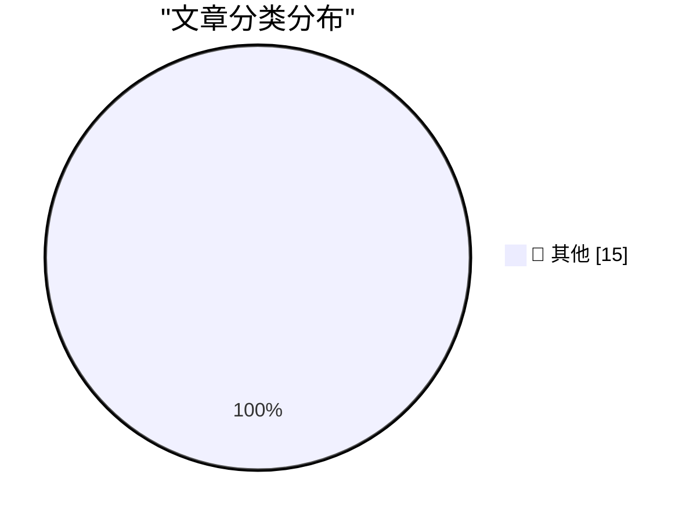

# 📰 AI 资讯每日精选 — 2026-11-22

> 汇聚 140+ 技术博客、X/Twitter、Hacker News、Reddit、Product Hunt、
> Lobste.rs、ClawFeed 日报及 GitHub Trending，经 AI 评分筛选。
>
> **本期内容**：🏆 今日必读 · 🌐 ClawFeed 日报 · 🔥 GitHub Trending · 📂 分类精选 · 🎨 设计与生成式 AI · 📊 数据概览

## 🏆 今日必读

🥇 **Muru**

[Muru](https://simonwillison.net/2026/Nov/21/muru/) — simonwillison.net · 3 小时前 · 📝 其他

> Muru

🥈 **To code well, avoid blunders**

[To code well, avoid blunders](https://seangoedecke.com/to-code-well-avoid-blunders/) — seangoedecke.com · 3 小时前 · 📝 其他

> To code well, avoid blunders

🥉 **★ A Week With the New Privacy Controls in MacOS 27.3 Beta 2**

[★ A Week With the New Privacy Controls in MacOS 27.3 Beta 2](https://daringfireball.net/2026/11/a_week_with_the_new_privacy_controls_in_macos_273) — daringfireball.net · 7 小时前 · 📝 其他

> ★ A Week With the New Privacy Controls in MacOS 27.3 Beta 2

4️⃣ **The U.S. — Utterly Predictably — Has Lost Measles Elimination Status Under Trump and RFK Jr.**

[The U.S. — Utterly Predictably — Has Lost Measles Elimination Status Under Trump and RFK Jr.](https://www.wsj.com/health/measles-is-back-it-will-take-years-to-eliminate-it-again-9971736e?st=GKiu3E) — daringfireball.net · 8 小时前 · 📝 其他

> The U.S. — Utterly Predictably — Has Lost Measles Elimination Status Under Trump and RFK Jr.

5️⃣ **Apple Documents Extra Apple Intelligence Usage Limits Per iCloud+ Paid Tier**

[Apple Documents Extra Apple Intelligence Usage Limits Per iCloud+ Paid Tier](https://support.apple.com/en-us/127901) — daringfireball.net · 9 小时前 · 📝 其他

> Apple Documents Extra Apple Intelligence Usage Limits Per iCloud+ Paid Tier

---

## 🌐 ClawFeed 日报精选

> 来源：[ClawFeed](https://clawfeed.kevinhe.io) — AI 驱动的多源新闻聚合

# ☀️ ClawFeed | 2026-11-21 日报 SGT

> 聚合自 3 期 8 小时简报：#1530 00:00 档（00:00-07:59）、#1531 08:00 档（08:00-15:59）、#1532 16:00 档（16:00-23:59），时间窗 2026-11-21 00:00–23:59 SGT（周六），三档都在。三期标题按发布时刻写：#1530 标题是「11-21 08:00」、#1531 是「11-21 16:00」、#1532 是「11-22 00:00」，所以各期正文里「11-21 08:00 那期」就是本日的 #1530，「11-21 16:00 那期」就是 #1531；「11-21 00:00 那期」指的是 #1528（窗口 11-20 16:00–23:59，已收进 11-20 日报 #1529），「11-20 16:00 那期」是 #1527，「11-20 08:00 那期」是 #1526，「11-20 00:00 那期」是 #1524；更早的「11-19 16:00 那期」是 #1523，「11-19 08:00 那期」是 #1522，「11-18 16:00 那期」是 #1519，「11-18 00:00 那期」是 #1516，「11-17 08:00 那期」是 #1514（按 11-20 日报的对照）。
> 素材数（都按各期自己写的数，和三期网站 metadata 的 feed 一致）：首页时间线窗内分别 118、123、107 条（合计 348），收了 47、31、25 条（合计 103）；关注抽样另算，三期都是抽 35 个账号、打开 24 个主页（23 个有内容、1 个是空的，出错 0），窗内分别 9、6、8 条，合计 23 条，收了 0、3、2 条（合计 5），都不在首页时间线里。书签三期分别抓到 17、17、18 条：#1530、#1531 窗内都是 0 条，跳过、没从旧书签里补；#1532 窗内 2 条（17:32、19:45），都收了。有一处对不上：#1530 写的最新一条书签是 11-20 07:43，#1531 写的最新一条却是 11-20 20:50；20:50 那条落在 11-20 16:00 档（#1528）的窗口里，不在本日窗口内，#1528 和 #1530 抓取时都没看到它（可能是 #1530 抓完之后才收藏的，这是推测；那条书签的内容三期素材里都看不到）。
> 这是 SGT 周六的一天：00:00 档美国东部是 11-20 周五上午 11 点到晚上 7 点，美股收盘（SGT 05:00）在中间，是这一天行情消息最多的一档；08:00 档美国是周五晚上 7 点到周六凌晨 3 点，美股已收盘，时间线里体育、媒体快讯和中文的周六白天闲聊占了大半；16:00 档美国是周六凌晨 3 点到上午 11 点，周末休市，#1532 自己写的是「没有特别大的新事件」。覆盖：#1530 是 11-21 08:01–08:07 抓的，两遍去重 238 条、最早翻到 11-19 19:47，覆盖完整，7 点档 29 条，其余每小时 11 到 14 条，分布比较匀；#1531 是 11-21 16:0x 抓的（16:07 抓完），去重 266 条、最早翻到 11-19 20:46，15 点档 49 条占了四成，其余每小时 8 到 15 条；#1532 是 11-22 00:0x 抓的，去重 254 条、最早翻到 11-20 07:04，23 点档 43 条占了四成，17 点档只有 3 条、16 点档 6 条、19 点档 5 条，那一段很薄、可能漏事。
> 主线：黎曼猜想的第二天。00:00 档纽约时报发了快讯（仍是「声称证明」），数学家 Bartosz Naskręcki 说 Andrew Sutherland 已经跑完对形式化证明的独立机器复核、「99.99999% 成立」（一方说法）；同一天美国数学会主席 Ravi Vakil 贴出 Alessandro Masullo 一份「全部由人类完成」的 940 页证明，00:00 档的转述里 RH、GRH 两种写法对不上，08:00 档 Quanta Magazine 的报道写明是广义黎曼猜想（GRH）；08:00 档马斯克转了 Grok 生成的汇总。其次是周五美股收盘和加密继续跌：纳指一天跌 5.3%（收盘前的快讯）、标普 500 七连跌，比特币先跌破 7 月初前低 57,800 美元，再到路透说的两年来最低、盘中跌破 57,000 美元，晚上有人说「昨天」到过 55,555 美元。第三是 Thinking Machines 的开放权重小模型 Inkling 2 Mini，三档都有：发布和结构、上架 LM Studio 和 CyberBench 结果、本地跑的速度。另有美国政府又一轮网络入侵（FBI 犯罪信息数据库、农业部）和 Ledger 的集体诉讼、OpenRouter 上几家服务商被确认把数据转回 MiniMax、Coinbase 说平台上最常用的 agent 是 Grok Bot、苹果股票的第一笔链上分红；还有纽约时报写黄仁勋的长文、特朗普要黄仁勋道歉、Paul Graham 谈英伟达董事会，Cursor 改名 Grok Build 的爆料，GPT-6.2 Astra 的机器人基准，ChatGPT Space 开放给 Plus，Google AI 订阅的黑五五折，以及一串 agent 工具的更新。

---

## 🔥 当日最重要 5 条（跨档去重）

1. **黎曼猜想的第二天：纽约时报快讯仍写「声称证明」；有数学家说 Sutherland 已跑完独立的机器复核、「99.99999% 成立」（一方说法）；同一天冒出另一份「全部由人类完成」、940 页的证明，Quanta 写明是广义黎曼猜想（GRH）；两份证明都没有素材能看到的正式核实，克雷研究所也没改状态（据 Grok 的汇总）**（#1530、#1531、#1532，接 11-20 日报 Alpöge 的声明）：凌晨：@nytimes 05:56：快讯「一位 Anthropic 数学家声称证明了黎曼猜想」，标题《Anthropic 数学家声称解决了数学界最著名的问题》（只有标题和一句话）；@nasqret 07:56（Bartosz Naskręcki，自称专业是算术几何）：「终于可以认真消化这份证明了（因为我们终于知道它完全正确）」，所引的同一作者 4 小时前那条说 Andrew Sutherland 第一个跑完了 nanoda 内核检查和 comparator 的「paranoid 模式」（一方说法，后文被截断，Sutherland 本人的帖子素材里看不到）；@MaxForAI 03:27：Ravi Vakil 发「紧急公告」，Alessandro Masullo 提出了 GRH 的证明，「全部由人类完成，没有使用 AI」，所引 Thomas Bloom 原帖写的却是一份「100% 人类完成」的 RH 证明声明、「只有 940 页」，几个月前完成、一直在私下审稿（转述）；@a16z 01:53、@a16zfrontier 02:44：a16z Frontier 11-19 录的那期节目刚讨论过「AI 给出一个没法读的千禧年难题证明会怎样」，Ittai Abraham 说给出 Lean 证明却给不出人能看懂的解释「有点出人意料」；@MaxForAI 00:08 标题写「2026 年菲尔兹奖得主邓煜老师锐评」，正文是「我的数学家朋友」从数学哲学角度否定这件事（转述，那位朋友是不是邓煜只在标题里出现）（#1530）。白天：@Leozayaat 08:22 引 Quanta Magazine：Vakil 贴出 Masullo 940 页的 GRH 证明手稿，「全部由人类完成，没有 AI」（媒体报道，证明本身没人核实；发帖人说 Vakil 是自己大学时的导师）；@elonmusk 15:46：「就算还没完全解决，也快了」，所引 Grok 的回答说 Lean 形式化约 1,740 万行、约 17.5 万个文件，人类可读的完整论证超过 25 万页，Sutherland 和 nanoda 等独立检查编译通过、零错误、只用了 Lean 的三条标准公理，克雷数学研究所还没改「未解决」的状态（Grok 根据 31 个网页生成的汇总，不是一手来源，后文被截断）；@ninja_maths 15:52（Alex Smith）赞同 Francesco Maggi：不理解对 Alpöge 声明的负面反应，已经有了一条公开的、经过 Lean 认证的路（个人观点）；@oran_ge 15:06：比起 AI 证明黎曼猜想，1859 年提出它的人更令人惊叹（个人观点），15:41 又转了一段讲黎曼当年没有计算机、没法检验上万亿个零点的文字（后文被截断）（#1531）。晚上 #1532 只剩 2 条一句话跟帖和 PANews 一条两份声明的转发，都进了噪音。**三期说法不一致的地方**：Masullo 那份是 RH 还是 GRH，#1530 的转述两种写法都有，#1531 引的 Quanta 写的是 GRH；「完全正确」「99.99999% 成立」（Naskręcki）和「零错误」（Grok 汇总）都不是一手的复核报告，复核细节素材里看不到。
   来源: https://x.com/nytimes/status/2123898294761820587 ｜ https://x.com/nasqret/status/2123928495210271171 ｜ https://x.com/MaxForAI/status/2123860792324002021 ｜ https://x.com/a16z/status/2123837158230573411 ｜ https://x.com/a16zfrontier/status/2123849878073971114 ｜ https://x.com/MaxForAI/status/2123810685733970426 ｜ https://x.com/Leozayaat/status/2123934999460360362 ｜ https://x.com/elonmusk/status/2124046857659650295 ｜ https://x.com/ninja_maths/status/2124048389172052066 ｜ https://x.com/oran_ge/status/2124036780135780840 ｜ https://x.com/oran_ge/status/2124045636106584174

2. **周五美股收盘和加密继续跌：纳指一天跌 5.3%（收盘前 11 分钟的快讯）、标普 500 七连跌，是 2020 年 2 月以来最长；比特币先跌破 7 月初前低 57,800 美元，白天路透说跌到两年来最低、盘中再次跌破 57,000 美元，恐惧贪婪指数「极度恐惧」；Strategy 和 BitMine 大额浮亏；「泡沫破了没有」两边都有人说**（#1530、#1531、#1532，接 11-20 日报比特币跌破 6 万美元和 Kobeissi 的长文）：凌晨：@AlArabiya_Brk 04:49（阿拉伯语快讯，X 机翻）：纳指跌 5.3%（收盘数素材里看不到）；@cnnbrk 05:34：标普 500 连跌第 7 天，是 2020 年 2 月以来最长；@oran_ge 05:45：「美股再次迎来黑色星期五」，「这次应该没有人再怀疑 AI 泡沫了吧」（个人观点）；@dongxi_nlp 06:51 推荐 Kobeissi 那篇，转述的结论相反：没有泡沫，也没有破裂（转述）；@Sea_Bitcoin 07:19：比特币快速跌破 7 月初前低 57,800 美元，从 8.7 万一路下来，同一天是 4 年前上一轮熊市最低点（个人整理）；@Bankless 02:01：Ryan Adams 对暴跌的猜测，素材里看到四个，其中「币安被黑」没有任何依据（都是猜测，第五个被截断）（#1530）。白天：@Reuters 14:50：比特币跌到两年来最低（只有标题）；@KongBTC 15:00：再次跌破 57,000 美元，Zcash 领跌，「之前喊抄底的人都安静了」；@Tradermayne 15:07（关注抽样）：在 55,000–56,000 美元附近又买了些现货，「不知道是不是底」（个人操作）；@PANewsCN 15:17：按比特币 58,036 美元、以太坊 1,632 美元算，Strategy 持有 850,849 枚比特币、均价 75,452 美元，浮亏约 23%（约 148 亿美元），BitMine 持有 6,077,745 枚以太坊、估算均价约 3,350 美元，浮亏超过一半（约 104 亿美元）（媒体估算）；@nancy_c813 09:00：Cathie Wood 拿 9,100 万美元押注 Anthropic 上市、同时加速减持加密资产（自媒体整理，没给出处，见「未证实」）；@indigox 14:10 引 Kobeissi：不是泡沫破裂，是正常回调，抛售是五件事叠加（个人观点）（#1531）。晚上：@zijing 23:38 引 K Society：「昨天」比特币已经跌到 55,555 美元，各城市币圈组织小饭局「彼此取暖」（社区说法，没给出处）；@0xmediaco 19:52：流传「再跌 25%，USDT 都可能出系统性风险」，帖子自己的反驳是 Tether 储备以美国短期国债为主（传言加媒体看法）（#1532）。**说法不一致的地方**：同一个 08:00 档里，PANews 按 58,036 美元算浮亏，KongBTC 说再次跌破 57,000，Tradermayne 说在 55,000–56,000 附近买入，关注抽样里比特唐三藏的截图是 57,909 美元（-6.32%），这些是不同时点、不同来源的数，素材里没有统一的最低价；「55,555 美元」只有 #1532 一条社区帖子；纳指 5.3% 是收盘前的快讯，oran_ge 写的是「5%」，正式收盘数三期都没有。
   来源: https://x.com/AlArabiya_Brk/status/2123881328881868975 ｜ https://x.com/cnnbrk/status/2123892663573241978 ｜ https://x.com/oran_ge/status/2123895558104547821 ｜ https://x.com/dongxi_nlp/status/2123912187613966424 ｜ https://x.com/Sea_Bitcoin/status/2123919255624356038 ｜ https://x.com/Bankless/status/2123839202614014268 ｜ https://x.com/Reuters/status/2124032612574368235 ｜ https://x.com/KongBTC/status/2124035083816382845 ｜ https://x.com/Tradermayne/status/2124036840718057551 ｜ https://x.com/PANewsCN/status/2124039402598859211 ｜ https://x.com/nancy_c813/status/2123944499370226041 ｜ https://x.com/indigox/status/2124022724565795315 ｜ https://x.com/zijing/status/2124165607000358967 ｜ https://x.com/0xmediaco/status/2124108644820414517

3. **Thinking Machines 发布开放权重的循环 Transformer「Inkling 2 Mini」：总参数 26B、激活 5.4B，24 层里中间 12 层循环 3 次，原生 NVFP4，AA 指数 20.1；当天 vLLM 支持，随后上架 LM Studio（约 18GB），Vals AI 说在 CyberBench 上和 Opus 5.5 打平（转发者自己存疑）；晚上 EXO Labs 给出本地速度，个人实测差很多**（#1530、#1531、#1532，三档都有）：@thinkymachines 04:10：「有人觉得 594B 参数的 Inkling 2 Small 太大」，Mini 只有 26B，小到能在笔记本上跑、够做 agent 工作（自家发布）；@JingyuanLiu123 07:34 引 Guangxuan Xiao（Thinking Machines 预训练）：结构细节如上，从大模型 logit 蒸馏而来；@Xianbao_QIAN 06:11 引 vLLM：当天支持（项目方说法）；@julien_c 04:18（Julien Chaumond）：「一个能在本地跑的、来自西方的最先进模型，正是时候」（个人评价）（#1530）。@lmstudio 09:55（关注抽样，两条）：上架 LM Studio，本地约需 18GB，Apache 2.0，在 100B 以下的模型里 DeepSWE v1.1（48.2%）和 Vals Index v2.2（46.5%）排第一，模型页写的是紧凑的视觉语言模型、100 万 token 上下文（自家发布）；@harpaljadeja 15:25 引 Vals AI：在 CyberBench 上和 Claude Opus 5.5（CVP）打平、成本不到四分之一，转发者说「可能说过头了，再核实一下」（第三方基准方说法）（#1531）。@xiaohu 23:12 引 EXO Labs：和 Thinking Machines 一起做了本地加速，96GB M5 Ultra Mac Studio 上解码每秒 210 token，48GB M5 Max MacBook Pro 上每秒 125 token，做原生天气 App 比 Claude Sonnet 5.5 快 1.8 倍（自家发布）；小互自己用 48GB M5 Max 只跑到每秒 33 token（个人体验，猜是 harness 拖慢了）；@aigclink 18:36：「有人说」它是能跑在 16GB 内存上的 Sonnet 5.5，总参数 26.4B、激活 3.4B（转述）（#1532）。**说法不一致的地方**：激活参数 5.4B（#1530 Thinking Machines 预训练成员的原帖）和 3.4B（#1532 aigclink 的转述）对不上，#1532 自己注明以原帖为准；总参数 26B 和 26.4B 写法不同；内存 16GB（aigclink）和 LM Studio 写的约 18GB 不一样；Vals AI 的 CyberBench 结果连转发者都存疑；EXO 的 125 token/秒和小互的 33 token/秒差了近 4 倍，后者是个人环境。
   来源: https://x.com/thinkymachines/status/2123871643797995872 ｜ https://x.com/JingyuanLiu123/status/2123922928161235444 ｜ https://x.com/Xianbao_QIAN/status/2123901955567395060 ｜ https://x.com/julien_c/status/2123873592228339993 ｜ https://x.com/lmstudio/status/2123958452808765580 ｜ https://x.com/lmstudio/status/2123958455652483500 ｜ https://x.com/harpaljadeja/status/2124041535570526437 ｜ https://x.com/xiaohu/status/2124159042423767463 ｜ https://x.com/aigclink/status/2124089654769303581

4. **安全和数据：FBI 在查全国犯罪信息数据库疑似被黑（CNN 说是几个月里第二次），路透转 NBC 报美国农业部被黑；Ledger 被提起拟议集体诉讼；OpenRouter 的邮件确认几家服务商把数据转回 MiniMax；Chainalysis 说中国关联钱包在新前沿模型发布后付款跳升 55%**（#1531、#1532，接 11-20 日报的网络总监辞职、农业部入侵和 Ledger 扩到德国）：@CNN 10:35、@cnnbrk 10:35：FBI 调查全国犯罪信息数据库的一次疑似被黑，是几个月里第二次（只有一句话）；@Reuters 11:20：路透转 NBC News，黑客入侵了美国农业部（只有标题；11-20 08:00 那期写过 Nextgov 报的同一件事，这次是路透和 NBC 跟进）；@wublockchain12 08:44：Hall Attorneys 等律所就 Ledger 硬件钱包涉嫌交付前被植入间谍装置提起拟议集体诉讼，10-30 已提交加州北区联邦地区法院，原告称经官方经销商买的两台 Ledger Flex 都通过了 Genuine Check，链接标题写损失约 105 万美元（媒体转述，后文被截断）（#1531）。@Rob1Ham 23:05 引 Nate Berkopec：收到 OpenRouter 的邮件，确认 Atlascloud、Novita（据说在 OpenRouter 上标的是美国、零数据保留）和 Streamlake 把数据转回了中国的 MiniMax，Rob Hamilton 推荐 TEE 机密计算（转述的邮件，OpenRouter 原文素材里看不到；后面是个人观点，带推广）；@Cointelegraph 23:30：Chainalysis 说中国用户在用稳定币为被禁用的美国 AI 模型付费（媒体快讯，报告原文素材里看不到）；@zhuanfgghjnb 19:04 引 GCSA 11-21 安全周报：Wagyu 的 XMR1 部署者私钥放在早就删掉的旧服务器上，托管商被黑、文件还在，被转出 520 万枚（转述，后文被截断）（#1532）。
   来源: https://x.com/CNN/status/2123968428700496136 ｜ https://x.com/cnnbrk/status/2123968459000127951 ｜ https://x.com/Reuters/status/2123979773974073808 ｜ https://x.com/wublockchain12/status/2123940588982796451 ｜ https://x.com/Rob1Ham/status/2124157365083599047 ｜ https://x.com/Cointelegraph/status/2124163503086858461 ｜ https://x.com/zhuanfgghjnb/status/2124096652860616946

5. **agent 和加密金融走近：第一笔代币化苹果股票的链上分红用 USDC 直接打到钱包；Coinbase 说平台上最常用的 agent「目前」是 Grok Bot，Coinbase for Agents 交易量不断创新高；Strategy CEO Phong Le 说「agent 会有银行」；Base 一周上线 11 只代币化股票（含 Anthropic）**（#1530、#1532）：@jerallaire 04:07（Jeremy Allaire）引 Carlos Domingo：第一笔代币化苹果股票的链上分红已经发出，Allaire 说是「用数字美元实时分红」的第一笔（自家和合作方发布；#1531 噪音里 Securitize 那条只多了每单位 0.27 美元）（#1530）。@coinbase 22:39：最常用的是 Grok Bot，Claude、ChatGPT 和自建的在追（自家数据，没给具体数字）；@BitcoinNews 23:45：Phong Le 这周说「agent 会有银行，agent 会做买卖」，所引前一条还说三年内所有证券都会以代币化形式全天候交易（个人预测，媒体转述）；@base 18:08：Base 新上线 11 只代币化股票，包括 Anthropic、可口可乐、沃尔玛、Adobe，Base Batches 004 在纽约开了 Demo Day（自家发布）（#1532）。#1530 噪音里还有 Jesse Pollak「agent 金融是 2027 的大趋势」、Raoul Pal「agent 是无限的用户」两条一句话。
   来源: https://x.com/jerallaire/status/2123870807286075785 ｜ https://x.com/coinbase/status/2124150603584844208 ｜ https://x.com/BitcoinNews/status/2124167199795581327 ｜ https://x.com/base/status/2124082565573230932

**⚠️ 未证实（素材里核实不了，只记录说法）**
- 「Sutherland 已跑完 nanoda 内核和 comparator 的 paranoid 模式复核，黎曼猜想 99.99999% 成立 / 完全正确」：@nasqret 07:56 一方说法，Sutherland 本人的帖子和复核细节素材里看不到（#1530）。https://x.com/nasqret/status/2123928495210271171
- 「Lean 形式化约 1,740 万行、约 17.5 万个文件，人类可读论证超过 25 万页，独立检查零错误」：@elonmusk 15:46 所引的是 Grok 根据网页生成的汇总，不是一手来源（#1531）。https://x.com/elonmusk/status/2124046857659650295
- 「Masullo 证明了（广义）黎曼猜想，940 页、全部由人类完成」：@MaxForAI 03:27 的转述里 RH、GRH 写法对不上，@Leozayaat 08:22 引 Quanta 写的是 GRH 手稿；证明本身没人核实（#1530、#1531）。https://x.com/MaxForAI/status/2123860792324002021 ｜ https://x.com/Leozayaat/status/2123934999460360362
- 「2026 年菲尔兹奖得主邓煜锐评」：@MaxForAI 00:08 只在标题里这么写，正文是「我的数学家朋友」（#1530）。https://x.com/MaxForAI/status/2123810685733970426
- 「这轮暴跌是因为币安被黑等」：@Bankless 02:01 Ryan Adams 的猜测，「币安被黑」没有任何依据（#1530）。https://x.com/Bankless/status/2123839202614014268
- 「Strategy 浮亏约 148 亿美元、BitMine 浮亏约 104 亿美元」：@PANewsCN 15:17 媒体估算，BitMine 均价是估算的，后文被截断（#1531）。https://x.com/PANewsCN/status/2124039402598859211
- 「Cathie Wood 拿 9,100 万美元押注 Anthropic 上市、加速减持加密资产；Tether 销毁 40 亿枚 USDT」：@nancy_c813 09:00 自媒体整理，没给出处（#1531）。https://x.com/nancy_c813/status/2123944499370226041
- 「比特币『昨天』已经跌到 55,555 美元」：@zijing 23:38 社区帖子里的说法，没给出处（#1532）。https://x.com/zijing/status/2124165607000358967
- 「加密再跌 25%，USDT 可能出系统性风险」：@0xmediaco 19:52 记录的传言，帖子本身就反驳了（#1532）。https://x.com/0xmediaco/status/2124108644820414517
- 「Inkling 2 Mini 激活 3.4B、能跑在 16GB 内存上的 Sonnet 5.5」：@aigclink 18:36 转述的「有人说」，和 #1530 原帖的 5.4B 对不上（#1532）。https://x.com/aigclink/status/2124089654769303581
- 「Inkling 2 Mini 在 CyberBench 上和 Opus 5.5 打平」：@harpaljadeja 15:25 引 Vals AI，转发者自己说可能说过头了（#1531）。https://x.com/harpaljadeja/status/2124041535570526437
- 「OpenRouter 上的 Atlascloud、Novita、Streamlake 把数据转回 MiniMax」：@Rob1Ham 23:05 转述 Nate Berkopec 收到的邮件，OpenRouter 原文素材里看不到（#1532）。https://x.com/Rob1Ham/status/2124157365083599047
- 「新前沿模型发布后中国关联钱包付款跳升 55%」：@Cointelegraph 23:30 只有一句快讯，Chainalysis 报告原文素材里看不到（#1532）。https://x.com/Cointelegraph/status/2124163503086858461
- 「Cursor 改名 Grok Build，Grok Build CLI 2.0 在 alpha 渠道」：@astropol0 04:41、@mark_k 06:38 都引 Puck（GrokInsider）的爆料，没有 Cursor 或 SpaceX 的官方确认；#1532 噪音里又有 2 条引同一条爆料，仍没有确认（#1530）。https://x.com/astropol0/status/2123879505483952446 ｜ https://x.com/mark_k/status/2123908808284205467
- 「上市后亚马逊持股 14.7%、谷歌 13.7%，联合创始人合计 12.8%，公众 6.3%」：@FuSheng_0306 01:48 引的自媒体整理，没给出处，后文被截断（#1530）。https://x.com/FuSheng_0306/status/2123835937251790873
- 「纽约时报长文写黄仁勋让羞辱员工成为常态」：@colinwu 07:13 引的转述，原文素材里看不到（#1530）。https://x.com/colinwu/status/2123917574757101995
- 「特朗普敦促黄仁勋道歉」「Lutnick 曾要求 Pure Lithium 接受政府接管」：@Reuters 13:50、@Reuters 12:10 只有标题，原因素材里看不到（#1531）。https://x.com/Reuters/status/2124017498819379575 ｜ https://x.com/Reuters/status/2123992347717329173
- 「贝佐斯首次公开介绍 Prometheus，估值 410 亿美元、累计融资约 145 亿美元」：@KKaWSB 00:33 自媒体整理，没给出处（#1530）。https://x.com/KKaWSB/status/2123816952837832886
- 「Karpathy 70 分钟展示自己每天怎么用 AI」：@huxlab 12:54 转述，视频出处素材里看不到（#1531）。https://x.com/huxlab/status/2124003386471358810
- 「深圳一家年营收几十亿的跨境电商用 DeepSeek Harness 把整条业务流做成了 agent」：@harrisonitsme 21:07 二手见闻，没写公司名（#1532）。https://x.com/harrisonitsme/status/2124127665833873598
- 「WorkBuddy 一两个月后会变成第一大工具」：@yiren_ai 12:14 社群数据加个人判断（#1531）。https://x.com/yiren_ai/status/2123993402698297457
- 「张涛说视频模型延迟降到 1 秒以内可能成为新一代 OS」：@hocyzon 20:26 转述的文字稿，后文被截断（#1532）。https://x.com/hocyzon/status/2124117331618246890
- 「姚顺雨说 AI 时代招人的关键素质是 Low Ego」：@colinwu 17:32 的转述，原始出处素材里看不到（书签，#1532）。https://x.com/colinwu/status/2124073385714213245

**次重要（备选）**
- 黄仁勋和英伟达（接 11-20 日报 TechCrunch 的「管理风格」标题）：纽约时报长文见「未证实」（#1530）；@Reuters 13:50 特朗普要黄仁勋道歉、@Reuters 12:10 Lutnick 和 Pure Lithium（只有标题）；@Jason 14:14（Jason Calacanis）：「黄仁勋是那种杀手愿意跟着上战场的领导」（个人观点）（#1531）；@sleepy0x13 18:59 引 Paul Graham：「所有人都觉得董事会犯了大错，除了董事会自己」（个人观点）（#1532）。https://x.com/colinwu/status/2123917574757101995 ｜ https://x.com/Reuters/status/2124017498819379575 ｜ https://x.com/Reuters/status/2123992347717329173 ｜ https://x.com/Jason/status/2124023697447231545 ｜ https://x.com/sleepy0x13/status/2124095406934278290
- Cursor 改名 Grok Build（接 11-20 日报 CNBC 说「SpaceX 旗下的 Cursor」考虑停用中国模型）：爆料内容见「未证实」，Astro Polo 补充桌面和网页版会围绕团队 agent 工作流改版（#1530）。https://x.com/astropol0/status/2123879505483952446 ｜ https://x.com/mark_k/status/2123908808284205467
- GPT-6.2 Astra（接 11-20 日报的 Blueprint-Bench 2）：@gdb 04:30 引 XDOF：Astra 在机器人基准 Ember-0 上 41.2%，9 月初 GPT 6 Astra 是 19.6%（第三方基准方说法）；@Techub_News 07:41 两条标题：OpenAI 加强 GPT-6.2 Astra 和 Sol 的内部推理保护，Cerebras 和微软签云服务协议、成为第三家超大规模客户（都只有标题）（#1530）。https://x.com/gdb/status/2123876651583111322 ｜ https://x.com/Techub_News/status/2123924785692348553 ｜ https://x.com/Techub_News/status/2123924800057815329
- Anthropic 上市后的股权（接 11-20 日报的开盘、收盘和「绿鞋」）：@FuSheng_0306 01:48（傅盛）引的整理见「未证实」，傅盛的评价是「特别奇葩……然后能上市」（#1530）。https://x.com/FuSheng_0306/status/2123835937251790873

---

## 📰 当日核心主题

**① OpenAI、Google 和其他模型（三期都有）**
OpenAI（#1530）：@gdb 03:06 引 ChatGPT：ChatGPT Space 开放给 Plus 用户，可以和别人一起做交互页面、幻灯片和网站，手机上也能编辑（自家发布；#1532 噪音里的「面向 Plus 全球推送」是同一件事）；@gdb 03:22 引 OpenAI：新基准 MedChemBench，衡量 AI 在药物化学上的推理（自家发布，分数素材里看不到）；@OpenAI 06:00：GPT-Rosalind 和 Perturb AI、Scripps Research 合作研究神经退行性疾病，提出恢复胆固醇转运能否保护神经元的新线索（自家发布，后文被截断）（https://x.com/gdb/status/2123855521996570772 ｜ https://x.com/gdb/status/2123859658473668694 ｜ https://x.com/OpenAI/status/2123899406550528422）。Astra 见「次重要」。
Google（#1530、#1531）：@vikaskansalHQ 01:38（Vikas Kansal）：当天到 11-26，Google AI Plus 和年付 Pro 最高五折，面向现有订阅用户提前开放（自家发布，后文被截断）；@zzgo_sh 05:13：还没订阅的要等到 11-27 黑五当天（个人整理）；@ohouhou717 07:31：同样二十块，Opus 5.5 能撑一周、Neon 一天半就差不多用完（个人体验）；@servasyy_ai 07:24：Google 免费放出一门近 2 小时的 Harness 工程课（转述，课程链接素材里看不到）（#1530）；@Gorden_Sun 15:56 引 Google Gemini：Gemini App 能生成 GIF，用的是 Gemini Omni 1.2 Flash（自家发布，后面是个人评价「比 GPT 的好很多」）（#1531）（https://x.com/vikaskansalHQ/status/2123833450297995624 ｜ https://x.com/zzgo_sh/status/2123887390213455883 ｜ https://x.com/ohouhou717/status/2123922085370315104 ｜ https://x.com/servasyy_ai/status/2123920523789037664 ｜ https://x.com/Gorden_Sun/status/2124049230566453321）。
开放权重和训练方法：Inkling 2 Mini 见前 5 条第 3 条；@lucataco 07:39：把 Clairic 两个模型转成 MLX 4-bit 在 Mac 上跑（clairic-flash 6.2 GB、clairic 16.4 GB；Clairic 是什么素材里没说明）（#1530）；@elonmusk 15:30：「SFT 更像拿电锯理发」，应该并进主训练，「system prompt」也很蠢（个人观点，后文被截断）（#1531）；@rasbt 22:05（Sebastian Raschka）：美国和中国的开放权重模型互相推动，闭源模型没有开放权重也不会这么便宜，「竞争是好事」（个人观点）（#1532）（https://x.com/lucataco/status/2123924179195965689 ｜ https://x.com/elonmusk/status/2124042864891982292 ｜ https://x.com/rasbt/status/2124142247285235990）。

**② Agent 和开发工具（三期都有）**
凌晨（#1530）：@cramforce 07:49（Malte Ubl）：Vercel Board 的 skill 合入按 harness 区分的工具映射，把各家 harness 里 agent 间通信的内置工具映射到 Board 命令（自家发布，接 11-19 16:00、11-20 16:00 两期）；@yibie 02:14 引 Matt Pocock 的「今日提示词」：让 agent 把代码注释分成「同义反复」「借口」等几类（后文被截断）；@mihail_eric 03:51：「软件工厂」的组件，第一条原则是 agent 就绪优先（后文被截断）；@htahir111 02:02（Hamza Tahir）：长文《从 trace 开始给 agent 建评测》（个人分享）；@gitlab 02:15：GitLab 19.6 加了定时自动化，按固定频率跑 Duo Agent Platform 的流程（自家发布）；@rauchg 04:00：Vercel 拿到 ISO/IEC 42001:2023 认证，Rauch 称之为「AI 的 SOC2」（自家发布）；@AravSrinivas 00:10：Perplexity 的 Computer 模式里能设「队友」（自家发布）；@mvanhorn 04:59 引 Granola：苹果允许 iPhone 上不切 App 就用 LLM 语音输入（个人推荐，苹果的说明素材里看不到）；@larsencc 05:30：Grok bot 用量烧得太快，汇总了 572 个用户说的耗量原因（后文被截断）；@brian_armstrong 06:16：贴出自己的 AI 工作流图，很多 PR 仍要大改、审阅负担很重（个人分享，后文被截断）（https://x.com/cramforce/status/2123926740842213768 ｜ https://x.com/yibie/status/2123842389035130902 ｜ https://x.com/mihail_eric/status/2123866740019077553 ｜ https://x.com/htahir111/status/2123839496437334458 ｜ https://x.com/gitlab/status/2123842701929975909 ｜ https://x.com/rauchg/status/2123869175085191298 ｜ https://x.com/AravSrinivas/status/2123811155605164259 ｜ https://x.com/mvanhorn/status/2123884068152730032 ｜ https://x.com/larsencc/status/2123891636694298977 ｜ https://x.com/brian_armstrong/status/2123903397095215184）。
白天（#1531）：@shao__meng 09:15 引 Matt Pocock：第一个给非开发者的 skill「/vector」，六个步骤把一项任务委托给 AI（自家发布）；@shao__meng 15:33 引 Langfuse 的 Annabell Schäfer《Evaluating proactive agents》：主动式 agent 大多数决定是「什么都不做」且没人审，该做没做的不会留下失败记录（转述，后文被截断）；@opencode 15:10：OpenCode Console 支持 OIDC 无密钥认证（自家发布）；@KingBootoshi 15:50 引 0xSero：「Skill Distill」把 Opus 5.5 做过的工作蒸馏成给开放权重或本地模型用的 skill（项目方发布）；@GitHub_Daily 15:30：Splash，苹果芯片 Mac 上的开源本地推理引擎，一条命令把 Claude Code 或 Codex 接到本地模型（项目介绍，速度对比被截断）；@im23pds 13:14 引 Harrison Green：CCS 2026 论文 STITCH，fuzzer 边跑边拼出 C 库的调用序列，测了 1,000 多个库、100 多个 bug 已修复（作者说法）；@yiren_ai 12:14：生财 TokenRank 上 Codex 被吐槽最多、但用的人最多，WorkBuddy 第二（见「未证实」）；@liyue_ai 15:10：WorkBuddy 上线电脑应用操控，能直接操控微信（个人体验）；Karpathy 视频见「未证实」（https://x.com/shao__meng/status/2123948393009422679 ｜ https://x.com/shao__meng/status/2124043580415385946 ｜ https://x.com/opencode/status/2124037654639468759 ｜ https://x.com/KingBootoshi/status/2124047725843153141 ｜ https://x.com/GitHub_Daily/status/2124042641134526652 ｜ https://x.com/im23pds/status/2124008516310782237 ｜ https://x.com/yiren_ai/status/2123993402698297457 ｜ https://x.com/liyue_ai/status/2124037626848239750 ｜ https://x.com/huxlab/status/2124003386471358810）。
晚上（#1532）：@Guluhehe 20:11（李简AI）：读了 DeepSeek Harness、Pi、LangChain、Grok Bot 的设计，归纳出 Always-on Agent 的三个共识，如「常驻不等于一直在跑」（个人总结，后文被截断）；@alacheng 20:25：推荐 Meta Muse 产品负责人 Mona Sarantakos 的首次播客访谈（转述，「App Store 第一」是视频标题的说法）；@VivianBala 22:38（新加坡外交部长 Vivian Balakrishnan）：把之前在树莓派上用 NanoClaw 跑的「外交官第二大脑」在 Claude Duet 里重做，做法和提示词放在 GitHub Gist（本人发布）；@dani_avila7 23:53：AI Templates 推出 Harness Components 排行榜，按 CLI 实际安装量给 2,000 个组件排名，已统计 170 多万次安装（自家发布）；@samuel_ys92 22:04 引 Artificial Analysis：Parallel Search 在搜索指数上 83 分，和 Keenable Search（pro）并列第一（第三方基准）；@garrytan 22:43：自己「软件工厂」里约一半的工作在用 Capy（个人推荐）；@awe0_io 17:00：开源组件库 Tool UI（项目介绍）；@9hills 20:03：orca 更新了 bot 功能（个人体验）；@0xLogicrw 22:29 引 sida：开源笔记应用 Quiet.md（作者说法，后文被截断）；@fankaishuoai 23:38（范凯）：「一个固定入口、两套 agent 软件、三份订阅」，订阅每月不到 200 美元（个人配置，后文被截断）；深圳跨境电商和张涛两条见「未证实」；关注抽样两条：@LimestoneHQ 20:29：agent 跑错了别急着改提示词，每次失败由人标根因，第一个是「缺上下文」（自家经验）；@mardehaym 22:19：医疗 AI 演示反复出问题的 8 处，第一处是每家保险方流程不一样（自家经验，带咨询推广）（https://x.com/Guluhehe/status/2124113594036170994 ｜ https://x.com/alacheng/status/2124117094640042225 ｜ https://x.com/VivianBala/status/2124150500199424163 ｜ https://x.com/dani_avila7/status/2124169386982506650 ｜ https://x.com/samuel_ys92/status/2124141878698520953 ｜ https://x.com/garrytan/status/2124151626286170609 ｜ https://x.com/awe0_io/status/2124065393832845707 ｜ https://x.com/9hills/status/2124111341673943135 ｜ https://x.com/0xLogicrw/status/2124148307463446802 ｜ https://x.com/fankaishuoai/status/2124165532282982533 ｜ https://x.com/harrisonitsme/status/2124127665833873598 ｜ https://x.com/hocyzon/status/2124117331618246890 ｜ https://x.com/LimestoneHQ/status/2124117967516717204 ｜ https://x.com/mardehaym/status/2124145558688563373）。

**③ 公司、行业和政策（三期都有）**
凌晨（#1530）：@Techub_News 06:41：哈佛研究说美国超大规模数据中心一年用电约 820 亿千瓦时、占全国 1.8%（只有标题）；贝佐斯和 Prometheus 见「未证实」（https://x.com/Techub_News/status/2123909582154080523 ｜ https://x.com/KKaWSB/status/2123816952837832886）。白天（#1531）：@Cointelegraph 15:30：据报道孙正义曾探讨为 1 万亿美元收购 SK 海力士融资，软银说已不再考虑（媒体转述；#1532 噪音里路透的同一条）；@sleepy0x13 09:37 引 WIRED：16 岁的拉脱维亚高中辍学生创办 Polemos Industries 做 AI 制导导弹，商业计划里写着「cost per kill」（媒体报道的转述；「50 万美元是 YC 给的」是转发者的说法）（https://x.com/Cointelegraph/status/2124042694179565674 ｜ https://x.com/sleepy0x13/status/2123953838575300807）。晚上（#1532）：@Cointelegraph 23:52：特朗普说准备和民主党合作，把信用卡利率在一年内封顶 10%（媒体快讯，只有一句话）（https://x.com/Cointelegraph/status/2124169102587548117）。黄仁勋、Cursor 见「次重要」。

**④ 加密（三期都有）**
大跌见前 5 条第 2 条，agent 金融和链上分红见第 5 条，Ledger 诉讼见第 4 条。凌晨（#1530）：@btcinsider__ 07:46 引 256 Foundation：嘉楠开源了 Avalon Nano 3s 的原厂固件，MIT 许可，alpha 版、刷机要小心（第三方说法）；@DeepFortyTwo 07:44：Stellar 的 Bell 升级（Protocol 30）把 ML-DSA 后量子签名校验做成 Soroban 原生 host function，主网验证者 11-23 投票（项目方说法）；@toly 07:13 转 LambdaClass：PropAMM Router 的第一个 10 亿美元（只有导语）（https://x.com/btcinsider__/status/2123926001625579631 ｜ https://x.com/DeepFortyTwo/status/2123925509738463474 ｜ https://x.com/toly/status/2123917670148096323）。

---

## 🔖 书签精选

当日窗内书签只有 #1532 的 2 条（#1532 抓到 18 条），都收了；#1530、#1531 各抓到 17 条，窗内都是 0 条，跳过、没从旧书签里补（最新一条时间两期写法不同，见开头）。
- @it_works_123 19:45：Pi Bot 开源（Apache-2.0）：在自己电脑上干活的 AI 团队，一群有名字的 bot，可以私聊，也可以拉进群里分工，做计划、跑命令、改文件、互相交接（项目方发布；时间线里 geekbb 转了同一条，进了噪音）。https://x.com/it_works_123/status/2124106873729421365
- @colinwu 17:32 转述姚顺雨：AI 时代招人的一个关键素质是 Low Ego，愿意承认不知道、推翻自己之前的判断；今天引以为傲的技术能力，半年后可能被 AI 工具轻松做到（转述，原始出处素材里看不到，见「未证实」）。https://x.com/colinwu/status/2124073385714213245

---

## 👀 推荐关注汇总（去重，共 11 个；各期写稿时都在浏览器里核实过「未关注」：#1530 在 11-21 08:10–08:13，#1531 在 11-21 16:11–16:13，#1532 在 11-22 00:11–00:13 SGT，本日报没有重新核实）

**模型和基准的一手信息**
- @julien_c（Julien Chaumond，Hugging Face 联合创始人兼 CTO；9.18 万关注者；你关注的人里约 283 个也关注了）：本期是对 Inkling 2 Mini 的评价，主页同一时间还贴了用 llama serve 跑 Inkling 2 Mini GGUF 的命令（#1530）。https://x.com/julien_c
- @Guangxuan_Xiao（Guangxuan Xiao，Thinking Machines 预训练、MIT EECS 博士；5,977 关注者；你关注的人里约 61 个也关注了）：Inkling 2 Mini 结构细节的原帖作者；关注者不到 1 万，按「知名公司研究员、一手内容、被多个已关注的人关注」推荐，发帖少（共 206 条）（#1530）。https://x.com/Guangxuan_Xiao
- @ValsAI（Vals AI，公开的 LLM 评测；3.16 万关注者；你关注的人里约 116 个也关注了）：Inkling 2 Mini 在 CyberBench 上和 Opus 5.5 打平的原帖作者（#1531）。https://x.com/ValsAI
- @0xSero（0xSero，研究员，管着一个 5,900 人的本地 AI 社区；8.13 万关注者；你关注的人里约 246 个也关注了）：Skill Distill 的原帖作者，本地模型和开放权重方向（#1531）。https://x.com/0xSero

**agent 工程和 builder**
- @mihail_eric（Mihail Eric，Monaco 的 AI 负责人，在斯坦福教 AI 生产力课；2.09 万关注者；你关注的人里约 56 个也关注了）：本期是「软件工厂」的组件和原则（#1530）。https://x.com/mihail_eric
- @mvanhorn（Matt Van Horn，June 和后来成为 Lyft 的公司的联合创始人，开源了 last30days 和 Printing Press；4.41 万关注者；你关注的人里约 139 个也关注了）：本期是 iPhone 上 LLM 语音输入放开的提醒（#1530）。https://x.com/mvanhorn
- @mattpocockuk（Matt Pocock，Total TypeScript 和 AI Hero 的作者；39.7 万关注者；你关注的人里约 306 个也关注了）：/vector skill 的原帖作者，#1530 那条注释提示词也是出自这里（#1531）。https://x.com/mattpocockuk
- @capydotai（Capy，「给工程团队的 agent 集群」的官方账号；1.17 万关注者；你关注的人里约 36 个也关注了）：Garry Tan 推荐的 iOS 版 TestFlight 的原帖（#1532）。https://x.com/capydotai
- @VivianBala（Vivian Balakrishnan，新加坡外交部长；12.95 万关注者；你关注的人里约 31 个也关注了）：本期是在 Claude Duet 里重做「外交官第二大脑」并公开做法，少见的政府高层亲手搭 agent 的一手内容（#1532）。https://x.com/VivianBala

**中文 AI 圈的一手观察**
- @yiren_ai（亦仁，生财有术社群的创始人；2.5 万关注者；你关注的人里约 88 个也关注了）：本期是生财 TokenRank 的工具使用榜；账号 2026-10 才注册、共 153 条帖子（#1531）。https://x.com/yiren_ai
- @9hills（九原客，聚焦大模型；2.88 万关注者；你关注的人里约 116 个也关注了）：本期是 orca bot 功能的使用体验，主页同时在发国内 harness 缓存命中率的实测（#1532）。https://x.com/9hills

（三期另有 28 个显示未关注但没推荐的账号，@cnnbrk 在 #1530、#1531 各出现一次，去重后 27 个：#1530 的 @AravSrinivas、@yibie（两个都是前几期推荐过、仍未关注，不再重复推荐）、@larsencc、@thomasfbloom、@htahir111、@vikaskansalHQ、@AlArabiya_Brk、@cnnbrk、@Bankless、@gitlab、@astropol0、@zzgo_sh；#1531 的 @QuantaMagazine、@Frances01896069、@annabellschfr、@hgarrereyn、@huxlab、@Reuters、@CNN；#1532 的 @0xmediaco、@Guluhehe、@awe0_io、@0xLogicrw、@harrisonitsme、@it_works_123、@nateberkopec、@GCSA_COM。理由是综合媒体发帖量大、领域偏离（数学、Ruby）、公司官号以营销为主、偏转述，或关注者很少「可以先观察」（@larsencc、@htahir111、@annabellschfr、@hgarrereyn、@Guluhehe、@it_works_123）。）

**建议取关**：三期都没有提出取关建议。

---

## 💤 重复噪音模式

三期过滤掉的时间线 245 条（#1530 71、#1531 92、#1532 82），收了 103 条（47、31、25）；关注抽样窗内 23 条（9、6、8），收了 5 条（0、3、2），没收 18 条。按类别（三期分类口径不完全一样，下面是合并后的数）：
- **推广、活动和公司公告**：56 条（#1530 23、#1531 15、#1532 18；币安曼谷区块链周三期都有（#1530 门票、#1531 自称靠内幕清仓的那条、#1532 活动日历），BNB 曼谷黑客松在 #1530、#1532 都有；Notion 的 notion.com/nsfw 在 #1530 有 2 条；Wispr Flow 学生优惠、Warp 的软件工厂课程、孙宇晨喊 TRX 和 JST、ZOTH 社区销售 2 条、Yoroll 的 Fable 5.2 折扣、Minara 的 CTA 策略「15 天跑赢比特币 40.7%」、CC Desk Tunnel「防封号」等）。
- **重复转发和前几期写过的**：20 条（#1530 的 Google 黑五五折重复转发和 Neon 一句话 4 条；#1531 6 条：AlexFinn 吹 Inkling 2 Mini（还误写成 Inkling 2 Small）、Securitize 苹果股票分红、Mihail Eric 的软件工厂图、Notion「NSFW」、harness 组合泛化论文、姚顺雨和混元的 Reddit AMA；#1532 10 条：PANews 两份黎曼证明声明的转发、Notion「NSFW」第三次、Cursor 改名 Grok Build 2 条、Gemini 4 Neon 的 BREAKING、ChatGPT Space 全球推送、路透的孙正义和 SK 海力士、Gemini 生成 GIF、Impeccable 等设计 skill、Balaji 谈 Netflix 的 FTX 剧）。
- **黎曼猜想的一句话跟帖**：6 条（#1530 4：Yuchen Jin、Chase Wang 引姚顺雨「OMG」、rick awsb「奇点快乐」、Neso 质疑在破发边缘「恰巧」放出消息；#1532 2：Matthew Pines、「黎曼猜想被解决了」的转发；#1531 噪音里 rickawsb 的「P=NP」算在加密场边）。
- **AI 和科技相关但没有信息量**：64 条（#1530 14、#1531 23、#1532 27；DHH 谈 AI 打破 App 锁定在 #1530、#1531 都有（#1531 2 条）；Grok Bot 相关的入门教程、meetup、代运营接单、「值不值 30 美元」散在 #1531、#1532；范凯工具箱另 2 条（和正文同一套）；geekbb 转 Pi Bot（和书签同一件事）；姚顺雨分享笔记在 #1530、#1532 都有；王川「token 数像 page view」、Codex 的「声学验证」、omarsar0 2 条等）。
- **加密和行情场边**：21 条（#1530 8、#1531 6、#1532 7；「又看到 5 开头的 BTC」、Saylor 讲自己股票跌 99.8% 的旧语录、彼得·林奇谈回调、Kelly 仓位、加密 VC 转 AI、CZ 骂 Netflix 的 FTX 剧（11-20 00:00 那期写过那部剧；#1532 Balaji 谈同一部剧算在重复里）、读狱中 SBF 专访的感想）。
- **新闻、时政、体育、娱乐和闲聊**：78 条（#1530 18 = 新闻时政 6 + 闲聊 12；#1531 42 = 游戏体育娱乐 15 + 新闻时政 9 + 闲聊 18；#1532 18 = 游戏娱乐 3 + 新闻时政 4 + 闲聊 11；GTA 在 #1531、#1532 都有；SpaceX 发射在 #1531、#1532 都有；#1531 周六白天的空帖和一句话最多）。
- **关注抽样里没收的**：18 条（#1530 9、#1531 3、#1532 6；Startup Wisdom 的语录在 #1530、#1532 各 2 条，Tradermayne 的一句话和行情帖三期都有，比特唐三藏的段子在 #1530、#1531 都有，Sierra 3 条和 RightNow 2 条自家宣传在 #1530，Limestone 的免费指南和 Mark Ajzenstadt 的预约咨询广告在 #1532）。
- **同一话题延续**：黎曼猜想（11-20 日报 Alpöge 的声明 → #1530 纽约时报快讯、Sutherland 复核、Masullo 的另一份证明 → #1531 Quanta 写明 GRH、马斯克转 Grok 的汇总 → #1532 只剩噪音，https://x.com/nasqret/status/2123928495210271171 ｜ https://x.com/Leozayaat/status/2123934999460360362）；美股和加密（11-20 日报跌破 6 万美元 → #1530 纳指跌 5.3%、跌破 57,800 → #1531 两年来最低、跌破 57,000 → #1532「55,555」和 USDT 传言，https://x.com/Sea_Bitcoin/status/2123919255624356038 ｜ https://x.com/KongBTC/status/2124035083816382845 ｜ https://x.com/zijing/status/2124165607000358967）；Inkling 2 Mini（#1530 发布 → #1531 LM Studio 和 CyberBench → #1532 本地速度，https://x.com/thinkymachines/status/2123871643797995872 ｜ https://x.com/lmstudio/status/2123958452808765580 ｜ https://x.com/lmstudio/status/2123958455652483500 ｜ https://x.com/xiaohu/status/2124159042423767463）；黄仁勋（11-18 08:00 那期卸任 → 11-20 日报 TechCrunch 标题 → #1530 纽约时报长文 → #1531 特朗普要求道歉 → #1532 Paul Graham 谈董事会）；Cursor（11-20 日报 CNBC → #1530 Grok Build 爆料 → #1532 噪音里 2 条同一爆料）；网络安全（11-20 日报网络总监辞职和农业部 → #1531 FBI 数据库和路透跟进农业部；Ledger 11-20 日报扩到德国 → #1531 集体诉讼）；Anthropic 上市（11-20 日报 → #1530 股权结构 → #1531 Cathie Wood 的传言 → #1532 Base 上线代币化 Anthropic、关注抽样里 Polymarket Perps 的 IPO 比赛）；Vercel Board（11-19 16:00、11-20 16:00 两期 → #1530 跨 harness 工具映射）；Matt Pocock（#1530 注释提示词 → #1531 /vector skill）；WorkBuddy（11-20 16:00 那期写过小程序 → #1531 工具榜第二和电脑应用操控）。---

## 🔥 GitHub Trending

> 今日热门开源项目（全语言 + Python）

| # | 项目 | 描述 | ⭐ 总星 | 📈 今日 | 语言 |
|---|------|------|---------|---------|------|
| 1 | [elementalsouls/Claude-BugHunter](https://github.com/elementalsouls/Claude-BugHunter) 🤖 | A Claude Code skill bundle for bug hunting and external r... | 16.2k | +1803 | Python |
| 2 | [firecrawl/firecrawl](https://github.com/firecrawl/firecrawl) | Knowledge infrastructure to make your agents smarter. Sea... | 206.3k | +1006 | TypeScript |
| 3 | [obra/superpowers](https://github.com/obra/superpowers) | An agentic skills framework & software development method... | 323.8k | +883 | Shell |
| 4 | [XiaoYouChR/Ghost-Downloader-3](https://github.com/XiaoYouChR/Ghost-Downloader-3) | The only downloader you need. 下载器的集大成者。 | 14.5k | +779 | Python |
| 5 | [HKUDS/CLI-Anything](https://github.com/HKUDS/CLI-Anything) 🤖 | "CLI-Anything: Making ALL Software Agent-Native" -- CLI-H... | 62.1k | +769 | Python |
| 6 | [mjmirza/app-store-compliance](https://github.com/mjmirza/app-store-compliance) 🤖 | Avoid common App Store and Google Play rejections. Open p... | 3.5k | +720 | Shell |
| 7 | [zhouxiaoka/autoclip](https://github.com/zhouxiaoka/autoclip) 🤖 | AutoClip｜一个链接，一键出片。开源 AI 视频剪辑桌面工具，将播客、访谈、课程等长视频自动剪成短视频，生成... | 12.9k | +683 | Python |
| 8 | [cathrynlavery/diagram-design](https://github.com/cathrynlavery/diagram-design) 🤖 | Editorial diagram design for Claude Code, Codex, GitHub C... | 69.8k | +583 | HTML |
| 9 | [toeverything/AFFiNE](https://github.com/toeverything/AFFiNE) | There can be more than Notion and Miro. AFFiNE(pronounced... | 76.3k | +574 | TypeScript |
| 10 | [mvanhorn/last30days-skill](https://github.com/mvanhorn/last30days-skill) 🤖 | AI agent skill that researches any topic across Reddit, X... | 72.1k | +560 | Python |
| 11 | [jingyaogong/minimind](https://github.com/jingyaogong/minimind) 🤖 | 🧠 两小时从 0 训出你的 64M 大模型。Train your own 64M LLM from scratc... | 68.2k | +488 | Python |
| 12 | [Tracer-Cloud/opensre](https://github.com/Tracer-Cloud/opensre) 🤖 | The open-source agent for CI/CD reliability. | 14.0k | +450 | Python |
| 13 | [FlashML-org/FreeVideo](https://github.com/FlashML-org/FreeVideo) | Make videos on the computer you already own. FreeVideo ru... | 4.2k | +428 | Python |
| 14 | [google-labs-code/stitch-skills](https://github.com/google-labs-code/stitch-skills) 🤖 | A library of Agent Skills designed to work with the Stitc... | 11.5k | +326 | TypeScript |
| 15 | [google-research/paper-orchestra](https://github.com/google-research/paper-orchestra) 🤖 | PaperOrchestra is a multi-agent framework for automated A... | 5.8k | +310 | Python |

---

## 📝 其他

### 1. Muru

[Muru](https://simonwillison.net/2026/Nov/21/muru/) — **simonwillison.net** · 3 小时前 · ⭐ 15/30

> Muru

---

### 2. To code well, avoid blunders

[To code well, avoid blunders](https://seangoedecke.com/to-code-well-avoid-blunders/) — **seangoedecke.com** · 3 小时前 · ⭐ 15/30

> To code well, avoid blunders

---

### 3. ★ A Week With the New Privacy Controls in MacOS 27.3 Beta 2

[★ A Week With the New Privacy Controls in MacOS 27.3 Beta 2](https://daringfireball.net/2026/11/a_week_with_the_new_privacy_controls_in_macos_273) — **daringfireball.net** · 7 小时前 · ⭐ 15/30

> ★ A Week With the New Privacy Controls in MacOS 27.3 Beta 2

---

### 4. The U.S. — Utterly Predictably — Has Lost Measles Elimination Status Under Trump and RFK Jr.

[The U.S. — Utterly Predictably — Has Lost Measles Elimination Status Under Trump and RFK Jr.](https://www.wsj.com/health/measles-is-back-it-will-take-years-to-eliminate-it-again-9971736e?st=GKiu3E) — **daringfireball.net** · 8 小时前 · ⭐ 15/30

> The U.S. — Utterly Predictably — Has Lost Measles Elimination Status Under Trump and RFK Jr.

---

### 5. Apple Documents Extra Apple Intelligence Usage Limits Per iCloud+ Paid Tier

[Apple Documents Extra Apple Intelligence Usage Limits Per iCloud+ Paid Tier](https://support.apple.com/en-us/127901) — **daringfireball.net** · 9 小时前 · ⭐ 15/30

> Apple Documents Extra Apple Intelligence Usage Limits Per iCloud+ Paid Tier

---

### 6. Relicensing to CC BY-SA and making it visible in Schema metadata

[Relicensing to CC BY-SA and making it visible in Schema metadata](https://shkspr.mobi/blog/2026/11/relicensing-to-cc-by-sa-and-making-it-visible-in-schema-metadata/) — **shkspr.mobi** · 14 小时前 · ⭐ 15/30

> Relicensing to CC BY-SA and making it visible in Schema metadata

---

### 7. What is the Generalized Riemann Hypothesis?

[What is the Generalized Riemann Hypothesis?](https://www.johndcook.com/blog/2026/11/20/grh/) — **johndcook.com** · 23 小时前 · ⭐ 15/30

> What is the Generalized Riemann Hypothesis?

---

### 8. This Week in Package Management: 21 November 2026

[This Week in Package Management: 21 November 2026](https://nesbitt.io/2026/11/21/this-week-in-package-management.html) — **nesbitt.io** · 17 小时前 · ⭐ 15/30

> This Week in Package Management: 21 November 2026

---

### 9. Reading List 11/21/2026

[Reading List 11/21/2026](https://www.construction-physics.com/p/reading-list-11212026) — **construction-physics.com** · 14 小时前 · ⭐ 15/30

> Reading List 11/21/2026

---

### 10. What three-bolt mount means on a garbage disposal

[What three-bolt mount means on a garbage disposal](https://dfarq.homeip.net/what-three-bolt-mount-means-on-a-garbage-disposal/?utm_source=rss&#038;utm_medium=rss&#038;utm_campaign=what-three-bolt-mount-means-on-a-garbage-disposal) — **dfarq.homeip.net** · 15 小时前 · ⭐ 15/30

> What three-bolt mount means on a garbage disposal

---

### 11. Notes on the discrete Fourier transform (DFT)

[Notes on the discrete Fourier transform (DFT)](https://eli.thegreenplace.net/2026/notes-on-the-discrete-fourier-transform-dft/) — **eli.thegreenplace.net** · 5 小时前 · ⭐ 15/30

> Notes on the discrete Fourier transform (DFT)

---

### 12. Nvidia researchers argue huge AI context windows are a dead end

[Nvidia researchers argue huge AI context windows are a dead end](https://the-decoder.com/nvidia-researchers-argue-huge-ai-context-windows-are-a-dead-end/) — **The Decoder** · 11 小时前 · ⭐ 15/30

> Nvidia researchers argue huge AI context windows are a dead end

---

### 13. Silicon Valley's growing obsession with AI doomsday is turning parts of the tech industry toward cult-like devotion

[Silicon Valley's growing obsession with AI doomsday is turning parts of the tech industry toward cult-like devotion](https://the-decoder.com/silicon-valleys-growing-obsession-with-ai-doomsday-is-turning-parts-of-the-tech-industry-toward-cult-like-devotion/) — **The Decoder** · 11 小时前 · ⭐ 15/30

> Silicon Valley's growing obsession with AI doomsday is turning parts of the tech industry toward cult-like devotion

---

### 14. OpenAI shares new prompting tips for GPT-6.2 Astra and Sol to fix brief answers and unnecessary questions

[OpenAI shares new prompting tips for GPT-6.2 Astra and Sol to fix brief answers and unnecessary questions](https://the-decoder.com/openai-shares-new-prompting-tips-for-gpt-6-2-astra-and-sol-to-fix-brief-answers-and-unnecessary-questions/) — **The Decoder** · 13 小时前 · ⭐ 15/30

> OpenAI shares new prompting tips for GPT-6.2 Astra and Sol to fix brief answers and unnecessary questions

---

### 15. Hours after Anthropic claims a Claude proof of the Riemann hypothesis, Stanford releases an all-human competing draft

[Hours after Anthropic claims a Claude proof of the Riemann hypothesis, Stanford releases an all-human competing draft](https://the-decoder.com/hours-after-anthropic-claims-a-claude-proof-of-the-riemann-hypothesis-stanford-releases-an-all-human-competing-draft/) — **The Decoder** · 16 小时前 · ⭐ 15/30

> Hours after Anthropic claims a Claude proof of the Riemann hypothesis, Stanford releases an all-human competing draft

---

## 📊 数据概览

| 扫描源 | 抓取文章 | 时间范围 | 精选 |
|:---:|:---:|:---:|:---:|
| 91/140 | 3926 篇 → 32 篇 | 24h | **15 篇** |

### 分类分布

---

*生成于 2026-11-22 03:27 | 汇聚 140 个技术博客、X/Twitter、Hacker News、Reddit、Product Hunt、Lobste.rs、ClawFeed 日报及 GitHub Trending，经 AI 评分筛选出 Top 15 精华内容*
