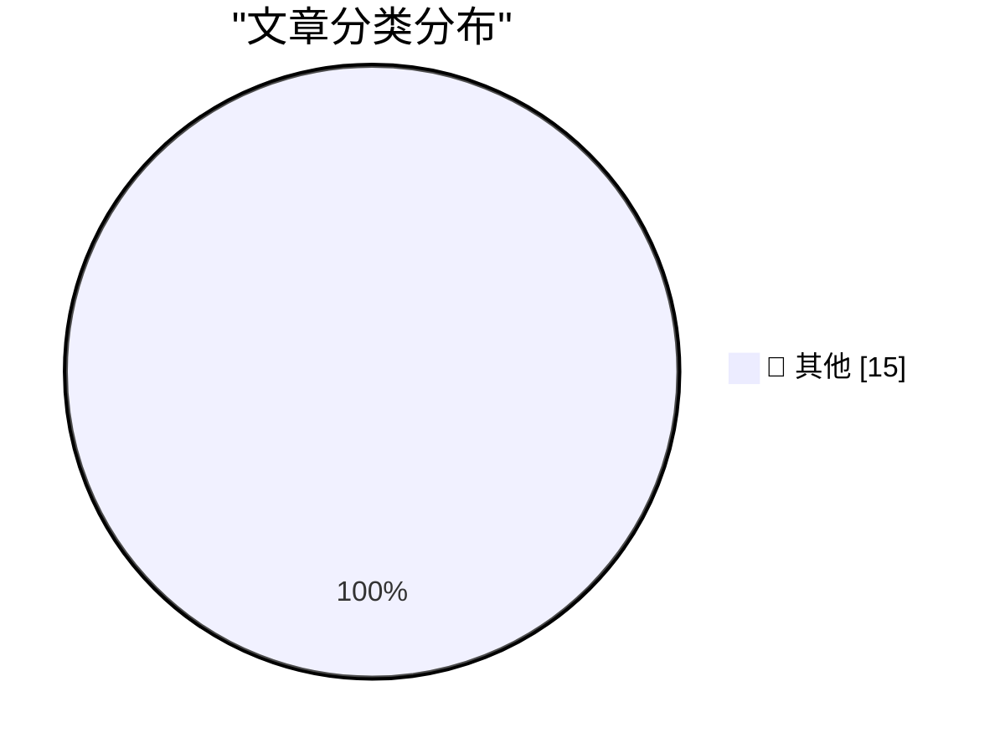

# 📰 AI 资讯每日精选 — 2026-11-23

> 汇聚 140+ 技术博客、X/Twitter、Hacker News、Reddit、Product Hunt、
> Lobste.rs、ClawFeed 日报及 GitHub Trending，经 AI 评分筛选。
>
> **本期内容**：🏆 今日必读 · 🌐 ClawFeed 日报 · 🔥 GitHub Trending · 📂 分类精选 · 🎨 设计与生成式 AI · 📊 数据概览

## 🏆 今日必读

🥇 **Select Styling Specimens**

[Select Styling Specimens](https://simonwillison.net/2026/Nov/22/select-styling/) — simonwillison.net · 8 小时前 · 📝 其他

> Select Styling Specimens

🥈 **When in doubt, flail about**

[When in doubt, flail about](https://seangoedecke.com/when-in-doubt-flail-about/) — seangoedecke.com · 3 小时前 · 📝 其他

> When in doubt, flail about

🥉 **Ivy**

[Ivy](https://semantical.com/?utm_campaign=df-2026-12) — daringfireball.net · 4 小时前 · 📝 其他

> Ivy

4️⃣ **I don't enjoy being pampered**

[I don't enjoy being pampered](https://shkspr.mobi/blog/2026/11/i-dont-enjoy-being-pampered/) — shkspr.mobi · 15 小时前 · 📝 其他

> I don't enjoy being pampered

5️⃣ **slopcore**

[slopcore](https://geohot.github.io//blog/jekyll/update/2026/11/23/slopcore.html) — geohot.github.io · 11 小时前 · 📝 其他

> slopcore

---

## 🌐 ClawFeed 日报精选

> 来源：[ClawFeed](https://clawfeed.kevinhe.io) — AI 驱动的多源新闻聚合

# ☀️ ClawFeed | 2026-11-22 日报 SGT

> 聚合自 3 期 8 小时简报：#1534 00:00 档（00:00-07:59）、#1535 08:00 档（08:00-15:59）、#1536 16:00 档（16:00-23:59），时间窗 2026-11-22 00:00–23:59 SGT（周日），三档都在。三期标题按发布时刻写：#1534 标题是「11-22 08:00」、#1535 是「11-22 16:00」、#1536 是「11-23 00:00」，所以各期正文里「11-22 08:00 那期」就是本日的 #1534，「11-22 16:00 那期」就是 #1535；「11-22 00:00 那期」指的是 #1532（窗口 11-21 16:00–23:59，已收进 11-21 日报 #1533），「11-21 16:00 那期」是 #1531，「11-21 08:00 那期」是 #1530，「11-21 00:00 那期」是 #1528，「11-20 16:00 那期」是 #1527，「11-20 08:00 那期」是 #1526，「11-20 00:00 那期」是 #1524（按 11-21 日报的对照）。
> 素材数（都按各期自己写的数，和三期网站 metadata 的 feed 159、120、175 一致）：首页时间线窗内分别 159、120、175 条（合计 454），收了 23、27、31 条（合计 81）；关注抽样另算，三期都是抽 35 个账号、打开 24 个主页（23 个有内容、1 个是空的，出错 0），窗内分别 7、5、10 条，合计 22 条，收了 2、1、1 条（合计 4），三期都写明这些帖子不在首页时间线里。书签三期都抓到 18 条，最新一条都是 11-21 19:45（#1534 注明那条上一期 11-22 00:00 已经收过），三期窗内都是 0 条，网站 metadata 的书签数也是 0、0、0；本日报没从旧书签里补。
> 这是 SGT 周日的一天（美国东部 = SGT−13 小时）：00:00 档对应美国东部 11-21 周六上午 11 点到晚上 7 点；08:00 档对应周六晚上 7 点到 11-22 周日凌晨 3 点；16:00 档对应周日凌晨 3 点到上午 11 点。三档都是周末、美股休市，三期都说 AI 和科技的帖子不多：#1534 的时间线大半是大学橄榄球、NBA、欧洲足球、GTA 6 和中东战事快讯，#1535 大半是 NBA、美国大学橄榄球、印度政要的帖子、推广和一句话，#1536 大半是推广、加密行情、新闻快讯和一句话。覆盖：#1534 是 11-22 08:0x 抓的，第一遍翻到第 3 屏遇到整屏早于窗口就停（13 条），第二遍翻满 80 屏（267 条），两遍去重 275 条、最早翻到 11-21 02:26，覆盖完整（窗外另有 113 条早于窗口、3 条晚于窗口），6 点档 39 条、7 点档 30 条最多；#1535 是 11-22 16:0x 抓的，第一遍到第 3 屏停（14 条），第二遍翻满 80 屏（261 条），从第 5 屏起就整屏早于窗口，去重 269 条、最早翻到 11-20 23:32，覆盖完整（窗外 144 条早于窗口、5 条晚于窗口），15 点档 34 条、14 点档 21 条最多，12 点档只有 6 条；#1536 是 11-23 00:0x 抓的，第一遍到第 2 屏停（10 条），第二遍翻满 80 屏（261 条），从第 4 屏起就整屏早于窗口，去重 267 条、最早翻到 11-21 14:57，覆盖完整（窗外 85 条早于窗口、7 条晚于窗口），23 点档 77 条、22 点档 28 条最多，16 点档只有 6 条、17 点档 8 条。三期都说离抓取时刻最近的两个小时帖子最多、和前几期一样，所以每档前半段相对薄。
> 主线：特斯拉 FSD v15 开始推送，三档都有：00:00 档是特斯拉官方的推送帖（「处理安全关键情况好 25 倍」、Tesla Reality View）和马斯克「点画面上任意一点车就开过去」，08:00 档是完整更新说明（视觉编码器升级、和 Robotaxi、Optimus 共用）、v15.0.1 在下载和关注抽样里 Sawyer Merritt 介绍的新画面，16:00 档只剩噪音里的复述。其次是周末行情：英伟达周五跌 14%、周线连跌是 2008 年以来最长（00:00 档快讯），比特币周六回到 6 万美元以上、晚上突破 61,000 美元，周一开盘前韩国准备动用股市稳定基金、中国的交易所放宽融资交易要求，摩根大通估算挖 1 枚比特币的成本约 8.6 万美元、比币价高。第三是 agent 购物和 agent 办事：Stripe 数据显示经 agent 的消费近一个月翻倍、Walmart 和 Muse 要做第一个 agent 对 agent 的购物对接（转述），晚上 Lee Robinson 用 Grok Bot 办了亚马逊退款。第四是 GPT-6.2 的两面：凌晨 DesignArena 游戏开发榜前三都是 OpenAI、Sol 上架 GitLab，下午却是「OpenAI 内部士气低落、几十个早期测试者差评」的匿名二手传闻。第五是黎曼猜想：孙宇晨奖称 Lean 形式化版本已通过多家独立核验、100 万美元奖金开放申领（奖金方自己的公告）。另有 Anthropic 上市后的新说法（据报道要求 IPO 投行六个月内不给 OpenAI、DeepSeek 做业务，「募资 1,073 亿美元」和前几期的 813.4 亿美元对不上，都没有一手出处）、Ant Ling 的开放权重医疗模型 LingSante-3.1-flash、英伟达董事会罢免黄仁勋的新说法、All-In 新一期、OpenCode 降价 60%、Strata 支持 Inkling 2 Mini、K2 Horizon 的训练技术报告、ClickHouse 开源的 Loom、LangChain 的「知识工厂」、「2027 年的 agent 平台」长文，以及几起跨链桥和金库被盗。

---

## 🔥 当日最重要 5 条（跨档去重）

1. **特斯拉开始推送 FSD v15：官方称端到端驾驶网络每一部分都升级、处理安全关键情况好 25 倍，新增实时显示行驶计划的 Tesla Reality View；白天马斯克转发完整更新说明（升级视觉编码器、和 Robotaxi、Optimus 共用、用数百万条网络视频训练），v15.0.1 已经在下载；关注抽样里 Sawyer Merritt 介绍了车顶上方虚拟摄像头的新画面**（#1534、#1535，#1536 只剩噪音里的复述；前几期没写过）：凌晨：@niuniu255431 07:05 引特斯拉官方：FSD v15 开始推送，升级端到端驾驶网络的每一部分，安全方面处理安全关键情况好 25 倍，新增 Tesla Reality View，可以看到并控制 FSD 计划怎么开，导航部分后文被截断（自家发布，发帖人只加了一句感叹）；@elonmusk 04:26：v15 里特斯拉的 AI 电脑会像游戏一样「重新渲染现实」，转弯时天上有箭头，点画面上任意一点车就会开过去（本人说法）；@Churro808 06:24 引 Watcher Guru 的「JUST IN」：特斯拉正式开始推送 FSD v15（快讯转发，发帖人说考虑订阅一次）（#1534）。白天：@elonmusk 08:11 引 Tesla Super Intelligence 贴的完整更新说明（底下再引特斯拉官方的推送帖）：泛化和数据效率更好（后文被截断），马斯克称这是「全新架构」、配得上叫「超级」智能、开得比人好（本人说法）；@elonmusk 08:15：FSD V15.0.1 正在下载，「好玩到值得为了兜风让车载着转」；@elonmusk 11:14：「FSD 是现实版 GTA」，v15 绕开了路上一根大树枝（本人说法，视频素材里看不到）；关注抽样 @Tradermayne 09:08 引 Sawyer Merritt：从车顶上方一个任意位置的虚拟摄像头持续显示视角，接下来的导航转弯直接画在驾驶画面里，转向灯声音更轻、响几下后淡出（发帖人只加了一句「把税都给马斯克」的玩笑）；@Sea_Bitcoin 14:14：看了很多 v15 的海外视频，觉得国内三年内都做不到，又说 2027 年可能有阶段性去泡沫、但 AI「下半场」会更猛（个人观点，后文被截断）（#1535）。晚上 #1536 噪音里有马斯克「FSD v15 比 v14 安全 25 倍」和 Gorden_Sun 的 v15.0.1 整理，都算前几期写过。**说法不一致的地方**：「25 倍」在 #1534 的特斯拉官方帖里是「处理安全关键情况好 25 倍」，#1536 噪音里马斯克那条写的是「比 v14 安全 25 倍」，两个说法的口径不一样，素材里没有测量方法；Reality View 的实际画面只在 Sawyer Merritt 的文字描述里出现，视频素材里看不到。
   来源: https://x.com/niuniu255431/status/2124278163022999823 ｜ https://x.com/elonmusk/status/2124238164512714925 ｜ https://x.com/Churro808/status/2124267796448329848 ｜ https://x.com/elonmusk/status/2124294755316310346 ｜ https://x.com/elonmusk/status/2124295793280450870 ｜ https://x.com/elonmusk/status/2124340719397781824 ｜ https://x.com/Tradermayne/status/2124309085432459390 ｜ https://x.com/Sea_Bitcoin/status/2124386012646551816

2. **周末行情和周一开盘前的救市：英伟达周五跌 14%、周线连跌是 2008 年以来最长；比特币周六涨 2% 以上回到 6 万美元以上，晚上突破 61,000 美元（24 小时涨 5.50%）；韩国准备在周一开盘前动用股市稳定基金、打击非法卖空，中国的交易所放宽融资交易要求；摩根大通估算挖 1 枚比特币的成本约 86,000 美元、比币价高约 25,000 美元；Kalshi 上美国明年衰退的概率升到 25% 以上**（#1534、#1535、#1536，接 11-21 日报的纳指大跌和比特币跌破 57,000 美元）：凌晨：@Cointelegraph 06:30：英伟达周五跌 14%，周线连跌是 2008 年以来最长（媒体快讯，只有一句话；11-21 08:00 那期写过周五纳指大跌，11-22 00:00 那期写过 Paul Graham 谈英伟达董事会）；@Reuters 06:20：比特币涨 2% 以上，回到 6 万美元以上（只有标题；11-22 00:00 那期写过 55,555 的说法）（#1534）。白天：@pete_rizzo_ 15:25：Kalshi 上美国明年进入衰退的概率升到 25% 以上，是几个月来最高（快讯，「利好比特币」是发帖人的观点）；@Techub_News 11:50：AI 投资将为美国 2026 年前三季度的 GDP 增长贡献 1.27 个百分点（只有标题，出处素材里看不到）（#1535）。晚上：@Cointelegraph 23:30：韩国准备在周一开盘前动用股市稳定基金，并开始打击非法卖空（媒体快讯）；@Reuters 21:20：中国的交易所放宽融资交易要求，以支撑股市（只有标题）；@Techub_News 20:53：比特币突破 61,000 美元，24 小时涨 5.50%（媒体快讯）；@coinbureau 23:30：摩根大通最新估算挖出 1 枚比特币的成本约 86,000 美元，比币价高约 25,000 美元，一年前摩根大通写过这个生产成本「在经验上一直是底部」，当时比特币在 10 万美元以上，现在约 60,600 美元、比成本低约 30%（媒体转述，报告原文素材里看不到）；@ansheng0 22:58：一台 S19 XP 跑满 24 小时挖出约 4 美元、电费 4.37 美元，电价得压到每度约 5.5 美分才刚够交电费（个人估算）；@BitcoinNews 23:47：Polymarket 上「年底跌到 55,000 美元」的概率 56%，期权成交偏向看跌，恐惧指数 11，比特币在两年低位附近（媒体快讯，后文被截断）；@coinbase 21:39 转的本周大事里还有标普 500 自 4-15 以来首次跌破 7,000 点、金价自 2025 年 9 月以来首次跌破 3,550 美元、美国油价跌破每桶 82 美元（#1536）。**说法不一致的地方**：比特币价格是不同时点、不同来源的数：#1534 路透写「6 万美元以上」，#1536 Techub 写突破 61,000 美元，同一档 coinbureau 的转述写约 60,600 美元，素材里没有统一的时点；「摩根大通成本比币价高约 25,000 美元」和「比成本低约 30%」是同一条转述里的两个说法，报告原文看不到；#1536 噪音里撸币养家说「韩国和台湾都宣布救市」，没有出处，和 Cointelegraph 写的「韩国准备」不一样，台湾的部分三期都没有其他来源。
   来源: https://x.com/Cointelegraph/status/2124269223228662162 ｜ https://x.com/Reuters/status/2124266643270324651 ｜ https://x.com/pete_rizzo_/status/2124403758507700276 ｜ https://x.com/Techub_News/status/2124349680985210922 ｜ https://x.com/Cointelegraph/status/2124525906404294675 ｜ https://x.com/Reuters/status/2124493149636583673 ｜ https://x.com/Techub_News/status/2124486380889809285 ｜ https://x.com/coinbureau/status/2124525813890707757 ｜ https://x.com/ansheng0/status/2124517988829384903 ｜ https://x.com/BitcoinNews/status/2124530177216561410 ｜ https://x.com/coinbase/status/2124498080347418892

3. **agent 购物和 agent 办事：Stripe 的 agent 商务数据显示经 agent 的消费从 9 月底到 11 月初持平、近一个月翻了一倍（a16z 的 Olivia Moore 推测旅行是第一大类）；有人转述 Walmart 和 Muse 要上线第一个 agent 对 agent 的购物对接；晚上 Lee Robinson 让 Grok Bot 翻邮件、填表、提交，拿回亚马逊多扣的 100 美元；OpenCode Browse 让 agent 代填网页表单**（#1534、#1536）：凌晨：@omooretweets 05:43（Olivia Moore，a16z）引 Stripe 的 Ernie Tedeschi《节日季前夕的 agent 商务》：经 agent 的消费在 9 月底（Muse 上线后）到 11 月初持平，近一个月重新加速、翻了一倍；旅行是第一大类是 Olivia Moore 的推测（Stripe 的数据加个人推测，后文被截断，具体数字素材里看不到）；@sytaylor 01:02（Simon Taylor）引 Juozas Kaziukėnas：Muse 用 Walmart 的 MCP 查商品、建购物车、下单，订单、门店、政策和比价问题去问 Walmart 自己的 agent Sparky，Simon Taylor 的评论是「商家们，上线自己的 MCP 吧」（转述，没有 Walmart 或 Muse 的官方说法）；@climbingK 01:42（Kay Woo）：巴黎一家专车公司开源了 MCP 服务器，agent 不用点就能订车，后半是推自家的 TADA 和 Throo（自家推广）；@marissamayer 05:12（Marissa Mayer）推 Dazzle：从照片里了解用户、做推荐的个人助理，比如从照片背景里看到新沙发就推荐配画（自家产品推广，后文被截断）（#1534）。晚上：@leerob 23:15（Lee Robinson）引 drsarah 提醒亚马逊退款申请 12-1 截止的帖子：把那条帖子丢给 Grok Bot，它翻了邮件、填表、提交，帮自己拿回被多扣的 100 美元（个人体验；亚马逊欠钱、截止日期是被引帖的说法）；@thdxr 23:24（Dax）：给 OpenCode 发了一张停车标志的照片，剩下的事它都办了，要先装 OpenCode Browse，「再也不用填烂网页表单」（自家产品）（#1536）。
   来源: https://x.com/omooretweets/status/2124257522903314807 ｜ https://x.com/sytaylor/status/2124186698318053643 ｜ https://x.com/climbingK/status/2124196692702683475 ｜ https://x.com/marissamayer/status/2124249659619278989 ｜ https://x.com/leerob/status/2124522043274351096 ｜ https://x.com/thdxr/status/2124524412196278730

4. **GPT-6.2 的两面：凌晨 OpenAI 的 Greg Brockman 转 DesignArena，游戏开发榜前三都是 OpenAI 的模型（Astra 第 1、Sol 第 3），Sol 上架 GitLab Duo Agent Platform；下午却有「OpenAI 内部士气低到吓人、可能是公司史上最糟的一周、几十个早期测试者差评」的匿名二手传闻；另有讲解视频说代码测试里 Sol 只比 Astra 低 0.4 个百分点、单次成本约五分之一**（#1534、#1535，前几期写过发布和各家基准分数）：@gdb 03:08（Greg Brockman）引 DesignArena：GPT-6.2 Astra（high）和 Sol（high）在游戏开发榜上排第 1 和第 3（第三方榜单，OpenAI 的人转发）；@gitlab 03:46：GPT-6.2 Sol 上架 GitLab Duo Agent Platform，定位是看重速度和成本的日常通用任务（自家发布）（#1534）。@sleepy0x13 15:28 转述 Binkg 的长帖：Binkg 说从 OpenAI 内部的朋友那里听说士气低得吓人、有点集体抑郁，周二发布 GPT-6.2 的同时几十个早期测试者给了差评，Theo 直接说是 OpenAI 有史以来最差的模型（匿名二手传闻，素材里没有 OpenAI 或 Theo 本人的帖子，后文被截断）；@bojie_li 15:04（Bojie Li）引同一条长帖：别被一时的股价影响太多，自己 7 月差点加入 MiniMax，MiniMax 6 月均价 506、今天 102，智谱 6 月均价 1648、今天 334（个人说法，后文被截断）；@tongjun88 15:40：同一项代码测试两款都开到 Max，Sol 比 Astra 低 0.4 个百分点、单次成本约是 Astra 的五分之一（视频作者的说法，测试出处素材里看不到）（#1535）。**说法不一致的地方**：#1534 的第三方榜单和自家上架是正面信号，#1535 的「最差模型」是匿名二手传闻，两边都没有 OpenAI 自己的回应；推荐关注里 #1535 写 Binkg 的简介自称反 AI。
   来源: https://x.com/gdb/status/2124218429133754499 ｜ https://x.com/gitlab/status/2124227873527505204 ｜ https://x.com/sleepy0x13/status/2124404515839611149 ｜ https://x.com/bojie_li/status/2124398647563706432 ｜ https://x.com/tongjun88/status/2124407650008092981

5. **黎曼猜想的第三天：孙宇晨奖称 Alpöge 证明的 Lean 形式化版本已通过 Lean FRO、Mathlib、MIT、滑铁卢大学和 MathDB 的独立核验，100 万美元奖金开放申领（奖金方自己的公告）；数学家 Abhishek Saha 说因为「RH 是用上所有东西证出来的」反而更相信证明大概率成立；有人第一次觉得机器验证如此重要**（#1534、#1535，接 11-21 日报的 Sutherland 复核和 Masullo 的另一份证明）：凌晨：@levie 05:25（关注抽样，Aaron Levie）引 Abhishek Saha：原来和多数数学家一样，以为黎曼猜想眼下完全够不着（就算有最好的 AI 工具），所引的 Alex Kontorovich 说「RH 是用上*所有东西*证出来的」，反而让自己更相信这个证明大概率成立，Levie 说解决问题的方式会和过去很不一样（转述，引文被截断）；@elonmusk 02:49 引 Grok 的回答：证明的用处是让依赖黎曼猜想的一大批定理从「有条件」变成「无条件」，又说这是「超级智能」做到的（个人说法，后半是 AI 生成的科普）（#1534）。白天：@sunyuchentron 15:36（孙宇晨）引孙宇晨奖：上面那条核验和奖金公告，孙宇晨奖 JSP-000001（黎曼猜想）的 100 万美元奖金开放申领，孙宇晨本人只加了「所证即解」四个字（素材里没有各核验方的帖子）；@Blackpink_Ox66 14:45：以前觉得数学里的机器验证有点多此一举，这次第一次觉得机器验证如此重要（个人观点，后文被截断）；@rleshner 11:12（Robert Leshner）：「我的直觉是 2027 年会证明 P≠NP」（只有一句话的个人猜测）（#1535）。#1536 只剩噪音里 Eli Ben-Sasson「AI 在改变数学家的角色」一句话和讽刺跟风发黎曼猜想的帖子。**说法不一致的地方**：「已通过 Lean FRO、Mathlib、MIT、滑铁卢大学和 MathDB 的独立核验」只有奖金方自己的公告，核验方本身的帖子三期都没有；#1534 的 Saha 是「大概率成立」的个人判断，#1535 孙宇晨本人加的是「所证即解」，两者的确定程度不一样。
   来源: https://x.com/levie/status/2124252844710887549 ｜ https://x.com/elonmusk/status/2124213680422387741 ｜ https://x.com/sunyuchentron/status/2124406638090260984 ｜ https://x.com/Blackpink_Ox66/status/2124393731302568052 ｜ https://x.com/rleshner/status/2124340148179468444

**⚠️ 未证实（素材里核实不了，只记录说法）**
- 「Anthropic 要求给自己做 IPO 的投行六个月内不和 OpenAI、DeepSeek 合作」：@VraserX 23:42 引 Polymarket Money 的「据报道」，VraserX 说据路透名单里还有 Cursor 和 Hugging Face；两条转述的名单不一样，路透原文素材里看不到（#1536）。https://x.com/VraserX/status/2124528866047738058
- 「Anthropic 募资 1,073 亿美元、创 IPO 纪录」：@coinbase 21:39 转的 Coinbase Predict 本周大事，和 11-20 08:00 那期写的募资 813.4 亿美元对不上，素材里没有说明口径（#1536）。https://x.com/coinbase/status/2124498080347418892
- 「OpenAI 内部士气低落、可能是公司史上最糟的一周，几十个早期测试者差评，Theo 说是最差的模型」：@sleepy0x13 15:28 转述 Binkg 的匿名二手传闻，没有 OpenAI 或 Theo 本人的帖子（#1535）。https://x.com/sleepy0x13/status/2124404515839611149
- 「黎曼猜想的 Lean 形式化版本已通过 Lean FRO、Mathlib、MIT、滑铁卢大学和 MathDB 的独立核验」：@sunyuchentron 15:36 引的奖金方自己的公告，没有各核验方的帖子（#1535）。https://x.com/sunyuchentron/status/2124406638090260984
- 「Walmart 和 Muse 要上线第一个 agent 对 agent 的购物对接」：@sytaylor 01:02 引的转述，没有 Walmart 或 Muse 的官方说法（#1534）。https://x.com/sytaylor/status/2124186698318053643
- 「经 agent 的消费近一个月翻倍、旅行是第一大类」：@omooretweets 05:43 引 Stripe 的数据，具体数字素材里看不到，旅行是第一大类是个人推测（#1534）。https://x.com/omooretweets/status/2124257522903314807
- 「董事会罢免黄仁勋最主要的动因是撒谎；特朗普下『政治通牒』希望黄仁勋回英伟达」：@0xLaughing 13:25 中文自媒体转述加「知情人士」说法，没给出处，特朗普的原话被截断（#1535）。https://x.com/0xLaughing/status/2124373591043293353
- 「David Friedberg 批评特朗普要求强制披露使用中国 AI 的计划」：@Techub_News 06:48 只有标题，计划内容和批评理由素材里看不到（#1534）。https://x.com/Techub_News/status/2124273810203414905 ｜ https://x.com/Techub_News/status/2124273821762941160
- 「Loom 给 Claude Code 接上后模型成本省 20%、文件定位准确率 96.4%」：@wlzh 07:54 的转述，数字来源素材里看不到，后文被截断（#1534）。https://x.com/wlzh/status/2124290319315615940
- 「Cyber 跨链桥疑似被攻击、损失约 100 万美元」：@Techub_News 05:48 媒体快讯，还在调查（#1534）。https://x.com/Techub_News/status/2124258677867594185
- 「Chainflip 金库 11-21 被转出 122.86 BTC、520.22 ETH、325 万 USDC 和 75.81 万 USDT」：@KTXLounge 14:40 的转述，后文被截断（#1535）。https://x.com/KTXLounge/status/2124392563394359666
- 「AI 投资将为美国 2026 年前三季度 GDP 增长贡献 1.27 个百分点」：@Techub_News 11:50 只有标题，出处素材里看不到（#1535）。https://x.com/Techub_News/status/2124349680985210922
- 「高露洁论文说让 LLM 扮演顾客就能预测真实购买意向，『悄悄干掉了整个市场调研行业』」：@toly 09:07 引的营销号式转述，论文细节素材里看不到（#1535）。https://x.com/toly/status/2124308706590663160
- 「苹果给 Andarium 的下架理由像临时找的」：@bitexiaohu 15:32 发帖人的看法，苹果的理由素材里看不到（#1535）。https://x.com/bitexiaohu/status/2124405576440348947
- 「GPT-6.2 Sol 比 Astra 低 0.4 个百分点、单次成本约五分之一」：@tongjun88 15:40 视频作者的说法，测试出处素材里看不到（#1535）。https://x.com/tongjun88/status/2124407650008092981
- 「摩根大通估算挖 1 枚比特币成本约 86,000 美元」：@coinbureau 23:30 媒体转述，报告原文素材里看不到（#1536）。https://x.com/coinbureau/status/2124525813890707757
- 「MONAI Label 被 AI 代理 11 分钟从测绘 API 打到入侵」：@ccy1871 20:00 转述 GCSA 的整理，后文被截断（#1536）。https://x.com/ccy1871/status/2124472982781501842
- 「影视行业内容产量从 2022 年一个月约 500 部到现在一个月 6 万部以上」：@Bit_LittleP 20:30 聊天听来的，没有出处（#1536）。https://x.com/Bit_LittleP/status/2124480739517591607
- 「AI 事故八到九成没有攻击者」：@AISecHub 22:50 引 JD Pruett 的说法，研究出处素材里看不到（#1536）。https://x.com/AISecHub/status/2124515943032467488
- 「K2 Horizon 的报告透明度远超多数开源 LLM 报告」：@alacheng 20:05 的转述和评价，报告原文素材里看不到，后文被截断（#1536）。https://x.com/alacheng/status/2124474282403324065
- 「LingSante-3.1-flash 的基准表现」：@AntLingAGI 23:22 是自家发布，后文被截断，基准数字素材里看不到（#1536）。https://x.com/AntLingAGI/status/2124523916819648945

**次重要（备选）**
- Anthropic 上市后的新说法（11-20 08:00 起几期写过上市第一天的成交，11-21 00:00 那期写过「绿鞋」和创始人套现）：投行限制和 1,073 亿美元见「未证实」，VraserX 批评 Anthropic 一边讲 AI 安全一边限制对手获得金融服务（后文被截断）；@aiedge_ 23:00：Anthropic Residency（带薪跟 Anthropic 工程师学习的研究项目）下一轮 11-22 当天截止申请（转发的招募信息）（#1536）；@ViewsOfChris 11:26 推荐的 All-In 11-21 那一期，题目里也有 Anthropic 上市的多空（#1535）。https://x.com/VraserX/status/2124528866047738058 ｜ https://x.com/coinbase/status/2124498080347418892 ｜ https://x.com/aiedge_/status/2124518358095888466 ｜ https://x.com/ViewsOfChris/status/2124343615547916648
- Ant Ling 发布开放权重的医疗 MoE 模型 LingSante-3.1-flash：@AntLingAGI 23:22：总参数 560B、每 token 激活 25B，把多种医疗能力合进一个模型，同时保留通用能力，包括复杂医疗推理、长流程工作流执行等（自家发布，基准数字素材里看不到）；@hasantoxr 23:57（Hasan Toor）引同一条：预测 12 个月内每家正经医院都会在内部跑开放的医疗模型（个人预测）（#1536）。https://x.com/AntLingAGI/status/2124523916819648945 ｜ https://x.com/hasantoxr/status/2124532822119764448
- 黄仁勋和英伟达董事会（11-21 16:00 那期写过特朗普要黄仁勋道歉，11-22 00:00 那期写过 Paul Graham 的评论）：#1534 只有英伟达周五跌 14% 的快讯；@0xLaughing 13:25 引小龙先生：特朗普开新闻发布会向英伟达董事会下「政治通牒」，希望黄仁勋回英伟达，0xLaughing 补了知情人士的说法（见「未证实」）（#1535）。和 11-21 16:00 那期「要黄仁勋道歉」放在一起看，特朗普的态度素材里只有转述，没有原话。https://x.com/Cointelegraph/status/2124269223228662162 ｜ https://x.com/0xLaughing/status/2124373591043293353

---

## 📰 当日核心主题

**① 模型、开放权重和推理（三期都有）**
GPT-6.2 见前 5 条第 4 条，Ant Ling 见「次重要」。凌晨（#1534）：@wlzh 07:54：ClickHouse 开源的 Loom 把记忆、文档搜索和代码索引做进一个自托管的 MCP 服务器，记忆挂在对应的文件和符号上，解决换个会话 agent 就忘的问题（转述，「省 20%、准确率 96.4%」见「未证实」）；@coreyganim 07:43（Corey Ganim）：统计了 GitHub 上星最多的 15 个 MCP 服务器，6 个来自个人开发者账号，一位独立开发者的 Blender MCP（3.53 万星）超过 GitHub 官方的（3.47 万星），6 个是 2025 年 3 月一个月里建的（个人统计，后文被截断）；@dongxi_nlp 06:42（东锡）推荐 Nathan Lambert 的新讲稿：后训练最大的开放问题和这个领域怎么走到今天，也是 Lambert 在 Trillium Labs 的目标声明（推荐转发，讲稿内容素材里看不到）（https://x.com/wlzh/status/2124290319315615940 ｜ https://x.com/coreyganim/status/2124287681043779732 ｜ https://x.com/dongxi_nlp/status/2124272367878737958）。
白天（#1535）：@0xkydo 15:55 引 Dax 和 OpenCode：OpenCode 上 GLM 5.3 和 DeepSeek V4.1 Flash 降价 60%，Dax 说价格比 Fireworks、Baseten 低 60%、量比它们都大，全部跑在自己的 GPU 上，「现在我们第一」（自家说法；11-21 00:00 那期写过 OpenCode 把推理搬到自己的 GPU 上）；@rakyll 14:40（Jaana Dogan）：今天用了 Neon 8 小时以上，觉得没有别的模型接近，表达比自己还到位、读起来像人（个人体验；Neon 前几期写过发布）（https://x.com/0xkydo/status/2124411496025493510 ｜ https://x.com/rakyll/status/2124392641496588465）。
晚上（#1536）：@servasyy_ai 21:35（huangserva）引 Niko Veit：Strata 0.2.19 支持 Inkling 2 Mini，RTX 5090 上 prefill 每秒 11,306 token、输出每秒 4,087 token，Qwen3.8-Flash-Next 在支持的各种硬件上快约 40%；huangserva 自己测 V100 首字等待最多降 40%、RTX 4090 的 prefill 快约 40%（项目方发布和个人实测，后文被截断；Inkling 2 Mini 11-21 08:00 起几期写过）；@alacheng 20:05（头雁）：K2 Horizon（以华人团队为主）发布 LLM 训练技术报告，按 LLM360 标准完整公开「怎么做出来的」，不只给最终权重（转述，见「未证实」）；@Techub_News 23:54：Perplexity 推出 Monitor API，可以定时搜索网页并筛选重要更新（只有标题；同一分钟 Techub 还发了 Ark 撤回 ETF 那条，链接两条都列上）（https://x.com/servasyy_ai/status/2124497084334420448 ｜ https://x.com/alacheng/status/2124474282403324065 ｜ https://x.com/Techub_News/status/2124531864215900389 ｜ https://x.com/Techub_News/status/2124531853180694930）。

**② Agent 和开发工具（三期都有）**
agent 购物见前 5 条第 3 条。凌晨（#1534）：知识工厂（11-20 08:00 那期写过 Harrison Chase 引 Hex 的说法）：Harrison Chase 发了文章《How to build a knowledge factory》，说让 AI 在公司里起作用缺的不是更好的模型、也不只是更多上下文，而是公司怎么运作、标准是什么这类知识，LangChain 内部的 GTM、内容 agent 和 LangSmith Engine 都有类似的学习循环；@nichochar 00:47（Nicholas Charriere）对文中的「curator agent」最感兴趣，叫它「园丁」：挂在一个空间而不是一个人身上的 agent（个人观点，后文被截断）；@crtr0 04:15（Carter Rabasa）说这是法律、金融这类知识型企业的好蓝图，预计「skill」和「知识」的边界会慢慢模糊（个人观点）；@abduzeedo 05:49（Fabio，Abduzeedo）：设计媒体 Abduzeedo 日常已经用 pen.dev 替代 Figma，画布很快，能直接拉入线上网站接着设计（个人使用记录；pen.dev 的 Tom Krcha 转发了）；@ryancarson 00:14（Ryan Carson）：Devin Bots 的新功能让自己公司 Untangle 的整个工程流程顺了很多，像有了各自负责 App 一部分的员工，团队共用同一套 bot（个人使用体验，Devin Bots 前几期写过）（https://x.com/nichochar/status/2124182843102535974 ｜ https://x.com/crtr0/status/2124235340236169563 ｜ https://x.com/abduzeedo/status/2124258869073309814 ｜ https://x.com/ryancarson/status/2124174540204880154）。
白天（#1535）：@thdxr 09:03（Dax）引 Anomaly：本地离线听写 App hex 上架 iOS App Store，完全免费，Dax 说审核这么快、OpenCode 的 App 还在等（自家产品；11-20 00:00 那期写过 hex 移动端的预告）；@shao__meng 10:39（meng shao）推荐 Parth Sharma 的长文《做了一年半 agent 学到的：循环、工具和规格》：理解运行框架可以先抓住一个 while 循环，真正影响系统质量的是工具设计、上下文管理和可靠的后端实现（推荐转发，原文素材里只有开头）；@jiayuan_jy 13:53（Jiayuan Zhang）：把 Multica 上的 agent 接进微信后，每天主要就是让这个 agent 管所有其他 issue，实践下来「super agent + issues」比较合适（发帖人的实践；11-20 16:00 那期写过 Multica 的用户数）；@dingyi 12:57（Ding）引 koji：用 Codex 加树莓派在上海做了 24 小时听鸟鸣、识别鸟种的「飞鸟电台」，识别用 BirdNET 和 Google 的 Perch 两个模型（koji 的个人项目，后文被截断）；@james_x 15:47：把自己每天用的投研加交易 agent 做成 Grok Bot 模板，可一键导入，按标的给新闻打分、早晚各出一份简报，Max 档能查 13F 和机构持仓，交易默认关闭、下单前要本人确认（自家模板和文章的推广）；@wangray 13:25（Ray Wang）引 Yihui：推荐 coss ui，底座是 Base UI，有一系列带样式的成品组件，可以直接让 AI 复用（个人推荐）；@toly 09:07（Anatoly Yakovenko）引 How To Prompt 的高露洁论文转述（见「未证实」，toly 只加了一句玩笑）；@bitexiaohu 15:32：能让 iPhone 和 iPad 直接跑完整 Android 17 的开源 App Andarium 上架 32 小时就被 App Store 撤下（转述，后文被截断）（https://x.com/thdxr/status/2124307624480903433 ｜ https://x.com/shao__meng/status/2124331898772361395 ｜ https://x.com/jiayuan_jy/status/2124380709959987655 ｜ https://x.com/dingyi/status/2124366660480151777 ｜ https://x.com/james_x/status/2124409443970642366 ｜ https://x.com/wangray/status/2124373735683789034 ｜ https://x.com/toly/status/2124308706590663160 ｜ https://x.com/bitexiaohu/status/2124405576440348947）。
晚上（#1536）：@it_works_123 16:43：Pi Bot v0.0.3 发布，是开源（Apache-2.0）后的第一个版本，Pi Bot 是在自己电脑上干活的一组有名字的 Bot，「大脑」跑在本机，聊天、文件和密钥都留在本机，只有所选的模型服务商能看到发出去的内容（自家发布，改动列表被截断；11-22 00:00 那期书签里写过开源）；@omarsar0 22:12（elvis）引 John Suh 的《Agent platform of 2027》：文章总结了强 agent 平台的关键原语，要支持多种 agent 配置、把 agent 和实例、会话分开，「在 RSI 的世界里东西得可塑」，原帖称这会是唯一的应用层软件、其他软件都会变成它的数据库（作者观点，后文被截断）；@tomasmalamud 22:31（Tomás Malamud）也引了同一篇，说是做科技的人必读（西班牙语，X 机翻）；@rwayne 20:50（Roland.W）：Google Ultra 的 Hypothesis generation 用来做科研是「神助」，在 labs.google.com/science 登记兴趣、目前不对所有人开放（个人体验，后文被截断）；@dhh 20:05（DHH）：Omarchy 中文版快好了，安装器全部翻译、用本地 CDN、默认主题 Jade Horse，由 xdanger 牵头（作者发布）；@AISecHub 22:50 引 JD Pruett：把最新研究做成一段提示词（GitHub 上的 ai-codebase-safety-audit.md），交给 agent 检查自己环境里最常见的诱因（「八到九成」见「未证实」）；@brucexu_eth 20:19（brucexu.eth）：用 Tailscale 的建议都打开 Tailnet Lock，之前分享的 ACL 能防止一台机器被攻破后横向扩散，但还有一个口子（个人经验，后文被截断）；@WuPingJu 21:11（PJ Wu）：发了长文介绍自己从 7 月起跑在 Claude Code 上的 personal agent「Peregrine」（文章内容素材里看不到）；@ccy1871 20:00（Aidang）引 GCSA：MONAI Label 在没有任何漏洞预警的情况下被 AI 代理自动测绘 API、发现路径穿越，以前挖一个 0day 到入侵要好几天，这次 11 分钟（见「未证实」）；关注抽样 @mardehaym 19:56（Mark Ajzenstadt，Limestone 创始人）：很多创始人在崩溃，自己经营一家 200 人的工程公司也有同感，原以为 AI 会改变造东西的速度，低估了它对工程师工作本身的改变（个人感受，后文被截断）（https://x.com/it_works_123/status/2124423401142128838 ｜ https://x.com/omarsar0/status/2124506354324840953 ｜ https://x.com/tomasmalamud/status/2124511201795162171 ｜ https://x.com/rwayne/status/2124485569170550797 ｜ https://x.com/dhh/status/2124474336996422046 ｜ https://x.com/AISecHub/status/2124515943032467488 ｜ https://x.com/brucexu_eth/status/2124477857330340018 ｜ https://x.com/WuPingJu/status/2124490841867911505 ｜ https://x.com/ccy1871/status/2124472982781501842 ｜ https://x.com/mardehaym/status/2124472151957008793）。

**③ 公司、行业和政策（三期都有）**
凌晨（#1534）：@Techub_News 06:48：All-In 播客主持人 David Friedberg 批评特朗普要求强制披露使用中国 AI 的计划（只有标题，见「未证实」）；关注抽样 @guruchahal 07:11（Guru Chahal，Lightspeed 合伙人）：AI 产业链不是一条，微软、Google、亚马逊、OpenAI、Anthropic、SpaceX、英伟达和台积电各控制不同的层、又互相依赖，真正的问题是哪个瓶颈能带来持久的控制力（自家文章的引子，正文在 Substack，素材里看不到）（https://x.com/Techub_News/status/2124273810203414905 ｜ https://x.com/Techub_News/status/2124273821762941160 ｜ https://x.com/guruchahal/status/2124279550498758887）。
白天（#1535）：All-In 新一期：@ViewsOfChris 11:26 推荐 11-21 这期，题目有 Anthropic 上市的多空、英伟达的乱局（股价、人才、法律问题和黄仁勋的去向）、市场是否见底、白宫考虑新的开源披露规则，开头是 Chamath 的「10 家 AI 巨头」理论（推荐转发，节目内容素材里看不到）；黄仁勋见「次重要」（https://x.com/ViewsOfChris/status/2124343615547916648 ｜ https://x.com/0xLaughing/status/2124373591043293353）。
晚上（#1536）：@amix3k 17:13（Amir Salihefendić，Todoist）引 Noah Kagan「AppSumo 从 140 人减到 20 人」和六条公司规则（零人工作、人人交付、每个项目都要赚钱……）：Todoist 现在 108 人、规模比以往都大，还打算多招人，不裁员而是做更多、抬高标准（创始人说法）；@Bit_LittleP 20:30（LittlePoint）：听影视圈朋友说，对方做过 AI 短剧爆款，现在已彻底放弃短剧，产量数字见「未证实」（https://x.com/amix3k/status/2124431057093079185 ｜ https://x.com/Bit_LittleP/status/2124480739517591607）。

**④ 加密和金融基础设施（三期都有）**
行情见前 5 条第 2 条。凌晨（#1534）：@Techub_News 06:48：Circle 在 Solana 上 20 分钟内铸造 5 亿枚 USDC（媒体快讯，和 Friedberg 那条同一分钟）；@Cointelegraph 07:30：菲律宾交易所 Coins.ph 关闭向自托管钱包的转账，用户只能把币转到受监管的交易所，每笔不论金额都要交对方信息（媒体快讯）；@Techub_News 05:48：Cyber 跨链桥疑似被攻击、损失约 100 万美元，韩国 Upbit 和 Bithumb 暂停相关转账（媒体快讯，还在调查）（https://x.com/Techub_News/status/2124273810203414905 ｜ https://x.com/Techub_News/status/2124273821762941160 ｜ https://x.com/Cointelegraph/status/2124284280423473195 ｜ https://x.com/Techub_News/status/2124258677867594185）。
白天（#1535）：@KTXLounge 14:40：Chainflip Labs 披露 11-21 金库被盗（金额见「未证实」），提出让攻击者留 10% 作为赏金、归还 90%（转述）；@Techub_News 14:51：Cysic 跨链桥被攻击，黑客在 BNB Chain 上铸了 1000 万枚代币（媒体快讯）；@Techub_News 14:51：俄罗斯共产党提议把法院没收的加密资产纳入国家储备（媒体快讯，只是提议）。**名字容易混**：#1535 自己注明 Cysic 和 #1534 的 Cyber 跨链桥不是同一件事（https://x.com/KTXLounge/status/2124392563394359666 ｜ https://x.com/Techub_News/status/2124395313284739320 ｜ https://x.com/Techub_News/status/2124395236600242552）。
晚上（#1536）：@Techub_News 17:52：日本财务省的国债代币化实验将在 Canton 区块链上进行（媒体快讯，依据是财务省的研究资料）；@Techub_News 23:54：Ark Invest 撤回 CoinDesk 20 加密指数 ETF 的申请（只有标题）；@jessepollak 21:16（Jesse Pollak，Base 负责人）转 Laura Shin 的采访摘录：Base 仍在研究发币但不急，不想因此分心于增长，一开始就有意决定当时不发币（采访转述，后文被截断）；@StaniKulechov 23:39（Stani Kulechov，Aave）引 Sentora：Aave 第一批外部策展的市场接近 2 亿美元，11-9 到 11-19 Aave V4 上 Sentora hub 的存款从 1.009 亿美元增到 1.709 亿美元、借款从 4,190 万美元增到 6,860 万美元，借款全是 RLUSD，RLUSD 利用率 92.5%（hub 整体 40.1%）（项目方数据）（https://x.com/Techub_News/status/2124440920493887647 ｜ https://x.com/Techub_News/status/2124531864215900389 ｜ https://x.com/Techub_News/status/2124531853180694930 ｜ https://x.com/jessepollak/status/2124492204282421704 ｜ https://x.com/StaniKulechov/status/2124528121135415715）。

---

## 🔖 书签精选

当日窗内没有书签：#1534、#1535、#1536 三期都抓到 18 条，最新一条都是 11-21 19:45，早于本日窗口（#1534 注明那条上一期 11-22 00:00 已经收过），三期窗内都是 0 条，网站 metadata 的书签数也是 0、0、0。本日报跳过这一节，没从旧书签里补。

---

## 👀 推荐关注汇总（去重，共 9 个；各期写稿时都在浏览器里核实过「未关注」：#1534 在 11-22 08:10–08:11 和 08:12–08:12，#1535 在 11-22 16:12–16:13 和 16:14–16:16，#1536 在 11-23 00:11–00:12 和 00:12–00:14 SGT，本日报没有重新核实）

**agent 商务和 AI 金融的一手信息**
- @sytaylor（Simon Taylor，简介是「AI 和金融的书呆子」，在 brainfood.xyz 写文章；7.43 万关注者；你关注的人里约 287 个也关注了）：本期是 Walmart 和 Muse 的 agent 对 agent 购物对接加「商家们上线自己的 MCP」的点评，置顶是 10 月的长文《Fintech is Dead》（#1534）。https://x.com/sytaylor
- @ernietedeschi（Ernie Tedeschi，Stripe 首席经济学家，曾任白宫经济顾问委员会首席经济学家；4.71 万关注者；你关注的人里约 34 个也关注了）：Olivia Moore 引的 Stripe agent 商务数据就是这个账号 11-21 发的文章，agent 支付的一手数据（#1534）。https://x.com/ernietedeschi

**agent 平台、本地推理和 builder**
- @john_ssuh（John Suh，简介是「Building」、之前是 Long Lake 的创始团队，在旧金山；4,404 关注者；你关注的人里约 32 个也关注了）：elvis 和 Tomás Malamud 引的《Agent platform of 2027》的原帖作者（#1536）。https://x.com/john_ssuh
- @coldniko（Niko Veit，简介是「整天在做 Strata」；1.39 万关注者；你关注的人里约 27 个也关注了，包括 Unsloth AI）：Strata 0.2.19 支持 Inkling 2 Mini 的发布者，本地推理引擎的一手开发者（#1536）。https://x.com/coldniko
- @bojie_li（Bojie Li，简介是「独立研究者，做交互式 agent 系统」，个人站 01.me；1.66 万关注者；你关注的人里约 84 个也关注了）：本期是引 OpenAI 士气传闻、谈智谱和 MiniMax 股价回落和自己差点加入 MiniMax 的那条（#1535）。https://x.com/bojie_li
- @Yuancheng（koji，真格基金投资合伙人，创办了播客和公众号「十字路口 Crossing」，发起了 AI Hacker House；1.01 万关注者；你关注的人里约 126 个也关注了）：「飞鸟电台」就是这个账号用 Codex 加树莓派做的个人项目（#1535）。https://x.com/Yuancheng

**创始人、投资人和 AI 加数学**
- @theallinpod（The All-In Podcast，Chamath Palihapitiya、Jason Calacanis、David Sacks、David Friedberg 主持；61.07 万关注者；你关注的人里约 425 个也关注了）：Chris Lee 推荐的 11-21 那一期（Anthropic 上市、英伟达乱局、开源披露规则），每周都在更新（#1535）。https://x.com/theallinpod
- @noahkagan（Noah Kagan，AppSumo 的 Chief Sumo，Facebook 第 30 号员工；17.75 万关注者；你关注的人里约 94 个也关注了）：Todoist 的 Amir Salihefendić 引的「AppSumo 从 140 人减到 20 人」和六条公司规则的原帖作者（#1536）。https://x.com/noahkagan
- @AlexKontorovich（Alex Kontorovich，罗格斯大学数学杰出教授；4.11 万关注者；你关注的人里约 64 个也关注了）：黎曼猜想那条里被 Abhishek Saha 引用，AI 加形式化数学的一手视角（#1534）。https://x.com/AlexKontorovich

（三期另有 36 个显示未关注但没推荐的账号，@Tesla 在 #1534、#1535 各出现一次，@Reuters 在 #1534、#1536 各出现一次，去重后 34 个：#1534 的 @climbingK、@marissamayer、@itsdazzleai、@Reuters、@WatcherGuru、@Tesla、@nichochar、@crtr0、@gitlab、@ClickHouseDB、@abduzeedo、@ObhishekSaha、@juokaz、@DesignArena；#1535 的 @TeslaSI、@SawyerMerritt、@anomalyco、@parthshr370、@KTXLounge、@dummerspast39、@SunPrizeCN、@Dragonhau66、@HowToPrompt__、@yihui_indie；#1536 的 @lubi366、@it_works_123、@tomasmalamud、@WuPingJu、@PolymarketMoney、@CoinbasePredict、@GCSA_COM、@drsarah、@jdpruettt、@xdanger。理由是综合媒体或公司官号以公告和营销为主、偏转述、领域偏离，或一手但关注者很少「可以先观察」（@nichochar、@juokaz、@parthshr370、@it_works_123、@WuPingJu、@jdpruettt）。）

**建议取关**：三期都没有提出取关建议。

---

## 💤 重复噪音模式

三期过滤掉的时间线 373 条（#1534 136、#1535 93、#1536 144），收了 81 条（23、27、31）；关注抽样窗内 22 条（7、5、10），收了 4 条（2、1、1），没收 18 条（5、4、9）。按类别（三期分类口径不完全一样，下面是合并后的数）：
- **推广、活动和项目方自己的帖**：66 条（#1534 15、#1535 14、#1536 37；tiany221 的课程和网盘在 #1535、#1536 都有，AIsa 的旧金山 Code & Coffee 在 #1535、#1536 都有，Babylon 的宣传在 #1535、#1536 都有，BNB 的 bStocks 和曼谷黑客松散在 #1534、#1535；#1536 最多，WEEX、zkPass、Docker 改品牌、Supabase 等一长串）。
- **前几期写过的**：14 条（#1534 3：FBI 数据库疑似被黑、墨西哥抓获毒枭、Netflix 的 FTX 剧；#1535 5：范凯的 Inkling 2 Mini、Delphi 的 Hivemind、BillyM2k 吐槽 Netflix 的 FTX 剧、marquistrillx 复述 FSD v15 官方帖、博索纳罗进 ICU；#1536 6：PaulYoungX 复述高露洁论文、Supers6061 的 Anthropic 上市复盘、狱中 SBF 专访的中文整理、马斯克「FSD v15 比 v14 安全 25 倍」、Gorden_Sun 的 v15.0.1 整理、「想买字节老股」的引用）。Netflix 的 FTX 剧在 #1534、#1535 都出现，「想买字节老股」在 #1535、#1536 都出现。
- **FSD v15 的重复反应**：3 条（#1534 2：Raj Gokal「GTA 和现实开始融合」、Galois Capital 引马斯克同一条；#1535 1：Ray Wang「欢迎来到 GTA6 的世界」）。
- **黎曼猜想的一句话跟帖**：4 条（都在 #1534：a16z Frontier、DataChaz 的梗、马斯克把同一段解释又发了一遍、doomslide 的嘲讽；#1536 的 Eli Ben-Sasson 和讽刺跟风的帖子算在「没有信息量」里）。
- **AI 和科技相关但没有信息量**：63 条（#1534 12、#1535 15、#1536 36；GEO 大会在 #1534 vista8 的回放整理和 #1535 GoSailGlobal 的提问里都有，Grok Bot 的推广和玩法散在 #1535、#1536，「Opus 5.5 降智」「AI is underhyped」这类一句话最多，Claude 分流和「不弹 KYC」是规避风控的教程）。
- **行情和加密场边**：41 条（#1534 10、#1535 9、#1536 22；Jesse Pollak 的一句话在 #1534、#1536 都有，比特币四年周期和减半周期表在 #1534、#1535 各一条，#1536 有撸币养家说「韩国和台湾都宣布救市」（没有出处）和 cryptorover「美股蒸发 7.7 万亿美元」（没给出处））。
- **体育、游戏、娱乐、新闻时政和闲聊**：182 条（#1534 90 = 体育游戏娱乐 48 + 新闻时政 26 + 闲聊 16；#1535 49 = 18 + 15 + 16；#1536 43 = 8 + 17 + 18；GTA 6 里「知道自己在游戏里」的 NPC 在 #1534、#1535 都有；中东战事是 #1534 窗口内的大事，但不在简报范围；印度政要的帖子在 #1535、#1536 都有；marquistrillx 的闲聊在 #1535 6 条、#1536 9 条）。
- **关注抽样里没收的**：18 条（#1534 5、#1535 4、#1536 9；Startup Wisdom 的语录在 #1534、#1536 各 2 条，Tradermayne 的一句话和行情帖在 #1534、#1536 都有，幻觉工程师在 #1535、#1536 都有，比特唐三藏在 #1535、#1536 都有，Mark Ajzenstadt 的预约咨询广告和 Limestone 的 skills 提示词在 #1536）。
- **同一话题延续**：FSD v15（#1534 开始推送 → #1535 完整更新说明和 v15.0.1 → #1536 噪音里的复述，https://x.com/niuniu255431/status/2124278163022999823 ｜ https://x.com/elonmusk/status/2124294755316310346）；行情（11-21 日报纳指大跌、比特币跌破 57,000 → #1534 英伟达周五跌 14%、比特币回到 6 万以上 → #1535 Kalshi 衰退概率 → #1536 突破 61,000、亚洲救市、挖矿成本，https://x.com/Reuters/status/2124266643270324651 ｜ https://x.com/pete_rizzo_/status/2124403758507700276 ｜ https://x.com/Techub_News/status/2124486380889809285）；黎曼猜想（11-21 日报 Sutherland 复核和 Masullo → #1534 Saha 的反应 → #1535 孙宇晨奖的核验公告 → #1536 只剩噪音，https://x.com/levie/status/2124252844710887549 ｜ https://x.com/sunyuchentron/status/2124406638090260984）；GPT-6.2（#1534 DesignArena 和 GitLab → #1535 士气传闻和成本对比，https://x.com/gdb/status/2124218429133754499 ｜ https://x.com/sleepy0x13/status/2124404515839611149）；黄仁勋（11-21 16:00 那期要道歉 → 11-22 00:00 那期 Paul Graham → #1534 英伟达跌 14% → #1535 罢免的新说法和 All-In 的题目）；Anthropic 上市（11-20 08:00 那期上市 → #1535 All-In 的多空 → #1536 投行限制和 1,073 亿的说法）；OpenCode（11-21 00:00 那期自建 GPU → #1535 降价 60% 和 hex 上架 → #1536 OpenCode Browse，https://x.com/0xkydo/status/2124411496025493510 ｜ https://x.com/thdxr/status/2124524412196278730）；Inkling 2 Mini（11-21 08:00 起几期 → #1535 噪音里范凯的默认模型 → #1536 Strata 支持）；Grok Bot（#1535 投研模板 → #1536 亚马逊退款）；跨链桥和金库被盗（#1534 Cyber → #1535 Chainflip 和 Cysic → #1536 GCSA 的案例里接 Chainflip）；All-In 和 Friedberg（#1534 强制披露计划的快讯 → #1535 新一期的题目）。---

## 🔥 GitHub Trending

> 今日热门开源项目（全语言 + Python）

| # | 项目 | 描述 | ⭐ 总星 | 📈 今日 | 语言 |
|---|------|------|---------|---------|------|
| 1 | [elementalsouls/Claude-BugHunter](https://github.com/elementalsouls/Claude-BugHunter) 🤖 | A Claude Code skill bundle for bug hunting and external r... | 18.1k | +1716 | Python |
| 2 | [firecrawl/firecrawl](https://github.com/firecrawl/firecrawl) | Knowledge infrastructure to make your agents smarter. Sea... | 207.2k | +915 | TypeScript |
| 3 | [obra/superpowers](https://github.com/obra/superpowers) | An agentic skills framework & software development method... | 324.3k | +788 | Shell |
| 4 | [XiaoYouChR/Ghost-Downloader-3](https://github.com/XiaoYouChR/Ghost-Downloader-3) | The only downloader you need. 下载器的集大成者。 | 15.4k | +701 | Python |
| 5 | [HKUDS/CLI-Anything](https://github.com/HKUDS/CLI-Anything) 🤖 | "CLI-Anything: Making ALL Software Agent-Native" -- CLI-H... | 62.9k | +699 | Python |
| 6 | [mvanhorn/last30days-skill](https://github.com/mvanhorn/last30days-skill) 🤖 | AI agent skill that researches any topic across Reddit, X... | 72.9k | +668 | Python |
| 7 | [zhouxiaoka/autoclip](https://github.com/zhouxiaoka/autoclip) 🤖 | AutoClip｜一个链接，一键出片。开源 AI 视频剪辑桌面工具，将播客、访谈、课程等长视频自动剪成短视频，生成... | 13.6k | +641 | Python |
| 8 | [mjmirza/app-store-compliance](https://github.com/mjmirza/app-store-compliance) 🤖 | Avoid common App Store and Google Play rejections. Open p... | 4.1k | +621 | Shell |
| 9 | [toeverything/AFFiNE](https://github.com/toeverything/AFFiNE) | There can be more than Notion and Miro. AFFiNE(pronounced... | 76.9k | +542 | TypeScript |
| 10 | [cathrynlavery/diagram-design](https://github.com/cathrynlavery/diagram-design) 🤖 | Editorial diagram design for Claude Code, Codex, GitHub C... | 70.4k | +518 | HTML |
| 11 | [google-labs-code/stitch-skills](https://github.com/google-labs-code/stitch-skills) 🤖 | A library of Agent Skills designed to work with the Stitc... | 12.0k | +494 | TypeScript |
| 12 | [jingyaogong/minimind](https://github.com/jingyaogong/minimind) 🤖 | 🧠 两小时从 0 训出你的 64M 大模型。Train your own 64M LLM from scratc... | 68.8k | +473 | Python |
| 13 | [microsoft/markitdown](https://github.com/microsoft/markitdown) | Python tool for converting files and office documents to ... | 197.9k | +459 | Python |
| 14 | [Tracer-Cloud/opensre](https://github.com/Tracer-Cloud/opensre) 🤖 | The open-source agent for CI/CD reliability. | 14.5k | +399 | Python |
| 15 | [cursor/plugins](https://github.com/cursor/plugins) | Cursor plugin specification and official plugins | 18.5k | +294 | TypeScript |

---

## 📝 其他

### 1. Select Styling Specimens

[Select Styling Specimens](https://simonwillison.net/2026/Nov/22/select-styling/) — **simonwillison.net** · 8 小时前 · ⭐ 15/30

> Select Styling Specimens

---

### 2. When in doubt, flail about

[When in doubt, flail about](https://seangoedecke.com/when-in-doubt-flail-about/) — **seangoedecke.com** · 3 小时前 · ⭐ 15/30

> When in doubt, flail about

---

### 3. Ivy

[Ivy](https://semantical.com/?utm_campaign=df-2026-12) — **daringfireball.net** · 4 小时前 · ⭐ 15/30

> Ivy

---

### 4. I don't enjoy being pampered

[I don't enjoy being pampered](https://shkspr.mobi/blog/2026/11/i-dont-enjoy-being-pampered/) — **shkspr.mobi** · 15 小时前 · ⭐ 15/30

> I don't enjoy being pampered

---

### 5. slopcore

[slopcore](https://geohot.github.io//blog/jekyll/update/2026/11/23/slopcore.html) — **geohot.github.io** · 11 小时前 · ⭐ 15/30

> slopcore

---

### 6. Mouse for Tandy 1000

[Mouse for Tandy 1000](https://dfarq.homeip.net/mouse-for-tandy-1000/?utm_source=rss&#038;utm_medium=rss&#038;utm_campaign=mouse-for-tandy-1000) — **dfarq.homeip.net** · 15 小时前 · ⭐ 15/30

> Mouse for Tandy 1000

---

### 7. Zenith Data Systems, Part II

[Zenith Data Systems, Part II](https://www.abortretry.fail/p/zenith-data-systems-part-ii) — **abortretry.fail** · 1 小时前 · ⭐ 15/30

> Zenith Data Systems, Part II

---

### 8. Weekly Update 531: Optimizely. Script Dependencies & Third Parties

[Weekly Update 531: Optimizely. Script Dependencies & Third Parties](https://www.troyhunt.com/weekly-update-531/) — **troyhunt.com** · 22 小时前 · ⭐ 15/30

> Weekly Update 531: Optimizely. Script Dependencies & Third Parties

---

### 9. AI coding agents ace isolated tests but complete fewer than one in ten tasks in a simulated workplace

[AI coding agents ace isolated tests but complete fewer than one in ten tasks in a simulated workplace](https://the-decoder.com/ai-coding-agents-ace-isolated-tests-but-complete-fewer-than-one-in-ten-tasks-in-a-simulated-workplace/) — **The Decoder** · 12 小时前 · ⭐ 15/30

> AI coding agents ace isolated tests but complete fewer than one in ten tasks in a simulated workplace

---

### 10. Perplexity's new Monitor API turns web search from a one-off query into a nonstop watchdog

[Perplexity's new Monitor API turns web search from a one-off query into a nonstop watchdog](https://the-decoder.com/perplexitys-new-monitor-api-turns-web-search-from-a-one-off-query-into-a-nonstop-watchdog/) — **The Decoder** · 13 小时前 · ⭐ 15/30

> Perplexity's new Monitor API turns web search from a one-off query into a nonstop watchdog

---

### 11. AI is getting better faster than experts can reliably test whether new systems are safe, METR warns

[AI is getting better faster than experts can reliably test whether new systems are safe, METR warns](https://the-decoder.com/ai-is-getting-better-faster-than-experts-can-reliably-test-whether-new-systems-are-safe-metr-warns/) — **The Decoder** · 14 小时前 · ⭐ 15/30

> AI is getting better faster than experts can reliably test whether new systems are safe, METR warns

---

### 12. Security researchers show how cheap AI inference providers steal keys and snoop on users

[Security researchers show how cheap AI inference providers steal keys and snoop on users](https://the-decoder.com/security-researchers-show-how-cheap-ai-inference-providers-steal-keys-and-snoop-on-users/) — **The Decoder** · 15 小时前 · ⭐ 15/30

> Security researchers show how cheap AI inference providers steal keys and snoop on users

---

### 13. Lean and Mathlib community officially confirms Levent Alpöge's proof of the Riemann hypothesis is correct

[Lean and Mathlib community officially confirms Levent Alpöge's proof of the Riemann hypothesis is correct](https://the-decoder.com/lean-and-mathlib-community-officially-confirms-levent-alpoges-proof-of-the-riemann-hypothesis-is-correct/) — **The Decoder** · 16 小时前 · ⭐ 15/30

> Lean and Mathlib community officially confirms Levent Alpöge's proof of the Riemann hypothesis is correct

---

### 14. GPT-6.2 Astra and Sol get to the point faster but score lower on transparency than Claude

[GPT-6.2 Astra and Sol get to the point faster but score lower on transparency than Claude](https://the-decoder.com/gpt-6-2-astra-and-sol-get-to-the-point-faster-but-score-lower-on-transparency-than-claude/) — **The Decoder** · 18 小时前 · ⭐ 15/30

> GPT-6.2 Astra and Sol get to the point faster but score lower on transparency than Claude

---

### 15. Free alternative TV network built from the Internet Archive's forgotten videos

[Free alternative TV network built from the Internet Archive's forgotten videos](https://spelunkr.tv) — **Hacker News Best** · 2 小时前 · ⭐ 15/30

> Free alternative TV network built from the Internet Archive's forgotten videos

---

## 📊 数据概览

| 扫描源 | 抓取文章 | 时间范围 | 精选 |
|:---:|:---:|:---:|:---:|
| 90/140 | 3882 篇 → 36 篇 | 24h | **15 篇** |

### 分类分布

---

*生成于 2026-11-23 03:58 | 汇聚 140 个技术博客、X/Twitter、Hacker News、Reddit、Product Hunt、Lobste.rs、ClawFeed 日报及 GitHub Trending，经 AI 评分筛选出 Top 15 精华内容*
