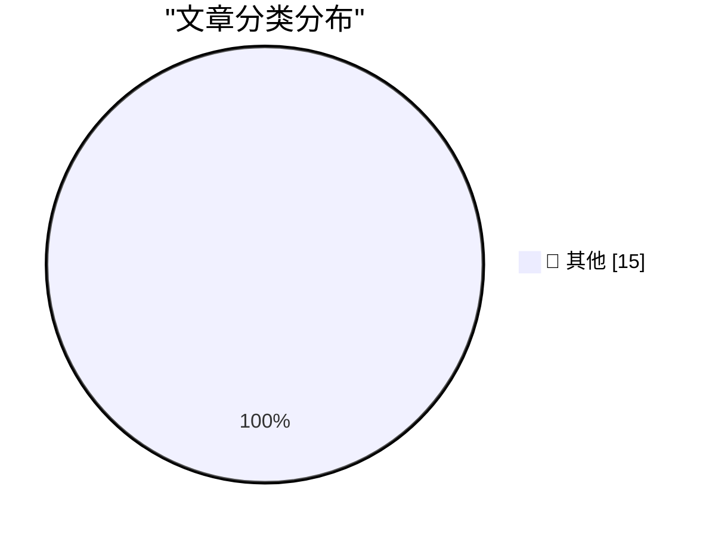

# 📰 AI 资讯每日精选 — 2026-11-24

> 汇聚 140+ 技术博客、X/Twitter、Hacker News、Reddit、Product Hunt、
> Lobste.rs、ClawFeed 日报及 GitHub Trending，经 AI 评分筛选。
>
> **本期内容**：🏆 今日必读 · 🌐 ClawFeed 日报 · 🔥 GitHub Trending · 📂 分类精选 · 🎨 设计与生成式 AI · 📊 数据概览

## 🏆 今日必读

🥇 **datasette-charts 0.2a0**

[datasette-charts 0.2a0](https://simonwillison.net/2026/Nov/24/datasette-charts/) — simonwillison.net · 2 小时前 · 📝 其他

> datasette-charts 0.2a0

🥈 **datasette-agent 0.7a1**

[datasette-agent 0.7a1](https://simonwillison.net/2026/Nov/24/datasette-agent/) — simonwillison.net · 3 小时前 · 📝 其他

> datasette-agent 0.7a1

🥉 **GLM-5.4: Toward Generalized Coding with Our First Loop Transformer**

[GLM-5.4: Toward Generalized Coding with Our First Loop Transformer](https://simonwillison.net/2026/Nov/23/glm-54/) — simonwillison.net · 7 小时前 · 📝 其他

> GLM-5.4: Toward Generalized Coding with Our First Loop Transformer

4️⃣ **Ladybird's first alpha release**

[Ladybird's first alpha release](https://simonwillison.net/2026/Nov/23/ladybird/) — simonwillison.net · 9 小时前 · 📝 其他

> Ladybird's first alpha release

5️⃣ **[Sponsor] Finalist Daily Planner Meets iPhone Duo**

[[Sponsor] Finalist Daily Planner Meets iPhone Duo](https://www.finalist.works/iphone-duo-planner/?utm_source=df-nov-2026) — daringfireball.net · 7 小时前 · 📝 其他

> [Sponsor] Finalist Daily Planner Meets iPhone Duo

---

## 🌐 ClawFeed 日报精选

> 来源：[ClawFeed](https://clawfeed.kevinhe.io) — AI 驱动的多源新闻聚合

# ☀️ ClawFeed | 2026-11-23 日报 SGT

> 聚合自 3 期 8 小时简报：#1539 00:00 档（00:00-07:59）、#1540 08:00 档（08:00-15:59）、#1541 16:00 档（16:00-23:59），时间窗 2026-11-23 00:00–23:59 SGT（周一），三档都在。三期标题按发布时刻写：#1539 标题是「11-23 08:00」、#1540 是「11-23 16:00」、#1541 是「11-24 00:00」，所以各期正文里「11-23 08:00 那期」就是本日的 #1539，「11-23 16:00 那期」就是 #1540；「11-23 00:00 那期」指的是 #1536（窗口 11-22 16:00–23:59，已收进 11-22 日报 #1537），「11-22 16:00 那期」是 #1535，「11-22 08:00 那期」是 #1534，#1541 里说的「11-22 的日报」就是 #1537；「11-21 16:00 那期」是 #1531，「11-21 08:00 那期」是 #1530，「11-21 00:00 那期」是 #1528（按 11-22 日报的对照）。
> 素材数（都按各期自己写的数，和三期网站 metadata 的 feed 165、160、212 一致）：首页时间线窗内分别 165、160、212 条（合计 537），收了 20、31、36 条（合计 87）；关注抽样另算，三期都是抽 35 个账号、打开 24 个主页（23 个有内容、1 个是空的，出错 0），窗内分别 8、4、15 条，合计 27 条，收了 3、3、3 条（合计 9），三期都写明这些帖子不在首页时间线里。书签三期都抓到 18 条，最新一条都是 11-21 19:45，三期窗内都是 0 条，网站 metadata 的书签数也是 0、0、0；本日报没从旧书签里补。
> 这是 SGT 周一的一天（美国东部 = SGT−13 小时）：00:00 档对应美国东部 11-22 周日上午 11 点到晚上 7 点，周末、美股休市，#1539 说时间线里大半是 NFL、欧洲足球、ATP 年终总决赛、新闻快讯、推广和一句话，AI 和科技的帖子很少；08:00 档是亚洲周一的白天（美国东部周日晚 7 点到周一凌晨 3 点），#1540 说时间线以中文 AI 和加密账号为主，推广和转述很多；16:00 档对应美国东部周一凌晨 3 点到上午 11 点，美股 22:30 SGT 开盘，#1541 说 22 点、23 点两档帖子最多，大半在说同一件事（黄仁勋回归）。覆盖：#1539 是 11-23 08:0x 抓的，第一遍翻到第 11 屏遇到整屏早于窗口就停（41 条），第二遍翻满 80 屏（245 条），从第 5 屏起就整屏早于窗口，两遍去重 269 条、最早翻到 11-21 16:34，覆盖完整（窗外 104 条早于窗口，没有晚于窗口的），6 点档 34 条、5 点档 25 条最多；#1540 是 11-23 16:0x 抓的，第一遍到第 11 屏停（40 条），第二遍翻满 80 屏（240 条），从第 16 屏起整屏早于窗口，去重 261 条、最早翻到 11-22 03:00，覆盖完整（窗外 94 条早于窗口、7 条晚于窗口），15 点档 55 条最多，13 点档只有 7 条、9 点档 9 条；#1541 是 11-24 00:0x 抓的，第一遍到第 4 屏停（9 条），第二遍翻满 80 屏（279 条），第 4、21、46 屏整屏早于窗口、其余屏里仍夹着窗内的帖子，去重 284 条、最早翻到 11-22 22:43，覆盖完整（窗外 58 条早于窗口、14 条晚于窗口），23 点档 95 条、22 点档 33 条最多，18 点档只有 9 条。
> 主线：英伟达和黄仁勋，两档接力：08:00 档是《纽约时报》称风波中心人物 Alice Huang 和中国最高情报机构有接触、特朗普在 Truth Social 上希望董事会请回黄仁勋（ME News 转述），16:00 档英伟达董事会恢复黄仁勋的总裁、CEO 和董事职务，路透标题是「股价大涨」，特朗普称美国没有黄仁勋违规的证据，时间线里同一件事的转述和一句话反应有 28 条。其次是周一的行情：开盘前美股期货反弹、亚洲多地救市，白天 A 股盘中转涨，晚上《纽约时报》说标普 500 早盘一度涨近 5%；回看上周是股票、黄金、比特币同一天都跌 3% 以上、芯片股跌 17%。第三是黎曼猜想之后：《科学美国人》报道独立数学家完成核验，Alexandr Wang 发长文《Superintelligence is Arriving》，中文自媒体转述一位数学家质疑证明的 Lean 代码（没有一手出处）。第四是 OpenAI 的一周：Jakub Pachocki 的预训练透明度主张，「GPT-6.2 Astra 在 Agent Arena 排第 6、融资额减半」的整理，以及图表源码里留着 10 个模型原始算力的发现。第五是 agent 商务落地：Sierra 完成 17.5 亿美元 F 轮、估值 300 亿美元，Walmart Agent Gateway 上线支持 Muse，Visa CLI，花旗用 Devin 省钱的说法。另有 GLM-5.4（先开放给 Coding Plan 用户、晚上正式发布，称是第一个 Loop Transformer）、Ant Ling 的 Ling-3.2-air 和「LingSante-3.1-flash 超过 GPT-6 Astra」的说法、对《Agent platform of 2027》的回应、OpenCode 2.4.0 的自动化、Linger 开源、腾讯混元的 Reddit 问答、「阿里 Qwen 团队大规模离职」的传言、Gemini 的 Helium 订阅档、OpenAI 用 2,000 个 agent 分析 800 万个细胞、GCSA 说「零数据保留」被打穿、俄勒冈和弗吉尼亚起诉 SpaceX、几款用 AI 做的游戏，以及代币化苹果股票的第一次链上派息等加密消息。

---

## 🔥 当日最重要 5 条（跨档去重）

1. **英伟达和黄仁勋：白天《纽约时报》称风波中心人物 Alice Huang 在和黄仁勋交往期间与中国最高情报机构有过接触，ME News 转述特朗普在 Truth Social 上说「我希望英伟达董事会重新聘请黄仁勋」；晚上英伟达董事会恢复黄仁勋的总裁、CEO 和董事职务，路透标题是「股价大涨」，TechCrunch 说特朗普援引司法部长称美国没有黄仁勋违规的证据、同时敦促英伟达继续做出口管制的调查**（#1540、#1541，接 11-22 日报的「董事会罢免黄仁勋」新说法、英伟达周五跌 14% 和「特朗普希望黄仁勋回去」的中文自媒体转述）：白天：@nytimes 08:38 援引了解美国情报报告的人士：Alice Huang 在和黄仁勋交往期间与中国最高情报机构有过接触，报告记录了这些接触（媒体报道，正文素材里看不到；路透 13:20 也转了这篇报道）；@MetaEraCN 13:17（ME News）：特朗普在 Truth Social 上发文「我希望英伟达董事会重新聘请黄仁勋，这对公司和美国都是最好的」，此前对记者说「不介意」黄仁勋回来、「学到了很大的教训」、美国是「给第二次机会的国家」；所引同一账号 6 小时前的帖子：财长贝森特在 Face the Nation 上说，此前建议英伟达找外部 CEO，而黄仁勋现在就在外部，为回归留了余地，同时强调要调查高层的合规责任（媒体转述，Truth Social 原帖素材里看不到）（#1540）。晚上：@nvidianewsroom 21:58（英伟达新闻室，Yat Siu 转发）：「英伟达董事会恢复黄仁勋的总裁、CEO 和董事职务」，附新闻稿链接（公司公告，新闻稿正文素材里看不到）；@Reuters 22:32：「英伟达董事会恢复黄仁勋职务，股价大涨」（直播标题）；@TechCrunch 23:09：特朗普援引美国司法部长的说法为黄仁勋回归辩护，同时敦促英伟达继续做出口管制方面的调查（媒体报道，正文素材里看不到）；股价：关注抽样 @tangsanzangbtc 22:02（比特唐三藏）附的行情卡片显示 NVDA 168.22 美元、+34.01%（卡片报价的时间素材里看不出）；@Betaer 23:19：Melius Research 把英伟达评级从持有上调到买入，目标价 220 美元（⚠️未证实：快讯没给出处）；旁支：@MrMikeInvesting 22:15 称上周五收盘前有人买了 340 万美元、今天到期的 NVDA 160 美元看涨期权，涨了约 9,000%，价值会超过 3.12 亿美元（⚠️未证实：没给成交记录或出处，后文被截断）；@starzq 22:22 说木头姐（Cathie Wood）刚清掉了 NVDA（⚠️未证实：没给持仓出处）；@MrRyanChi 22:45 引纽约时报中文网：英伟达前人力资源高级副总裁 Michael Winston 2005 年曾威胁起诉英伟达，称自己因反对黄仁勋的做法被解雇（2005 年的旧指控，媒体转述；发帖人配了一段反讽的时间线：11 月初丑闻、11-12 辞职、11-17 借员工联名和政客施压回来）（#1541）。#1541 噪音里另有同一件事的转述和一句话反应 28 条（CNN 等的快讯、Jim Fan「Jensen 2.0」、Kalshi 上 ARM CEO 续约到 2033 年等）。**说法不一致的地方**：股价涨幅三处数不一样：比特唐三藏的卡片是 +34.01%，噪音里 oasis 写「暴涨 31%」，关注抽样里 0x糖豆写「盘前涨 30%」，时点不同、素材里看不出各自的报价时间；特朗普的表态在 #1540 只有 ME News 的转述，#1541 是 TechCrunch 的标题，两处都看不到原话全文；《纽约时报》的情报报道只有快讯，报告本身素材里看不到。
   来源: https://x.com/nytimes/status/2124663793670127809 ｜ https://x.com/MetaEraCN/status/2124733934181425590 ｜ https://x.com/nvidianewsroom/status/2124865060397019480 ｜ https://x.com/Reuters/status/2124873759987290577 ｜ https://x.com/TechCrunch/status/2124882936696623270 ｜ https://x.com/tangsanzangbtc/status/2124866244004528623 ｜ https://x.com/Betaer/status/2124885662482710777 ｜ https://x.com/MrMikeInvesting/status/2124869411001545117 ｜ https://x.com/starzq/status/2124871103902572622 ｜ https://x.com/MrRyanChi/status/2124876988397580303

2. **周一的行情：开盘前美股期货在纳斯达克 100 自 2020 年以来最差的一周后反弹（标普 500 期货 +1.4%、回到 7,000 点以上），中国、韩国、台湾股市密集救市，比特币约 60,900 美元、低于挖矿成本；白天 A 股早盘深跌后三大指数全部转涨、宇树涨停；晚上《纽约时报》说标普 500 早盘涨近 5%；回看上周：股票、黄金、比特币同一天都跌 3% 以上（2014 年以来只出现过两次），芯片股跌 17%，比特币 ETF 5 个交易日净流出约 18 亿美元**（#1539、#1540、#1541，接 11-22 日报的英伟达周五跌 14%、韩国准备动用股市稳定基金和摩根大通的挖矿成本估算）：凌晨：@KobeissiLetter 07:02（The Kobeissi Letter）：纳斯达克 100 经历 2020 年以来最差的一周后，美股期货重新开盘反弹：标普 500 +1.4%、纳斯达克 100 +2.2%、道琼斯 +0.9%、WTI 原油 +1.5%、黄金 +2.0%，标普 500 期货回到 7,000 点以上（快讯）；@Techub_News 06:55：中国、韩国、台湾股市密集出台救市措施，标普 500 面临七连跌（媒体快讯，只有标题；同一分钟 Techub 还发了 Fusionist 被黑那条，链接两条都列上）；@Dropstab_com 02:21（DropsTab）：比特币前三轮见顶后分别过了 410、363、376 天见底，今天是第 412 天；比特币 60,900 美元，低于 Strategy 的平均买入价 75,700 美元、200 周均线 68,200 美元和挖矿成本 62,900 美元（数据号的整理）（#1539）。白天：@bitexiaohu 15:54（比特币小虎）：股票、黄金、比特币上周五同一天都跌了 3% 以上，Alea Research 翻了 2014 年以来的数据，这种情况只出现过两次，上一次是 2020 年 3 月疫情引发美股熔断那几天，这次能躲的只剩美国国债（转述研究机构的数据，后文被截断）；关注抽样 @Tabgdoueth 14:39（0x糖豆）：A 股早盘三大指数跌得挺深，到发帖时全部转涨，宇树涨停、市值两千八百多亿，机器人、CPO、影视板块都强，三千多只股票上涨（个人盘中观察）（#1540）。晚上：@nytimes 22:53：标普 500 早盘涨近 5%，扭转上周因为担心 AI 引发的暴跌，文章标题是「黄仁勋回归英伟达后华尔街大涨」（媒体快讯）；@BinanceResearch 20:50（币安研究院）的周报：上周 SPY、GLD、BTC 一起跌、钱跑去了债券，对 AI 支出和融资的担忧让芯片股跌了 17%，美联储会议纪要提到 12 月加息 50 个基点的可能，稳定币供应量降到 2026 年的低点，卖盘大多在美国交易时段（研究机构的周报摘要）；@TradersWeek 19:25：比特币 ETF 5 个交易日净流出约 18 亿美元，比特币比 200 日均线低 15%，爆仓量只有平常的 0.4 倍、资金费率接近 0，结论是「人们在卖，而不是在清杠杆」（数据整理，后文被截断）；@Nexo 17:00：感恩节周把一周的美国数据挤进 72 小时，周三的核心 PCE 和三季度 GDP 会检验通胀是否影响美联储 12 月的决定（平台的日程提示）（#1541）。**说法不一致的地方**：比特币的挖矿成本两个数：#1539 DropsTab 写 62,900 美元（口径素材里看不到），11-22 日报里 coinbureau 转述的摩根大通估算是 86,000 美元，不是同一个数；#1539 Techub 的标题说标普 500「面临七连跌」，同一档 Kobeissi 写的是期货开盘反弹，一个是现货的连跌、一个是期货的开盘，时点不同；#1541 噪音里有 CoinGlass 11-21 的爆仓快照（24 小时 23.8 亿美元、多头占 92.6%），和 TradersWeek「爆仓量只有平常的 0.4 倍」说的是不同时段。
   来源: https://x.com/KobeissiLetter/status/2124639723016601958 ｜ https://x.com/Techub_News/status/2124637950923165875 ｜ https://x.com/Techub_News/status/2124637939674038391 ｜ https://x.com/Dropstab_com/status/2124568855938994308 ｜ https://x.com/bitexiaohu/status/2124773457900527812 ｜ https://x.com/Tabgdoueth/status/2124754814831862022 ｜ https://x.com/nytimes/status/2124878998274474444 ｜ https://x.com/BinanceResearch/status/2124848033594822735 ｜ https://x.com/TradersWeek/status/2124826768179655015 ｜ https://x.com/Nexo/status/2124790108901494958

3. **黎曼猜想之后：《科学美国人》称独立数学家已完成对 Anthropic 数学家 Levent Alpöge 证明的完整核验、「结果是真的」，Kirk Borne 问这是否已成定论；白天 Meta 首席 AI 官 Alexandr Wang 发长文《Superintelligence is Arriving》，说 AI 现在缺的不是智力而是各行业的专门知识和实验条件，同时警告社会不应接受向 AI 的「移交」；另有中文自媒体转述数学家 Jenny Lorraine Nielsen 质疑证明代码把关键几何条件设成恒真**（#1539、#1540，接 11-22 日报的孙宇晨奖核验公告和 Abhishek Saha 的反应）：凌晨：@KirkDBorne 06:07（Kirk Borne）引《科学美国人》：独立数学家已经完成对 Alpöge 前一天公布的黎曼猜想证明的完整核验，「结果是真的」（标题是「AI 的黎曼猜想证明几乎可以肯定是对的」）；Kirk Borne 问「现在算定论了吗？」，说这个周末至少看到过一位数学家的相反说法（媒体报道加个人疑问，相反说法没给出处，文章正文素材里看不到）（#1539）。白天：@dotey 14:47（宝玉）引 Wang 的长文：结论是 AI 现在缺的不是智力，而是各行业的专门知识和实验条件；Wang 同时反对把社会交给 AI，认为整个行业需要换一条路走（宝玉的总结，后文被截断；Wang 原文素材里只有开头「超级智能正在到来，人类接下来一年怎么做，会深远影响我们生活在什么样的未来」）；@Cointelegraph 10:30：Wang 在 AI 协助证明黎曼猜想后说「超级智能正在到来」，并警告社会不应接受向 AI 的「移交」（媒体快讯）；@TechFlowPost 14:35（TechFlow 深潮）：Wang 认为纯粹的「原始智力」已经不是卡脖子的瓶颈，文中一句是「和黎曼猜想相比，许多物理学家都会同意，造原子弹充其量只相当于一道课后作业」（媒体转述，后文被截断）；@linmumu223 14:00（mumu木川）：称数学家 Jenny Lorraine Nielsen 公开质疑这份证明，说证明代码把一个关键几何条件直接设成恒真（True），绕过了必要的验证，「Lean 通过检查不代表数学证明本身成立」，发帖人自己也在问 Grok 这是不是真的（⚠️未证实：中文自媒体转述，Nielsen 本人的帖子或文章素材里看不到）（#1540）。#1540 噪音里另有 Wang 长文的转述和一句话评论 5 条（PANews、sleepy、Mak、比特币橙子Trader、Rohan Paul），以及孙宇晨「黎曼奖已开放、下一个是谁」；#1541 没有新的黎曼猜想内容。**说法不一致的地方**：#1539 的《科学美国人》写「完整核验、结果是真的」，#1540 的 Nielsen 质疑说 Lean 代码绕过了验证，两边都没有一手的数学家原文；Kirk Borne 说周末看到的「一位数学家的相反说法」是不是 Nielsen，#1540 自己注明素材里看不出；11-22 日报里孙宇晨奖的「通过多家独立核验」也只是奖金方自己的公告。
   来源: https://x.com/KirkDBorne/status/2124625772111368430 ｜ https://x.com/dotey/status/2124756676607627434 ｜ https://x.com/Cointelegraph/status/2124692145005072632 ｜ https://x.com/TechFlowPost/status/2124753791283061019 ｜ https://x.com/linmumu223/status/2124744756442149309

4. **OpenAI 的一周：凌晨 Jakub Pachocki 说 OpenAI 决定公开更多预训练进展、走向共同的安全门槛，Mustafa Suleyman 称「非常重要」；GPT-6.2 Astra 上架 GitLab Duo Agent Platform；白天 PANews 整理称 GPT-6.2 Astra 在 Agent Arena Index 上排第 6、落后于 Anthropic 的 Claude Fable，标题还说融资额减半、对冲基金担心 OpenAI 上不了市；傅盛说在硅谷听到的情况和 Binkg 的传闻类似；Lucas Beyer 转的发现：预训练文章的图表源码里留着 10 个模型的原始算力**（#1539、#1540，接 11-22 日报的「内部士气低落、早期测试者差评」传闻和 GPT-6.2 Sol 上架 GitLab）：凌晨：@mustafasuleyman 02:43（Mustafa Suleyman，Boaz Barak 转发）引 Jakub Pachocki：「我们决定公开更多 OpenAI 预训练进展，以便走向共同的安全门槛」，在《Perplexity and Intelligence》里主张按困惑度和其他指标设共同上限，超过上限的进展要取决于……（后文被截断）；Suleyman 说「这非常重要」，向 Pachocki 和 OpenAI 的倡导致敬（OpenAI 的人自己的说法，具体公开什么素材里看不到）；@gitlab 05:05：GPT-6.2 Astra 上架 GitLab Duo Agent Platform，定位是看重质量和判断的多步骤难活（自家发布）（#1539）。白天：@PANewsCN 10:30（PANews）：标题是「OpenAI 遭遇艰难一周：新模型榜单第 6，融资额减半，对冲基金担忧其无法 IPO」，正文说 GPT-6.2 Astra 在 Agent Arena Index 上排第 6，落后于 Claude Fable；所引 Paul Bonnet 的帖子转述两位对冲基金朋友的看法，第一条是担心半导体供应链（和电力）盈利过头（后文被截断）（⚠️未证实：「融资额减半」「无法 IPO」素材里没有出处，榜单原始页面也看不到）；@FuSheng_0306 08:16（傅盛）引 Binkg「OpenAI 内部气氛低落、近乎抑郁，可能是公司史上最糟的一周」：说这两天在硅谷和朋友聊，听到的情况类似（个人见闻，仍是二手，素材里没有 OpenAI 的回应）；@indigox 08:26（indigo）介绍 Pachocki 的文章：主张行业用「对数困惑度」反映底层智能的进展，因为模型的能力在预训练阶段就已具备，要在进入 RL 阶段之前就管住（个人转述，后文被截断）；@giffmana 15:26（Lucas Beyer）引 Rui-Jie Zhu：OpenAI 的图表把算力归一成 GPT-4 = 1，但归一化是在浏览器里算的，页面嵌了 8 个 Observable notebook，损失曲线图源码第 207 行还留着这个模型梯队里全部 10 个模型的原始算力；Beyer 说「而且这是手写的，不是最近某些 agent 生成的东西意外泄露」（第三方发现，哪张图、具体数字素材里看不到）（#1540）。**说法不一致的地方**：11-22 日报写过 DesignArena 游戏开发榜前三都是 OpenAI 的模型，#1540 PANews 写 GPT-6.2 Astra 在 Agent Arena Index 排第 6，是两个不同的榜单；士气的说法从 Binkg 的匿名传闻到傅盛的「听到的情况类似」，仍然都是二手，三期都没有 OpenAI 自己的回应。
   来源: https://x.com/mustafasuleyman/status/2124574455972364689 ｜ https://x.com/gitlab/status/2124610141748170941 ｜ https://x.com/PANewsCN/status/2124692030546981009 ｜ https://x.com/FuSheng_0306/status/2124658197013398007 ｜ https://x.com/indigox/status/2124660902092042722 ｜ https://x.com/giffmana/status/2124766602243813655

5. **AI 客服和 agent 商务落地：做客服 AI 的 Sierra 完成 17.5 亿美元 F 轮、估值 300 亿美元（TechCrunch 标题是「六个月内估值翻倍」）；Walmart Agent Gateway 已经上线、支持 Meta 的 Muse；Visa 面向美国用户推出实验性的 AI 代理钱包 Visa CLI；Cognition 的 CEO 说花旗预计 2026 年仅靠 Devin 就能省约 15 亿美元；Grok Bot 出了黑五比价模板和订酒店、机票的新功能**（#1540、#1541，Walmart 和 Muse 接 11-22 日报那条「要上线第一个 agent 对 agent 购物对接」的转述）：白天：@wublockchain12 08:39（吴说区块链）：Visa 加密业务负责人 Cuy Sheffield 发文说，Visa 已面向美国用户推出实验性的 AI 代理钱包 Visa CLI，基于 Tempo 和机器支付协议（MPP），同时把可信代理协议（TAP）和 Visa Agent Directory 扩展到代理钱包和任务市场（媒体转述，后文被截断）；@bearlyai 08:38（Bearly AI）：Cognition 的 CEO Scott Wu 说，花旗预计仅 2026 年就能靠 Devin 省下约 15 亿美元，主要是把老系统的活（版本升级、迁移、几十年老代码换平台）收回自己做，不再付钱给外包和合同工（厂商 CEO 的说法，花旗方面的说法素材里看不到，后文被截断）（#1540）。晚上：@SierraPlatform 19:50（Sierra）：F 轮融资 17.5 亿美元、估值 300 亿美元，Greenoaks 和 Lightspeed 领投，之前各轮的领投方 Benchmark、Sequoia、Greenoaks、GV 和 Tiger Global 都加码（公司公告，后文被截断）；@TechCrunch 22:43：Sierra 由前 Salesforce 联席 CEO Bret Taylor 联合创办，做企业客户体验，标题是「AI 客服需求起飞，Sierra 六个月内估值翻倍到 300 亿美元」（媒体报道）；@GVteam 20:04（GV）：七个月前联合领投了 Sierra 的 E 轮，这次加码（投资方说法）；@verge 19:05（The Verge）：Walmart Agent Gateway 已经上线、支持 Muse，其他 app 和 agent「在路上」，文章标题是「Meta 的 Muse 现在能去 Walmart 帮你买黑五的东西」（媒体报道）；@elonmusk 22:46 引 Nima Owji：做了一个叫「DEAL HUNTER」的 Grok Bot 模板，每隔几小时上网找黑五优惠，找到就通知；@mattyp 23:00（matt palmer）介绍 Grok Bot 新功能：订酒店和机票、通过 Tailscale 用 tailnet 上的 MCP 服务器、连接器工具权限、图片标注（产品介绍视频）（#1541）。**说法不一致的地方**：11-22 日报里「Walmart 和 Muse 要上线 agent 对 agent 购物对接」只有 Simon Taylor 引的转述，本日有了 The Verge 的报道说已上线，但仍没有 Walmart 或 Meta 自己的帖子；花旗省 15 亿美元只是 Cognition CEO 的说法。
   来源: https://x.com/wublockchain12/status/2124664126593257784 ｜ https://x.com/bearlyai/status/2124663752553586762 ｜ https://x.com/SierraPlatform/status/2124832956795539842 ｜ https://x.com/TechCrunch/status/2124876408040137145 ｜ https://x.com/GVteam/status/2124836379922481444 ｜ https://x.com/verge/status/2124821529750032710 ｜ https://x.com/elonmusk/status/2124877252412281142 ｜ https://x.com/mattyp/status/2124880662750724594

**⚠️ 未证实（素材里核实不了，只记录说法）**
- 「数学家 Jenny Lorraine Nielsen 质疑证明代码把关键几何条件设成恒真」：@linmumu223 14:00 中文自媒体转述，Nielsen 本人的帖子或文章素材里看不到（#1540）。https://x.com/linmumu223/status/2124744756442149309
- 「独立数学家已完成核验、结果是真的」和「周末看到过一位数学家的相反说法」：@KirkDBorne 06:07 引的《科学美国人》报道正文素材里看不到，相反说法没给出处（#1539）。https://x.com/KirkDBorne/status/2124625772111368430
- 「OpenAI 融资额减半、对冲基金担心其无法 IPO；GPT-6.2 Astra 在 Agent Arena Index 排第 6」：@PANewsCN 10:30 的整理，「融资额减半」「无法 IPO」没有出处，榜单原始页面看不到（#1540）。https://x.com/PANewsCN/status/2124692030546981009
- 「OpenAI 图表源码里留着 10 个模型的原始算力」：@giffmana 15:26 引的第三方发现，哪张图、具体数字素材里看不到（#1540）。https://x.com/giffmana/status/2124766602243813655
- 「特朗普在 Truth Social 上说希望英伟达董事会重新聘请黄仁勋」：@MetaEraCN 13:17 媒体转述，Truth Social 原帖素材里看不到（#1540）。https://x.com/MetaEraCN/status/2124733934181425590
- 「Melius Research 把英伟达上调到买入、目标价 220 美元」：@Betaer 23:19 快讯没给出处（#1541）。https://x.com/Betaer/status/2124885662482710777
- 「有人买了 340 万美元的 NVDA 160 美元看涨期权、价值会超过 3.12 亿美元」：@MrMikeInvesting 22:15 没给成交记录或出处（#1541）。https://x.com/MrMikeInvesting/status/2124869411001545117
- 「木头姐刚清掉了 NVDA」：@starzq 22:22 没给持仓出处（#1541）。https://x.com/starzq/status/2124871103902572622
- 「LingSante-3.1-flash 是目前医疗领域最好的模型，多项基准超过 GPT-6 Astra」：@svpino 02:10 的说法，基准数字素材里看不到，Ant Ling 原帖被截断（#1539）。https://x.com/svpino/status/2124566192115646591
- 「BitGo 的 CEO 往钱包里放 100 BTC 挑战『市值 1.1 万亿美元的 Anthropic』来黑」：@pete_rizzo_ 06:34 的说法，BitGo 方面的原帖、Anthropic 的回应和「1.1 万亿美元」的出处都看不到，「证实 AI 黑不了最强的钱」是发帖人的结论（#1539）。https://x.com/pete_rizzo_/status/2124632591554711666
- 「Anthropic 本周 IPO 定价 1.5 万亿美元、OpenAI 最近估值 1.25 万亿美元」：@PANewsCN 10:51 引 Gap 的「Stripe 帮」名单，估值数字的出处素材里看不到，和 #1539 pete_rizzo 帖里的「1.1 万亿美元」对不上（#1540）。https://x.com/PANewsCN/status/2124697229613228301
- 「阿里 Qwen 团队正在发生大规模人员离职」：@xingzengji 11:31 只是一句提问，没给任何报道出处（#1540）。https://x.com/xingzengji/status/2124707258760306865
- 「近 1000 个 AI agent 连续研究 3 个月，自主产出 936 篇论文」：@FinanceYF5 10:58 的说法，项目名称和出处素材里看不到（#1540）。https://x.com/FinanceYF5/status/2124699160733536469
- 「Fable 5.2 一次尝试就找到《魔鬼的计谋》象形文字谜题的通关解法」：@FinanceYF5 11:56 据 Deedy 的二手转述，Deedy 的原帖素材里看不到（#1540）。https://x.com/FinanceYF5/status/2124713661029654561
- 「花旗预计仅 2026 年就能靠 Devin 省下约 15 亿美元」：@bearlyai 08:38 转述的厂商 CEO 说法，花旗方面的说法素材里看不到（#1540）。https://x.com/bearlyai/status/2124663752553586762
- 「Gemini 4 Helium 要来了」：@kimmonismus 17:54 从订阅档名字推测，Google 没有官方说法（#1541）。https://x.com/kimmonismus/status/2124803644394533236
- 「Google 在官方论坛表态运行官方原版 antigravity-acp 用于个人交互式开发就是合规的」：@Kkkatia1 21:48 引的说法，Google 论坛的原帖素材里看不到（#1541）。https://x.com/Kkkatia1/status/2124862687364657307
- 「3 家推理服务商被攻破、标了『零数据保留』的请求照样泄露，OpenRouter 撤了 125 个端点的 ZDR 资格」：@MINGJUNBJ 17:49 引 GCSA，是哪 3 家、OpenRouter 方面的说法素材里都看不到（#1541）。https://x.com/MINGJUNBJ/status/2124802615309668397
- 「2,000 个 AI agent 在 800 万个细胞里找到人工几个月没发现的模式」：@a16z 23:30 的介绍，合作方和论文素材里看不到，后文被截断（#1541）。https://x.com/a16z/status/2124888419855634543

**次重要（备选）**
- GLM-5.4（两档接力）：@ZixuanLi_ 12:18（Zixuan Li）：GLM-5.4 向所有 GLM Coding Plan 用户开放，新增视觉能力、整体编码能力更强，按周配额的用户 GLM-5.4 的额度比 GLM-5.3 多 50%（发布公告）；@askalphaxiv 12:50（alphaXiv）：GLM 5.4 已经上了 OpenResearch，Autoresearch 的基准结果「很快」出（自家平台）（#1540）。@Zai_org 18:27（Z.ai）正式发布，标题是「通用编码，我们的第一个 Loop Transformer」：在 GLM-5 基座模型里循环复用已有的层来做更深的推理，从传统编码扩展到视频、游戏、3D 着色器和 CAD 建模，新增视觉能力用于视觉编码（官方发布）；@alacheng 21:18（头雁）：「都开始循环了」（#1541）。https://x.com/ZixuanLi_/status/2124719275864670681 ｜ https://x.com/askalphaxiv/status/2124727309282480395 ｜ https://x.com/Zai_org/status/2124811995912286352 ｜ https://x.com/alacheng/status/2124855191099122148
- Ant Ling（11-22 日报写过 LingSante-3.1-flash 的发布）：@svpino 02:10（Santiago）引 Ant Ling 的发布，称 LingSante-3.1-flash 是目前医疗领域最好的模型、多项基准超过 GPT-6 Astra（⚠️未证实：基准数字素材里看不到）（#1539）；@AntLingAGI 23:42（Ant Ling）：发布开放权重的 Ling-3.2-air，和 Ling-3.0-flash-VL 共用原生多模态架构，总参数 124B、激活 5.5B，工作流自动化和专业文档推理更强，AutomationBench-AA 从 15.7% 升到 61%（自家发布，完整基准是图，素材里看不到）（#1541）。https://x.com/svpino/status/2124566192115646591 ｜ https://x.com/AntLingAGI/status/2124891223597240338
- 《Agent platform of 2027》的回应（11-22 日报写过 elvis 和 Tomás Malamud 推荐这篇长文，#1539 噪音里有 Dalton Caldwell 的引用）：@hwchase17 08:02（Harrison Chase）说文章很好、很多地方同意，但它描绘的是未来的 agent「运行时」，运行时只是 agent 平台的一部分，有两处明显遗漏：一是可观测性和评测，二是治理（后文被截断）；关注抽样 @levie 08:15（Aaron Levie）说「全都同意」：agent 接手越来越多长时间的项目工作、成群的 agent 并行朝一个目标推进，agent 的 harness 和编排架构都得跟着变（后文被截断）（#1540）；@jiayuan_jy 17:01（Jiayuan Zhang）说在 Multica 每个工作日有 17 万次 agent 运行，要分享从中学到的东西（只有开头，正文素材里看不到）（#1541）。https://x.com/hwchase17/status/2124654748104302930 ｜ https://x.com/levie/status/2124658150771188157 ｜ https://x.com/jiayuan_jy/status/2124790534313312648

---

## 📰 当日核心主题

**① 模型、开放权重和 AI 做研究（三期都有）**
GLM-5.4 和 Ant Ling 见「次重要」。凌晨（#1539）：@elonmusk 04:52 引 Julian Ibarz：特斯拉的端到端具身 AI 架构已经在几百万辆车上量产，更大的世界模型由 Autopilot 和 Optimus 共用，对 Optimus 的 3D 标注很重要；底下再引马斯克 13 小时前的帖子：去年起就有「近乎像素级」的世界模型，用来生成合成数据，车里跑的是小得多的条件 mean-flow 模型（后文被截断），马斯克加了一句招人（本人和团队说法；11-22 日报写过 FSD v15 和 Optimus 共用视觉编码器）；关注抽样 @rightnow_co 02:54（RightNow，YC F26）引 Jaber：thinkymachines 的 Inkling 2 Small 有 594B 参数，预训练、中训练和后训练都用 NVFP4，也就是 Blackwell 张量核心直接读的格式，Jaber 说这证明「CUDA 护城河越来越宽」，RightNow 说护城河现在在模型权重里、自家 agent 能给它写 kernel（转述加自家推广，后文被截断）；关注抽样 @turingbook 01:15（刘江）引 Sebastian Raschka「美国的开放权重模型没有中国的开放权重模型不会这么好，反之亦然」：大模型团队在架构上互相借鉴，国内 DeepSeek 和苏剑林的原创贡献比较突出（个人观点）（https://x.com/elonmusk/status/2124606900553863466 ｜ https://x.com/rightnow_co/status/2124577316722692361 ｜ https://x.com/turingbook/status/2124552343282930002）。
白天（#1540）：@shao__meng 08:07（meng shao）引 Tony Zhang 11-19 的发布：DeepSeek 早期核心成员、DeepSeek-VL 项目负责人张博创办 Simplex AI，开源个人 agent Linger，跑在自己电脑上，主打主动性、长期记忆和本地推理（项目方说法，后文被截断）；@Summer_ikiki 15:04（一碗咕咪酱）：腾讯混元在 Reddit 上做开发者问答，首席 AI 科学家姚顺雨带队，120 分钟答了近 100 条，问题包括算力受限怎么追前沿、别人冲 3T、5T 参数「你们还停在 700B 凭什么」、怎么看刷榜，混元回答说在尽量充分利用现有资源追赶前沿（转述，Reddit 原帖素材里看不到）；@xingzengji 11:31（知一）：问阿里 Qwen 团队发生了什么，「外媒都在传正在发生大规模人员离职」（⚠️未证实：只是一句提问，没给任何报道出处）；@shao__meng 08:37 引 Lewis Tunstall：给物理学家讲的「From LLMs to Swarms」，49 页讲稿放在 HF 上，从 scaling law、推理模型、coding agent 和 harness，讲到 autoresearch 和「idea basins」，再到用通信来引导和训练 agent 群（讲者自己的提纲）；@FinanceYF5 11:56（AI Will）：据 Deedy 分享，韩国解谜节目《魔鬼的计谋》第三季一道象形文字谜题，4 名以上选手花了 3 天多没解完，Fable 5.2 一次尝试就找到了通关解法，当时网上还没有公开答案，不过最后一块没有完全破解（二手转述）；@FinanceYF5 10:58：称来自 Stanford、MIT、ETH Zurich 等 35 个实验室的近 1000 个 AI agent 连续研究 3 个月，自主产出 936 篇论文（⚠️未证实：项目名称和出处素材里看不到）；@FinanceYF5 11:47：Yuchen Jin 建议研究数学的可以转向物理和生物，做软件的可以转向构建验证器和评测系统，并预测 2027 年大部分 AI 研究可能实现自动化（转述）（https://x.com/shao__meng/status/2124655927567794192 ｜ https://x.com/Summer_ikiki/status/2124760901912072615 ｜ https://x.com/xingzengji/status/2124707258760306865 ｜ https://x.com/shao__meng/status/2124663687193764228 ｜ https://x.com/FinanceYF5/status/2124713661029654561 ｜ https://x.com/FinanceYF5/status/2124699160733536469 ｜ https://x.com/FinanceYF5/status/2124711291747013002）。
晚上（#1541）：@kimmonismus 17:54（Chubby）引 lyra：Gemini 网页版新加了一个叫 Helium 的订阅档，这个名字之前在一段视频里被当作下一个模型预告过，Chubby 说「Gemini 4 Helium 要来了」（⚠️未证实：Google 没有官方说法，是从订阅档名字推测的）；@a16z 23:30：OpenAI 在做帮科学家从人看不完的大数据集里找规律的工具，一项合作里 2,000 个 AI agent 在 800 万个细胞里找到了人工分析几个月都没发现的模式，OpenAI 最近收购了 Orchestra Bio（后文被截断，合作方和论文素材里看不到）（https://x.com/kimmonismus/status/2124803644394533236 ｜ https://x.com/a16z/status/2124888419855634543）。

**② Agent 和开发工具（三期都有）**
agent 商务见前 5 条第 5 条，《Agent platform of 2027》见「次重要」。凌晨（#1539）多是用 AI 做的游戏和小工具：@thisiskp_ 01:48（KP）：GTA VI 周四发售了，但这一周自己反复点开的是别人用 AI 做的游戏，第一个是 1:1 复刻伦敦市中心、扮演自行车快递员（列表被截断）；@thisiskp_ 01:57 推荐 ann_nnng 做的节日 Claude skill：放一张贺卡照片加上祝福，Claude 把它做成可交互的贺卡（skill 发布在 TypingMind 上）；@Thaxnay 02:41：用 fable 5.2 做的《罗摩衍那》动作冒险游戏，可以在桌面和手机浏览器里玩，底下引自己 11-20 的帖子说是用 Unity、Blender、Claude 和 GPT 做的（个人作品）；@zachtratar 06:42（Zach Tratar）引 ari dutilh：在浏览器里跑的迷你旧金山（smallsf.com），有真实的公交、飞机、船和天气，还能坐 robotaxi（个人作品，帖子没说用了什么工具）（https://x.com/thisiskp_/status/2124560696494952589 ｜ https://x.com/thisiskp_/status/2124562954263961943 ｜ https://x.com/Thaxnay/status/2124574054296219939 ｜ https://x.com/zachtratar/status/2124634735582556191）。
白天（#1540）：@xiaohu 13:19（小互）：OpenAI 出了一篇教程，教人做 Dot 那样的个人 agent：中途问一句、没收到回复，它照样按时交稿，例如 16:00 让它查一家客户、16:15 开会，它在 16:12 前交简报（转述，OpenAI 的教程原文素材里看不到）；@_avichawla 14:55（Avi Chawla）：HarnessRouter 开源了 Harness Memory，记忆归用户所有，从 Claude Code 换到 Codex 也不会丢（推荐帖，后文被截断）；@RoundtableSpace 15:15（0xMarioNawfal）：开源工具 fast-anything 先给 Python、Node 或 Ruby 应用做性能剖析，找出最耗时的函数，只让 Claude Code 或 Codex 把这部分改写成 Rust，录下最多 500 次真实调用拿来回放（后文被截断）；@turingou 12:20（郭宇）：自己做的极速构建服务 hayabuild 正式上线，前期有三台 Mac 构建机，按秒计费、每月 150 分钟免费额度（自家产品）；@zzcdsg11 15:56（zzcT）引 Mark Gurman：苹果的 computer-use AI agent 会来，但至少要到明年底才会推出，到那时别家的 agent 可能已经像从 iPhone 换到 Android 一样难离开（Gurman 的判断，出自彭博的通讯；zzcT 加了一句讽刺）（https://x.com/xiaohu/status/2124734624702267791 ｜ https://x.com/_avichawla/status/2124758790910460337 ｜ https://x.com/RoundtableSpace/status/2124763630092824618 ｜ https://x.com/turingou/status/2124719819249570045 ｜ https://x.com/zzcdsg11/status/2124774137105092810）。
晚上（#1541）：@opencode 23:22：OpenCode 2.4.0 加了自动化工具，agent 可以自己建自动化，定时跑或者响应 MCP 事件，触发提示词、shell 命令或能调 MCP 工具的 code mode 脚本（自家发布；11-22 日报写过 OpenCode Browse 代填网页表单）；@thdxr 23:29（Dax）：买域名时遇到麻烦，agent 用已连上的 MCP 建了一个监控邮件的自动化，一小时后指示邮件来了，它照着办完、拿到域名、配好 Cloudflare（自家产品的个人体验）；@mattpocockuk 17:30（Matt Pocock）：Vercel Board 说白了就是给 agent 和开发者共用的私有 Slack 工作区（还能同步到 Slack 频道），觉得是天才的想法，但多数团队应该自己从头搭一个（个人观点）；@rauchg 23:05（Guillermo Rauch）引这条：「一个真正好用的 board！」（自家产品）；@ElliotChen 23:00（Elliot）引浙大张宁豫：MemTrace 正式接入 EverOS，口号是「记忆遇上可观测性」，Elliot 说做 agent 记忆常遇到的问题是回答错了要往前翻很久、不知道抽取时有没有漏、更新时有没有把原来的内容覆盖（合作双方的发布）；@wey_gu 21:57（Wey Gu）引 leon7hao：Lody 可以有一份每日大纲笔记，把一条笔记转成对话、在笔记视图里管理所有对话，Wey Gu 说自家的 working memory 可以借鉴（产品介绍）；关注抽样 @LimestoneHQ 18:11（Limestone Digital）：「OpenAI 说 AGENTS.md 要写得精简」，附一段按 OpenAI 的 GPT-6.2 指南检查 Codex 配置的提示词（转述，OpenAI 指南原文素材里看不到）；关注抽样 @mardehaym 22:15（Mark Ajzenstadt）：没人真读 coding agent 开出来的 2,000 行 PR，agent 几分钟写完，审的人赶在周五前扫一眼就点通过（个人观点，后文被截断）；@Kkkatia1 21:48（Katiya）引森叔 11-22 的帖子：Gemini 4 口碑很好，但订阅只能在难用的 Antigravity 里用，T3 Code 因此突然火了，有人用反向代理绕过去，magpie 这类项目第二天就被成批封号，后来 Google 在官方论坛表态运行官方原版 antigravity-acp、用于个人交互式开发就是合规的（⚠️未证实：Google 论坛的原帖素材里看不到；Katiya 借这条推自家的 tutti.sh）（https://x.com/opencode/status/2124886266835505473 ｜ https://x.com/thdxr/status/2124888129102360921 ｜ https://x.com/mattpocockuk/status/2124797717834543167 ｜ https://x.com/rauchg/status/2124881919506886832 ｜ https://x.com/ElliotChen/status/2124880700109451407 ｜ https://x.com/wey_gu/status/2124864815462318426 ｜ https://x.com/LimestoneHQ/status/2124807923012604295 ｜ https://x.com/mardehaym/status/2124869327954612425 ｜ https://x.com/Kkkatia1/status/2124862687364657307）。

**③ 公司、行业、安全和监管（三期都有）**
英伟达见前 5 条第 1 条，Sierra 见第 5 条。凌晨（#1539）：关注抽样 @mardehaym 01:19（Mark Ajzenstadt）：如果自己是投资方的运营合伙人，被投公司 CEO 说「我们已经在用 AI 了」，会在下次董事会前要七样东西，第一样是公司付费的全部 AI 工具清单，从信用卡账单和报销单里找（后文被截断，另外六样素材里看不到）；@Techub_News 05:55：特朗普之子投资的机器人初创公司 Foundation 取消员工的健康福利（媒体快讯，只有标题）；@charlieINTEL 00:34（CharlieIntel）：Activision 公开了一项专利，NPC 通过采集游戏同时运行的语音聊天软件里的音频，学着像真人玩家那样反应（游戏媒体快讯，专利原文素材里看不到）（https://x.com/mardehaym/status/2124553244362035615 ｜ https://x.com/Techub_News/status/2124622804330897529 ｜ https://x.com/charlieINTEL/status/2124542124620140848）。
白天（#1540）：关注抽样 @turingbook 09:34（刘江）：1930 年代失业率 22%、人们担心机器抢走工作时，凯恩斯预测一百年后发达国家生活水平是当时的四到八倍；美国 1930 年实际人均 GDP 约 8,847 美元（2017 年不变价），2025 年约 69,749 美元，已经约 7.9 倍，按 1.5–2% 的年增速，2030 年很可能达到或略超 8 倍（个人整理）；@PANewsCN 10:51 引 Gap 的「Stripe 帮」名单：Stripe 前员工创办的 17 家公司，Anthropic 联创 Daniela Amodei 2013 到 2018 年在 Stripe，OpenAI 联创 Greg Brockman 也出自 Stripe（博主整理，估值数字见「未证实」）（https://x.com/turingbook/status/2124677848275538319 ｜ https://x.com/PANewsCN/status/2124697229613228301）。
晚上（#1541）：@MINGJUNBJ 17:49（铭君）引 GCSA 的《Can You Trust Zero Data Retention in AI?》：用约 200 万条带「金丝雀」标记的测试提示词测出 3 家推理服务商被攻破，标了「零数据保留」的请求照样泄露，OpenRouter 撤了 125 个端点的 ZDR 资格，铭君的结论是 ZDR「说白了就是一句承诺」（⚠️未证实：是哪 3 家、OpenRouter 方面的说法素材里都看不到；11-22 日报写过 GCSA 的 MONAI Label 案例）；@nytimes 22:11：俄勒冈州和弗吉尼亚州起诉 SpaceX，理由是其 AI 工具能让用户生成女性和儿童的色情化图像（媒体快讯，诉状内容素材里看不到）（https://x.com/MINGJUNBJ/status/2124802615309668397 ｜ https://x.com/nytimes/status/2124868358554189994）。

**④ 加密和金融基础设施（三期都有）**
行情见前 5 条第 2 条。凌晨（#1539）：@pete_rizzo_ 06:34（The Bitcoin Historian）：称 BitGo 的 CEO 往一个钱包里放了 100 BTC（800 万美元以上），公开挑战「市值 1.1 万亿美元的 Anthropic」的 CEO 来黑，现在币还没动（⚠️未证实：BitGo 方面的原帖、Anthropic 的回应和「1.1 万亿美元」的出处素材里都看不到）；@saintniko 03:47（niko）引 DEGEN NEWS：sunrise 称代币化 $ANT 头两天的 DEX 交易量 Solana 领先，超过 1.4 亿美元、比其他所有链加起来还多，Robinhood 的链第二、6,400 万美元（项目方说法的转述，$ANT 的全称素材里没写）；@Techub_News 06:55：Fusionist 被黑，1,091.5 ETH 已经通过 Tornado Cash 洗走（媒体快讯，只有标题；和亚洲救市那条同一分钟，链接两条都列上）；@JET_EUROPA_ 00:49（JET Europa）：Jito 的 BAM 已超过 Solana 质押量的 40%（生态号的说法）；@WSJ 01:10（华尔街日报）：总统去年从 meme 币版税拿到 6.35 亿美元，同期币价下跌（媒体报道，正文素材里看不到）；@CoinDesk 05:24：Backpack 为什么把交易所跑在自己完全控制的链上，Mark Wetjen 说在美国最容易被监管接受的是明显中心化的系统（采访摘录）（https://x.com/pete_rizzo_/status/2124632591554711666 ｜ https://x.com/saintniko/status/2124590537940632024 ｜ https://x.com/Techub_News/status/2124637950923165875 ｜ https://x.com/Techub_News/status/2124637939674038391 ｜ https://x.com/JET_EUROPA_/status/2124545908851314808 ｜ https://x.com/WSJ/status/2124551166675607726 ｜ https://x.com/CoinDesk/status/2124614899783594232）。
白天（#1540）：@wublockchain12 15:39：新加坡第二大银行华侨银行（OCBC）和 StraitsX 启动跨境企业间稳定币支付试点，企业用现有 OCBC 账户收款，不用自己管稳定币钱包和兑换（媒体转述，后文被截断）；@Cointelegraph 15:30：据 Token Terminal，496 亿美元的代币化资产里只有 8.2% 部署在 DeFi，约 455 亿美元在链上闲置（媒体快讯）（https://x.com/wublockchain12/status/2124769790804045838 ｜ https://x.com/Cointelegraph/status/2124767651691950511）。
晚上（#1541）：@Cryptic_Web3 23:46（Cryptic）：Securitize 完成代币化苹果股票的第一次派息，用 Solana 上的 USDC 支付，43.14 美元在约 4 分钟内发到 20 个钱包（转述，后文被截断）；@TechFlowPost 16:06（TechFlow 深潮）：Solana 官方上线 AI 基础设施门户 solana.ai，重心是让 AI agent 自主花钱和干活的底层基建（媒体解读，后文被截断）；@im23pds 22:14（23pds）引币安：币安请了 Mandiant、慢雾（SlowMist）和 Verichains 对自己的安全流程做独立审查（官方说法，审查的起因素材里看不到）；@CoinDesk 18:59：Cardano 社区以约 5 比 1 否决基金会为 2027 年各场会议申请的 360 万美元国库预算，投票者要求先证明过去的活动支出确实带来了采用、交易或开发者留存（媒体快讯）（https://x.com/Cryptic_Web3/status/2124892255982936343 ｜ https://x.com/TechFlowPost/status/2124776701842583738 ｜ https://x.com/im23pds/status/2124869300741984283 ｜ https://x.com/CoinDesk/status/2124820070639534171）。

---

## 🔖 书签精选

当日窗内没有书签：#1539、#1540、#1541 三期都抓到 18 条，最新一条都是 11-21 19:45，早于本日窗口，三期窗内都是 0 条，网站 metadata 的书签数也是 0、0、0。本日报跳过这一节，没从旧书签里补。

---

## 👀 推荐关注汇总（去重，共 11 个；各期写稿时都在浏览器里核实过「未关注」：#1539 在 11-23 08:11–08:12 和 08:12–08:13，#1540 在 11-23 16:13–16:15 和 16:15–16:16，#1541 在 11-24 00:11–00:14 SGT，本日报没有重新核实）

**前沿 AI 公司和模型的一手发布**
- @mustafasuleyman（Mustafa Suleyman，简介是 Microsoft AI 的 CEO、《The Coming Wave》作者，之前联合创办 Inflection AI 和 Google DeepMind；110 万关注者；你关注的人里约 301 个也关注了）：本期公开支持 Jakub Pachocki 的预训练透明度主张，置顶是 11-18 自家发布的 MAI Cyber 2 Flash（#1539）。https://x.com/mustafasuleyman
- @ZixuanLi_（Zixuan Li，简介写着「Lead z.ai @Zai_org」；4.28 万关注者；你关注的人里约 190 个也关注了）：GLM-5.4 向 Coding Plan 用户开放的公告就是这个账号发的，GLM 系列的一手发布（#1540）。https://x.com/ZixuanLi_
- @_lewtun（Lewis Tunstall，在 Hugging Face 做后训练；2.14 万关注者；你关注的人里约 114 个也关注了，包括 MiniMax 官方号）：「From LLMs to Swarms」讲稿的作者，置顶是 10-22 Hugging Face 发布的 Carbon-X（#1540）。https://x.com/_lewtun
- @zhangboknight（Tony Zhang，Simplex AI 创始人、在做开源本地个人 AI Linger，之前是 DeepSeek 最早的核心成员；3,397 关注者；你关注的人里约 28 个也关注了）：关注者不多，但是知名团队出身的创始人、building in public（#1540）。https://x.com/zhangboknight
- @zxlzr（Ningyu Zhang，浙江大学副教授，研究 NLP、LLM、知识图谱、agent 和知识编辑；4,831 关注者；你关注的人里约 43 个也关注了，包括 Elliot）：MemTrace 接入 EverOS 的发布者，置顶是 8 月发在 Nature Machine Intelligence 上的知识编辑论文（#1541）。https://x.com/zxlzr

**具身 AI、agent 产品和 builder**
- @julianibarz（Julian Ibarz，特斯拉 Optimus 的 AI 负责人，之前负责 Google Brain 机器人和 Google Maps 的 AI；14.33 万关注者；你关注的人里约 58 个也关注了）：马斯克引的「世界模型由 Autopilot 和 Optimus 共用、已在几百万辆车上量产」就是这个账号的帖子（#1539）。https://x.com/julianibarz
- @mattyp（matt palmer，简介是「cursor & @bot at @spacexsi」；13.52 万关注者；你关注的人里约 299 个也关注了）：Grok Bot 新功能的介绍视频就是这个账号发的，产品一线、building in public（#1541）。https://x.com/mattyp
- @leon7hao（在做 Lody、Loro 的联创、做 local-first，之前在达摩院；4,589 关注者；你关注的人里约 50 个也关注了）：Wey Gu 引的 Lody「笔记转对话」就是这个账号的介绍，一手的中文 AI 开发者内容（#1541）。https://x.com/leon7hao
- @ann_nnng（Ann Nguyen，在 TypingMind 用 AI 做可爱的设计和好玩的东西；1.52 万关注者；你关注的人里约 39 个也关注了）：KP 推荐的节日贺卡 Claude skill 就是这个账号做的，building in public（#1539）。https://x.com/ann_nnng

**创始人和科技报道**
- @btaylor（Bret Taylor，Sierra 联创、OpenAI 董事会成员；16.56 万关注者；你关注的人里约 265 个也关注了）：Sierra 17.5 亿美元 F 轮就是这家公司，核对时主页 2 小时前刚发了融资公告（#1541）。https://x.com/btaylor
- @markgurman（Mark Gurman，彭博的 Managing Editor，跑苹果和科技的突发新闻；49.17 万关注者；你关注的人里约 128 个也关注了）：zzcT 引的「苹果的 computer-use agent 最早明年底」就是这个账号的判断（#1540）。https://x.com/markgurman

（三期另有 10、10、17 个显示未关注但没推荐的账号，三期之间没有重复：#1539 的 @KobeissiLetter、@Dropstab_com、@gitlab、@charlieINTEL、@Thaxnay、@JET_EUROPA_、@WSJ、@sciam、@aridutilh、@Akashi203；#1540 的 @linmumu223、@MetaEraCN、@Summer_ikiki、@xingzengji、@bearlyai、@dummerspast39、@RidgerZhu、@john_ssuh、@akshay_pachaar、@gaspardlezin；#1541 的 @nvidianewsroom、@TechCrunch、@Reuters、@verge、@Betaer、@MrMikeInvesting、@TradersWeek、@Nexo、@GVteam、@mattpocockuk、@claybavor、@GCSA_COM、@harrisonitsme、@nima_owji、@lyraxana、@MulticaAI、@Securitize。理由是综合媒体或公司、机构官号以公告和快讯为主、说法没给出处、推广为主、领域偏离、不够活跃，或一手但关注者很少「可以先观察」（@Thaxnay、@aridutilh、@Akashi203、@Summer_ikiki、@RidgerZhu、@john_ssuh、@mattpocockuk、@GCSA_COM）。）

**建议取关**：三期都没有提出取关建议。

---

## 💤 重复噪音模式

三期过滤掉的时间线 450 条（#1539 145、#1540 129、#1541 176），收了 87 条（20、31、36）；关注抽样窗内 27 条（8、4、15），收了 9 条（3、3、3），没收 18 条（5、1、12）。按类别（三期分类口径不完全一样，下面是合并后的数）：
- **推广、活动和项目方自己的帖**：101 条（#1539 19、#1540 39、#1541 43；币安区块链周相关的帖三期都有（#1539 Kite、#1540 BNB Chain 送门票和曼谷 BBW 的社交夜、#1541 PancakeFi 和 BNB Chain Demo Night），Bitget、Raft、Lista DAO 在 #1540、#1541 都有，#1541 最多，TopNod、UXUY、1inch、Base 等一长串）。
- **同一件事的其他转述和一句话反应**：34 条（#1540 6：Alexandr Wang 长文 5 条、路透转《纽约时报》的 Alice Huang 报道 1 条；#1541 28：都是黄仁勋回归）。
- **前几期写过的**：10 条（#1539 3：Dalton Caldwell 引《Agent platform of 2027》、路透：美国陆军在艾奥瓦引爆制弹材料、路透：COP31 谈崩后的气候外交；#1540 5：JaydenWei 的 FSD V15 期待和测试视频、孙宇晨「黎曼奖已开放」、Alex Finn 在 MacBook Pro 上跑 Inkling 2 Mini、路透：沙特对 COP31 谈崩影响很大；#1541 2：头雁借高露洁论文介绍 Simile、「Chamath 预测 AI 的 Magnificent 10」）。COP31 谈崩在 #1539、#1540 都出现。
- **AI 和科技相关但信息量少**：70 条（#1539 7、#1540 37、#1541 26；「Claude KYC」类规避风控的东西在 #1540（护照生成器）、#1541（印尼 KYC 成品号）都有、都不收，Grok Bot 的玩法和吐槽散在 #1540，「Claude 最近变差」「Claude 不靠谱」这类一句话在 #1539、#1540 都有）。
- **行情和加密场边**：30 条（#1539 4、#1540 15、#1541 11；toly 转的帖在 #1539 有 2 条，balance0014 在 #1541 有 3 条，#1541 有 CoinGlass 11-21 的爆仓快照）。
- **体育、游戏、娱乐、新闻时政和闲聊**：205 条（#1539 112 = 体育游戏娱乐 51 + 新闻时政 20 + 闲聊 41；#1540 27 = 5 + 6 + 16；#1541 66 = 14 + 20 + 32；marquistrillx 的闲聊在 #1539、#1540 各 6 条、#1541 也有，RaminNasibov 在 #1539、#1540 各 2 条，《经济学人》谈土耳其在 #1539、#1541 都有，莫迪和印度政要的帖子在 #1540、#1541 都有，#1539 的 NFL、欧洲足球和 ATP 年终总决赛占了大半）。
- **关注抽样里没收的**：18 条（#1539 5、#1540 1、#1541 12；Mark Ajzenstadt 的预约咨询广告在 #1539、#1541 都有，Startup Wisdom 的语录在 #1539 2 条、#1541 1 条，Tradermayne / Mayne 的一句话在 #1539、#1541 各 2 条，幻觉工程师在 #1540、#1541 都有，0x糖豆「黄仁勋复职、盘前涨 30%」算同一件事）。
- **同一话题延续**：黄仁勋（11-22 日报董事会罢免的新说法和「特朗普希望回去」→ #1540《纽约时报》的 Alice Huang 报道和 Truth Social → #1541 恢复职务、股价大涨，https://x.com/nytimes/status/2124663793670127809 ｜ https://x.com/nvidianewsroom/status/2124865060397019480）；行情（11-22 日报英伟达周五跌 14%、韩国稳定基金 → #1539 期货反弹和亚洲救市 → #1540 股票黄金比特币同日跌超 3%、A 股转涨 → #1541 标普 500 早盘涨近 5%，https://x.com/KobeissiLetter/status/2124639723016601958 ｜ https://x.com/bitexiaohu/status/2124773457900527812 ｜ https://x.com/nytimes/status/2124878998274474444）；黎曼猜想（11-22 日报孙宇晨奖的核验公告 → #1539《科学美国人》的核验报道 → #1540 Wang 的长文和 Nielsen 的质疑，https://x.com/KirkDBorne/status/2124625772111368430 ｜ https://x.com/dotey/status/2124756676607627434）；OpenAI（11-22 日报的士气传闻 → #1539 Pachocki 的预训练透明度 → #1540 Agent Arena 第 6 和图表源码，https://x.com/mustafasuleyman/status/2124574455972364689 ｜ https://x.com/PANewsCN/status/2124692030546981009）；GLM-5.4（#1540 开放给 Coding Plan → #1541 正式发布，https://x.com/ZixuanLi_/status/2124719275864670681 ｜ https://x.com/Zai_org/status/2124811995912286352）；Ant Ling（11-22 日报 LingSante-3.1-flash 发布 → #1539 svpino 的基准说法 → #1541 Ling-3.2-air）；《Agent platform of 2027》（11-22 日报 elvis 推荐 → #1539 噪音里 Dalton Caldwell → #1540 Harrison Chase 和 Aaron Levie → #1541 Multica 的 17 万次运行）；Walmart 和 Muse（11-22 日报的转述 → #1541 The Verge 说已上线，https://x.com/verge/status/2124821529750032710）；OpenCode（11-22 日报 OpenCode Browse → #1541 2.4.0 的自动化）；Grok Bot（11-22 日报亚马逊退款 → #1541 黑五比价模板和新功能）；Anthropic 估值（#1539「1.1 万亿美元」→ #1540「IPO 定价 1.5 万亿美元」，两个数对不上）；GCSA（11-22 日报 MONAI Label → #1541「零数据保留」被打穿）；COP31（11-22 日报噪音 → #1539、#1540 噪音）。---

## 🔥 GitHub Trending

> 今日热门开源项目（全语言 + Python）

| # | 项目 | 描述 | ⭐ 总星 | 📈 今日 | 语言 |
|---|------|------|---------|---------|------|
| 1 | [elementalsouls/Claude-BugHunter](https://github.com/elementalsouls/Claude-BugHunter) 🤖 | A Claude Code skill bundle for bug hunting and external r... | 20.2k | +2029 | Python |
| 2 | [XiaoYouChR/Ghost-Downloader-3](https://github.com/XiaoYouChR/Ghost-Downloader-3) | The only downloader you need. 下载器的集大成者。 | 16.7k | +1087 | Python |
| 3 | [firecrawl/firecrawl](https://github.com/firecrawl/firecrawl) | Knowledge infrastructure to make your agents smarter. Sea... | 208.2k | +924 | TypeScript |
| 4 | [zhouxiaoka/autoclip](https://github.com/zhouxiaoka/autoclip) 🤖 | AutoClip｜一个链接，一键出片。开源 AI 视频剪辑桌面工具，将播客、访谈、课程等长视频自动剪成短视频，生成... | 14.7k | +907 | Python |
| 5 | [obra/superpowers](https://github.com/obra/superpowers) | An agentic skills framework & software development method... | 325.3k | +840 | Shell |
| 6 | [jingyaogong/minimind](https://github.com/jingyaogong/minimind) 🤖 | 🧠 两小时从 0 训出你的 64M 大模型。Train your own 64M LLM from scratc... | 69.7k | +828 | Python |
| 7 | [mvanhorn/last30days-skill](https://github.com/mvanhorn/last30days-skill) 🤖 | AI agent skill that researches any topic across Reddit, X... | 73.6k | +797 | Python |
| 8 | [HKUDS/CLI-Anything](https://github.com/HKUDS/CLI-Anything) 🤖 | "CLI-Anything: Making ALL Software Agent-Native" -- CLI-H... | 64.0k | +790 | Python |
| 9 | [mjmirza/app-store-compliance](https://github.com/mjmirza/app-store-compliance) 🤖 | Avoid common App Store and Google Play rejections. Open p... | 5.2k | +761 | Shell |
| 10 | [cathrynlavery/diagram-design](https://github.com/cathrynlavery/diagram-design) 🤖 | Editorial diagram design for Claude Code, Codex, GitHub C... | 71.2k | +620 | HTML |
| 11 | [toeverything/AFFiNE](https://github.com/toeverything/AFFiNE) | There can be more than Notion and Miro. AFFiNE(pronounced... | 77.5k | +595 | TypeScript |
| 12 | [Tracer-Cloud/opensre](https://github.com/Tracer-Cloud/opensre) 🤖 | The open-source agent for CI/CD reliability. | 14.9k | +436 | Python |
| 13 | [google-labs-code/stitch-skills](https://github.com/google-labs-code/stitch-skills) 🤖 | A library of Agent Skills designed to work with the Stitc... | 12.4k | +422 | TypeScript |
| 14 | [cursor/plugins](https://github.com/cursor/plugins) | Cursor plugin specification and official plugins | 18.9k | +397 | TypeScript |
| 15 | [FlashML-org/FreeVideo](https://github.com/FlashML-org/FreeVideo) | Make videos on the computer you already own. FreeVideo ru... | 4.8k | +304 | Python |

---

## 📝 其他

### 1. datasette-charts 0.2a0

[datasette-charts 0.2a0](https://simonwillison.net/2026/Nov/24/datasette-charts/) — **simonwillison.net** · 2 小时前 · ⭐ 15/30

> datasette-charts 0.2a0

---

### 2. datasette-agent 0.7a1

[datasette-agent 0.7a1](https://simonwillison.net/2026/Nov/24/datasette-agent/) — **simonwillison.net** · 3 小时前 · ⭐ 15/30

> datasette-agent 0.7a1

---

### 3. GLM-5.4: Toward Generalized Coding with Our First Loop Transformer

[GLM-5.4: Toward Generalized Coding with Our First Loop Transformer](https://simonwillison.net/2026/Nov/23/glm-54/) — **simonwillison.net** · 7 小时前 · ⭐ 15/30

> GLM-5.4: Toward Generalized Coding with Our First Loop Transformer

---

### 4. Ladybird's first alpha release

[Ladybird's first alpha release](https://simonwillison.net/2026/Nov/23/ladybird/) — **simonwillison.net** · 9 小时前 · ⭐ 15/30

> Ladybird's first alpha release

---

### 5. [Sponsor] Finalist Daily Planner Meets iPhone Duo

[[Sponsor] Finalist Daily Planner Meets iPhone Duo](https://www.finalist.works/iphone-duo-planner/?utm_source=df-nov-2026) — **daringfireball.net** · 7 小时前 · ⭐ 15/30

> [Sponsor] Finalist Daily Planner Meets iPhone Duo

---

### 6. Jensen Huang Returns to Work

[Jensen Huang Returns to Work](https://www.businessinsider.com/jensen-huang-returns-to-nvidia-hq-im-terribly-sorry-2026-11) — **daringfireball.net** · 7 小时前 · ⭐ 15/30

> Jensen Huang Returns to Work

---

### 7. Donald Trump on Jensen Huang’s Reinstatement at Nvidia

[Donald Trump on Jensen Huang’s Reinstatement at Nvidia](https://truthsocial.com/@realDonaldTrump/posts/117666713950631493) — **daringfireball.net** · 13 小时前 · ⭐ 15/30

> Donald Trump on Jensen Huang’s Reinstatement at Nvidia

---

### 8. Semafor: ‘Hours Before Huang’s Reinstatement, Trump Called Nvidia’s Board to Argue for His Return’

[Semafor: ‘Hours Before Huang’s Reinstatement, Trump Called Nvidia’s Board to Argue for His Return’](https://www.semafor.com/article/11/23/2026/jensen-huang-reinstated-as-nvidia-ceo) — **daringfireball.net** · 15 小时前 · ⭐ 15/30

> Semafor: ‘Hours Before Huang’s Reinstatement, Trump Called Nvidia’s Board to Argue for His Return’

---

### 9. Government Regulation and Demand

[Government Regulation and Demand](https://stratechery.com/2026/obituaries/) — **daringfireball.net** · 15 小时前 · ⭐ 15/30

> Government Regulation and Demand

---

### 10. Elon Musk Claims to Be Unfamiliar With MAGA

[Elon Musk Claims to Be Unfamiliar With MAGA](https://www.usatoday.com/story/opinion/columnist/2026/11/19/musk-maga-trump-republicans-billionaires/92855121007/) — **daringfireball.net** · 15 小时前 · ⭐ 15/30

> Elon Musk Claims to Be Unfamiliar With MAGA

---

### 11. Nvidia Board Reinstates Jensen Huang

[Nvidia Board Reinstates Jensen Huang](https://nvidianews.nvidia.com/news/nvidia-board-reinstates-jensen-huang-as-president-ceo-and-board-director) — **daringfireball.net** · 16 小时前 · ⭐ 15/30

> Nvidia Board Reinstates Jensen Huang

---

### 12. Pluralistic: The Debt Trap (23 Nov 2026)

[Pluralistic: The Debt Trap (23 Nov 2026)](https://pluralistic.net/2026/11/23/grasshoppers-v-ants/) — **pluralistic.net** · 17 小时前 · ⭐ 15/30

> Pluralistic: The Debt Trap (23 Nov 2026)

---

### 13. Gadget Review: Cheap Zigbee Environmental Sensors ★★★☆☆

[Gadget Review: Cheap Zigbee Environmental Sensors ★★★☆☆](https://shkspr.mobi/blog/2026/11/gadget-review-cheap-zigbee-environmental-sensors/) — **shkspr.mobi** · 18 小时前 · ⭐ 15/30

> Gadget Review: Cheap Zigbee Environmental Sensors ★★★☆☆

---

### 14. Could Jensengate take down the President?

[Could Jensengate take down the President?](https://garymarcus.substack.com/p/could-jensengate-take-down-the-president) — **garymarcus.substack.com** · 12 小时前 · ⭐ 15/30

> Could Jensengate take down the President?

---

### 15. Breaking: Jensen is back. And the market is way up. But things will never be the same.

[Breaking: Jensen is back. And the market is way up. But things will never be the same.](https://garymarcus.substack.com/p/breaking-jensen-is-back-and-the-market) — **garymarcus.substack.com** · 14 小时前 · ⭐ 15/30

> Breaking: Jensen is back. And the market is way up. But things will never be the same.

---

## 📊 数据概览

| 扫描源 | 抓取文章 | 时间范围 | 精选 |
|:---:|:---:|:---:|:---:|
| 91/140 | 3879 篇 → 69 篇 | 24h | **15 篇** |

### 分类分布

---

*生成于 2026-11-24 07:04 | 汇聚 140 个技术博客、X/Twitter、Hacker News、Reddit、Product Hunt、Lobste.rs、ClawFeed 日报及 GitHub Trending，经 AI 评分筛选出 Top 15 精华内容*
