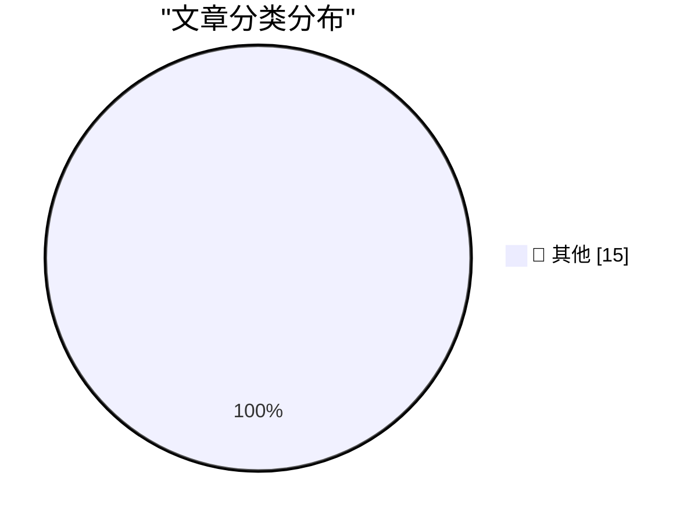

# 📰 AI 资讯每日精选 — 2026-11-25

> 汇聚 140+ 技术博客、X/Twitter、Hacker News、Reddit、Product Hunt、
> Lobste.rs、ClawFeed 日报及 GitHub Trending，经 AI 评分筛选。
>
> **本期内容**：🏆 今日必读 · 🌐 ClawFeed 日报 · 🔥 GitHub Trending · 📂 分类精选 · 🎨 设计与生成式 AI · 📊 数据概览

## 🏆 今日必读

🥇 **Three LLM inflection points in twelve months**

[Three LLM inflection points in twelve months](https://simonwillison.net/2026/Nov/24/llm-inflection-points/) — simonwillison.net · 6 小时前 · 📝 其他

> Three LLM inflection points in twelve months

🥈 **GPT 6.2 Astra Solves a Historical Mystery**

[GPT 6.2 Astra Solves a Historical Mystery](https://simonwillison.net/2026/Nov/24/astra-historical-mystery/) — simonwillison.net · 12 小时前 · 📝 其他

> GPT 6.2 Astra Solves a Historical Mystery

🥉 **Engadget Scoop Claims iPhone 18e Will Have a Camera Plateau**

[Engadget Scoop Claims iPhone 18e Will Have a Camera Plateau](https://www.engadget.com/2325828/new-leaks-reveal-the-iphone-18e-will-have-a-redesigned-camera-plateau/) — daringfireball.net · 5 小时前 · 📝 其他

> Engadget Scoop Claims iPhone 18e Will Have a Camera Plateau

4️⃣ **Trump Made Up to $15M on Nvidia Stock After Huang’s Return**

[Trump Made Up to $15M on Nvidia Stock After Huang’s Return](https://www.theguardian.com/technology/2026/nov/24/donald-trump-nvidia-stock-jensen-huang-stock-market) — daringfireball.net · 6 小时前 · 📝 其他

> Trump Made Up to $15M on Nvidia Stock After Huang’s Return

5️⃣ **Nvidia and Trump’s State Capitalism**

[Nvidia and Trump’s State Capitalism](https://www.wsj.com/opinion/nvidia-jensen-huang-donald-trump-130e644c) — daringfireball.net · 7 小时前 · 📝 其他

> Nvidia and Trump’s State Capitalism

---

## 🌐 ClawFeed 日报精选

> 来源：[ClawFeed](https://clawfeed.kevinhe.io) — AI 驱动的多源新闻聚合

# ☀️ ClawFeed | 2026-11-24 日报 SGT

> 聚合自 3 期 8 小时简报：#1543 00:00 档（00:00-07:59）、#1544 08:00 档（08:00-15:59）、#1545 16:00 档（16:00-23:59），时间窗 2026-11-24 00:00–23:59 SGT（周二），三档都在。三期标题按发布时刻写：#1543 标题是「11-24 08:00」、#1544 是「11-24 16:00」、#1545 是「11-25 00:00」，所以各期正文里「11-24 08:00 那期」就是本日的 #1543，「11-24 16:00 那期」就是 #1544；「11-24 00:00 那期」指的是 #1541（窗口 11-23 16:00–23:59，已收进 11-23 日报 #1542），「11-23 16:00 那期」是 #1540，#1545 里说的「11-23 日报」就是 #1542，「11-22 日报」是 #1537；「11-21 16:00 起几期」「11-21 08:00 起几期」从 #1531、#1530 算起（按 11-23 日报的对照）。
> 素材数（都按各期自己写的数，和三期网站 metadata 的 feed 163、130、144 一致）：首页时间线窗内分别 163、130、144 条（合计 437），收了 43、39、25 条（合计 107）；关注抽样另算，三期都是抽 35 个账号、打开 24 个主页（23 个有内容，出错 0；#1543 写明另 1 个是空的），窗内分别 13、7、12 条，合计 32 条，收了 5、1、4 条（合计 10），三期都写明这些帖子不在首页时间线里。书签三期都抓到 18 条，最新一条都是 11-21 19:45，三期窗内都是 0 条，网站 metadata 的书签数也是 0、0、0；本日报没从旧书签里补。
> 这是 SGT 周二的一天（美国东部 = SGT−13 小时）：00:00 档对应美国东部 11-23 周一上午 11 点到晚上 7 点，#1543 说正赶上黄仁勋回归英伟达后的第一个交易日收盘前后；08:00 档是美国东部周一晚上 7 点到周二凌晨 3 点、北京时间周二白天，#1544 说美国那边比较安静、中文圈的内容多；16:00 档对应美国东部周二凌晨 3 点到上午 11 点，美股 22:30 SGT 开盘，#1545 说 23 点档的帖子最多。覆盖：#1543 是 11-24 08:0x 抓的，第一遍翻到第 10 屏遇到整屏早于窗口就停（37 条），第二遍翻满 80 屏（240 条），第 28、35、56、75 屏整屏早于窗口、其余屏里仍夹着窗内的帖子，两遍去重 270 条、最早翻到 11-23 05:36，覆盖完整（窗外 105 条早于窗口、2 条晚于窗口），6 点档 33 条、7 点档 32 条最多，1 点档只有 10 条；#1544 是 11-24 16:0x 抓的（第一次抓取在 16:02:50 因专用浏览器重启中断、结果作废，以下是整套重跑的数），第一遍到第 4 屏停（17 条），第二遍翻满 80 屏（262 条），去重 277 条、最早翻到 11-23 12:27，覆盖完整（窗外 138 条早于窗口、9 条晚于窗口），15 点档 37 条最多，14 点档只有 7 条；#1545 是 11-25 00:0x 抓的，第一遍到第 4 屏停（14 条），第二遍翻满 80 屏（227 条），去重 236 条、最早翻到 11-24 00:17，覆盖完整（窗外 78 条早于窗口、14 条晚于窗口），23 点档 68 条最多，16 点档只有 6 条。
> 主线：黄仁勋回归英伟达之后，三档接力：00:00 档是 BBC 说特朗普称自己「说服」了英伟达、路透说加州总检察长认为「什么都没变」、黄仁勋回到总部；08:00 档是币安研究院的 NVDAUSDT 数据和回归后的场面；16:00 档是纳斯达克开盘。其次是行情：周一加密股跟着美股大涨、比特币一度到 63,800 美元，到周二美股开盘，Cointelegraph 说因为加征关税的报道一下子蒸发 1 万亿美元市值，比特币跌回 60,224。第三是 Anthropic：Claude Ship（beta）让 Claude 审 PR、处理反馈，Claude Code 桌面版改了侧边栏；晚上有用户说 Claude Opus 5.6 正在小范围测试（没有官方说法）。第四是 OpenAI：和 Cisco 开源 Shirudo，GPT-6.2 的 3D 演示，GPT-6.2 Sol 进 ChatGPT 聊天页，第三方测评说 GPT-6.2 Astra 的机器人控制远超趋势，OpenWorks 资助本地 AI 专家帮小商家。第五是字节豆包的 AI 个人助理「小豆」开启公测，中文圈讨论很多。另有传统资产上链（富达加入代币化股票交易所、OKXICE、Solana 代币化股票交易量、摩根大通等的代币化黄金、币安的 SpaceX 永续）、Gemini 4 Neon 三档接力、GLM-5.4 之后的循环 Transformer、ERNIE 5.5 Flash 开放权重、Phonic 1.1、Ladybird alpha、Armin Ronacher 谈 agent 编程该追求质量、Hugging Face 的 agent 评测、a16z 的 AI 购物测试、「AMD 收购 World Labs」的说法、Supertake 2,000 万美元种子轮、法国议会建议登记自托管钱包、CFTC 允许交易所用加密资产充运营储备等。

---

## 🔥 当日最重要 5 条（跨档去重）

1. **黄仁勋回归英伟达之后：BBC 说特朗普称是自己「说服」英伟达恢复黄仁勋的职务，路透说加州总检察长认为「这什么都没改变」；黄仁勋回到英伟达总部，员工的现场视频被马斯克转发；币安研究院说 NVDAUSDT 守住了盘前涨幅；晚上纳斯达克在黄仁勋复职后开盘**（#1543、#1544、#1545，接 11-23 日报的「董事会恢复黄仁勋的总裁、CEO 和董事职务」和路透「股价大涨」）：凌晨：@BBCWorld 00:52（BBC）：标题是「特朗普说是自己『说服』英伟达恢复黄仁勋的职务」（媒体快讯，正文素材里看不到）；@laurashin 05:25（Laura Shin）的节目预告：英伟达董事会在请回黄仁勋之前征询过美国政府高层官员（⚠️未证实：节目预告里的一句话，没给出处）；@Reuters 06:50：「加州总检察长说黄仁勋复职什么都没改变」（标题，正文素材里看不到）；回到总部：@elonmusk 03:07 引 Gavin Baker 发的英伟达总部现场视频：「我认识的英伟达的人都希望 Jensen 回来，看得出来」，Gavin Baker 的原帖说员工最想要的就是黄仁勋回来，并感谢总统、政府、联名请愿的人和给董事会打电话的人（后文被截断）；@ellazhang516 05:52（Ella Zhang）引小龙先生：黄仁勋站在英伟达总部大楼中央讲话，「这是我第一天上班吗？」，Ella Zhang 引了一句黄仁勋的话「第二次我会是个更好的 CEO」（转述，没给出处）（#1543）。白天：@BinanceResearch 10:40（币安研究院）：黄仁勋回归后 NVDAUSDT 守住了盘前涨幅；未平仓合约减少，可能是获利了结，USDT 计价的持仓基本持平；盘前贡献了币安盘外交易额的 86%，币安在 12 家交易场所样本里的份额升到 52.3%（研究机构数据）；@Reuters 15:20：「分析师评论黄仁勋回任英伟达 CEO 对市场的影响」（标题，正文素材里看不到）；@DAXIAGUA1 08:11（大西瓜）：说 NVDA「一天暴涨 31%」，AI 时代最稀缺的可能是掌舵算力的人（⚠️未证实：没给出处）；场面：@Crypto_He 15:46（先知）：从视频看，黄仁勋这次回来把皮夹克换成了行政夹克，还在公司楼下给员工发迷你三明治（个人看视频的描述，视频素材里看不到）；@cyodyssey 09:37（Siyuan）引 Lex Fridman：上周黄仁勋发消息说想一起骑两辆摩托车横穿美国，Lex Fridman 后悔没答应，「现在又忙起来了」（转述原帖，后文被截断）（#1544）。晚上：@Reuters 22:12：「黄仁勋复职英伟达后纳斯达克开盘」（直播标题，内容素材里看不到）（#1545）。#1543 噪音里另有同一件事的转述和一句话反应 13 条（「黄金因为都姓黄被带起来」、Pump.fun 说有人押中复职把 5,500 美元变成 2.5 万、exolabs「Welcome back Jensen」等），#1544 噪音 3 条（网友做的英伟达 MV、「英伟达不能没有黄仁勋」、「皮夹克还穿着」），#1545 噪音 1 条（看到关税新闻做空 AMD）。**说法不一致的地方**：英伟达的涨幅各处数不一样：#1543 CoinDesk 写 +27%，同一档 Arthur Hayes 写「隔夜涨 30%」，#1544 大西瓜写「一天暴涨 31%」，11-23 日报里行情卡片是 +34.01%，时点不同、各自的报价时间素材里看不出；特朗普「说服」的说法只有 BBC 的标题，原话素材里看不到。
   来源: https://x.com/BBCWorld/status/2124908991784386725 ｜ https://x.com/laurashin/status/2124977755859066930 ｜ https://x.com/Reuters/status/2124998966026575932 ｜ https://x.com/elonmusk/status/2124942828274925651 ｜ https://x.com/ellazhang516/status/2124984464954831150 ｜ https://x.com/BinanceResearch/status/2125056964254429297 ｜ https://x.com/Reuters/status/2125127320360894720 ｜ https://x.com/DAXIAGUA1/status/2125019555097661774 ｜ https://x.com/Crypto_He/status/2125134032459739422 ｜ https://x.com/cyodyssey/status/2125041033184719327 ｜ https://x.com/Reuters/status/2125230991522324822

2. **从周一大涨到周二开盘大跌：周一 CoinDesk 说 NVDA 涨 27%、纳指期货涨近 7%，加密股跟着大涨（Galaxy Digital +19%、Strategy +14%、Coinbase +8.3%），比特币一度到 63,800 美元；周二美股开盘，Cointelegraph 说因为特朗普政府准备对中国、欧盟和另外 14 国加征更高关税的报道，一下子蒸发 1 万亿美元市值；比特币从 64,603 跌回 60,224，戴尔在 AI 服务器订单的期待下涨了 20% 多**（#1543、#1544、#1545，接 11-23 日报《纽约时报》说标普 500 早盘涨近 5% 和上周股票、黄金、比特币同日跌超 3%）：凌晨：@CoinDesk 03:30 引自家早前的快讯：董事会一致投票恢复黄仁勋的职务后，NVDA 涨 27%，纳指期货涨近 7%，比特币一度到 63,800 美元；@CoinDesk 00:17：加密股跟着华尔街大涨，Galaxy Digital +19%、Bullish +16.5%、Strategy +14%、Circle +12%、Coinbase +8.3%，比特币涨 3% 到 63,000 美元（媒体快讯）；@TeamMcEntee 07:09（Ryan Selkis 转发）引 Watcher Guru「美股今天市值增加 3.3 万亿美元」（⚠️未证实：3.3 万亿是快讯数字，没给出处；发帖的是政治人物的团队账号）；@BitcoinMagazine 06:26：Bitwise 研究主管说「今天早上我们看到的可能是这轮火热牛市的第一个火花」（转述）；反方向的看法：@CryptoHayes 07:22（Arthur Hayes）：NVDA 大涨对手里的加密资产是最糟的事，「我们需要美股烧起来，美联储才会印钱」（个人观点）；关注抽样 @Tradermayne 06:57（Mayne）：比特币到了最可能被打回去的位置，站上 6.4 万美元会再走一段，失望的是 NVDA 和指数涨这么猛、比特币守住的涨幅这么少（个人交易观点）（#1543）。白天：@Cointelegraph 15:36：42 Macro 的 CEO Darius Dale 说已经减持比特币，要等这轮抛售结束再买（媒体报道）（#1544）。晚上：@Cointelegraph 23:59：有报道说特朗普政府准备对中国、欧盟和另外 14 个国家加征更高关税，美股开盘一下子蒸发 1 万亿美元市值（媒体快讯；⚠️未证实：关税是「据报道」，政府的说法和报道出处素材里看不到）；@dongboshieth 22:09（董博士）的晚报：纳指前一晚涨了 6.51%，比特币却从 64,603 跌回 60,224，24 小时跌 1.65%，比前一晚 22 点（新加坡时间）的高点低 4,379、跌了 6.8%；Abraxas Capital 3 天累计从 Kraken 提走 19,820 枚比特币、均价 59,665（个人整理的数据，后文被截断）；@bitget 20:04（Bitget）引 Bitget TradFi：戴尔 $DELL 在市场反弹后涨了 20% 多，当天美股收盘后发财报，市场预期每股收益 6.62 美元、营收 493 亿美元，投资者看它能不能把 950 亿美元的 AI 服务器积压订单兑现（交易所发的行情帖）（#1545）。**说法不一致的地方**：纳指两个数：#1543 CoinDesk 是期货「涨近 7%」，#1545 董博士是「前一晚涨了 6.51%」，一个是期货、一个是收盘后的整理，口径不同；比特币的高点 #1543 写一度到 63,800，#1545 董博士写从 64,603 跌回，时点不同；#1543「市值增加 3.3 万亿美元」和 #1545「开盘蒸发 1 万亿美元」都只有快讯数字，没给出处。
   来源: https://x.com/CoinDesk/status/2124948708022227362 ｜ https://x.com/CoinDesk/status/2124900083200319849 ｜ https://x.com/TeamMcEntee/status/2125003725253324939 ｜ https://x.com/BitcoinMagazine/status/2124992969992183912 ｜ https://x.com/CryptoHayes/status/2125007094697140500 ｜ https://x.com/Tradermayne/status/2125000902540997102 ｜ https://x.com/Cointelegraph/status/2125131365603483749 ｜ https://x.com/Cointelegraph/status/2125258108511383666 ｜ https://x.com/dongboshieth/status/2125230276565725245 ｜ https://x.com/bitget/status/2125198795285873036

3. **Anthropic：推出 Claude Ship（beta），在 Claude Code 里跑 /ship，Claude 开 PR、审改动、处理反馈和没过的检查，能不能合并仍由权限和分支规则决定；Claude Code 桌面版重新设计侧边栏；晚上有用户说 Claude Opus 5.6 正在给一部分用户测试（没有官方说法）**（#1543、#1545）：凌晨：关注抽样 @ClaudeDevs 04:13（Claude 开发者账号）：Claude 可以审你的 PR、处理修复，并批准团队策略允许的那些，目标是「写多快就能发多快」；同一时间的另一条：更新 Claude Code 后在下一个 PR 上跑 /ship，CLI 和桌面版正在陆续开放，Claude 开 PR、审改动、处理反馈和没过的检查，能不能合并仍由你的权限和分支规则决定（官方发布）；@lydiahallie 04:48（Lydia Hallie）引这条只写了「/ship」；@aigclink 06:43（AIGCLINK）的中文解读：开发者提交 PR 后可以接着做下一个功能，Claude Ship 在后台继续跟进这个 PR（媒体解读，后文被截断）；关注抽样 @ClaudeDevs 05:30：Claude Code 桌面版重新设计了侧边栏，文件、改动、终端等工具变成会话旁边的标签页，可以拖开同时看几个，也可以弹出成单独的窗口；先在 Mac 上开放，Windows 和 Linux 稍后（官方发布）（#1543）。晚上：@kimmonismus 18:32（Chubby）：Opus 5.6（「不管它叫什么」）好像已经在 Claude Code 里给部分用户开放了，自己日常在 Gemini 4 和 Opus 5.5 之间一半一半；引的是 leo（@synthwavedd）的帖子：Claude Opus 5.6 可能正在给一部分 Claude 用户测试（有的在 Claude Code、有的在聊天里、有的哪里都没有），方式和当初测 Opus 5.5 类似，比 Opus 5.5 进步很大（⚠️未证实：素材里只有用户的说法和演示，没有 Anthropic 的官方说法）；@xiaohu 23:42（小互）：「Opus 5.6 看来快了，要杀杀 Google 的威风」，引的是 Chetaslua 的帖子「Opus 5.6 纯用代码做的这个」（演示视频素材里看不到，是不是 Opus 5.6 做的也看不出）（#1545）。Anthropic 相关的还有 $ANT（见「⚠️ 未证实」）和 Notch 公开向 Anthropic 要更多额度（见「📰 当日核心主题」①）。#1544 噪音里有 Zihua 借 Claude Ship 推自家 heydeer 的 Autopilot（不收）。**说法不一致的地方**：Opus 5.6 的说法从 leo 到 Chubby 到小互都是用户层面的观察，三期都没有 Anthropic 自己的帖子；Chubby 说「好像」在 Claude Code 里开放了，leo 说测试范围有的在聊天里、有的哪里都没有。
   来源: https://x.com/ClaudeDevs/status/2124959436640858475 ｜ https://x.com/ClaudeDevs/status/2124959438175981965 ｜ https://x.com/lydiahallie/status/2124968415316361462 ｜ https://x.com/aigclink/status/2124997179630927925 ｜ https://x.com/ClaudeDevs/status/2124978802006851961 ｜ https://x.com/kimmonismus/status/2125175594681807308 ｜ https://x.com/xiaohu/status/2125253687325118850

4. **OpenAI：和 Cisco 开源 Shirudo，让 agent 写动态 eBPF 规则、不停机挡住漏洞利用；GPT-6.2 的 3D 演示；GPT-6.2 Sol 的日常对话版进 ChatGPT 聊天页，第三方测评说 GPT-6.2 Astra 在机器人控制基准上比过去两年的趋势高出近 5 倍；OpenWorks 资助本地 AI 专家免费帮小商家做 AI 工具**（#1543、#1544，接 11-23 日报的 GPT-6.2 Astra 在 Agent Arena 排第 6 的整理和 OpenAI 用 2,000 个 agent 分析 800 万个细胞）：凌晨：@CryptoTetsugan 06:36（tetsugan）引 OpenAI：Shirudo 是一个开源的 Linux 运行时，让 agent 在不停机的情况下保护系统：agent 写动态的 eBPF 规则挡住漏洞利用，给防守方更多时间测试和推出补丁，由 Cisco 和 OpenAI 一起做（官方发布），tetsugan 补充说名字来自日语的「盾」；@ChuckRobbins 06:49（Cisco 的 Chuck Robbins）：开源 Shirudo 是为了在补丁还在开发时给安全团队多争取时间（合作方说法，后文被截断）；@gdb 04:21（Greg Brockman）引 OpenAI Developers：GPT-6.2 能理解周围的 3D 世界、模拟事物怎么运转，附的片子看起来像 1915 年旧金山世博会的胶片，其实整个是在 Blender 里做的（官方演示）；@OpenAIDevs 05:39（OpenAI Developers）引 jake：OpenAI 推出 OpenWorks，资助本地的 AI 专家免费和小商家一起做 AI 工具，问题由店主自己选（官方发布）；@a16z 03:04 引 OpenAI 的 Joy Jiao 谈做「给科学家的 Codex」：现在的模型存在「能力过剩」，模型能做很多事，但没人知道（访谈摘录，后文被截断）（#1543）。白天：@gdb 15:42 引 ChatGPT 官方：ChatGPT 的 Chat 页面开始推送一个为日常对话优化的 GPT-6.2 Sol 版本，处理复杂请求明显更好，尤其是给了详细指令或让它上网找信息的时候（官方发布，后文被截断），Greg Brockman 说「这是个很棒的模型」；@gdb 14:32 引 Playground：GPT-6.2 Astra 在机器人控制基准上比过去两年的指数趋势高出近 5 倍，基准饱和的速度比前一年快约 10 倍，照 9 月以来的速度，到 2027 年底顶尖策略会把其跟踪的几乎所有任务做到饱和（第三方测评机构的说法，基准细节素材里看不到），Greg Brockman 的评语是「机器人控制正在复兴」；@gdb 09:43 贴出 OpenWorks 的申请入口，引的是 Polymarket 的快讯「OpenAI 会给 AI 专家每月最多 8,000 美元」（⚠️未证实：8,000 美元是 Polymarket 的说法，OpenAI 的官方数字素材里看不到）（#1544）。#1544 关注抽样里另有 Guru Chahal 夸 Shirudo「动态的 agent 防火墙」（#1544 按「前几期写过」没收）。**说法不一致的地方**：11-23 日报里 PANews 整理说 GPT-6.2 Astra 在 Agent Arena Index 排第 6，本日 Playground 说的是机器人控制基准，两者不是同一类榜单；OpenWorks 的资助金额只有 Polymarket 的说法。
   来源: https://x.com/CryptoTetsugan/status/2124995477464822079 ｜ https://x.com/ChuckRobbins/status/2124998711428485246 ｜ https://x.com/gdb/status/2124961434685898803 ｜ https://x.com/OpenAIDevs/status/2124981063487492379 ｜ https://x.com/a16z/status/2124942195887354125 ｜ https://x.com/gdb/status/2125132836105809951 ｜ https://x.com/gdb/status/2125115240690201049 ｜ https://x.com/gdb/status/2125042638781120632

5. **字节豆包的 AI 个人助理「小豆」开启公测（邀请制）：主打「一个懂你，还能主动帮你办事的豆包」，今年 4 月豆包内部就在测代号 Spell 的个人助理项目；中文圈反应两极：有人说「小豆太可怕了」、知道用户看了什么视频、家住哪里，有人说它「结束了中国 Personal Agent 市场」，也有人觉得陪跑的才刚加入**（#1544）：@0xLogicrw 10:49（思维怪怪）：11-24 豆包旗下 AI 个人助理「小豆」正式公测；今年 4 月豆包内部就在测代号 Spell 的个人助理项目，最初由豆包手机助手团队负责，因为豆包手机发布等原因一直没对外推出（媒体式梳理，后文被截断）；@MetaEraCN 11:52（ME News）引自家快讯：豆包官方宣布小豆今天公测，目前是邀请制，以后会逐步上线豆包 APP，公测期间凭邀请码体验、送免费额度，邀请码靠已有资格的用户分享和官方账号活动发放；反应：@dontbesilent 14:23（dontbesilent）：「小豆太可怕了」，手机上的 agent 一句话就能给用户充话费、主动提醒快递到哪了，还知道用户看了什么视频、听了什么音乐、家住哪里（个人观点，后文被截断）；@capmmk 15:54（桃子队长）引 Roland.W：小豆某种意义上「结束了中国 Personal Agent 市场」，能和它打的只有腾讯，似乎也没机会了，身边朋友反馈小豆和 Muse「已经可以在一张桌子上吃饭了」，桃子队长回了一句「还不够，国产 Personal Agent 陪跑者大军正在加入」（个人观点）；@ohyishi 13:27（Yishi）：腾讯市值现在大约只有字节估值的一半，十年前字节还不在腾讯的竞争对手名单上，字节把公司本身当成快速迭代的产品来运营（个人观点，后文被截断）。#1544 噪音里另有 dontbesilent「豆包 personal agent，毁天灭地」1 条。**说法不一致的地方**：公测的官方说法只有 ME News 转的快讯，豆包自己的帖子素材里看不到；「结束了中国 Personal Agent 市场」是 Roland.W 的个人判断，同一条里桃子队长就不同意。
   来源: https://x.com/0xLogicrw/status/2125059231896543375 ｜ https://x.com/MetaEraCN/status/2125075028106711162 ｜ https://x.com/dontbesilent/status/2125113060100870314 ｜ https://x.com/capmmk/status/2125136071789011252 ｜ https://x.com/ohyishi/status/2125098921362129052

**⚠️ 未证实（素材里核实不了，只记录说法）**
- 「Claude Opus 5.6 正在给一部分用户测试，比 Opus 5.5 进步很大」：@kimmonismus 18:32 引 leo 的说法，素材里只有用户的说法和演示，没有 Anthropic 的官方说法（#1545）。https://x.com/kimmonismus/status/2125175594681807308
- 「Opus 5.6 纯用代码做的」演示：@xiaohu 23:42 引 Chetaslua 的帖子，演示视频素材里看不到，是不是 Opus 5.6 做的也看不出（#1545）。https://x.com/xiaohu/status/2125253687325118850
- 「英伟达董事会在请回黄仁勋之前征询过美国政府高层官员」：@laurashin 05:25 节目预告里的一句话，没给出处（#1543）。https://x.com/laurashin/status/2124977755859066930
- 「美股今天市值增加 3.3 万亿美元」：@TeamMcEntee 07:09 引的快讯数字，没给出处，发帖的是政治人物的团队账号（#1543）。https://x.com/TeamMcEntee/status/2125003725253324939
- 「NVDA 一天暴涨 31%」：@DAXIAGUA1 08:11 没给出处，和 #1543 CoinDesk 的 +27%、11-23 日报行情卡片的 +34.01% 都对不上（#1544）。https://x.com/DAXIAGUA1/status/2125019555097661774
- 「特朗普政府准备对中国、欧盟和另外 14 国加征更高关税，美股开盘蒸发 1 万亿美元市值」：@Cointelegraph 23:59 写的是「据报道」，政府的说法和报道出处素材里看不到（#1545）。https://x.com/Cointelegraph/status/2125258108511383666
- 「摩根士丹利庆祝 Anthropic 的历史性一天」「$ANT 当天连收涨都做不到」：@MorganStanley 03:01 没说是什么事，@CryptoHayes 06:45 的 $ANT 指什么素材里看不出（#1543）；@MorphNetwork 12:57 说 $ANT 是通过 Bitget 提供的 Anthropic 代币化敞口，素材里没有 Anthropic 的说法，这不是 Anthropic 的股票，Hayes 说的是不是这个也看不出（#1544）。https://x.com/MorganStanley/status/2124941433203237149 ｜ https://x.com/CryptoHayes/status/2124997864636174393 ｜ https://x.com/MorphNetwork/status/2125091373242261897
- 「OpenAI 会给 AI 专家每月最多 8,000 美元」：@gdb 09:43 引的 Polymarket 快讯，OpenAI 的官方数字素材里看不到（#1544）。https://x.com/gdb/status/2125042638781120632
- 「GPT-6 Astra 发布 25 天后 AMD 用约 82 亿美元收购李飞飞的 World Labs」：@FinanceYF5 10:52 的说法，素材里没有 AMD 或 World Labs 的官方说法，收购时间也看不出（#1544）。https://x.com/FinanceYF5/status/2125059887801794885
- 「币安的 SpaceX 永续 $SPCX 一天成交约占 SpaceX 正股成交额的 14.9%」：@cz_binance 21:31 引 danny 算的数，正股成交额的出处素材里看不到（#1545）。https://x.com/cz_binance/status/2125220776316133514
- 「有人靠一个让本地模型提速的开源 agent skill 赚了 10 万美元」：@RoundtableSpace 23:45 写的是「有人说」，10 万美元和提速数字都是转述（#1545）。https://x.com/RoundtableSpace/status/2125254364311003198
- 「Instinct 有 45% 的回答只推荐品牌自营店，Muse 只有 11%」：@FinanceYF5 13:49 的二手转述，a16z 原文素材里看不到（#1544）。https://x.com/FinanceYF5/status/2125104404181200931
- 「CFTC 允许交易所把 BTC、ETH 和合格稳定币算进运营储备」：@Cryptic_Web3 15:20 的转述，CFTC 原文素材里看不到（#1544）。https://x.com/Cryptic_Web3/status/2125127361687683216
- 「摩根大通、汇丰和 StoneX 完成第一批代币化碎片黄金的实盘交易」：@CoinDesk 19:05 转述彭博，彭博原文素材里看不到（#1545）。https://x.com/CoinDesk/status/2125183975824261604
- 「Ray Dalio 警告 AI 会催生金融泡沫」：@JonhernandezIA 23:27 的二手转述，Dalio 原话的出处素材里看不到（#1545）。https://x.com/JonhernandezIA/status/2125250021763502222
- 「黄仁勋说第二次会是个更好的 CEO」「换上行政夹克、给员工发迷你三明治」：@ellazhang516 05:52 的转述没给出处（#1543），@Crypto_He 15:46 是看视频的个人描述，视频素材里看不到（#1544）。https://x.com/ellazhang516/status/2124984464954831150 ｜ https://x.com/Crypto_He/status/2125134032459739422
- 噪音里另有 2 条只记说法、不收：#1545 GCSA 说 Azure API Management Classic 有漏洞（两条说法几乎一样、在推 GCSA 的安全预警，微软原文素材里看不到）；#1545 关注抽样里比特唐三藏「黄仁勋下台是为了让民主党上车」的阴谋论。

**次重要（备选）**
- 传统资产上链（三档都有，接 11-23 日报的代币化苹果股票第一次链上派息）：@CoinDesk 02:05 的早报：持有 720 亿美元 ETH 的以太坊钱包将来可能面临量子计算的风险；富达加入华尔街第一个代币化股票交易场所；交易员下调了美联储 12 月大幅加息的预期（媒体摘要）（#1543）；@LennixOKX 15:31（OKX 的 Lennix Lai）引 OKX：OKXICE 代币化证券交易场所上线，可以 24 小时交易股票（官方发布）；@solana 09:04（Solana）引 Birdeye Data：Q4 才过一半多，Solana 上代币化股票的交易量已经超过 2026 年其他任何一个季度，日均 1.85 亿美元，是 Q3 的两倍多、Q1 的 12 倍（链上数据方说法）；@solana 12:04：三井物产讲为什么选 Solana：「更好的发行控制、自动结算、全球链上分发」（自家宣传）（#1544）；@CoinDesk 19:05：据彭博报道，摩根大通、汇丰和 StoneX 完成了第一批代币化碎片黄金的实盘交易，实物金条不用挪动就能当抵押品；@cz_binance 21:31（CZ）引 danny：币安的 SpaceX 永续 $SPCX 11-23 成交 19.57 亿 USDT，约占 SpaceX 正股成交额的 14.9%，CZ 回了句「Woah...」，又问 Grok「是真的吗」（⚠️未证实，见上）（#1545）。https://x.com/CoinDesk/status/2124927208192098781 ｜ https://x.com/LennixOKX/status/2125130288703680936 ｜ https://x.com/solana/status/2125032654668202368 ｜ https://x.com/solana/status/2125078025377378634 ｜ https://x.com/CoinDesk/status/2125183975824261604 ｜ https://x.com/cz_binance/status/2125220776316133514
- Gemini 4 Neon（三档接力，接 #1541 噪音里的「Neon 不是普通模型」）：@Google 04:44 讲 Neon 在 Gemini 模型家族里的位置：Neon 面向复杂编码、分析推理和生产级企业工作流，Carbon 负责最难的长周期项目，Hydrogen 负责快速的日常执行（官方说法，后文被截断）；@Techub_News 07:02（Techub News）：Google DeepMind 用 Gemini 4 Neon 重建了图灵 1936 年在剑桥的研究室（媒体标题；同一分钟 Techub 还发了 Hyperliquid 那条，链接两条都列上）（#1543）；@OfficialLoganK 08:07（Logan Kilpatrick）：Gemini 4 Neon 已经通过 Gemini App 开放给 Google Workspace 客户（官方说法）；@turingou 13:22（郭宇）问大家都用什么 harness 跑 Neon 模型（只是提问）（#1544）；@_philschmid 20:35（Philipp Schmid）做了一个给 Gemini 4 Neon 用的实验性前端 skill，用来做快速、干净的落地页：首屏用满版大字、字体最多 2 种、正文最多 3 个字号、不小于 13px、不用米色和紫色（后文被截断）（#1545）。https://x.com/Google/status/2124967271814910183 ｜ https://x.com/Techub_News/status/2125002160794382580 ｜ https://x.com/Techub_News/status/2125002147330662452 ｜ https://x.com/OfficialLoganK/status/2125018427790344654 ｜ https://x.com/turingou/status/2125097609488732332 ｜ https://x.com/_philschmid/status/2125206633722601572
- agent 编程该追求质量、怎么评测（#1543、#1544）：@shao__meng 15:34（meng shao）介绍 Armin Ronacher 在 AI Engineer 的演讲：这位 Flask 作者、Earendil CTO 在启动了 141 个项目之后认为 agent 编程更该追求软件质量，「先建好软件工作坊，再考虑软件工厂」，主张「更好的软件，而不是更多的软件」（演讲摘要，后文被截断）；@shao__meng 15:39 介绍 Hugging Face 团队的《Agent evals》：同一组 8 个任务每个跑 3 次，87.5% 的任务至少成功过一次，但只有 12.5% 的任务每次都成功（文章摘要）（#1544）；关注抽样 @mardehaym 03:03（Mark Ajzenstadt）：挑公司里一个又痛又无聊的流程做 agent，在 agent 写代码之前先写规格，能写成规则的就写成代码（个人建议，后文被截断）（#1543）。https://x.com/shao__meng/status/2125130872546640298 ｜ https://x.com/shao__meng/status/2125132094682644860 ｜ https://x.com/mardehaym/status/2124941804844036443

---

## 📰 当日核心主题

**① 模型、产品、训练和推理（三期都有）**
Gemini 4 Neon 见「次重要」。凌晨（#1543）：@amasad 02:28（Amjad Masad）引 Artificial Analysis：Phonic 1.1 (High) 以 89.1 分登上 Artificial Analysis 语音对语音榜第一，超过自家不到一个月前发布的 Phonic 1（87.1）（第三方榜单）；@googledevs 02:40（Google for Developers）：Gemini API 新增原生文件切片，可以把很厚的 PDF、Office 和 OpenDocument 文件、音频、视频直接交给 Gemini 4 模型，在服务端只切出需要的页、单元格或时间段（官方发布）；@TechCrunch 03:19：Google 搜索的 AI Mode 现在可以调用 Drive 和 Wallet 里的数据给出更个人化的回答，TechCrunch 的看法是 Google 在利用自家生态里已有的用户数据（媒体报道）；@MistralAI 00:39（Mistral AI）：上周给欧洲开发者的 Vibe Pro 免费试用不到一小时就被领完，现在不再限量，欧洲的用户都能免费用一个月 Vibe Pro（官方发布，后文被截断）；@TheAhmadOsman 07:48（Ahmad）：推理引擎应该按硬件芯片、模型和工作负载分别做，通用推理引擎的时代快结束了（个人观点）（https://x.com/amasad/status/2124933157862646244 ｜ https://x.com/googledevs/status/2124936137739542604 ｜ https://x.com/TechCrunch/status/2124945849260114094 ｜ https://x.com/MistralAI/status/2124905610386780451 ｜ https://x.com/TheAhmadOsman/status/2125013672670232862）。
白天（#1544）：@ivanfioravanti 15:35（Ivan Fioravanti）引百度 ERNIE：ERNIE 5.5 Flash 预览版权重按 Apache 2.0 开放，总参数 280B、激活 14B、100 万上下文，后训练还在进行，可在 Hugging Face 下载、OpenRouter 上免费调用（官方发布）；@ivanfioravanti 15:37 引 Inco AI：Inkling 2 Mini 在 M5 Max 上跑到每秒 200 多 token，靠的是自家的 Splash 引擎和 DFlash 2 草稿模型，在 M5 Pro 上比 Inco AI 测过的其他引擎快 1.7 倍（自家数字；11-21 08:00 起几期写过 Inkling 2 Mini 在笔记本上本地跑）；@PANewsCN 14:04（PANews）：《我的世界》作者 Notch 在 X 上公开问 Anthropic 能不能给更多不限量的 token 和更快的速度，「我有钱可以烧」，还说认同 Anthropic 的 AI 宣言（媒体转述）（https://x.com/ivanfioravanti/status/2125131277821268430 ｜ https://x.com/ivanfioravanti/status/2125131796341727599 ｜ https://x.com/PANewsCN/status/2125108338606461248）。
晚上（#1545）：@rasbt 23:27（Sebastian Raschka）：随着 GLM-5.4 发布，自己的「LLM 架构图鉴」里已经有 5 个循环 Transformer，「看到趋势了」（11-23 日报写过 Z.ai 正式发布 GLM-5.4、称是自家第一个 Loop Transformer）；@SergioPaniego 23:28（Sergio Paniego）：TRL 的异步强化学习现在稳定了，异步训练器把生成回答和学习同时做，同样的训练步数下用时更短（具体对比数字被截断）；@paoloardoino 22:48（Paolo Ardoino）引 QVAC：Tether 免费开源的 AI 模型在 Hugging Face 上下载量过了 10 万，每个都小到能在笔记本或手机上跑（自家数字）；关注抽样 @rightnow_co 17:42（RightNow，YC F26）：用自家新的 kernel 优化技术优化了 Kimi K3.1 Pro 背后的 kernel，当天在 RightNow 上线：每秒 174 token、首 token 791 毫秒，每百万 token 输入 1.60 美元、输出 8.00 美元，100 万上下文（自家数字）；@RoundtableSpace 23:45 转述的本地模型提速 skill 见「⚠️ 未证实」；@svpino 23:23（Santiago）介绍 ASRKit：给应用加本地语音转文字，音频不用上传服务器，是免费语音 AI 应用 Edgent 背后的 SDK，Edgent 在 iPhone 和 Mac 上全部在设备上跑，飞行模式也能用（产品介绍）（https://x.com/rasbt/status/2125249956495953973 ｜ https://x.com/SergioPaniego/status/2125250085835460791 ｜ https://x.com/paoloardoino/status/2125240121809113412 ｜ https://x.com/rightnow_co/status/2125163056280060204 ｜ https://x.com/svpino/status/2125248896243003481）。

**② Agent 和开发工具（三期都有）**
Claude Ship 见前 5 条第 3 条，Shirudo 见第 4 条，小豆见第 5 条，Armin Ronacher 和《Agent evals》见「次重要」。凌晨（#1543）：@amasad 02:03 引 Manny Bernabe：一个 35 美元的 Replit Mission 带来了 2.5 万美元的单子，一家咨询公司让它找 200 个准备引入 AI 的 C 级高管线索，跑了一夜（自家的客户案例，后文被截断）；@AravSrinivas 04:38（Aravind Srinivas）引 Perplexity Developers：Monitor API 新增 Agent monitor，用自然语言写任务，按计划调用 Agent API，答案一变就带着来源发提醒（自家发布）；@gitlab 02:47（GitLab）：GitLab 19.6 让安全 agent 同时处理多个项目里积压的漏洞，在代码合并前修掉，每个 agent 的修复都走和其他改动一样的审批（自家发布）；@Sumanth_077 02:05（Sumanth，meng shao 转发）引 Kushal Byatnal：Extend 2.5 文档处理，解析便宜 60%、最快 6.8 倍，分类不到一秒（自家发布的数字，后文被截断）；@simonw 06:07（Simon Willison）：Ladybird 浏览器发布 alpha，有 macOS 和 Linux 版，试了一天觉得「真的很好」，试过的大多数网站都能用（个人试用）；@thdxr 02:16（Dax）引 Kit Langton 的 macOS 窗口管理器 Spaceman 演示：「这个视频真把我吓到了」（个人反应）；@sydneyrunkle 06:51（Sydney Runkle）引 amal：在 LangChain 内部做设计 agent 的笔记，内部的 content studio 就是其中一个 agent（自家经验）（https://x.com/amasad/status/2124926938225705097 ｜ https://x.com/AravSrinivas/status/2124965820220756280 ｜ https://x.com/gitlab/status/2124937978761875710 ｜ https://x.com/Sumanth_077/status/2124927320339452177 ｜ https://x.com/simonw/status/2124988263857635572 ｜ https://x.com/thdxr/status/2124930030161518830 ｜ https://x.com/sydneyrunkle/status/2124999322207129947）。
白天（#1544）：@_avichawla 15:25（Avi Chawla）：Claude Code 和 Codex 各自在单独的终端里跑、没有共享上下文，开源项目 Switch AI 就是来解决在两边手动复制 bug 报告、diff 和评审意见这件事的（介绍，后文被截断）；@Tao100086 11:26（Tao Wang）：agent 记忆系统已经从「长上下文拼接 + 简单向量检索」走到动态巩固、时序图谱、操作系统级分页和经验自进化，按四类列了阅读清单（个人整理）；a16z 的 AI 购物测试：@TechFlowPost 12:24（深潮）：a16z 联合机构做了 1.1 万次 AI agent 模拟下单，机器花钱「根本不吃人类那一套」（后文被截断），@FinanceYF5 13:49（AI Will）引的比例见「⚠️ 未证实」；@9hills 13:56（九原客）：试了 orca bot，觉得和 hermes 一类、和 grok bot、Muse 的产品思路不一样，先放弃了，推荐一个推友做的开源产品 Mingle，「设计理念很好，功能很克制」（个人试用）；@GitHub_Daily 15:30（GitHubDaily）：开源长视频切片工具 NeonClipping，贴 YouTube 或 Twitch 链接，大约两分钟出带字幕的竖屏短片（项目介绍）；关注抽样 @levie 12:47（Aaron Levie，Box CEO）引 Yash Patil「看好 AI 就该相信服务业能像软件一样扩张」：服务业一直受限于给客户交付结果的能力，扩张只能靠加人（个人观点，后文被截断）；@cognition_jp 10:00（Cognition 日本）：和 DeNA 合作在日本推出 Devin for Startups，给日本国内的创业公司最多价值 6.5 万美元的 Devin ACU（官方发布）（https://x.com/_avichawla/status/2125128635845865601 ｜ https://x.com/Tao100086/status/2125068536913776824 ｜ https://x.com/TechFlowPost/status/2125083172689875188 ｜ https://x.com/FinanceYF5/status/2125104404181200931 ｜ https://x.com/9hills/status/2125106321343361354 ｜ https://x.com/GitHub_Daily/status/2125129812344008750 ｜ https://x.com/levie/status/2125089009018040779 ｜ https://x.com/cognition_jp/status/2125046813015318939）。
晚上（#1545）：关注抽样 @mardehaym 22:13（Mark Ajzenstadt）引 Harrison Chase 的《怎么搭一座知识工厂》：让 AI 在公司里起作用，缺的不是更好的模型、也不只是更多上下文，而是更好的「公司怎么运作」的知识；Mark Ajzenstadt 反驳说这是在自动化一个 AI 出现之前公司就有的问题，维护公司知识就是要理清大家用哪个定义、什么时候算例外、谁说了算（个人观点，后文被截断）；关注抽样 @LimestoneHQ 22:02（Limestone Digital，11-23 日报写过这个账号的 AGENTS.md 提示词）：一条 coding agent 真能照着做的 bug 分诊提示词，来自改写 20 个流行提示词、删掉所有不影响输出的词，下一条解释删改原因：原版让每个 bug 的频率和严重程度各打 1 到 10 分、乘积小于 5 才不改代码，可 100 种分数组合里只有 8 种低于 5（后文被截断）；@smyyguy 23:32（Dan Smith）引 Blockworks：Blockworks 推出内置 AI agent Pip（beta），帮用户筛选、分析和监控链上资本市场，和 Blockworks 前端、API/MCP 用同一套数据（自家产品）；@mem0ai 23:49（mem0）的文章《在消费级应用里衡量记忆有没有起作用》：常见的看板只显示调用次数、token 和会话数，没有一个能说明记忆解决了什么（文章开头）（https://x.com/mardehaym/status/2125231330757898292 ｜ https://x.com/LimestoneHQ/status/2125228444351180924 ｜ https://x.com/LimestoneHQ/status/2125228456913092699 ｜ https://x.com/smyyguy/status/2125251209787326874 ｜ https://x.com/mem0ai/status/2125255477022060656）。

**③ 公司、融资、安全和观点（三期都有）**
凌晨（#1543）：Supertake 种子轮：@Sage_Tega 01:47（sagetega）引 lincoln murr：加入 Supertake 任联创兼 CEO，正在完成 2,000 万美元种子轮，联创兼 CTO 是 Coinbase 出来的 John Peterson；@cbventures 04:33（Coinbase Ventures）：用自己的话描述一个想法，AI 把它变成投资组合，Coinbase Ventures 参投种子轮（投资方说法）；@jonathankingvc 04:40（Jonathan King）：在 Coinbase 和两位创始人一起做过 AI，这次也投了，「金融的未来是 agentic 的」；@TechCrunch 07:09：Figma 和 CEO 被一名在职员工起诉，指控性骚扰和歧视（媒体报道，诉状内容素材里看不到）；@elonmusk 01:28 引 X 的 Global Government Affairs：美国司法部刑事司本月立案调查涉嫌在 X Money 上使用盗来的第三方支付凭证的人，X 会全力配合（公司说法）（https://x.com/Sage_Tega/status/2124922847097205044 ｜ https://x.com/cbventures/status/2124964689537032436 ｜ https://x.com/jonathankingvc/status/2124966454722203927 ｜ https://x.com/TechCrunch/status/2125003734979613171 ｜ https://x.com/elonmusk/status/2124917923391443211）。
白天（#1544）：YC 的两家新公司：@lightanchor_ai 09:58（Light Anchor，YC F26）自称「AI 原生的宝洁」，上线 3 个月年化产品销售额 1,000 万美元、美国客户 2 万多（自家数字）；@jaykhan 08:35（Jay，LegalOS）：LegalOS（YC W26）给创始人和团队办 O-1、H-1B 和绿卡，律师审核，最快 48 小时递交，已有 75 家以上 YC 公司在用（自家发布）；「AMD 收购 World Labs」的说法见「⚠️ 未证实」（https://x.com/lightanchor_ai/status/2125046490376863966 ｜ https://x.com/jaykhan/status/2125025554248220975）。
晚上（#1545）：@uctodaynews 19:46（UC Today）：微软计划给 Teams 里和组织外部人员的一对一通话加 AI 语音钓鱼检测，对话出现社会工程迹象时提醒接听方（媒体报道，后文被截断）；@coin68 16:20（Coin68）：以太坊基金会把协议安全团队扩大了一倍，并在推进升级以太坊、应对量子计算和 AI 带来的风险（媒体报道，基金会原文素材里看不到；#1543 的 CoinDesk 早报说过以太坊钱包将来可能面临量子风险）；@elonmusk 18:44 对 Grok 的一段回答说「正中靶心」：Grok 说「算力就是能源」，一旦纯智力的问题解决了，硬上限就是能把多少电力送去把方案变成现实（马斯克本人只说了一个词，其余是 Grok 的话）；@JonhernandezIA 23:27（Jon Hernandez）转述 Ray Dalio：AI 能改变全球经济，但不代表每个估值都合理，「人们常把伟大的新技术误当成伟大的投资」（二手转述）（https://x.com/uctodaynews/status/2125194244423885003 ｜ https://x.com/coin68/status/2125142509106172367 ｜ https://x.com/elonmusk/status/2125178828943184363 ｜ https://x.com/JonhernandezIA/status/2125250021763502222）。

**④ 加密和金融基础设施（三期都有）**
传统资产上链见「次重要」。凌晨（#1543）：@CoinDesk 02:42：纽约一名法官暂时拒绝禁止 Kalshi 在该州运营（媒体快讯）；@CoinDesk 04:29：Avalanche 宣布更聚焦的战略，重心是机构金融、能产生收益的代币化资产和嵌入式支付（媒体报道，后文被截断）；@StellarOrg 04:21（Stellar）：Bell（Protocol 30）上了主网，合约能验证后量子的 ML-DSA 签名，账本时间精确到毫秒（官方发布）；@Techub_News 07:02：Hyperliquid 拿走永续 DEX 89% 的手续费，竞争对手的手续费下降 95%（媒体标题，统计口径素材里看不到）（https://x.com/CoinDesk/status/2124936565449240743 ｜ https://x.com/CoinDesk/status/2124963581985014179 ｜ https://x.com/StellarOrg/status/2124961617360343193）。
白天（#1544）：@wublockchain12 08:58（吴说）：法国国民议会财政委员会的 2027 年预算审查报告里，两名特别报告员建议持有超过 5,000 欧元自托管加密钱包的纳税人向税务机关申报（只是报告建议）；@Cryptic_Web3 15:20（Cryptic）：CFTC 允许受监管的衍生品交易所和清算所把比特币、以太坊和合格的支付稳定币算进 12 个月的运营储备，BTC、ETH 至少打八折（转述，后文被截断）；@TheBlockCo 08:40（The Block）：OKX 澳大利亚给零售用户上线股票和商品永续合约、现货杠杆，永续最高 2 倍、现货杠杆最高 10 倍（媒体报道）；@ChainCatcher_ 09:11（ChainCatcher）：Sky 联创 Rune Christensen 说已从质押 SKY 的借款仓位里还了 300 万 USDS，还欠约 7,700 万，正考虑把部分 SKY 直接卖给机构，杜均随后表示有兴趣买下全部仓位（双方的公开发言）（https://x.com/wublockchain12/status/2125031171772031000 ｜ https://x.com/Cryptic_Web3/status/2125127361687683216 ｜ https://x.com/TheBlockCo/status/2125026629361836174 ｜ https://x.com/ChainCatcher_/status/2125034420042375288）。
晚上（#1545）：@abbaskhan 23:25（Abbas Khan）引 KOSH 的公告「KOSH 全部服务关停」，认为新银行这条路没有外面看起来那么容易（个人观点）；@0xCabana 23:45（CABANA）引 Ondo：代币化美债产品 USDY（TVL 23 亿美元以上）现在可以通过 LayerZero 的 OFT 标准在 Stellar 和以太坊之间转移（项目方说法）；@plumenetwork 23:46（Plume）：Bybit 的 Earn 页面上已经有固定收益、信用卡应收款和日本股票，本月加了 SBI 资产管理的日本高股息股票策略 JPE（自家宣传）；@LeonWaidmann 23:31（Leon Waidmann）引 Chainalysis：英国仍是西欧最大的加密经济体，年加密活动 4,245 亿美元，比 2022 年增长 71%（转述，后文被截断）；@lex_node 23:41（gabriel shapiro）批评 Ledger 钱包接入 Canton、由 Kiln 运营的共同验证模式：个人钱包上的每笔交易都要经过两个指定的许可中介（个人批评）（https://x.com/abbaskhan/status/2125249334665154684 ｜ https://x.com/0xCabana/status/2125254491846881479 ｜ https://x.com/plumenetwork/status/2125254619307946372 ｜ https://x.com/LeonWaidmann/status/2125250886209253802 ｜ https://x.com/lex_node/status/2125253576259965340）。

---

## 🔖 书签精选

当日窗内没有书签：#1543、#1544、#1545 三期都抓到 18 条，最新一条都是 11-21 19:45，早于本日窗口，三期窗内都是 0 条，网站 metadata 的书签数也是 0、0、0。本日报跳过这一节，没从旧书签里补。

---

## 👀 推荐关注汇总（去重，共 10 个；各期写稿时都在浏览器里核实过「未关注」：#1543 在 11-24 08:11–08:16，#1544 在 11-24 16:12–16:15，#1545 在 11-25 00:14–00:16 SGT，本日报没有重新核实）

**创始人和一手产品**
- @AravSrinivas（Aravind Srinivas，简介是 Perplexity 联创兼 CEO；110 万关注者；你关注的人里约 599 个也关注了）：本期 Perplexity Monitor API 的 Agent monitor 就是这个账号转的，置顶是 11-18 说 Perplexity 年化收入过 10 亿美元（#1543）。https://x.com/AravSrinivas
- @ypatil125（Yash Patil，简介是 Applied Compute 联创兼 CEO；2.5 万关注者；你关注的人里约 142 个也关注了）：Aaron Levie 引的「服务业能像软件一样扩张」就是这个账号的，置顶是 11-19 说 Applied Compute 签约以 45 亿美元被 Palo Alto Networks 收购（#1544）。https://x.com/ypatil125
- @kushalbyatnal（Kushal Byatnal，简介是在做 Extend，「给 agent 用的文档处理 API」；7,982 关注者；你关注的人里约 40 个也关注了）：Extend 2.5 的发布就是这个账号的，关注者不到 1 万，但是创始人的一手产品内容（#1543）。https://x.com/kushalbyatnal
- @kitlangton（Kit Langton，简介是做 opencode 的开发者；2.89 万关注者；你关注的人里约 65 个也关注了）：Dax 引的 macOS 窗口管理器 Spaceman 演示就是这个账号的，building in public（#1543）。https://x.com/kitlangton

**agent 编程实践和中文 AI 圈**
- @mitsuhiko（Armin Ronacher，简介是 Flask 作者、在做 Earendil；10.1 万关注者；你关注的人里约 197 个也关注了）：meng shao 介绍的 AI Engineer 演讲就是这个账号的，置顶就是这场演讲，agent 编程的一手实践和观点（#1544）。https://x.com/mitsuhiko
- @9hills（九原客，简介是「目前聚焦在大模型领域」；2.89 万关注者；你关注的人里约 116 个也关注了）：orca bot 和 Mingle 的试用就是这个账号的，常写模型和产品的实测感受（#1544）。https://x.com/9hills
- @0xLogicrw（思维怪怪，简介是「写关于 AI 的一切」；8,652 关注者；你关注的人里约 103 个也关注了）：小豆公测的梳理就是这个账号的，关注者不到 1 万，但被很多已关注的人关注，中文 AI 资讯整理得细（#1544）。https://x.com/0xLogicrw

**新模型动态和实测（这次的说法都还没有官方确认）**
- @synthwavedd（leo，简介是「科技、AI 和政治爱好者」；4.83 万关注者；你关注的人里约 117 个也关注了）：Chubby 引的「Opus 5.6 正在小范围测试」就是这个账号发的，跟踪新模型动态的一手消息源，简介里也写了关注政治话题（#1545）。https://x.com/synthwavedd
- @chetaslua（Chetaslua，简介是 AI 研究者和报道者，新模型上线当天就测、做能跑的演示；4.69 万关注者；你关注的人里约 85 个也关注了）：小互引的「Opus 5.6 纯用代码做的」演示就是这个账号的，简介里也写了做越狱测试（#1545）。https://x.com/chetaslua

**投资**
- @GavinSBaker（Gavin Baker，简介是 Atreides Management 的管理合伙人兼 CIO；37.72 万关注者；你关注的人里约 518 个也关注了）：马斯克引的英伟达总部视频就是这个账号发的，可以看半导体和 AI 的投资观点（#1543）。https://x.com/GavinSBaker

（三期另有 19、13、9 个显示未关注但没推荐的账号，@Reuters 三期都出现，去重后 39 个：#1543 的 @BBCWorld、@Reuters、@TechCrunch、@TeamMcEntee、@ChuckRobbins、@Google、@googledevs、@gitlab、@MorganStanley、@StellarOrg、@Supertake、@perplexitydevs、@phonic_co、@ladybirdbrowser、@Sage_Tega、@Dragonhau66、@MannyBernabe、@amal_irgashev、@jakeottiger；#1544 的 @Reuters、@TheBlockCo、@MetaEraCN、@ChatGPT、@okx、@Baidu_ERNIE、@cognition_jp、@lightanchor_ai、@inco_ai、@withplayground、@jaykhan、@notch、@Tao100086；#1545 的 @Reuters、@uctodaynews、@coin68、@bitget、@Ondo、@qvac、@TheStageAI、@usekoshmoney、@dongboshieth。理由是综合媒体或公司、项目官号以公告和快讯为主、推广或营销为主、内容不以 AI 和科技为主、不够活跃，或一手但量小「可以先观察」（@ChuckRobbins、@amal_irgashev、@jakeottiger、@Tao100086）。）

**建议取关**：三期都没有提出取关建议。

---

## 💤 重复噪音模式

三期过滤掉的时间线 330 条（#1543 120、#1544 91、#1545 119），收了 107 条（43、39、25）；关注抽样窗内 32 条（13、7、12），收了 10 条（5、1、4），没收 22 条（8、6、8）。按类别（三期分类口径不完全一样，下面是合并后的数）：
- **推广、活动和项目方自己的帖**：84 条（#1543 23、#1544 21、#1545 40；币安区块链周和曼谷的活动三期都有（#1543 Genius 参加币安区块链周、BNB Chain 曼谷活动，#1544 孙宇晨转币安区块链周、Flap 曼谷社交夜、SmartX 曼谷晚宴，#1545 gmgn 曼谷局、Aster 交易赛、APRO），Lista DAO 在 #1544、#1545 都有，币安学院在 #1544、#1545 都有，#1545 最多，Starknet 3 条、付费合作 2 条（Scoble 的 Nace、Crypto Rover）等）。
- **同一件事的其他转述和一句话反应**：21 条（#1543 16：黄仁勋回归 13 条、Spaceman、GPT-6.2 演示、Supertake 各 1 条；#1544 4：黄仁勋回归 3 条、小豆 1 条；#1545 1：看到关税新闻做空 AMD）。
- **前几期写过的**：5 条（#1543 1：Babylon 介绍的见证加密研究 Praxis；#1544 3：Zihua 借 Claude Ship 推 heydeer、RickyW 转 Supertake 种子轮、吴说的 Stellar Bell 上主网，都是 #1543 写过的；#1545 1：Malte Ubl 的「Vercel Board 重新讨论 CEO 问题」，11-23 日报写过 Vercel Board）。
- **AI 和科技相关但信息量少**：28 条（#1543 10、#1544 9、#1545 9；「靠 AI 赚钱」类的帖子在 #1544（「用 Claude 写四个 Markdown 文件 30 天收入 4.3 万美元」）、#1545（「靠 AI 发推一年拿到 X 创作者收益」）都有、都不收，「该 Fable 5.5 了」这类一句话在 #1543）。
- **行情和加密场边**：18 条（#1543 7、#1544 3、#1545 8；toly 转的帖在 #1543、#1545 都有，孙宇晨转的帖在 #1544）。
- **体育、游戏、娱乐、新闻时政和闲聊**：174 条（#1543 63 = 体育游戏娱乐 33 + 新闻时政 12 + 闲聊 18；#1544 51 = 17 + 14 + 20；#1545 60 = 29 + 15 + 16；足球三期都有（#1543 11 条、#1545 18 条），GTA6 在 #1543、#1545 都有，marquistrillx 的问答在 #1543、#1544 各 6 条，莫迪和印度政要的帖子在 #1544、#1545 都有，NFL 周一夜赛在 #1544 有 8 条）。
- **关注抽样里没收的**：22 条（#1543 8、#1544 6、#1545 8；Raft 的项目方帖三期都有，Mark Ajzenstadt 的预约咨询广告在 #1543、#1545 都有，Startup Wisdom 的语录在 #1543、#1545 都有，Mayne 的段子在 #1543 1 条、#1544 2 条，幻觉工程师在 #1544、#1545 都有，Sierra 2 条在 #1543 按「11-23 日报写过」没收，比特唐三藏的阴谋论在 #1545）。
- **同一话题延续**：黄仁勋（11-23 日报董事会恢复职务 → #1543 BBC、路透、回到总部 → #1544 NVDAUSDT 和回归后的场面 → #1545 纳指开盘，https://x.com/BBCWorld/status/2124908991784386725 ｜ https://x.com/BinanceResearch/status/2125056964254429297 ｜ https://x.com/Reuters/status/2125230991522324822）；行情（11-23 日报标普早盘涨近 5% → #1543 加密股大涨 → #1544 42 Macro 减持比特币 → #1545 关税报道、开盘蒸发 1 万亿美元，https://x.com/CoinDesk/status/2124900083200319849 ｜ https://x.com/Cointelegraph/status/2125131365603483749 ｜ https://x.com/Cointelegraph/status/2125258108511383666）；Anthropic（11-23 日报估值 1.1 万亿和 1.5 万亿对不上 → #1543 Claude Ship、摩根士丹利「历史性一天」、$ANT → #1544 Morph 的 $ANT、Notch 要额度 → #1545 Opus 5.6 的说法，https://x.com/ClaudeDevs/status/2124959436640858475 ｜ https://x.com/ClaudeDevs/status/2124959438175981965 ｜ https://x.com/PANewsCN/status/2125108338606461248 ｜ https://x.com/kimmonismus/status/2125175594681807308）；OpenAI 的 GPT-6.2（11-23 日报 Agent Arena 第 6 → #1543 3D 演示 → #1544 Sol 进 ChatGPT、Astra 的机器人控制，https://x.com/gdb/status/2124961434685898803 ｜ https://x.com/gdb/status/2125132836105809951）；OpenWorks（#1543 推出 → #1544 申请入口和 8,000 美元的说法）；Shirudo（#1543 开源 → #1544 关注抽样里 Guru Chahal 的评价）；Gemini 4 Neon（#1541 噪音 → #1543 Google 讲分工 → #1544 开放给 Workspace → #1545 前端 skill）；GLM-5.4（11-23 日报正式发布 → #1545 Raschka 说循环 Transformer 成趋势）；Inkling 2（11-23 日报 RightNow 谈 Inkling 2 Small → #1544 Inkling 2 Mini 在 M5 Max 上的速度）；Mark Ajzenstadt 和 Limestone（11-23 日报 2,000 行 PR、AGENTS.md → #1543 先写规格 → #1545 知识工厂、bug 分诊提示词）；Harrison Chase（11-23 日报回应《Agent platform of 2027》→ #1545 知识工厂）；以太坊的量子风险（#1543 CoinDesk 早报 → #1545 以太坊基金会扩充安全团队）；代币化资产（11-23 日报代币化苹果股票派息 → #1543 富达 → #1544 OKXICE、Solana 交易量 → #1545 代币化黄金、SPCX）；Stellar（#1543 Bell → #1544 噪音里吴说的转述 → #1545 USDY 可以在 Stellar 和以太坊之间转移）；Supertake（#1543 种子轮 → #1544 噪音）；Sierra（11-23 日报 F 轮 → #1543 关注抽样里的转发，没收）；Vercel Board（11-23 日报 → #1545 噪音）。---

## 🔥 GitHub Trending

> 今日热门开源项目（全语言 + Python）

| # | 项目 | 描述 | ⭐ 总星 | 📈 今日 | 语言 |
|---|------|------|---------|---------|------|
| 1 | [elementalsouls/Claude-BugHunter](https://github.com/elementalsouls/Claude-BugHunter) 🤖 | A Claude Code skill bundle for bug hunting and external r... | 21.8k | +1826 | Python |
| 2 | [XiaoYouChR/Ghost-Downloader-3](https://github.com/XiaoYouChR/Ghost-Downloader-3) | The only downloader you need. 下载器的集大成者。 | 17.6k | +1092 | Python |
| 3 | [HKUDS/CLI-Anything](https://github.com/HKUDS/CLI-Anything) 🤖 | "CLI-Anything: Making ALL Software Agent-Native" -- CLI-H... | 65.0k | +1074 | Python |
| 4 | [obra/superpowers](https://github.com/obra/superpowers) | An agentic skills framework & software development method... | 326.0k | +1003 | Shell |
| 5 | [firecrawl/firecrawl](https://github.com/firecrawl/firecrawl) | Knowledge infrastructure to make your agents smarter. Sea... | 209.1k | +991 | TypeScript |
| 6 | [zhouxiaoka/autoclip](https://github.com/zhouxiaoka/autoclip) 🤖 | AutoClip｜一个链接，一键出片。开源 AI 视频剪辑桌面工具，将播客、访谈、课程等长视频自动剪成短视频，生成... | 15.6k | +980 | Python |
| 7 | [mjmirza/app-store-compliance](https://github.com/mjmirza/app-store-compliance) 🤖 | Avoid common App Store and Google Play rejections. Open p... | 6.0k | +928 | Shell |
| 8 | [cathrynlavery/diagram-design](https://github.com/cathrynlavery/diagram-design) 🤖 | Editorial diagram design for Claude Code, Codex, GitHub C... | 72.3k | +802 | HTML |
| 9 | [jingyaogong/minimind](https://github.com/jingyaogong/minimind) 🤖 | 🧠 两小时从 0 训出你的 64M 大模型。Train your own 64M LLM from scratc... | 70.4k | +727 | Python |
| 10 | [mvanhorn/last30days-skill](https://github.com/mvanhorn/last30days-skill) 🤖 | AI agent skill that researches any topic across Reddit, X... | 74.5k | +703 | Python |
| 11 | [toeverything/AFFiNE](https://github.com/toeverything/AFFiNE) | There can be more than Notion and Miro. AFFiNE(pronounced... | 78.1k | +584 | TypeScript |
| 12 | [google-labs-code/stitch-skills](https://github.com/google-labs-code/stitch-skills) 🤖 | A library of Agent Skills designed to work with the Stitc... | 12.7k | +403 | TypeScript |
| 13 | [Tracer-Cloud/opensre](https://github.com/Tracer-Cloud/opensre) 🤖 | The open-source agent for CI/CD reliability. | 15.3k | +398 | Python |
| 14 | [cursor/plugins](https://github.com/cursor/plugins) | Cursor plugin specification and official plugins | 19.3k | +360 | TypeScript |
| 15 | [FlashML-org/FreeVideo](https://github.com/FlashML-org/FreeVideo) | Make videos on the computer you already own. FreeVideo ru... | 4.9k | +285 | Python |

---

## 📝 其他

### 1. Three LLM inflection points in twelve months

[Three LLM inflection points in twelve months](https://simonwillison.net/2026/Nov/24/llm-inflection-points/) — **simonwillison.net** · 6 小时前 · ⭐ 15/30

> Three LLM inflection points in twelve months

---

### 2. GPT 6.2 Astra Solves a Historical Mystery

[GPT 6.2 Astra Solves a Historical Mystery](https://simonwillison.net/2026/Nov/24/astra-historical-mystery/) — **simonwillison.net** · 12 小时前 · ⭐ 15/30

> GPT 6.2 Astra Solves a Historical Mystery

---

### 3. Engadget Scoop Claims iPhone 18e Will Have a Camera Plateau

[Engadget Scoop Claims iPhone 18e Will Have a Camera Plateau](https://www.engadget.com/2325828/new-leaks-reveal-the-iphone-18e-will-have-a-redesigned-camera-plateau/) — **daringfireball.net** · 5 小时前 · ⭐ 15/30

> Engadget Scoop Claims iPhone 18e Will Have a Camera Plateau

---

### 4. Trump Made Up to $15M on Nvidia Stock After Huang’s Return

[Trump Made Up to $15M on Nvidia Stock After Huang’s Return](https://www.theguardian.com/technology/2026/nov/24/donald-trump-nvidia-stock-jensen-huang-stock-market) — **daringfireball.net** · 6 小时前 · ⭐ 15/30

> Trump Made Up to $15M on Nvidia Stock After Huang’s Return

---

### 5. Nvidia and Trump’s State Capitalism

[Nvidia and Trump’s State Capitalism](https://www.wsj.com/opinion/nvidia-jensen-huang-donald-trump-130e644c) — **daringfireball.net** · 7 小时前 · ⭐ 15/30

> Nvidia and Trump’s State Capitalism

---

### 6. Patriotism, Trump-Style

[Patriotism, Trump-Style](https://nypost.com/2026/11/23/us-news/trump-suggests-jensen-huang-could-have-moved-to-china-if-not-reinstated-as-nvidia-ceo-sex-sells-fellas/) — **daringfireball.net** · 7 小时前 · ⭐ 15/30

> Patriotism, Trump-Style

---

### 7. ‘The Economy Is a Hostage Situation’

[‘The Economy Is a Hostage Situation’](https://www.theatlantic.com/technology/2026/11/ai-hostage-economy-nvidia-huang/689552/?gift=aQyUJR7AIw1mJWdQ6Ed6yMQrokNaYAmgr0aVusAzQCY&amp;) — **daringfireball.net** · 10 小时前 · ⭐ 15/30

> ‘The Economy Is a Hostage Situation’

---

### 8. I Told You to Bet the Over

[I Told You to Bet the Over](https://www.wsj.com/business/nvidia-jensen-huang-white-house-9ad03961?st=HzeUyV) — **daringfireball.net** · 10 小时前 · ⭐ 15/30

> I Told You to Bet the Over

---

### 9. Restoring a 1982 ‘Star Wars’ Poster From Japan

[Restoring a 1982 ‘Star Wars’ Poster From Japan](https://www.instagram.com/p/DcUk0WjBwVI/) — **daringfireball.net** · 12 小时前 · ⭐ 15/30

> Restoring a 1982 ‘Star Wars’ Poster From Japan

---

### 10. Enron Employees Give Kenneth Lay a Standing Ovation Upon His Return as CEO in 2001

[Enron Employees Give Kenneth Lay a Standing Ovation Upon His Return as CEO in 2001](https://www.threads.com/@meidastouch/post/DgGKhbTAka5) — **daringfireball.net** · 12 小时前 · ⭐ 15/30

> Enron Employees Give Kenneth Lay a Standing Ovation Upon His Return as CEO in 2001

---

### 11. David Sacks’s Pool Boy Is Cocky

[David Sacks’s Pool Boy Is Cocky](https://www.threads.com/@karaswisher/post/DgGBe_XI147) — **daringfireball.net** · 13 小时前 · ⭐ 15/30

> David Sacks’s Pool Boy Is Cocky

---

### 12. Jason Zengerle Profiles Treasury Secretary Scott Bessent for The New Yorker

[Jason Zengerle Profiles Treasury Secretary Scott Bessent for The New Yorker](https://www.newyorker.com/magazine/2026/11/30/scott-bessent-profile) — **daringfireball.net** · 13 小时前 · ⭐ 15/30

> Jason Zengerle Profiles Treasury Secretary Scott Bessent for The New Yorker

---

### 13. Pluralistic: Free lunches (24 Nov 2026)

[Pluralistic: Free lunches (24 Nov 2026)](https://pluralistic.net/2026/11/24/move-fast-break-kings/) — **pluralistic.net** · 17 小时前 · ⭐ 15/30

> Pluralistic: Free lunches (24 Nov 2026)

---

### 14. Virgin Media Hub 5 API

[Virgin Media Hub 5 API](https://shkspr.mobi/blog/2026/11/virgin-media-hub-5-api/) — **shkspr.mobi** · 17 小时前 · ⭐ 15/30

> Virgin Media Hub 5 API

---

### 15. What happens to entries in the CoreApplication Properties when the source apartment shuts down?

[What happens to entries in the CoreApplication Properties when the source apartment shuts down?](https://devblogs.microsoft.com/oldnewthing/20261124-00/?p=112889/) — **devblogs.microsoft.com/oldnewthing** · 14 小时前 · ⭐ 15/30

> What happens to entries in the CoreApplication Properties when the source apartment shuts down?

---

## 📊 数据概览

| 扫描源 | 抓取文章 | 时间范围 | 精选 |
|:---:|:---:|:---:|:---:|
| 91/140 | 3910 篇 → 73 篇 | 24h | **15 篇** |

### 分类分布

---

*生成于 2026-11-25 05:39 | 汇聚 140 个技术博客、X/Twitter、Hacker News、Reddit、Product Hunt、Lobste.rs、ClawFeed 日报及 GitHub Trending，经 AI 评分筛选出 Top 15 精华内容*
