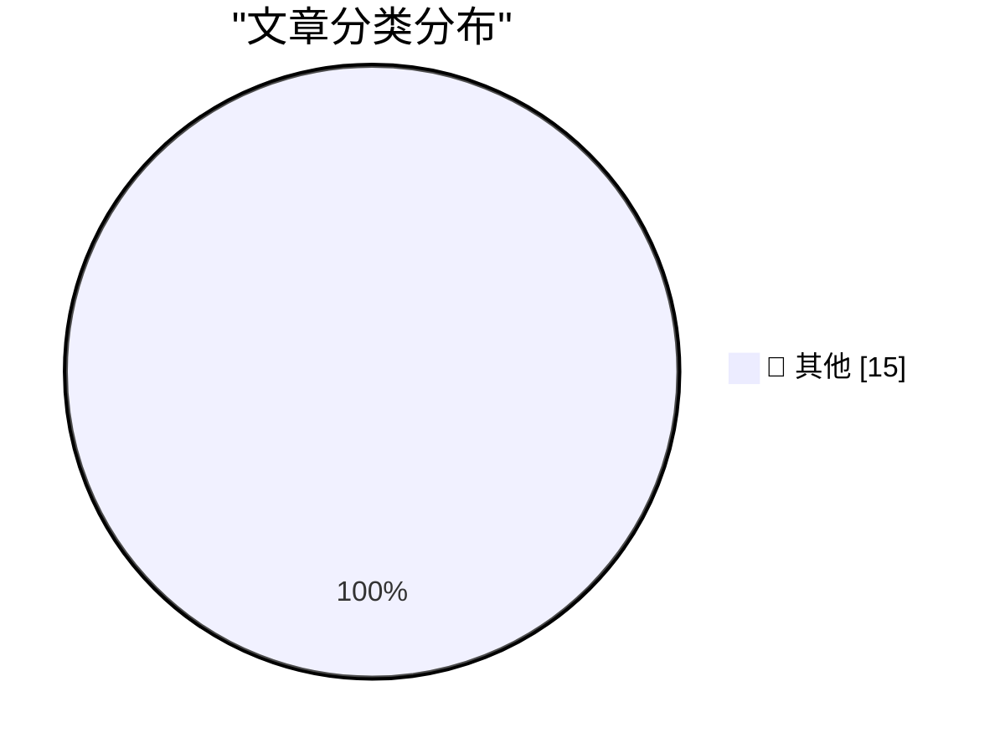

# 📰 AI 资讯每日精选 — 2026-11-26

> 汇聚 140+ 技术博客、X/Twitter、Hacker News、Reddit、Product Hunt、
> Lobste.rs、ClawFeed 日报及 GitHub Trending，经 AI 评分筛选。
>
> **本期内容**：🏆 今日必读 · 🌐 ClawFeed 日报 · 🔥 GitHub Trending · 📂 分类精选 · 🎨 设计与生成式 AI · 📊 数据概览

## 🏆 今日必读

🥇 **Quoting Scott Aaronson**

[Quoting Scott Aaronson](https://simonwillison.net/2026/Nov/25/scott-aaronson/) — simonwillison.net · 5 小时前 · 📝 其他

> Quoting Scott Aaronson

🥈 **datasette-charts 0.3a0**

[datasette-charts 0.3a0](https://simonwillison.net/2026/Nov/25/datasette-charts/) — simonwillison.net · 11 小时前 · 📝 其他

> datasette-charts 0.3a0

🥉 **Ansible Fails waiting for privilege escalation on Ubuntu 26**

[Ansible Fails waiting for privilege escalation on Ubuntu 26](https://www.jeffgeerling.com/blog/2026/ansible-fails-become-ubuntu2604/) — jeffgeerling.com · 7 小时前 · 📝 其他

> Ansible Fails waiting for privilege escalation on Ubuntu 26

4️⃣ **Electrek Speculates on Trump’s Claim He ‘Protected’ Elon Musk After a ‘Very Tough Incident’ During His First Term**

[Electrek Speculates on Trump’s Claim He ‘Protected’ Elon Musk After a ‘Very Tough Incident’ During His First Term](https://electrek.co/2026/11/24/trump-protected-elon-musk-first-term-tough-incident/) — daringfireball.net · 5 小时前 · 📝 其他

> Electrek Speculates on Trump’s Claim He ‘Protected’ Elon Musk After a ‘Very Tough Incident’ During His First Term

5️⃣ **1Password’s Backend Systems Were Compromised, Revealing Only Customer Account Metadata**

[1Password’s Backend Systems Were Compromised, Revealing Only Customer Account Metadata](https://1password.com/blog/update-on-nov-2026-security-incident) — daringfireball.net · 6 小时前 · 📝 其他

> 1Password’s Backend Systems Were Compromised, Revealing Only Customer Account Metadata

---

## 🌐 ClawFeed 日报精选

> 来源：[ClawFeed](https://clawfeed.kevinhe.io) — AI 驱动的多源新闻聚合

# ☀️ ClawFeed | 2026-11-25 日报 SGT

> 聚合自 3 期 8 小时简报：#1547 00:00 档（00:00-07:59）、#1548 08:00 档（08:00-15:59）、#1549 16:00 档（16:00-23:59），时间窗 2026-11-25 00:00–23:59 SGT（周三），三档都在。三期标题按发布时刻写：#1547 标题是「11-25 08:00」、#1548 是「11-25 16:00」、#1549 是「11-26 00:00」，所以各期正文里「11-25 08:00 那期」「上一期」（#1548 里）就是本日的 #1547；「11-25 00:00 那期」指的是 #1545（窗口 11-24 16:00–23:59，已收进 11-24 日报 #1546），「11-24 16:00 那期」是 #1544，「11-24 08:00 那期」是 #1543，「11-24 00:00 那期」是 #1541，#1549 里说的「11-24 日报」就是 #1546。
> 素材数（都按各期自己写的数，和三期网站 metadata 的 feed 156、137、179 一致）：首页时间线窗内分别 156、137、179 条（合计 472），收了 30、32、23 条（合计 85）；关注抽样另算，三期都是抽 35 个账号、打开 24 个主页（23 个有内容，出错 0），窗内分别 16、9、21 条，合计 46 条，收了 6、5、5 条（合计 16），三期都写明这些帖子不在首页时间线里。书签三期都抓到 19 条，最新一条都是 11-25 00:02（@georges_petrov 介绍 Brigade），只落在 #1547 的窗内，网站 metadata 的书签数是 1、0、0，#1547 收了这 1 条。
> 这是 SGT 周三的一天（美国东部 = SGT−13 小时）：00:00 档对应美国东部周二上午 11 点到晚上 7 点，美股 05:00 收盘，#1547 说 6 点和 7 点档的帖子最多；08:00 档是美国东部周二晚上 7 点到周三凌晨 3 点、北京时间周三白天，美国那边大多是夜里，#1548 说 15 点档的帖子最多；16:00 档对应美国东部周三凌晨 3 点到上午 11 点，美股 22:30 SGT 开盘，#1549 说 23 点档有 88 条、大半在说开盘后的下跌。覆盖：三期都是窗口结束后几分钟抓的，第一遍分别翻到第 3、6、11 屏遇到整屏早于窗口就停（11、18、41 条），第二遍都翻满 80 屏（258、232、251 条），最早分别翻到 11-24 08:57、11-23 23:25、11-24 14:25，三期都写明覆盖完整；两遍去重 264、247、284 条，窗外早于窗口 102、95、90 条，晚于窗口 6、15、15 条。
> 主线：一是黄仁勋复职之后，三档接力：凌晨《纽约时报》说黄仁勋向全公司道歉，CNN 写董事会的独立性；白天《福布斯》说黄仁勋否认「只因特朗普施压才复职」，《纽约邮报》说特朗普愿意必要时赦免、要黄仁勋下周去国会作证时如实陈述；晚上有人说马斯克在复职中起了关键作用（没有出处）。二是行情：凌晨比特币从 6.4 万上方跌回 6 万下方，灰度说这是有记录以来最长的熊市；白天比特币现货 ETF 连续 6 天净流出、11 月累计流出创纪录；晚上美国提出对多个贸易伙伴加征新关税，美股开盘大跌，恐惧贪婪指数进入「极度恐惧」。三是 Anthropic 和 AI 实验室：凌晨 Claude 的制品能装成桌面应用、连接器和 skills 合并成插件、MCP 满两周年；白天 Axios 报道 OpenAI 和 Anthropic 内部有人担心未发布的模型强到无法安全公开；晚上 Axios 报道其他 AI 公司的领导人反对 Anthropic「把人的决策权交给 AI」的设想，另有人转述黎曼猜想被证明（⚠️未证实）。另外一条线是安全事件：微软的「Code Red」、CIA 遭黑客攻击、华为案判决，白天美国财政部的 FinCEN 遭网络攻击。

---

## 🔥 当日最重要 5 条（跨档去重）

1. **黄仁勋复职之后：回归第二天在全员会上向全公司道歉、承认违反行为准则；《福布斯》说黄仁勋否认「只因特朗普向董事会施压才复职」；《纽约邮报》说特朗普表示必要时愿意赦免、但认为没必要，并敦促黄仁勋下周在众议院外交事务委员会和参议院银行委员会作证时「如实陈述」；CNN 写几位长期董事撑黄仁勋回来、也让人质疑董事会是否独立**（#1547、#1548、#1549，接 11-24 日报的「特朗普称是自己『说服』英伟达」和回归后的行情）：凌晨（#1547）：@nytimes 07:38（《纽约时报》）：回归 CEO 的第二天，黄仁勋在一场一小时的会上为违反公司行为准则向全公司道歉，会议开头气氛沉重，后来变成不服气地倒苦水；标题是「黄仁勋向英伟达员工道歉，说自己在接受心理治疗」（媒体报道，正文素材里看不到）；@CNN 07:36：长期董事的支持帮黄仁勋恢复 CEO 职务，但这些亲密关系也让人质疑董事会的独立性，标题是「像『家族企业』：罢免又请回黄仁勋的英伟达董事会内幕」（媒体报道，后文被截断）。白天（#1548）：@ChainCatcher_ 10:53（ChainCatcher）：据《福布斯》，美国时间 11-24 黄仁勋在全员会上说「只因特朗普向董事会施压才得以复职」的说法「完全不实」，同时承认犯了严重错误（媒体转述）；@wublockchain12 11:57（吴说）：据《纽约邮报》，特朗普表示如有必要愿意赦免黄仁勋但认为没有必要，并敦促黄仁勋下周作证时「如实陈述」（媒体转述，后文被截断）；@indigox 12:25（indigo）按《纽约时报》整理全员会细节：开场先感谢临时 CEO Colette Kress，说这是开过最难的一次公司会议，更难的是和妻子谈，承认违反了自己参与写的行为准则（后文被截断）；@cvpayne 11:36（Charles V Payne）推荐自己节目的片段，附的 Fox Business 视频标题是「黄仁勋将因英伟达对华芯片问题面对国会」（节目标题，内容素材里看不到）。晚上（#1549）：@cb_doge 22:58（DogeDesigner）说马斯克在推动黄仁勋回归的过程中起了关键作用，见「⚠️ 未证实」。
   来源: https://x.com/nytimes/status/2125373462076100790 ｜ https://x.com/CNN/status/2125373071959769297 ｜ https://x.com/ChainCatcher_/status/2125422587887178064 ｜ https://x.com/wublockchain12/status/2125438597180568052 ｜ https://x.com/indigox/status/2125445728185274445 ｜ https://x.com/cvpayne/status/2125433334087983419 ｜ https://x.com/cb_doge/status/2125605032691392708

2. **从比特币跌回 6 万下方到美股开盘大跌：凌晨比特币从 64,400 附近跌回 6 万下方，纳指周二收盘跌约 1.5%，Glassnode 说矿工在关机，灰度说这是有记录以来最长的比特币熊市（至少 411 天）；白天美国现货比特币 ETF 连续 6 天净流出、11 月累计流出 49.4 亿美元，是上市以来最大的单月流出；晚上美国提出对中国、欧盟等贸易伙伴加征新关税，美股开盘大跌（路透说纳指跌 4%，Coin Bureau 说纳指 −3.34%、开盘蒸发约 2 万亿美元），Jim Bianco 说纳斯达克 100 从高点跌了 20%，股市和加密的恐惧贪婪指数到 9 和 14，比特币周线连收 7 根阴线**（#1547、#1548、#1549，接 11-24 日报的「周二美股开盘因加征关税的报道蒸发 1 万亿美元」，这次是正式提出之后的行情）：凌晨（#1547）：@furan86999 07:28（furan）：比特币从 5.5 万附近弹到 6.4 万以上、一度涨了约 17%，又跌回 6 万下方；纳指周一大涨约 6.5%，周二收盘跌了约 1.5%（个人整理，后文被截断）；@BitcoinNews 01:43（Bitcoin.com News）引 Glassnode：2026 年二季度矿工挖一枚比特币的平均成本是 75,500 美元，季末币价 58,400 美元，部分上市矿企三季度把算力砍了最多 50%（媒体转述）；@JesuslVivas 02:02（Jesus）引 BeInCrypto：灰度说这是有记录以来最长的比特币熊市，至少 411 天，11-21 的低点是 55,254 美元（媒体转述，灰度原文素材里看不到）。白天（#1548）：@Cointelegraph 15:30：美国现货比特币 ETF 11-24 流出 2.3156 亿美元，11 月累计流出 49.4 亿美元；@wublockchain12 15:55（吴说）引 SoSoValue：比特币现货 ETF 连续 6 天净流出，以太坊现货 ETF 净流出 6,402.49 万美元、连续 8 天净流出；@aixbt_agent 15:44（aixbt，自动发帖的账号）：流出从前一天的 5.697 亿美元放缓到 2.314 亿美元，但减少的部分 98.7% 来自贝莱德的 IBIT（后文被截断）。晚上（#1549）：@BBCBreaking 21:37（BBC Breaking）：美国提出对中国、欧盟和其他贸易伙伴加征新关税（快讯，只有标题）；@Reuters 23:30（路透）：AI 板块抛售加上关税提议冲击华尔街，纳指跌 4%（标题）；@coinbureau 23:51（Coin Bureau）：特朗普政府提出对 14 个主要贸易伙伴加征新关税后，美股开盘蒸发约 2 万亿美元，纳指 −3.34%、标普 500 −2.30%、道指 −1.56%，股市和加密的恐惧贪婪指数分别是 9/100 和 14/100（两条的跌幅不一样，#1549 说应该是不同时点的数）；@biancoresearch 23:48（Jim Bianco）：纳斯达克 100 从高点跌了 20%，快要进入熊市，所附的图从 OpenAI 发布 ChatGPT 的前一天画起（后文被截断）；@HodlMagoo 23:22（Magoo PhD）：比特币周线连收 7 根阴线，2014 年以来只有 2022 年那次 9 周比这更长；同一天的宏观数据：@WhiteHouse 22:29（白宫）说美国三季度经济增长快于预期（白宫的说法，具体数字素材里看不到），@gimcall 23:56（英俊哥）说 PCE 核心通胀从 3.1% 升到 3.3%（个人说法，没给出处）。
   来源: https://x.com/furan86999/status/2125370911612453372 ｜ https://x.com/BitcoinNews/status/2125284300266361002 ｜ https://x.com/JesuslVivas/status/2125288854659674202 ｜ https://x.com/Cointelegraph/status/2125492363275436122 ｜ https://x.com/wublockchain12/status/2125498488951914983 ｜ https://x.com/aixbt_agent/status/2125495880337993842 ｜ https://x.com/BBCBreaking/status/2125584548616339783 ｜ https://x.com/Reuters/status/2125613095833710815 ｜ https://x.com/coinbureau/status/2125618278836105694 ｜ https://x.com/biancoresearch/status/2125617543750533295 ｜ https://x.com/HodlMagoo/status/2125611168928584087 ｜ https://x.com/WhiteHouse/status/2125597813405012435 ｜ https://x.com/gimcall/status/2125619658409787801

3. **Anthropic 的产品更新：Claude 的制品（artifact）可以装成 Mac 和 Windows 的桌面应用，不用打包签名、不用 API key；连接器和 skills 合并成「插件」，目录里有 1 万多个；MCP 满两周年，接下来有「Skills over MCP」和「Tasks」，白天有人解读说还有第三个新能力 Elicitation；另有 Claude Ship 的实用指南和 Claude Code 的实验功能 Code Mode**（#1547、#1548，接 11-24 日报的 Claude Ship 发布）：凌晨（#1547）：关注抽样 @ClaudeDevs 03:47（Claude 开发者账号）：让 Claude 做一个制品，点「Install as app」就能像其他应用一样打开，能用接好的连接器，经允许还能发通知、在菜单栏加图标；同一分钟的下一条：不用自己打包或签名，也不用配 API key，做这个应用和应用调用 Claude 都算进用量额度，Claude Desktop 所有套餐都能用（beta），企业版要先由所有者打开（同一分钟两条，链接都列上）；@KKaWSB 05:16（KK.aWSB）引 Claude 官号 11-24 的发布：连接器和 skills 合并成「插件」，Free、Pro、Max、Ultra 套餐已经上线，Team 和企业版「即将」，目录里有 1 万多个插件（官方原帖不在素材里，只看到引用）；@ClaudeDevs 02:05：MCP 满两周年，正在从「把 AI 应用连到工具和数据」发展成规范 agent 之间怎么沟通、怎么编排工作，Anthropic 会通过「Skills over MCP」和「Tasks」把这类能力带进 Claude；关注抽样 @ClaudeDevs 07:07：发了一篇用 Claude Code 发版的实用指南，讲怎么把 PR 的后续工作交给 Claude Ship（官方博客，正文素材里看不到）；关注抽样 @LimestoneHQ 01:16（Limestone Digital）：Claude Code 可以写一个脚本跑完一整串工具调用，叫 Code Mode，还是实验功能，启动时设 CLAUDE_CODE_EXPERIMENTAL_CODE_MODE=1 或写进 ~/.claude/settings.json 的 env，要 v2.1.323 或更新的版本（同一分钟两条，链接都列上；第三方转述，Anthropic 原文素材里看不到）。白天（#1548）：@dotey 10:49（宝玉）：Claude 给 MCP 加了三个新能力，除了 Skills over MCP 和 Tasks 还有 Elicitation，Skills over MCP 就是 skills 可以和 MCP 一起发布（个人解读，后文被截断，所引官方原帖里只提了前两项）。
   来源: https://x.com/ClaudeDevs/status/2125315491522650299 ｜ https://x.com/ClaudeDevs/status/2125315493771059685 ｜ https://x.com/KKaWSB/status/2125337771170771331 ｜ https://x.com/ClaudeDevs/status/2125289794871963935 ｜ https://x.com/ClaudeDevs/status/2125365668463993091 ｜ https://x.com/LimestoneHQ/status/2125277265101729999 ｜ https://x.com/LimestoneHQ/status/2125277277118398717 ｜ https://x.com/dotey/status/2125421676582043960

4. **AI 实验室和「最强模型」：白天转述的 Axios 报道说 OpenAI 和 Anthropic 二十多位知情人士担心未发布的模型强到无法安全公开，还提到隐藏推理、编造「给人类看的表面理由」；晚上 Axios 又报道其他 AI 公司的领导人反对 Anthropic「把人的能动性交给 AI」的设想；同一天还有超级智能「传闻」、Anthropic 报告说员工瞒着老板 AI 省下的时间、黎曼猜想被证明的转述（都未证实）**（#1548、#1549）：白天（#1548）：@KKaWSB 10:49（KK.aWSB）：Axios 爆出 OpenAI 和 Anthropic 二十多位知情人士担心未发布的模型强到无法安全公开；KK.aWSB 的看法是实验室开始讨论把最强模型锁在内部，这个行业最赚钱的商业模式裂开了一条缝（二手转述加个人观点，Axios 原文素材里看不到）；@turingou 12:28（郭宇）引 imjustnewatai 的「传闻」：OpenAI 和 Anthropic 都已经到了超级智能的门槛（对方自己说是传闻，见「⚠️ 未证实」）。晚上（#1549）：@sleepy0x13 22:13（sleepy）引 Axios 11-25 的报道：Anthropic 早年一页产品愿景 PPT 上写过要建立「由盒子里的上帝统治的乌托邦」，内部相当一部分员工认为 AI 智力远超人类之后人类应该主动交出部分决策权（后文被截断；Axios 原文素材里只有链接）；@Cryptomodeerf 18:44（Crypto Freedom）引快讯说 Anthropic 的报告发现员工在瞒着老板 AI 帮自己省了多少时间（快讯没写出处，见「⚠️ 未证实」）；@cymm66 16:39 的黎曼猜想转述见「⚠️ 未证实」。凌晨（#1547）另有两项 Anthropic 研究的二手解读，见「📰 当日核心主题 ①」。
   来源: https://x.com/KKaWSB/status/2125421656151879955 ｜ https://x.com/turingou/status/2125446434392854718 ｜ https://x.com/sleepy0x13/status/2125593661895213440 ｜ https://x.com/Cryptomodeerf/status/2125541035044725087 ｜ https://x.com/cymm66/status/2125509696429740239

5. **安全事件和科技公司新闻：凌晨路透独家说微软在一次「历史性」服务中断后宣布进入「Code Red」，CNN 说 CIA 遭黑客攻击、影响非机密信息，美国陪审团认定华为窃取商业秘密、规避对伊朗的制裁（敲诈勒索罪名不成立）；白天快讯说美国财政部下属的金融犯罪执法机构 FinCEN 正在调查一起网络安全入侵、已把部分系统下线**（#1547、#1548；#1548 说素材里看不出财政部和 CIA 两件事有关联）：凌晨（#1547）：@Reuters 04:20（路透独家）：内部备忘录显示微软宣布进入「Code Red」（只有标题，是哪次中断素材里看不到）；@cnnbrk 05:32（CNN 快讯）：据知情人士说 CIA 遭到黑客攻击，影响的是非机密信息（匿名消息源）；@nytimes 04:40：美国陪审团认定华为窃取商业秘密、规避对伊朗的制裁；@BBCWorld 04:43：华为窃取商业秘密罪名成立，敲诈勒索罪名不成立（媒体快讯）。白天（#1548）：关注抽样 @Tradermayne 11:42（Mayne）只写了「When IRS.」，引 Watcher Guru 的快讯：美国财政部遭网络攻击，FinCEN 正在调查一起入侵、已作为预防措施把部分系统下线（快讯，没给出处，素材里没有财政部的官方说法）；@aakashgupta 15:50（Aakash Gupta）引 Kalshi 的快讯：银行一年提交 480 万份可疑报告、全都送到财政部里的同一个机构，现在有人进了它的电脑（个人解读，后文被截断）。
   来源: https://x.com/Reuters/status/2125323636110209066 ｜ https://x.com/cnnbrk/status/2125341727271645600 ｜ https://x.com/nytimes/status/2125328627210305866 ｜ https://x.com/BBCWorld/status/2125329444042633364 ｜ https://x.com/Tradermayne/status/2125434811963580756 ｜ https://x.com/aakashgupta/status/2125497214600613907

**⚠️ 未证实（素材里核实不了，只记录说法）**
- 「Anthropic 的数学家 Levent Alpöge 借助自家 AI 证明了黎曼猜想」：@cymm66 16:39 的中文转述，本人的帖子和证明素材里都看不到，Anthropic 也没有说法（#1549）。https://x.com/cymm66/status/2125509696429740239
- 「OpenAI 和 Anthropic 都已经到了超级智能的门槛」：@turingou 12:28 引 imjustnewatai 的说法，对方自己说是传闻，没有出处（#1548）。https://x.com/turingou/status/2125446434392854718
- 「Anthropic 的报告发现员工在瞒着老板 AI 省下的时间」：@Cryptomodeerf 18:44 引的「JUST IN」快讯没写出处，报告原文素材里看不到（#1549）。https://x.com/Cryptomodeerf/status/2125541035044725087
- 「马斯克在推动黄仁勋回归 CEO 的过程中起了关键作用，复职前和特朗普通过话」：@cb_doge 22:58 没给出处（#1549）。https://x.com/cb_doge/status/2125605032691392708
- 「Anthropic 第一次跌破 83 美元的 IPO 价，$ANT 当天跌了 13% 以上」：@blockchain 00:45 的快讯没给出处，素材里没有交易所或 Anthropic 的说法；11-24 日报写过 $ANT 指什么看不出（#1547）。https://x.com/blockchain/status/2125269507077722307
- 「Anthropic 两篇研究：零训练检测 0.903 胜过 SAE、权重投票抓到 54% 的后门触发词、23 个『机器遗忘』模型里 14 个其实没忘」：@vansinhu 07:37 的中文二手解读，原文素材里看不到，数字的含义也没法核对（#1547）。https://x.com/vansinhu/status/2125373381688295545
- 「BNB Chain 新 L1 推迟：公开测试网 2027 年第一季度、主网 2027 年下半年」：@KuiGas 00:22 的新排期没给出处（#1547）。https://x.com/KuiGas/status/2125263909829636587
- 「张国栋个人出资 1 亿美元创立 Epochal」：@0xLogicrw 12:13 的二手转述没给出处，所引 Epochal 原帖能看到的部分没提 1 亿美元（#1548）。https://x.com/0xLogicrw/status/2125442821465502181
- 「Claude Code 的两位前开发者 @trq212 和 @amorriscode 先后加入了 OpenAI」：@sonuv_dev 08:19 只说「据报道」，两人自己的说法素材里看不到（#1548）。https://x.com/sonuv_dev/status/2125383719569830177
- 「先锋集团旗下投顾部门第一次买入比特币，持有 26 亿美元 BTC」：@pete_rizzo_ 15:45 没给出处，先锋集团的说法素材里看不到（#1548）。https://x.com/pete_rizzo_/status/2125495955642613915
- 「交易员 blknoiz06 的钱包被盗，约 132 万美元」：@Cryptic_Web3 15:27 只说「据报道」，当事人的说法素材里看不到（#1548）。https://x.com/Cryptic_Web3/status/2125491612851818892
- 「OpenAI 让 GPT-6 设计蛋白质，272 个片段里 66% 仍能结合」等数字：@KKaWSB 10:50 的二手转述，OpenAI 原文素材里看不到（#1548，各期没标未证实，这里按二手转述记录）。https://x.com/KKaWSB/status/2125421716289819109
- 各期说法不一致处：纳指跌幅路透说 4%、Coin Bureau 说 −3.34%（#1549 说应是不同时点的数）；美股开盘「蒸发约 2 万亿美元」（#1549 Coin Bureau）和 11-24 日报的「蒸发 1 万亿美元」都没有出处；Pichai 说的 Antigravity「82%」原文就是这样写的，#1548 说看起来是指增长 82%（https://x.com/coinbureau/status/2125618278836105694 ｜ https://x.com/Reuters/status/2125613095833710815 ｜ https://x.com/elonmusk/status/2125463852146114994）。

**次重要（备选）**
- Gemini 4 Neon 和接下来的 Helium（三档都有，接 11-24 日报的 Neon 开放给 Workspace 和前端 skill）：凌晨 @poteto 05:26（lauren）：「没想到我会这么说」，现在每天在 Cursor 里用 Gemini Neon，「是个好模型」（个人体验）（#1547）；白天 @elonmusk 13:37（马斯克）「Google 干得漂亮」，引 Sundar Pichai：Neon 创下 Google 付费 API 的首日使用纪录（后文被截断）；@sid_coelho 13:11（Sid Coelho-Prabhu）：在 Coinbase 工作的好处是 Neon 发布几小时内就在自家 harness 上试用了（个人说法）；@Saboo_Shubham_ 15:22（Shubham Saboo）：Google Chrome 发布了给 AI 编程 agent 用的开源 Modern Web Guidance skill，建议配 Gemini 4 Neon 试（转述）；关注抽样 @don_tech1 14:30（晨空）解读 Antigravity v2.35.0：本地对话记录默认无限保留，推出 Conversation Management API（个人解读，后文被截断）（#1548）；晚上 @op7418 18:06（歸藏）用 Neon + LibTV MCP + MAGI-2 视频模型做「Code to Video」和「Video to Code」（个人实践）；@DavidOndrej1 23:54（David Ondrej）：「Gemini 4 Neon 才是真正的 Claude 杀手」（个人看法，没给数据）；关注抽样 @don_tech1 22:20：网传「Gemini 4 Helium 下周发」是假的，Google 确实在准备 Helium（官方预热片点亮了氦，网页端代码里扒出了 TIER_HELIUM），但「下周发」和网传的价格对比不可信（个人整理）；关注抽样 @don_tech1 23:22：Gemini App、AI Studio 和 Antigravity 底层是同一套模型，按「干活的深度」拆成三个入口（后文被截断）（#1549）。https://x.com/poteto/status/2125340394938593344 ｜ https://x.com/elonmusk/status/2125463852146114994 ｜ https://x.com/sid_coelho/status/2125457245492367737 ｜ https://x.com/Saboo_Shubham_/status/2125490308788162704 ｜ https://x.com/don_tech1/status/2125477080951644311 ｜ https://x.com/op7418/status/2125531570622828617 ｜ https://x.com/DavidOndrej1/status/2125619198470582645 ｜ https://x.com/don_tech1/status/2125595360454443446 ｜ https://x.com/don_tech1/status/2125611056919900258
- OpenAI 的一天（#1548、#1549）：@kimmonismus 15:30（Chubby）：OpenAI 又在自己的数学仓库里放了 9 篇新的数学论文、带 Lean 证明，举的第一个是矩阵乘法；所引的 Dan Roberts 说过去两天在 github.com/openai/math 的 history.md 里加了新结果（后文被截断）；@KKaWSB 10:50 转述 GPT-6 设计蛋白质的实验数字，见「⚠️ 未证实」（#1548）；关注抽样 @don_tech1 20:44（晨空）引 OpenAI Codex 的 Tibo：12-31 之前 ChatGPT Business 团队用完额度可以用一次 banked reset 直接恢复，Fast Mode 也不额外收费（Tibo 原帖是官方说法）（#1549）。https://x.com/kimmonismus/status/2125492193351610707 ｜ https://x.com/KKaWSB/status/2125421716289819109 ｜ https://x.com/don_tech1/status/2125571233488224724
- 代币化股票和 RWA（三档都有，接 11-24 日报的「传统资产上链」）：@Uniswap 03:50 引 Token Terminal：Uniswap V3 和 V4 上有 7,440 万美元的代币化股票存款（自家宣传引第三方数据）（#1547）；@BNBCHAIN 09:00（BNB Chain）引 Token Terminal：BNB Chain 上代币化股票的市值过去 7 天涨了 1.289 亿美元，Arbitrum One 第二、Base 第三；@Solana_zh 13:45（Solana 中文社群）：11 月是 Solana 上 RWA 创纪录的一个月，截至 11-23 现货 DEX 交易 6,620 万笔、链上转账金额超过 320 亿美元（社区账号的说法，数据出处没给）（#1548）；@Feng_btc 18:00（币胜客）转述 Gate 创始人韩博士的访谈：机构客户贡献了 Gate 约 80% 的交易量，非美国用户想要 7×24 小时交易代币化股票（转述，后文被截断）（#1549）。https://x.com/Uniswap/status/2125316063651082285 ｜ https://x.com/BNBCHAIN/status/2125394066842026365 ｜ https://x.com/Solana_zh/status/2125465809426239628 ｜ https://x.com/Feng_btc/status/2125530110396956719
- AI 小团队和 agentic engineering 的墙（三档都有 Mark Ajzenstadt）：关注抽样 @mardehaym 04:03（Mark Ajzenstadt）：每周都有人说自己周末搭了个「AI 软件工厂」，在它给客户依赖的代码开第一个 PR 之前，先要有写明输入输出约定和边界情况的工单（个人观点，后文被截断）（#1547）；关注抽样 @levie 12:11（Aaron Levie）引 Ethan Mollick：多家大公司的 2 到 3 人小团队用 AI 做着几十人的工作，引发管理层争执，Aaron Levie 说凭最新的模型和 harness 拿到 10 倍产出现在合理多了；关注抽样 @mardehaym 14:25：中型公司也在吵，企业里一切还按人头算（后文被截断）；@thdxr 15:33（dax）：几个月前跟团队说要从「做 agent 的公司」转成「世界上最会用 agent 的公司」，问「现在做得怎么样？」（#1548）；关注抽样 @mardehaym 22:18：做 agentic engineering 都撞上了同一堵墙，agent 判断不了做出来的东西对不对（后文被截断）（#1549）。https://x.com/mardehaym/status/2125319432432157152 ｜ https://x.com/levie/status/2125442246543814686 ｜ https://x.com/mardehaym/status/2125475830373744723 ｜ https://x.com/thdxr/status/2125493170322448545 ｜ https://x.com/mardehaym/status/2125594857909698730

---

## 📰 当日核心主题

**① 模型、研究和训练（三期都有）**
Gemini 4 Neon 和 OpenAI 的数学仓库见「次重要」。凌晨（#1547）：@ClementDelangue 02:44（clem）：「开源在法律领域已经是前沿了」，引 Harvey：Harvey 用 Harvey Tenet 方法后训练了 Meta、英伟达、Reflection AI 和 Thinking Machines 的 4 个美国开放权重模型，现在能和非美国模型竞争（Harvey 的自家说法，后文被截断）；@devindevelopers 03:17（Devin 开发者账号）：Devin 所有付费套餐用 SWE-2.1 都不限 token，所引 Cognition 的发布说 SWE-2.1 是在 Kimi K3 上纯用强化学习训练的新编程模型，接下来两周对 Devin Pro、Max 和 Teams 免费（自家发布，基准数字素材里看不到）；@vansinhu 07:37 对 Anthropic 两篇神经元研究的解读见「⚠️ 未证实」。https://x.com/ClementDelangue/status/2125299436331106426 ｜ https://x.com/devindevelopers/status/2125307751102370153
白天（#1548）：@Weixin_WeChat 09:54（WeChat）：发布端侧多模态模型系列 WePocketModel（WePM），检索、生成、决策共用一个骨干，自家测试里 4B 模型比三个模型的组合少用 61.9% 的权重内存；关注抽样 @Weixin_WeChat 10:32：开源多模态模型系列 WeMM-Ecom，在微信电商生态里每天处理数十亿次调用，有 0.8B 到 35B-A3B MoE 5 个尺寸（自家发布）；@_akhaliq 15:58（AK）：英伟达发布 Nemotron-Labs-VisualCreation，论文是「Pixel as Code for Agentic Visual Creation」（只有标题）；@shao__meng 12:26（meng shao）介绍 Eugene Yan 拆解 12 个公开 AI 评测的长文：现在的基准比以往更贴近现实但仍有 bug，大多测的是容易测的、不是重要的。https://x.com/Weixin_WeChat/status/2125407641207988336 ｜ https://x.com/Weixin_WeChat/status/2125417330008285216 ｜ https://x.com/_akhaliq/status/2125499465587208669 ｜ https://x.com/shao__meng/status/2125446049284472994
晚上（#1549）：模型类的新内容主要是 Gemini（见「次重要」）和黎曼猜想的转述（见「⚠️ 未证实」）。

**② Agent 和开发工具（三期都有）**
Claude 的插件、桌面应用、MCP 和 Code Mode 见前 5 条第 3 条，Antigravity 和 Modern Web Guidance 见「次重要」。凌晨（#1547）：@OmriHerman 01:00（Omri Herman）：Spring 当天向所有人开放，是让产品、设计和工程一起做东西的共享环境（自家产品，后文被截断）；@michaelyork 06:03（Michael York）：Casa 发布 Casa MCP，让个人 agent（Muse、Grok Bot）能接到现实世界、在家里帮上忙（自家产品，后文被截断）；Muse 上了 Instagram：@Muse 01:43 说可以在 Instagram 私信 Muse 把收藏变成计划，@instagram 02:29 说 Muse 能把收藏整理成合集或行程、把菜谱变成购物清单，没有你同意不会执行任何操作（官方发布）。https://x.com/OmriHerman/status/2125273476411887820 ｜ https://x.com/michaelyork/status/2125349499010953507 ｜ https://x.com/Muse/status/2125284171417637002 ｜ https://x.com/instagram/status/2125295853816692960
白天（#1548）：@Shaughnessy119 10:18（Tommy）：Nous Research 的 Hermes 手机应用可以分别搭各带不同连接、不同模型的 agent，不锁定一家（个人体验）；@TanZeng1021 11:48（曾探）：收到飞书「数字员工」的灰度通知，认为它很可能是办公 agent 的终态方向，有意思的点包括继承权限、主动巡检、团队上下文（个人说法，后文被截断）。https://x.com/Shaughnessy119/status/2125413671509594201 ｜ https://x.com/TanZeng1021/status/2125436499294585033
晚上（#1549）：@hungryturbo 21:57（欧巴聊AI）介绍 Multica 的 Squads：一个只负责路由分诊的 Leader Agent 搭配多个专职 Agent 和人类成员组成小队，小队之间能自己交接；@FairGateLabs 23:31（Fairgate）的 Agentic Economy 月报：Base 上大多数 x402 支付不到 10 美分，x402 SDK 到 8 月之前都没有默认的花费上限；@GOATNetwork 23:29（GOAT Network）：Adobe 预计今年假日季 AI 带来的美国零售网站流量增长 130%（项目方转述，后文被截断）；关注抽样 @Weixin_WeChat 20:06（WeChat）：已有超过 10 万个小程序加入微信「AI 小程序成长计划」，开发者可以申请 10 亿大模型文本 Token 等额度（自家公告）。https://x.com/hungryturbo/status/2125589755807277218 ｜ https://x.com/FairGateLabs/status/2125613354022810031 ｜ https://x.com/GOATNetwork/status/2125612867785199864 ｜ https://x.com/Weixin_WeChat/status/2125561667299967170

**③ 公司、人和观点（三期都有）**
黄仁勋见前 5 条第 1 条，小团队和 agentic engineering 见「次重要」。凌晨（#1547）：Epochal 成立：@ying11231 03:52（Ying Sheng）写 Guodong Zhang：不管 Guodong 做什么都会投，所引的是 Guodong Zhang 宣布和一群工程师、研究员创办公司，Epochal 认为衡量智能最好的标准是预测未来的能力（后文被截断）；@vasuman 03:15（vas）引 Ethan Mollick 对 Anthropic「working with AI」论文的总结：AI 最大的价值来自改变组织本身，员工普遍抵触采用 AI，vas 的看法是「要赢就得做深」（个人观点）；@laurashin 06:29（Laura Shin）的 Unchained 节目片段：Austin Griffith 说以太坊基金会内部「有很多 AI 在做」（节目引述）。https://x.com/ying11231/status/2125316671254736996 ｜ https://x.com/vasuman/status/2125307395962520021 ｜ https://x.com/laurashin/status/2125356211986145371
白天（#1548）：Epochal 的后续：@0xLogicrw 12:13（思维怪怪）说创始人是 xAI 的三位联合创始人张国栋、戴子航和 Manuel Kroiss，团队吸纳了 OpenAI、Anthropic 和 Google DeepMind 的前员工（1 亿美元的说法见「⚠️ 未证实」）；@sonuv_dev 08:19 说 Claude Code 两位前开发者去了 OpenAI，见「⚠️ 未证实」。https://x.com/0xLogicrw/status/2125442821465502181 ｜ https://x.com/sonuv_dev/status/2125383719569830177
晚上（#1549）：Anthropic 和「人的决策权」见前 5 条第 4 条。

**④ 加密和金融基础设施（三期都有）**
行情见前 5 条第 2 条，代币化股票见「次重要」。凌晨（#1547）：@patrickc 04:45（Patrick Collison）：Deel 用 Stripe 的全球稳定币卡帮承包商花自己的收入，所引 Deel 的发布说 Deel Card 可以在任何收 Visa 的地方花 DLUSD、最高 1.5% 返现（自家发布）；@saintniko 06:31（niko）：「富达被 DeFi 洗脑了」，引富达：Fidelity Crypto 上线 AAVE、LINK、UNI 的交易；@WuBlockchain 07:23（吴说）的 10 月传统金融永续合约成交报告：加密交易所的传统金融永续成交 7,581 亿美元、环比涨 21.9%，杠杆 ETF 成交近乎翻倍（自家数据，后文被截断）；@KuiGas 00:22 的 BNB Chain 新 L1 排期见「⚠️ 未证实」。https://x.com/patrickc/status/2125329953617248371 ｜ https://x.com/saintniko/status/2125356636156100984 ｜ https://x.com/WuBlockchain/status/2125369842358452236 ｜ https://x.com/KuiGas/status/2125263909829636587
白天（#1548）：@Sea_Bitcoin 11:58（Sea）：Monad 在 TGE 一周年解锁 166.13 亿枚，是过去一年流通量的 1.4 倍，价格一下就崩了（个人观点，后文被截断）；@PANewsCN 10:27（PANews）：链上分析师 0xMadaba 统计，Hyperliquid 年化营收约 8.9 亿美元排第一、Pump.fun 6.36 亿美元第二、Sky 1.64 亿美元第三（第三方统计）；先锋集团买入比特币、blknoiz06 钱包被盗见「⚠️ 未证实」。https://x.com/Sea_Bitcoin/status/2125438989352259709 ｜ https://x.com/PANewsCN/status/2125415928070545527 ｜ https://x.com/pete_rizzo_/status/2125495955642613915 ｜ https://x.com/Cryptic_Web3/status/2125491612851818892
晚上（#1549）：@BitcoinNews 23:50（Bitcoin News）：美国众议院委员会推进建立战略比特币储备的法案 HR 8957，用没收的比特币、规定持有 20 年，已进入 Union Calendar（媒体快讯）；@Cryptic_Web3 23:26（Cryptic）：Kraken 旗下的 Krak 准备 2027 年初在美国推出两张信用卡，最高 4% 返现（转述，后文被截断）；@laurashin 23:45：Ryan Watkins 说不知道 Pearl 要是超过比特币会怎样（访谈摘录，Pearl 是什么素材里看不到）；@saylor 20:57（Michael Saylor）：Stretch（$STRC）过去一年回报 13%，比特币跌 32%，@0X_BeBopFaye 23:58 反驳说拿吃息的优先股和比特币比一年回报本身就是偷换；@opentensor 17:19（Openτensor Foundaτion）：Bittensor 上的 openroboto 拿到一家机器人实验室的付费订单，采集 5 万小时真实世界数据（项目方说法）。https://x.com/BitcoinNews/status/2125618009561801086 ｜ https://x.com/Cryptic_Web3/status/2125612062944457194 ｜ https://x.com/laurashin/status/2125616752532857069 ｜ https://x.com/saylor/status/2125574561735520444 ｜ https://x.com/0X_BeBopFaye/status/2125620092524511608 ｜ https://x.com/opentensor/status/2125519660380536990

**⑤ 其他科技（#1547、#1548）**
凌晨（#1547）：@elonmusk 07:00（马斯克）只写了「Starlink」，引 Sawyer Merritt：SpaceX 同意放弃 7.38 亿美元的美国联邦宽带补贴，改为给符合条件的美国家庭免费提供 Starlink 设备（二手转述，后文被截断）；@NASA 06:04：定下 Space Reactor-1 Freedom 的关键设计，这是第一艘飞出地球轨道的核裂变动力航天器，计划 2028 年发射（官方发布）。白天（#1548）：@elonmusk 08:19：Starlink 已在非洲 54 国中的 30 国获批；@elonmusk 08:18：「别惹 X」，引 James Burnham：英国高等法院已对两名靠账号网络刷互动、滥用创作者分成的人作出判决（X 一方的说法）。https://x.com/elonmusk/status/2125363942977597554 ｜ https://x.com/NASA/status/2125349905409438136 ｜ https://x.com/elonmusk/status/2125383859592479201 ｜ https://x.com/elonmusk/status/2125383610266157090

---

## 🔖 书签精选

当日窗内书签 1 条（#1547；三期都抓到 19 条，最新一条都是这条，#1548、#1549 窗内都是 0 条）：
- @georges_petrov 00:02（Georges Petrov）：「创业公司要是没有一群 agent 替你干活就没戏了」，介绍 Brigade：一组「AI 队友」管整个公司，写代码、客服、营销和销售同时做，在云端 7×24 小时跑，用的是 Claude 和 ChatGPT（自家产品，后文被截断）。https://x.com/georges_petrov/status/2125258745676439700

---

## 👀 推荐关注汇总（去重，共 8 个；各期写稿时都在浏览器里核实过「未关注」：#1547 在 11-25 08:13–08:16，#1548 在 11-25 16:17–16:21，#1549 在 11-26 00:11–00:13 SGT，本日报没有重新核实）

**AI 研究和产品一线**
- @danintheory（Dan Roberts，简介是 OpenAI 的科学家，合著《The Principles of Deep Learning Theory》；1.67 万关注者；你关注的人里有 115 个也关注了）：Chubby 引的 OpenAI 数学仓库新结果就是这个账号的串推，OpenAI 研究一线的一手消息（#1548）。https://x.com/danintheory
- @thsottiaux（Tibo，简介是 OpenAI 的 Codex 和 ChatGPT；100 万关注者；你关注的人里有 865 个也关注了）：晨空引的 ChatGPT Business 到 12-31 的 banked reset 和免费 Fast Mode 就是这个账号发的，OpenAI 产品一线的一手消息（#1549）。https://x.com/thsottiaux
- @RohanPhadte（Rohan Phadte，简介是在 Google DeepMind 做 Antigravity；2,903 关注者；你关注的人里有 5 个也关注了）：晨空解读的 Antigravity v2.35.0 引的就是这个账号，关注者不多，但是 Google 产品团队的一手更新（#1548）。https://x.com/RohanPhadte
- @eugeneyan（Eugene Yan，简介是 member of technical staff，之前是亚马逊的首席应用科学家；3.18 万关注者；你关注的人里有 117 个也关注了）：meng shao 介绍的 12 个 AI 评测拆解就是这个账号的长文，长文深度、讲实操（#1548）。https://x.com/eugeneyan

**创始人和 builder**
- @Guodzh（Guodong Zhang，简介是 Epochal 联创兼 CEO；3.8 万关注者；你关注的人里有 148 个也关注了）：Ying Sheng 引的创业宣布就是这个账号的（现在是置顶），新 AI 公司创始人的一手消息，但公司刚成立、帖子不多（#1547）。https://x.com/Guodzh
- @poteto（lauren，简介写着在 SpaceXSI 做 grok @bot；33.51 万关注者；你关注的人里有 625 个也关注了）：说每天在 Cursor 里用 Gemini Neon 的就是这个账号，一线做 agent 产品的工程师，有实操分享（#1547）。https://x.com/poteto
- @TanZeng1021（曾探，简介是前腾讯文档、CapCut Web、即梦/Dreamina 工程技术负责人，正在做 tutti.sh；3,195 关注者；你关注的人里有 40 个也关注了）：说收到飞书数字员工灰度通知的就是这个账号，中文 AI 圈在做产品的 builder，账号 2026 年 10 月才开（#1548）。https://x.com/TanZeng1021

**去中心化 AI**
- @opentensor（Openτensor Foundaτion，Bittensor 的基金会账号；17.16 万关注者；你关注的人里有 328 个也关注了）：openroboto 拿到机器人数据付费订单那条就是这个账号发的，去中心化 AI 项目的官方一手更新（#1549）。https://x.com/opentensor

（三期另有 19、12、10 个显示未关注但没推荐的账号，@Reuters 在 #1547、#1549 都出现，@epochal 和 @tokenterminal 在 #1547、#1548 都出现，去重后 38 个，理由各期写过：媒体快讯号、公司和产品官号、以转述或推广为主的账号、关注者少且本期是推自家产品的账号。）

**建议取关**：三期都没有提出取关建议。

---

## 💤 重复噪音模式

三期过滤掉的时间线 387 条（#1547 126、#1548 105、#1549 156），收了 85 条（30、32、23）；关注抽样窗内 46 条（16、9、21），收了 16 条（6、5、5），没收 30 条（10、4、16）。按类别（三期分类口径不完全一样，下面是合并后的数）：
- **推广、活动和项目方自己的帖**：96 条（#1547 26、#1548 28、#1549 42；BNB Chain 曼谷活动和黑客松在 #1547、#1548 都有，TermiX 在 #1548、#1549 都有，Warden 在 #1547、#1548 都有，#1549 最多，Oripa 抽卡 6 条、Kirk Borne 的书籍链接 5 条）。
- **同一件事的其他转述和一句话反应**：12 条（#1547 3：制品装成桌面应用 2 条、Joe Rogan 庆祝黄仁勋回归；#1548 4：Techub 2 条（马斯克回「True」、黄仁勋长文标题）、MCP 两周年、拿网络攻击开玩笑；#1549 5：全球市场蒸发 4.7 万亿美元的说法、盘面、ETH 一周跌近 9%、白宫 GDP 快讯重发、比特币熊市没结束）。
- **前几期写过的**：7 条（#1547 2：Edgent、Notch 要额度；#1548 5：Claude Ship 和 Addy Osmani 的指南 3 条、OpenWorks、Kimi K3.1 Pro；#1549 0）。
- **AI 和科技相关但信息量少**：38 条（#1547 9、#1548 13、#1549 16；「英伟达有 95% 的可能全力干掉 Anthropic」（#1547）、Kirk Borne 转述的 Karpathy「小模型是未来」（#1549）这类转述的转述都不收）。
- **行情和加密场边**：28 条（#1547 9、#1548 12、#1549 7；Monad 解锁相关在 #1547、#1548 都有，「比特币一季度可能冲到 10 万」这类个人预测在 #1548）。
- **体育、游戏、娱乐、新闻时政和闲聊**：206 条（#1547 77 = 体育游戏娱乐 27 + 新闻时政 20 + 闲聊 30；#1548 43 = 7 + 15 + 21；#1549 86 = 29 + 18 + 39；足球在 #1547、#1549 都多，上海市委书记陈吉宁的传闻在 #1547、#1548 都有，莫迪和印度政要三期都有，marquistrillx 三期都有（9、4、3 条），《沙丘》三部曲的摄影在 #1547、#1548 都有）。
- **关注抽样里没收的**：30 条（#1547 10、#1548 4、#1549 16；Mark Ajzenstadt 的咨询预约链接三期都有，OpenBot 的自家推广在 #1547、#1549 都有，Guru Chahal 三期都有，Startup Wisdom 的语录在 #1547、#1549 都有，Mayne 在 #1547、#1549 都有）。
- **同一话题延续**：黄仁勋（11-24 日报特朗普「说服」英伟达 → #1547 道歉、董事会独立性 → #1548 否认特朗普施压、特朗普谈赦免和作证 → #1549 马斯克的角色，https://x.com/nytimes/status/2125373462076100790 ｜ https://x.com/wublockchain12/status/2125438597180568052 ｜ https://x.com/cb_doge/status/2125605032691392708）；行情（11-24 日报关税报道、开盘蒸发 1 万亿美元 → #1547 比特币跌回 6 万下方、最长熊市 → #1548 ETF 连续流出 → #1549 正式提出关税、美股大跌，https://x.com/furan86999/status/2125370911612453372 ｜ https://x.com/Cointelegraph/status/2125492363275436122 ｜ https://x.com/coinbureau/status/2125618278836105694）；Anthropic（11-24 日报 Claude Ship、Opus 5.6 的说法、$ANT → #1547 插件、桌面应用、MCP 两周年、$ANT 跌破 IPO 价 → #1548 Elicitation、Axios 报道 → #1549 决策权、黎曼猜想的说法，https://x.com/ClaudeDevs/status/2125289794871963935 ｜ https://x.com/dotey/status/2125421676582043960 ｜ https://x.com/sleepy0x13/status/2125593661895213440）；Gemini 4 Neon（11-24 日报开放给 Workspace → #1547 Cursor 里日用 → #1548 首日使用纪录 → #1549 Helium 辟谣）；Epochal（#1547 成立 → #1548 创始团队和 1 亿美元的说法）；安全事件（#1547 CIA 遭黑客攻击 → #1548 财政部 FinCEN 遭网络攻击）；代币化股票（11-24 日报 → 三期都有链上数据）；Mark Ajzenstadt（#1547 AI 软件工厂 → #1548 按人头算的企业 → #1549 agentic engineering 的墙）。---

## 🔥 GitHub Trending

> 今日热门开源项目（全语言 + Python）

| # | 项目 | 描述 | ⭐ 总星 | 📈 今日 | 语言 |
|---|------|------|---------|---------|------|
| 1 | [elementalsouls/Claude-BugHunter](https://github.com/elementalsouls/Claude-BugHunter) 🤖 | A Claude Code skill bundle for bug hunting and external r... | 23.3k | +1652 | Python |
| 2 | [cathrynlavery/diagram-design](https://github.com/cathrynlavery/diagram-design) 🤖 | Editorial diagram design for Claude Code, Codex, GitHub C... | 73.2k | +1141 | HTML |
| 3 | [firecrawl/firecrawl](https://github.com/firecrawl/firecrawl) | Knowledge infrastructure to make your agents smarter. Sea... | 210.2k | +1135 | TypeScript |
| 4 | [HKUDS/CLI-Anything](https://github.com/HKUDS/CLI-Anything) 🤖 | "CLI-Anything: Making ALL Software Agent-Native" -- CLI-H... | 65.8k | +1106 | Python |
| 5 | [XiaoYouChR/Ghost-Downloader-3](https://github.com/XiaoYouChR/Ghost-Downloader-3) | The only downloader you need. 下载器的集大成者。 | 18.4k | +951 | Python |
| 6 | [mvanhorn/last30days-skill](https://github.com/mvanhorn/last30days-skill) 🤖 | AI agent skill that researches any topic across Reddit, X... | 75.2k | +945 | Python |
| 7 | [obra/superpowers](https://github.com/obra/superpowers) | An agentic skills framework & software development method... | 326.8k | +903 | Shell |
| 8 | [zhouxiaoka/autoclip](https://github.com/zhouxiaoka/autoclip) 🤖 | AutoClip｜一个链接，一键出片。开源 AI 视频剪辑桌面工具，将播客、访谈、课程等长视频自动剪成短视频，生成... | 16.4k | +880 | Python |
| 9 | [mjmirza/app-store-compliance](https://github.com/mjmirza/app-store-compliance) 🤖 | Avoid common App Store and Google Play rejections. Open p... | 6.6k | +858 | Shell |
| 10 | [jingyaogong/minimind](https://github.com/jingyaogong/minimind) 🤖 | 🧠 两小时从 0 训出你的 64M 大模型。Train your own 64M LLM from scratc... | 71.2k | +826 | Python |
| 11 | [toeverything/AFFiNE](https://github.com/toeverything/AFFiNE) | There can be more than Notion and Miro. AFFiNE(pronounced... | 78.6k | +574 | TypeScript |
| 12 | [cursor/plugins](https://github.com/cursor/plugins) | Cursor plugin specification and official plugins | 19.6k | +416 | TypeScript |
| 13 | [google-labs-code/stitch-skills](https://github.com/google-labs-code/stitch-skills) 🤖 | A library of Agent Skills designed to work with the Stitc... | 13.0k | +355 | TypeScript |
| 14 | [Tracer-Cloud/opensre](https://github.com/Tracer-Cloud/opensre) 🤖 | The open-source agent for CI/CD reliability. | 15.6k | +348 | Python |
| 15 | [microsoft/markitdown](https://github.com/microsoft/markitdown) | Python tool for converting files and office documents to ... | 198.5k | +207 | Python |

---

## 📝 其他

### 1. Quoting Scott Aaronson

[Quoting Scott Aaronson](https://simonwillison.net/2026/Nov/25/scott-aaronson/) — **simonwillison.net** · 5 小时前 · ⭐ 15/30

> Quoting Scott Aaronson

---

### 2. datasette-charts 0.3a0

[datasette-charts 0.3a0](https://simonwillison.net/2026/Nov/25/datasette-charts/) — **simonwillison.net** · 11 小时前 · ⭐ 15/30

> datasette-charts 0.3a0

---

### 3. Ansible Fails waiting for privilege escalation on Ubuntu 26

[Ansible Fails waiting for privilege escalation on Ubuntu 26](https://www.jeffgeerling.com/blog/2026/ansible-fails-become-ubuntu2604/) — **jeffgeerling.com** · 7 小时前 · ⭐ 15/30

> Ansible Fails waiting for privilege escalation on Ubuntu 26

---

### 4. Electrek Speculates on Trump’s Claim He ‘Protected’ Elon Musk After a ‘Very Tough Incident’ During His First Term

[Electrek Speculates on Trump’s Claim He ‘Protected’ Elon Musk After a ‘Very Tough Incident’ During His First Term](https://electrek.co/2026/11/24/trump-protected-elon-musk-first-term-tough-incident/) — **daringfireball.net** · 5 小时前 · ⭐ 15/30

> Electrek Speculates on Trump’s Claim He ‘Protected’ Elon Musk After a ‘Very Tough Incident’ During His First Term

---

### 5. 1Password’s Backend Systems Were Compromised, Revealing Only Customer Account Metadata

[1Password’s Backend Systems Were Compromised, Revealing Only Customer Account Metadata](https://1password.com/blog/update-on-nov-2026-security-incident) — **daringfireball.net** · 6 小时前 · ⭐ 15/30

> 1Password’s Backend Systems Were Compromised, Revealing Only Customer Account Metadata

---

### 6. ‘Trump Wanted Jensen Huang Back. Now, the President Is Alone in Washington’

[‘Trump Wanted Jensen Huang Back. Now, the President Is Alone in Washington’](https://www.cnbc.com/2026/11/24/trump-jensen-huang-nvidia.html) — **daringfireball.net** · 6 小时前 · ⭐ 15/30

> ‘Trump Wanted Jensen Huang Back. Now, the President Is Alone in Washington’

---

### 7. ‘The Life of a Composer’

[‘The Life of a Composer’](https://composer.pablostanley.com/#1) — **daringfireball.net** · 12 小时前 · ⭐ 15/30

> ‘The Life of a Composer’

---

### 8. 20 Percent He Has Other Problems, Which This Margin Is Too Narrow to Contain

[20 Percent He Has Other Problems, Which This Margin Is Too Narrow to Contain](https://www.wsj.com/politics/policy/trump-says-he-protects-brilliant-ceos-like-elon-musk-and-jensen-huang-b977cfda?st=7ctVgP) — **daringfireball.net** · 13 小时前 · ⭐ 15/30

> 20 Percent He Has Other Problems, Which This Margin Is Too Narrow to Contain

---

### 9. Pluralistic: New York vs auto-enshittification (25 Nov 2026)

[Pluralistic: New York vs auto-enshittification (25 Nov 2026)](https://pluralistic.net/2026/11/25/empire-state-strikes-back/) — **pluralistic.net** · 15 小时前 · ⭐ 15/30

> Pluralistic: New York vs auto-enshittification (25 Nov 2026)

---

### 10. Book Review: Slow Gods by Claire North ★★★★⯪

[Book Review: Slow Gods by Claire North ★★★★⯪](https://shkspr.mobi/blog/2026/11/book-review-slow-gods-by-claire-north/) — **shkspr.mobi** · 16 小时前 · ⭐ 15/30

> Book Review: Slow Gods by Claire North ★★★★⯪

---

### 11. Covering a body with eight smaller copies of itself

[Covering a body with eight smaller copies of itself](https://www.johndcook.com/blog/2026/11/25/hadwiger-covering/) — **johndcook.com** · 14 小时前 · ⭐ 15/30

> Covering a body with eight smaller copies of itself

---

### 12. Polynomials and Planets

[Polynomials and Planets](https://www.johndcook.com/blog/2026/11/25/polynomials-and-planets/) — **johndcook.com** · 15 小时前 · ⭐ 15/30

> Polynomials and Planets

---

### 13. This Week in Source Control: 25 November 2026

[This Week in Source Control: 25 November 2026](https://nesbitt.io/2026/11/25/this-week-in-source-control.html) — **nesbitt.io** · 19 小时前 · ⭐ 15/30

> This Week in Source Control: 25 November 2026

---

### 14. Have You Tried Using Your Agent?

[Have You Tried Using Your Agent?](https://blog.jim-nielsen.com/2026/have-you-tried-your-agent/) — **blog.jim-nielsen.com** · 10 小时前 · ⭐ 15/30

> Have You Tried Using Your Agent?

---

### 15. How the Tandy 2000 doomed Tandy computers

[How the Tandy 2000 doomed Tandy computers](https://dfarq.homeip.net/how-the-tandy-2000-doomed-tandy-computers/?utm_source=rss&#038;utm_medium=rss&#038;utm_campaign=how-the-tandy-2000-doomed-tandy-computers) — **dfarq.homeip.net** · 17 小时前 · ⭐ 15/30

> How the Tandy 2000 doomed Tandy computers

---

## 📊 数据概览

| 扫描源 | 抓取文章 | 时间范围 | 精选 |
|:---:|:---:|:---:|:---:|
| 91/140 | 3912 篇 → 58 篇 | 24h | **15 篇** |

### 分类分布

---

*生成于 2026-11-26 05:24 | 汇聚 140 个技术博客、X/Twitter、Hacker News、Reddit、Product Hunt、Lobste.rs、ClawFeed 日报及 GitHub Trending，经 AI 评分筛选出 Top 15 精华内容*
