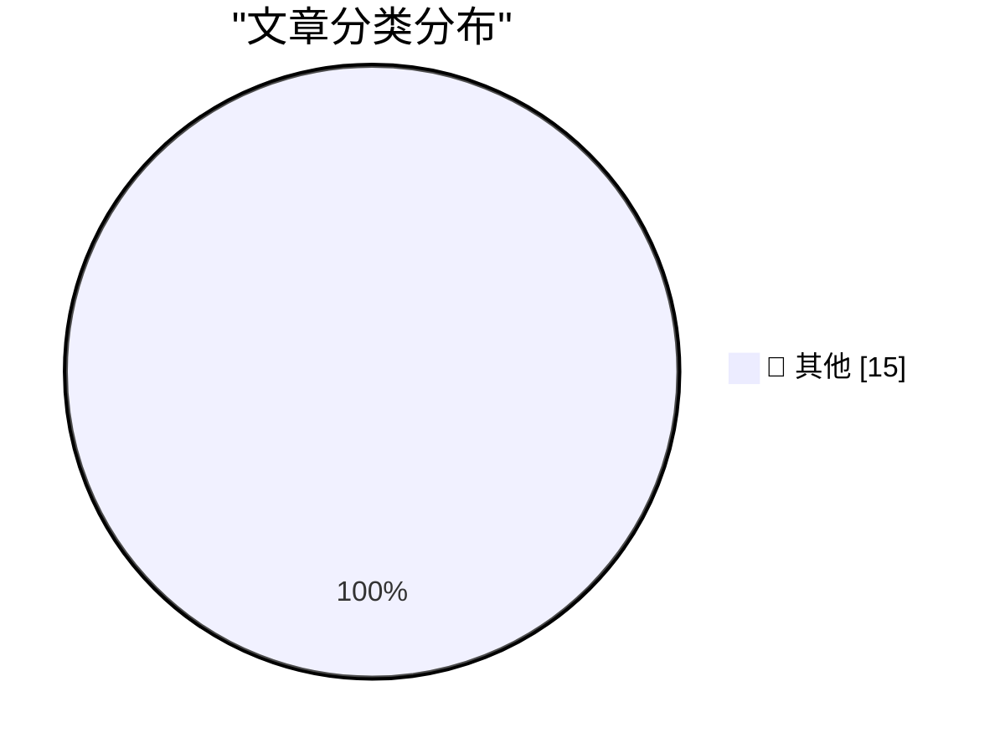

# 📰 AI 资讯每日精选 — 2026-11-27

> 汇聚 140+ 技术博客、X/Twitter、Hacker News、Reddit、Product Hunt、
> Lobste.rs、ClawFeed 日报及 GitHub Trending，经 AI 评分筛选。
>
> **本期内容**：🏆 今日必读 · 🌐 ClawFeed 日报 · 🔥 GitHub Trending · 📂 分类精选 · 🎨 设计与生成式 AI · 📊 数据概览

## 🏆 今日必读

🥇 **Quoting Jack Despain Zhou**

[Quoting Jack Despain Zhou](https://simonwillison.net/2026/Nov/26/jack-despain-zhou/) — simonwillison.net · 14 小时前 · 📝 其他

> Quoting Jack Despain Zhou

🥈 **sqlite3_rsync: Database Remote-Copy Tool For SQLite**

[sqlite3_rsync: Database Remote-Copy Tool For SQLite](https://simonwillison.net/2026/Nov/26/sqlite3-rsync/) — simonwillison.net · 23 小时前 · 📝 其他

> sqlite3_rsync: Database Remote-Copy Tool For SQLite

🥉 **Who gets to decide if something is written by AI?**

[Who gets to decide if something is written by AI?](https://seangoedecke.com/who-gets-to-decide-if-something-is-written-by-ai/) — seangoedecke.com · 5 小时前 · 📝 其他

> Who gets to decide if something is written by AI?

4️⃣ **★ Obvious Affordances Are Due for a Comeback**

[★ Obvious Affordances Are Due for a Comeback](https://daringfireball.net/2026/11/obvious_affordances_are_due_for_a_comeback) — daringfireball.net · 14 小时前 · 📝 其他

> ★ Obvious Affordances Are Due for a Comeback

5️⃣ **Pluralistic: Charles Koch is a cult leader (26 Nov 2026)**

[Pluralistic: Charles Koch is a cult leader (26 Nov 2026)](https://pluralistic.net/2026/11/26/science-of-liberty/) — pluralistic.net · 16 小时前 · 📝 其他

> Pluralistic: Charles Koch is a cult leader (26 Nov 2026)

---

## 🌐 ClawFeed 日报精选

> 来源：[ClawFeed](https://clawfeed.kevinhe.io) — AI 驱动的多源新闻聚合

# ☀️ ClawFeed | 2026-11-26 日报 SGT

> 聚合自 3 期 8 小时简报：#1551 00:00 档（00:00-07:59）、#1552 08:00 档（08:00-15:59）、#1553 16:00 档（16:00-23:59），时间窗 2026-11-26 00:00–23:59 SGT（周四），三档都在。三期标题按发布时刻写：#1551 标题是「11-26 08:00」、#1552 是「11-26 16:00」、#1553 是「11-27 00:00」。各期提到前几期时，有的按标题时刻写、有的按窗口开始时刻写，同一期里也不统一，按内容对照：#1551 里的「上一期 11-26 00:00」是 #1549（窗口 11-25 16:00–23:59），#1551 说 MCP 两周年写在「11-25 00:00 那期」、三期都说书签那条「11-25 08:00 那期已经收过」，这两处说的都是 #1547（窗口 11-25 00:00–07:59）；#1552 里的「上一期」是 #1551，#1553 里的「上一期」是 #1552；#1552、#1553 正文里带编号的「11-25 08:00 那期（#1548）」「11-25 16:00 那期（#1549）」「11-26 00:00 那期（#1551）」按窗口开始时刻写，以编号为准；#1553 里的「11-25 日报（#1550）」就是上一份日报。
> 素材数（都按各期自己写的数，和三期网站 metadata 的 feed 160、142、155 一致）：首页时间线窗内分别 160、142、155 条（合计 457），收了 29、30、30 条（合计 89）；关注抽样另算，三期都是抽 35 个账号、打开 24 个主页（23 个有内容，出错 0），窗内分别 12、9、16 条，合计 37 条，收了 3、3、3 条（合计 9），三期都写明这些帖子不在首页时间线里。书签三期都翻 5 屏抓到 19 条，三期窗内都是 0 条（网站 metadata 的书签数也是 0、0、0）。
> 这是 SGT 周四的一天（美国东部 = SGT−13 小时），美国感恩节当天：00:00 档对应美国东部周三上午 11 点到晚上 7 点（感恩节前一天），美股 05:00 收盘，#1551 说 6 点和 7 点档的帖子最多；08:00 档是美国东部周三晚上 7 点到周四凌晨 3 点、北京时间周四白天，#1552 说这一档多是体育、印度宪法日和孟买 26/11 纪念、感恩节问候，15 点档的帖子最多（62 条）；16:00 档对应美国东部周四凌晨 3 点到上午 11 点（感恩节当天），#1553 说感恩节问候、足球和币安区块链周（曼谷）的推广很多，23 点档的帖子最多（51 条）。覆盖：三期都是窗口结束后几分钟抓的，第一遍分别翻到第 6、10、15 屏遇到整屏早于窗口就停（26、35、54 条），第二遍都翻满 80 屏（248、242、231 条），最早分别翻到 11-25 08:19、11-25 02:05、11-25 23:11，三期都写明覆盖完整；两遍去重 261、269、268 条，窗外早于窗口 91、118、104 条，晚于窗口 10、9、9 条。
> 主线：一是 AI 实验室：凌晨 Dario Amodei 本人回应 Axios，说「把人的自由意志交给 AI」的说法荒谬，马斯克转发说「Interesting」；白天 OpenAI 在小范围客户里测试 Private Inference（机密计算），Karpathy 让 Claude（Opus 5.5）用 7 小时、4.5 万行代码做出《文明》式美国地图。二是黄仁勋复职之后的英伟达，三档接力：凌晨《华盛顿邮报》说美国防长 Hegseth 讨论过用《国防生产法》向英伟达施压，英伟达 2.9 亿美元和解挖矿收入集体诉讼；白天穆迪说评级不变，《华尔街日报》写高管 Jay Puri 和超微高管的交往；晚上有人列「三重压力」（⚠️未证实），Michael Burry 的看涨期权翻倍。三是 SpaceX：凌晨亚利桑那的 Colossus 3，白天马斯克说每个美国孩子都会拿到两股 SpaceX，晚上 CNN 说 FCC 批准 SpaceX 部署 100 万颗卫星做 AI 数据中心。另外一条线是安全事件：凌晨有人转述 1Password 后端被黑（⚠️未证实），白天 CrowdStrike 宣布收购 Zscaler 的后续，晚上路透独家说渣打旗下的 Zodia Custody 遭安全入侵。

---

## 🔥 当日最重要 5 条（跨档去重）

1. **AI 实验室：Dario Amodei 回应 Axios，说「我不认为我们应该把人的自由意志交给 AI 系统」、说自己这么想是荒谬的，马斯克转发说「Interesting」；OpenAI 在一小批客户里测试 Private Inference（机密计算）；ChatGPT 合并 Chat 和 Work 后改用统一用量计，另有人说全体订阅用户送重置卡（未证实）**（#1551、#1552，接 11-25 日报第 4 条 Axios 报道的「其他 AI 公司的领导人反对 Anthropic 把人的能动性交给 AI」，这次是 Dario 本人的回应）：凌晨（#1551）：@DarioAmodei 02:22（Dario Amodei）：「我不认为我们应该把人的自由意志交给 AI 系统，说我这么想是荒谬的」，写过几百页文章，一个不变的主题是 AI 必须受正当的民主程序管辖（后文被截断），所引的是 Axios 那篇报道；@elonmusk 03:12（马斯克）转发 Dario 这条，只写了「Interesting」；@TechCrunch 04:05（TechCrunch）：ChatGPT 合并 Chat 和 Work 体验后，OpenAI 会改用一个统一的用量计，OpenAI 说重度用户可能更早撞到上限（标题和链接卡片）。白天（#1552）：@gdb 13:30（Greg Brockman）：「Private Inference——机密计算，模型处理提示和回复时对其做严格管控——现在进入测试」；所引的 Sam Altman 原帖（早于窗口）说这是 OpenAI Private Intelligence 下的最新产品，先给一小批客户试，更强的隐私保护能让前沿 AI 用在更多工作上（官方说法，后文被截断）；@xueqiu88 11:47（雪球）说 OpenAI 给全体 ChatGPT 订阅用户送重置卡，见「⚠️ 未证实」。#1552 关注抽样里晨空转 Dario 回应的那条因为上一期写过，放进了噪音。
   来源: https://x.com/DarioAmodei/status/2125656399392690605 ｜ https://x.com/elonmusk/status/2125669066388209784 ｜ https://x.com/TechCrunch/status/2125682206249021583 ｜ https://x.com/gdb/status/2125824585027272727 ｜ https://x.com/xueqiu88/status/2125798549346734285

2. **黄仁勋复职之后的英伟达：《华盛顿邮报》说复职前美国防长 Hegseth 和副手讨论过拿 1950 年的《国防生产法》当筹码向英伟达施压；英伟达同意付 2.9 亿美元和解 2018 年的挖矿收入集体诉讼；穆迪说复职减少了不确定性、评级不变；《华尔街日报》说长期副手 Jay Puri 曾和超微电脑的一名高管交往；晚上有人列英伟达「三重压力」（未证实），Michael Burry 的看涨期权翻倍**（三档都有，接 11-25 日报第 1 条的道歉、特朗普谈赦免和作证）：凌晨（#1551）：@coinbureau 07:07（Coin Bureau）引《华盛顿邮报》：黄仁勋周一复职之前，特朗普的防长 Pete Hegseth 和副手 Steve Feinberg 讨论过用 1950 年的战时法律《国防生产法》当筹码向英伟达施压、让黄仁勋回来（《华盛顿邮报》原文素材里看不到，后文被截断）；@Delphi_Digital 03:00（Delphi Digital）的 Hivemind 节目里 Yan Liberman 说，黄仁勋回归已经明朗、市场还在跌，说明大家觉得问题和风险要大得多（节目摘录，后文被截断）；@wublockchain12 00:36（吴说区块链）引路透：英伟达同意支付 2.9 亿美元，和解 2018 年提起的投资者集体诉讼，原告指控英伟达没有如实披露加密挖矿需求对游戏业务收入的影响（媒体报道）。白天（#1552）：@Reuters 15:40（路透）：穆迪说黄仁勋复职减少了不确定性，英伟达评级不变（标题）；@WSJ 10:52（《华尔街日报》）：黄仁勋的长期副手 Jay Puri 曾和超微电脑的高管 Cenly Chen 交往数年，当时超微正在争取英伟达的芯片供应，消息来自现任和前任同事（媒体报道）；@ranranyk 13:53（ranran）说马斯克带两个小儿子到访英伟达总部，见「⚠️ 未证实」。晚上（#1553）：关注抽样 @Tabgdoueth 22:25（0x糖豆）列的「三重压力」见「⚠️ 未证实」；@ant_fun_trade 18:44（ANT.FUN）引 Benzinga 的标题「Michael Burry 的英伟达看涨期权翻倍，已经计划再做空」，评论说 Burry「只是公关团队更好的赌徒」（项目方账号的评论，Benzinga 正文素材里看不到）。
   来源: https://x.com/coinbureau/status/2125728065317966129 ｜ https://x.com/Delphi_Digital/status/2125665828825596033 ｜ https://x.com/wublockchain12/status/2125629632129155474 ｜ https://x.com/Reuters/status/2125857120742428731 ｜ https://x.com/WSJ/status/2125784770235838615 ｜ https://x.com/ranranyk/status/2125830157420372332 ｜ https://x.com/Tabgdoueth/status/2125959156427612428 ｜ https://x.com/ant_fun_trade/status/2125903559161991395

3. **SpaceX 的一天：凌晨 SpaceX 说亚利桑那的超算基地 Colossus 3 不建燃气电厂、不用工业用水，当地投入 500 亿美元以上；白天马斯克说美国每个孩子都会拿到两股 SpaceX；晚上 CNN 说美国 FCC 批准 SpaceX 部署 100 万颗卫星、用来建为 AI 提供算力的数据中心，Coin Bureau 转述马斯克说「多行星」的 SpaceX 可能值 118 艾美元**（三档都有）：凌晨（#1551）：@elonmusk 03:07（马斯克）引 SpaceX：亚利桑那 Cochise 县的 Colossus 3 不建燃气电厂、不用工业用水、用干冷闭环水系统，SpaceX 会在当地投入 500 亿美元以上，带来 1,000 个长期岗位和最多 5,500 个建设岗位（公司说法，后文被截断）。白天（#1552）：@levelsio 15:56（levelsio）：「每个美国孩子都会成为 $SPCX 股东」，引马斯克：美国每个孩子都会拿到两股 SpaceX，一股来自公司、一股由马斯克个人出（马斯克本人的说法，怎么发、什么时候发素材里看不到）。晚上（#1553）：@CNN 22:37（CNN）：FCC 批准 SpaceX 在太空部署 100 万颗卫星，用来建设为 AI 提供算力的数据中心（媒体快讯，FCC 原文、获批条件和时间表素材里看不到；抓取时浏览 90K）；@coinbureau 23:30（Coin Bureau）：马斯克说「多行星」的 SpaceX 可能值 118 艾（quintillion）美元，大约是全球年经济产出的 100 万倍，前提是帮人类在不止一个星球上生活（后文被截断）；所引 Coin Bureau 自己早些时候的帖说，最多 7,000 万名孩子通过 Trump Accounts 各拿 2 股 $SPCX，按每股 127 美元算，原文写每人 255 美元（媒体转述，马斯克原话素材里看不到）。
   来源: https://x.com/elonmusk/status/2125667762324541673 ｜ https://x.com/levelsio/status/2125861313780039747 ｜ https://x.com/CNN/status/2125962036282564725 ｜ https://x.com/coinbureau/status/2125975369165443171

4. **安全事件：凌晨有人转述 1Password 的后端被黑、拖走一批用户数据但密码库没丢（未证实）；白天关注抽样里有人祝贺 CrowdStrike 宣布收购 Zscaler（Zscaler 11-24 发的公告，交易金额素材里看不到）；晚上路透独家说渣打银行的加密子公司 Zodia Custody 遭安全入侵、部分客户数据外泄**（三档都有，接 11-25 日报第 5 条的微软 Code Red、CIA 和 FinCEN）：凌晨（#1551）：关注抽样 @don_tech1 07:30（晨空）引 Polymarket 的快讯，转述 1Password 员工的企业 GitHub 账号失守、攻击者进了私有源码库和 CI/CD，见「⚠️ 未证实」。白天（#1552）：关注抽样 @guruchahal 10:20（Guru Chahal）祝贺 Jay（Zscaler 创始人）和两家公司达成合作，说自己曾参与 Zscaler 的历程（后文被截断）；所引的是 Zscaler 11-24 的帖：CrowdStrike 宣布已签最终协议收购 Zscaler，把终端安全和零信任 SASE 合在一起，做「网络安全的操作系统」（公司公告，交易金额和时间表素材里看不到；#1552 说前几期都没写过）。晚上（#1553）：@Reuters 22:50（路透）：独家消息，渣打银行的加密子公司 Zodia Custody 遭安全入侵，部分客户数据外泄（只有标题，涉及多少客户、有没有资产损失素材里看不到，Zodia 自己的说法素材里没有）；同一档 @BitcoinNews 23:17（Bitcoin.com News）：英格兰银行的《金融稳定报告》把 10 月的币安被黑事件（64 亿美元）当作操作风险案例，说冲击「因为加密市场和其他金融体系的联系比较弱而有限」（媒体快讯，报告原文素材里看不到）。
   来源: https://x.com/don_tech1/status/2125733776516874585 ｜ https://x.com/guruchahal/status/2125776803520204868 ｜ https://x.com/Reuters/status/2125965343650693594 ｜ https://x.com/BitcoinNews/status/2125972333001154741

5. **Claude 的实际用法：Karpathy 让 Claude（Opus 5.5）用 7 小时、4.5 万行代码，把美国 31 个公开数据源做成一张《文明》式的游戏地图；Anthropic 把 Claude Messages API 从 Python 迁到 Rust、由一组组 Claude agent 找差异；Simon Willison 转「Claude Pelican 1」假发布视频，有人开始试 Claude 个人助理 Duet；转述说 Claude Code 团队每出新模型先删光系统提示、Opus 5 删掉八成；有人晒「Opus 5.6」做的 PPT（未证实）**（三档都有，接 11-25 日报第 3 条的插件、桌面应用和 MCP 两周年）：凌晨（#1551）：关注抽样 @ClaudeDevs 00:32（Claude 开发者账号）：工程博客写了把 Claude Messages API 从 Python 迁到 Rust 的过程，用原来的 Python 服务来验证新服务，由一组组 Claude agent 找出并修掉两个版本之间的差异（官方说法）。白天（#1552）：@karpathy 10:31（Andrej Karpathy）：让 Claude 用美国的真实数据填满一张《文明》风格的游戏地图，Opus 5.5 下载并解析了大量公开数据，「7 小时、4.5 万行代码之后……能跑了」，用了 31 个真实数据源，包括 Census、BEA、BLS、EIA、NOAA、USGS、DoD、NPS、FAA、FEMA 等（作者本人的一手实践，后文被截断；抓取时浏览 671K）；@simonw 12:58（Simon Willison）说「这个真不错」，引 kirill sh：让 Opus Next（原文写的是「5.6/6」，这个名字 Anthropic 的说法素材里看不到）照 Anthropic 真实发布视频的样子，给一个只会画「骑自行车的 SVG 鹈鹕」的假模型「Claude Pelican 1」做发布视频（个人实践）；@turingou 13:31（郭宇）：「终于排到我了」，开始试 Claude 的个人助理 Duet（只有这一句，Duet 的官方介绍素材里看不到）。晚上（#1553）：@FinanceYF5 18:44（AI Will）转述 Claude Code 负责人 Boris Cherny 今年 7 月在 YC 讲：团队每出一个新模型，先把系统提示删光、再一行一行加回来，Opus 5 这次删掉了八成，还劝用户每半年清一遍自己的 CLAUDE.md、skills、hooks（转述，演讲原文素材里看不到，后文被截断）；@xiaohu 16:23（小互）录视频解释为什么一份 Claude artifact 做的 PPT「配得上卧槽」，所引自己早些时候的帖写「Opus 5.6 这么牛逼吗」，见「⚠️ 未证实」；@yanhua1010 18:48（Yanhua）贴出一段让 Claude 做「AI 未来、智能爆炸」主题演示的提示词，要求「完全抛开锚定偏见」（素材里看不出和小互那份 PPT 是不是同一个）。
   来源: https://x.com/ClaudeDevs/status/2125628717263372512 ｜ https://x.com/karpathy/status/2125779541952246039 ｜ https://x.com/simonw/status/2125816458911600681 ｜ https://x.com/turingou/status/2125824676446494821 ｜ https://x.com/FinanceYF5/status/2125903476547109044 ｜ https://x.com/xiaohu/status/2125867980177440927 ｜ https://x.com/yanhua1010/status/2125904441698353637

**⚠️ 未证实（素材里核实不了，只记录说法）**
- 「1Password 被黑：11-19 发现员工的企业 GitHub 失守，攻击者进了私有源码库和 CI/CD 流水线、往后端服务插了恶意代码、拖走一批用户数据，密码库没丢」：关注抽样 @don_tech1 07:30 引 Polymarket 的「BREAKING」快讯加转述，1Password 自己的公告素材里看不到（#1551）。https://x.com/don_tech1/status/2125733776516874585
- 「英伟达三重压力：暂停向马来西亚、新加坡、泰国、印尼发货服务器；标普把 AA 评级列入负面观察；民主党高层继续追问复职决定」：关注抽样 @Tabgdoueth 22:25 三点都没写出处，英伟达和标普的说法素材里看不到（#1553）。https://x.com/Tabgdoueth/status/2125959156427612428
- 「黄仁勋刚复职，马斯克就带着两个小儿子到访英伟达总部」：@ranranyk 13:53 只有这一句、没有出处（#1552；#1548 写过有人引「看看谁在英伟达总部」）。https://x.com/ranranyk/status/2125830157420372332
- 「OpenAI 给全体 ChatGPT 订阅用户送 1 张重置卡，到 12 月 3 日会有 2 张」：@xueqiu88 11:47，OpenAI 自己的说法素材里看不到（#1552）。https://x.com/xueqiu88/status/2125798549346734285
- 「Opus 5.6」：@xiaohu 16:23 所引的自己早些时候的帖用了这个名字，Anthropic 的说法素材里看不到；11-25 日报回顾 11-24 日报时也提过「Opus 5.6 的说法」；同一天 @simonw 12:58 引的 kirill sh 也写了「Opus Next（5.6/6）」，#1552 没标未证实，这里一并记录（#1552、#1553）。https://x.com/xiaohu/status/2125867980177440927 ｜ https://x.com/simonw/status/2125816458911600681
- 「10 月通胀涨到 3.8%、PCE 也超预期」：@zhuanfgghjnb 09:33 没写数据出处（#1552）。https://x.com/zhuanfgghjnb/status/2125764869979078769
- 「CoreWeave 2031 年到期的债券收益率逼近 18%，CDS 升到 1314 个基点」：@gigiz_eth 16:57 没写数据出处（#1553）。https://x.com/gigiz_eth/status/2125876462716891300
- 「OpenEvidence 19 个月从 10 亿涨到 150 亿美元估值、Harvey 估值 155 亿、Sierra 年化收入 11 个月从 1 亿涨到 4 亿以上并以 300 亿估值融资 17.5 亿美元」等数字：@FinanceYF5 09:37、09:55、10:03 三条转述都没写出处（#1552，各期没标未证实，这里按二手转述记录）。https://x.com/FinanceYF5/status/2125765863949406471 ｜ https://x.com/FinanceYF5/status/2125770336847409243 ｜ https://x.com/FinanceYF5/status/2125772392731754730
- 各期说法不一致或对不上的地方：以太坊 Glamsterdam，@binji_x 23:20 引 Ethlabs 说硬分叉推进因 gas 重新定价的审计问题暂停，@ryanberckmans 23:35 说「很快会上」，#1553 说两条怎么对上素材里看不出；《美国储备现代化法案》（@CoinMarketCap 23:20）和 #1549 写过的 HR 8957 是不是同一部法案素材里看不出；SpaceX 股份 Coin Bureau 按每股 127 美元算两股，#1553 注明原文写的是每人 255 美元（@coinbureau 23:30）；MAGI-2 比 Seedance 便宜多少，Artificial Analysis 说 7 倍（@ArtificialAnlys 09:13），#1552 噪音里另有一条说 9 倍、对不上。（https://x.com/binji_x/status/2125972865132712222 ｜ https://x.com/ryanberckmans/status/2125976746650419623 ｜ https://x.com/CoinMarketCap/status/2125972867917533543 ｜ https://x.com/coinbureau/status/2125975369165443171 ｜ https://x.com/ArtificialAnlys/status/2125759745655210113）

**次重要（备选）**
- 开放终端协议 OSC 7577（#1553 的前 3 条之一，前几期都没写过）：@0xLogicrw 18:34（思维怪怪）：Ghostty 创始人 Mitchell Hashimoto 的新终端工具 Rex 和 Herdr 联合推出 OSC 7577，让终端程序在服务或电脑重启后自动恢复会话；以前用 tmux 之类让多个 AI agent 在后台跑，电脑一重启进程就全没了（后文被截断）；所引 Mitchell Hashimoto 本人的帖（早于窗口）说「Rex 现在能在服务器重启后恢复你的程序」，协议请多位终端模拟器和终端程序作者审过（作者发布）。https://x.com/0xLogicrw/status/2125901090147520537
- Gemini 4 Neon 和 Gemini 的新功能（三档都有，接 11-25 日报「次重要」的 Neon 和 Helium）：凌晨 @jack 05:11（jack）转 Demis Hassabis 的「你应该试试 Gemini Neon，是个好模型」，只写了「very much so」（Demis 引的 Logan Kilpatrick 用量帖被截断，数字看不到）；@WesRoth 07:00（Wes Roth）：Google 在 Android 和 iOS 的 Gemini 上推出 66 种地区口音语音，Live 对话和朗读回复都会用（介绍）（#1551）；白天 @shao__meng 09:55（meng shao）介绍 Philipp Schmid 的「用 Gemini 4 Neon 之后改掉的 5 个习惯」：给旧模型写的许多护栏、skill 和规则反而拖慢了 Neon（个人实践，后文被截断）；@FinanceYF5 13:59（AI Will）转述 Alex Finn 演示的 Antigravity Swarm：7 个 Gemini 4 Neon agent 并行试不同架构，再由一个协调 agent 比较，输入 /swarm 加任务描述就能启动（转述，后文被截断）（#1552）；晚上 @sonuv_dev 18:32（sou）：让 Gemini 4 Neon 做了一个设定在巨大黑洞下单色世界里的第三人称探索游戏 Tide Atlas，整个游戏在一个 HTML 文件里（个人作品，后文被截断；抓取时浏览 93K）（#1553）。https://x.com/jack/status/2125698983796642288 ｜ https://x.com/WesRoth/status/2125726224399929548 ｜ https://x.com/shao__meng/status/2125770370900996580 ｜ https://x.com/FinanceYF5/status/2125831737213079675 ｜ https://x.com/sonuv_dev/status/2125900496091398560
- 行情和关税（三档都有，接 11-25 日报第 2 条的关税提议和美股开盘大跌）：凌晨 @CNN 07:32（CNN）：华尔街周三上演大反弹，收复了早盘的大幅下跌，资金躲进和 AI 无关的板块（标题，涨跌数字素材里看不到）；@3orovik 07:58（borovik）：比特币重回 6 万美元以上，「底部可能到了」（个人看法）；@Cointelegraph 07:00 引 CryptoQuant：有超过 1,118 万枚比特币处于亏损；@CoinMarketCap 04:54 转述 Arthur Hayes：「印钞之外没有别的比特币价格驱动力」，新一轮牛市「100%」取决于 AI 崩盘和救市（媒体转述）；@Cointelegraph 06:20：2025 年初以来美国企业利润涨了 26.4%，工资总额只涨 7.1%，物价涨 5.6%（快讯，没写数据出处）（#1551）；白天 @zhuanfgghjnb 09:33（蜡币小鑫）回顾周三：纳指盘中跌近 4%，比特币砸到 57,200 左右，发帖时回到 60,600 附近（个人整理；通胀数字见「⚠️ 未证实」）；@pete_rizzo_ 15:30（The Bitcoin Historian）：比特币第二次跌到「彩虹图」下方，上次是 2022 年的 15,500 美元（个人看法，喊买）；@0x99DaDa 15:57（DaDa）转述：新加坡对美方拟议关税「非常失望」，新加坡对美国商品零关税仍躲不过最高 20%；马来西亚说美方给了 18% 至 25% 的区间，但签协定时谈成的上限是 19%（转述，两国声明原文素材里看不到）；@Reuters 15:35（路透）：拟议的巴航工业关税会推高美国航空公司的成本（标题）；@Reuters 14:40：韩国央行按预期加息 25 个基点到 3.25%（标题）（#1552）；晚上 @coinbureau 23:07（Coin Bureau）据《华尔街日报》：欧盟官员推荐 Pablo Hernández de Cos 接替拉加德任欧洲央行行长，拉加德 2027 年 2 月离任（媒体转述）（#1553）。https://x.com/CNN/status/2125734473807355915 ｜ https://x.com/3orovik/status/2125740949485519191 ｜ https://x.com/Cointelegraph/status/2125726446249234491 ｜ https://x.com/CoinMarketCap/status/2125694526551367715 ｜ https://x.com/Cointelegraph/status/2125716324236026265 ｜ https://x.com/zhuanfgghjnb/status/2125764869979078769 ｜ https://x.com/pete_rizzo_/status/2125854568290324970 ｜ https://x.com/0x99DaDa/status/2125861517337784592 ｜ https://x.com/Reuters/status/2125855857225220328 ｜ https://x.com/Reuters/status/2125842033143078948 ｜ https://x.com/coinbureau/status/2125969636609151043
- AI 的钱和算力（三档都有）：凌晨 @KKaWSB 00:21（KK.aWSB）引 Garry Tan：Ramp 联合 CEO Eric Glyman 在 YC 节目上说，Ramp 信用卡消费数据显示 AI 的杰文斯悖论最近失灵了，单位智能的推理成本一直在降，用量却没有相应暴涨（转述，后文被截断）（#1551）；白天 @FinanceYF5 09:37、09:55、10:03（AI Will）三条谈垂直 AI 的估值和收入（数字见「⚠️ 未证实」），还说病历转录站不住，今年三分之二的新增资金被 Epic 和微软这样的老厂商拿回去（#1552）；晚上 @gigiz_eth 16:57（GiGi 發財豬）说华尔街担心 AI 公司的债务、CoreWeave 债券大跌（数字见「⚠️ 未证实」）；@blockspace 23:49（Blockspace）：$IREN 大跌，投资者担心融资，Bernstein 认为这家 neocloud 超卖、股价已跌回接近底层资产价值（转述 Bernstein）（#1553）。https://x.com/KKaWSB/status/2125625831229899029 ｜ https://x.com/FinanceYF5/status/2125765863949406471 ｜ https://x.com/FinanceYF5/status/2125770336847409243 ｜ https://x.com/FinanceYF5/status/2125772392731754730 ｜ https://x.com/gigiz_eth/status/2125876462716891300 ｜ https://x.com/blockspace/status/2125980215788593590

---

## 📰 当日核心主题

**① 模型、研究和训练（三期都有）**
Gemini 4 Neon 见「次重要」，Claude 见前 5 条第 5 条。凌晨（#1551）：@Gorden_Sun 07:44（Gorden Sun）引 Neuralink：已获 FDA 批准开展 LINK，这是美国第一个植入式脑机接口的关键性试验，基于此前 30 多位参与者的经验，ALS 患者可能符合条件（Neuralink 官方说法）；@BSCNews 03:43（BSCN，OpenMind 转发）：OpenMind 把人形机器人 Iris 接上实验室培养的人类神经元，Iris 把摄像头画面通过网络发给澳大利亚等地实验室里的神经元培养物，NBC 当天播了报道（媒体报道，后文被截断）；@RoundtableSpace 06:15（0xMarioNawfal）：有开发者用 24,252 字节的 x86-64 汇编写了一个能直接启动、跑 Qwen3-0.6B 的系统，称 4 线程 78.89 tok/s、比 llama.cpp 的 51.08 快 54%（开发者自己的测试，后文被截断）。https://x.com/Gorden_Sun/status/2125737516963926390 ｜ https://x.com/BSCNews/status/2125676646090846272 ｜ https://x.com/RoundtableSpace/status/2125714899049341113
白天（#1552）：@ArtificialAnlys 09:13（Artificial Analysis）：Sand AI 的 4,800 亿参数视频模型 MAGI-2 在图生视频榜首次上榜就排第 1，和 Dreamina Seedance 2.5 统计上并列，每分钟 4.80 美元，比 Seedance 2.5（每分钟 34.12 美元）便宜 7 倍（评测机构的数据，后文被截断）；关注抽样 @don_tech1 14:30（晨空）引 Qwen 官方：Qwen-Audio-3.1 三个 Flash 语音模型做了多语言更新，语音识别扩到 59 种语言加 8 种中文方言，语音合成扩到 65 种语言加 6 种中文方言（官方更新的解读，后文被截断）；@dongxi_nlp 15:57（Dongxi 东锡 NLP）推荐 Wenhao Chai 的博客：整条 agent 轨迹的困惑度不能衡量 agent 能力，在 Terminal-Bench 2.1 上按它排出来的模型顺序正好反过来（研究者本人的博客，后文被截断）；@FinanceYF5 10:37（AI Will）转述 Hugging Face 的 Leandro von Werra 的报告：让 1000 个 DeepSeek agent 连续协作一周以上，记录了任务分配、通信、Git 冲突和 agent 异常行为等问题（转述，后文被截断）。https://x.com/ArtificialAnlys/status/2125759745655210113 ｜ https://x.com/don_tech1/status/2125839471027384509 ｜ https://x.com/dongxi_nlp/status/2125861574438998267 ｜ https://x.com/FinanceYF5/status/2125780932388933764
晚上（#1553）：@opencode 17:31（OpenCode）：Hy4 flash 现在每天处理 10 万亿 token，到本周末在 OpenCode 上独家免费（自家说法；#1553 说这条没写 Hy4 flash 是谁的模型，#1549 在微信小程序计划里提过「混元 Hy4」）；@MistralAI 19:33（Mistral AI）：演示 Mistral Large 4 在地图上找到完全匹配的位置并圈出来，说在视觉定位任务上甚至超过闭源前沿模型（自家说法，没给评测数据）；@NFT_Chen 23:10（SuSu_酥酥）转述斯坦福团队的 pi-H3 给 MiniMax H3 视频模型提速：2 到 4 步直出高清视频，单卡 3090 跑 768p 约 40 秒（转述，论文或仓库素材里看不到，后文被截断）；@SergioPaniego 23:29（Sergio Paniego）：TRL 的异步强化学习带上了能直接跑的例子，包括 Qwen3-0.6B 用 2 张 GPU 学数学、Qwen3-8B 加 LoRA 每步同步 160 MB 而不是 16 GB、4 个 agent 组队学协作（作者发布，后文被截断）；@justinsuntron 18:21（孙宇晨）祝贺四位作者拿到首个 MathDB 奖，获奖的是庞加莱猜想证明的 Lean 形式化（奖项方自己的说法）。https://x.com/opencode/status/2125885121282593220 ｜ https://x.com/MistralAI/status/2125915743212761359 ｜ https://x.com/NFT_Chen/status/2125970402631688544 ｜ https://x.com/SergioPaniego/status/2125975112843510139 ｜ https://x.com/justinsuntron/status/2125897661983375480

**② Agent 和开发工具（三期都有）**
OSC 7577 见「次重要」。凌晨（#1551）：@obsdmd 05:19（Obsidian）：为各家 agent 推出官方连接器，可以给 agent 一个共享知识库、数据仍归自己，换 agent 或让几个 agent 协作都行（官方说法，后文被截断）；@cognition 02:33（Cognition）：Devin Bots 上线 Org Charts，一张画布看所有 Devin Bot 的进度、目标和需要人处理的事（官方发布）；@kirtandopamine 02:04（govi）：agent-phone，给 agent 用的手机自动化命令行，能无头驱动 iOS 模拟器，也能通过 iPhone 镜像驱动真机，付款、发送、删除这类高风险点击要等人确认（作者发布）；@thdxr 07:50（dax）：团队发的视频全部在 opencode 里做，所引 OpenCode 的发布说连了有视频模型的服务商就能用新的视频生成工具（自家产品）；@mylifcc 04:02（lifcc）：开发者 Matteocean 用一个下午和 Claude Code 逆向出 AirPods 3 没公开的头部追踪协议，写成开源驱动 mousepods，在 Linux 上转头控制鼠标（转述，后文被截断）。https://x.com/obsdmd/status/2125700941156651151 ｜ https://x.com/cognition/status/2125659035231780966 ｜ https://x.com/kirtandopamine/status/2125651873541837237 ｜ https://x.com/thdxr/status/2125738852942049350 ｜ https://x.com/mylifcc/status/2125681427861946695
白天（#1552）：@shao__meng 10:32（meng shao）介绍 Mirasim 的「为什么大家从 T3 Code 迁到 Mira」：打开就能带上原来的项目、worktree 和会话，十美元起按量付费（自家说法，后文被截断）；@dotey 12:45（宝玉）：Cindy 即将集成 /artifacts，能做文档、slides、白板和网页设计，背后是开源项目 Open Artifact，所引 Chris 说 Cindy 大部分窗口和功能都能用插件定制（开发者自己的说法）；@vincentjuan0507 15:12（vincent）实测 gflow-cli：把一份 6028 字的中文逐秒分镜 prompt 从终端直接交给 Google Flow，用 omni-1.2 模型出 9 秒 720p 竖屏视频（个人实测，后文被截断）；@bentossell 15:52（Ben Tossell）说在用 PilotLINK 管垃圾邮件，所引介绍说 PilotLINK 是一个充当公开邮箱地址的 agent，只把重要的对话递上来（自家说法）。https://x.com/shao__meng/status/2125779600320217439 ｜ https://x.com/dotey/status/2125813177317196196 ｜ https://x.com/vincentjuan0507/status/2125850151223013458 ｜ https://x.com/bentossell/status/2125860265535410550
晚上（#1553）：关注抽样 @LimestoneHQ 21:22（Limestone Digital）：一条把 agent 的预览发到手机的 CLAUDE.md 规则：电脑和手机用同一账号装 Tailscale，让 agent 发 Tailscale 链接而不是 localhost，用 tailscale serve 发布，发出前自己先打开每个链接（这条提示 11-14 发过，后文被截断）；@wquguru 23:40（WquGuru）：免费开源剪辑软件 editroom 只有 23 MB，支持 4K 实时编辑、手动和 AI 两种模式（转述，后文被截断）；关注抽样 @don_tech1 20:00（晨空）：Linus 在内核邮件列表批评 AI 写代码，Linux 7.4-rc5 临近发版时 EXT4 以「修 Bug」的名义一次塞进 4.1 万多行新代码，很多是为验证 AI 补丁补的 KUnit 单测和 AI 辅助修复代码，Linus 最后还是合了但怒怼了维护者（转述，邮件原文素材里看不到，后文被截断）。https://x.com/LimestoneHQ/status/2125943203270623286 ｜ https://x.com/wquguru/status/2125978104263065684 ｜ https://x.com/don_tech1/status/2125922516958842889

**③ 公司、人和观点（三期都有）**
Dario Amodei 见前 5 条第 1 条，AI 的钱和算力见「次重要」。凌晨（#1551）：关注抽样 @mardehaym 02:20（Mark Ajzenstadt）：「2027 年的企业 agent 栈」，认为每年花七位数的 ERP、CRM 和 SaaS 都会降级成数据库和交易引擎，受管控的无头 agent 运行时成为真正的操作层（个人看法，后文被截断）。白天（#1552）：关注抽样 @levie 14:20（Aaron Levie）引 Nate Silver「写代码让人坐在第一排看能力增长有多快」：编程让人看到大量知识工作的未来，多数岗位会从亲手调研、打字变成协调工作（个人观点，后文被截断）；@GVteam 11:17（GV）祝贺 EnduroSat 和 Blue Origin 签下两次专属 New Glenn 发射，EnduroSat 说每次最多把 45 吨送进近地轨道（公司说法）。晚上（#1553）：@hidecloud 22:31（hidecloud）引 Parker Lyman：辞掉 VC 工作搬到中国，说服几个来自武汉的创业者雇自己做「出海」，「我们成了 Manus」；hidecloud 补充说 Parker 加入 20 天后的第一个融资会议就是 Benchmark，跟团队见的第一位合作方 CEO 是 Satya（当事人的说法，原文只写了名字）。https://x.com/mardehaym/status/2125655962480713798 ｜ https://x.com/levie/status/2125837181398950233 ｜ https://x.com/GVteam/status/2125791049390112903 ｜ https://x.com/hidecloud/status/2125960549414666356

**④ 加密和金融基础设施（三期都有）**
行情见「次重要」，Zodia Custody 和英格兰银行报告见前 5 条第 4 条。凌晨（#1551）：@CoinMarketCap 07:39（CoinMarketCap）：参议员 Elizabeth Warren 敦促 SEC 撤回 Regulation Crypto Assets 规则（媒体快讯）；@toly 06:55（toly）转 Deriverse 的 Matus：按 DefiLlama 的 24 小时交易量，Solana DEX 前十里有两家链上订单簿，Manifest 约 1.54 亿美元、Deriverse 约 4,600 万美元（Deriverse 是当事方，后文被截断）；@DeepFortyTwo 07:45（Deep42）的三条解读：Stellar 的 Protocol 30 11-23 上主网，Soroban 合约可以原生验证抗量子的 ML-DSA 签名，同时上线 CAP-87、CAP-84（「W 地址」）、CAP-88（账本关闭时间记到毫秒），但普通账户仍用 Ed25519 签名、并不抗量子（同一分钟三条，链接都列上）；@Unchained_pod 00:15（Unchained）：Ryan Watkins 说比特币的安全模型已经变成「赌价格永远上涨」，这是最大的长期风险（节目片段）。https://x.com/CoinMarketCap/status/2125736047757660211 ｜ https://x.com/toly/status/2125725015098437732 ｜ https://x.com/DeepFortyTwo/status/2125737661092475309 ｜ https://x.com/DeepFortyTwo/status/2125737663852630399 ｜ https://x.com/DeepFortyTwo/status/2125737666046033964 ｜ https://x.com/Unchained_pod/status/2125624375869350304
白天（#1552）：@dankrad 15:15（Dankrad Feist）引 Liam Horne：Tempo 上线可配置账户，每个账户都内置 2FA、密钥轮换、恢复密钥和多签，Dankrad 说不知道哪种密码学会先被攻破，可配置账户让 Tempo 能很快应对新威胁（上线公告的转发）；@babylonlabs_io 15:53（Babylon）：@dntse 在 Bitcoin Magazine 的节目里讲 Praxis、见证加密和原生比特币抵押借贷（自家节目）；@CoinMarketCap 15:40：前纽约州长 Andrew Cuomo 对彭博说，最终会回到「要通过 CLARITY 法案」，「要的是立法，不是监管规则」（媒体转述）。https://x.com/dankrad/status/2125851012699402741 ｜ https://x.com/babylonlabs_io/status/2125860383369871689 ｜ https://x.com/CoinMarketCap/status/2125857096415469702
晚上（#1553）：@Dune 21:00（Dune）：OKX 和 ICE 推出代币化美股，67 家公司选择退出、包括「七巨头」，上线的 6 只都是加密或亲加密公司，3 天成交 890 万美元，但 99.85% 来自两个和资金池流动性有关的钱包（链上数据平台的统计，后文被截断；接 11-25 日报「次重要」的代币化股票）；@CoinMarketCap 23:20：按众议院委员会报告的版本，《美国储备现代化法案》要求财政部用密码学证明和年度报告公开核实所持比特币（媒体快讯，接 #1549 的战略比特币储备）；以太坊 Glamsterdam：@binji_x 23:20（binji）引 Ethlabs：10 月的审计发现 gas 重新定价会打破部分已部署合约依赖的假设，硬分叉推进因此暂停，@ryanberckmans 23:35（Ryan Berckmans）说以太坊很快会上 Glamsterdam、把 gas 上限提到 3.3 倍（个人看法，两条怎么对上见「⚠️ 未证实」）；@wublockchain12 23:29（吴说区块链）：非托管多链钱包 Okto 宣布 2026-12-22 永久关停，原定的代币发行取消，用户要在这之前导出助记词或私钥（媒体转述官方公告，后文被截断）；@durov 23:35（Pavel Durov）：Telegram 礼物是「唯一还活着的 NFT」，本周礼物 P2P 交易上链，手续费从 10% 降到 2%（创始人本人的说法）；@FairGateLabs 23:27（Fairgate）：即将发表的论文给比特币可争议计算用「算术原生」的混淆电路，每个混淆电路从约 280 GB 降到约 3 GB（自家研究，论文素材里看不到）；@JinseFinance 16:05（金色财经）据余烬：2015 年 ICO 认购 10 万枚 ETH 的鲸鱼已全部清仓，当年花 3.1 万美元，换回 8,721 万美元（媒体转述链上分析）；@Solana_zh 17:03（Solana 中文社群）：SBI Solana Global 上线，SBI 控股和三井住友金融集团把资产和客户带进日本基于 Solana 的链上金融市场（社区号转述，后文被截断）；@saylor 21:15（Michael Saylor）：$MSTR 的期权未平仓合约占市值的 61.2%，TSLA 是 13.8%（Strategy 董事长本人的说法）。https://x.com/Dune/status/2125937618164515148 ｜ https://x.com/CoinMarketCap/status/2125972867917533543 ｜ https://x.com/binji_x/status/2125972865132712222 ｜ https://x.com/ryanberckmans/status/2125976746650419623 ｜ https://x.com/wublockchain12/status/2125975315113713865 ｜ https://x.com/durov/status/2125976637795893711 ｜ https://x.com/FairGateLabs/status/2125974625184002335 ｜ https://x.com/JinseFinance/status/2125863489596227804 ｜ https://x.com/Solana_zh/status/2125878049405100144 ｜ https://x.com/saylor/status/2125941406128607460

---

## 🔖 书签精选

当日窗内书签 0 条：三期都翻 5 屏抓到 19 条。#1551、#1552 抓到的最新一条都是 11-25 00:02（@georges_petrov 介绍 Brigade，已收进 11-25 日报）；#1553 抓到的最新一条发帖时间是 11-26 10:20（@Entertheriver 的「Personal Agent 大评测」文章），落在 #1552 的窗口里，但 #1552 抓取时它还不在书签里，#1553 抓取时又早于 #1553 的窗口，所以三期都没收。素材里没有这条的链接，本日报也不补。

---

## 👀 推荐关注汇总（去重，共 9 个；各期写稿时都在浏览器里核实过「未关注」：#1551 在 11-26 08:10–08:13，#1552 在 11-26 16:12–16:15，#1553 在 11-27 00:11–00:14 SGT，本日报没有重新核实）

**AI、agent 和开发者**
- @mitchellh（Mitchell Hashimoto，简介是 Superlogical 联合创始人、Ghostty 作者，之前创办 HashiCorp；24.43 万关注者；你关注的人里有 329 个也关注了）：思维怪怪转的 Rex 和 OSC 7577 就是这个账号的原帖，知名开发者和创始人，发的是自己产品和协议的一手进展（#1553）。https://x.com/mitchellh
- @wenhaocha1（Wenhao Chai，简介是普林斯顿计算机系博士、之前在 Google DeepMind；8,518 关注者；你关注的人里有 92 个也关注了）：东锡推荐的「轨迹困惑度不能衡量 agent 能力」博客就是这个账号写的，关注者不到 1 万，但是研究者本人的一手结果（#1552）。https://x.com/wenhaocha1
- @zkyo（Chris，简介是 Cindy 和 Filo 的作者，在上海；3,888 关注者；你关注的人里有 20 个也关注了）：宝玉引的 Cindy 插件生态就是这个账号发的，中文圈自己做产品的开发者，发的是自家产品的一手进展（#1552）。https://x.com/zkyo
- @obsdmd（Obsidian，笔记应用的官方账号；22.41 万关注者；你关注的人里有 264 个也关注了）：给各家 agent 推出官方连接器的就是这个账号，agent 知识库方向的产品一手消息（#1551）。https://x.com/obsdmd
- @jack（jack；1,240 万关注者；你关注的人里有 1,000 个也关注了）：转 Demis Hassabis 推荐 Gemini Neon 的就是这个账号，自己发的是一手态度（#1551）。https://x.com/jack

**科技公司一手进展**
- @neuralink（Neuralink，简介是「做通用、高带宽的脑机接口」；180 万关注者；你关注的人里有 423 个也关注了）：Gorden Sun 引的 FDA 批准 LINK 关键性试验就是这个账号发的，发帖不多（共 230 条），都是公司的一手进展（#1551）。https://x.com/neuralink

**加密和链上数据**
- @liamihorne（Liam Horne，简介是在做 Tempo，之前做过 Optimism，联合创办 ETHGlobal；1.9 万关注者；你关注的人里有 395 个也关注了）：Dankrad Feist 引的「Tempo 上线可配置账户」就是这个账号发的，项目创始团队的一手进展（#1552）。https://x.com/liamihorne
- @ethlabs_org（Ethlabs，简介是以太坊和 ETH 的非营利研发实验室，2026 年 6 月注册；1.98 万关注者；你关注的人里有 251 个也关注了）：binji 引的 Glamsterdam 硬分叉推进暂停就是这个账号发的，以太坊协议研发的一手说明（#1553）。https://x.com/ethlabs_org
- @Dune（Dune，链上数据平台；83.16 万关注者；你关注的人里有 817 个也关注了）：OKX 和 ICE 代币化美股「99.85% 成交来自两个钱包」的统计就是这个账号发的，发的是自己平台上的一手链上数据（#1553）。https://x.com/Dune

（「你关注的人里有多少也关注了」按各期写的「某某、某某和另外 N 个」加起来。三期另有 10、11、9 个显示未关注但没推荐的账号，@CNN 在 #1551、#1553 都出现，@Reuters 在 #1552、#1553 都出现，去重后 28 个，理由各期写过：新闻媒体和播客、公司和项目官方号（已推荐其创始人的不重复推荐）、以转述为主或本期是自家推广的账号、关注者少且帖子不多的账号。）

**建议取关**：三期都没有提出取关建议。

---

## 💤 重复噪音模式

三期过滤掉的时间线 368 条（#1551 131、#1552 112、#1553 125），收了 89 条（29、30、30）；关注抽样窗内 37 条（12、9、16），收了 9 条（3、3、3），没收 28 条（9、6、13）。按类别：
- **推广、活动和项目方自己的帖**：106 条（#1551 39、#1552 21、#1553 46；币安区块链周（曼谷）在 #1552、#1553 都有（#1553 有 5 条），BNB Chain 的曼谷活动和黑客松在 #1552，Lista DAO 三期都有，Bitget 在 #1552、#1553 各 3 条，Warden 在 #1551、#1553 都有，#1553 最多，感恩节主题的项目帖很多）。
- **同一件事的其他转述**：5 条（#1551 4：Techub 写黄仁勋「违规不等于解雇」、WSJ 讲黄仁勋被赶走又回来的 11 天、晨空写 Gemini 66 种语音、KK.aWSB 转韩国财经主播落泪；#1552 1：有人说 MAGI-2 和 Seedance 价格差 9 倍；#1553 0）。
- **前几期写过的**：5 条（#1551 1：MCP 满两周年；#1552 2：Obsidian 的 agent 连接器、Sundar Pichai 的 One More Pie 小游戏；#1553 2：战略比特币储备持有 20 年、汇编写的 llm.asm）。
- **AI 和科技相关但信息量少**：29 条（#1551 11、#1552 8、#1553 10；Gemini 4 Neon 和 GPT-6.2 Astra 下一盘棋、「Neon 让公司 VPN 变快了」这类一句话不收）。
- **行情和加密场边**：21 条（#1551 3、#1552 8、#1553 10；「QE 回来比特币就会抛物线」这类没出处的预测在 #1552，ZEC 喊单和币安 AI 传闻在 #1553）。
- **体育、游戏、娱乐、新闻时政和闲聊**：202 条（#1551 73 = 体育游戏娱乐 35 + 新闻时政 21 + 闲聊 17；#1552 72 = 21 + 24 + 27；#1553 57 = 25 + 17 + 15；足球三期都多，NBA 三期都有，梅西感恩节游行改期在 #1551，印度宪法日和孟买 26/11 纪念在 #1552，Duran Duran 的 Andy Taylor 去世在 #1551、#1552 都有，莫迪在 #1551、#1552 都有，marquistrillx 三期都有（3、7、3 条），Ramin Nasibov 三期都有（3、2、2 条））。
- **关注抽样里没收的**：28 条（#1551 9、#1552 6、#1553 13；Mark Ajzenstadt 的咨询预约链接在 #1551、#1553 都有，OpenBot 的自家推广在 #1551、#1553 都有，Startup Wisdom 的语录在 #1551、#1553 都有，Mayne 的现货买入计划图在 #1551、#1553 都有，晨空转 Dario 回应在 #1552 因为上一期已写而没收）。
- **同一话题延续**：英伟达（11-25 日报道歉、特朗普谈赦免和作证 → #1551 Hegseth 和《国防生产法》、2.9 亿美元和解 → #1552 穆迪评级不变、Jay Puri → #1553「三重压力」的说法、Burry 的期权，https://x.com/coinbureau/status/2125728065317966129 ｜ https://x.com/Reuters/status/2125857120742428731 ｜ https://x.com/Tabgdoueth/status/2125959156427612428）；Anthropic 和 Axios 报道（11-25 日报 Axios 报道 → #1551 Dario 回应 → #1552 晨空转发进噪音，https://x.com/DarioAmodei/status/2125656399392690605）；Claude（11-25 日报插件、MCP 两周年、Opus 5.6 的说法 → #1551 Rust 迁移 → #1552 Karpathy 的《文明》地图、Duet → #1553 Boris Cherny 删系统提示、又一次「Opus 5.6」，https://x.com/ClaudeDevs/status/2125628717263372512 ｜ https://x.com/karpathy/status/2125779541952246039 ｜ https://x.com/xiaohu/status/2125867980177440927）；SpaceX（#1551 Colossus 3 → #1552 每个孩子两股 → #1553 FCC 批准 100 万颗卫星、118 艾美元，https://x.com/elonmusk/status/2125667762324541673 ｜ https://x.com/levelsio/status/2125861313780039747 ｜ https://x.com/CNN/status/2125962036282564725）；安全事件（11-25 日报 Code Red、CIA、FinCEN → #1551 1Password 的说法 → #1552 CrowdStrike 收购 Zscaler → #1553 Zodia Custody）；行情和关税（11-25 日报关税提议、美股开盘大跌 → #1551 美股收复跌幅、比特币重回 6 万 → #1552 新加坡和马来西亚回应关税 → #1553 IREN 和 CoreWeave 的融资担忧）；Gemini 4 Neon（11-25 日报 Helium 辟谣 → #1551 Demis 推荐 → #1552 5 个习惯和 /swarm → #1553 单个 HTML 的游戏）；代币化股票（11-25 日报链上数据 → #1553 OKX 和 ICE 的成交集中在两个钱包）；战略比特币储备（#1549 HR 8957 → #1553《美国储备现代化法案》）。---

## 🔥 GitHub Trending

> 今日热门开源项目（全语言 + Python）

| # | 项目 | 描述 | ⭐ 总星 | 📈 今日 | 语言 |
|---|------|------|---------|---------|------|
| 1 | [elementalsouls/Claude-BugHunter](https://github.com/elementalsouls/Claude-BugHunter) 🤖 | A Claude Code skill bundle for bug hunting and external r... | 24.9k | +1597 | Python |
| 2 | [firecrawl/firecrawl](https://github.com/firecrawl/firecrawl) | Knowledge infrastructure to make your agents smarter. Sea... | 211.1k | +1046 | TypeScript |
| 3 | [cathrynlavery/diagram-design](https://github.com/cathrynlavery/diagram-design) 🤖 | Editorial diagram design for Claude Code, Codex, GitHub C... | 74.0k | +955 | HTML |
| 4 | [XiaoYouChR/Ghost-Downloader-3](https://github.com/XiaoYouChR/Ghost-Downloader-3) | The only downloader you need. 下载器的集大成者。 | 19.3k | +889 | Python |
| 5 | [obra/superpowers](https://github.com/obra/superpowers) | An agentic skills framework & software development method... | 327.6k | +854 | Shell |
| 6 | [zhouxiaoka/autoclip](https://github.com/zhouxiaoka/autoclip) 🤖 | AutoClip｜The open-source OpusClip alternative — local-fir... | 17.1k | +774 | Python |
| 7 | [mvanhorn/last30days-skill](https://github.com/mvanhorn/last30days-skill) 🤖 | AI agent skill that researches any topic across Reddit, X... | 75.9k | +759 | Python |
| 8 | [HKUDS/CLI-Anything](https://github.com/HKUDS/CLI-Anything) 🤖 | "CLI-Anything: Making ALL Software Agent-Native" -- CLI-H... | 66.5k | +746 | Python |
| 9 | [jingyaogong/minimind](https://github.com/jingyaogong/minimind) 🤖 | 🧠 两小时从 0 训出你的 64M 大模型。Train your own 64M LLM from scratc... | 71.8k | +702 | Python |
| 10 | [mjmirza/app-store-compliance](https://github.com/mjmirza/app-store-compliance) 🤖 | Avoid common App Store and Google Play rejections. Open p... | 7.1k | +562 | Shell |
| 11 | [toeverything/AFFiNE](https://github.com/toeverything/AFFiNE) | There can be more than Notion and Miro. AFFiNE(pronounced... | 79.1k | +525 | TypeScript |
| 12 | [superdesigndev/treg](https://github.com/superdesigndev/treg) 🤖 | OpenRouter for agent tools. Join community here: https://... | 9.6k | +501 | Python |
| 13 | [Tracer-Cloud/opensre](https://github.com/Tracer-Cloud/opensre) 🤖 | The open-source agent for CI/CD reliability. | 15.9k | +327 | Python |
| 14 | [google-labs-code/stitch-skills](https://github.com/google-labs-code/stitch-skills) 🤖 | A library of Agent Skills designed to work with the Stitc... | 13.4k | +309 | TypeScript |
| 15 | [cursor/plugins](https://github.com/cursor/plugins) | Cursor plugin specification and official plugins | 19.8k | +270 | TypeScript |

---

## 📝 其他

### 1. Quoting Jack Despain Zhou

[Quoting Jack Despain Zhou](https://simonwillison.net/2026/Nov/26/jack-despain-zhou/) — **simonwillison.net** · 14 小时前 · ⭐ 15/30

> Quoting Jack Despain Zhou

---

### 2. sqlite3_rsync: Database Remote-Copy Tool For SQLite

[sqlite3_rsync: Database Remote-Copy Tool For SQLite](https://simonwillison.net/2026/Nov/26/sqlite3-rsync/) — **simonwillison.net** · 23 小时前 · ⭐ 15/30

> sqlite3_rsync: Database Remote-Copy Tool For SQLite

---

### 3. Who gets to decide if something is written by AI?

[Who gets to decide if something is written by AI?](https://seangoedecke.com/who-gets-to-decide-if-something-is-written-by-ai/) — **seangoedecke.com** · 5 小时前 · ⭐ 15/30

> Who gets to decide if something is written by AI?

---

### 4. ★ Obvious Affordances Are Due for a Comeback

[★ Obvious Affordances Are Due for a Comeback](https://daringfireball.net/2026/11/obvious_affordances_are_due_for_a_comeback) — **daringfireball.net** · 14 小时前 · ⭐ 15/30

> ★ Obvious Affordances Are Due for a Comeback

---

### 5. Pluralistic: Charles Koch is a cult leader (26 Nov 2026)

[Pluralistic: Charles Koch is a cult leader (26 Nov 2026)](https://pluralistic.net/2026/11/26/science-of-liberty/) — **pluralistic.net** · 16 小时前 · ⭐ 15/30

> Pluralistic: Charles Koch is a cult leader (26 Nov 2026)

---

### 6. OGP Image Format Support on Major Sites and Apps

[OGP Image Format Support on Major Sites and Apps](https://shkspr.mobi/blog/2026/11/ogp-image-format-support-on-major-sites-and-apps/) — **shkspr.mobi** · 16 小时前 · ⭐ 15/30

> OGP Image Format Support on Major Sites and Apps

---

### 7. What happens when you put a non-agile object in the CoreApplication Properties?

[What happens when you put a non-agile object in the CoreApplication Properties?](https://devblogs.microsoft.com/oldnewthing/20261126-00/?p=112899/) — **devblogs.microsoft.com/oldnewthing** · 14 小时前 · ⭐ 15/30

> What happens when you put a non-agile object in the CoreApplication Properties?

---

### 8. Las Vegas, Monte Carlo, and Integer Factorization

[Las Vegas, Monte Carlo, and Integer Factorization](https://www.johndcook.com/blog/2026/11/26/las-vegas-monte-carlo/) — **johndcook.com** · 16 小时前 · ⭐ 15/30

> Las Vegas, Monte Carlo, and Integer Factorization

---

### 9. Introducing the llama.cpp benchmark dashboard for AMD Ryzen and Radeon

[Introducing the llama.cpp benchmark dashboard for AMD Ryzen and Radeon](https://huggingface.co/blog/ggml-org/llamacpp-amd-bench) — **Hugging Face Blog** · 17 小时前 · ⭐ 15/30

> Introducing the llama.cpp benchmark dashboard for AMD Ryzen and Radeon

---

### 10. Former OpenAI researcher says the Riemann proof matters less than the fact that an AI system can produce it

[Former OpenAI researcher says the Riemann proof matters less than the fact that an AI system can produce it](https://the-decoder.com/former-openai-researcher-says-the-riemann-proof-matters-less-than-the-fact-that-an-ai-system-can-produce-it/) — **The Decoder** · 9 小时前 · ⭐ 15/30

> Former OpenAI researcher says the Riemann proof matters less than the fact that an AI system can produce it

---

### 11. GPT-6.2 Astra users now hit limits 40% faster after OpenAI patched a pricing error

[GPT-6.2 Astra users now hit limits 40% faster after OpenAI patched a pricing error](https://the-decoder.com/gpt-6-2-astra-users-now-hit-limits-40-faster-after-openai-patched-a-pricing-error/) — **The Decoder** · 11 小时前 · ⭐ 15/30

> GPT-6.2 Astra users now hit limits 40% faster after OpenAI patched a pricing error

---

### 12. After OpenAI and Anthropic shut the door on their data, a Chinese AI developer is turning to Google and Meta instead

[After OpenAI and Anthropic shut the door on their data, a Chinese AI developer is turning to Google and Meta instead](https://the-decoder.com/after-openai-and-anthropic-shut-the-door-on-their-data-a-chinese-ai-developer-is-turning-to-google-and-meta-instead/) — **The Decoder** · 13 小时前 · ⭐ 15/30

> After OpenAI and Anthropic shut the door on their data, a Chinese AI developer is turning to Google and Meta instead

---

### 13. FCC clears SpaceX to deploy up to 1 million Starmind satellites for orbital AI data centers by 2040

[FCC clears SpaceX to deploy up to 1 million Starmind satellites for orbital AI data centers by 2040](https://the-decoder.com/fcc-clears-spacex-to-deploy-up-to-1-million-starmind-satellites-for-orbital-ai-data-centers-by-2040/) — **The Decoder** · 15 小时前 · ⭐ 15/30

> FCC clears SpaceX to deploy up to 1 million Starmind satellites for orbital AI data centers by 2040

---

### 14. Microsoft details how state-backed hackers use the ARTEX AI framework to automate cyberattacks

[Microsoft details how state-backed hackers use the ARTEX AI framework to automate cyberattacks](https://the-decoder.com/microsoft-details-how-state-backed-hackers-use-the-artex-ai-framework-to-automate-cyberattacks/) — **The Decoder** · 17 小时前 · ⭐ 15/30

> Microsoft details how state-backed hackers use the ARTEX AI framework to automate cyberattacks

---

### 15. Nvidia halts server shipments to Malaysia, Singapore, Thailand, and Indonesia after tighter US export controls

[Nvidia halts server shipments to Malaysia, Singapore, Thailand, and Indonesia after tighter US export controls](https://the-decoder.com/nvidia-halts-server-shipments-to-malaysia-singapore-thailand-and-indonesia-after-tighter-us-export-controls/) — **The Decoder** · 17 小时前 · ⭐ 15/30

> Nvidia halts server shipments to Malaysia, Singapore, Thailand, and Indonesia after tighter US export controls

---

## 📊 数据概览

| 扫描源 | 抓取文章 | 时间范围 | 精选 |
|:---:|:---:|:---:|:---:|
| 90/140 | 3903 篇 → 41 篇 | 24h | **15 篇** |

### 分类分布

---

*生成于 2026-11-27 05:18 | 汇聚 140 个技术博客、X/Twitter、Hacker News、Reddit、Product Hunt、Lobste.rs、ClawFeed 日报及 GitHub Trending，经 AI 评分筛选出 Top 15 精华内容*
